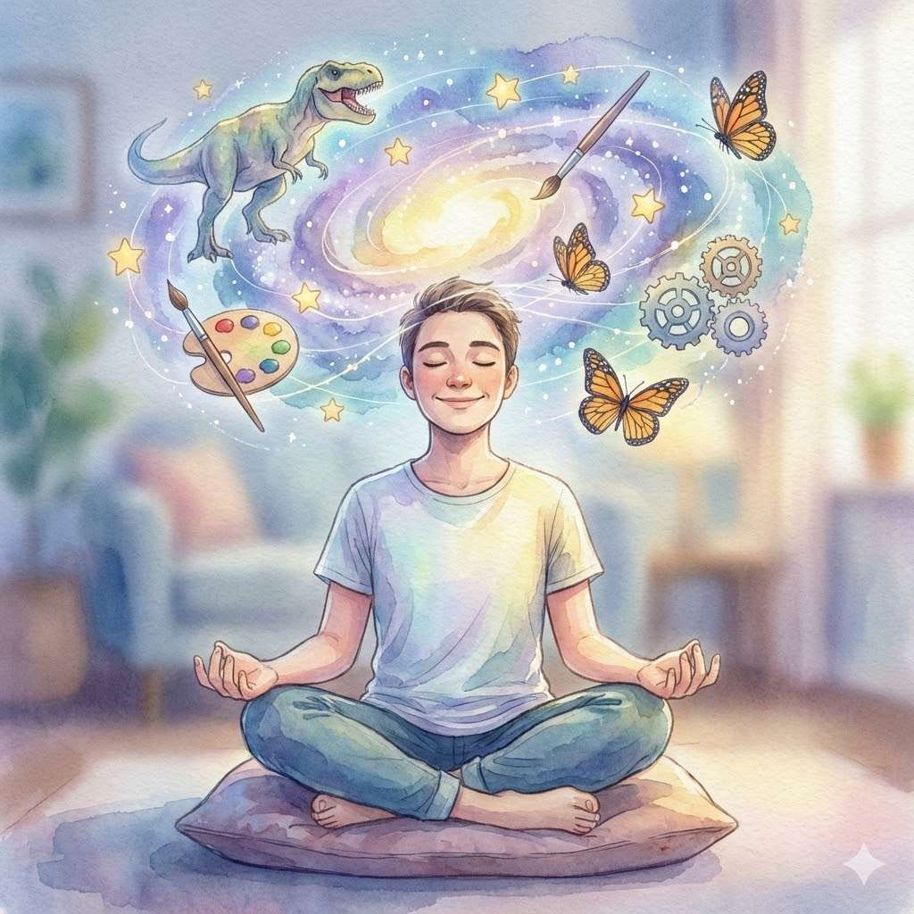
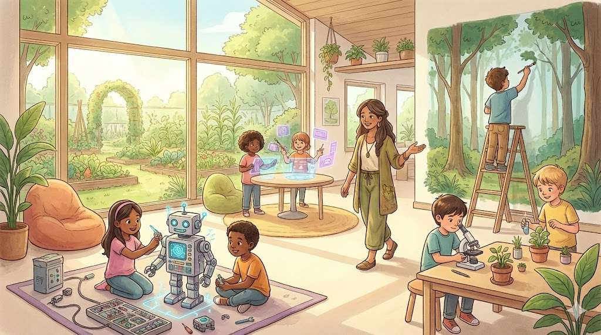

## 被压抑的火焰

[上一篇：为什么学习本应是一件快乐的事](02-AI教育01-为什么学习本应是一件快乐的事.md)讲到一个蹲下来看蚂蚁的孩子。他不是比别人更能吃苦，而是有一件自己想弄明白的事。可如果一个人正担心下个月的房租，让他放轻松、去探索，听起来像不像风凉话？

我想谈的转机有个前提：人得有一点不马上拿来换收入的时间。工具可以降低一次尝试的成本，不能替人提供生活保障。

### 当一项技能不再是一份工作的保证

过去几十年，大多数人遵循的是这样一条人生路径：

**好好学习 → 考上好大学 → 找到好工作 → 获得稳定收入 → 安稳生活**

在这条路径里，学习是手段，生存是目的。你学习不是因为你想学，而是因为你必须学——不学就考不上大学，考不上大学就找不到好工作，找不到好工作就没有收入，没有收入就无法生存。

这条逻辑链，驱动了几代人拼命学习。

但这条链上的每一个箭头，都不是保证。

客服可以让工具先拟答复，程序员也可以让它写一段代码。答错顾客、代码接不上旧系统，还是得有人处理。变化先发生在任务上，不能从一封回信的生成速度推断整个岗位已经消失。

那为什么还要重新想学习的事？因为只盯着别人已经定义好的任务，比谁做得快，会错过另一个问题：我自己想拿这些本领做什么？

### 什么才是AI时代真正有价值的

那人类还剩下什么？

这个问题让很多人恐惧。但如果我们仔细思考，会发现答案其实指向一个充满希望的方向。

工具也能提出问题、给出选题。可十个看似漂亮的问题摆在面前，是哪一个会让你明天还想回来？这件事不能靠它替你回答。

* 好奇心驱动提问——问出好的问题，比找到答案更难。
* 好奇心驱动探索——去寻找那些没有人走过的路。
* 好奇心驱动创造——想要看到世界上还不存在的东西。
* 好奇心驱动意义——追问什么是真正重要的。

所以我愿意把好奇心看作学习的起点，不是又一种用来淘汰人的就业指标。

### AI如何解放好奇心

但AI带来的不只是冲击，更是机遇。

同样是 AI，刚才还在替人拟客服答复，现在也可以陪一个初学者把问题问下去。

**第一，AI降低了学习的门槛。**

以前，想学一样新东西，门槛很高。你要找到好的老师或教材，要有足够的时间系统学习，要有足够的钱支付学费，遇到问题可能没人可问。

现在，第一步可以小得多。答案未必对，却可以先拿来做个小实验。

想学编程？AI可以从零开始教你，随时回答你的问题，不会不耐烦。
想了解量子物理？AI可以用你能理解的方式解释，然后一步步深入。
想学一门外语？AI可以24小时陪你练习对话，纠正你的发音。

有设备、有网络、也挤得出时间的人，可以先从这一问开始。能随时问一句，跟能不能得到靠谱的回答，还是两回事。

**第二，AI让一些原本迈不过的步骤变小了。**

以前，如果你想做一件事，但有些环节不会，你要么放弃，要么花大量时间去学那些你不感兴趣的环节。

你想做一个App，但不会编程——放弃。
你想写一首歌，但不会编曲——放弃。
你想做一个研究，但不会统计分析——放弃。

多少好奇心和创意，被"不会"扼杀了。

现在，AI可以帮你完成那些你不会的环节。你可以专注于你真正感兴趣的核心部分——创意、想法、表达——而把技术性的工作交给AI。

原来要因为一句“我不会”搁置的想法，现在有机会先试一小步。

**第三，AI让"做中学"成为可能。**

传统的学习路径是：先学理论，再学技术，最后实践。这条路很漫长，很多人在前两步就放弃了，因为太枯燥，看不到应用。

AI时代可以反过来：先做，遇到问题再学。

想做一个网站，直接开始做，不懂的问AI。
想写一篇论文，直接开始写，需要什么知识随时查。
想搞一个项目，直接开始干，AI帮你补充背景知识。

这是更符合人类认知规律的学习方式。我们天生是在"做"中学习的，而不是在抽象的理论中学习的。

**第四，也是最重要的，AI降低了心理门槛。**

以前，面对一个新领域，很多人的第一反应是"我不行""我不是这块料""太难了"。

现在，因为知道AI可以帮忙，人们更愿意说"我可以试试"。

这种心态的转变，比任何具体技能都重要。它让人重新获得了探索的勇气。

## 站在分岔路口

AI带来了转机，但转机不会自动变成好的结果。面对同样的变革，不同的人会走向完全不同的方向。

### 当下的分野：两种年轻人

打开任何一个社交媒体，关于AI的内容都充斥着焦虑：

"这10个职业即将被AI取代"
"再不学AI你就废了"
"35岁程序员已经被AI淘汰"
"你的孩子正在输在起跑线上"

为什么这类内容这么多？因为恐惧是最有效的流量密码。人类对负面信息的关注度远高于正面信息——这是进化留下的本能。自媒体深谙此道，于是恐惧被批量生产，焦虑被持续放大。

在这种氛围下，我观察到两种状态。同一个人，也可能在两者之间来回。

**第一种：恐惧驱动型。**

他们被焦虑营销裹挟，觉得AI是一个巨大的威胁，不学就会被淘汰。于是他们开始"学习AI"。

但他们学习的动机是什么？不是因为好奇，不是因为喜欢，而是因为**怕**。

这本质上还是"为了生存而学习"——只不过披上了新时代的外衣。

这种恐惧驱动的学习是什么状态？

- 追逐热点，什么火学什么，浮于表面
- 被动接受别人说"应该学"的东西，不知道自己真正想要什么
- 学习是为了证明自己"没有落后"，永远在追赶，永远焦虑
- 把AI当作威胁来应对，无法享受探索的乐趣

结果就是：**疲惫和迷茫**。

疲惫，因为在做自己不喜欢的事。迷茫，因为不知道这样做有什么意义。

最让人累的是，昨天刚补完一项“必学技能”，今天就有人告诉你已经落后了。就算每门课都追上，你还是答不出自己原本想用它做什么。

**第二种：热爱驱动型。**

另一类人，他们接触AI不是因为恐惧，而是因为单纯觉得有意思。

"这个东西好神奇，我想知道它是怎么工作的。"
"我可以用它做什么有趣的事？"
"让我试试看能不能……"

他们的状态是**玩**，不是**学**。

这两个字的区别很大。"学"有目的，有压力，怕犯错，追求效率。"玩"的目的就是过程本身，犯错是发现的一部分，享受探索。

这类人有几个特点：

他们不在乎"有没有用"，可能花几个小时让AI生成一张搞笑图片，可能反复尝试一个没有任何实际价值的实验，在别人看来是"浪费时间"，在他们看来是乐趣。

他们不追热点，追自己的兴趣，不是"大家都在学什么我就学什么"，而是"我对什么感兴趣我就研究什么"，可能会走一些"弯路"，但每一步都是自己的。

他们不焦虑。因为动力来自内部，不依赖外部评价，不需要证明自己"没有落后"。

他们会深入。因为喜欢，所以愿意花时间钻研，不满足于表面的了解，想知道"为什么"。

这类人往往是"非线性成长"的，他们可能很长时间看起来"没什么产出"，只是在玩、在探索，但某一天，量变突然变成质变，他们创造出别人创造不出的东西。

**这两种人的本质区别是什么？**

不是聪明与否，不是努力与否，而是——**好奇心有没有活着**。

恐惧型的人，好奇心可能早就被压抑了。他们习惯了被外部目标驱动：考试、升学、就业、升职……现在AI来了，他们把它纳入同一个框架——又一个需要应对的威胁，又一场需要赢的竞赛。

热爱型的人，好奇心还活着，AI对他们来说不是威胁，而是新玩具，就像小时候拿到一个新玩具，迫不及待想拆开看看里面是什么、能怎么玩。

我想起一个比喻：**冲浪者和逃难者**。

想象海边来了一波大浪。

逃难者看到浪来了，惊恐地往岸上跑，他跑得很累，但浪总是在后面追，他永远在逃，永远在恐惧。

冲浪者看到浪来了，兴奋地拿起冲浪板迎上去，同样的浪，对他来说是可以借力的能量，他不是在逃避浪，而是在驾驭浪。

AI 就像这波浪。但冲浪的人手里有块板，忙着上岸的人也可能得先顾住一家人的生计。我说的姿态，是在有余地的那一刻，你愿不愿意迎上去。

区别不在于浪的大小，而在于你的姿态。

### 当下的选择：从恐惧走向热爱

如果你发现自己处于恐惧和迷茫的状态，有没有可能转变？

我认为是可以的，好奇心从来没有真正死去，只是被压抑了。它可以被重新点燃。

**第一，减少恐惧信息的摄入。**

你关注什么，你就会变成什么，如果你每天看的都是"AI要取代你"的内容，你当然会焦虑。

试着取关那些贩卖焦虑的账号，少看那些恐惧营销的内容。恐惧不会让你学得更好，只会让你更累。

**第二，问自己：我真正好奇的是什么？**

不是"我应该学什么"，而是"我想知道什么"。

这个问题可能不容易回答，因为我们太习惯被外部目标驱动了，但可以从小处开始：最近有没有什么事情让你觉得"咦，这个挺有意思的"？哪怕是一个很小的问题，也是起点。

从真正好奇的问题出发，而不是从"应该学"的清单出发。

**第三，允许自己"浪费时间"。**

探索需要空间，需要试错，需要走弯路。

如果你每一分钟都要"有产出""有效率"，你就没有空间去真正探索。

允许自己花时间做"没用"的事，那些看起来没用的探索，往往是最有价值的学习。

**第四，把AI当作玩具，而不是威胁。**

心态的转变很重要。

AI不是来取代你的敌人，而是可以帮助你的工具，甚至是可以陪你探索的伙伴。

当你把它当作玩具，你就会想"我能用它做什么有趣的事"，而不是"我怎么才能不被它取代"。

**第五，连接童年的好奇心。**

想想你小时候对什么着迷过？

可能是恐龙、可能是星空、可能是画画、可能是拆东西……

那种着迷的感觉，就是好奇心活着的证据。它可能被压抑了很久，但没有消失。

试着重新连接它。用AI去探索你曾经着迷的领域，可能会重新点燃那种感觉。

### 未来的愿景：教育的回归

如果越来越多的人从恐惧走向热爱，如果AI真的解决了"谋生"的问题，教育会变成什么样？

我想象中的未来教育是这样的：

**教育的目的回归本源：帮助一个人成为他自己。**

不再是为了找工作而学习，不再是所有人学同样的东西，不再是用标准化考试来筛选人。

而是帮助每个孩子发现自己的独特性，发展自己的优势，找到自己的热爱，走自己的路。

**教师的角色从"知识传授者"变成"好奇心的守护者"。**

如果有些讲解可以交给工具反复演示，老师腾出的那一点时间，可以拿来做什么？

孩子讲到一半停下来，老师可以等一等，听听他究竟在哪儿卡住了。也许他在意的，压根不是课本上那个标准问题。

好老师不是告诉你答案，而是让你对问题产生兴趣。

**学习的主动权回到孩子手中。**

不是老师规定学什么，而是孩子想学什么；不是按照课本的顺序，而是按照问题的驱动；不是为了考试，而是为了解决真实的问题、创造真实的东西。

AI在这里扮演无限耐心的助手——随时回答问题，随时提供资源，随时帮助实现想法。

**未来的孩子可能是幸福的。**

不是物质丰裕的幸福，而是可以做自己喜欢的事的幸福，不被恐惧和焦虑驱动，有探索和创造的自由，能够成为自己。

他们真的可以去探索过去我们想都不敢想的事情。

这是当前教育最缺乏的东西。我们培养了很多"成功"的人，却很少培养"幸福"的人。很多人考上了好大学、找到了好工作，却不知道自己真正喜欢什么、想要什么。

如果教育能够回归本源，这种状况可能会改变。

当然，实现这个愿景需要很多条件：基本需求要被保障，教育系统需要变革，家长观念需要转变，社会评价体系需要改变。这是一个系统性的变革，不会一蹴而就。

但方向是清晰的，而且AI正在让这个方向变得可能。

## 留给这周的一件小事

与其再列一份必学技能表，不如给一个小时留白。选一件小时候会凑过去看、后来却总嫌没用的事。用不用 AI 都行。到点的时候，只问一句：我还想不想多弄明白一点？

## 结语：好奇心解放的时代

让我们回到开头的问题：学习是反人性的吗？

现在我还是会说：**不是。** 一个两岁的孩子可以专注地看蚂蚁半小时，一个成年人却可能对任何事情都提不起兴趣——这中间发生了什么？

也许那个大人刚想蹲下来，就想起还有一张表没填。等终于有空，又习惯性地问：这对我有什么用？考试、工作、房租，一个个都是真问题。久而久之，他连自己原本想问什么都忘了。

这也是 AI 让我觉得有意思的地方。它可以帮你把一个突如其来的问题接着往下问。问题从哪里来，却还是你自己的事。小时候着迷的东西，可能被压抑了很久，但一直在那里，等待被重新点燃。

也许你需要做的，只是暂时放下那些“应该学”的东西，开始问自己：我真正好奇的是什么？

然后，带着那份好奇，去玩，去探索，去试试看。

[连稿版本与配图](03-AI教育03-AI时代的学习转机.md)
