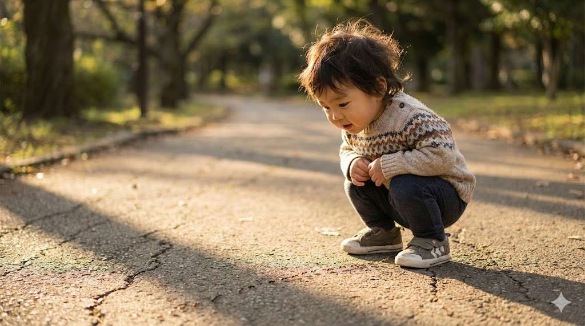
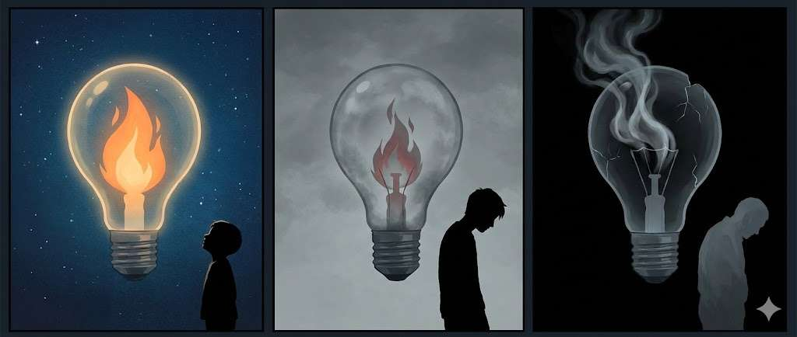
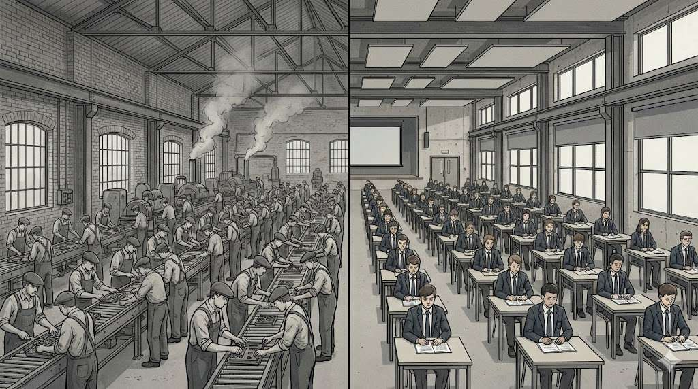

### 一个需要被打破的迷思

小时候，我曾跟妈妈有过一场争论。

起因是什么我已经记不清了，只记得妈妈说了一句大人们常说的话："学习是一件很痛苦的事情"

我不服气，跟她争辩："不，学习是一件快乐的事情。"

妈妈笑了笑没有继续，但这个场景我一直记得，因为我当时是真心这么认为的——学习新东西、弄懂一个问题、发现一个有趣的事实，那种感觉确实是快乐的。

长大后，我听到越来越多的人说"学习是反人性的"。这几乎成了一种共识：人天生是懒惰的，学习需要克服惰性，所以必须靠纪律、靠压力、靠奖惩来逼自己。

但我始终觉得哪里不对。

直到有一天，我看到一个两岁的孩子蹲在地上看蚂蚁，看了整整半个小时，完全忘我。

那一刻我突然明白了：**学习本身不是反人性的，好奇心是人类最本能的驱动力。**

婴儿从出生开始就在学习——学习认脸、学习抓握、学习走路、学习说话。没有人给他们制定KPI，他们就是停不下来地探索这个世界。这是进化赋予人类的优势，写在基因里的东西。

那为什么长大后，学习变成了痛苦的事？

答案不在学习本身，而在**学习被异化了**。

当学习从"我想知道"变成"我必须知道"，从满足好奇心变成应付考试，从探索世界变成换取生存的筹码——它就从享受变成了负担。

**逆人性的从来不是学习这件事，而是"为了什么去学习"。**

这个区分非常重要。因为它指向一个更深的问题：我们的教育到底在做什么？它是在激发人类天生的好奇心，还是在系统性地扼杀它？

而在AI时代，这个问题变得更加紧迫。

### 学习是如何被异化的

让我们诚实地看一看，一个孩子从小到大，学习这件事发生了什么变化。

幼儿时期，孩子的状态是这样的：
- 对一切都好奇，问不完的"为什么"
- 学什么都兴致勃勃，今天想研究恐龙，明天想研究星星
- 不怕犯错，摔倒了爬起来继续
- 学习的奖励就是学习本身——弄懂一件事的快乐

上学之后，孩子的状态逐渐变成这样：
- 好奇心被"这个考不考"取代
- 学什么由课程表决定，不管你感不感兴趣
- 犯错要扣分，要被批评，要被比较
- 学习的目的是分数、排名、升学

到了成年，很多人对学习的感受已经变成：
- 学习是痛苦的，能不学就不学
- 只学"有用"的，能变现的
- 害怕挑战新领域，担心自己学不会
- 一旦离开学校，就再也不想学习

**这是一个逐渐熄灭的过程。** 那团天生的火焰，被一点一点浇灭了。

最悲哀的是，很多人甚至不记得自己曾经有过那团火。他们真的相信自己"天生不爱学习"，相信"学习就是反人性的"。

但这不是天性，这是被驯化的结果。

### 扼杀好奇心的机制

好奇心不是自己消失的，是被系统性地扼杀的。我们可以清晰地看到几个扼杀机制：

**第一，标准答案文化。**

在只认分数的课堂上，学生很快会发现，最划算的是找出“正确答案”。问题有标准答案，答错了扣分，答对了得分。

这训练出什么？训练出对犯错的恐惧。

但真正的探索恰恰需要犯错。试一种材料，发现它不合用，至少知道了下一次不必从哪里开始。这跟答错一道题就扣分，很不一样。

当一个孩子害怕犯错，他就不敢提问、不敢尝试、不敢走进未知的领域。好奇心的第一个敌人，就是对犯错的恐惧。

**第二，时间的剥夺。**

有些孩子的时间表，从早上到校一直排到晚上的作业，连周末也留给了补习班。

每一分钟都被安排好了。哪里有时间去好奇？哪里有时间去发呆、去做梦、去追问一个没有标准答案的问题？

好奇心需要空闲，需要留白。一个被塞得满满当当的容器，装不进新东西。

**第三，评价体系的单一化。**

什么是好学生？成绩好。什么是成功？好大学、好工作、高收入。

一个孩子可能在音乐、绘画、编程、写作、运动、社交、领导力上有天赋，但如果数学和英语不好，他就是"差生"。

这种单一的评价体系，不仅扼杀了好奇心，还扼杀了自信。大量的孩子因为不擅长考试，就认定自己"不行"，从此关上了探索的大门。

**第四，"有用"的诅咒。**

有句家长随口会问的话："这个有什么用？"

孩子想学画画："画画能当饭吃吗？"
孩子想研究昆虫："这个能考加分吗？"
孩子想学哲学："哲学能找到工作吗？"

每一次这样的追问，都在传递一个信息：只有"有用"的东西才值得学，而"有用"的定义是能换成钱或分数。

于是孩子学会了功利地对待知识。他们不再问"这个有趣吗"，而是问"这个考不考"。好奇心就这样被功利心取代了。

**第五，焦虑的代际传递。**

家长自己活在焦虑中——焦虑工作、焦虑房子、焦虑阶层滑落。这种焦虑传递给孩子，变成"不能输在起跑线上""别人家的孩子都在学""现在不努力以后怎么办"。

潜台词是：世界是危险的，资源是稀缺的，你必须竞争才能生存。

在这种恐惧驱动下，学习变成了军备竞赛。孩子不是在享受探索的乐趣，而是在为生存而战斗。

### 为什么铃声让我想到工厂

有时我觉得学校像一座工厂。让我想到工厂的，是孩子每天摸得到的几样东西：
- 统一的铃声，像工厂的上下班
- 整齐的座位，像流水线的工位
- 标准化的课程，每个人学一样的东西
- 考试和排名，筛选和分流

铃声可以让大家按时聚到一起，统一上课也能让许多孩子得到同样的机会。问题是，当整齐成了最受奖励的品质，一个还在追问的孩子，可能先学会了把手放下。

那只蚂蚁并没有变得无聊。变的是孩子有没有时间蹲下来，有没有人肯跟着他多看一会儿。这个条件还能不能找回来？接着读[主读续篇：AI如何让学习回到好奇心](01-AI教育02-AI如何让学习回到好奇心.md)。
