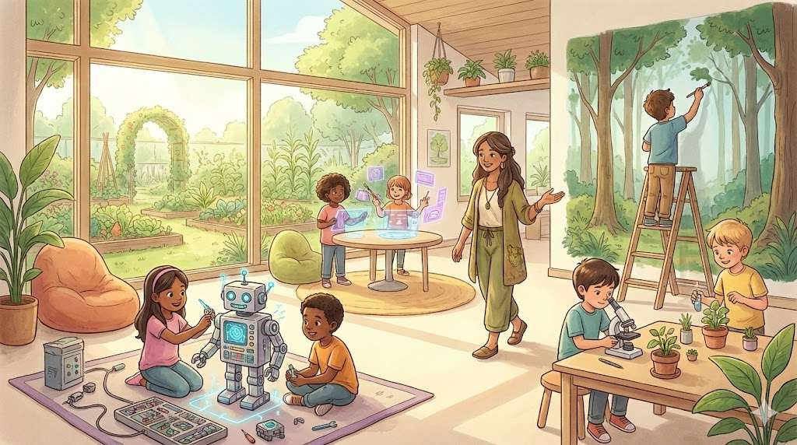

## 连稿版：从蚂蚁到浪头

这份连稿原来从“第二部分”起笔。前面那个蹲着看蚂蚁的孩子，出现在[《为什么学习本应是一件快乐的事》](02-AI教育01-为什么学习本应是一件快乐的事.md)里。顺着读到[《AI 如何让学习回到好奇心》](01-AI教育02-AI如何让学习回到好奇心.md)，才能听出为什么写浪头的人，最后又把话说回了蚂蚁。

连稿中间的冲浪比喻和五条建议，与续篇同文。两篇已经读过，想找当时那句“去玩，去探索，去试试看”，可以直接读[接回开篇的长结语](01-AI教育02-AI如何让学习回到好奇心.md#long-ending)。

连稿原配图（按原顺序）

