## 前言：站在历史的分岔口

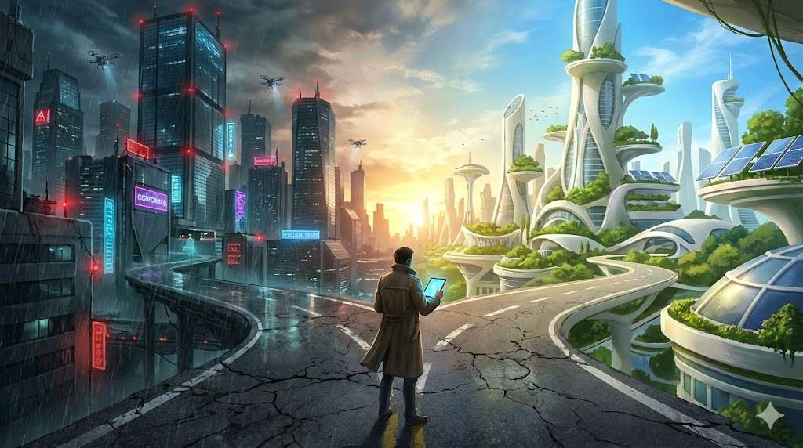

2023年以来，人工智能的发展速度超出了所有人的预期。ChatGPT的横空出世，让普通人第一次真切感受到：这项技术可能真的会改变一切。

与此同时，一种深重的焦虑正在全球蔓延。

打开任何一个新闻平台，关于AI的讨论几乎都笼罩在恐惧之中。"AI将取代80%的工作岗位""大规模失业潮即将来临""人类将沦为无用阶级""AI可能毁灭人类"……这些标题每天都在刺激着人们的神经。

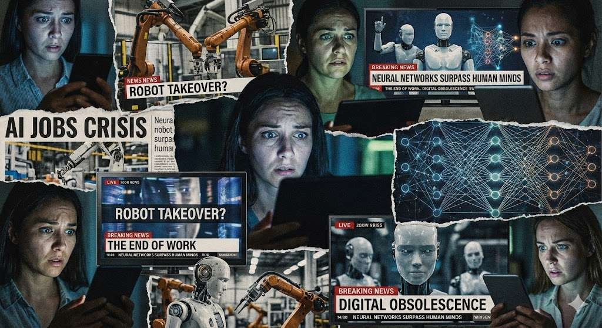

这种恐惧不只存在于普通人中间。经济学家警告就业危机正在逼近，社会学家担心社会结构将被彻底撕裂，哲学家追问当人类不再被需要时存在的意义是什么，科幻作家描绘着一个个反乌托邦的未来图景。甚至AI领域的顶尖专家——那些亲手创造这项技术的人——也联名呼吁暂停研发，警告AI可能带来"灭绝级风险"。

当一项技术让它的创造者都感到恐惧时，我们确实应该认真对待这种担忧。

但在恐惧之余，很少有人追问一个更根本的问题：**这些可怕的预测，是建立在什么样的前提之上的？**

一些悲观预言默认了这样一件事：机器替人干活之后，人还是只能靠原来的岗位取得收入。可技术在变，凭什么分配规则就得永远不变？

下面做一个有意拉开两端的推演。同样假定技术省下了一部分劳动，只换收益归谁、谁能支配省下的时间。两条路是我选来作比较的制度情景，不是对所有国家的二选一预报。现实中可以有共同所有、私人投资、公共服务和税收调节的种种组合。关于不同路径各自遇到的难题，可对照[《AI时代的制度问题》](AI时代的制度问题.md)；这里先看两种逻辑会把同一次替代说成什么。

## 第一部分：恐惧的未来——当技术进步成为诅咒

要理解为什么那么多人对AI感到恐惧，我们首先需要理解当今社会的运作逻辑。

### 永无止境的增长竞赛

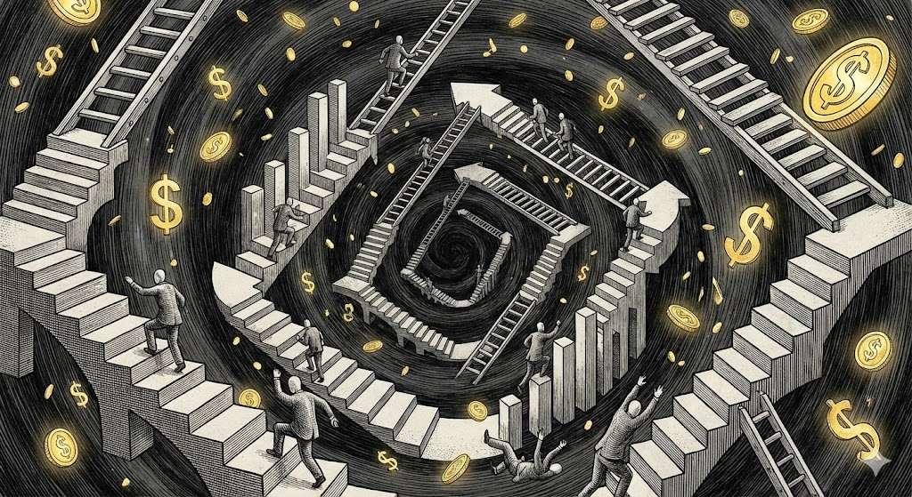

在当今社会，企业的核心驱动力是利润增长。这不是某个企业家的个人选择，而是系统的内在要求。在市场竞争中，不增长就意味着被淘汰。每一个企业、每一笔投资，都必须不断扩张，否则就会在竞争中败下阵来。

为了实现利润增长，企业有几个基本手段：扩大市场、提高效率、降低成本。而降低成本最直接的方式，就是减少人力支出。

在第一种情景里，假设老板可以用更少的工时完成同一订单，而省下的工资不用与原班人马分享。那么即使他并不憎恨谁，竞争也会推着他考虑裁减用工。这是一个结构性的压力，不是“每个企业一定裁人”的经验定律。

### 逻辑链条：从效率提升到系统崩溃

让我们跟随这个逻辑，看看它会通向何方。

**第一步：AI替代人类劳动**

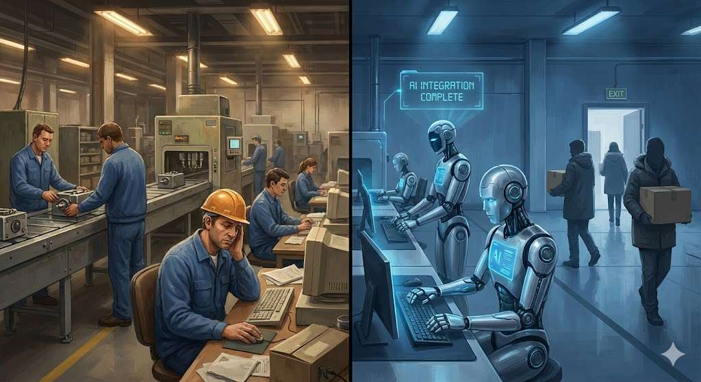

先分清三件事。客服可以把一个标准问题交给机器人，是任务受到影响；整班人原来做的工时有一部分可以省，是自动化潜力；到月底真的有人失去工作且没有再就业，才是失业。把许多职业受影响的工时折算成全职工作量，也不是数出了同样多的失业者。

**第二步：如果节省的人力变成裁员**

在这个情景里，我们再假定新增工作接不住退出的人，省下的时间也没有分给原来的劳动者。这时，效率提升才沿着失去收入这条路传下去。

有人说，历史上每次技术革命都会创造新的就业机会。蒸汽机取代了手工织布，但创造了工厂工人的岗位；计算机取代了打字员，但创造了程序员的岗位。AI时代也会如此，旧工作消失，新工作出现。

这种乐观可能低估了AI的颠覆性。以往的技术革命替代的是人类的体力或某些特定技能，而AI替代的是人类的认知能力本身。当一个系统可以学习、推理、创造，那人类还有什么是不可替代的呢？

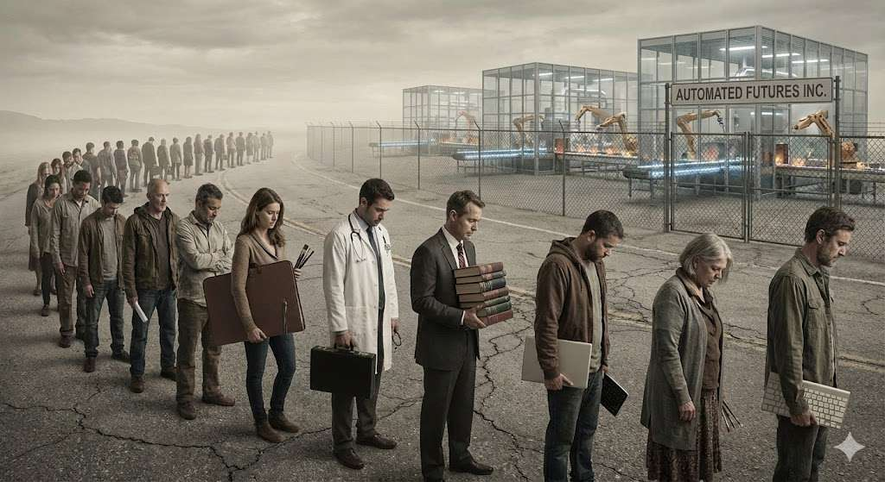

更重要的是，即使AI创造了新的工作岗位，这些岗位的数量和质量也令人担忧。它可能创造少量高薪的AI工程师岗位，但同时消灭大量中产阶级工作。结果是就业的"空心化"——顶层和底层还有工作，中间消失了。

**第三步：消费能力崩溃**

这是当前逻辑中最致命的矛盾。

当今社会既需要工人作为生产者，又需要工人作为消费者。工人生产商品，然后用工资购买商品，这个循环支撑着整个系统的运转。

但当AI替代了生产者，消费者也就消失了。失业的人没有收入，没有收入就无法消费。当越来越多的人失业，消费能力就会急剧萎缩。

**第四步：产能过剩与系统危机**

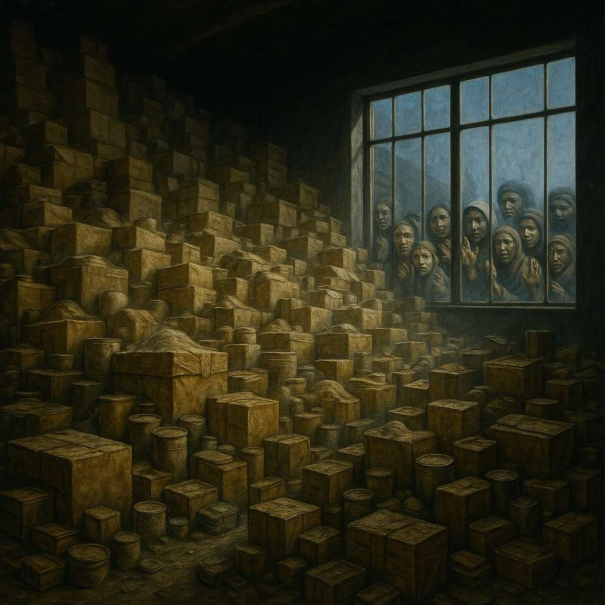

生产效率因为AI而大幅提升，但消费能力却在下降。结果是：东西生产出来，但卖不出去。

这种"产能过剩"不是因为东西太多、人们不需要，而是因为人们没有钱买。这是一种荒诞的困境——技术进步本应让所有人生活得更好，结果却让大多数人陷入困境。

我担心的矛盾就在这里：从一家企业的账上看是降成本，从工人的饭桌上看却是少了一笔收入。这个推演要成立，还得满足前面那几个条件；不能拿它去一笔解释历次经济危机。

**第五步：恶性循环**

产能过剩导致企业利润下降，企业为了生存进一步裁员降本，失业加剧，消费更加萎缩，产能更加过剩……这是一个向下的螺旋，一旦开始就很难停止。

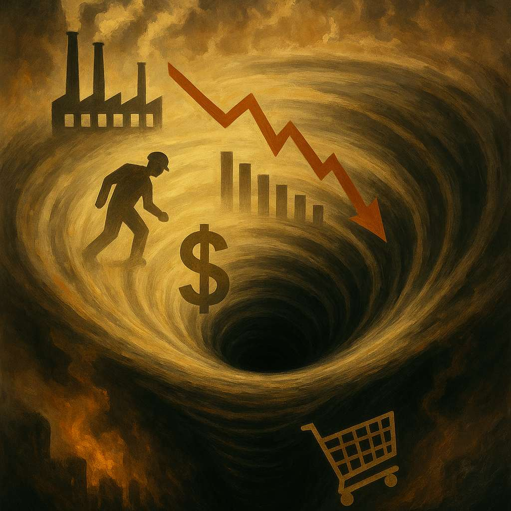

### 试图维持现状的"解决方案"

面对这个困境，现有系统不会坐以待毙。它会尝试各种办法来延续自己的生命。但这些办法，要么是饮鸩止渴，要么是制造更大的问题。

**方案一：制造更多欲望**

既然消费不足，那就让人们想要更多东西。

这是当今社会一直以来的拿手好戏。20世纪初，当工业生产效率大幅提升、商品出现过剩时，解决方案不是减少生产，而是制造需求。广告业应运而生，消费主义文化被系统性地培育出来。

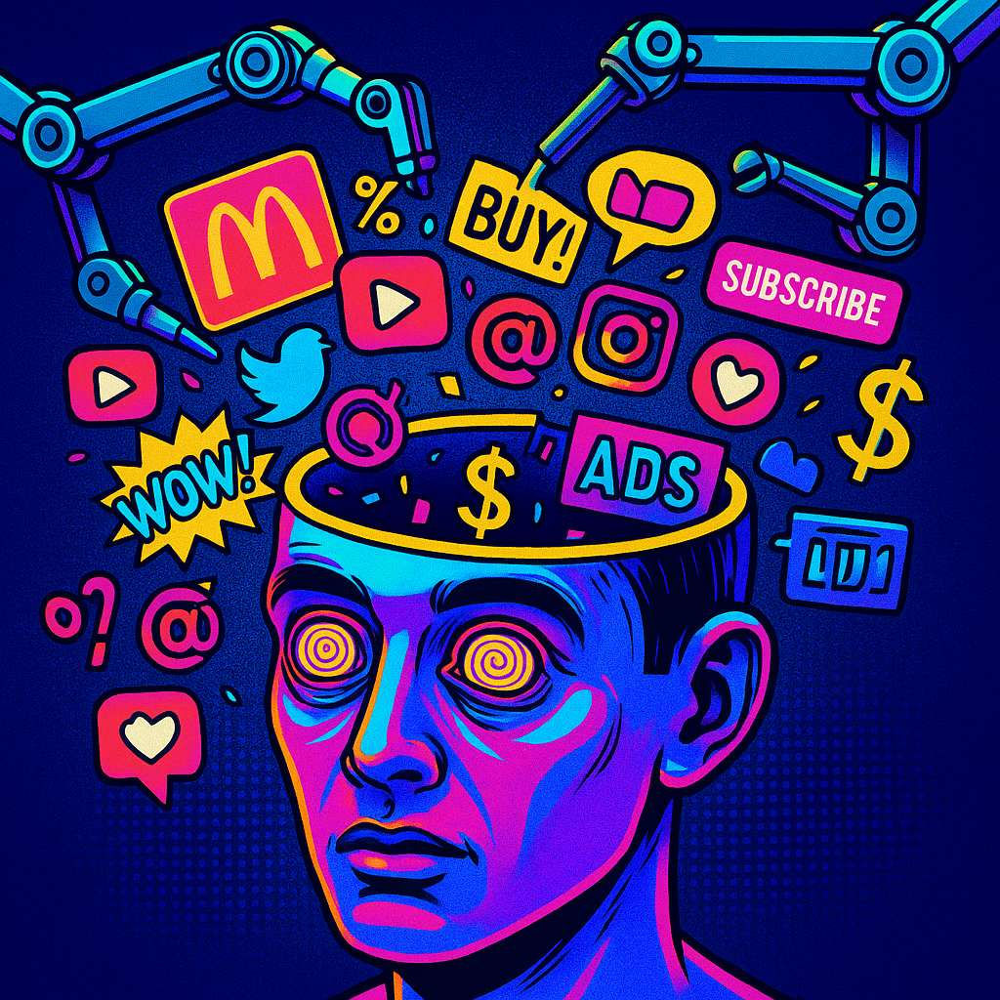

只要去年的款式让买主觉得“不新了”，一件没有用坏的商品就有了被提前换掉的可能。

这套系统今天仍在高效运转。广告无处不在，营销无孔不入。时尚产业让你的衣服每年都"过时"，科技公司让你的手机每年都"落后"，社交媒体让你永远觉得自己的生活不够精彩。

在AI时代，这套制造欲望的机器只会更加强大。AI可以分析你的每一个行为，精准预测你的心理弱点，推送最能打动你的广告。你以为你有自由意志，其实你的欲望正在被算法精心塑造。

但这条路的问题是：当人们连基本收入都没有时，再强烈的欲望也无法转化为消费。你可以让一个失业者渴望最新的iPhone，但你不能让他买得起。

**方案二：债务扩张**

没有钱？可以借给你。

消费贷、信用卡、花呗、白条……各种金融产品让没有积蓄的人也能提前消费。这在短期内确实能刺激消费，维持经济运转。

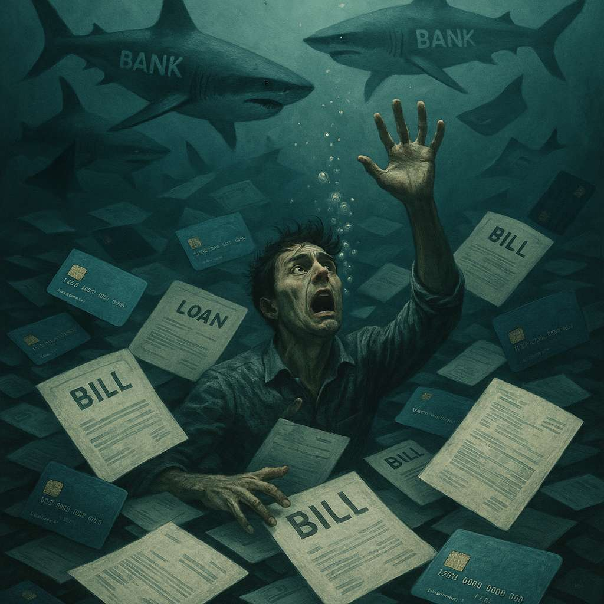

但债务终究要偿还。当越来越多人失去工作，他们拿什么还债？债务违约将像多米诺骨牌一样蔓延，最终引爆金融危机。

事实上，2008年的全球金融危机就是这条路的预演。那次危机的根源就是把钱借给了还不起的人。次贷危机摧毁了数百万家庭，差点拖垮整个金融系统。AI时代如果继续这条路，下一次危机只会更加猛烈。

**方案三：财富向上集中，服务少数富人**

如果大众消费不起，那就只服务富人。

这是另一条正在发生的趋势。奢侈品市场逆势增长，高端服务蓬勃发展，私人定制、私人飞机、私人岛屿……富人的消费似乎不受经济周期影响。

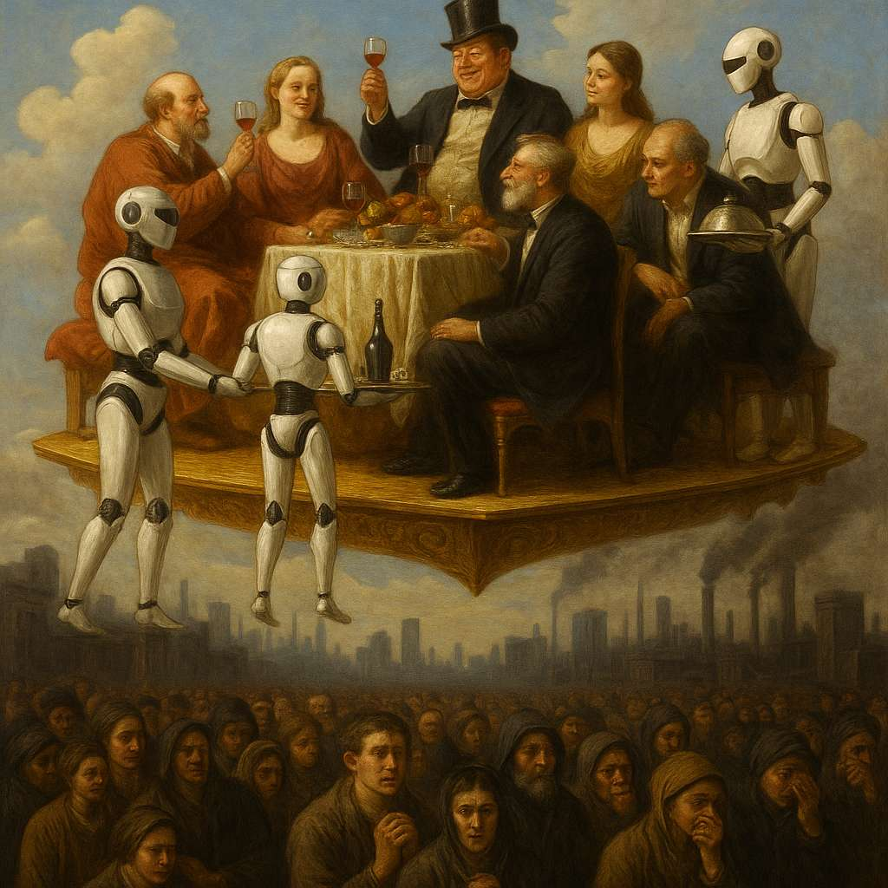

当AI的收益被少数人（AI的所有者）攫取，财富将以前所未有的速度向顶层集中。一个极少数人富可敌国、绝大多数人挣扎求生的社会将成为现实。

这样的社会能稳定吗？历史告诉我们：不能。极端不平等最终会导致社会动荡、政治极化、甚至革命。这不是一条可持续的路。

**方案四：全民基本收入？**

有些人提出了"全民基本收入"（UBI）的设想：既然AI替代了人的工作，那就由政府给每个人发钱，让人们即使不工作也能生存。

这个想法看起来人道，但在当前框架下存在根本矛盾：钱从哪来？

如果由政府向AI的拥有者征税，然后分配给大众，那本质上是用政治力量重新分配财富。但拥有财富的人会接受这种安排吗？历史表明，他们会用一切手段抵制再分配——游说、避税、资本外逃、甚至支持推翻"不友好"的政府。

更根本的问题是：在当前框架下，全民基本收入只是一种施舍，让失去生产资料的大众勉强维持生存。人们的身份从"工人"变成"受救济者"，尊严何在？意义何在？

一个社会，少数人拥有AI，坐享其成；多数人依靠救济金生活，无所事事。这真的是我们想要的未来吗？

### 恐惧的根源

现在我们可以理解，为什么那么多人对AI感到恐惧了。

如果效率收益集中而失去工资的人得不到补偿，前面那条链就有机会成形。人们怕的未必是机器能干活，而是自己的生活会在这个过程中掉下去。

但这里有一个关键的问题：**当前的社会制度是唯一可能的选择吗？**

如果我们被困在"现有制度是历史的终结"这个思维框架里，那确实没有出路。但如果我们跳出这个框架呢？

---

## 第二部分：解放的未来——当技术进步成为礼物

现在让我们换一个前提。

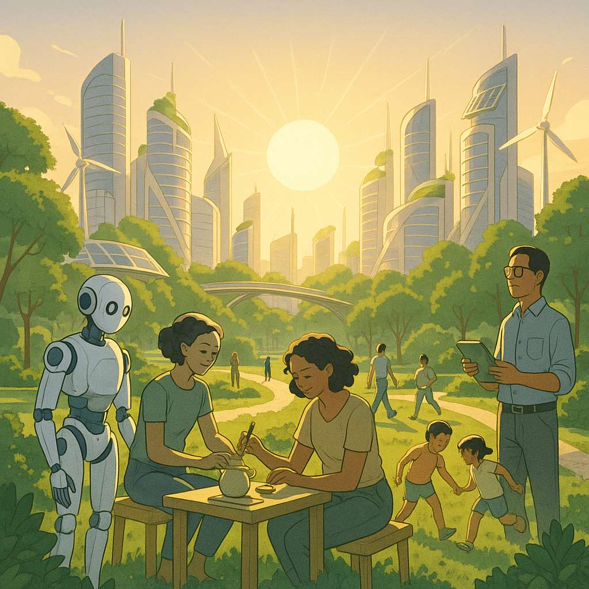

如果生产资料不是少数人私有，而是全社会共同所有呢？如果AI创造的财富不是归少数股东，而是归全体人民呢？如果社会的目标不是利润增长，而是满足所有人的需求呢？

在这个框架下，同样是AI极大提升生产效率，结果将完全不同。

### 从替代到解放

在前一种框架下，"AI替代人类劳动"是一个威胁——你被替代了，就意味着你失业了，没有收入了，生存受到威胁了。

但在另一种框架下，"AI替代人类劳动"是一个解放——那些重复的、枯燥的、繁重的、危险的工作，由AI来做了，人类可以从中解放出来，去做更有意义的事。

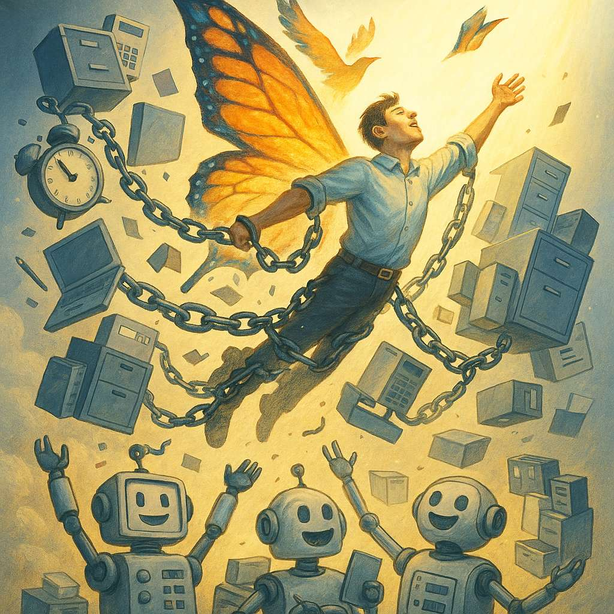

这不是文字游戏。这两种表述反映的是完全不同的社会制度安排。

**关键的区别在于：AI创造的财富归谁所有？**

在一种安排下，生产资料私有，AI归企业股东所有，AI创造的财富也归股东所有。工人被替代后，什么也得不到。

在另一种安排下，生产资料公有，AI归全社会所有，AI创造的财富也归全社会所有。每个人都是这份财富的主人，都有权分享AI带来的效率提升。

同样的技术进步，在不同的社会制度下，结果天差地别。

### "按需分配"变得可行

在解放的未来中，一个核心原则是"按需分配"——每个人根据自己的需要获得生活资料。

很多人一听到这个原则就摇头：人的欲望是无限的，怎么可能满足？

这是对"按需分配"最常见的误解，也是消费主义意识形态最成功的洗脑之一。

**"按需分配"不是"按欲分配"。**

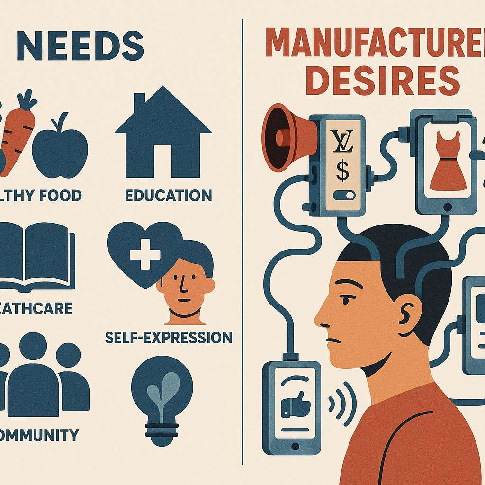

人的真实需求是有限的：
- 健康的食物（每天2000大卡左右的热量，均衡的营养）
- 舒适的住所（不需要豪宅，但要安全、温暖、有足够的空间）
- 必要的教育（发现自己的天赋，获得必要的知识和技能）
- 基本的医疗（保持健康，疾病时得到治疗）
- 社会联结（家人、朋友、社区的归属感）
- 自我实现的机会（做自己热爱的事，发挥自己的才能）

食物、住房、医疗可以列出基本保障目标，但不能靠一张统一的清单替每个人决定需要多少，更不能靠统计取消稀缺。

无限的是欲望，而欲望很大程度上是被人为制造的。

回顾一下当今社会是如何制造欲望的：

**计划性淘汰**：产品被故意设计成会过时或损坏。智能手机每年更新换代，但你真的每年都需要新手机吗？

**广告营销**：把商品和情感绑定，让你觉得买了这个就会被爱、被尊重、被羡慕。钻石"永恒"的叙事完全是戴比尔斯公司20世纪的营销创造。

**社会比较**：媒体不断展示"成功生活"的样板，让你永远觉得自己不够好。邻居买了新车，你也得买；朋友出国旅游，你也得去。

**身份消费**：你买的不是商品，而是身份认同。穿什么牌子的衣服、开什么牌子的车、住什么样的房子，定义了你是什么样的人。

这些欲望不是人类天性，而是系统性制造出来的。当今社会需要你永远不满足，这样你才会持续消费。如果你对自己拥有的东西满意了，这个系统就无法运转了。

在我设想的另一条路上，保障基本生活是生产的目标，不是说今天所有东西已经足够。

第一，**AI有机会减少满足需求所需的劳动**。例如同样多的生活用品可以用较少的工时生产。但住房的位置、医护人员的时间，并不因为机器会算就取之不尽。

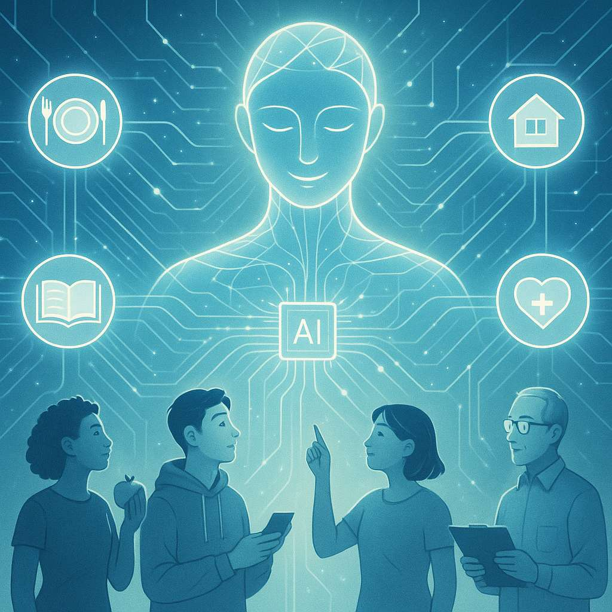

第二，**AI可以协助对接供需，不能代替协商**。它可以汇总某地需要多少餐食、哪些人要求不同饮食，并帮助安排配送。但倘若两处社区都想要仅有的一队照护人员，推荐得再准，也没有决定哪一处该先等。得由受影响的人参与订规则，能说明理由，也能提出异议。知道谁需要什么，和有权决定谁优先，是两回事。

### 人的真正解放

解放的未来的终极目标不只是物质的丰裕，而是"人的解放"。

让我来详细解释一下这个概念的含义。

**从生存压力中解放**

现在人们工作是因为"不工作就没有收入，没有收入就无法生存"。这种强制性让劳动变成了痛苦。

你不喜欢你的工作，但你不得不做，因为有房贷、有孩子的学费、有父母的医疗费用。你每天都在焦虑：万一失业了怎么办？万一生病了怎么办？万一经济不好公司裁员怎么办？

这种恐惧让你不敢停下来，不敢做自己想做的事，不敢说老板的坏话，不敢追求更好的可能。你成了系统的人质。

如果基本需求被无条件保障呢？如果你知道，不管发生什么，你都会有饭吃、有房住、有病能治呢？

这种安全感会彻底改变人的状态。你可以做自己真正想做的事，而不是不得不做的事。

**从异化劳动中解放**

在当今的生产方式下，劳动变成了一种异己的力量，劳动者在劳动中不是实现自己，而是失去自己。

这种异化有几个层面：

- **劳动者与劳动产品的分离**：你生产的东西不属于你。你在工厂里组装iPhone，但你自己买不起iPhone。

- **劳动者与劳动过程的分离**：你不是在从事一项有意义的创造，而只是流水线上的一个环节，一颗可以被替换的螺丝钉。

- **劳动者与人的本质的分离**：人的本质是自由的、有创造力的活动。但在异化劳动中，工作只是谋生的手段，你不是在实现自我，而是在出卖自我。

- **劳动者与他人的分离**：你和同事不是合作伙伴，而是竞争对手。你们争夺有限的晋升机会，互相防备，难以建立真正的信任。

**当这些异化被消除，劳动就不再是"不得不做的事"，而是"我想做的事"。**

想想你最有创造力、最有成就感的时刻。可能是完成了一个有挑战的项目，可能是创作了一件满意的作品，可能是帮助别人解决了一个难题。那种投入、那种忘我、那种满足感——那才是劳动应有的状态。

**从"物的统治"中解放**

在当今社会，不是人在控制物，而是物在控制人。商品、货币、资本这些本应服务于人的东西，反过来成了支配人的力量。

我们为了赚钱而工作，为了还贷而生活，我们的时间、精力、生命都被货币逻辑支配。股票市场的涨跌影响着几十亿人的情绪，GDP数字成了衡量一切的标准，人的价值被简化为"年薪多少"。

这是一种颠倒。本来，经济活动是为了满足人的需求而存在的。但在当今社会，人反而成了经济机器的零件，成了利润增长的工具。

解放意味着：人重新成为主体，经济活动服务于人，而不是人服务于经济活动。

### 解放后的人会做什么？

这是很多人会问的问题：如果人们不需要为生存而工作，他们会不会躺平？社会怎么运转？

**我认为不会躺平。理由如下：**

**第一，人有内在的创造冲动。**

观察小孩子：没有人逼他们，他们也会不停地探索、提问、创造。搭积木、画画、问"为什么"——这些是自发的，不需要任何外部激励。

这种冲动是被成长过程逐渐压制的。"别问这么多""这个没用""赚不到钱"——社会教育我们把好奇心和创造力收起来，去做"有用"的事。

但冲动并没有消失，只是被压抑了。一旦压力解除，它会重新涌现。

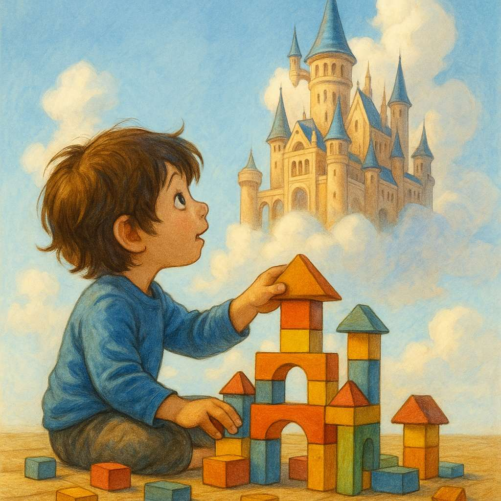

**第二，无所事事会让人痛苦。**

心理学研究表明，长期无所事事会导致抑郁、焦虑、空虚。人不仅需要快乐，更需要意义感——感到自己有用、有贡献、生活有目的。

那些被动"躺平"的人（失业者、退休后无所适从者），往往精神状态不佳。而那些主动选择简朴生活、但有自己追求的人，反而往往很幸福。

区别在于：你是否有自己想做的事。

**第三，现实中已有大量非金钱驱动的创造。**

看看一些不只靠金钱激励的创造：

- **开源与公共知识**：有人下班后自愿维护工具，也有人领工资为Linux贡献代码；开放的是成果和协作方式，不等于每一小时都无偿。
- **科学与艺术**：一个人靠薪水做研究、靠卖画维持生活，仍可能在没人催他时追着一个问题不放。收入和好奇心可以同时存在。
- **志愿服务**：愿意把周末用来帮助邻居，本身就是一种有目的、有组织的劳动。

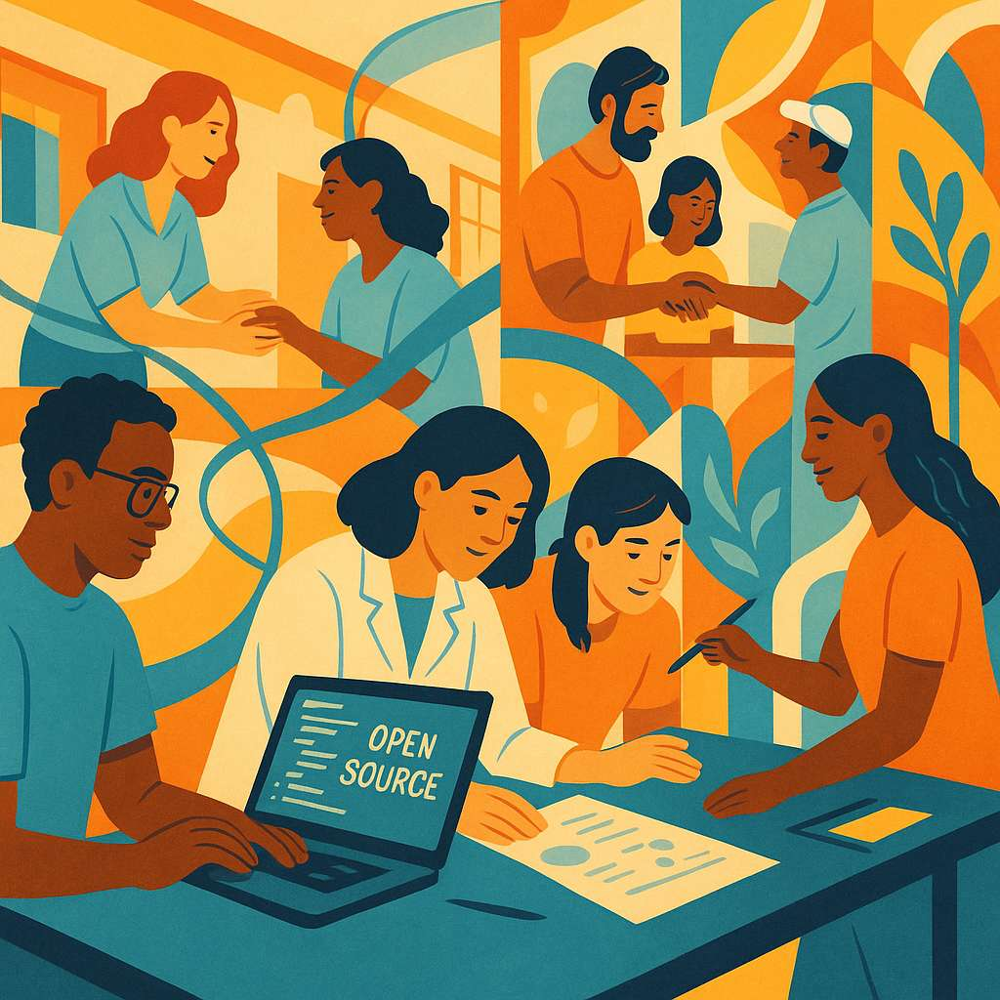

这些例子说明：**人不是只有被金钱驱动才会行动。内在的好奇心、创造欲、利他心、意义感，都是强大的驱动力。**

**第四，AI时代的劳动性质将彻底改变。**

当AI承担了大部分重复性、规律性的劳动，人类劳动的性质将发生根本转变。

以前，大多数人从事的是"不得不做"的劳动——流水线工作、数据录入、文书处理、简单客服……这些工作单调、枯燥，主要价值在于维持生存。

未来，这些工作将由AI完成。人类将专注于：

- **创造性工作**：科学发现、技术发明、艺术创作、思想创新
- **探索性工作**：深空探测、科学考察、未知领域的研究
- **照护性工作**：教育、医疗、心理咨询、陪伴关怀
- **社会性工作**：社区建设、文化活动、公共服务

这些工作的驱动力不是生存压力，而是好奇心、创造欲、关爱他人的愿望。

**这不是"没有劳动"的社会，而是"劳动性质改变"的社会。**

### 发展的动力：从欲望驱动到解放驱动

有人会问：当今社会之所以发展这么快，就是因为它利用了人的欲望。没有欲望驱动，社会怎么进步？

这是一个重要的问题，值得认真回答。

确实，当今社会通过放大欲望来驱动发展。每个人都想要更多、更好、更新，这种永不满足的追求推动了技术进步和经济增长。过去200年创造的物质财富，超过了人类之前几千年的总和。

但我们需要问：**这种发展模式可持续吗？代价是什么？方向是对的吗？**

**可持续性问题**：地球资源是有限的。如果发展模式依赖于永无止境的欲望扩张和物质消费，迟早会撞上生态极限。气候危机、环境污染、资源枯竭，这些都是欲望驱动型发展的后果。

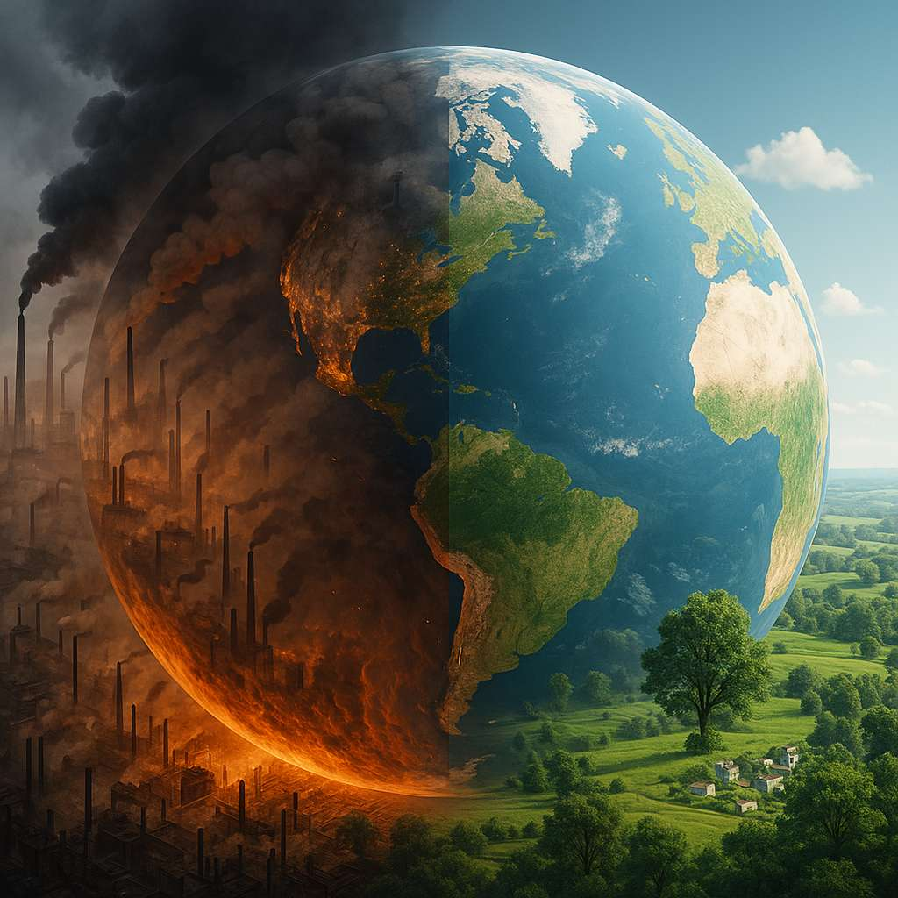

**代价问题**：欲望驱动的发展让大多数人陷入"焦虑-满足-空虚-更大焦虑"的循环。物质越来越丰富，但人们越来越不幸福。这是"伊斯特林悖论"：超过一定收入水平后，更多的物质并不带来更多的幸福。

**方向问题**：欲望驱动的发展，方向是由利润决定的，不是由人类真正需要什么决定的。所以我们看到：治疗秃头的研究经费超过治疗疟疾的研究经费；制造上瘾手游的才智远超解决气候问题的才智；短视频算法越来越精巧，但公共卫生系统却在衰退。

**解放的未来提供了另一种发展动力：人的解放本身就是动力。**

这不是压制人的欲望，而是移除压制人的东西，让人的内在潜能自然展开。

| 维度 | 欲望驱动 | 解放驱动 |
|------|---------|---------|
| 心理状态 | 焦虑 → 满足 → 空虚 → 更大焦虑 | 好奇 → 探索 → 创造 → 满足 → 新的好奇 |
| 可持续性 | 需要不断升级刺激 | 自我持续的正循环 |
| 方向 | 由利润决定 | 由人的真实需要决定 |
| 与地球的关系 | 掠夺性的 | 可以是可持续的 |
| 人与人的关系 | 竞争 | 协作 |

欲望驱动是一种消耗性的动力——它消耗人的精神，消耗地球的资源，消耗社会的凝聚力。

解放驱动是一种生成性的动力——它让人的潜能得以展开，让创造力自然流动，让人与人的合作成为可能。

而且，解放后的人类将有更宏大的目标可以追求。当我们不再为眼前的生存而内斗，目光可以投向更远的地方：探索宇宙、理解意识的本质、延长人类寿命、创造更高级的文明。这些才是真正值得人类倾注精力的星辰大海。

---

## 第三部分：两种逻辑的本质——资本主义与共产主义

现在，让我们揭示这两种未来背后的本质。

**恐惧的未来，其实就是资本主义逻辑的延续。**

资本主义的核心特征是：生产资料私有制、雇佣劳动、市场竞争、资本增殖。在这个系统中，生产的目的不是满足人的需求，而是实现利润最大化。工人出卖劳动力换取工资，资本家占有剩余价值。当AI可以替代工人时，工人就失去了价值，被系统抛弃。

第一部分设想的是这些矛盾在缺少制衡时怎样互相加强。它说明我为什么担心收益越集中、风险越往工人身上落，不是在预告每一个市场经济体都将以同一种方式崩溃。

**解放的未来，其实就是共产主义的愿景。**

共产主义的核心特征是：生产资料公有制、消灭雇佣劳动、按需分配、人的全面自由发展。在这个系统中，生产的目的是满足所有人的需求，技术进步的成果由全体成员共享。当AI替代人类劳动时，不是人被抛弃，而是人被解放。

第二部分描述的那些可能——从繁重劳动中解放、基本需求得到保障、人可以自由发展自己——正是马克思一百多年前就已经设想的共产主义社会。

这不是偶然的巧合。马克思的理论核心就是：**生产力的发展最终会要求改变生产关系。**当旧的生产关系成为生产力发展的桎梏时，社会变革就会发生。

把这两种逻辑并置，不是要把世界切成两个纯粹样板。即使同一社会里，某种收益可以归股东，另一种可以进入公共保障。迟到这一步才说出两个名字，是因为我希望先谈劳动者究竟得到了什么，再谈标签。

而我的取向并不中立：如果有选择，我宁愿省下来的工时成为人的自由时间，而不是失业通知。

但无论叫什么名字，问题的实质不会改变：**我们要让AI服务于少数人的利润，还是让AI服务于所有人的解放？**

## 后记

"资本主义"和"共产主义"这两个词，在今天都背负了太多情绪。一个被一些人捧上神坛，另一个被另一些人视为洪水猛兽。反过来也一样。

但如果我们抛开标签和情绪，只是冷静地分析它们各自的运作逻辑，会发现：它们不过是两种不同的社会组织方式，各有各的内在机理，各有各的优势和问题。

这篇文章不想妖魔化或者神话任何一方，我只是想尽我所能还原它们本来的样子——它们的逻辑是什么，会导向什么结果，在AI时代分别意味着什么。

我作为一个中国人，生活在一个由共产党领导的社会主义国家，同时又深度参与了全球化的市场经济。这种独特的位置，让我有机会同时观察两种制度的实践，也让我不禁思考：面对AI这样的历史性变革，什么样的道路对中国、对人类是更好的选择？

这不是意识形态的站队，而是一个务实的中国人做的推演和思考。

