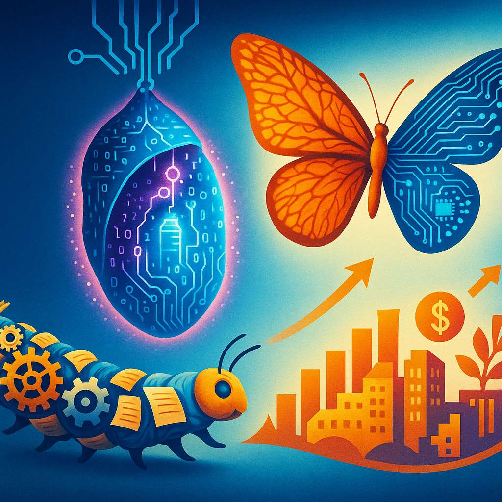
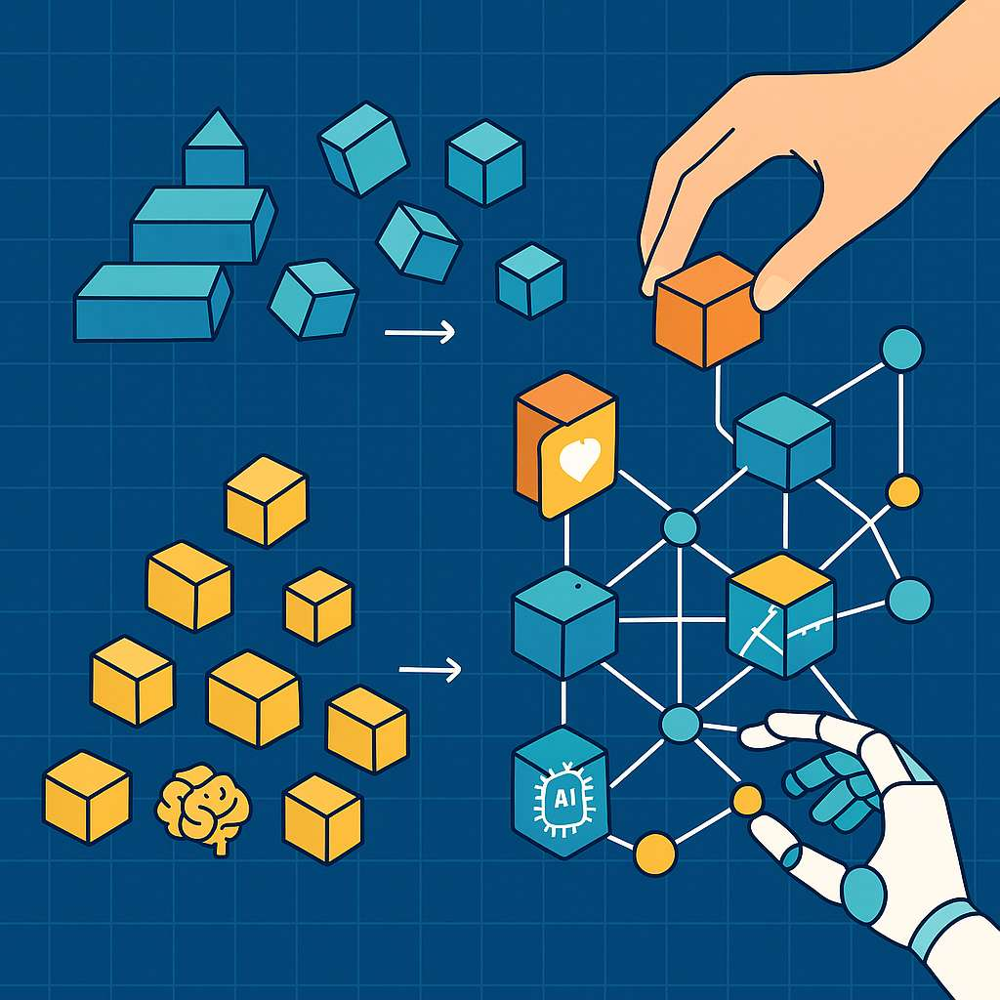

## **为AI无处不在的未来做好准备**

这是《AI管理学》的第八篇，也是收束篇。全系列从[01 为什么需要管理 AI 同事](08-AI管理学01-为什么我们需要管理AI同事.md)起步，依次讨论[02 能动性](07-AI管理学02-AI如何从工具变成数字同事.md)、[03 理论渊源](06-AI管理学03-这门新学科的四大理论支柱.md)、[04 管理者角色](05-AI管理学04-管理者如何从监督者变为统筹者.md)、[05 管理职能](04-AI管理学05-人机混合团队的四大管理职能.md)、[06 问责](03-AI管理学06-当AI犯错时谁来负责.md)、[07 协作场景](02-AI管理学07-人机协作的三个实战场景.md)，最后回到一个不大讨喜的问题：如果最熟练的人都不再做这项工作，系统停下来时，谁还能接手？

这不需要押注哪一年会有多少企业安装智能体。一项应用里有助手、一项任务可以自动执行、一项决定不再需要人签字，是三件不同的事。前七篇说的是组织怎么放权；这一篇想说的是，放权之后，组织还得有能力把工作接回来。

## **组织蜕变：迈向人机混合的新生命形态**

我把这类改变叫作**组织蜕变**。买一套工具，原先负责的人还可以照旧工作；可一旦有人只负责训练系统，有人只接系统挑出来的疑难件，连新人要跟谁学、经理能问谁要解释，都得重新安排。

这样的组织可以看作“人机混合实体”。不必预设它一定会变得更扁平：一条原本层层上报的信息或许可以直接送到处理者手里，但出了例外，谁能暂停、谁来拍板，依旧需要一条清楚的线。

这场蜕变的核心驱动力，是一种被称为**“合成动态能力”（synthetic dynamic capabilities）**的新型能力。 在传统战略管理理论中，“动态能力”指企业整合、构建和重构内外部资源以适应快速变化环境的能力。 而AI的加入，则为这种能力赋予了“合成”的特质：
*   **扩展**：分析任务遇到高峰，可以增加计算资源；数据供应、算力预算和人工复核仍会限制吞吐量。
*   **迁移**：设想两个部门处理同类单据，而且字段口径、授权和例外流程相同，可以借用第一个部门的工作流。只要第二个部门多一类特殊客户，就得让当地经办人重新走一遍，不能把复制配置当成培训完成。
*   **改进**：一线把错误交回来，团队修订规则或模型，再查有没有引进新错。这才是能力在增长；同一套软件运行得久，不会自然变好。

## **未来的领导力：从技术推行者到组织蜕变的引领者**

在这场深刻的转型中，领导者的角色变得比以往任何时候都更加关键。他们的任务不再是简单地推行一项新技术，而是作为建筑师和引航员，引导整个组织安全、高效地完成这场从传统形态到“人机混合实体”的蜕变。 这要求他们具备全新的领导力特质和行动框架。

1.  **培养面向未来的新文化**
    领导者必须首要地塑造一种能够支撑人机深度协作的组织文化。 这不再是传统企业文化建设的简单延伸，而是针对新物种的特殊培育。这种文化的核心支柱包括：
    *   **持续学习与实验精神**：给员工试新流程的余地，也允许他们把试坏了的地方拿出来讨论。
    *   **心理安全与人类中心**：当AI开始承担更多决策时，人类员工可能会感到威胁或被边缘化。领导者必须创造一个高度心理安全的环境，让员工敢于质疑AI的输出、提出建设性意见，并始终强调技术服务于增强人类能力的核心目标。
    *   **数据驱动与伦理敬畏**：文化上需要转向数据驱动的决策模式，同时，领导者必须将伦理考量置于核心地位，确保AI的应用公平、透明且符合社会价值观。

2.  **以工作再造为核心的组织设计**
    未来的领导者必须成为“工作架构师”。 他们的核心任务不再是管理“岗位”，而是解构和重塑“工作”。 这意味着：
    *   **从岗位描述到任务分解**：领导者需要将传统的固定岗位分解为一系列的任务和能力模块。 随后，基于人类（如同理心、复杂战略思维、伦理判断）和AI（如数据处理速度、模式识别、规模化执行）的互补优势，进行战略性的任务再分配。
    *   **设计增强型工作流**：目标是设计出能够放大人类智慧的工作流程。AI不应被视为替代人类的工具，而应是增强人类能力的“副驾驶”或“力量倍增器”。 这要求领导者深入理解业务流程，并与技术团队紧密合作，创造出人机无缝衔接的新模式。
    *   **主动管理技能演进**：领导者必须正视并主动管理因过度依赖AI可能导致的技能退化风险。他们需要制定策略，通过任务轮换、模拟培训以及保留人类专家等方式，确保组织核心能力的延续和发展。

3.  **引领变革的人文关怀**
    组织蜕变是一场深刻的变革，必然会伴随着员工的焦虑、不确定性和阻力。 因此，未来的领导力比任何时候都更需要强调同理心、沟通和人文关怀等“软技能”。
    *   **成为首席沟通官**：领导者需要清晰、透明且持续地与员工沟通变革的愿景、路径和影响，解释“为何要变”，描绘人机协作的美好未来，以建立信任、凝聚共识。
    *   **关注人的体验**：在推行AI的过程中，必须将员工的体验置于中心位置。确保AI工具易于使用，确保变革过程公平公正，并为员工提供充足的培训和支持，帮助他们适应新的工作方式。
    *   **以身作则**：领导者自身必须率先拥抱AI，在日常工作和决策中示范如何与AI协作，成为组织中人机协作的榜样。

## **结论与未来展望**

“AI管理学”的终极目标，是引导组织完成这场面向未来的深刻蜕变。随着AI从工具演进为队友，甚至成为组织结构的一部分，管理者和领导者必须掌握新的理念、技能和框架。未来不属于单纯的人类，也不属于独立的AI，而属于那些能够将二者无缝融合、协同共进的“人机混合组织”。掌握引领这场组织蜕变的能力，将是赢得未来的关键。

对于希望在AI时代保持领先的组织领导者，核心建议如下：

1.  **深刻认知范式转变**：必须从战略高度认识到，AI带来的不仅是效率工具，更是一场组织形态的革命。停止将AI视为IT部门的事务，而是将其作为企业核心战略议题。
2.  **投资新型领导力发展**：优先选拔和培养那些具备系统思维、高情商、强大伦理判断力和变革管理能力的领导者。 传统的指挥控制型领导者将难以适应未来的需求。
3.  **治理先行，试点推进**：在规模化推广任何AI应用之前，必须建立健全的问责框架和“人在环路中”的治理机制，将风险管理置于首位。选择一个可控且影响显著的领域作为试点，积累人机协作管理的实践经验。
4.  **主动管理人力资本转型**：将重心从“降本增效”转向“技能提升”，制定明确的战略以应对技能退化风险，并投入资源积极培养人类员工与AI同事之间相互信任、共同学习的协作文化。

我会用一次交接来检验这场蜕变：下次系统停下来，谁接第一件工作，谁带着新人把第二件做完？如果答不上来，应该先留住这种本领，再谈下一轮自动化。

