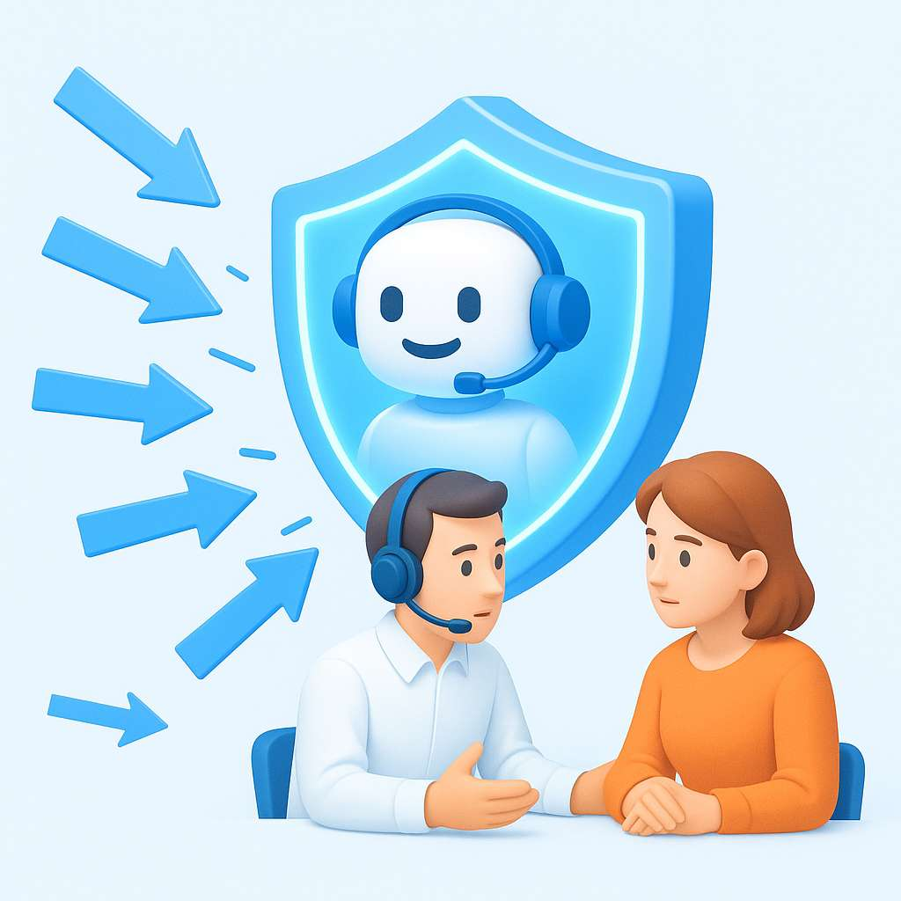
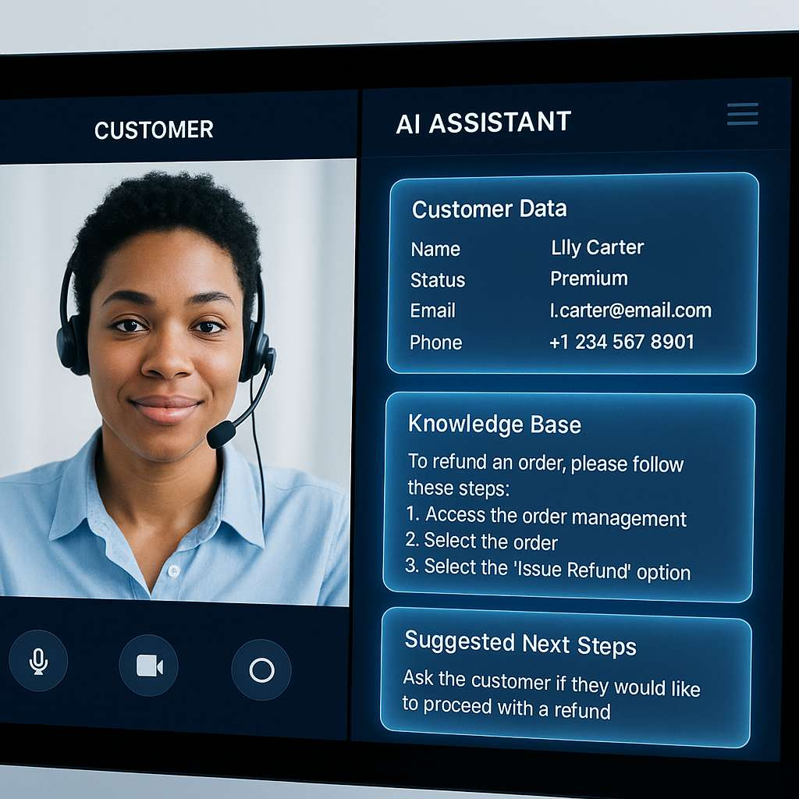
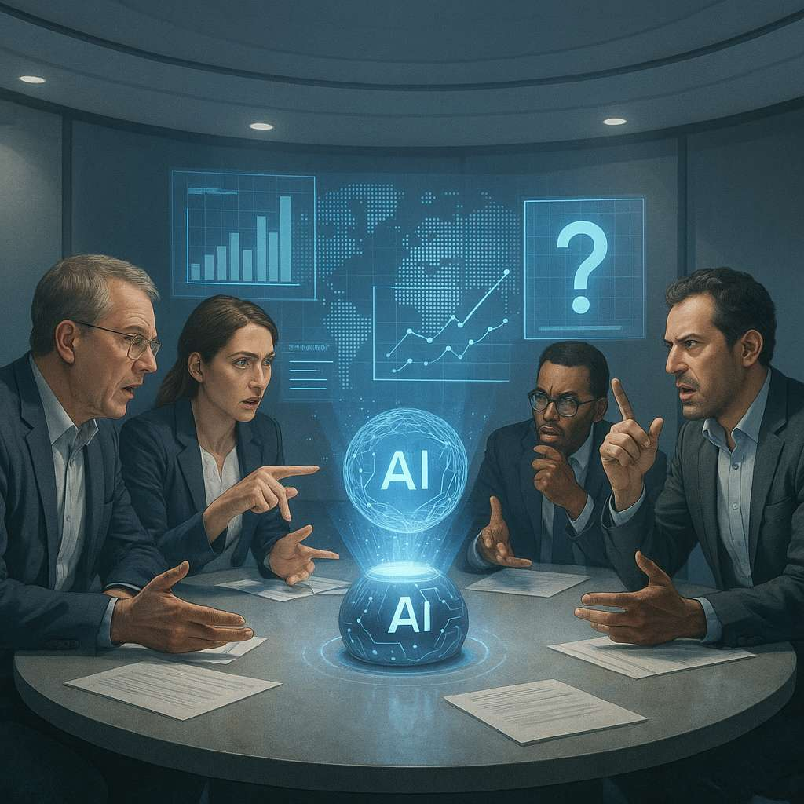

## **引言：从理论到实践，驾驭人机协作新浪潮**

在人工智能（AI）从一个后台工具演变为前台“数字同事”的时代，企业面临的挑战已不再是“是否”要引入AI，而是“如何”管理一个由人类与AI智能体组成的新型混合劳动力。理论框架为我们指明了方向，但真正的考验在于将这些原则转化为日常运营中的具体行动。若缺乏有效的管理实践，再先进的AI技术也可能导致效率低下、风险失控甚至团队信任的崩塌。

下面不是三份企业实测报告，而是三幅可以放到会议桌上推演的工作图。我会特别留意每次交接：客服什么时候把投诉交给有权处理的人？代码是谁签字合入的？战略假设一动，谁来判断那张漂亮的预测图还算不算数？

## **案例一：重塑客户体验——增强型客户服务团队**

### **场景剖析：直面现代客户服务的双重挑战**

现代客户服务中心正处在一个十字路口。一方面，客户期望获得全天候、即时且高度个性化的服务；另一方面，企业面临着控制成本、降低员工流失率和处理海量重复性咨询的巨大压力。传统的纯人工模式难以为继，而纯AI模式又缺乏处理复杂、情感化问题的能力。

增强型客户服务团队，作为AI管理学应用的典范，正是在这一背景下应运而生。其典型构架是：一支由经验丰富的人类坐席与多个AI智能体（如AI聊天机器人、AI坐席辅助工具）组成的混合团队。AI并非意在取代人类，而是通过精确的分工与协作，共同提升整个服务体系的效率与质量。

### **AI管理学实践应用**

#### **1. 战略性任务分配：基于互补优势的精妙编排**

这是混合团队成功的基石。管理者不再是简单地将工单分配给下一个空闲的坐席，而是基于“互补性原则”对整个工作流进行战略性设计，最大化人与AI的各自优势。

*   **AI先接常见问题**：订单到哪了、怎样重置密码、退货期限多长，这些有标准答案的问题可以先由机器人回答。但客户没有再找坐席，也可能只是因为转人工太难，不能据此销单。

*   **人类专注的高价值对话**：通过AI的过滤，人类坐席得以从繁琐的重复劳动中解放出来，将宝贵的精力投入到真正需要人类智慧的领域：处理复杂的技术故障、安抚情绪激动的客户、处理需要共情与协商的投诉，以及识别和挽留有流失风险的高价值客户。
*   **AI驱动的智能路由**：更进一步，先进的AI系统还能扮演“交通指挥官”的角色。通过实时分析客户输入的语言、语气（通过语音分析）和历史交互数据，AI能够进行预测性路由。例如，当系统识别到客户语言中含有强烈的负面情绪或关键词（如“失望”、“投诉”、“法律”）时，它会跳过标准流程，直接将该对话无缝转接给最有经验或最擅长处理此类问题的人类专家，从而有效避免客户情绪的进一步升级。

#### **2. 混合劳动力的绩效管理：为“数字员工”设定目标**

管理AI队友，意味着要超越传统的系统正常运行时间和响应速度等技术指标。管理者必须像对待人类员工一样，为AI设定与业务目标紧密关联的关键绩效指标（KPIs）。

*   **AI的KPIs**：其核心在于衡量其对业务的直接贡献。关键指标包括：
    *   **分流率（Deflection Rate）**：在同一统计时段，以进入机器接待的咨询为分母，分别记录有多少未转人工、有多少中途离开。未转接只是流向。
    *   **首次联系解决率（FCR）**：另看首次接触后问题是否解决。可结合客户确认、工单结案原因与同一问题在约定窗口内的再次来询；无法确认的单独标出。
    *   **客户满意度（CSAT）**：在AI完成服务后，通过简短问卷收集客户对其服务的直接反馈。
*   **人类坐席的KPIs**：其考核标准也随之演进，从传统的“平均处理时长”转向更能体现其专家价值的指标：
    *   **复杂案例的客户满意度（CSAT）** 与 **净推荐值（NPS）**。
    *   **客户挽留率** 或 **升级销售额**。
*   **团队共同目标**：优秀的管理者还会设立团队级的共同目标，例如整体客户满意度的提升。这能激励人类坐席在发现AI回答不准确或流程不顺畅时，主动向AI提供反馈（即“AI辅导”），从而形成一个持续优化的良性循环。

#### **3. 协作与沟通：打造无缝的人机工作流**

高效协作的关键在于信息流的畅通。AI坐席辅助工具（Agent Assist）是这一理念的完美体现。它像一个经验丰富的导师，实时坐在人类坐席旁边。

坐席正听客户解释为什么不能按普通退货处理。助手在一旁找出适用条款和上一次工单，坐席不用让客户从头再讲一遍；但核对是否同一笔订单、决定能否破例，仍是坐席的事。要评价这个设计，既看检索省了几分钟，也查错引条款造成了多少返工。

## **案例二：加速创新步伐——混合型软件开发团队**

### **场景剖析：应对日益增长的软件复杂性**

软件开发是一个知识密集且高度依赖创造力的领域。然而，开发者们往往需要将大量时间花费在编写样板代码、构建单元测试和修复琐碎缺陷等低价值、高重复性的工作上，这不仅拖慢了开发进度，也容易导致人才的倦怠和流失。

混合型软件开发团队通过引入AI编程助手（如GitHub Copilot）以及用于测试和调试的AI工具，旨在将人类开发者的心智资源从冗余任务中解放出来，聚焦于最具创造性和战略性的工作。

### **AI管理学实践应用**

#### **1. 战略性任务分配：AI作为“初级开发者”与“结对伙伴”**

在这个场景中，AI智能体被赋予了“初级开发者”或“全能结对编程伙伴”的角色。其核心任务是加速代码的编写和验证过程。

*   **AI负责“脚手架”工作**：开发者只需用自然语言描述一个函数的功能或类的结构，AI编程助手就能迅速生成功能完整、语法正确的代码草案。它尤其擅长编写样板代码（Boilerplate Code）、实现标准算法、生成单元测试用例，以及根据上下文自动补全代码。
*   **人类专注于“建筑设计”**：资深的人类开发者则将精力集中在更高层次的抽象工作上：进行系统架构设计、规划复杂模块间的交互、实现核心的业务逻辑，以及解决前所未有的技术难题。他们从“编码者”更多地转变为“设计者”和“审查者”。

#### **2. 治理与问责：以“人在环路中”保障代码质量**

AI代码生成能力虽强，但并非完美无瑕。它可能产生存在逻辑漏洞、安全隐患甚至版权问题的代码。因此，在这个高风险领域，建立一个强有力的“人在环路中”（Human-in-the-Loop, HITL）治理框架至关重要。

*   **强制性的代码审查（Code Review）**：这是最核心的治理机制。管理者必须制定严格的开发流程，规定所有由AI生成的代码都不能直接并入主代码库。相反，它必须通过一个拉取请求（Pull Request）的方式提交。
*   **人类的“守门人”角色**：这个请求必须经过至少一名（通常是更资深的）人类开发者的仔细审查、测试和批准。这位人类审查者是代码质量和安全的最终责任人。他们会检查代码的逻辑正确性、性能效率、可维护性以及是否遵循了团队的编码规范。这种方式既享受了AI带来的速度优势，又通过人类的经验和判断力构筑了一道坚实的防火墙。

#### **3. 绩效管理：量化AI对生产力的贡献**

衡量AI编程助手的价值，需要超越简单的“代码行数”指标，采用更能反映其对开发流程实际影响的量化指标。

*   **AI贡献度指标**：
    *   **代码接受率**：开发者实际采纳AI建议代码的百分比。高接受率通常意味着AI的建议质量高且贴合需求。
    *   **开发用时**：选难度相近的任务，记下有无助手时从开工到通过审查的时间，把测试、返工和等待评审算进去。即使某个小任务写得快，也不能据此给整支团队定一个提速指标。
    *   **缺陷密度降低**：衡量引入AI后，新编写代码中的缺陷数量是否有所下降（例如，通过AI生成的更全面的单元测试）。
*   **开发者满意度**：通过定期的匿名问卷，了解开发者对AI工具的看法，评估它是在减轻负担还是在增加干扰。

## **案例三：驱动前瞻决策——AI赋能的战略规划单元**

### **场景剖析：在数据洪流中寻找战略航向**

企业战略的制定是一项极具挑战性的任务，它要求决策者在海量、模糊且瞬息万变的信息中洞察未来趋势。在数字化时代，任何企业的战略团队都面临着一个共同的难题：如何处理人类心智无法企及的海量数据集，从中挖掘出决定未来成败的关键信号。

AI赋能的战略规划单元，正是为了应对这一挑战而构建的。在这个团队中，AI不直接做决策，而是作为一个强大的分析引擎和模拟器，与由资深商业战略家组成的人类团队紧密协作。

### **AI管理学实践应用**

#### **1. 协作智能：人机共创，超越认知极限**

这个案例完美诠释了“协作智能”的理念，即人与机器结合各自的独特优势，创造出任何一方都无法单独达成的成果。

*   **AI放大人类的分析能力**：战略团队先问“未来五年，哪项新技术可能改变我们的市场？”让助手从选定的论文、专利和竞争对手公开财报中整理线索，注明时间与来源，哪些行业或地区没有资料也列出来。搜到一批相关消息，只是产生了值得追问的假设。

*   **人类赋予数据以意义和方向**：AI提供的仅仅是“What”（是什么），而人类战略家则负责回答“So What”（这意味着什么）和“Now What”（我们该怎么做）。他们运用深厚的行业经验、对公司文化的理解、商业直觉和创造力，来解读、批判和提炼AI的输出。他们能够判断哪些数据相关性是真实的商业机会，哪些仅仅是统计上的巧合，并最终将这些洞察编织成一个连贯、可行且有说服力的战略叙事。

#### **2. 信任与可解释性：打开“黑箱”，实现真正的对话**

对于战略决策这样高风险的活动，信任是协作的绝对前提。如果战略团队不理解AI为何会提出某个建议，他们就不可能、也不应该采纳它。因此，对AI的“可解释性”（Explainability, XAI）管理至关重要。

*   **超越“答案”，要求“过程”**：管理者必须确保团队使用的AI系统不是一个提供武断结论的“黑箱”。一个优秀的战略AI必须能够清晰地解释其建议背后的关键驱动因素和数据依据。战略家应该能够向AI提问，例如：“你将市场A的增长潜力评为最高的三个主要数据支撑是什么？”或者“如果我们将竞争对手B的市场份额增长速度这一变量上调10%，我们的市场进入模拟结果会有何变化？”。
*   **从盲目接受到批判性评估**：这种透明度使得人类能够对AI的逻辑进行批判性评估，发现其模型中可能存在的偏见或过时假设。这促进了一种健康的怀疑精神，将人机关系从单向的“指令-执行”提升为双向的“对话-探索”。

#### **3. 领导力的核心：统筹思辨，达成最优决策**

在这个高级别的人机团队中，团队领导者的角色不再是项目经理，而更像是一位交响乐队的指挥，或是一位苏格拉底式的对话引导者。

*   **统筹人机对话**：领导者的核心任务是设计并主持这场结构化的人机对话。他们需要提出深刻的问题，不断挑战人类团队成员固有的认知偏见（如确认偏误）和AI模型潜在的算法偏见。
*   **促进建设性冲突**：我会鼓励团队“与AI辩论”，但不会把它当成没有偏见的外部顾问。让主张进入市场的人说出什么变化会让他改主意，再去调整模拟条件；如果结论翻转，讨论的重点就从选哪个市场变成了先查哪项假设。

## **结语：AI管理学是未来的核心竞争力**

客服分流成功却没解决投诉、代码写得快却排队等评审、战略预测很漂亮却换个假设就翻转，这三种情况都可能发生。工作图的用途，是让管理者在部署前就知道去哪里看这些落差。

我的判断是：不能只给机器设一个“多做”的目标，还要给人一个说“不”、改方向和把事情接到底的位置。有了这个位置，再谈协作究竟带来了多少收益。

