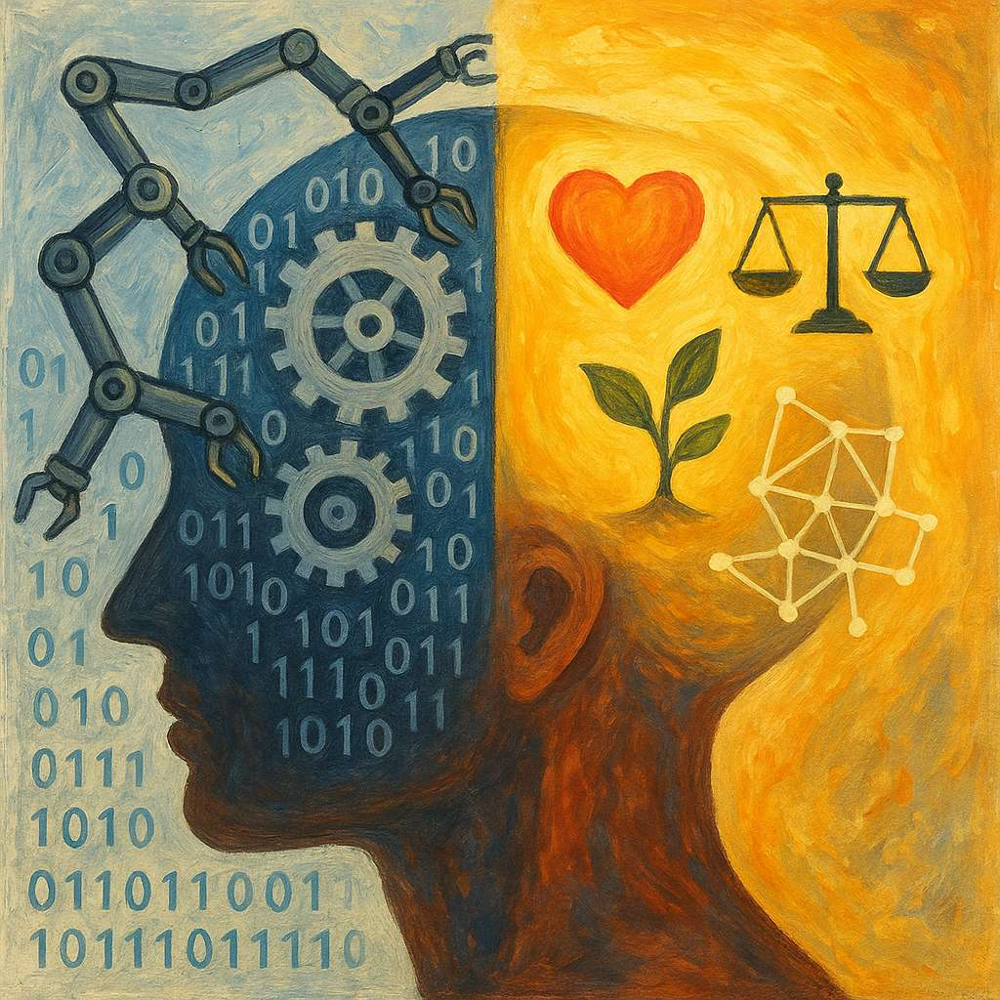
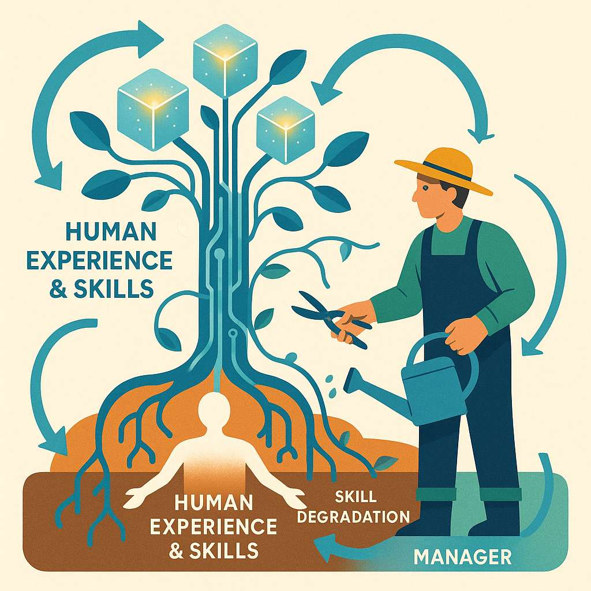
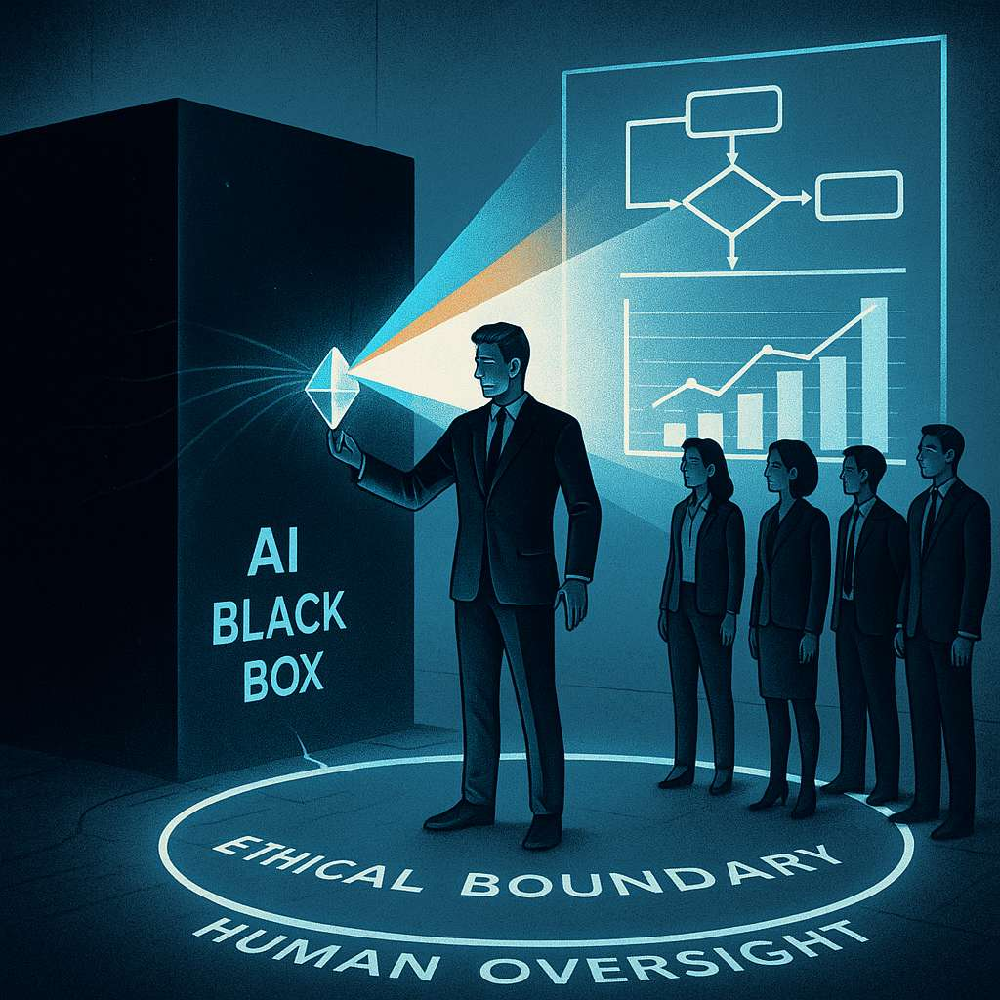

在人工智能（AI）日益融入工作流程的今天，一种普遍的焦虑悄然蔓蔓延：人类管理者的价值是否会被削弱？当AI能够高效处理数据分析、任务监控甚至部分决策时，传统意义上的管理者似乎正面临被技术“优化”的风险。

然而，事实恰恰相反。AI的崛起非但没有削弱人类管理者的重要性，反而对其提出了前所未有的更高要求，并从根本上重塑了其核心角色。**管理的重心正从对具体任务的微观监督（Supervisor），转向对一个由人类智慧与机器智能构成的复杂协作系统的宏观统筹（Orchestrator）**。这不仅是一次简单的职能转变，更是一场深刻的领导力进化。

## 领导力技能的重新定义：从指令下达到价值培育

在过去，管理者的权威很大程度上来源于信息差和对任务流程的掌控。他们下达指令，监督执行，评估结果。但如今，AI能够比任何人类都更高效地执行任务监控和数据分析。

这种转变，迫使管理者必须将精力从可被自动化的“硬技能”中解放出来，聚焦于那些AI无法复制的“高阶人类技能”。这些技能是构建高效、有韧性的人机混合团队的粘合剂，是新时代领导力的核心。

**高阶人类技能的价值凸显：**

*   **情商（Emotional Intelligence, EI）：** 这是人类管理者最坚固的护城河。AI可以处理数据，但无法真正共情。 具备高情商的管理者能够敏锐地感知团队成员的情绪波动，尤其是在面对AI带来的变革时可能产生的焦虑、抵触或不安。 他们能够通过积极聆听、同理心和真诚沟通，建立团队的心理安全感，化解人与机器协作初期的摩擦与不信任。 **这种人本关怀是激发人类员工创造力、建立团队凝聚力的关键，而这恰恰是算法无法提供的**。

*   **复杂的、非结构化问题的解决能力：** AI擅长在有明确规则和清晰边界的领域内寻找最优解，但现实世界的商业环境充满了模糊性、矛盾和突发状况。**管理者需要处理的往往是“灰色问题”**，例如，如何在两个同样有潜力的创新项目之间分配有限的资源？如何在遵守法规的同时，应对由AI引发的意外伦理困境？这些决策需要管理者运用经验、直觉和价值观进行权衡，这种综合性的判断力远超当前AI的能力范畴。

*   **创造力与战略思维：** AI可以基于现有数据生成无数种方案，但**真正的颠覆式创新源于人类的想象力和对未来的远见**。 管理者的角色不再是简单地评估AI给出的选项，而是要能够提出AI“想不到”的问题，设定更大胆的战略目标，并构想全新的商业模式。他们需要跳出算法的框架，从更宏观的视角进行战略思考，规划组织的长期发展路径。

*   **指导力与人才发展：** 随着AI接管更多重复性任务，员工的发展路径也在发生改变。管理者的角色从任务分配者转变为职业发展的“教练”和“导师”。**他们需要帮助员工识别和培养那些能够与AI互补的技能，引导他们从执行者成长为思考者和创造者**。这种个性化的指导和对个人成长的投资，是维系人才、提升组织整体能力的关键。

*   **伦理判断力：** 这是AI时代管理者最不可或缺的责任。AI的决策基于数据和算法，本身不具备道德指南针。 **当AI的建议可能带来负面的社会影响或与组织价值观冲突时，管理者必须扮演最终“道德刹车”的角色。** 例如，一个以利润最大化为目标的AI可能会建议裁撤某个部门，但管理者需要权衡此举对员工士气、公司声誉和长远发展的综合影响。这种基于人类价值观的伦理判断是无法被编码的，也是人类监督的最后一道防线。

**从指挥官到统筹者（Orchestrator）的转变：**

这种技能重心的转移，最终导向了管理者角色的根本性变革：**从一个发号施令的指挥官，演变为一个混合团队的“统筹者”**。 统筹者如同一个交响乐团的指挥，他不亲自演奏每一种乐器，但他深刻理解每一种乐器的特性——人类的创造力、同理心，以及AI的速度、精度。

他的核心任务是创造一个和谐的环境，让两种截然不同的“乐器”能够协同奏出最华美的乐章。**他的目标不再是管理产出，而是精心设计和培育那个能够持续产生卓越成果的、充满活力的人机协作系统**。

## 管理者作为系统思想家：驾驭人机协作的复杂动态

领导一个包含自主AI成员的混合团队，要求管理者必须具备强大的**系统思维能力**。传统的线性管理思维——输入、处理、输出——在这种新范式下已经失效。人机团队是一个复杂的自适应系统，充满了反馈循环、相互依赖性和非线性效应。管理者不能再只关注孤立的个体或任务，而必须能够理解和驾驭整个系统的动态。

**理解和管理人机系统的核心要素：**

*   **反馈循环（Feedback Loops）：** 在人机系统中，反馈无处不在。**人类对AI输出结果的修正和评价，会成为AI模型迭代优化的输入数据；反之，AI性能的提升或下降，也会直接影响人类员工的信任度、工作方式乃至情绪状态**。一个优秀的管理者需要能够识别出这些关键的反馈循环。例如，如果一个AI推荐系统因为数据偏差而持续给出错误建议，导致人类员工“过度不信任”，进而完全弃用该工具，这就形成了一个负向反馈循环。

    **统筹者的任务是打破这种恶性循环，通过引入更多元的数据、优化人机交互界面或提供专门的培训，重新校准信任，建立一个正向的、持续改进的反馈机制**。

*   **相互依赖性（Interdependencies）：** 在混合团队中，人类和AI成员之间是深度耦合、相互依存的。人类的战略洞察为AI设定了正确的目标方向，而AI强大的数据处理能力则为人类的决策提供了事实依据。一个环节的薄弱或失败，可能会引发整个系统的连锁反应。
     
     **管理者必须能够绘制出这种相互依赖的“系统地图”，清晰地看到人类员工的判断力、AI模型的数据质量、工作流程的设计等各个节点是如何相互影响的。**这使得他们能够在问题发生前，就预见到潜在的瓶颈和风险点。

*   **潜在风险与非预期后果：** 复杂的系统往往会涌现出令人意想不到的行为。其中，一个尤为突出的长期风险是**技能退化（Skill Erosion）**。 **当团队成员过度依赖AI来完成特定任务时，他们自身的相关技能可能会随着时间的推移而逐渐萎缩**。 

    例如，过分依赖AI编程助手可能导致初级开发人员缺乏独立解决复杂问题的能力；长期使用AI进行财务分析，可能让分析师丧失从原始数据中发现异常的敏锐直觉。

    一名具备系统思维的管理者会主动预见并管理这种风险。他们不会仅仅满足于AI带来的短期效率提升，而是会从组织能力的长远健康出发，设计相应的干预措施。这可能包括：
    *   **建立“自动化-手动”轮换机制：** 定期要求员工手动完成那些通常由AI处理的任务，以保持技能的熟练度。
    *   **利用AI创建培训环境：** 将AI从一个“执行者”转变为一个“陪练”，通过模拟各种极端或罕见场景，帮助员工在可控的环境中锻炼和提升专业技能。
    *   **强调批判性思维训练：** 培养员工对AI输出结果进行审视、质疑和验证的能力，确保他们不是被动接受者，而是主动的判断者。

通过运用系统思维，管理者得以超越日常的琐碎管理，从一个更高维度上理解和优化人机协作。他们不再是修理单个齿轮的工匠，而是设计和维护整部精密机器的总工程师，确保系统能够长期、健康、高效地运转。

## 管理者作为首要的“解释者”与“维护者”

在人机协作的“协作智能”框架中，人类扮演着三个不可或缺的角色：训练者（Trainers）、解释者（Explainers）和维护者（Sustainers）。而在一个具体的团队内部，管理者是“解释者”和“维护者”这两个关键角色的最终和首要承担者。他们是连接AI技术与组织信任、确保AI行为符合伦理规范的核心枢纽。

**解释AI决策：构建透明与信任的桥梁**

许多先进的AI模型，特别是深度学习网络，其内部决策过程非常复杂，常常被称为“黑箱”。 这种不可解释性是人机协作中信任的最大障碍。当团队成员不理解AI为何会提出某个建议或做出某个判断时，他们很难对其产生真正的信赖，要么盲目服从，要么完全排斥。

管理者的“解释者”角色，并非要求他们成为一名算法工程师，能够复现AI的完整计算过程。而是要求他们能够：

*   **翻译技术语言：** 与技术团队紧密合作，将AI决策所依据的关键特征、数据模式和置信度水平，**用通俗易懂的商业语言传达给团队成员、其他业务部门乃至客户**。 例如，当AI系统拒绝一笔贷款申请时，管理者需要能够解释，这是基于申请人的负债率、信用历史和现金流稳定性这几个关键维度的综合评估结果，而非一个随意或带有偏见的决定。

*   **沟通AI的局限性：** 清晰地界定AI的能力边界至关重要。管理者需要让团队明白，**AI在哪些场景下是可靠的，在哪些领域其判断力尚有欠缺，以及它的知识截止日期是什么**。这种坦诚的沟通有助于建立合理的期望，防止团队对AI产生不切实际的“神化”或“妖魔化”认知，从而实现更为理性的协作。

*   **建立组织层面的理解：** 解释工作不仅限于团队内部。当AI的输出需要影响到跨部门协作或客户决策时，管理者承担着向外部“布道”的责任。**他们需要确保整个组织，从上到下，对AI在团队中的作用和价值有一个清晰、统一的认识，从而为混合团队的顺畅运作扫清障碍。**

**维护伦理边界：确保AI向善而行**

随着AI智能体被赋予越来越大的自主权，确保其行为始终符合组织价值观和社會伦理规范，成为一项至关重要的治理任务。 管理者作为团队的“维护者”，是这一伦理框架在具体业务场景中的第一执行人。

*   **设定清晰的行为准则：** 管理者需要与技术和合规部门合作，为团队中的AI智能体设定明确的“行为红线”和操作规范。例如，一个用于客户服务的AI聊天机器人，必须被设定严格的规则，禁止使用任何带有歧视性或攻击性的语言；一个用于招聘筛选的AI，必须定期接受算法偏见审计，以确保公平性。

*   **设计“人在环路中”（Human-in-the-Loop）的关键节点：** 在任何涉及重大利益、高风险或存在高度不确定性的决策点，管理者必须确保流程中设置了强制的人工审核环节。 他们需要明确定义在何种情况下，AI必须暂停自主行动，并主动请求人类批准。这就像为高速行驶的AI列车设置了关键的手动制动阀，是防范重大风险的最后保障。

*   **处理伦理冲突与失败：** 当AI确实出现了有偏见或不道德的行为时，管理者必须能够迅速介入，承担责任，并启动预设的补救流程。这不仅包括技术层面的模型修正，更重要的是修复因此受损的团队信任和外部声誉。处理这类事件的能力，直接考验着管理者在AI时代的伦理领导力。

总而言之，从监督者到统筹者的转变，是对人类管理者价值的一次深刻重估和升华。**AI将管理者从繁琐的日常监督中解放出来，让他们能够专注于那些真正定义卓越领导力的核心要素：激发人性的光辉，用系统思维驾驭复杂性，并以智慧和勇气为技术注入伦理的灵魂**。

未来不属于那些试图与机器比拼效率的管理者，而属于那些懂得如何指挥一场由人类与AI共同参与的、创造无限可能的宏大交响乐的“统筹大师”。

