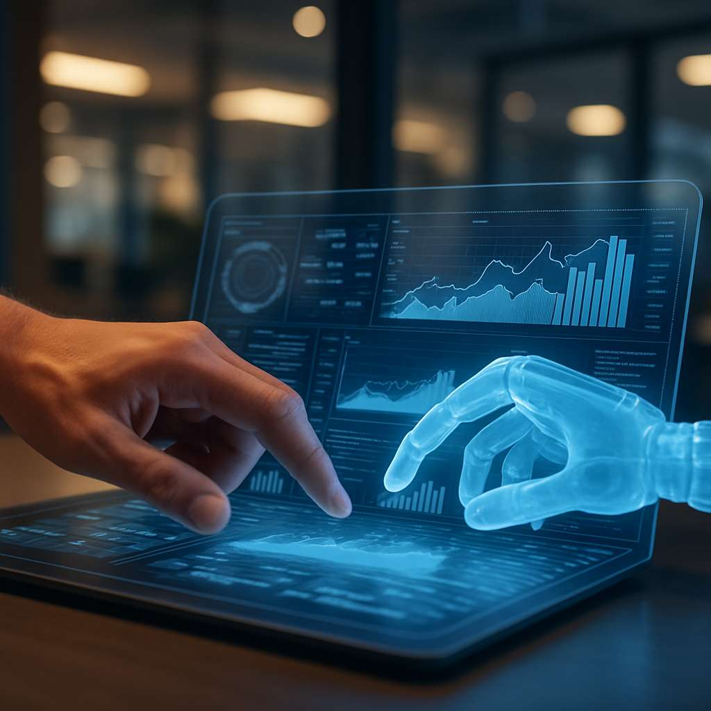
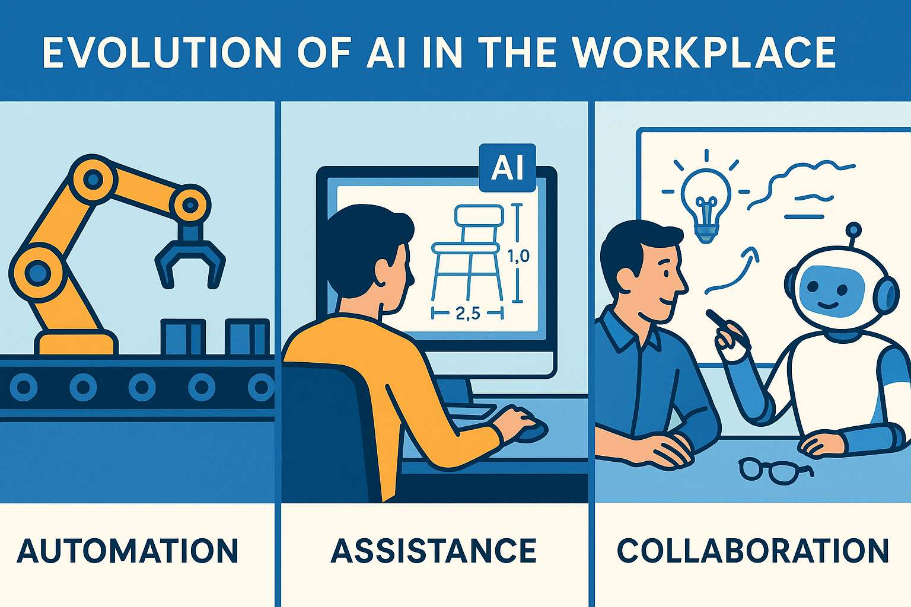
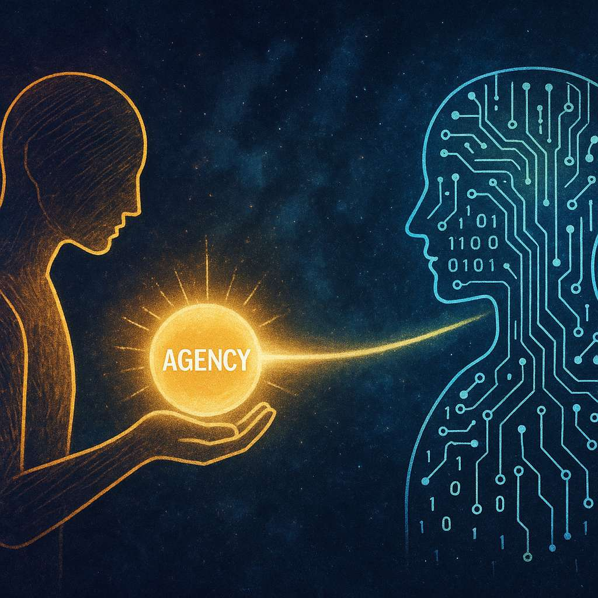
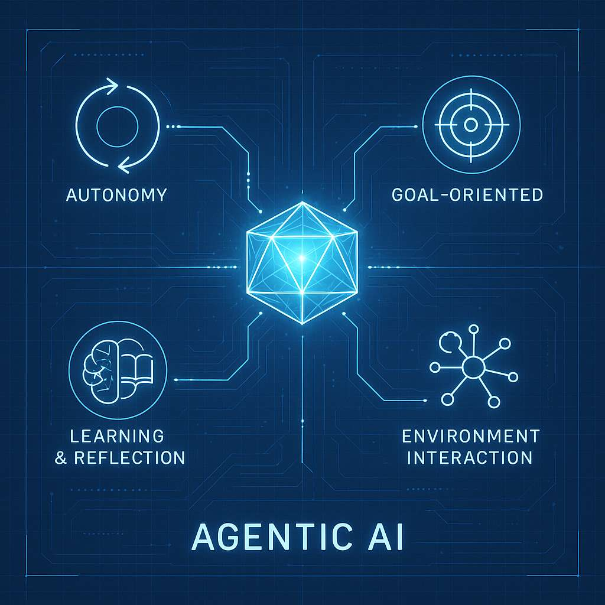

## **导言：新合作时代的黎明**

一个营销助手把文案放在屏幕上等人改，和它直接把文案发给客户，看起来只差一次点击。对管理者，那次点击却是分界线：是谁把行动权交出去，又能不能收回来？

我把工作中的系统按这种权限分成三种角色。同一家公司可以同时用着三种，甚至同一个工具在写稿时是助手，得到发布授权后才是代理。它们不是企业要按顺序走完的三个历史阶段。

## **工作场所的三种角色**

**规则执行者：照着写好的步骤做**

生产线上的固定动作、发票的字段搬运、客服窗口按关键词回一条预写好的答复，都可以靠自动化完成，不必为了讲AI而把每段脚本都算作AI。这里拿它们作参照：流程和例外由人预先决定，系统没有临场选择下一步的权限。

**增强助手：人类的“副驾驶”**

另一些系统把分析和建议交给人挑选。分界不在于用了哪一代技术，而在于它只有建议权。

例如，影像助手可以标出可疑区域供放射科医生复核，市场工具可以提示交易员查看异常，邮件助手可以拟好下一句。这些提示都还没有替使用者采取行动。

管理重点因此转向人机交互：界面怎样让人看懂建议，又不会把推荐项误当成已执行的决定？**AI可以提出建议，但行动的扳机依然由人类掌控。**

**协作智能体：获授权后可以行动的“数字同事”**

一旦允许系统根据结果选择下一步并调用工具，它的角色又不同了。管理者要规定可以用哪些工具、哪里必须停下来等人。

这种角色的转变，从根本上重塑了人与AI的关系，使其从“使用AI”演变为“与AI共事”。想象一个营销团队中的AI智能体，它可以自主分析最新的市场趋势报告，草拟多个版本的广告文案，设计并提议进行A/B测试，甚至在获得授权后直接在社交媒体平台上发布内容和监控效果。**在这里，AI不再等待指令，而是在一个共同的目标框架下主动发起任务、执行任务。**这种人机协同的工作模式，正迅速成为现实。

## **能动性转移：驱动范式变革的核心引擎**

从“自动化工具”到“协作队友”的演变，其核心驱动力并非单纯的技术算力增长，而是**能动性（Agency）的转移**。

这里说的**能动性（Agency）**是工作流里的行动余地：给定目标和权限，系统能选择并执行哪些步骤？它不是在断言软件有自己的愿望。

*   对规则执行者，先问指令是否写对。
*   对建议者，还要问使用者能否理解并拒绝建议。
*   对执行代理，则必须追问：错误操作发生时，谁能发现、暂停和补救？

因此，**当一个实体获得了能动性，它就天然地需要一套以往只适用于人类的管理方法**：如何设定和对齐目标？如何监控和评估其绩效？如何建立和校准团队成员间的信任？以及，当它犯错时，如何追究责任？AI的自主性越高，这些管理问题就变得越发迫切和关键，从而催生了对全新管理学理论和实践的需求。

## **定义新队友：什么是智能体AI (Agentic AI)？**

本文用“智能体”指能够围绕给定目标采取一连串行动的系统。可以从几个方面观察它实际获得的行动空间：

*   **自主性（Autonomy）**：能够在没有持续、直接的人类指令下独立运作，并根据环境变化做出决策。这是从“工具”到“队友”最核心的飞跃。
*   **目标导向（Goal-orientation）**：能够理解一个高层次的、有时甚至是模糊的目标（例如，“提升客户满意度”），并自主地将其分解为一系列可执行的子任务来进行规划和实施。这意味着交互方式从具体的指令（“Do X”）转变为意图的沟通（“Achieve Y”）。
*   **学习与反思能力（Learning & Reflection）**：不仅能从海量数据中学习，更能从其行动的后果和与人类队友的互动反馈中学习，并据此调整未来的策略和行为。
*   **环境交互（Interaction）**：能够感知其所处的数字或物理环境，并通过使用工具（如调用API、访问数据库、浏览网页）或其他系统和智能体进行交互，以完成任务。

具备这些特征的AI，其行为模式和在组织中的角色已经远超传统软件的范畴，更接近于一个真正的团队成员。

## **心理与社会学视角：当我们视计算机为社会行动者**

随着AI能动性的增强，一个更深层次的转变发生在人类的心理层面。我们如何感知和回应这些“数字同事”？社会心理学中一个经典而愈发重要的理论——**“计算机是社会行动者”（Computers Are Social Actors, CASA）范式**——为此提供了有力的解释。

CASA范式由斯坦福大学的学者Clifford Nass等人提出，其核心观点是：**人类会不自觉地、无意识地将适用于人类社会的社交规则、礼仪和期望应用到与计算机的互动中**。即使人们在理智上清楚地知道计算机没有情感、没有意识，但在行为和反应上，他们依然会像对待一个社会实体那样对待它。

例如，人们会对一台“夸奖”过自己的电脑产生更多好感，或者在“专家”电脑和“普通”电脑前表现出不同的信任度。

回到日常工作，下面这些设计也都在给人社交线索：

*   **使用自然语言进行流畅对话**，甚至带有独特的“个性”或语气。
*   **在对话中使用第一人称代词**，如“我认为”或“我建议”。
*   **主动发起沟通**，而不仅仅是被动回应。
*   **与你协作完成一项共同的任务**，表现出目标导向的行为。

我们可能因此把它拟人化。夸奖让人产生好感，能说明人的社会性反应，却不能由此判断是哪一种神经机制在起作用，更不能反过来证明夸奖人的系统怀有善意。

这种心理上的转变带来了深远的影响：

1.  **信任的重构**：对工具的信任是基于其可靠性和功能性（它能否正常工作？）。而对队友的信任则复杂得多，它建立在对其能力、诚信和意图的综合判断之上。与AI队友的协作，使得信任变成一个需要持续沟通、验证和校准的动态过程。
2.  **沟通模式的改变**：与其猜它的“本意”，不如让界面显示它准备做什么、已经做了什么，再给人更正目标的机会。
3.  **团队动态的复杂化**：一个AI队友的加入会改变团队内的信息流动、权力结构甚至引发新的社会情感问题，例如人类员工可能会因AI的高效而感到焦虑，或因决策被AI主导而产生挫败感。研究甚至发现，当团队中的AI表现不佳时，会显著拉低整个团队的绩效。

因此，即使系统行为本身没变，称呼、语气和界面也可能改变人核查它的方式。管理混合团队既是权限问题，也是社会心理问题。

## **迎接新队友，重塑新管理**

称不称“同事”，不是最要紧的。先把它能建议什么、能执行什么写在桌面上，再看看人的信任有没有超过授权边界。对那个营销团队来说，草稿再像一位老同事写的，也不能替代发给客户前的授权。下一篇回到[四种理论视角](06-AI管理学03-这门新学科的四大理论支柱.md)，看看这些问题分别从哪里来。

