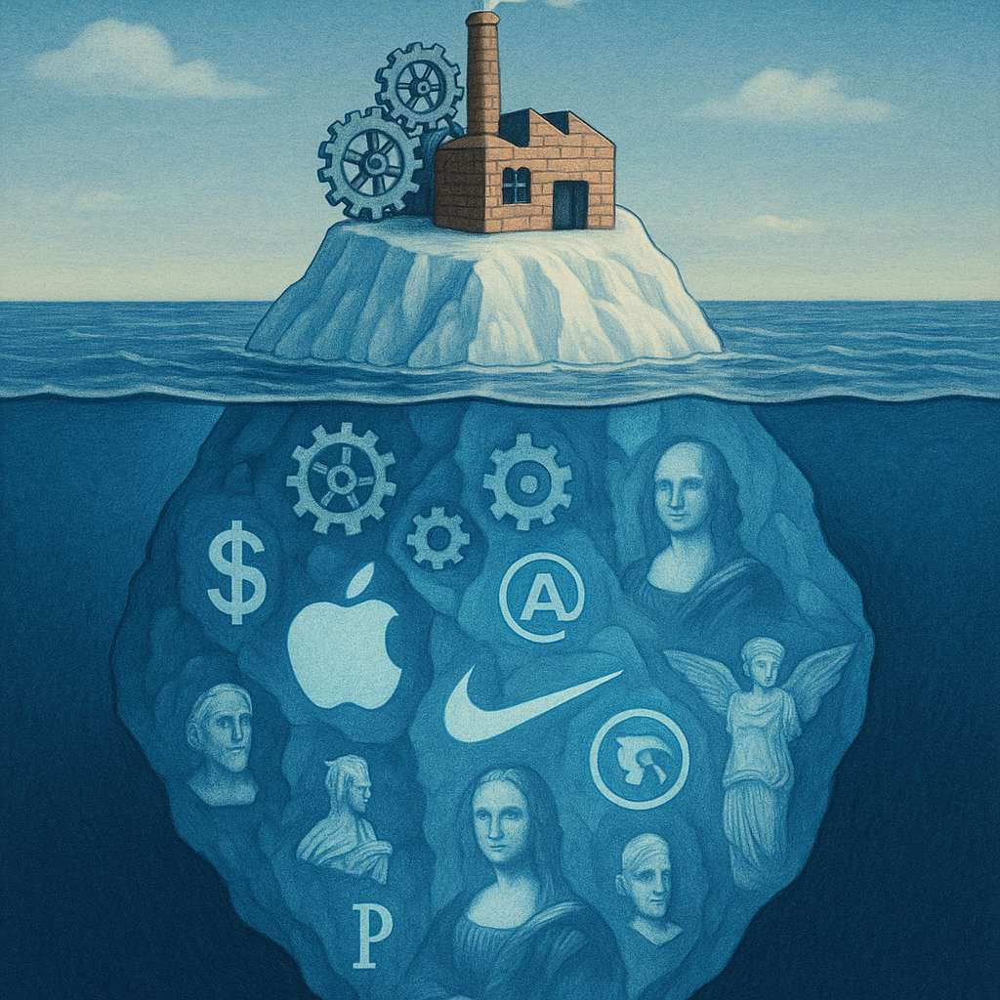
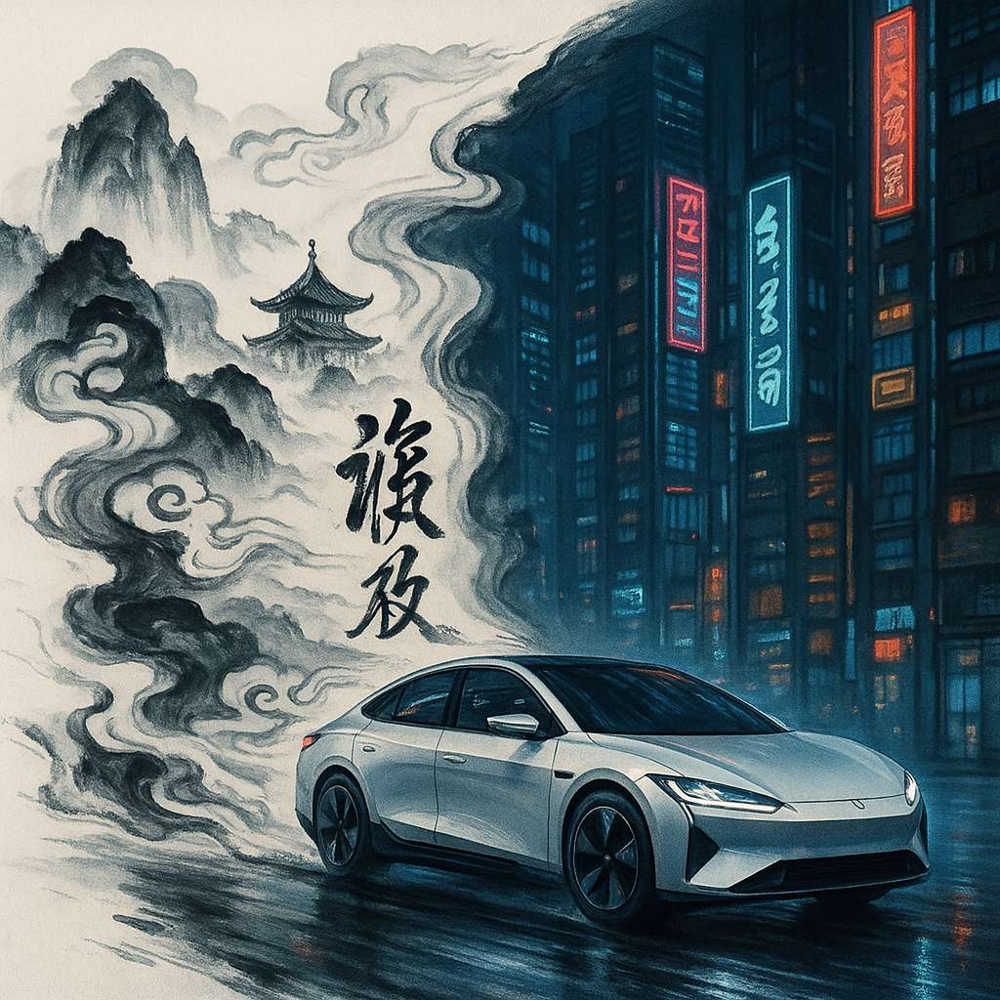
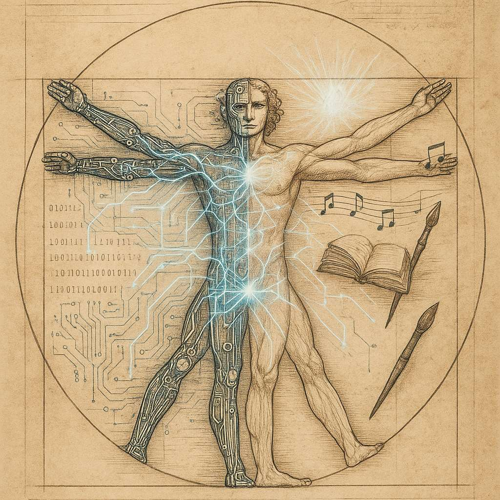

## 从“如何做”到“为何如此”的时代转向

把一个东西做出来，和让人觉得它值得带回家，是两门本事。AI若让某些制作环节变便宜，第二门本事是不是更值得我们认真对待？我想为人文学科争的，是这个常被成本表漏掉的位置，不是宣告物质生产退场。

**系列第二篇，从无形经济读起。** 下面先看皮包和手机：同样是谈“价值”，账本记下的东西和买主看重的东西有什么不同？沿着“为何如此”继续读，可以看[当算法成为权力](当算法成为权力：AI时代为什么更需要人文科学.md)讨论谁来决定规则，或读[系列结语](不可被自动化的心智：深层人文探索如何定义未来.md)。

## 无形经济的崛起：当叙事超越物质

无形投入既包括品牌、设计和文化叙事，也包括软件研发。以微软为例，数厂房和设备，显然数不出一套软件的全部价值；但把股票市值减去账面资产，也得不出一个叫“叙事”的数。市价还反映对未来收益的预期，研发团队写下的代码也不是有形设备。

我能由此提出的判断要窄一些：生产成本解释不了一种产品的全部价值。工程解决“如何做”，还有一种工作要回答“为什么有人在乎它”——**赋予商品超越其物理功能的文化与情感价值。** 两种劳动并不互相排斥。

## **奢侈品与高科技消费品的价值密码**

取一个爱马仕皮包。皮革的成本不能解释全部售价，工匠的时间、有限的供给和销售渠道也都在里面。那么工艺故事还重要吗？重要。同一处针脚，被看成耐用的接缝，和被看成某种手艺的传承，是两种购买理由。

奢侈品牌经营的正是这种差别。故事可以改变买主怎样理解眼前的东西，却不能把售价扣掉皮料之后的余额都记在讲故事的人头上。

同样，苹果公司之所以能在激烈的科技市场中维持高额利润，其根本原因不仅在于卓越的技术规格，更在于其成功塑造的品牌叙事——一种关于创新、简约、个性和归属感的文化符号。消费者购买的不仅是一部手机，更是一种身份的认同和生活方式的表达。这种品牌忠诚度，根植于人文层面的情感连接，而非单纯的技术参数对比。

这些例子说明了为什么品牌、设计与文化研究值得做，而非证明AI已经把利润从技术转移给叙事。消费者可以同时喜欢手机的性能和它代表的生活方式；哪一种理由带来多少收益，单凭这个例子分不出来。

## **国家战略的升维：“讲好中国故事”的经济逻辑**

将上述经济逻辑从企业层面提升至国家战略层面，便与“讲好中国故事”的时代要求形成了深刻的共鸣。 在全球化的竞争格局中，一个国家的影响力不仅取决于其经济体量与军事等硬实力，更取决于其文化叙事的感召力，即文化软实力。

### **从“中国制造”到“中国引领”**

中国在新能源汽车、无人机、高铁等领域取得了举世瞩目的技术成就。这些强大的理工科实力，为国家发展提供了坚实的物质基础，可谓之“体”。然而，若缺乏强大的人文叙事作为其“魂”，这些技术产品在全球市场中将主要依赖价格与性能进行竞争。这种竞争模式不仅限制了其价值的上限，也削弱了其文化影响力。

“讲好中国故事”的战略意义，正是在于为中国的硬实力注入文化内核。 这是一项系统性的人文工程，旨在构建一套融通中外的话语和叙事体系，提炼和展示中华文明的精神标识与文化精髓，从而提升中国形象的亲和力与中国话语的说服力。 其最终目标，是将“中国制造”的产品，转化为承载着中国智慧、中国方案和中国价值的文化出口，推动中国在全球价值链中的地位从跟随者向引领者跃升。

例如，当一辆中国制造的电动汽车不仅被视为交通工具，更被理解为中国致力于可持续发展理念、构建人类命运共同体的实践载体时，它的价值便超越了物理性能本身。这种价值升维，需要历史学、哲学、传播学、艺术设计等多个人文领域的深度参与。

### **理工科与人文科学的战略共生**

在此背景下，理工科与人文科学的关系并非“非此即彼”的对立，而是一种**战略性的共生关系**。斯坦福大学等顶尖学府早已认识到交叉融合的重要性，并成立了“以人为本的人工智能研究院”，强调AI需要融入人类智慧的多样性。 清华大学等国内高校也开始推动学科交融，鼓励文科和理工科背景的学生合作。

一个国家的强大，需要理工科锻造出坚实的“骨骼”与“肌肉”，但同样需要人文科学赋予其独特的“灵魂”与“气质”。 如果说理工科决定了一个国家能走多快，那么人文科学则决定了它能走多远，以及它将以怎样的面貌被世界所理解和接受。

因此，中国发展的下一阶段，其关键并非简单地从理工科“转向”人文科学，而是在已有的强大理工科实力之上，深度“融合”人文科学的能力。 这种融合将催生出更高维度的全球竞争力，使得人文科学从过去被视为的辅助性角色，转变为驱动国家发展的核心战略要素。

## **在意义的蓝海中航行**

机器能把某道工序做得更快，未必能告诉企业，人们为什么还愿意选择这件产品；更不能替一个国家决定，希望外界通过它的产品了解怎样的生活。这才是我说的从“如何做”到“为何如此”。人文不是工程的接班人，两者应当坐在同一张设计桌前。

因此，“超越生产”不仅是对一个经济阶段的描述，更是对未来价值创造方向的战略指引。它要求我们重新审视教育体系、人才培养模式和国家发展战略，将人文科学置于其应有的核心地位。因为在这片由意义、情感和文化构成的广阔蓝海中，蕴藏着后工业、AI驱动经济中最澎湃的增长动力。

