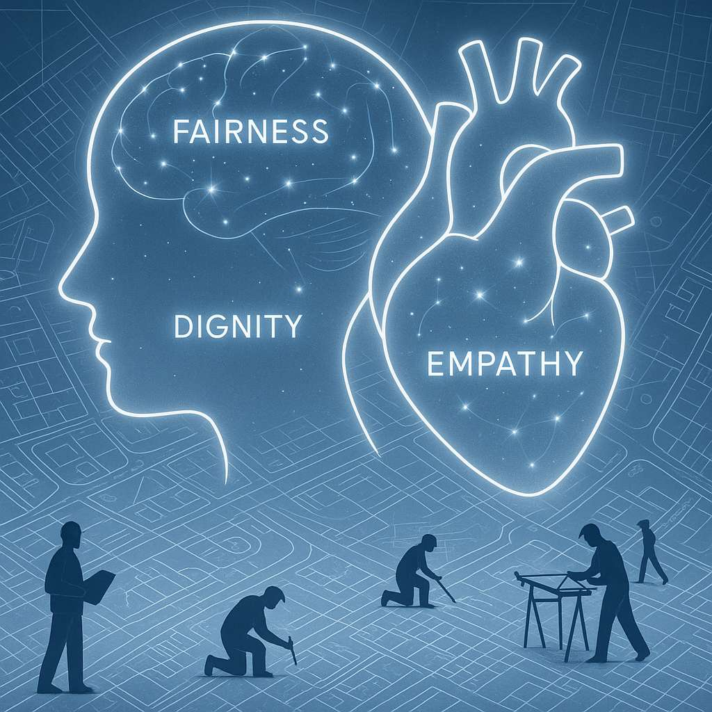

## **导语：当算法成为权力，谁来执笔伦理的法典？**

人工智能的浪潮以前所未有的深度与广度席卷人类社会，它既是效率革命的引擎，也构筑了一座错综复杂的伦理迷宫。在这座迷宫中，算法的偏见可能固化社会的不公，自动化决策的责任归属变得模糊不清，人工智能生成内容的知识产权亟待厘清，而自主系统在关键时刻的道德抉择更是悬而未决的难题。这些挑战的复杂性远非技术代码所能单独解答，它们是深刻的哲学、法学与社会学议题，呼唤着人文科学的智慧来导航。

本文旨在深入探讨人工智能时代的核心治理困境，并阐明为何人文科学所培养的阐释能力、伦理思辨与系统性思维，是确保技术始终“以人为本”不可或缺的指南针。

## **一、 算法的阴影：偏见、问责与知识产权的迷雾**

人工智能并非价值中立的工具，其决策逻辑深受训练数据和设计选择的影响。这使其在带来便利的同时，也催生了三大亟待解决的伦理与法律困境。

#### **1.1 算法偏见：数字世界中的系统性歧视**

算法偏见是指机器学习模型在决策时产生系统性的、不公平的结果，这通常源于有偏见的训练数据或有缺陷的算法设计。

例如，亚马逊公司曾因其开发的招聘AI系统自动对女性求职者的简历进行降权处理而引发巨大争议。此类事件揭示了一个严峻的现实：如果训练数据本身就包含了历史上人类社会存在的性别、种族或阶级偏见，那么AI不仅会复制这些偏见，甚至会将其放大并固化，形成一个难以打破的恶性循环。

这种“数字歧视”潜藏在金融信贷审批、司法风险评估、医疗诊断乃至公共资源分配等各个领域。要识别并纠正这些偏见，单纯的技术优化是远远不够的。我们必须借助社会学、伦理学和批判理论的视角，去审视数据背后的权力结构与社会现实，追问“公平”本身的多元定义。

人文科学的介入，能够帮助我们建立更加公正和透明的算法公平性评估框架，确保AI的发展能够促进而非侵蚀社会公平。

#### **1.2 责任归属：当机器犯错，谁来担责？**

随着自动驾驶汽车、智能医疗诊断系统等高风险自动化决策工具的应用日益广泛，一个棘手的法律难题浮出水面：当这些系统出错并造成损害时，责任应当由谁承担？ 是算法的设计者、数据提供者、系统运营方，还是最终用户？

传统的责任归属理论建立在人类行为者的基础上，但在人机协同的复杂系统中，这一框架显得捉襟见肘。例如，在一场由自动驾驶汽车引发的事故中，要厘清是软件缺陷、传感器故障还是用户不当干预导致了悲剧，技术上和法律上都极具挑战性。

解决这一“责任真空”问题，需要法学家、哲学家和政策制定者共同协作，探索全新的法律框架。这不仅涉及对现有侵权法、合同法和产品责任法的修订，更需要从伦理层面探讨机器的“道德地位”与人的“监督义务”，从而构建一个既能鼓励创新又能保障受害者权益的责任分配体系。

#### **1.3 AIGC的版权之争：谁是数字作品的创作者？**

人工智能生成内容（AIGC）的爆发式增长，正在颠覆传统的知识产权法律体系。当AI能够独立创作出小说、画作甚至音乐时，“作者”的定义便受到了根本性的挑战。现行著作权法大多以“人类的智力创造”为核心，这使得纯粹由AI生成的作品其权利归属变得模糊不清。

这场全球性的版权博弈中，不同的司法体系正探索不同的路径。例如，中国已有判例承认，若用户在使用AI过程中付出了显著的独创性智力投入，则该用户可被认定为作者并享有著作权。

然而，AI训练数据本身是否构成侵权、AI模型的开发者是否应享有部分权利等问题依然悬而未决。人文科学，特别是法学和美学，为解决这些争议提供了关键的理论工具。它们帮助我们辨析“独创性”的本质，探讨创作过程中人与机器的角色分配，并为构建一个能够平衡创作者、技术开发者与公众利益的AIGC知识产权新规则提供法理与哲理基础。

## **二、 人文的罗盘：以价值理性驾驭技术未来**

面对AI带来的复杂挑战，我们必须认识到，技术的发展并非一种不可抗拒的自然宿命，而是一系列“充满重大后果的人类选择”的产物。在这一过程中，人文科学扮演着不可或替代的“领航员”角色，它为我们提供了确保技术服务于人类福祉的价值罗盘。

#### **2.1 框架设定：确保以人为本的决策原则**

AI的研发和应用方向，从根本上说是由人类的价值观决定的。然而，在商业利益和技术效率的驱动下，AI的发展路径很容易偏离“以人为本”的初衷。人文主义的伦理学方法强调，我们不仅要关注AI能带来什么结果，更要关注它通过何种程序达成这些结果，以及这些程序是否尊重人的尊严与自主性。

人文科学，尤其是哲学和政治学，致力于探讨正义、公平、权利和共同利益等核心价值。将这些思辨融入AI的顶层设计，能够帮助我们确立负责任的创新原则，例如“安全可控”、“包容共享”和“开放协作”。

通过构建强有力的伦理审查和治理框架，我们可以引导技术创新朝着增进人类福祉、促进社会可持续发展的方向前进。这要求我们培养一种“技术伦理观”，确保每一次技术突破都伴随着对其社会影响的深刻反思。

#### **2.2 跨界沟通：搭建两种文化的协作桥梁**

气候变化、全球公共卫生危机、数字鸿沟等当今世界最严峻的挑战，本质上都是复杂的社会技术系统问题，无法仅靠单一学科的知识来解决。人工智能技术为应对这些挑战提供了强大的工具，但其有效应用离不开对具体社会文化情境的深刻理解。

人文领域的学者与实践者，凭借其强大的沟通、阐释与共情能力，能够成为连接技术专家、政策制定者与社会公众之间的关键桥梁。他们擅长将复杂的技术概念转化为公众可理解的语言，促进不同专业背景的团队进行有效协作，并将技术解决方案牢牢地锚定在真实的社会需求和文化价值之上。

例如，在利用AI缩小数字鸿沟时，仅提供技术设备是远远不够的，还需要社会学家和教育家深入研究老年人、偏远地区居民等群体的具体困难和学习习惯，设计出真正具有包容性的解决方案。这种跨越“两种文化”的深度融合，是实现“科技向善”的必由之路。

## 为人机共生的未来注入人文精神

在驾驭人工智能这座迷宫的征途中，技术本身既是路径，也是障碍。算法的逻辑可以无限趋近于理性，但唯有人文精神的光芒，才能确保这条路通往一个更公平、更可持续、也更富温情的未来。从解决算法偏见的社会根源，到为自动化决策建立合理的问责机制，再到为数字创作界定新的权利边界，每一步都离不开深刻的价值判断与伦理思辨。

一个只懂技术的社会是脆弱的，而一个只懂人文的社会则缺乏改变世界的力量。在人工智能时代，最大的风险并非机器将取代人类，而是人类在技术的迷宫中迷失了方向，忘记了我们出发的初衷。

因此，大力发展人文科学，培养兼具技术素养与人文关怀的跨界人才，以前所未有的紧迫性摆在我们面前。这不仅是为了应对眼前的挑战，更是为了塑造一个人类与智能机器能够和谐共生、共同繁荣的未来文明形态。让人文的智慧成为驾驭科技的缰绳，这正是我们在人工智能时代必须坚守的核心使命。

