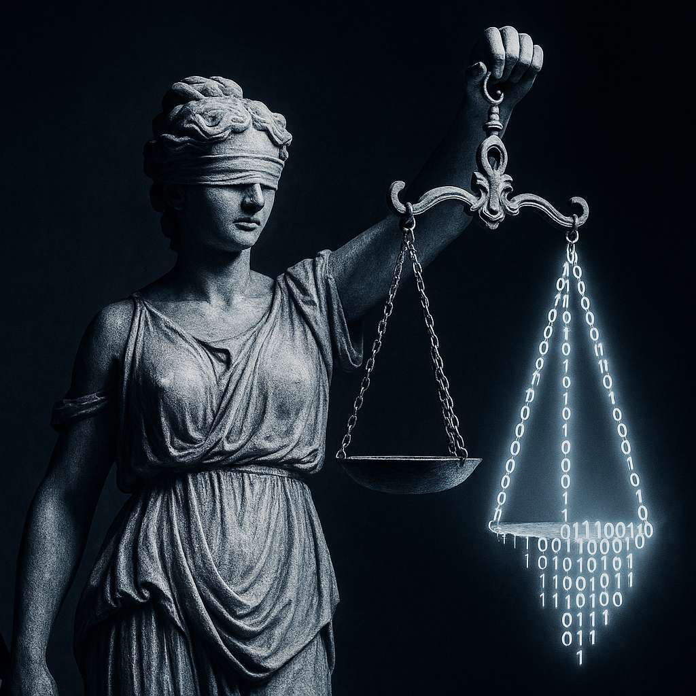

## **导语：当算法成为权力，谁来执笔伦理的法典？**

人工智能的浪潮以前所未有的深度与广度席卷人类社会，它既是效率革命的引擎，也构筑了一座错综复杂的伦理迷宫。在这座迷宫中，算法的偏见可能固化社会的不公，自动化决策的责任归属变得模糊不清，人工智能生成内容的知识产权亟待厘清，而自主系统在关键时刻的道德抉择更是悬而未决的难题。这些挑战的复杂性远非技术代码所能单独解答，它们是深刻的哲学、法学与社会学议题，呼唤着人文科学的智慧来导航。

本文旨在深入探讨人工智能时代的核心治理困境，并阐明为何人文科学所培养的阐释能力、伦理思辨与系统性思维，是确保技术始终“以人为本”不可或缺的指南针。

## **一、 算法的阴影：偏见、问责与知识产权的迷雾**

人工智能并非价值中立的工具，其决策逻辑深受训练数据和设计选择的影响。这使其在带来便利的同时，也催生了三大亟待解决的伦理与法律困境。

#### **1.1 算法偏见：数字世界中的系统性歧视**

算法偏见是指机器学习模型在决策时产生系统性的、不公平的结果，这通常源于有偏见的训练数据或有缺陷的算法设计。

一个常被提起的例子是亚马逊试验过的简历排序工具。据路透社2018年10月10日的报道，试验发现它会给带有某些女性相关词语的简历降分。报道区分了工具给出的推荐和招聘人员实际作出的决定；不能据此说它曾独立决定谁获得工作。但也不必等到确认某人因此落选，才追问：拿历史录用记录做标准，系统究竟学会了辨认能力，还是学会了复制谁过去更容易入行？

这种“数字歧视”潜藏在金融信贷审批、司法风险评估、医疗诊断乃至公共资源分配等各个领域。要识别并纠正这些偏见，单纯的技术优化是远远不够的。我们必须借助社会学、伦理学和批判理论的视角，去审视数据背后的权力结构与社会现实，追问“公平”本身的多元定义。

人文科学的介入，能够帮助我们建立更加公正和透明的算法公平性评估框架，确保AI的发展能够促进而非侵蚀社会公平。

#### **1.2 责任归属：当机器犯错，谁来担责？**

随着自动驾驶汽车、智能医疗诊断系统等高风险自动化决策工具的应用日益广泛，一个棘手的法律难题浮出水面：当这些系统出错并造成损害时，责任应当由谁承担？ 是算法的设计者、数据提供者、系统运营方，还是最终用户？

以自动驾驶事故为例：是设计缺陷、训练数据没有覆盖事发情境、运营者疏于维护，还是使用者在提示后没有接管？查清事实与因果关系不容易，不等于侵权、产品责任或合同规则一概失效。先要问谁保存了能说明当时状态的记录，谁有义务提供，受害者又可以向谁主张救济。

我的担心是：设计者说自己只交付了模型，运营者说自己只是照说明使用，最后受害者却要独自拼出整条链。讨论要不要创设新规则之前，应先看现有程序能不能让受影响的人拿到证据、得到答复。

#### **1.3 AIGC的版权之争：谁是数字作品的创作者？**

人工智能生成内容（AIGC）的爆发式增长，正在颠覆传统的知识产权法律体系。当AI能够独立创作出小说、画作甚至音乐时，“作者”的定义便受到了根本性的挑战。现行著作权法大多以“人类的智力创造”为核心，这使得纯粹由AI生成的作品其权利归属变得模糊不清。

北京互联网法院在2023年11月27日作出的[（2023）京0491民初11279号判决](https://english.bjinternetcourt.gov.cn/2024-02/28/c_695.htm)中，考察的是一幅具体图片：使用者设计提示词、调整参数，在多次生成后选择了最后的画面。法院依据这些具体选择认定该图体现了人的独创性表达。这不是按一下生成按钮就自动获得著作权的通则。

另一个问题在训练端：开发者取用的既有作品来自哪里，有没有授权，是否存在适用的法律例外？确认某一张输出图构成作品，既没有给模型的全部训练材料补发许可，也不能代替对另一幅图是否侵权的判断。把这两张账分开，创作者和使用者才知道各自在争什么。

## **二、 人文的罗盘：以价值理性驾驭技术未来**

面对AI带来的复杂挑战，我们必须认识到，技术的发展并非一种不可抗拒的自然宿命，而是一系列“充满重大后果的人类选择”的产物。在这一过程中，人文科学扮演着不可或替代的“领航员”角色，它为我们提供了确保技术服务于人类福祉的价值罗盘。

#### **2.1 框架设定：确保以人为本的决策原则**

AI的研发和应用方向，从根本上说是由人类的价值观决定的。然而，在商业利益和技术效率的驱动下，AI的发展路径很容易偏离“以人为本”的初衷。人文主义的伦理学方法强调，我们不仅要关注AI能带来什么结果，更要关注它通过何种程序达成这些结果，以及这些程序是否尊重人的尊严与自主性。

人文科学，尤其是哲学和政治学，致力于探讨正义、公平、权利和共同利益等核心价值。将这些思辨融入AI的顶层设计，能够帮助我们确立负责任的创新原则，例如“安全可控”、“包容共享”和“开放协作”。

通过构建强有力的伦理审查和治理框架，我们可以引导技术创新朝着增进人类福祉、促进社会可持续发展的方向前进。这要求我们培养一种“技术伦理观”，确保每一次技术突破都伴随着对其社会影响的深刻反思。

#### **2.2 跨界沟通：搭建两种文化的协作桥梁**

气候变化、全球公共卫生危机、数字鸿沟等当今世界最严峻的挑战，本质上都是复杂的社会技术系统问题，无法仅靠单一学科的知识来解决。人工智能技术为应对这些挑战提供了强大的工具，但其有效应用离不开对具体社会文化情境的深刻理解。

人文领域的学者与实践者，凭借其强大的沟通、阐释与共情能力，能够成为连接技术专家、政策制定者与社会公众之间的关键桥梁。他们擅长将复杂的技术概念转化为公众可理解的语言，促进不同专业背景的团队进行有效协作，并将技术解决方案牢牢地锚定在真实的社会需求和文化价值之上。

例如，在利用AI缩小数字鸿沟时，仅提供技术设备是远远不够的，还需要社会学家和教育家深入研究老年人、偏远地区居民等群体的具体困难和学习习惯，设计出真正具有包容性的解决方案。这种跨越“两种文化”的深度融合，是实现“科技向善”的必由之路。

## 为人机共生的未来注入人文精神

在驾驭人工智能这座迷宫的征途中，技术本身既是路径，也是障碍。算法的逻辑可以无限趋近于理性，但唯有人文精神的光芒，才能确保这条路通往一个更公平、更可持续、也更富温情的未来。从解决算法偏见的社会根源，到为自动化决策建立合理的问责机制，再到为数字创作界定新的权利边界，每一步都离不开深刻的价值判断与伦理思辨。

一个只懂技术的社会是脆弱的，而一个只懂人文的社会则缺乏改变世界的力量。在人工智能时代，最大的风险并非机器将取代人类，而是人类在技术的迷宫中迷失了方向，忘记了我们出发的初衷。

因此，大力发展人文科学，培养兼具技术素养与人文关怀的跨界人才，以前所未有的紧迫性摆在我们面前。这不仅是为了应对眼前的挑战，更是为了塑造一个人类与智能机器能够和谐共生、共同繁荣的未来文明形态。让人文的智慧成为驾驭科技的缰绳，这正是我们在人工智能时代必须坚守的核心使命。

