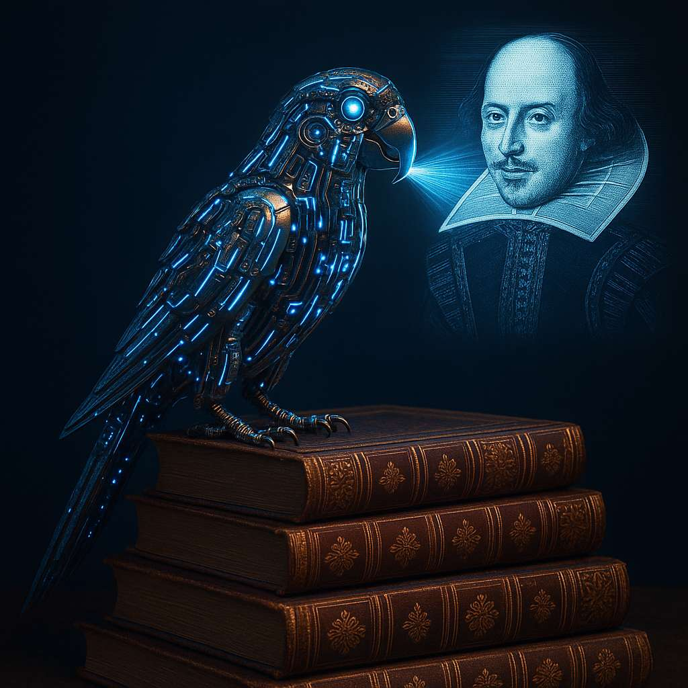
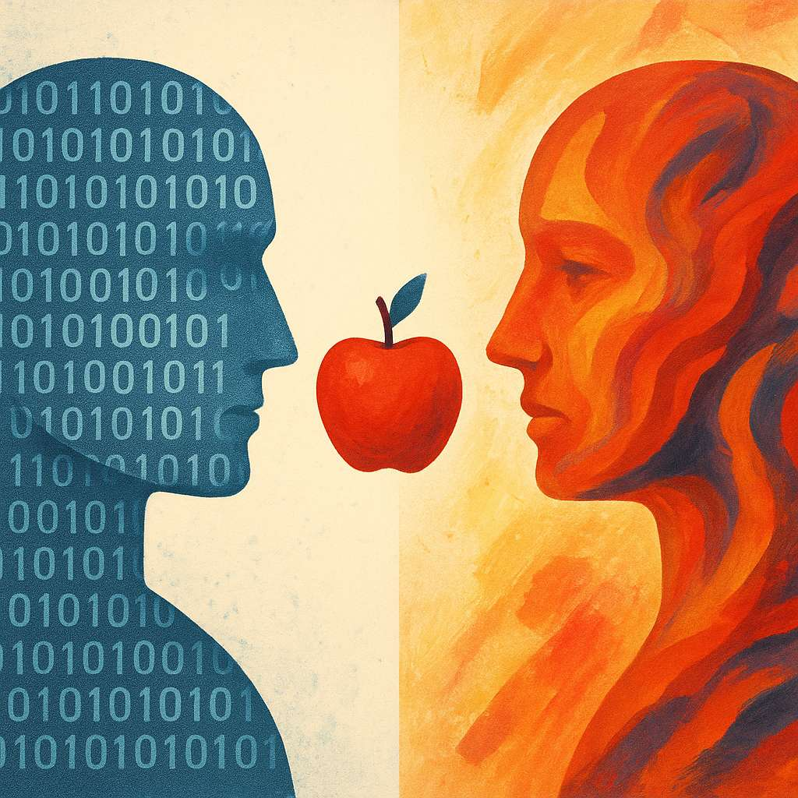
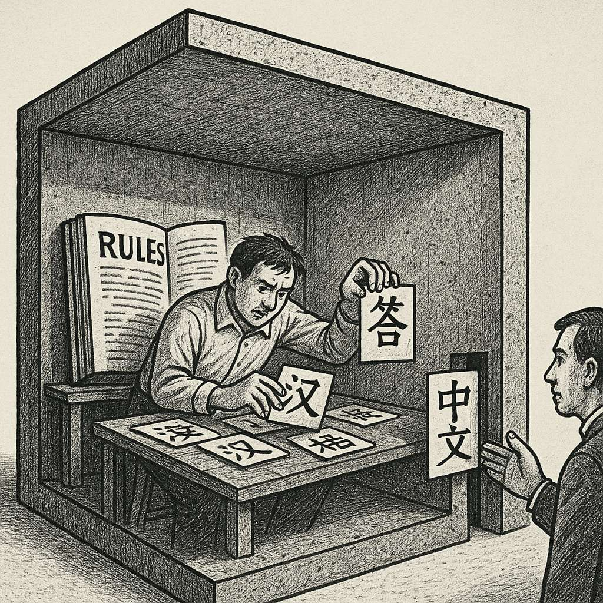
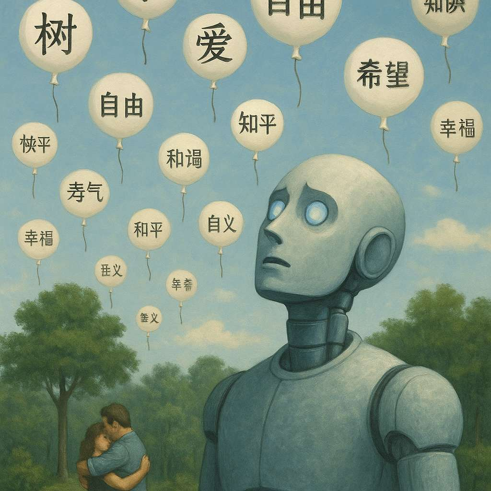
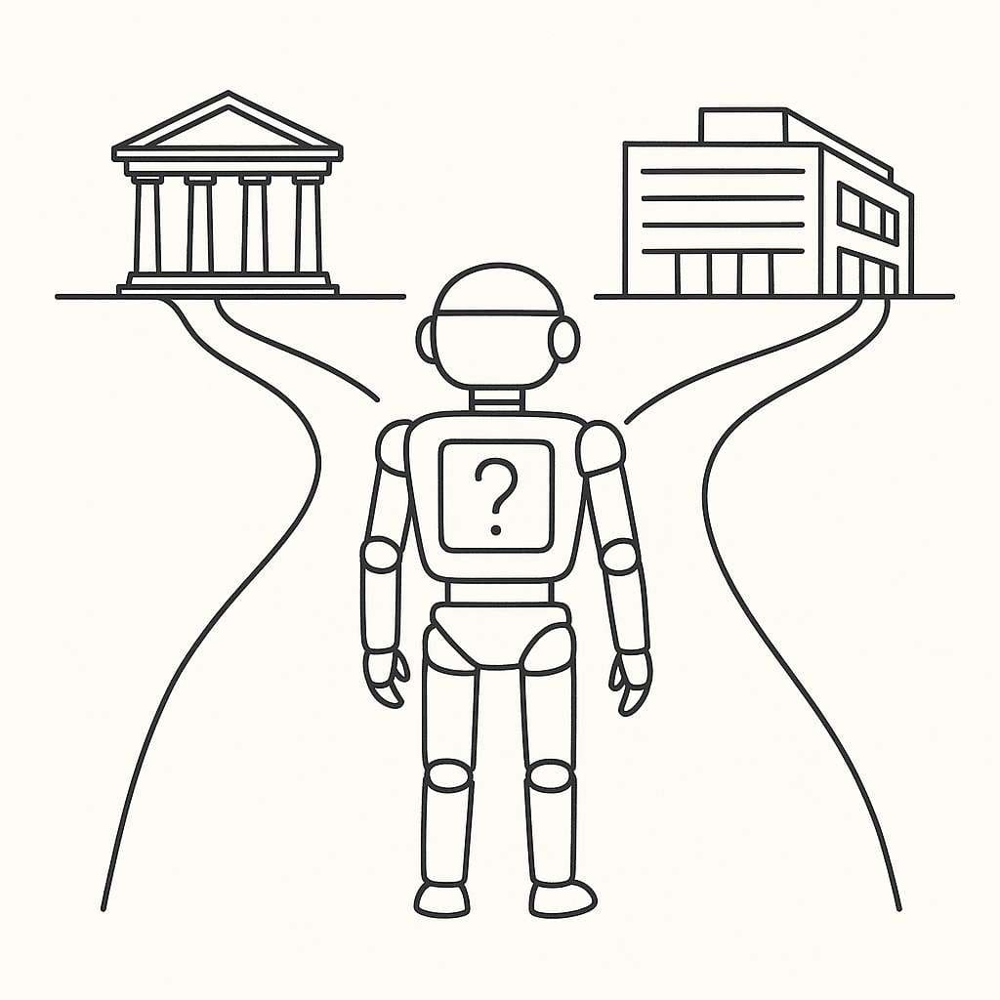

# 最精密的鹦鹉？从一只红苹果谈理解与创造

把一只红苹果放在桌上，问机器：“它是什么颜色？”它答“红色”。再问：“红是什么感觉？”它写出一句很漂亮的话：“像冬天里手掌贴近炉火，还没碰到的那一瞬。”

第一问可以换盏灯、换只青苹果，看看它还能不能辨认。第二问怎么判？如果那句话打动了我，至少证明**我**有了感觉。至于说出这句话的系统有没有感觉，这个结果没有告诉我。

我对“机器已经懂了”的说法一直有这点保留。但要是据此断言机器只能当鹦鹉，也说得太快。辨出红色、经历红色、用一句好比喻让别人想起红色，是三件不同的事。下文试着给它们各算各的账。

## 一、换一盏灯，能检验哪一种理解？

假如给一套系统看许多贴了标签的照片，它都答对，可能认出的是苹果，也可能只是照片里一贯出现的红色背景。把苹果挪到蓝桌布上，换成一篮青苹果，甚至放进一只蜡做的红苹果，会让不同的解释逐渐分开。这样的测试不会解决意识问题，却会改变我的判断：我愿不愿意让它帮果农分拣？出错时该在哪一处加一道人工复核？

“它看见红色时是什么感觉”问的不是分拣能力。关于红色的波长、光照和人的视觉系统，说明可以越来越完整；要从这些说明推出**眼前这套系统自身有第一人称体验**，还差一条论证。反过来也一样：我没有检验它体验的好办法，不等于我刚刚证明了任何机器都不可能有体验。我的立场是暂不把流利的自述当作证据，而不是已经知道了机箱里绝不会发生什么。

## 二、中文房间：房间里的人，还是整间房？

塞尔的设想很巧：一个不懂中文的人坐在屋里，照着规则拿卡片，能递出让屋外人满意的中文回答。问屋里的人那句话是什么意思，他还是不懂。这个例子让我对漂亮回答多了一层警惕：**把一句话接得恰到好处，与知道它指什么，不能不加解释地画等号。**

但这个故事有一个值得认真对待的反问：屋外的人从来就没在测试那位拿卡片的人，他们测试的是人、规则和卡片构成的整个房间。大脑里的一个神经元也不会单独读懂一句诗；不能因为一个部件不懂，就断定整体不懂。这叫“系统回应”。它没有证明房间理解中文；它指出，**原先那个“不懂”的答案是向谁问出来的**。双方真正需要交代的是：在怎样的整体行为或内部组织上，我们才肯把“理解”二字用上去？

学“椅子”也能看出这种分歧。只读词典，可以知道它常跟“坐下”一起出现；真的试着坐，得知道一把坏腿椅子会倒。对只接收文字的模型，我会追问词怎样连到事物。对有摄像头和机械臂的系统，这个问题就得改问：它能不能在推椅子、椅子晃动、及时收手的过程中改正判断？把所有系统统称为“无身”，反倒错过了可以做的实验。即使它学会收手，疼痛对它是什么感觉，仍然是前一节那个没答完的问题。

## 三、把署名盖起来，还会不会说这首诗没有原创性？

设想一场小小的写作练习：用四行写那只苹果，不许用“鲜红”“香甜”。一个人交来一首，一套模型也交来一首。先遮住署名。我愿意对两首都用相同的问题：比喻是不是直接照搬的？删去第三行，全诗会不会损失什么？有没有一个细节，让我以后经过水果摊时多看一眼？

如果模型那首在这些问题上答得好，我没有理由因为揭晓了署名就撤回对**作品**的欣赏。反过来，人写的一首套话也不会因为作者是活人就自动新颖。“从已有材料重组”本身不是判决；人学画、写诗也从临摹开始。要指认抄袭，需要拿出具体相似的作品；要赞美新意，也该说清它改变了哪一种习惯看法。

揭开署名以后，还有另一种阅读。假如那首诗写的是“父亲最后一次给我削苹果”，我会问：这是虚构的叙述者，还是作者请我相信的亲历？同样一句话，在短篇小说和回忆录里，作的是不同的承诺。身体经验之所以重要，不是因为一笔一画必然露出作者心跳，而是因为一个人有时确实在拿自己的记忆作证。而模型能写出一场告别，并不使那场告别成为它本人的履历。

## 四、还有一个不能交给盲评的问题

替别人做一张纪念海报，有十种构图可选。哪一张最醒目，可以并排比较；该不该用逝者那张生病时的照片，单看像素答不出来。谁答应了家属？谁可以撤回同意？如果照片用错了，谁去道歉、撤下、重做？再好的生成工具，也不能替作决定的人取得那份许可。

这是我最舍不得让“机器也会创造”一句话带过的部分。作品够不够新，可以就作品争；是否存在主观体验，是尚有争议的哲学判断；把特定作品署名、发表、交到谁手里，是现实里有人要承担的决定。三件事可以同时成立：一首生成的诗让我动容，我不知道系统是否体验过其中的悲伤，而发表它的人有义务说明那段经历是不是自己的。

所以我还愿意把“最精密的鹦鹉”当作一句**反问**。它提醒我，遇到一句像是理解的话，先问它能经受哪一种检验；也提醒我，遇到一句真的好诗，不要先看落款才决定自己有没有被打动。
