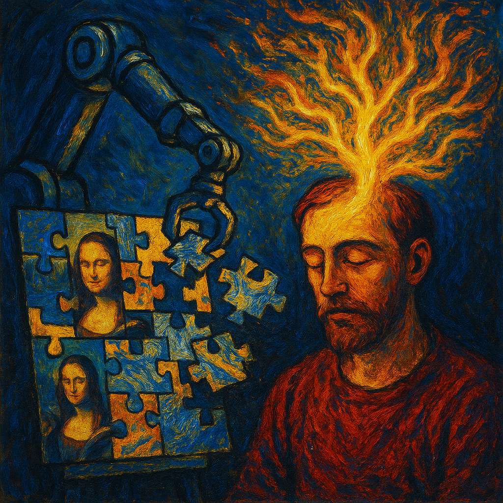

## **导言：最精密的鹦鹉**

人工智能（AI）正以前所未有的速度和深度重塑世界。大型语言模型可以引经据典，生成式AI能够创作出风格逼真的画作与乐曲。面对这些令人惊叹的成就，一个根本性的问题浮出水面：机器是否已经开始真正地思考和创造？或者，它们只是人类有史以来创造出的最精密、最博学的“鹦鹉”，能够完美模仿和重组人类的语言与思想，却始终无法触及理解与原创的内核？

本文旨在深入探讨这一核心议题，穿越人工智能光鲜的技术表象，探寻其深层的哲学与认知边界。这些边界并非暂时的技术瓶颈，而是关乎意识、意义、理解与原创性等根本问题。我们将从两大维度展开论述：首先，剖析AI在哲学层面无法逾越的鸿沟，包括意识缺席与理解困境；其次，审视AI在创造力维度的本质局限，论证其“创造”为何根本上是一种复杂的重组而非原创。

通过这次探索，我们旨在清晰地界定出那片专属于人类心智的、不可被自动化的核心领域。在一个答案可以被轻易生成的时代，理解这些边界，恰恰是为了更好地认识人之为人的独特价值所在。

## 一、人工智能的哲学边界：无法点亮的意识暗室

尽管人工智能在处理复杂任务时展现出超人的计算能力，但在其代码和算法的底层，横亘着几道深刻的哲学鸿沟，将机器智能与人类心智从根本上区别开来。

#### 意识与主观体验的鸿沟：什么是“红色的感觉”？

人工智能最根本的边界在于它缺乏意识（Consciousness）与主观体验，也就是哲学家所说的“感受质”（Qualia）。感受质指的是我们经验中那些主观的、“是什么样的感觉”的方面，例如品尝巧克力的甜美，或是看到落日的壮美时内心涌起的敬畏。

一个经典的思想实验可以阐明这一点：想象一台超级AI，它掌握了关于人类视觉系统的所有物理信息。当这台AI“看到”一个红色的苹果时，它可以精确分析光的波长，并输出所有与“红色”相关的文化和科学数据。然而，它能体验到我们所感受到的那种“红色的感觉”本身吗？答案是否定的。AI处理的是关于红色的客观数据，而人类拥有的，是体验红色的主观感受。

这种主观体验的缺失是根本性的。AI可以被编程来识别并回应人类的情感表达，但它自身无法“感受”到喜悦、悲伤或同情。它的行为是基于算法对数据的处理，而非源自内在的情感状态。这个被著名哲学家大卫·查默斯称为“意识的难题”（The Hard Problem of Consciousness）的挑战，构成了AI无法逾越的第一道深刻边界。

#### “中文房间”的思辨：句法不等于语义

如果说意识问题过于抽象，那么美国哲学家约翰·塞尔（John Searle）提出的“中文房间论证”（Chinese Room Argument）则更具体地揭示了AI在“理解”层面的本质缺陷。

实验是这样的：一个只懂英语的人被锁在房间里，他有一本英文规则手册和大量汉字卡片。当外面的人塞进用中文写的问题时，他不懂符号的含义，但可以根据规则手册的指示来匹配和组合汉字，然后将答案递出去。对于外面的人来说，这个房间仿佛有一个精通中文的人在与他们对话。然而，房间里的那个人（系统的“中央处理器”）自始至终没有理解任何一个汉字的意思。

塞尔认为，今天的AI系统本质上就处于这个“中文房间”之中。它们通过遵循复杂的程序（规则手册）来处理输入的符号（句法），并生成正确的输出，从而表现出“智能”的行为。但这个过程完全是形式化的，与符号所代表的真实含义（语义）无关。换言之，AI能够娴熟地操纵句法，却无法获得语义。这清晰地表明，无论一个程序多么智能，它本身都不足以产生真正的理解。

#### 符号接地问题：悬浮于经验世界之外的智能

“中文房间”引出了一个更深层次的问题，即“符号接地问题”（Symbol Grounding Problem）：系统中的符号（如文字）是如何与它们在现实世界中所指代的具体事物、经验和意义联系起来的？

对于人类而言，符号是“接地”的。当我们学习“椅子”这个词时，是通过看、坐、触摸等一系列身体与物理世界的互动，将这个符号与“可以坐的实体”这一丰富的、多感官的经验概念牢固地联系起来。我们的知识体系，深深地植根于我们作为肉身存在于这个世界的生活经验之中。

然而，AI的符号系统是悬浮的、未接地的。它通过分析海量文本，掌握了“椅子”这个词通常会和“坐”、“桌子”等词语一起出现。它所“理解”的，是符号与符号之间的统计相关性，而非符号与真实世界经验之间的联系。这就像一本只有文字的词典，你永远无法跳出这个封闭的符号系统来触及真实的世界。这种根本性的脱节意味着，AI的智能是一种漂浮在真实世界之上的、无根的智能。

## 二、人工智能的创造力边界：无法孕育原创的沃土

如果说哲学边界定义了AI“想”的局限，那么创造力边界则刻画了它“创”的本质。尽管生成式AI的作品时常令人惊叹，但其创作过程与人类的原创性活动存在根本性的不同。

#### 创造与重组的迷思：算法能产生真正的原创吗？

人工智能的“创造”，本质上是一种基于其庞大训练数据的、极其复杂的模式识别与重组。无论是生成图像还是文本，其核心都是学习现有作品的统计规律，然后生成符合这些规律的新样本。它可以将梵高的风格与赛博朋克的主题进行融合，但这是一种高超的“组合式创造力”，而非能够开辟全新范式的“变革式创造力”。

真正的原创往往源于对现有规则的突破。人类的创造力常常来自于独特的个人经历、深刻的情感驱动以及挑战公理的勇气。爱因斯坦提出相对论，不是基于对牛顿物理学数据的统计延伸，而是源于一个颠覆性的思想实验。这种跳出既定框架、重塑世界观的认知飞跃，是基于数据模式进行推演的AI所无法实现的。

因此，AI可以完美地模仿风格，却无法注入发自内心的“作者的声音”。它可以生成一首技巧无懈可击的诗，但诗中不会有作者本人在生活中体验到的爱与挣扎。AI的产出是其数据库的回声，而人类的杰作则是其生命经验的结晶。

#### 具身认知与生命体验：创造力的根源

人类的创造力与我们拥有身体（Embodiment）并生活在物理世界中这一事实密不可分。“具身认知”理论认为，我们的认知过程，包括高级的创造性思维，都深受身体经验的影响。

艺术创作在很大程度上是传递具身体验的尝试。一位画家的笔触，蕴含着他手臂运动的力量；一位音乐家的旋律，可能源自心跳的律动；一位小说家对恐惧的描写，离不开他对身体反应的亲身体验或共情理解。创造力植根于我们的感官知觉、身体行动以及与环境的持续互动之中。

而AI是“无身的”（disembodied）。它没有身体，没有在物理世界中的行动经验，也没有伴随生命历程而来的情感起伏。这就意味着，它的“创作”缺少了那一层最关键的、源自生命体验的质感与深度。它所处理的是抽象的数据，而非鲜活的经验。因此，AI可以生成一幅在视觉上令人愉悦的画，但它无法像人类艺术家那样，将自己与世界互动的真实感受灌注其中，使作品产生超越视觉本身的深刻共鸣。

#### 价值判断的缺失：无法自主的伦理与审美

最高层次的创造活动，不仅涉及技巧，更涉及价值判断，包括伦理判断和审美判断。人类艺术家不仅在创造“是什么”，更在表达“应该是什么”，他们的作品往往承载着对美、真理、正义的追求与反思。

AI可以被训练来模仿人类社会中被普遍认为是“美”或“善”的模式，但它自身没有内生的价值观。它的“判断”是基于其训练数据中的统计偏好，而非真正的信念。例如，一个AI可以生成符合黄金分割比例的构图，但它本身并不“理解”和谐之美。

更重要的是，艺术与思想的伟大进步，往往源于对现有审美和伦理规范的挑战与颠覆。一场新的艺术运动，本质上是对旧有审美标准的反叛。这种反叛与批判，需要一个独立的价值主体，一种敢于宣布“旧的标准是错的”的原创性意图。而AI作为被设定的工具，其本质是遵循而非挑战规则。它无法发起一场美学革命或伦理变革，因为它缺乏发动革命所必需的自主价值立场。

## 不可自动化的心智：重新发现人之为人的价值

通过对人工智能哲学与创造力边界的深入剖析，我们得出一个清晰的结论：尽管AI是人类创造出的最强大的工具，但它与真正的人类心智之间存在着本质的鸿沟。这些边界——意识的缺席、意义的悬浮、原创性的缺失、生命体验的空白以及价值判断的无能——共同勾勒出了一片专属于人类的、不可替代的核心领域。

认识到这些边界，并非为了贬低AI的巨大价值，恰恰相反，是为了在人工智能时代更深刻地定位人类自身的独特坐标。当重复性的计算与模式化的“创造”可以被机器高效完成时，人类独有的能力便愈发凸显其珍贵：去感受世界的主观体验，去追问“为何如此”的深刻理解，去扎根于生命历程的原创表达，以及去引领未来的价值决断。

人工智能是我们智慧的延伸，是一面反映人类知识总和的镜子。但最终，凝视镜中影像，并决定走向何方的，永远是镜子之外的我们。在这个新时代，最重要、最不可被自动化的任务，正是那些需要动用我们完整心智的活动：体验、共情、反思、批判与创造意义。这，正是人之为人的意义所在。

