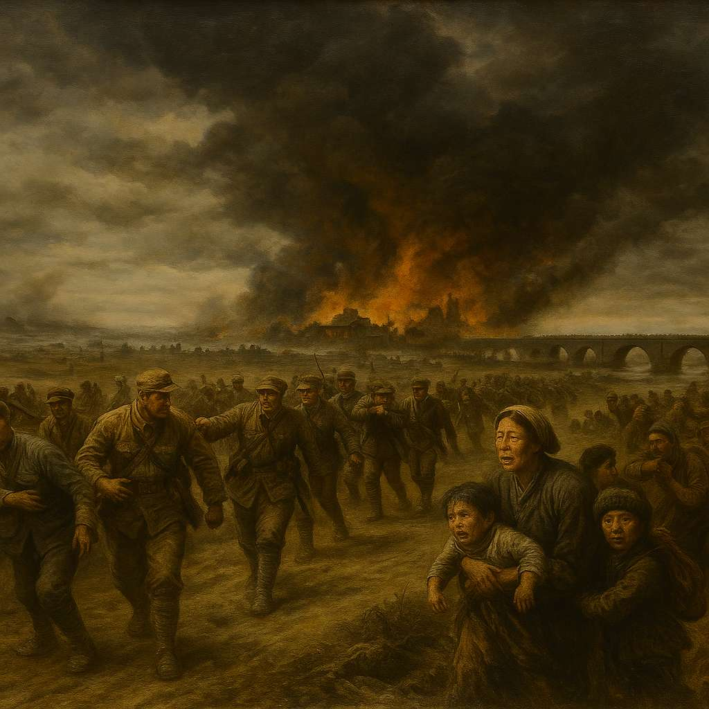
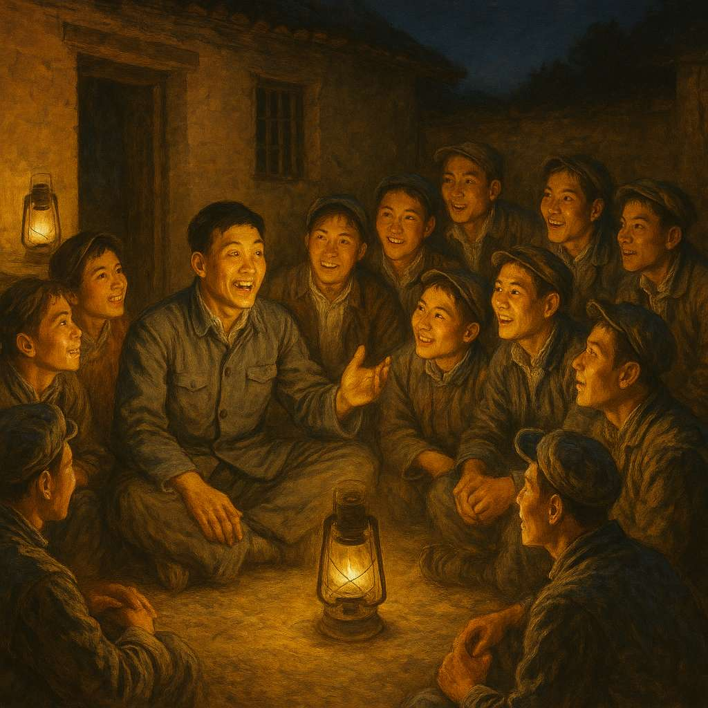
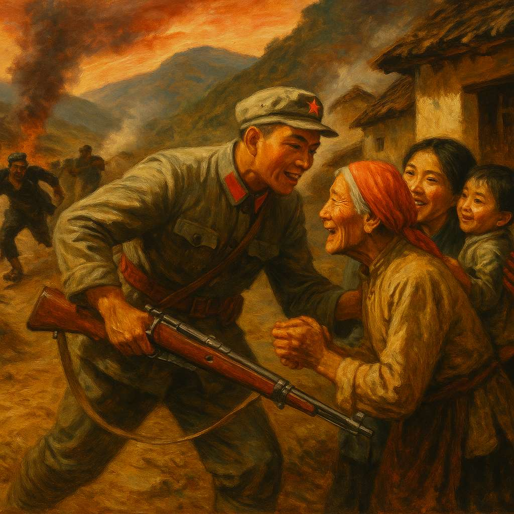

*注：本文图片均由AI生成，仅供示意，存在诸多与史实不符之处，本人能力有限，敬请谅解*

## **引子：AI推广的“天崩开局”，与1937年的回响**

让我们把时钟拨回到1937年的那个夏天。卢沟桥的枪声撕裂了华北平原的宁静。日寇的铁蹄之下，国军兵败如山倒。短短三个月，平津失守，河北沦陷，整个华北抗战遭遇了一场彻头彻尾的“天崩开局”。彼时彼刻，对于任何心存希望的抗争者而言，眼前是一片令人绝望的黑暗。

时光流转，在今天的企业殿堂里，一场没有硝烟的变革同样面临着它的“天崩开局”。AI，这个被誉为新质生产力代表的强大力量，正以雷霆万钧之势叩击着每一家组织的大门。我们都明白，生产力的巨大跃迁，必然要求生产关系做出相应的调整。这层近乎物理定律的第一性原理，是所有组织变革绕不开的基石。

然而，现实的剧本却往往荒腔走板。我们最常看到的，是领导层一拍脑袋，颁布一纸“全员拥抱AI”的敕令。于是，一场轰轰烈烈的“运动式”推广席卷而来。但这种自上而下的强压，却巧妙地绕过了组织架构的深水区，回避了工作流程的再造，更吝于在激励机制上做出丝毫让步。其结果，不过是风过无痕，留下一地鸡毛和几篇光鲜亮丽的PPT总结。

更普遍的，是一种弥漫在组织肌体中的“小资产阶级”式的集体彷徨。绝大多数员工和中层管理者，内心充满了矛盾与挣扎。他们既真切地恐惧AI会砸掉自己的饭碗，又深怕自己因固步自封而被时代无情地抛弃。

于是，“观望”成了最优策略。他们嘴上高喊着“拥抱变化”的口号，热衷于描绘一幅幅老板爱看、员工爱听的AI蓝图，反正画饼没有成本，还能赢得满堂喝彩。他们默默地窥视着那些勇敢的“先行者”，幻想着能一键复制别人的成功路径，却全然不知，任何真正的变革，都无法简单抄袭作业。

在这样一种混乱、迷茫、人人自危的氛围中，如何才能拨开迷雾，让AI的星星之火，真正在组织的土壤里形成燎原之势？

历史的尘埃中，往往埋藏着最璀璨的智慧。要解决这个本质上的组织发展（OD）问题，我们不妨从我党那段波澜壮阔的创业史中，借用其无往不利的三大法宝：**党的建设、武装斗争和统一战线**。

这绝非牵强附会，因为其背后，是洞穿人性和组织规律的深刻洞见。这三大法宝的灵魂，浓缩成一句话便是“全心全意为人民服务”。将其置于今天的商业语境，其内核便是：**AI的推广，必须真正服务于组织中的每一个人，以提升他们的生产力、降低他们的工作负担为首要目标，从而为组织带来真实、可持续的宏观收益。**

毕竟，老百姓从不关心你画的饼有多大，他们只关心自己的日子能否过得好一点。只要能坚守这个初心，那么变革路上的一切惊涛骇浪，都终将被我们跨越。

## **第一步：党的建设——从两手空空到淬炼出一支先锋队**

历史的镜头，聚焦于一位名叫孟庆山的干部。当他奉命前往冀中平原组织抗日武装时，他的全部家当，在被溃兵一路抢劫后，只剩下两双袜子和一条毛巾。正应了那句老话：“手上没把米，叫鸡都不来。”没有钱，没有枪，甚至连个像样的落脚点都没有，凭什么让老百姓跟着你把脑袋拴在裤腰带上干革命？就凭一张嘴吗？

令人惊叹的是，还真是凭着一张嘴。但孟庆山的这张嘴，蕴含着非凡的智慧。他没有一上来就振臂高呼、强行灌输。而是每到夜晚，骑着一辆破旧的自行车，穿行于各个村庄之间，为那些忧心忡忡又热血未凉的青年们，开办了一场场别开生面的“故事会”。

他讲的，不是空洞的大道理，而是红军如何在绝境中以少胜多、如何在百万军中取上将首级的亲身经历。这些充满传奇色彩又无比真实的故事，由一个活生生的战斗英雄娓娓道来，瞬间点燃了青年们心中的火焰。听众从最初的十几个，迅速发展到几十个，最后连小小的院落都挤不下了。

这便是我们得到的第一个，也是最根本的启示：**思想的启蒙与变革的宣传，必须像讲故事一样引人入胜，直抵人心。**

今天的员工，从媒体的狂轰滥炸中，对AI有着模糊而脸谱化的认知——它能写诗，能画画，很神奇，也很危险。这些信息，就像鲁迅笔下那个沾着鲜血的馒头，人们围观、议论，却不知道这究竟和自己的“病”有什么关系。

因此，组织内部的AI宣传，必须摒弃媒体式的浮夸与空泛。它需要像精准制导的导弹，深入到每一个具体的业务场景中。这就要求推动者，必须是一个既懂业务痛点，又懂AI能力的“双料专家”。

你可以在公司的内部社区平台，像连载小说一样，持续发布那些极具针对性的AI应用案例。比如，今天分享“设计部如何用AI在三小时内生成一百张营销海报初稿”，明天讲述“财务部如何用AI自动核对上万张发票，让员工告别无尽的加班”。在AI兴趣群里，你不仅要分享，更要像一个热情的“说书人”，与大家互动，解答每一个细微的疑问。

久而久之，那些真正对AI抱有热情、愿意动脑筋的“进步青年”，自然会从人群中浮现。他们会主动找上门来，好奇地询问：“你上次分享的那个自动化流程，到底是怎么实现的？”

这些人，就是你需要的星星之火。此刻，你的角色就要从“品宣广告”转向“效果广告”。当“故事会”的气氛达到顶点时，孟庆山立刻话锋一转，开始系统地讲授游击队如何组织、如何侦察、如何作战。同样，你也需要主动找到这些积极分子，与他们进行一对一的深度交流，倾听他们对AI的理解、困惑与期待。

更精妙的一招是，在谈话结束时，不经意地问一句：“在你身边，还有没有像你一样对这些新东西感兴趣的同事？”通过这种“滚雪球”式的社交挖掘，你就能迅速构建起一张跨部门的“AI积极分子网络”。

有了这批核心力量，你就可以开办“干部训练班”了——也就是我们今天所说的系统化培训。这绝不能是一次性的填鸭式教学，而应是长期的、循环的、螺旋式上升的学习社区。网络上的免费课程浩如烟海，但信息过载本身就是一种负担。

培训的真正价值，在于有人能为你披沙拣金，并传授“渔”而非“鱼”。你可以尝试“翻转课堂”的模式：让学员在线下利用精选的资料自学基础知识，然后把宝贵的面对面时间，全部用于项目实战、难点答疑和跨界脑暴。考虑到不同岗位的AI需求千差万别，最好的方式是将业务背景相似的人组成学习小组，让他们在小组内互为师生，共同攻克一个个真实的业务难题。

 

至此，通过“思想建设”的渗透和“组织建设”的凝聚，一支看不见但能量巨大的“AI先锋队”，便在组织的肌体中悄然成型。

## **第二步：武装斗争——用一场“高阳城之战”奠定胜局**

队伍虽然拉起来了，但凭什么让更广大的群众信服你？当时的冀中平原，各路地方武装多如牛毛，少则几百人，多则上万。孟庆山这支初生的队伍，在他们眼中不过是个不起眼的小角色。要想在乱世中站稳脚跟，光有思想和热情是远远不够的，必须打一场漂亮的胜仗，来证明自己的实力。

孟庆山的策略，是四个字——“借兵立威”。他找到了刚刚脱离国民党、手握1600多名训练有素、装备精良的东北军的传奇将领吕正操。他们精心选择的“祭旗”对象，是当时盘踞在高阳县城、装备精良、谁都不敢惹的硬骨头——保安队。

此战，孟庆山负责入城分化瓦解，动摇其军心；吕正操则负责正面强攻，平射炮一拉出来，只用两发炮弹就摧毁了对方的抵抗意志。战斗速战速决，大获全胜。此战过后，冀中平原上立刻传遍了“红军团长孟庆山带来了一两万人马”的“神话”，品牌效应瞬间爆棚，无数爱国青年闻讯纷纷前来投奔。

这个故事雄辩地证明，在组织变革中，“武装斗争”是不可或缺的一环。当然，我们斗争的对象，不是某个具体的人，而是**那些顽固的旧有流程、根深蒂固的低效模式，以及一切出于既得利益而产生的有形或无形的阻力。**

AI先锋队在初期，力量是薄弱的，资源是有限的。此时最忌讳的，就是四面出击，试图毕其功于一役。你必须学会“借兵立威”的巧劲。在组织里，所谓的“兵”，就是那些已经建立起声望、资源相对充裕、且对创新持开放态度的业务部门。你需要主动与他们结盟，共同选择一个如同“高阳城”一般的关键项目——这个项目必须具有足够的影响力，是许多人心中的“痛点”，同时又有明确的成功标准。

你要准备好面对那些顽固的怀疑论者。他们会出于维护自身地位、或仅仅是路径依赖，不遗余力地唱衰AI。他们会摆出长者的姿态，语重心长地告诫你：“你这个东西，我十年前就试过了，行不通。”

面对这种局面，任何辩论都是苍白无力的。你唯一需要做的，就是把那场“高阳城之战”的战报，响亮地拍在桌面上——“通过引入AI流程，这个项目的交付周期缩短了40%，人力成本降低了30%，客户满意度提升了20%。”

当这些无可辩驳的数据和成果摆在眼前，一切“不行论”都会烟消云散。这场胜利，本身就是一篇最雄浑的檄文。它会在组织内部迅速发酵，成为一个传奇的“企业故事”。

人们会在茶水间里议论：“你听说了吗？市场部那个老大难的项目，被AI搞定了！”这，就是瓦解阻力最有效的方式。同时，要记住任何顽固的堡垒，都有可能从内部被攻破。主动去识别和团结那些“敌对阵营”中的开明分子，让他们成为你安插在旧体系中的“内应”，变革的阻力将大大减小。

## **第三步：统一战线——改造而非消灭广大的“中间派”**

解决了最顽固的敌人，接下来要面对的，是更庞大、也更复杂的群体。在当年的冀中平原上，除了日伪军和我军，还存在着一股不可忽视的第三方势力——由各地地主豪绅组织的“联庄会”。

他们手握数万武装，占据着广大的乡村，其口号是“不抗日、不降日、防土匪、保家乡”，在夹缝中保持着一种微妙的“中立”。这股力量，争取过来，就是抗日的巨大助力；推向敌人，就是心腹大患。

在今天的任何一个组织中，都存在着大量的“联庄会”——那些对AI变革持中立、观望态度的部门和员工。他们不是激进派，也非顽固派，他们是沉默的大多数，是务实的“中间派”。他们的天平向哪边倾斜，将直接决定这场变革的最终走向。粗暴地命令他们“缴械投降”（放弃旧有工作模式），只会激起他们强烈的反抗。

我军当时采取的策略，堪称组织心理学的典范，其核心是：**不打联庄会，先剿匪打伪军。**

这背后的逻辑深刻而精妙：联庄会得以存在和壮大的根本原因是什么？是当时社会秩序崩溃，土匪、溃兵四处劫掠，老百姓普遍缺乏安全感。

地主豪绅正是利用了群众这种强烈的“保家自卫”的需求，才得以振臂一呼，组织起庞大的私人武装。那么，逻辑推演就变得异常清晰：如果此时出现了一支纪律严明、能真正剿灭匪患、恢复一方平安的队伍，那么老百姓对联庄会的依赖，以及维持这支武装的高昂成本，其存在的根基也就不复存在了。

历史的进程完美印证了这一判断。当我军连续消灭了冀中几股最大的土匪武装后，各个联庄会的头目们态度发生了180度的大转弯，从过去的高度戒备，变成了笑脸相迎，纷纷请求“团结抗日”。

这个伟大的策略，为我们今天争取组织内的“中间派”，提供了无与伦比的行动指南。这些“中间派”部门之所以固守旧有流程，并非他们天生抵制创新，而是因为变革带来了不确定性，威胁到了他们早已习惯的“安全感”和稳定的KPI。

因此，你不能一上来就试图去拆毁他们的“联庄会”（核心工作流程），那会让他们感到被侵犯。你应该做的，是先帮他们去剿灭长期困扰他们的“土匪”和“溃兵”——那些他们自己也深恶痛绝，却又无力根除的、大量重复性的、低价值的、耗费心神的日常工作。

当你的AI工具，像一支神兵天降的奇兵，帮助他们自动完成了那些繁琐的报表，智能处理了成千上万封邮件，从无尽的“复制粘贴”中解放了他们的双手时，你并没有触动他们的核心利益，反而为他们提供了巨大的价值。这种“剿匪”之功，会迅速为你赢得他们的好感与信任。

当他们对你放下戒心，你就可以不失时机地，采取更为精细的“三步走”策略，对他们进行和平的“改编”：

1.  **展示善意，化解疑虑**：在历史上，我军会通过同乡、亲友等各种社会关系，去做思想工作。在组织里，你可以通过非正式的午餐会、咖啡时间，主动分享一些对他们有用的AI小技巧，不求回报，纯粹是“雪中送炭”，让他们感受到你的善意。

2.  **展示榜样，建立向往**：当年，我军会选择作风最优良的部队驻扎在联庄会附近，让他们亲眼见识什么叫“三大纪律八项注意”。今天，你可以组织一场分享会，让那个成功打了“高阳城之战”的团队，现身说法，分享他们“解放”前后的工作状态对比。当“中间派”们看到别的团队不仅效率更高，还能准时下班，人心都是肉长的，他们自然会产生强烈的向往：“为什么人家行，我们不行？”

3.  **深度融合，赋能改造**：当他们主动上门，向你请教“带兵方法”时，变革的最好时机就到来了。你绝不能以“救世主”的姿态出现，而是应该派出你的AI专家，像“政委”一样，深入到他们的团队中，与他们一起分析流程，共同开发、调试工具，手把手地教会他们如何使用。在这个过程中，你输出的不仅是技术，更是方法论和变革的信心。当他们亲手用AI解决了自己的问题，这种成就感会让他们从内心深处，拥抱这场变革。最终，他们会主动要求全面融入新的工作体系，成为AI应用的坚定拥护者和新的布道者。

## **尾声：从星星之火，到燎原之势**

历史的记录是惊人的。从1937年8月到1938年10月，短短一年多的时间里，冀中的抗日力量，从几乎为零，发展到了拥有83万自卫队员和6万多主力部队的百万之众。那些曾经彼此隔绝、甚至相互仇视的村庄与宗族，最终都汇聚到了同一面高高飘扬的红旗之下，将整个华北平原，燃成了一片反抗的火海。

这段历史，以一种不容置辩的方式告诉我们：一场伟大的变革，从来不是依靠强权与命令。它是一门洞察人性的艺术，是一场顺应规律的科学，是一次精妙绝伦的组织发展实践。

当然，我们必须清醒地认识到，这一切的实现，都有一个至关重要的前提——稳固的组织保障。正如敌后根据地需要一个强有力的领导核心，在现代企业中，**AI部门，必须被提升到组织的一级战略部门的高度**。唯有如此，它才能拥有足够的视野、资源和跨越部门壁垒的权威，去策划并执行上述所有复杂的战略。

从“天崩开局”到“AI燎原”，这条路注定充满挑战。但只要我们能从历史的智慧中汲取力量，坚守“为员工服务”的初心，运用“党的建设、武装斗争、统一战线”这三大法宝，那么，再坚固的保守壁垒，也终将被那由星星之火汇聚而成的创新火海，彻底吞没。

**参考文献：**

*TomCat团座. "从天崩开局到百万雄兵，全靠一张嘴？根据地建设【撒豆成兵01】." Bilibili视频. 2025年4月5日. https://www.bilibili.com/video/BV18nRXYrE4b/.*

