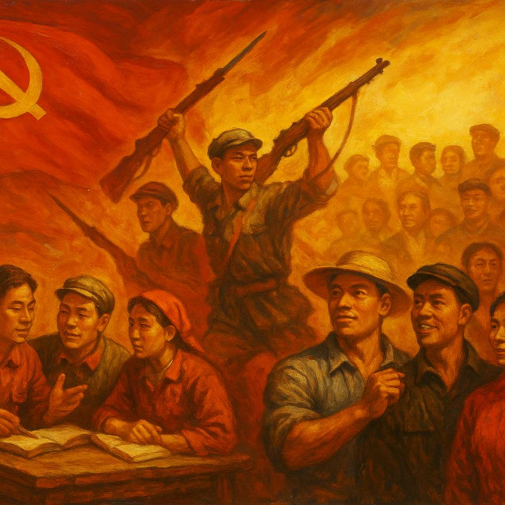
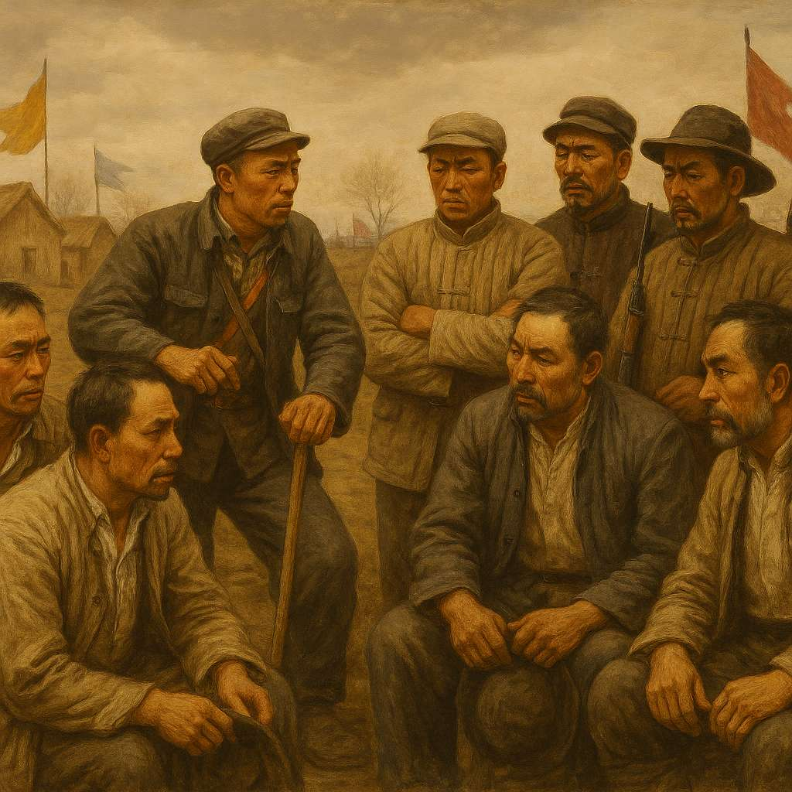

*注：本文图片均由AI生成，仅供示意，存在诸多与史实不符之处，本人能力有限，敬请谅解*

## **引子：AI推广的“天崩开局”，与1937年的回响**

把时钟拨回1937年的华北。局势骤变，村庄里的普通人未必知道明天会怎样。这便是文末那段讲冀中抗战的视频给故事选的开场。我借它的说书线索谈组织，不把视频里的场面当作亲见的史实。

时光流转，在今天的企业殿堂里，一场没有硝烟的变革同样面临着它的“天崩开局”。AI，这个被誉为新质生产力代表的强大力量，正以雷霆万钧之势叩击着每一家组织的大门。我们都明白，生产力的巨大跃迁，必然要求生产关系做出相应的调整。这层近乎物理定律的第一性原理，是所有组织变革绕不开的基石。

然而，现实的剧本却往往荒腔走板。我们最常看到的，是领导层一拍脑袋，颁布一纸“全员拥抱AI”的敕令。于是，一场轰轰烈烈的“运动式”推广席卷而来。但这种自上而下的强压，却巧妙地绕过了组织架构的深水区，回避了工作流程的再造，更吝于在激励机制上做出丝毫让步。其结果，不过是风过无痕，留下一地鸡毛和几篇光鲜亮丽的PPT总结。

组织里真正难懂的，是那些既怕饭碗被砸、又怕自己被时代落下的人。换你坐在那里，会不会也先看一阵？

于是，“观望”成了最优策略。他们嘴上高喊着“拥抱变化”的口号，热衷于描绘一幅幅老板爱看、员工爱听的AI蓝图，反正画饼没有成本，还能赢得满堂喝彩。他们默默地窥视着那些勇敢的“先行者”，幻想着能一键复制别人的成功路径，却全然不知，任何真正的变革，都无法简单抄袭作业。

在这样一种混乱、迷茫、人人自危的氛围中，如何才能拨开迷雾，让AI的星星之火，真正在组织的土壤里形成燎原之势？

我想借冀中根据地故事里的三条线索：怎么让人愿意来听，怎么把一件难事办成，又怎么让观望的人看见和自己有关的好处。历史上的对抗不能照搬到公司；今天要改的是低效流程，不是哪一群同事。

毕竟，老百姓从不关心你画的饼有多大，他们只关心自己的日子能否过得好一点。只要能坚守这个初心，那么变革路上的一切惊涛骇浪，都终将被我们跨越。

## **第一步：党的建设——从两手空空到淬炼出一支先锋队**

文末视频把镜头对准刚到冀中、手上缺人缺物的孟庆山。我最在意的不是他行囊里到底有几样东西，而是那个开场的难题：“手上没把米，叫鸡都不来。”凭什么让陌生人先停下来听你说？

照视频的讲法，答案还真是凭一张嘴。把画面想成一场夜里的故事会：白天各忙各的，天黑了，人围坐下来。有具体的人、有过不去的坎，才有人听完还想再问一句。对我来说，这个“再问一句”比院子里到底坐了多少人要紧。

这便是我们得到的第一个，也是最根本的启示：**思想的启蒙与变革的宣传，必须像讲故事一样引人入胜，直抵人心。**

今天的员工，从媒体的狂轰滥炸中，对AI有着模糊而脸谱化的认知——它能写诗，能画画，很神奇，也很危险。这些信息，就像鲁迅笔下那个沾着鲜血的馒头，人们围观、议论，却不知道这究竟和自己的“病”有什么关系。

因此，组织内部的AI宣传，必须摒弃媒体式的浮夸与空泛。它需要像精准制导的导弹，深入到每一个具体的业务场景中。这就要求推动者，必须是一个既懂业务痛点，又懂AI能力的“双料专家”。

你可以像连载小说一样，一回只讲一件身边的事。比如，设计师拿到一批草图后淘汰了哪些，财务核票时哪一格必须自己再看一眼。这些是例题，不是把别人的宣传数字贴成自己的成绩。

久而久之，那些真正对AI抱有热情、愿意动脑筋的“进步青年”，自然会从人群中浮现。他们会主动找上门来，好奇地询问：“你上次分享的那个自动化流程，到底是怎么实现的？”

有人追问，你的角色就从“品宣广告”转向“效果广告”了。别忙着办下一场大会，先坐下来，听听他自己那条流程到底卡在哪里。

更精妙的一招是，在谈话结束时，不经意地问一句：“在你身边，还有没有像你一样对这些新东西感兴趣的同事？”通过这种“滚雪球”式的社交挖掘，你就能迅速构建起一张跨部门的“AI积极分子网络”。

有了这批核心力量，你就可以开办“干部训练班”了——也就是我们今天所说的系统化培训。这绝不能是一次性的填鸭式教学，而应是长期的、循环的、螺旋式上升的学习社区。网络上的免费课程浩如烟海，但信息过载本身就是一种负担。

培训的真正价值，在于有人能为你披沙拣金，并传授“渔”而非“鱼”。你可以尝试“翻转课堂”的模式：让学员在线下利用精选的资料自学基础知识，然后把宝贵的面对面时间，全部用于项目实战、难点答疑和跨界脑暴。考虑到不同岗位的AI需求千差万别，最好的方式是将业务背景相似的人组成学习小组，让他们在小组内互为师生，共同攻克一个个真实的业务难题。

 

至此，通过“思想建设”的渗透和“组织建设”的凝聚，一支看不见但能量巨大的“AI先锋队”，便在组织的肌体中悄然成型。

## **第二步：故事好听，还得办成一件事**

视频接着讲到高阳。对一个最初没人看好的队伍，旁人怎样才肯相信它能办成事？我借的是这个转折，不是战斗经过。回到办公室，试点再上台时得带着真的工作来，不能靠把最初那场故事会再讲一遍。

这个比喻到低效流程为止。最好挑一个许多人真被它耽误过、愿意给你看旧账的项目；和熟悉它的业务部门一起把成功标准写下来。

你可能听见：“这东西，我十年前试过，行不通。”别急着判断说话的人是站哪一边的。问一句：当年是哪张表对不上，谁来补漏？也许他正好知道这回最该查什么。

战报可以怎么写？举个虚构的例子：“交付周期缩短40%，人力成本降低30%，满意度提升20%。”三行喜报，三个问题：比较的是哪两段时间，返工算进人力没有，满意度是相对增幅还是增加了百分点？这些百分比只是格式示例，答不上问题，战报就先别发。

好故事还是会在茶水间传开。可当同事来问“市场部那个老大难到底怎么解决的”，拿出来的应该是前后两份可比的工单，而不是一张写着“怀疑者出局”的名单。

## **第三步：先照顾观望者的安全感**

视频讲到冀中的联庄会时，我想到另一个问题：旁观者守着原来的办法，是因为特别喜欢它，还是因为眼下只有它能给自己一点安全感？

两种处境并不相同。企业里有人守着一张又慢又难用的表，可能是因为每次出错都得靠它找回原始单据。你要他先撤掉这根保险绳，再来听效率能提高多少，他为什么要答应？

所以别一上来就拆核心流程。先问问他：每天最烦哪件事？如果是抄报表，就先让工具填好重复字段，让他保留原件、自己对照；如果错了一格，能马上改回。等他亲自省下那个加班的晚上，你才明白什么叫赢得信任。

接下来才轮到三步走：

1. **先帮个小忙。** 午饭时演示一个他今天就用得着的小技巧，不用填报名表，也不以采纳为条件。
2. **请做过的人来说。** 不只展示准时下班的那天，也说说第一次弄错时是谁发现的。听众才好判断这办法能不能借。
3. **一起改他自己的流程。** 等同事主动上门，坐到他旁边让他指出例外，由他决定哪些字段可以交给工具、哪些不能动。最后会不会继续用，也由他来判断。

## **尾声：从星星之火，到燎原之势**

说书人收尾时，总要回望当初那场小小的故事会。我不拿视频末尾的规模数字当作这条路的证明：地方自卫力量和主力部队并非同一统计口径。对一项公司试点，更有用的收尾，是回去看看当初追问自动化流程的同事，如今是否真能少抄一张表。

推动者也得有授权：业务数据能不能用，返工谁来付，部门意见不一谁能协调。我倾向于让AI团队有直接提出这些问题的地位；是否单列一级部门，则要看哪种安排真能办事。

从“天崩开局”到“星火燎原”，我愿意留下的不是胜仗的排场，而是一个检验：故事散场之后，有没有人带着自己手上的难题，再来找你？

**叙事来源**（本文沿用其讲述线索，不作为人物细节、部队人数或战况的独立史料）：

*TomCat团座. "从天崩开局到百万雄兵，全靠一张嘴？根据地建设【撒豆成兵01】." Bilibili视频. 2025年4月5日. https://www.bilibili.com/video/BV18nRXYrE4b/.*

