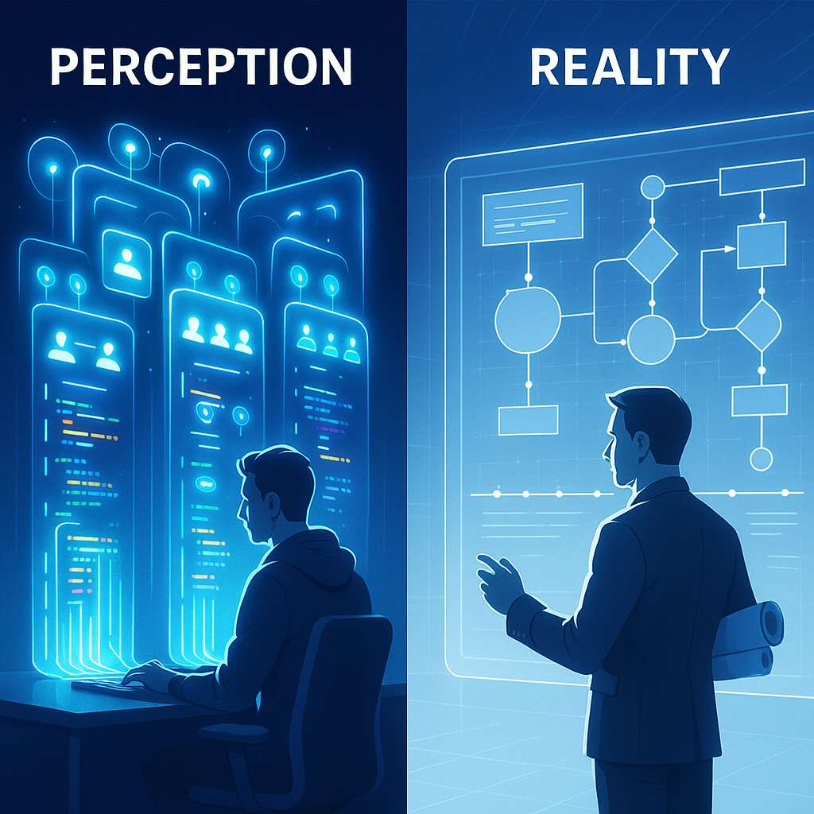
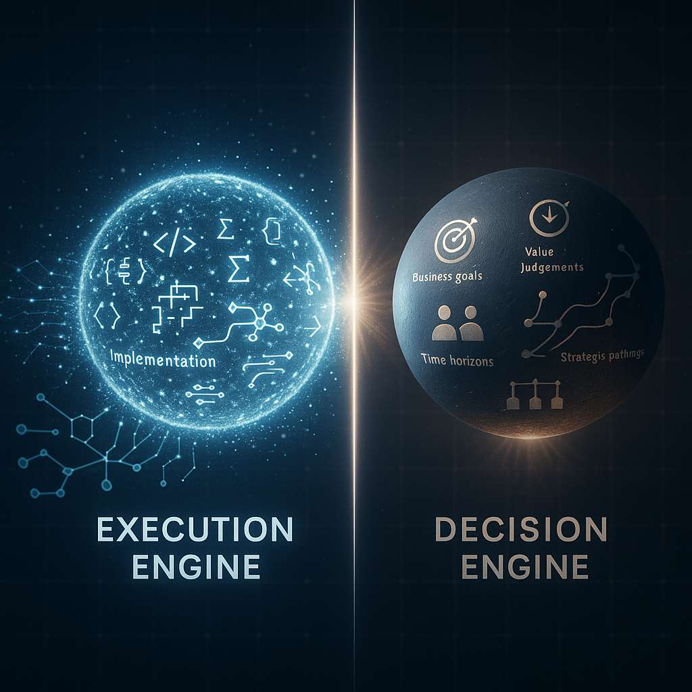
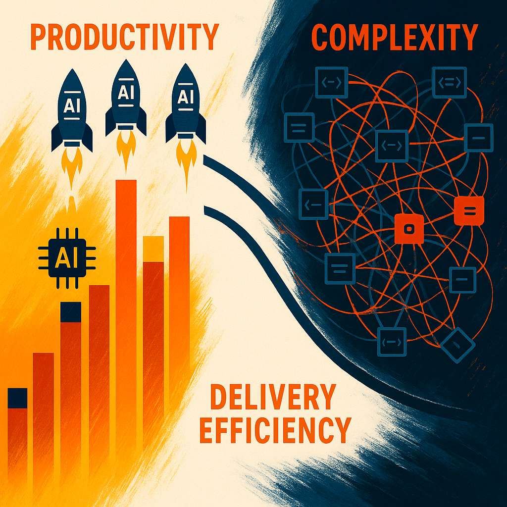
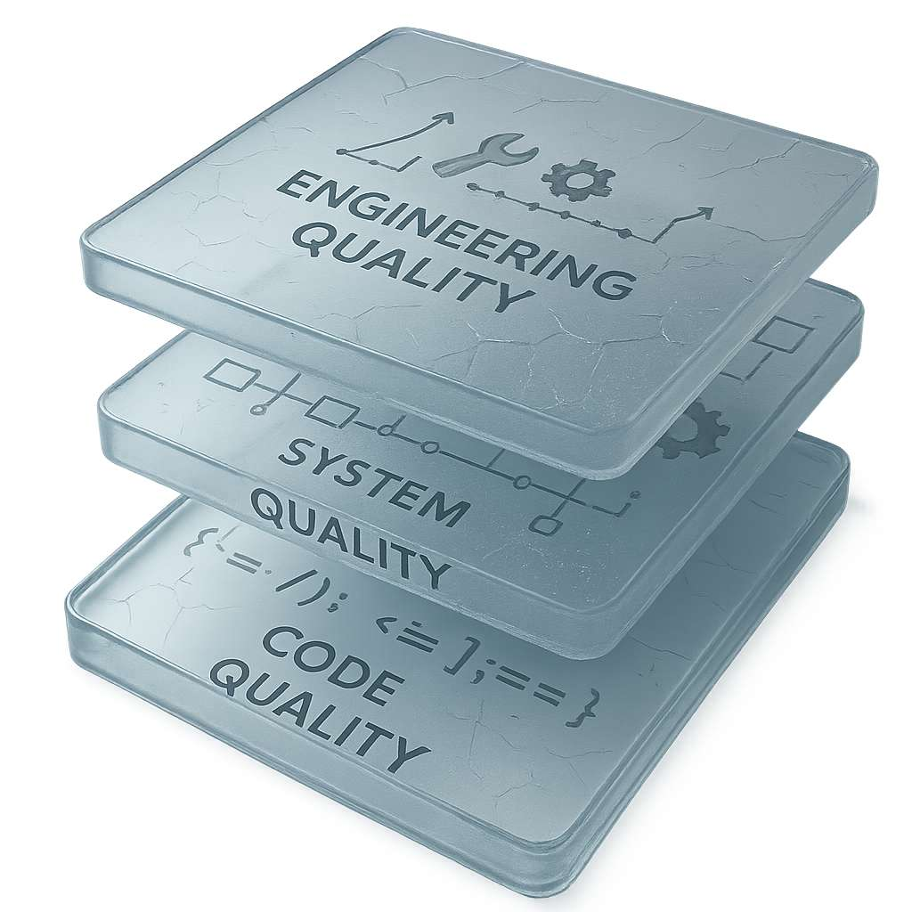
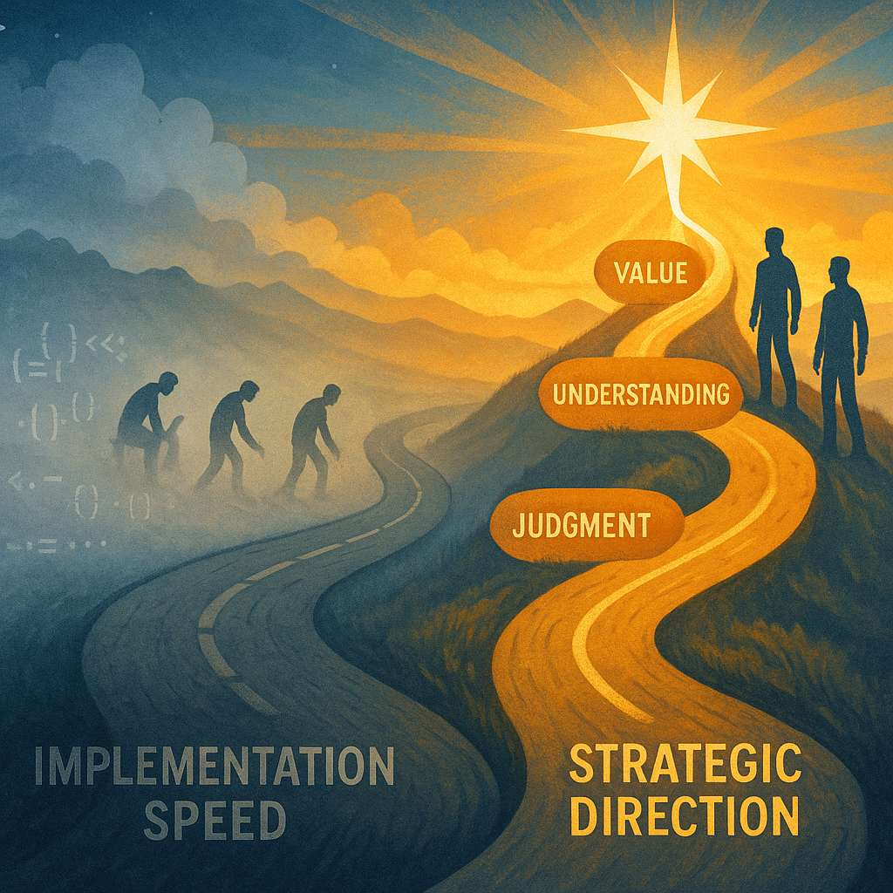

## 一、误解与本质

当ChatGPT、Claude、Cursor等AI编码工具展现出惊人的代码生成能力时，技术社区出现了一种声音："**我们还需要软件工程吗？AI已经可以直接写代码了。**"

这个观点的背后，是一个根深蒂固的认知误区——**将软件工程等同于编码技术**。

这就像是把建筑学等同于砌砖技术，把医学等同于开处方的能力。
当我们看到机械臂可以完美地砌砖时，我们不会说不需要建筑师了；当我们看到AI可以辅助诊断时，我们也不会说不需要医生了。

软件工程从来不是关于"如何写代码"的学问，而是关于**如何构建、交付和演进复杂系统**的学问。AI的崛起不是让软件工程变得过时，恰恰相反，它让软件工程的价值前所未有地凸显出来。

### 对软件工程的重新理解

在传统的认知中，软件工程常常被简化为一系列技术实践：设计模式、代码规范、测试方法、版本控制。但这些只是工具和手段，软件工程的本质在于**将软件开发视为一个工程问题来管理**。

什么是工程问题？工程问题的**核心**在于：
* 在约束条件下寻找可行解：时间、预算、人力、技术能力都是约束
* 在多个目标间寻找平衡：功能完整性、代码质量、交付速度、维护成本都需要权衡
* 面向长期价值而非短期实现：系统需要演进、扩展、维护，而不只是"能跑就行"

软件工程关注的是**整体交付能力**，而不是局部实现技巧。它要回答的问题不是"这个算法怎么写"，而是：
* 我们要解决什么问题？
* 为什么现在要解决这个问题？
* 解决方案的边界在哪里？
* 如何确保交付的质量？
* 如何在变化中保持系统的稳定性？
* 如何让系统能够持续演进？

### 从代码到系统的维度跃迁

* 代码是一维的——它是线性的指令序列。
* 模块是二维的——它是代码的组织和边界。
* 系统是三维的——它是模块的交互和整体行为。
* **软件工程是四维的——它还包含了时间维度上的演进和变化。**

AI擅长的是第一个维度。它可以生成语法正确、遵循模式、解决特定问题的代码。

但软件工程运作在更高的维度：
* **空间维度**：模块如何划分？接口如何定义？依赖如何管理？架构如何演进？
* **时间维度**：今天的设计是否能支撑明天的需求？如何在不重写的情况下扩展？技术债务如何管理？
* **人的维度**：团队如何协作？知识如何传承？决策如何达成共识？

这些维度的复杂性，不是通过优化单个模块的代码质量就能解决的。这需要的是**系统性思维**和**工程化管理**。

## 二、AI的能力与局限

需求清楚、例子充足时，编码工具很适合迅速写出第一版。值得细看的是，这个“清楚”从哪里来。

**先问场景。** 需求里说“尽快”，究竟是客户等不起，还是运营想少看一屏？工具可以列出两种解释，要辨别哪种是真的，得去问使用者。

**再比方案。** 把现有接口、预算和维护人手交代清楚，AI 可以帮忙比较快交付和易维护的方案。缺一条条件，排名就可能倒过来。团队得说明自己为什么愿意承担那个后果。

**最后定责任。** 能指出一个跨模块隐患，不等于对上线负责。谁签字、谁值班、什么信号一出现就撤回，这些安排才把一次建议变成工程决定。

AI能够高效地回答"如何做"的问题，但软件工程要回答的是"做什么"和"为什么做"的问题：
* 我们真的需要这个功能吗？
* 这个功能的价值是什么？
* 现在是做这件事的正确时机吗？
* 这个方案的长期影响是什么？
* 有没有更简单的解决方案？

差别不在于谁能写出一份像样的比较，而在于谁能代表团队作决定，并在判断落空时改正。

## 三、软件工程价值的重新显现

一个模块能很快改完，整套系统却要等旁边两个团队确认接口才能发版。在这种时候，**系统整合**会接过原先在编码上的瓶颈。

Vibe Coding 让更多人能同时写出东西。各人省下的时间，最后能不能合成一次更快的交付，要看这些东西怎样接到一起。

这正是**复杂性管理**的问题。把相关接口和依赖放在一起，工具也能帮我们发现冲突。可一处修改值不值得让另一个团队改排期，光看两份代码还看不出来。

架构一致性、接口规范、技术栈统一、质量标准——这些问题的答案不在代码里，在软件工程的实践里。

一段生成的代码今天能跑，是个不错的起点。再往下看，至少还有三个层面的质量要分别回答：

* 代码级质量关注的是正确性和效率；
* 系统级质量关注的是模块组合后的整体行为；
* **工程级质量关注的是时间维度上的可持续性**。

一个系统可以在今天运行得很好，但如果缺乏可测试性，它在未来会变得脆弱；如果缺乏可观测性，它在出问题时会变成黑箱；如果缺乏可扩展性，它在业务增长时会成为瓶颈；如果缺乏可维护性，它会逐渐腐化为技术债务。

最深层的危险在于：当实现变得容易时，我们可能会陷入为了实现而实现的陷阱。软件开发中最大的浪费从来不是写了低效的代码，而是**构建了错误的东西**。AI放大了这个风险——它让构建任何东西都变得容易，但并没有让我们更清楚应该构建什么。

这里有一个根本性的认知转变：软件的价值不在于功能的数量，而在于解决问题的精准度。一个复杂的系统不一定比简单的系统更有价值；一个功能完备的产品不一定比功能克制的产品更成功。

软件工程的核心价值，就是这种**价值判断能力**——在无限的可能性中，识别出真正重要的那部分。这需要对业务的深刻理解，对用户的真实洞察，对长期影响的前瞻判断。

## 四、范式转变与能力重构的呼唤

当AI可以代替我们写代码时，软件工程不是变得不重要了，而是**从技术细节中解放出来，回归其本质**——对复杂性的管理，对价值的追求，对长期的规划。

这标志着一个根本性的范式转变。软件工程不再是关于"如何更快地实现"，而是关于"如何做出正确的决策"。不再是关于"写什么代码"，而是关于"构建什么系统"。不再是关于"技术的深度"，而是关于"价值的洞察"。

**我们不是不再需要软件工程，我们是比以往任何时候都更需要软件工程。**

因为当实现变得廉价时，**正确的决策就变得无价**。当AI能很快交出一份实现时，知道生成什么代码就成了核心竞争力。当技术不再是瓶颈时，对业务的理解、对价值的判断、对方向的把控，就成了稀缺能力。

AI改变了软件开发的生产力曲线，但软件工程定义了这条曲线的方向。方向错了，速度越快，偏离越远。

然而，理解软件工程的必要性只是起点。一个更深刻的问题随之而来：

* 在AI可以协助实现的今天，软件工程师究竟应该掌握什么？
* 如何从代码的执行者转变为价值的创造者？
* 如何在AI时代重新定义自己的能力边界？

传统的软件工程能力模型建立在"实现复杂性"之上——算法、数据结构、设计模式、编程范式。但当AI可以瞬间检索并应用这些知识时，这个模型需要重构。

这不是一个简单的技能清单问题，而是一个关于能力本质、知识价值、职业演进的深层追问。

从技术深度到系统广度，从实现能力到决策智慧，从个体产出到组织影响——这条进化之路，需要我们重新思考什么是软件工程师真正的核心竞争力，需要我们在能力与知识的双重维度上完成深刻的重构。

接着读[能力篇：AI时代工程师该掌握什么](03-软件工程的重生02-AI时代工程师该掌握什么.md)。
