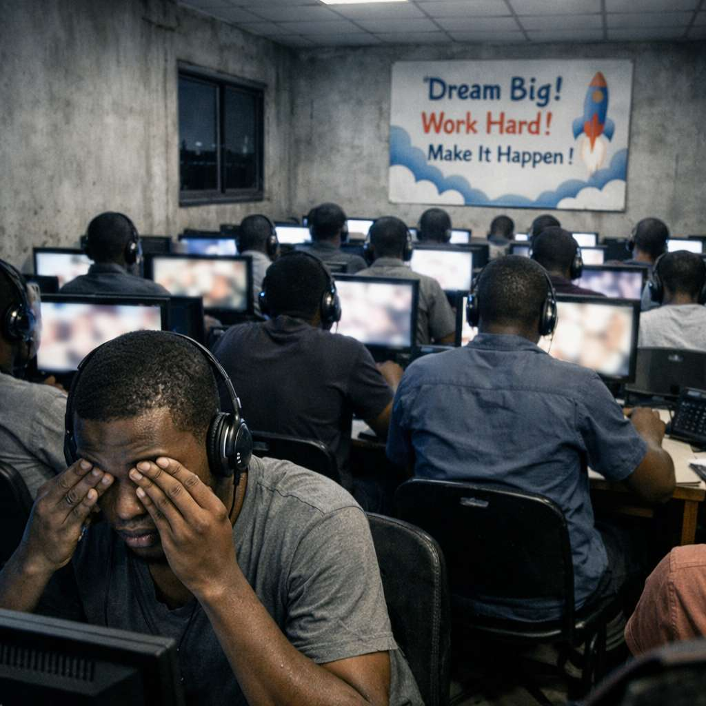
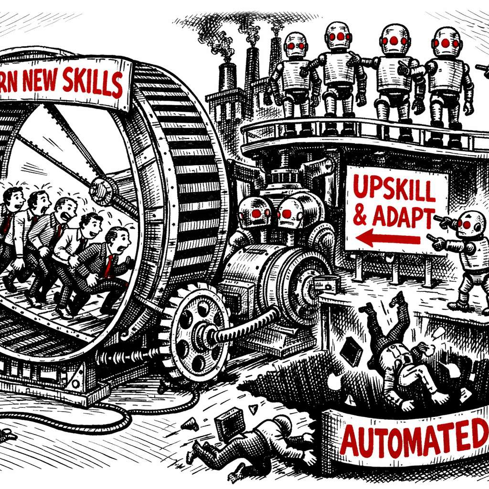
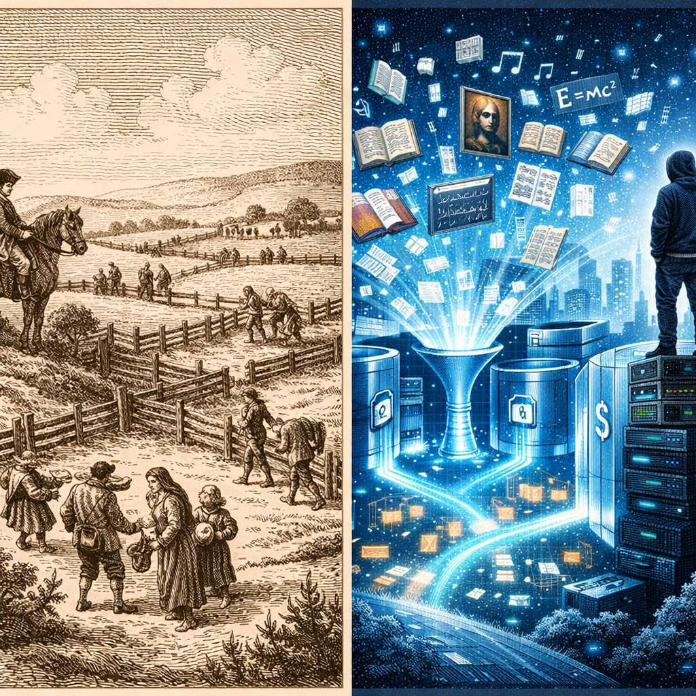
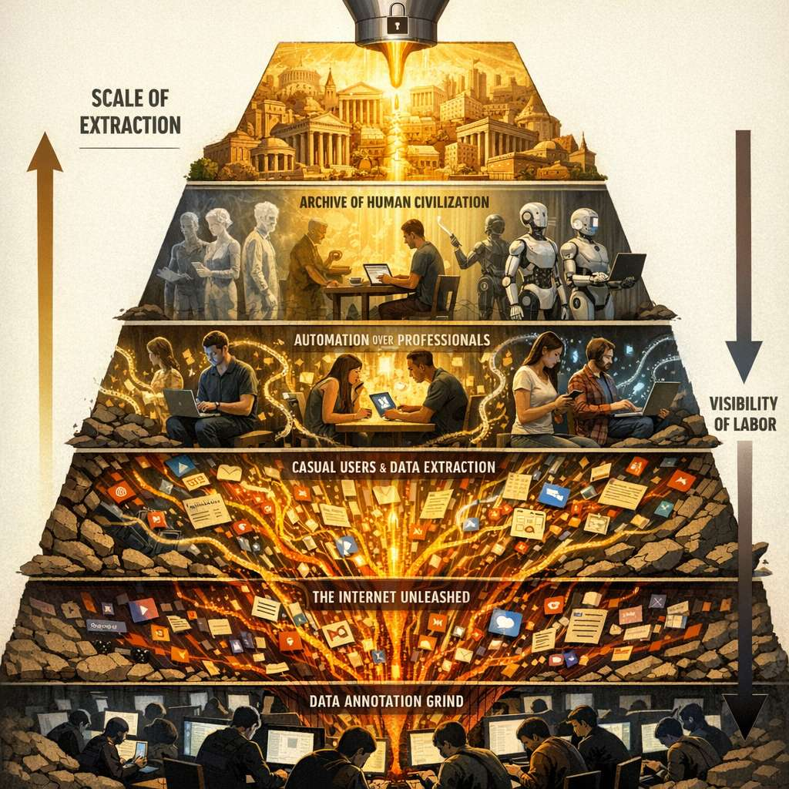
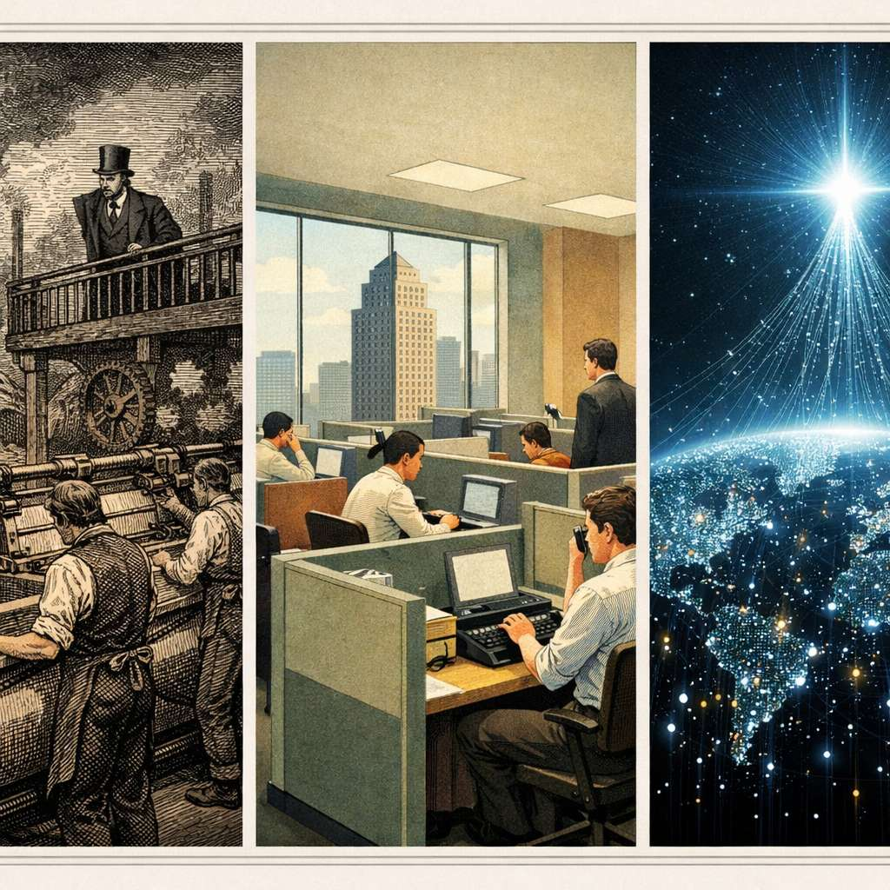
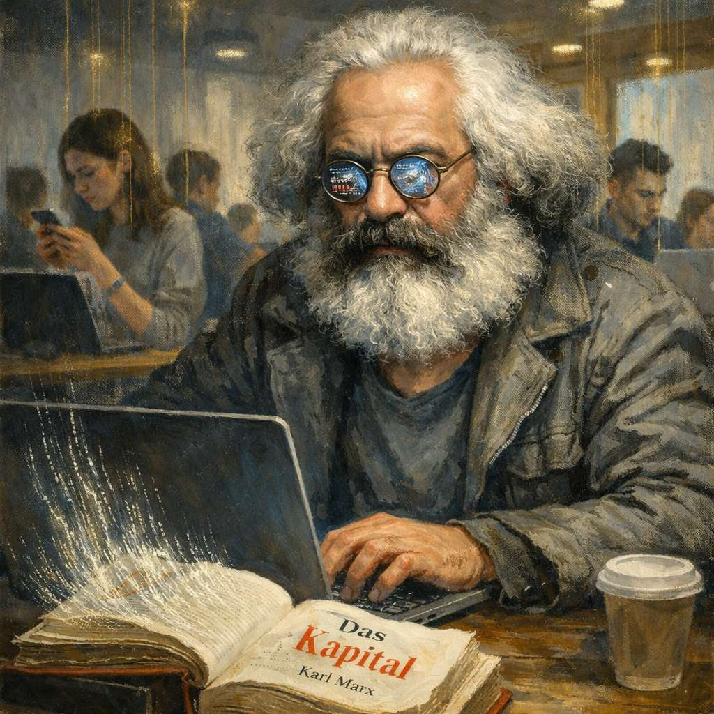
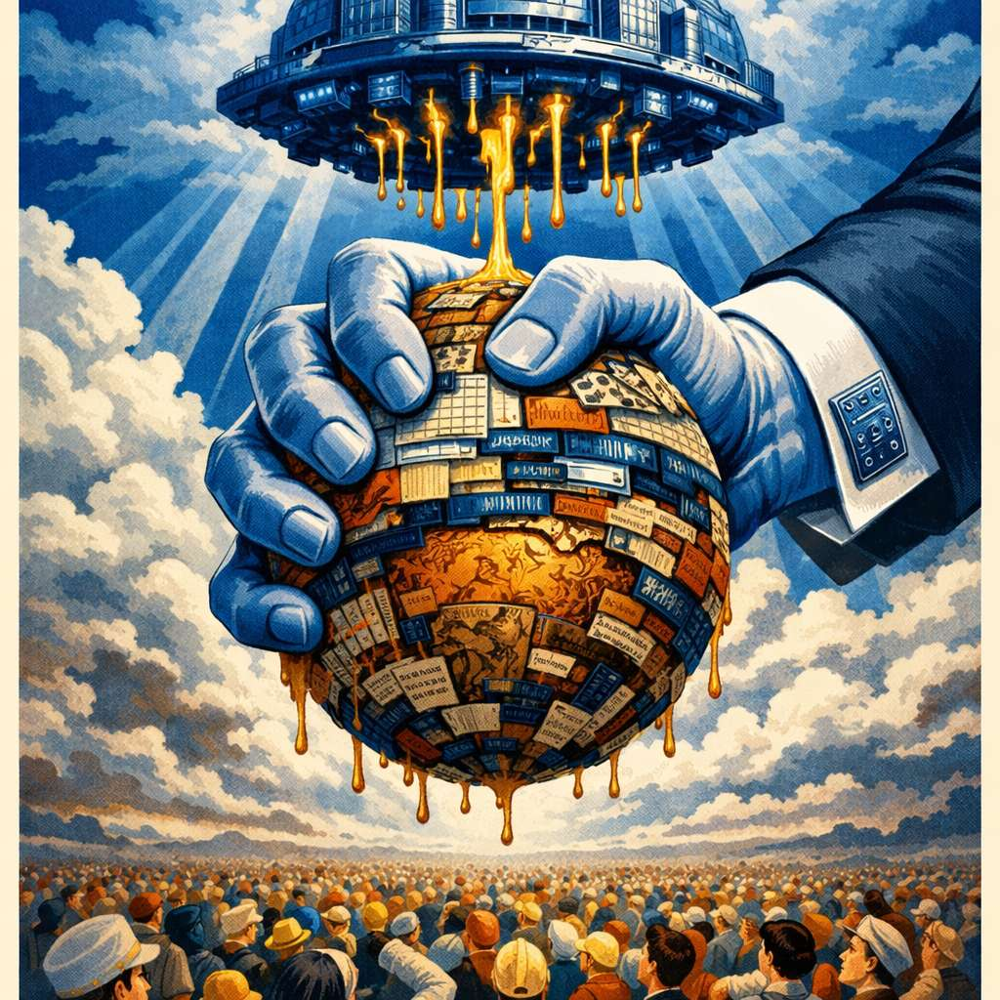

## 一、AI不是从天上掉下来的

当你打开ChatGPT，输入一个问题，几秒钟之内就收到一段流畅、精准、甚至富有洞见的回答——你会觉得这是一种近乎魔法的体验。科技公司也乐于维持这种叙事：AI是天才工程师们在硅谷的实验室里创造出来的奇迹，是人类智慧的结晶。

但这是一个被精心编织的故事。

真相是：**每一个大语言模型的背后，都站着数十亿人的劳动。** 这些劳动跨越了国界和阶层，从肯尼亚内罗毕的数据标注车间到你在深夜发布的一条知乎回答，从一个开源程序员无偿贡献的代码到莎士比亚四百年前写下的十四行诗——所有这些劳动和智力成果，都被"喂"进了AI模型。

然而，当AI开始创造价值——每年数千亿美元的市场规模，并在以指数级增长——这些价值的创造者们几乎什么也没有得到。

让我们揭开这个价值攫取体系的面纱。它不是单层的，而是由五个层次叠加而成的——从最底层赤裸裸的劳动剥削，到最高层对整个人类文明遗产的圈占。

---

## 二、第一层：数据标注工人——最底层的血汗劳动

### 隐形的流水线

在AI产业光鲜的外表下，有一个庞大的、几乎完全不可见的劳动群体。

他们在肯尼亚的内罗毕、菲律宾的马尼拉、委内瑞拉的加拉加斯、印度的海得拉巴，坐在拥挤的办公室里，盯着电脑屏幕，日复一日地做着同样的工作：给图片打标签、判断文本的情感倾向、标注语句中的实体关系、为AI的回答打分评级。

这些人就是**数据标注工人**。

2023年，《时代》杂志的调查揭示了这个产业的真实面貌。为OpenAI提供外包数据标注服务的肯尼亚工人，时薪不到2美元。他们需要阅读和标注大量涉及暴力、仇恨言论、性虐待的内容——这是为了训练ChatGPT识别和拒绝有害输出。这些工人中，许多人出现了严重的心理创伤，包括创伤后应激障碍（PTSD）。

但他们几乎得不到任何心理健康支持。他们的合同是临时性的，没有医疗保险，没有工会保护，随时可能被解雇。

### RLHF训练师：教AI说话的隐形工人

在大语言模型的训练过程中，有一个关键环节叫做RLHF（基于人类反馈的强化学习）。简单来说，就是让人类评估员对AI生成的多个回答进行排序和评分，然后用这些评分来优化模型的行为。

这些RLHF训练师往往具有较高的教育水平，能够胜任复杂的语言评估任务。但他们的报酬与他们创造的价值之间的鸿沟同样巨大。一个RLHF训练师的每一次评分，都在直接提升一个价值数百亿美元的模型的质量——而他们得到的可能只是每小时几美元的报酬。

### 理论定性：最经典的剩余价值剥削

这一层的劳动关系最容易用马克思的经典理论来分析。数据标注工人和RLHF训练师是**雇佣劳动者**——他们出卖自己的劳动力，获得工资，而他们的劳动创造的价值远远超过他们的报酬。差额——剩余价值——被资本家无偿占有。

不仅如此，这里还叠加了一个马克思时代就已存在的结构：**全球南方的超级剥削。** 资本利用国际劳动力市场的不平等，将最底层的劳动外包给全球南方国家，在那里劳动力价格最低、劳动保护最弱。这不是什么新鲜事——它是殖民时代以来全球分工体系的延续，只不过现在的产品从棉花和糖变成了数据标注。

---

## 三、第二层：互联网内容创作者——不知情的训练师

### 你的文字正在被"消化"

你知道大语言模型是怎么学会说话的吗？

答案很简单：它们"读"了互联网上几乎所有能读到的东西。

Reddit上的讨论帖、Wikipedia的百科全书条目、知乎上的长篇回答、Stack Overflow上的编程问答、GitHub上的开源代码、个人博客、新闻报道、学术论文的摘要、网络小说、产品评测……这些构成了大语言模型训练数据集的核心。

据估算，GPT-3的训练数据集包含约45TB的文本数据，来自于整个互联网的爬取结果。GPT-4和后续模型的训练数据规模更是呈指数级增长。

### 创作者从未同意过

这些内容是谁创造的？

是数以百万计的互联网用户——一个在知乎上写了两万字长文分析三国历史的历史爱好者，一个在GitHub上维护开源项目十几年的程序员，一个在Wikipedia上默默编辑词条的志愿者，一个在个人博客上分享育儿经验的全职妈妈。

他们在创作这些内容时，有一个共同的特点：**没有任何人想过自己在为AI公司工作。**

他们写作是为了分享知识、参与讨论、建立社区、表达自我、获得同行认可。他们的劳动是出于热情、责任感或社交需求——但不是为了让一家硅谷公司把他们的文字"炼"成一个价值千亿的商业产品。

### 事后的无力

当OpenAI、Google、Meta等公司大规模爬取互联网数据来训练模型时，大多数内容创作者甚至不知道这件事正在发生。等他们知道的时候，已经太迟了——模型已经训练完成，知识已经被"吸收"。

2023年开始，一些创作者群体开始发起抗议和诉讼。纽约时报起诉了OpenAI，一批视觉艺术家对Stability AI提起了集体诉讼。但这些法律行动面临着巨大的困难：现行的知识产权法框架在面对AI训练数据使用这种全新情况时显得力不从心。

### 理论定性：无偿的数字劳动

这一层的劳动关系比第一层复杂得多。这些内容创作者没有被雇佣，没有签劳动合同，没有收到工资——但他们的劳动成果确实被用于创造了巨额利润。

这是否构成"剥削"？经典马克思理论说剥削只发生在雇佣关系中。但如果我们固守这个定义，就无法解释AI时代一个显而易见的不公：亿万人的创作劳动被无偿占用，利润归少数公司。

我们需要引入新的理论工具来分析这种现象。这正是第三篇的任务——我们将详细讨论"数字劳动"理论的可能性和局限性。

---

## 四、第三层：AI产品用户——消费即劳动

### 你以为你是顾客，其实你也是工人

当你使用ChatGPT时，你以为自己只是在消费一种服务。但实际上，你的每一次交互都在为AI公司创造价值。

- 你对AI回答点"赞"或点"踩"——你在提供人类偏好数据
- 你修改提示词重新生成回答——你在展示什么样的表达方式更有效
- 你把AI的回答复制粘贴到文档中——你在验证哪些回答有实际用途
- 你和AI的对话记录——成为了改进下一代模型的训练数据

OpenAI在其服务条款中保留了使用用户数据来改进模型的权利。这意味着你在使用ChatGPT时的每一个操作，都可能被用来让模型变得更好——而"更好的模型"意味着更高的订阅费、更多的企业客户、更大的市场估值。

### "产消合一"的极致

社会学家阿尔文·托夫勒在1980年提出了"产消合一"（prosumer）的概念：消费者同时也是生产者。在AI时代，这个概念被推到了极致。

传统的消费行为是单向的——你付钱，获得商品或服务。但AI时代的消费行为是双向的——你获得了AI服务，同时你的使用行为本身就在为AI公司创造新的价值。

问题在于：这个双向过程中的价值交换是否对等？

你每月花20美元订阅ChatGPT Plus，获得了一个强大的工具。但你的使用数据为OpenAI持续改进模型所提供的价值——如果乘以亿万用户的规模——可能远远超过所有订阅费的总和。

### 最隐蔽的价值转移

这一层的价值攫取是最隐蔽的，因为它完全嵌入在"使用产品"这个看似自然的行为中。没有人会觉得自己在"工作"——你只是在问ChatGPT一个问题而已。

但正是这种隐蔽性，使得这种价值攫取几乎不可能被抵抗。你可以选择不当数据标注工人（虽然在缺乏其他就业机会的地方这种"选择"也是虚假的），你可以选择不在知乎上写长文——但你能选择不使用AI吗？当AI渗透到工作、教育、医疗、社交的每一个方面时，不使用AI就等于自我边缘化。

---

## 五、第四层：被AI替代的劳动者——培训了自己的替代者

### 历史上最具讽刺性的剥削形态

现在，让我们来看一个更加残酷的层次。

想象一个翻译。她从业十五年，积累了丰富的经验，翻译了大量的文学作品和商业文档。她的翻译作品被发布在互联网上，成为了翻译类大语言模型的训练数据。然后，这个模型学会了翻译——学得足够好，好到她的客户决定不再雇佣她，转而使用AI翻译。

**她用自己十五年的劳动成果，亲手培训了自己的替代者。**

这个故事不是虚构的。它正在翻译行业、插画行业、客户服务行业、初级编程领域、文案写作领域同时发生。

2023年，自由职业平台Upwork的数据显示，写作类自由职业的工作量大幅下降。2024年，多家游戏和动画公司裁减了概念艺术部门，转而使用AI生成图像。编程辅助工具GitHub Copilot的广泛使用正在改变软件开发的劳动力需求结构。

### 双重剥夺

被AI替代的劳动者遭受了双重剥夺：

**第一重：** 他们过去的劳动成果被无偿用于训练AI，他们没有获得任何补偿。这是价值的追溯性攫取。

**第二重：** 训练完成的AI反过来替代了他们的工作岗位，剥夺了他们未来的生计。这是劳动机会的前瞻性剥夺。

在人类历史上，从未有过这样的剥削形态：你的劳动成果不仅被拿走了，还被用来制造一个比你更便宜、更高效的替代品，然后把你扔掉。

蒸汽机时代的纺织工人至少没有"教"蒸汽机怎么纺织。但AI时代的脑力劳动者，确确实实在用自己的知识和技能"教"AI如何取代自己。

### 结构性的讽刺

更深层的讽刺在于：这些劳动者被替代后，通常被建议"转型升级"、"学习新技能"、"拥抱AI"。但问题是——当他们"拥抱AI"、学会使用AI工具时，他们的新技能和使用数据又会被用来进一步改进AI，然后再一次替代更多的人。

这不是一个可以通过个人努力解决的问题。它是一个结构性的问题。

---

## 六、第五层：人类文明本身——几千年的知识积累被一次性"吞噬"

### 最宏大的"圈地运动"

现在我们来到了这个价值攫取体系的最高层——也是最令人震撼的一层。

AI模型的训练数据不仅包括互联网上的当代内容。它们还包括：

- 人类几千年积累的书籍——从古希腊哲学到现代物理学
- 数百年的科学论文——记录了人类对自然规律的艰辛探索
- 全球的文学遗产——小说、诗歌、戏剧、散文
- 艺术和文化作品——被转化为文本描述或图像数据
- 法律文献、医学文献、工程手册——人类实践经验的结晶
- 各种语言的语法和表达方式——人类文明多样性的载体

这些知识是人类文明几千年来无数人共同创造的**集体遗产**。它们中的大部分早已进入公共领域，不受版权保护。正因如此，AI公司可以"合法地"将它们用于商业训练。

但"合法"不等于"正当"。

想想看：柏拉图的《理想国》、牛顿的《自然哲学的数学原理》、李白的诗、曹雪芹的《红楼梦》——这些作品属于全人类。它们是我们共同的知识遗产。任何人都可以阅读它们、学习它们、被它们启发。

但现在，一小撮科技公司把这些遗产"喂"进了它们的模型，然后用这些模型来赚取数千亿美元的利润。这些利润归属于公司的股东——一群华尔街的投资人和硅谷的亿万富翁。

**全人类的集体遗产被转化为少数人的私有利润。** 这是人类历史上规模最大的一次"公地圈占"——只不过这一次被圈占的不是英格兰的公共牧场，而是人类文明本身。

### 一次性还是持续性？

这里有一个重要的特征值得注意：**这种圈占在很大程度上是一次性的。**

英国的圈地运动是一块一块地把公地围起来。但AI对人类知识的"圈占"是一次性地把几乎所有可获取的人类知识"吞噬"进模型。

一旦模型训练完成，这些知识就已经被"炼化"为模型的参数。它们不再是独立存在的知识，而是变成了一个黑箱商业产品的一部分。你仍然可以去读莎士比亚，但莎士比亚已经被"消化"了——从他的作品中提取的语言模式和知识结构已经成为了一个私有产品的组成部分。

---

## 七、全景图：一个前所未有的全球价值攫取体系

现在，让我们退后一步，看看这五层结构叠加在一起的全景图。

### 五层结构的叠加效应

| 层次 | 劳动者 | 被攫取的价值 | 是否知情 | 是否有偿 |
|---|---|---|---|---|
| 第一层 | 数据标注工人 | 标注劳动 | 知情 | 极低报酬 |
| 第二层 | 互联网内容创作者 | 知识和创意 | 不知情 | 完全无偿 |
| 第三层 | AI产品用户 | 使用数据和反馈 | 部分知情 | 完全无偿 |
| 第四层 | 被AI替代的劳动者 | 过去的劳动积累 | 事后知情 | 完全无偿 |
| 第五层 | 人类文明整体 | 几千年的知识遗产 | 不适用 | 不适用 |

从底层到高层，存在一个清晰的递进关系：

- **劳动的可见度递减。** 数据标注工人至少还在"上班"，知乎作者至少还在"写文章"，而被AI替代者的贡献和人类文明遗产的被圈占几乎完全不可见。
- **抵抗的可能性递减。** 数据标注工人理论上还可以组织工会，互联网创作者还可以起诉——但谁来代表"人类文明"提起诉讼？
- **攫取的规模递增。** 从底层的数百万人到最高层的全人类，价值攫取的范围不断扩大。

### 为什么这比传统工厂剥削更隐蔽也更系统

在马克思的时代，剥削的结构相对简单：工人进入工厂，资本家获取剩余价值。工人知道自己在被剥削（虽然他可能不用这个词），因为他看得到自己的劳动产品和自己的工资之间的差距。

但AI时代的价值攫取体系有三个关键特征使其更加隐蔽：

**第一，劳动的分散性。** 价值的创造分散在全球数十亿人的日常活动中，没有人能看到全貌。

**第二，劳动的非自觉性。** 大多数贡献者并不认为自己在"劳动"——他们在聊天、在浏览、在分享生活。劳动被嵌入在生活本身之中。

**第三，价值链条的断裂。** 从你写一篇知乎回答到这篇回答被纳入训练数据，再到模型被训练出来并商业化——这个价值链条是断裂的、不透明的。你永远无法追踪自己的"贡献"在最终产品中占了多大比例。

### 马克思如果活在今天会如何描述这个体系？

如果马克思能够看到今天的AI产业，他可能会说：

资本对劳动的剥夺已经从工厂扩展到了整个社会。在工厂里，资本至少还需要和工人面对面；在AI时代，资本可以远程地、自动地、无声地吸取全球数十亿人的劳动成果。剥削不再需要工资关系作为中介——它变成了弥漫在整个社会空间中的"提取"。

而当这种提取达到极致，当资本不仅攫取了当代人的劳动，还攫取了人类文明几千年的积累——这已经不是通常意义上的"剥削"了。**这是一种文明层面的掠夺。**

---

_上一篇：引论：AI是资本主义的巅峰还是掘墓人？_

_下一篇：你在互联网上的每一次点击都是无偿劳动吗？_

