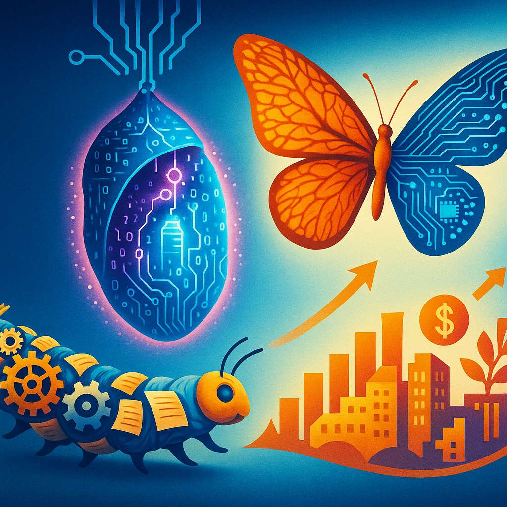
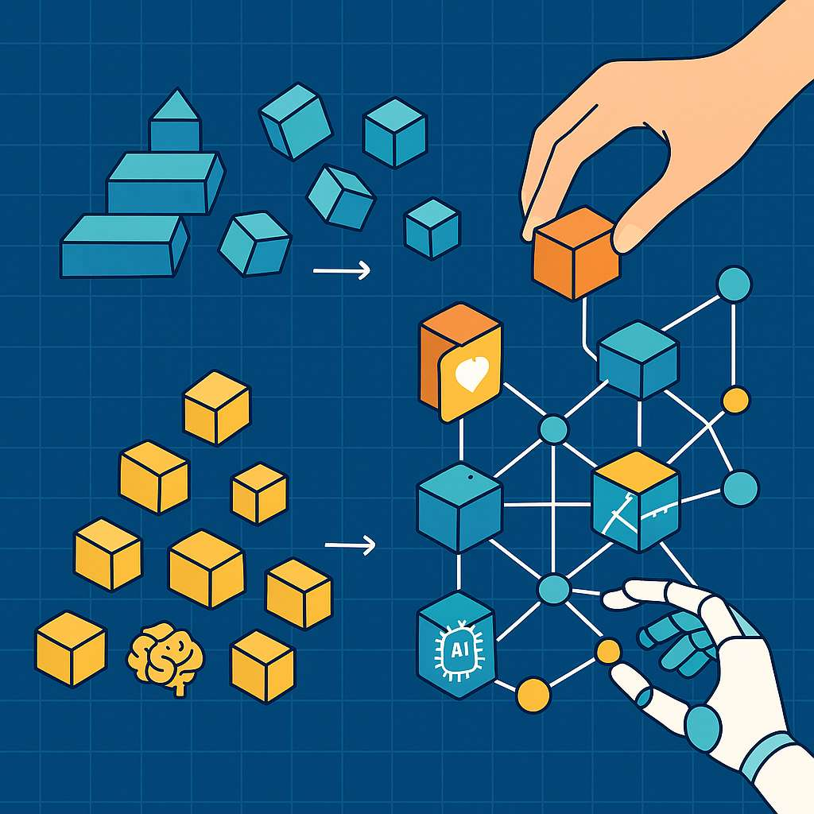

## **为AI无处不在的未来做好准备**

我们正处在一个深刻变革的时代前沿，人工智能（AI）将不仅仅是一个工具，而是组织结构中无处不在的组成部分。全球权威的技术研究与咨询公司Gartner对这一未来图景的预测清晰而紧迫，为我们探讨未来领导力与组织形态的必要性提供了强有力的依据。

Gartner的预测揭示了AI智能体融入企业核心运营的速度和广度：
*   **到2026年，40%的企业级应用将内置能够独立执行任务的AI智能体**，而目前这一比例不到5%。 这一转变意味着，AI将从辅助角色变为企业应用中主动的行动者。
*   **到2028年，约有三分之一的商业决策将由AI智能体处理。** 这预示着决策权将发生重大转移，AI将越来越多地自主做出影响业务的判断。
*   **到2030年，所有IT部门的活动都将在AI的辅助下完成。** 与此同时，Gartner也发出了警告：由于未经审慎管理的自动化，**半数企业将在至少两个关键岗位上面临不可逆转的技能短缺**。

这些预测共同描绘了一个核心的矛盾：一方面，企业为了保持竞争力，面临着快速、大规模采用AI的巨大压力；另一方面，如果这种采用是仓促的、缺乏系统性管理框架的，则可能导致灾难性的后果，例如关键人类技能的退化、对脆弱AI系统的危险依赖，以及因治理不善而引发的运营和伦理风险。 成功驾驭这一矛盾，将是未来十年对领导者最严峻的考验，而其核心答案在于推动一场深刻的组织蜕变。

## **组织蜕变：迈向人机混合的新生命形态**

AI的深度整合所引发的，远不止是运营效率的提升或流程的优化，而是一场根本性的**组织蜕变（Organizational Metamorphosis）**。 这一概念由研究者在观察了34位企业领导者深度融合AI的经历后提出，它描述了一个组织通过与AI的深度结合，从传统的形态不可逆转地转变为一个全新经济生命体的过程。

传统的组织变革理论已不足以解释这一现象。 这并非简单的技术采纳，而是组织基因层面的重塑。组织将演变为一个“人机混合实体”（human-AI hybrid entities），其运作方式、决策逻辑和能力边界都将与传统企业截然不同。 在这种新型组织中，传统的层级结构逐渐被打破，取而代之的是更加扁平化、网络化的协作模式，信息和决策在人与AI节点之间高速流动。

这场蜕变的核心驱动力，是一种被称为**“合成动态能力”（synthetic dynamic capabilities）**的新型能力。 在传统战略管理理论中，“动态能力”指企业整合、构建和重构内外部资源以适应快速变化环境的能力。 而AI的加入，则为这种能力赋予了“合成”的特质：
*   **即时扩展性**：AI驱动的分析或运营能力可以几乎无成本地瞬间扩展，以应对突发的市场需求或危机。
*   **完美复制性**：一个高效的“人机协作”工作流一旦被设计出来，就可以被完美地复制到组织的其他部门，无需经历传统的人员培训和学习曲线。
*   **持续进化性**：AI模型通过持续学习，使得这种合成能力能够不断自我优化和进化。

这种能力的出现，从根本上打破了传统商业世界中资源稀缺性的限制，为企业带来了前所未有的竞争优势。 能够成功实现这种蜕变的组织，将与那些仅仅将AI视为工具的组织拉开代际差距。

## **未来的领导力：从技术推行者到组织蜕变的引领者**

在这场深刻的转型中，领导者的角色变得比以往任何时候都更加关键。他们的任务不再是简单地推行一项新技术，而是作为建筑师和引航员，引导整个组织安全、高效地完成这场从传统形态到“人机混合实体”的蜕变。 这要求他们具备全新的领导力特质和行动框架。

1.  **培养面向未来的新文化**
    领导者必须首要地塑造一种能够支撑人机深度协作的组织文化。 这不再是传统企业文化建设的简单延伸，而是针对新物种的特殊培育。这种文化的核心支柱包括：
    *   **持续学习与实验精神**：AI技术日新月异，组织必须 fostering 一种拥抱实验、宽容失败的氛围，鼓励员工与AI共同探索新的工作方式。
    *   **心理安全与人类中心**：当AI开始承担更多决策时，人类员工可能会感到威胁或被边缘化。领导者必须创造一个高度心理安全的环境，让员工敢于质疑AI的输出、提出建设性意见，并始终强调技术服务于增强人类能力的核心目标。
    *   **数据驱动与伦理敬畏**：文化上需要转向数据驱动的决策模式，同时，领导者必须将伦理考量置于核心地位，确保AI的应用公平、透明且符合社会价值观。

2.  **以工作再造为核心的组织设计**
    未来的领导者必须成为“工作架构师”。 他们的核心任务不再是管理“岗位”，而是解构和重塑“工作”。 这意味着：
    *   **从岗位描述到任务分解**：领导者需要将传统的固定岗位分解为一系列的任务和能力模块。 随后，基于人类（如同理心、复杂战略思维、伦理判断）和AI（如数据处理速度、模式识别、规模化执行）的互补优势，进行战略性的任务再分配。
    *   **设计增强型工作流**：目标是设计出能够放大人类智慧的工作流程。AI不应被视为替代人类的工具，而应是增强人类能力的“副驾驶”或“力量倍增器”。 这要求领导者深入理解业务流程，并与技术团队紧密合作，创造出人机无缝衔接的新模式。
    *   **主动管理技能演进**：领导者必须正视并主动管理因过度依赖AI可能导致的技能退化风险。他们需要制定策略，通过任务轮换、模拟培训以及保留人类专家等方式，确保组织核心能力的延续和发展。

3.  **引领变革的人文关怀**
    组织蜕变是一场深刻的变革，必然会伴随着员工的焦虑、不确定性和阻力。 因此，未来的领导力比任何时候都更需要强调同理心、沟通和人文关怀等“软技能”。
    *   **成为首席沟通官**：领导者需要清晰、透明且持续地与员工沟通变革的愿景、路径和影响，解释“为何要变”，描绘人机协作的美好未来，以建立信任、凝聚共识。
    *   **关注人的体验**：在推行AI的过程中，必须将员工的体验置于中心位置。确保AI工具易于使用，确保变革过程公平公正，并为员工提供充足的培训和支持，帮助他们适应新的工作方式。
    *   **以身作则**：领导者自身必须率先拥抱AI，在日常工作和决策中示范如何与AI协作，成为组织中人机协作的榜样。

## **结论与未来展望**

“AI管理学”的终极目标，是引导组织完成这场面向未来的深刻蜕变。随着AI从工具演进为队友，甚至成为组织结构的一部分，管理者和领导者必须掌握新的理念、技能和框架。未来不属于单纯的人类，也不属于独立的AI，而属于那些能够将二者无缝融合、协同共进的“人机混合组织”。掌握引领这场组织蜕变的能力，将是赢得未来的关键。

对于希望在AI时代保持领先的组织领导者，核心建议如下：

1.  **深刻认知范式转变**：必须从战略高度认识到，AI带来的不仅是效率工具，更是一场组织形态的革命。停止将AI视为IT部门的事务，而是将其作为企业核心战略议题。
2.  **投资新型领导力发展**：优先选拔和培养那些具备系统思维、高情商、强大伦理判断力和变革管理能力的领导者。 传统的指挥控制型领导者将难以适应未来的需求。
3.  **治理先行，试点推进**：在规模化推广任何AI应用之前，必须建立健全的问责框架和“人在环路中”的治理机制，将风险管理置于首位。选择一个可控且影响显著的领域作为试点，积累人机协作管理的实践经验。
4.  **主动管理人力资本转型**：将重心从“降本增效”转向“技能提升”，制定明确的战略以应对技能退化风险，并投入资源积极培养人类员工与AI同事之间相互信任、共同学习的协作文化。

这场蜕变已经开始。领导者必须即刻行动，不仅是技术的采纳者，更是新组织形态和新领导范式的塑造者，唯有如此，才能在智能时代立于不败之地。

