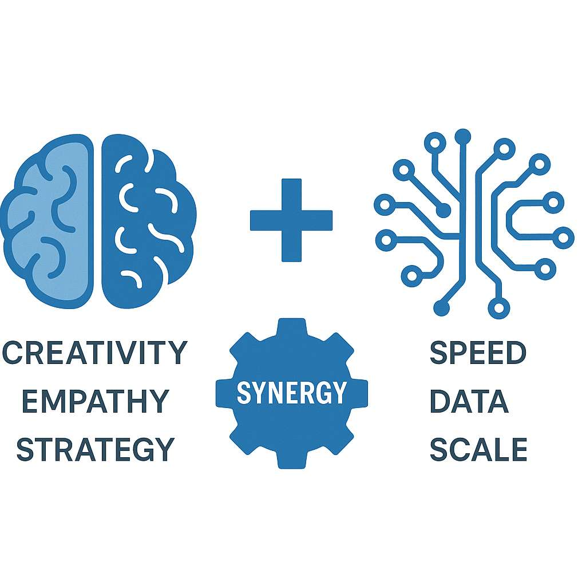
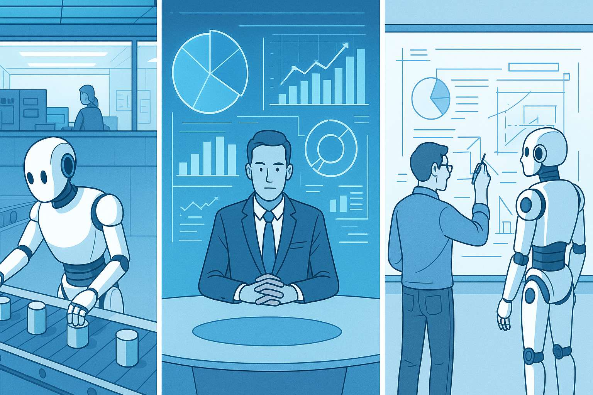
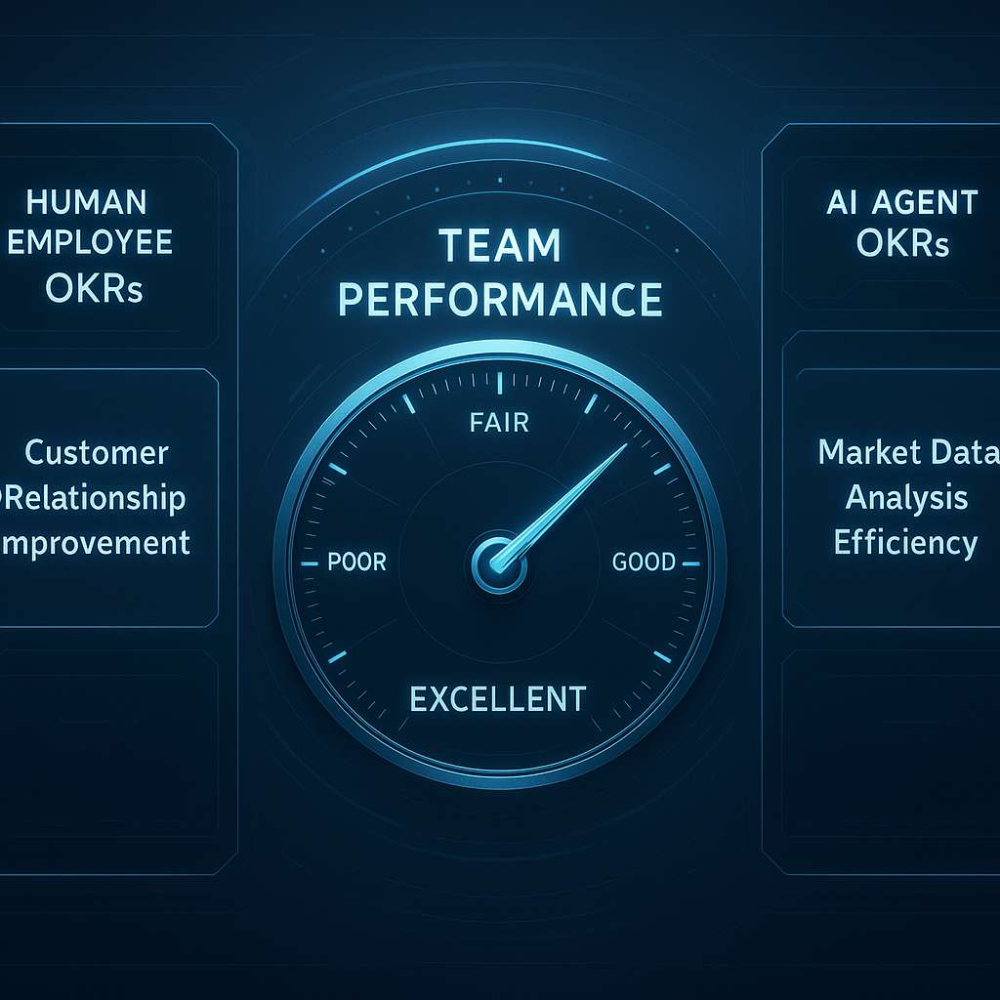
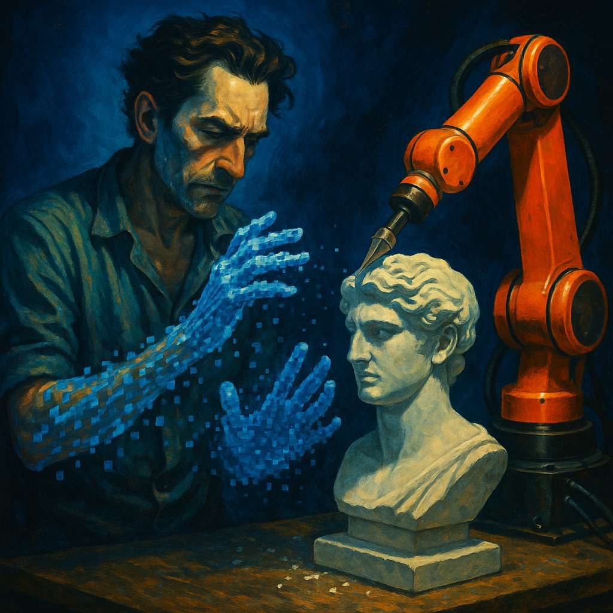

## 引言：从管理产出到驾驭过程

随着人工智能（AI）从一个被动的自动化工具演变为能够自主规划与行动的“数字同事”，传统的管理模式正面临深刻的颠覆。在由人类与AI智能体组成的人机混合团队中，管理的重心发生了根本性的偏移：不再是单纯地监督任务产出，而是转向精心设计、培育和统筹人机之间的**协作过程**本身。

在传统管理中，过程往往是一个“黑箱”，管理者更关心最终的结果。然而，在人机团队中，协作过程——信任的建立、任务的分配、信息的沟通、能力的成长——成为决定最终结果质量的关键变量。一个微小的过程失误，如对AI建议的误解或任务分配不当，都可能导致整个团队的失败。

因此，管理者必须掌握一套全新的核心职能，以驾驭这一复杂而动态的协作系统。本文将深入阐述AI管理学的四大核心管理职能，为管理者提供一套在日常工作中领导人机混合团队的可操作框架。

## **一、 基石：战略性任务分配与工作流设计**

成功的AI管理始于对工作流的深刻理解和重新设计。这并非简单地将任务丢给AI，而是要像一位战略家一样，根据每个“成员”（无论是人类还是AI）的独特优势进行布局，其核心遵循“互补性原则”。

 **互补性原则：发挥各自优势**

这项原则要求管理者清晰地认识到**人类与AI的本质区别与核心优势**。人类擅长创造力、战略思维、同理心以及处理复杂和非结构化问题的能力；而AI则在速度、规模化、模式识别和大数据处理方面拥有无与伦-比的优势。工作流的设计必须以最大化双方优势、弥补彼此短板为目标，实现“1+1>2”的协同效应。

**任务分配框架：构建清晰的协作模式**

在实践中，管理者可以采用一种**任务映射方法**，将团队的所有工作任务系统性地划分为三个明确的类别，并为每一类都建立清晰的规则和流程：

1.  **AI主导型任务**：这类任务由AI独立完成，人类仅在关键节点进行监督或对最终结果进行验收。这适用于高度结构化、重复性高、数据密集型的工作。
    *   **应用场景**：财务报表中的数据自动抓取与核对、大规模客户邮件的初筛与分类、代码库中的常规漏洞扫描、海量市场数据的初步清洗与整理。
    *   **管理要点**：核心在于建立强大的监控和预警机制。管理者需要明确定义触发人类干预的阈值（例如，当AI识别的数据异常超过某个百分比时），并确保存在清晰的**升级路径**（escalation paths），即在何种情况下任务必须无缝转交由人类处理。

2.  **人类主导型任务**：这类任务由人类掌握最终决策权和执行权，AI则扮演着强大的“增强助手”或“副驾驶”角色，提供深入的分析、洞察和建议。这适用于需要复杂伦理判断、关键商业决策、深度客户共情或突破性创新的工作。
    *   **应用场景**：制定公司年度战略规划（AI提供市场趋势分析和情景模拟）、进行关键的商业谈判（AI实时提供对方公司的背景资料和过往谈判风格分析）、处理重大的客户投诉（AI提供客户历史记录和解决方案建议，但由人类进行安抚与沟通）。
    *   **管理要点**：管理的重点在于确保人类成员能够准确理解并批判性地评估AI的输出。这要求AI的建议具备高度的可解释性，并且人类员工需接受相关培训，以避免对AI产生“自动化偏见”或盲目信任。

3.  **人机协作型任务**：这是最具挑战性也最具价值的协作模式。在这些任务中，人类与AI进行紧密、动态的互动，共同完成一个目标。这通常是一个迭代循环的过程，一方的输出会成为另一方的输入。
    *   **应用场景**：营销文案的创作（AI生成初稿，人类进行创意优化和润色，AI再根据反馈生成更多版本）、新药研发（AI筛选化合物分子，人类专家进行实验验证和方案调整）、复杂的软件调试（AI定位潜在的代码冲突，人类程序员进行逻辑推理和修复）。
    *   **管理要点**：管理者必须投入精力设计和优化人机交互的界面与协议。这要求建立一个高效的反馈循环，确保人类可以轻松地指导、修正和完善AI的行为，同时AI也能清晰地传达其推理过程和不确定性。

## **二、 引擎：混合劳动力的绩效管理**

如何衡量一个非人类成员的“绩效”？这是AI管理学带来的一个全新课题。传统的绩效管理体系必须被彻底改造，以适应混合劳动力的现实。其核心是从衡量技术指标转向衡量业务贡献，并建立持续优化的反馈机制。

**为AI智能体重新定义“成功”**

衡量AI的成功绝不能仅仅停留在其技术指标上，如系统正常运行时间、模型准确率或响应速度。**管理者必须为AI队友设定与团队业务目标紧密对齐的关键绩效指标（KPIs），将其视为真正的业务贡献者**。

*   **客服AI的KPI**：不应只是“响应时长”，而应是“首次联系解决率”、“客户满意度得分”或“为人类坐席节约的总时长”。
*   **供应链优化AI的KPI**：不应只是“算法精度”，而应是“库存成本降低百分比”、“物流运输效率提升率”或“缺货事件发生次数的减少”。
*   **招聘AI的KPI**：不应只是“简历筛选数量”，而应是“新员工90天留任率”、“招聘周期缩短天数”或“候选人质量评分”。

**为AI设定目标：引入OKR框架**

为了更好地引导AI智能体的自主行为，管理者可以超越KPI，为其设定目标与关键成果（OKRs）。这种做法能将AI的“工作”与组织更高层次的战略意图联系起来。

*   **示例：营销内容生成AI的OKR**
    *   **目标 (Objective)** ：显著提升品牌在目标客户群体中的社交媒体参与度。
    *   **关键成果1 (Key Result 1)** ：在本季度，将核心产品相关帖子的平均点赞数和分享数提高20%。
    *   **关键成果2 (Key Result 2)** ：独立生成并执行5个A/B测试，其中至少有2个测试的广告文案版本胜出人类撰写的版本。
    *   **关键成果3 (Key Result 3)** ：将AI生成内容的用户负面评论率降低至1%以下。

**建立反馈循环与实施“AI辅导”**

正如人类员工需要持续的反馈和辅导来提升绩效一样，AI模型也需要高质量的人类反馈来不断迭代和优化。**管理者必须将“AI辅导”制度化，使其成为团队的日常工作流程之一**。

*   **建立便捷的反馈机制**：团队成员应能通过简单的界面（如点赞/点踩按钮、评分系统、注释框）对AI的每一次输出进行评价。
*   **结构化反馈内容**：鼓励人类专家提供更深度的反馈，解释“为什么”AI的建议是好的或坏的，提供正确的范例，这种结构化的专家数据是模型微调的宝贵财富。
*   **定期“辅导会议”**：管理者可以定期组织会议，复盘AI在过去一段时间的表现，集中讨论其典型错误和成功案例，形成统一的反馈意见，集中输入给技术团队用于模型优化。这个过程是实现“学习的反思性”的关键环节，确保人与AI共同成长。

## **三、 链接：沟通与协作协议**

高效的团队合作依赖于清晰、无障碍的沟通。在人机混合团队中，管理者扮演着“首席沟通官”的角色，负责设计和建立一套能够促进人与AI之间相互理解、信任和默契的协议。

**超越“命令-响应”：构建交互式界面**

人机协作不能停留在简单的“命令-响应”模式。**管理者需要推动设计能够促进双向、主动沟通的交互界面。**AI不应只是一个被动等待指令的工具，而应成为一个能够主动提供上下文信息、预警潜在问题、并解释自身行为的沟通伙伴。

**可解释性（XAI）的中心角色**

信任是协作的基石，而透明度是信任的催化剂。AI智能体必须具备解释其意图和推理过程的能力。这种“可解释性”对于建立团队成员间共享的心智模型至关重要。

*   **劣质解释**：“建议选择方案B。”
*   **优质解释**：“我推荐方案B。因为数据显示，方案B的目标客户群体与我们上季度增长最快的用户画像重合度高达85%，且其预估成本比方案A低15%，同时考虑到了供应链的潜在风险。”

**建立“团队语言”：标准化交互**

为了减少误解并提高效率，管理者需要 fostering 一套清晰的沟通标准，即“团队语言”。

*   **对人类成员**：进行高级提示工程培训，教授如何提出精确、无歧义的问题，以获得更高质量的AI输出。
*   **对AI智能体**：规范其输出格式，要求其明确标示信息的置信度水平、数据来源以及潜在的不确定性。例如，AI在提供一个市场预测数据时，应同时给出“85%置信区间”和所依据的数据报告链接。

## **四、 成长：混合团队的培训与发展**

将AI引入团队不仅仅是技术部署，更是一场组织能力的变革。管理者必须同时关注人类员工和AI智能体两方面的成长与发展，以构建一个能够持续学习和适应的混合团队。

**提升人类技能：从“使用者”到“协作者”**

对人类员工的培训重点必须转变。 仅仅教会他们如何“使用”某个AI软件是远远不够的，培训的核心应聚焦于如何“与”AI高效协作。 关键培训领域包括：
*   **批判性评估能力**：培养员工识别AI输出中潜在偏见、错误和局限性的能力。
*   **战略性提问能力**：如何通过提问来引导AI进行更深层次的分析和创造。
*   **反馈与辅导技巧**：如何提供能够真正帮助AI模型改进的结构化反馈。
*   **数据素养**：理解AI决策背后的基本数据逻辑，成为更明智的AI协作者。

**AI智能体的“入职”与配置**

每一个新的AI智能体被引入团队时，都应被视为一名新员工的“入职”（Onboarding）。管理者应遵循一个标准流程：
1.  **角色定义**：向全体团队成员清晰地介绍这个AI的“职位描述”——它的核心职责、能力范围和已知局限性。
2.  **期望设定**：明确团队可以期待它做什么，以及不应该期待它做什么，避免不切实际的期望导致失望和不信任。
3.  **权限配置**：遵循**最小权限原则**，严格配置其系统和数据访问权限，确保其权限范围仅限于完成本职工作所需，这是控制安全风险的关键。

**主动应对技能退化风险**

过度依赖AI可能导致人类员工关键技能的退化（Skill Erosion），这是一个必须主动管理的长期风险。 管理者需要制定明确的策略来规避这一问题：
*   **任务轮换制度**：定期安排人类员工去处理那些通常由AI负责的任务，以保持他们的技能熟练度。
*   **设立“AI关闭日”**：在某些非关键业务日，可以尝试关闭部分AI辅助功能，鼓励员工回归基本功，进行“脱离AI”的思考和操作演练。
*   **利用AI进行高级培训**：利用AI创建高度逼真的模拟环境，让人类专家在无风险的情况下处理极端复杂的边缘案例，从而将他们的技能提升到新的高度。
*   **强化导师制度**：保留并激励资深员工作为导师，传承那些无法被AI轻易量化和学习的隐性知识与行业直觉。

## **结语：管理者的进化**

AI管理学的核心职能——战略性任务分配、混合绩效管理、沟通协议设计和双向培训发展——共同构成了一个动态而全面的框架。掌握这些职能，意味着管理者角色的根本进化：从一个任务的监督者，转变为一个人机协作生态系统的设计者、培育者和统筹者。这不仅是对管理技能的挑战，更是对管理思维的重塑。那些能够成功驾驭这一转变的领导者，将不仅能释放人机团队的巨大潜力，更将在智能时代引领组织走向持续的成功。

