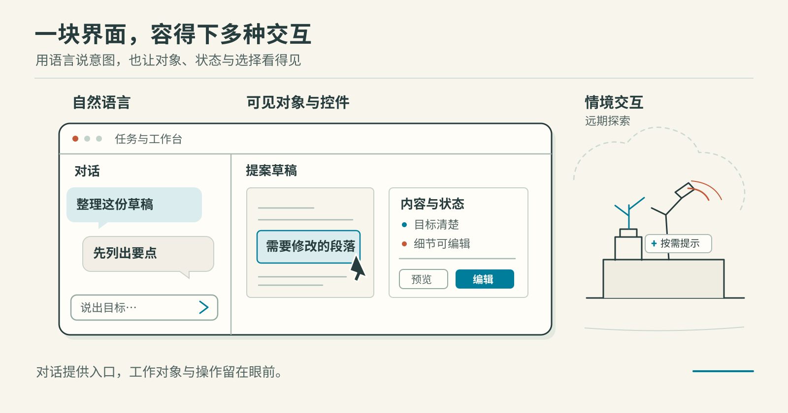

# 导言：聊天框之后，AI 交互往哪里走

2025 年 9 月，我写了《AI交互设计》系列的五篇文章，核心只有一句话：**今天主流的聊天框，不是人机交互的终极形态，而是一个由工程便利推动、终将退到幕后的拟物化过渡阶段。**

那五篇文章借了两位前辈的眼光：马克·韦泽（Mark Weiser）的“普适计算”，回答技术应该待在哪里；从施奈德曼到乔布斯的“直接操控”，回答人应该怎样操作。用这两把尺子，我批评了聊天框在回忆负担、可发现性和空间思考上的局限，并提出了一个面向长远未来的框架：**“实体虚拟化”**和**“平静的赋能”**。

此后 14 个月，我看到几种不同的变化：有的产品在聊天框旁摊开文档，有的图像工具允许圈出一块再说怎么改，几款编码工具则把自然语言带回终端。这些做法有一个共通的问题：当任务不再是一问一答，界面把工作对象放在哪里？

这一版重写，就是拿这 14 个月的变化，对照当初的判断。 想直接选题，读[六篇入口](#四篇章结构)；下文数字是文章书序，不是视频集号。

## 一、主线没有变：界面的演变

这个系列从头到尾追问的是一件事：**人和 AI 之间的界面应当长什么样，聊天框在其中处于什么位置。** 主动的 AI、穿戴硬件、智能体、安全边界，这些话题都会出现，但它们在这里只回答一个问题：它们对界面意味着什么。

沿着这条主线，2026 年的答案可以概括成一句话：**正在过渡掉的，不是聊天本身，而是“聊天作为唯一的界面”。**

聊天框没有消失。在一些工作流程里，可以把它比作方向盘：用语言说目标、改方向；旁边的编辑区或按需生成的界面则像工作台，把内容和状态摊开，让人直接操作；确认、权限和回退则提供控制。当 AI 开始替人干活，对话也可能成为交办任务的入口，而计划、进度、改动记录和任务看板承担起更多呈现与审阅的工作。

*图：Codex 根据本文绘制的概念示意；不同交互方式可以共存，右侧情境交互是远期探索。*

而“实体虚拟化”和“平静的赋能”依然是远方的方向：让计算融入环境，在适当的时候退回注意力的边缘。这是一种远期愿景，不是对何时实现的预测。从命令行到图形界面、从鼠标到多点触控，新旧方式都曾长期并存；14 个月还不足以确定交互范式最终会怎样变化。

## 二、对照 2025 年版：哪些说对了，哪些要改

| 2025 年的判断 | 2026 年回看 | 见 |
|---|---|---|
| 线性的语言摆不开工作台 | **有了更多例子。** 多家产品提供了对话旁的编辑区或交互界面；对需要比较、操作的信息密集型任务，它们可能更有帮助 | 第 04 篇 |
| 聊天框是“终将逝去的过渡阶段” | **说对了一半。** 受到挑战的是“唯一的界面”；聊天仍是表达和澄清意图的重要方式，终端也因自然语言获得新用途 | 第 01、04 篇 |
| 聊天框靠回忆、没有提示 | **在聊天框内部有了部分改进。** 一些产品可以反问、给选项或生成计划；具体表现取决于工具和设置 | 第 04 篇 |
| 用滑块调风格和语气 | **出现了另一种做法。** 一些产品支持“指着说”：先选范围，再说怎么改；是否支持版本回退取决于具体产品 | 第 03、05 篇 |
| AI 主动辅助、走出屏幕 | **愿景尚未充分实现。** 主动功能和穿戴设备都在尝试，但许多实际工作仍发生在屏幕上的应用里 | 第 02、05 篇 |
| 远期认知负荷“极低” | **说得太轻松。** 除了说明意图，还可能需要检查结果；监督负担不会自动消失 | 第 05、06 篇 |
| 清晰与可控是伦理基石 | **说对了，但说轻了。** 它已经是每个智能体产品的核心工程问题 | 第 05 篇 |
| （没写到） | **没想到。** AI 开始替人干活；界面有了第二种使用者；来源可辨的宿主确认框成为安全设计的一部分 | 第 06 篇 |

## 三、改版说明

这一版在保留原来五篇论证脉络的基础上，做了四件事。

**第一，用 2025–2026 年的证据检验原来的判断。** 包括哈佛、杜克与 OpenAI 关于真实使用分布的研究，斯坦福与佐治亚理工关于生成式界面何时胜出的实验，KAIST 与 UCSD 的征询式界面研究，CHI 2024–2025 关于直接操控和主动打断的实验，以及各家产品在这 14 个月里的实际走向。产品例子尽量覆盖 OpenAI、Google、Anthropic、微软、Cursor 等不同厂商；厂商自己发布的数字标注“厂商”。

**第二，校准具体的设计主张。** 原则二从“滑块”改为“指着说”；原则一加上“先被请进门”；原则四区分“走出聊天窗口”和“融入物理环境”；原则五补上“按风险和预先授权，为难以撤销的动作设置确认与控制”。

**第三，更正事实和归属错误。** 主要有：直接操控的概念由施奈德曼在 1983 年提出，iPhone 把它带给了大众；“普适计算”（1991）和“平静技术”（1995，与布朗合作）是两个时间点；韦泽汽车的例子是 22 个电机加 25 个电磁装置；活动徽章由 Olivetti 研究实验室率先开发；scrap computer 是“草稿纸电脑”；“至繁归于至简”出自苹果 1977 年的宣传册，原作者不明；“应当由人发起和控制行为”出自苹果的《iOS 人机界面指南》；“平静的赋能”是本系列的提法，不是韦泽的原词；“实体虚拟化”和“具身智能”不是一回事；开车时使用语音也不是“零分心”。完整的勘误表见 [AI交互设计系列（01–05）：2026 年修订建议](../AI交互设计系列（01–05）：2026_年修订建议.md)。

**第四，新增第 06 篇。** 原来的五篇讨论的是人怎样使用 AI。当 AI 开始替人干活，界面除了要帮助人把话说清楚，还要帮助人看清它做的事。第 06 篇引入利克莱德的“人机共生”和谢里丹的“监督控制”，讨论聊天框之外，监督需要什么样的界面，并提出第六项原则“可监督”。

## 四、篇章结构

1. [为什么聊天框不是终极形态](02-为什么聊天框不是终极形态.md)：聊天框为什么会赢、它的代价是什么，以及对话如何与其他工作方式配合；三条思想线索。
2. [重读韦泽的普适计算：界面应该退到哪里去](03-重读韦泽的普适计算：界面应该退到哪里去.md)：技术的“消失”和注意力的边缘与中心；主动的 AI 和穿戴硬件在 2026 年走到了哪一步；为什么走出聊天窗口不等于融入物理环境。
3. [乔布斯如何重塑人机关系：从直接操控到“指着说”](04-乔布斯如何重塑人机关系：从直接操控到“指着说”.md)：从 Sketchpad、施奈德曼到 iPhone 的直接操控谱系，一致性与用户主权；生成式 AI 怎样从“拉老虎机”走到“指着说”。
4. [为什么对话不是 AI 交互的终点：聊天框的三个问题与工作台的崛起](05-为什么对话不是_AI_交互的终点：聊天框的三个问题与工作台的崛起.md)：聊天框的三个结构性问题；2024–2026 年工作台的崛起和它的边界；终端这个反例说明了什么。
5. [实体虚拟化与下一代智能产品：从聊天框出发的演进框架](06-实体虚拟化与下一代智能产品：从聊天框出发的演进框架.md)：不同交互方式怎样并存；远期判断怎样检验；五项设计原则的 2026 年校准。
6. [从对话工具到自主代理：当 AI 替人干活，聊天框之外还需要什么界面](07-从对话工具到自主代理：当_AI_替人干活，聊天框之外还需要什么界面.md)：AI 替人干活之后，任务交办、进度与审阅界面如何补充对话；监督控制、核验负担、界面的第二种使用者和可信的确认框；第六项原则“可监督”。

---

## 相关页面

- **分篇资料**：[为什么聊天框不是终极形态](02-为什么聊天框不是终极形态.md#参考与来源)；[重读韦泽的普适计算](03-重读韦泽的普适计算：界面应该退到哪里去.md#参考与来源)；[乔布斯如何重塑人机关系](04-乔布斯如何重塑人机关系：从直接操控到“指着说”.md#参考与来源)；[为什么对话不是 AI 交互的终点](05-为什么对话不是_AI_交互的终点：聊天框的三个问题与工作台的崛起.md#参考与来源)；[实体虚拟化与下一代智能产品](06-实体虚拟化与下一代智能产品：从聊天框出发的演进框架.md#参考与来源)；[从对话工具到自主代理](07-从对话工具到自主代理：当_AI_替人干活，聊天框之外还需要什么界面.md#参考与来源)
- **图与署名**：概念图说明在图下；历史照片和论文图的来源与许可分别见[重读韦泽的普适计算：界面应该退到哪里去](03-重读韦泽的普适计算：界面应该退到哪里去.md)、[乔布斯如何重塑人机关系：从直接操控到“指着说”](04-乔布斯如何重塑人机关系：从直接操控到“指着说”.md)、[为什么对话不是 AI 交互的终点：聊天框的三个问题与工作台的崛起](05-为什么对话不是_AI_交互的终点：聊天框的三个问题与工作台的崛起.md)。
- **初版五篇**：[AI交互设计01-为什么聊天框不是终极形态](../AI交互设计系列文章/05-AI交互设计01-为什么聊天框不是终极形态.md) → [AI交互设计02-重读韦泽的普适计算](../AI交互设计系列文章/04-AI交互设计02-重读韦泽的普适计算.md) → [AI交互设计03-乔布斯如何重塑人机关系](../AI交互设计系列文章/03-AI交互设计03-乔布斯如何重塑人机关系.md) → [AI交互设计04-为什么对话不是AI交互的终点](../AI交互设计系列文章/02-AI交互设计04-为什么对话不是AI交互的终点.md) → [AI交互设计05-实体虚拟化与下一代智能产品](../AI交互设计系列文章/01-AI交互设计05-实体虚拟化与下一代智能产品.md)
- **版本与视频**：[AI交互设计系列（01–05）：2026 年修订建议](../AI交互设计系列（01–05）：2026_年修订建议.md)；[《聊天框之外：AI交互设计小课》系列大纲 v5（按 2026 版文章）](../../讲解与科普/AI交互设计科普视频策划/04-《聊天框之外：AI交互设计小课》系列大纲_v5（按_2026_版文章）.md)。
