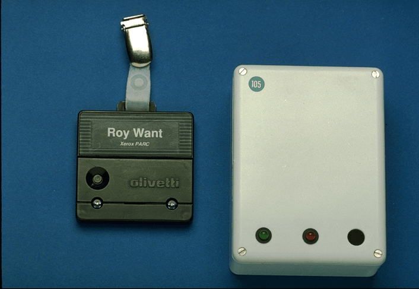

# 重读韦泽的普适计算：界面应该退到哪里去

1991 年，个人电脑正在走向巅峰，几乎所有人都在讨论怎样把桌面上的窗口做得更好看。施乐帕洛阿尔托研究中心（PARC）的首席科学家马克·韦泽（Mark Weiser）却提出了一条完全不同的路：计算不该被关在一个盒子、一块屏幕、一个入口里。

三十多年后，我们有了一个新的“唯一入口”：聊天框。重读韦泽，是为了拿他的标尺量一量它。

---

## 一、“消失”是技术成熟的样子

韦泽在《21 世纪的计算机》开篇写道：最深远的技术是那些会“消失”的技术，它们把自己织进日常生活，直到和生活本身分不开。

这里的“消失”不是物理上不见了，而是从注意力里退了出去。韦泽举了两个例子。

**书写。** 他说书写也许是人类最早的信息技术。书本、商品标签、路牌，文字早已遍布我们的环境。识字的人扫一眼路牌就知道往哪走，不会意识到自己“正在使用阅读这项技术”。

**电动机。** 工业化早期，一座工厂靠一台大蒸汽机，通过传动轴和皮带带动所有机器。小型电机成熟之后，动力被分散到每一台机器里。韦泽翻了一本普通汽车的维修手册，数出 22 个电机和 25 个电磁装置，它们藏在雨刮器、车窗、门锁和起动机后面。司机只需要拨一下杆、按一下键，不需要管理一份几十个部件的清单。

两个例子说的是同一件事：**技术成熟的标志，往往不是越来越集中、越来越显眼，而是被分散到具体的地方，从人的注意力里退出去。** 按这个标准，一个要求所有能力都从同一个输入框进、要求用户学会怎样对它说话的系统，还处在早期。韦泽在文末的说法更直接：机器应当适应人的环境，而不是强迫人进入机器的环境。

---

## 二、从“对象”到“背景”

为什么退到幕后这么重要？因为注意力是人最稀缺的资源。

韦泽援引了赫伯特·西蒙（Herbert Simon）关于技能“编译”的说法、迈克尔·波兰尼（Michael Polanyi）的“隐性维度”，以及海德格尔对工具的两种状态的区分：“在手”（present-at-hand）和“上手”（ready-to-hand）。初学骑车的人盯着车把，心里默念平衡要领；熟练的人看着前方的路，车已经成了身体的一部分。

工具从需要刻意操作的**对象**，变成延伸人能力的**背景**，这是一种认知上的解放：工具少占一分注意力，人就多一分心力去做真正的事。

韦泽对个人电脑的批评正在这里：操作系统的概念、文件目录和层层弹窗，把人的注意力锁在一个发光的盒子上，让电脑一直停留在“对象”阶段。

1995 年，韦泽和约翰·西利·布朗在《设计平静技术》里把这个想法讲得更细：**信息可以在注意力的“边缘”和“中心”之间移动。** 平静技术不是永不出声。熟练的司机平时不会去听引擎，但引擎声一旦不对，马上就会警觉。好的辅助平时待在边缘，不打断人；真正需要时清楚地走到中心，处理完再退回去。

这对今天的 AI 界面是一个尖锐的问题：如果所有交互都依赖用户打开聊天、盯着消息流，信息就很难根据紧急程度在注意力的边缘与中心之间切换。通知、侧栏或其他设备可以提供不同的呈现方式，但也可能带来新的打扰。

---

## 三、“实体虚拟化”：把计算放进世界

韦泽对当时风头正劲的虚拟现实（VR）提出了批评：VR 试图在计算机里造一个世界，用沉重的设备把人和真实生活隔开。

他的回应是**“实体虚拟化”（Embodied Virtuality）**：不是把人拉进计算机，而是把计算从电子外壳里放出来，放进人生活的物理世界，让已经存在的世界获得看不见的增强。

（需要说明：这和今天机器人领域说的“具身智能”（Embodied AI）不是一回事。韦泽说的是把计算织进环境里的器物；具身智能研究的是有身体、能感知和行动的智能体。两者有交集，出发点不同。）

为了落地，韦泽和 PARC 团队设想并试制了三种尺度的设备，目标是“每个房间有几百台计算设备”，打破“一人、一机、一屏”：

- **标签（Tabs，英寸级）**：很小的情境感知设备。典型的例子是“活动徽章”（Active Badge），由剑桥的 Olivetti 研究实验室率先开发，PARC 也用它做研究：徽章发出身份信号，楼里的传感器知道你在哪个房间，电话就转到那里。你不用操作任何界面，环境已经认出了你。
- **便笺（Pads，英尺级）**：便携的显示板。韦泽把它比作“草稿纸电脑”（scrap computers）。scrap 指草稿纸，不是“用完就扔”：它不属于某一个人，桌上可以同时摊开好几张，随手拿来用，用完放下。
- **白板（Boards，码级）**：墙面大小的显示面，供一屋子人共享信息、远程协作。

*图：Active Badge 系统的设备。照片：Roy Want，来源：[Wikimedia Commons](https://commons.wikimedia.org/wiki/File:Active_Badge.png)，[CC BY-SA 4.0](https://creativecommons.org/licenses/by-sa/4.0/)，未修改。*

这套设想的重点不在哪一件设备，而在设备之间的连接和对情境的感知。它们一起构成一个“场所”（place），而不是一个“用户界面”。计算像房间里的灯光一样，成为环境的底色。

---

## 四、2026 年的检验：主动的 AI 和走出屏幕

三十多年后，我们有了能理解上下文的大模型。韦泽的图景兑现了吗？

2025 年版的我对此相当乐观，认为 AI 应当“像一个安静但敏锐的背景服务”，根据你在哪里、日程上有什么，主动预测需求。14 个月的变化提醒我：**这是一个方向，但实现并不容易。** 主动辅助和穿戴设备都出现了，具体形式与授权方式各不相同，距离能自然融入日常环境仍有不少问题。

### 1. 主动是有代价的

让 AI 不必等人开口，听起来很诱人。但这个难题早就有人碰过。1990 年代末，微软研究院的埃里克·霍维茨（Eric Horvitz）主持 Lumière 项目，提出“混合主动”（mixed-initiative）界面的原则。系统只能用概率猜人的意图，猜错了时机，帮助就变成了打扰。Office 里那个让人烦躁的回形针助手，就是这条研究线进入产品后的样子。2008 年，格洛丽亚·马克（Gloria Mark）等人的实验发现，频繁被打断的人为了赶进度做得更快，但压力、挫败感和脑力负荷都明显上升。

2025–2026 年的产品提供了几种不同的主动辅助方式。它们的用途和授权机制不同，不能直接排成统一的“主动程度”名次：

| 方式 | 例子 | 交互与授权 |
|---|---|---|
| 用户设定，到点执行 | ChatGPT Tasks、Gemini 定时操作 | 人先设定任务和时间 |
| 结合当前任务提建议 | 编辑器里的行内补全；Pixel 的 Magic Cue | 建议出现后由人决定是否采用 |
| 主动准备更新 | ChatGPT Pulse | 内容结合系统选择和用户反馈；2026 年 6 月宣布逐步退出，官方建议改用定时任务 |
| 后台协助处理任务 | Claude Duet | 2026 年 10 月开放研究预览候补；发送、付款、签署或删除等操作需要批准 |
| 持续记录以供检索 | Windows Recall | 用户选择是否开启屏幕快照；它主要用于记录和检索，不等同于代替用户执行任务 |

这些例子共同提出了一个问题：系统应当在什么条件下介入，以及人能否看清并调整它的行为。

两项研究展示了其中的权衡。Pu 等人在 CHI 2025 的受控编程实验中记录了 398 次主动介入：53.3% 引发用户的有效回应或处理，包括回复助手或修改建议代码；12.1% 被判为有妨碍的打断；34.7% 没有得到互动，可能被忽略，也可能没有被注意到。Valerie Chen 等人同年让 65 名学生分组比较主动助手与被动聊天：普通建议组有 90% 的人偏好主动助手，带预览组为 80%，等待更短且一次显示更多建议的另一组为 47%。这是不同组之间的比较，不能把差异单独归因于打断频率。

这正是韦泽和布朗说的边缘与中心。**难的不是让机器开口，而是判断什么时候该开口。** 今天的产品还不一定能做好这个判断。一个值得遵循的设计原则是把选择权留给用户：先被请进门，再说话。

### 2. 硬件：屏幕挪到了眼前，没有消失

在物理世界，获取环境数据和理解人的意图是两回事。2013 年，一项有关 Nest 智能恒温器家庭使用的研究访谈了 23 人，其中 10 人还参加了三周日记研究。研究发现，一些用户对系统难以区分长期习惯和临时调整感到困扰：机器可能把一次性的例外学成反复执行的日程。这是特定设备和样本中的观察，不代表所有情境感知系统都有相同表现。

最彻底去掉屏幕的尝试，结局也最说明问题。无屏胸针 Humane Ai Pin 在 2025 年 2 月停止销售并关闭服务的案例，也暴露了对云端的依赖：服务关闭后，设备会失去依赖云端的功能。本次未取得 Humane 的停服公告与 HP 收购部分资产的原始公告，具体时间和交易细节仍待复核。活下来、还在扩张的穿戴设备，比如带镜片显示和肌电腕带的 Meta Ray-Ban Display、2026 年 10 月开放订购的 Android XR 眼镜 XREAL AURA，都是**把屏幕挪到了眼前，而不是取消屏幕**。语音和手势拓宽了输入，但人要高效地读取结构化信息，还得靠眼睛。

### 3. AI 先走出的，是聊天窗口

物理世界这一步走得慢。但另一个方向上，2025–2026 年发生了很大的变化：AI 走出了自己的聊天窗口，进入了别人的软件。Anthropic 的 Computer Use 和 Claude in Chrome、OpenAI 的 ChatGPT agent、Google 在 Chrome 里的自动浏览，以及在终端里读代码、跑测试、改文件的编码智能体。2025 年 11 月，微软在 Windows 11 中逐步预览代理工作区：为智能体提供独立账户和会话，让它操作应用，并在授权范围内访问文件。会话分开不意味着智能体完全无法接触用户数据。

很容易把这件事说成“韦泽的预言兑现了一半”，但这不准确。智能体住进浏览器和操作系统，计算依然关在屏幕这个盒子里，这恰恰不是韦泽说的“实体虚拟化”。Windows 的代理工作区说得更直白：机器有了一块自己的屏幕，只是人不必看着它。

它和韦泽真正相通的，只有注意力这一面：**人不必再亲手操作那些应用了，应用的界面从人的注意力里退了出去。** 但退出去的东西并没有消失，它换了一种方式回到人面前：人要看智能体的计划、改动和汇报。第 06 篇会专门讨论这件事。

所以需要区分两种变化：**走出聊天窗口，和融入物理环境，不是同一回事。** 前者包括由智能体操作数字应用；后者包括计算进入房间和器物。这些探索可以并行，但各自面临不同的硬件、权限、隐私与打断成本问题。

---

## 结语：一把量注意力的尺子

重读韦泽，得到的是一把尺子：**一个界面，是在占用人的注意力，还是在把注意力还给人？**

用这把尺子量，只依赖消息流的聊天界面还有局限：它不容易按情境调整信息进入注意力中心的时机。2026 年的产品在尝试不同办法，包括可关闭的主动提醒，以及离开聊天窗口操作其他软件的智能体；这些办法也带来授权、核验和打断问题。距离韦泽所说的“平静”，仍有不少设计难题。

当技术必须走到前台、由人亲手塑造和修正的时候，人该怎样操作它？这是第二条线索要回答的问题：直接操控。

---

## 相关页面

- **本篇资料附录**：参考文献与资料索引
- **上一篇**：AI交互设计2026版01：为什么聊天框不是终极形态
- **下一篇**：AI交互设计2026版03：乔布斯如何重塑人机关系
- **2025 初版对应原文**：052-AI交互设计02-重读韦泽的普适计算

## 参考与来源

- **普适计算与平静技术**
  - Mark Weiser, *The Computer for the 21st Century*, Scientific American（1991-09）：https://worrydream.com/refs/Weiser_1991_-_The_Computer_for_the_21st_Century.pdf
  - Mark Weiser & John Seely Brown, *Designing Calm Technology*（1995-12）：https://calmtech.com/papers/designing-calm-technology
  - Roy Want, Andy Hopper 等, *The Active Badge Location System*, ACM TOIS（1992）
- **混合主动与打断成本**
  - Eric Horvitz 等, *The Lumière Project*, UAI（1998）：https://arxiv.org/abs/1301.7385 ；Eric Horvitz, *Principles of Mixed-Initiative User Interfaces*, CHI（1999）
  - Gloria Mark, Daniela Gudith & Ulrich Klocke, *The Cost of Interrupted Work: More Speed and Stress*, CHI（2008）
  - Kevin Pu 等, *Assistance or Disruption? Exploring and Evaluating the Design and Trade-offs of Proactive AI Programming Support*, CHI（2025）：https://doi.org/10.1145/3706598.3713357
  - Valerie Chen 等, *Need Help? Designing Proactive AI Assistants for Programming*, GenAICHI @ CHI（2025）
- **主动功能与硬件（厂商公告为主）**
  - OpenAI, *Introducing ChatGPT Pulse*（2025-09-25）；*ChatGPT release notes*（2026-06-17）
  - Google, *Pixel Magic Cue*（2025-08）；*XREAL AURA*（2026-10-28）
  - Anthropic, [*Introducing Claude Duet*](https://claude.com/resources/articles/claude-duet)（2026-10-21，研究预览）
  - Rayoung Yang & Mark W. Newman, *Learning from a Learning Thermostat*, UbiComp（2013）
  - Humane 停服公告存档（2025-02）：https://archive.is/NUqbh ；HP 收购部分资产新闻稿（2025-02-18）
  - Meta, *Meta Ray-Ban Display: AI Glasses With an EMG Wristband*（2025-09-17）
- **AI 走出聊天窗口**
  - Anthropic, Computer Use（2024-10）与 *Piloting Claude in Chrome*（2025-08）；OpenAI, *Introducing ChatGPT agent*（2025-07-17）
  - Microsoft, Windows 11 代理工作区与智能体连接器预览（Ignite，2025-11）