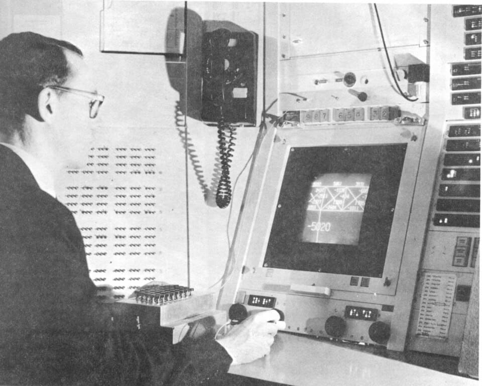

# 乔布斯如何重塑人机关系：从直接操控到“指着说”

个人计算的早期，计算机是专家和爱好者的领地。米白色的机箱隔着晦涩的命令和层层菜单跟人说话，强大，却和日常生活格格不入。

乔布斯留下的最大遗产，不只是几件漂亮的产品，而是让普通人可以亲手、直觉地操作计算机。2007 年的初代 iPhone 并没有发明背后的交互理论；它把计算机史上积累了几十年的探索合在一起，后续产品又将这种操作方式带给了数以亿计的人。

这套交互方式立在三根柱子上：**直接操控**，把命令变成动作；**极致简约**，把工程的复杂藏到任务后面；**反馈与用户主权**，让人确信一切在掌握之中。这一篇先讲这三根柱子，再看它们在生成式 AI 里遭遇了什么，又以什么样的新形状回来。

---

## 一、直接操控：从下命令到亲手做

多点触控普及之前，人和数字对象之间隔着一层：对象在玻璃后面，人要借键盘敲命令，或者握着鼠标移动屏幕上的箭头，把意图“转述”给计算机。

把这层隔阂拆掉，是一场持续了半个世纪的接力。1963 年，伊万·萨瑟兰（Ivan Sutherland）在 MIT 的博士论文里展示了光笔图形系统 **Sketchpad**：用光笔直接指着屏幕上的线条移动、缩放、加约束，不必再用代码重新描述图形。1983 年，本·施奈德曼（Ben Shneiderman）把这种方式总结为**“直接操控”（Direct Manipulation）**，并列出了它的特征：**操作对象一直看得见；用动作和点选代替复杂的语法；操作快、可以一点一点地做、随时可以撤回；结果立刻可见。** 2006 年，杰夫·韩（Jeff Han）在 TED 上演示了多点触控；2007 年，苹果用初代 iPhone 把直接操控从鼠标搬到了手指上。

*图：萨瑟兰使用 Sketchpad，照片见其博士论文。照片：Ivan Sutherland；扫描：Kerry Rodden。来源：[Wikimedia Commons](https://commons.wikimedia.org/wiki/File:SketchpadDissertation-Fig1-2.tif)，[CC BY-SA 3.0](https://creativecommons.org/licenses/by-sa/3.0/)，图片已缩放。*

心理上的变化是根本性的。你不再对机器说“把这张合影放大 200%”，而是两根手指按在照片上轻轻拉开，笑脸随着指尖放大，松手即停。你也不用去瞄准屏幕边上那条细细的滚动条，手指一拂，长页面就顺着惯性滑下去。

施奈德曼在意的，从来不是手指有没有碰到玻璃，而是**人的动作和对象的变化之间，有没有紧密、即时、可以预期的因果联系**。从“想好语法再下命令”到“看着对象亲手塑造”，交互从一项需要分心的认知任务，变成了接近本能的身体动作。

---

## 二、极致简约：第二种“消失”

“至繁归于至简”（*Simplicity is the ultimate sophistication*）这句话，印在苹果 1977 年的 Apple II 宣传册上，后来常被用来概括苹果的设计信条（原作者至今说不清）。这里的简约不是砍功能，也不是空洞的留白，而是把复杂性封装起来。“先从用户体验出发，再倒推需要什么技术”的表述常被归于乔布斯在 1997 年苹果全球开发者大会（WWDC）上的问答；本次未取得可直接核对的原始录像或逐字稿。

初代 iPhone 最大胆的决定，是去掉了当时许多智能手机都配着的物理键盘。业内很多人认为这是自毁输入效率。但固定键盘有个致命的问题：不管你在看电影、修照片还是弹钢琴，那半块键盘永远占着机身正面。

去掉键盘之后，整块正面变成了一张**“变色龙画布”**：写邮件时它是键盘，算账时是计算器，拍照时是取景框。内容站到了中央，界面随任务变化，用完就退场。

和上一篇的韦泽对照，会发现这是**第二种“消失”**。韦泽说的消失，是计算设备散进物理环境；iPhone 做到的消失，是**把庞大的软件工程藏进任务本身**，让人专注于正在做的事，忘了自己在操作一台精密的计算机。

---

## 三、反馈、一致性与用户主权

一个让人觉得“尽在掌握”的系统，信任不是靠承诺建立的，而是靠几套具体的机制。

**即时反馈。** 列表滑到底时的回弹，拨动开关时轻微的震动，图标展开时连贯的过渡动画，它们不断告诉人：系统听到了你的动作，并且按可靠的规律在响应。好的反馈还会区分状态：输入收到了、后台在处理、动作已完成。一段漂亮的动画，不应该用来掩盖一个还没有完成的结果。

**一致性。** 不管打开哪个应用，返回键大致都在左上角；按一下 Home 键（后来是从底部上滑），总能回到主屏幕。这种一致让人很快建立起稳定的心智模型：在任何地方，同样的动作产生同样的结果，同样的样子意味着同样的东西。人敢去探索陌生的功能，是因为知道自己不会迷路。

**用户主权。** 苹果 2011 年的《iOS 人机界面指南》写道：“通常应当由人，而非应用程序，来发起和控制行为。”应用可以提建议、发警告，但通常不应该替人做最终决定。

支撑主权感的一项关键发明，要追溯到 1970 年代 PARC 的拉里·泰斯勒（Larry Tesler）和蒂姆·莫特（Tim Mott）。早期的编辑器常常要求“先选动作、再选对象”：先进入删除模式，再去点要删的东西，一旦忘了自己在哪个模式，就容易误删。泰斯勒和莫特在 Gypsy 编辑器里把顺序倒过来：**先选中对象，再施加动作**，并配上剪切、复制、粘贴。再加上后来图形界面常见的撤销（Undo），人就可以更容易地看清选中的对象，并在支持撤销时退回操作。泰斯勒关于这段历史的 2012 年文章，本次只取得开头摘录，尚不能从该文全文逐项核对上述细节。

对象可见、反馈及时，加上适当的撤销能力，能让人更敢于探索；但实际产品并不保证每一步都可逆。

---

## 四、2026 年的检验：从“拉老虎机”到“指着说”

拿这把标尺去量生成式 AI，反差立刻出现：图形界面和多点触控好不容易赢回来的操控感，在纯聊天框里丢掉了一大片。

假设你在聊天框里改一张生成的画：输入一句话，等几秒，系统给出一张全新的图。你只想把右边的山抬高一点，模型却把左边人物的神态和天空的构图也一起重画了。没有局部锚定，没有一点一点的调整，也没有可以预期的因果。这更像在拉一台**老虎机**。

### 滑块：方向对，形状不对

2025 年版的我设想过一种图形化的办法：在界面旁边放一排滑块，标着“正式度”“说服力”“简洁度”或者“梵高风格的权重”，拖动滑块就能实时调整输出。

滑块确实出现过。OpenAI 的 Canvas 在 2024 年推出时，提供了“调整长度”和“更改阅读水平”（从幼儿园到研究生）两个快捷控件；CHI 2025 有一项研究，把文本的缩写和扩写映射成手机上的双指捏合与张开。2026 年 5 月，OpenAI 宣布 GPT-5.5 Instant 和 Thinking 不再提供独立 Canvas；这不等于所有新模型都取消了 Canvas。对于篇幅长短、结构化数据筛选等单一且连续的维度，滑块或类似控件仍然可以派上用场。

### 扩散开的形状：“指着说”

另一种已经出现在图像、代码、文档和生成式界面中的组合，我把它叫作**“指着说”**：**用手或光标圈出“哪里”，用一句话说“怎么改”。** 理想情况下，系统尽量把改动限制在指定范围，并提供可检查或恢复的版本；具体产品是否做到，要看它的实现。

- **图像。** Photoshop 的生成式填充：框选一块，输入要求。ChatGPT 的图像编辑：用画笔涂出要改的区域，再描述改法。Google Flow 在 2026 年 2 月加入了套索：圈出一块，写明要加什么、去掉什么。更早的研究系统已经探明了这条路：ControlNet 用边缘和姿态草图约束生成结构，DragGAN 让人在生成的图上打点拖拽变形。
- **代码。** 在 Codex 的远程工作流里，开发者可以在改动记录（diff）的具体行上留批注，再把审阅上下文发回 Codex。这是“指着说”的一种工作方式；修改能否严格限定在原范围内，还要看工具的实现和实际结果。
- **生成的界面和文档。** 如果工作台提供版本记录，人就有机会对照修改前后的结果。例如，Claude Code 的 Artifacts 文档介绍，同一链接下每次发布会产生新版本，作者可以选择向查看者展示的版本；这不等于所有产品都能恢复任意旧版的编辑状态。

研究也提供了一个具体例子。达米安·马松（Damien Masson）等人在 CHI 2024 发表的 **DirectGPT** 实验中，让 12 名有编程与 ChatGPT 使用经验的参与者，分别用直接操控界面和研究者复刻的聊天界面编辑文本、代码与矢量图。前者单次试验平均用时 56 秒，后者为 117 秒；平均提示次数分别为 1.90 和 3.67 次，每条提示平均为 5.83 和 19.98 个英文词。用时包含达到三分钟上限仍未完成的试次，因此不能把它理解成全部成功任务的完成时间。

### “指着说”解决了什么

**因为风格的维度是说不完的。** “正式度”“说服力”只是无数维度中的两个，每多一种诉求就要多一根滑块，面板很快会变成飞机仪表盘。语言恰好擅长随口说出任何一个方向：“带一点冷幽默”“把云改成暴雨将至的样子”。

语言真正的短板不在“怎么改”，而在“改哪里”。“倒数第三段第二句的后半截”“画面右上角第二棵树左边”，说半天不如手指一圈。

于是分工就清楚了：**手负责范围，嘴负责方向，版本负责兜底。** 泰斯勒的“先选对象、再施加动作”，在 AI 时代换了一种媒介重新出现：先圈出对象，再用一句话说出动作。

这也正好回答了第 01 篇的比喻：“指着说”就是一手扶着方向盘（语言），一手直接点在仪表盘（工作面）上。它不是要取消聊天，而是给语言补上它最不擅长的那一半。

当然它也有边界。精修一个局部靠“指着说”；但要把一百张照片统一改成黑白，一句全局指令远比圈一百次快。第 05 篇会再讲这一点。

### 一致性的新含义

还有一根柱子，在 2026 年变得比以往更重要：一致性。iPhone 时代，一致的操作语法让人敢于探索；到了 AI 能够生成界面的时代，生成的内容也可能画出以假乱真的“确认支付”按钮。这时，宿主程序自己的确认框、权限提示和身份标识，是否处在受保护、来源清楚且容易辨认的区域，就从体验问题变成了安全问题。隔离能限制内容控制宿主界面，却不能保证内容区里不会出现模仿它的图形。第 06 篇会回到这里。

---

## 结语：把工具的主权还给人

从萨瑟兰、施奈德曼到乔布斯，这条线索的核心是把技术“人性化”：用直接操控把语法变成身体的直觉，用变色龙般的画布把工程的复杂藏到任务后面，用反馈、一致性和撤销，把最终的控制权交还到人手里。

生成式 AI 一度让这些东西倒退回了“下命令、等结果”。2026 年的“指着说”说明，直接操控没有过时，只是换了操作的对象：从模型内部的“风格”，换成了**范围**和**版本**。

在我看来，这条传统留给 AI 产品最重要的提醒是：**最好的技术，不是让人惊叹机器有多聪明，而是让人觉得自己变得更有力量、更从容。**

有了韦泽和直接操控这两把尺子，下一篇正式拆解聊天框：它在复杂任务面前的三个结构性问题，以及过去一年多围绕它长出来的工作台。

---

## 相关页面

- **本篇资料附录**：参考文献与资料索引
- **上一篇**：AI交互设计2026版02：重读韦泽的普适计算
- **下一篇**：AI交互设计2026版04：为什么对话不是AI交互的终点
- **2025 初版对应原文**：051-AI交互设计03-乔布斯如何重塑人机关系

## 参考与来源

- **直接操控、简约与无模式编辑**
  - Ivan Sutherland, *Sketchpad: A Man-Machine Graphical Communication System*（1963 MIT 博士论文；剑桥大学 2003 年技术报告重印）：https://www.cl.cam.ac.uk/techreports/UCAM-CL-TR-574.html
  - Ben Shneiderman, *Direct Manipulation: A Step Beyond Programming Languages*, IEEE Computer（1983）：https://www.cs.umd.edu/~ben/papers/Shneiderman1983Direct.pdf
  - Jeff Han, *The Radical Promise of the Multi-Touch Interface*, TED（2006-02）
  - Apple Inc., *Apple II Brochure*（1977）：https://archive.computerhistory.org/resources/text/Apple/Apple.II.1977.102637933.pdf ；*Apple Reinvents the Phone with iPhone*（2007-01-09）
  - Apple Inc., *iOS Human Interface Guidelines*（2011-03，第 23 页）
  - Larry Tesler, *A Personal History of Modeless Text Editing and Cut/Copy-Paste*, ACM interactions 19(4)（2012）：https://dl.acm.org/doi/10.1145/2212877.2212896
- **生成式 AI 中的直接操控**
  - Damien Masson, Sylvain Malacria, Géry Casiez & Daniel Vogel, *DirectGPT: A Direct Manipulation Interface to Interact with Large Language Models*, CHI（2024）：https://doi.org/10.1145/3613904.3642462
  - Tim Zindulka 等, *Exploring Mobile Touch Interaction with Large Language Models*, CHI（2025）：https://arxiv.org/abs/2502.07629
  - Xingang Pan 等, *Drag Your GAN*, SIGGRAPH（2023）；Lvmin Zhang, Anyi Rao & Maneesh Agrawala, *Adding Conditional Control to Text-to-Image Diffusion Models*（ControlNet, ICCV 2023）
  - OpenAI, *Introducing canvas*（2024-10-03）；[*Editing your images with ChatGPT Images*](https://help.openai.com/en/articles/9055440-editing-your-images-with-chatgpt-images)（图像局部选择帮助页，2025-03 存档）；Adobe Firefly Generative Fill（2023-05）；Google, *New ways to create and refine content in Flow*（2026-02-25）；OpenAI Developers, [*Mastering remote engineering work from your phone*](https://developers.openai.com/blog/mastering-codex-remote-for-engineering)（2026-06-23）
  - Anthropic, [*Share session output as artifacts*](https://code.claude.com/docs/en/artifacts)（持续更新，关于发布版本和共享设置）