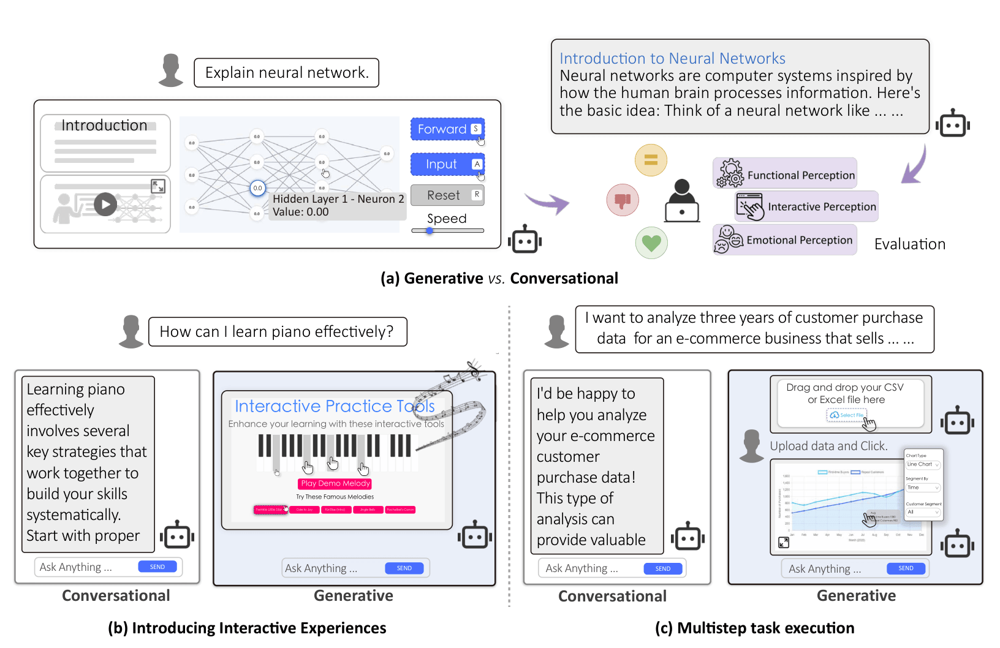
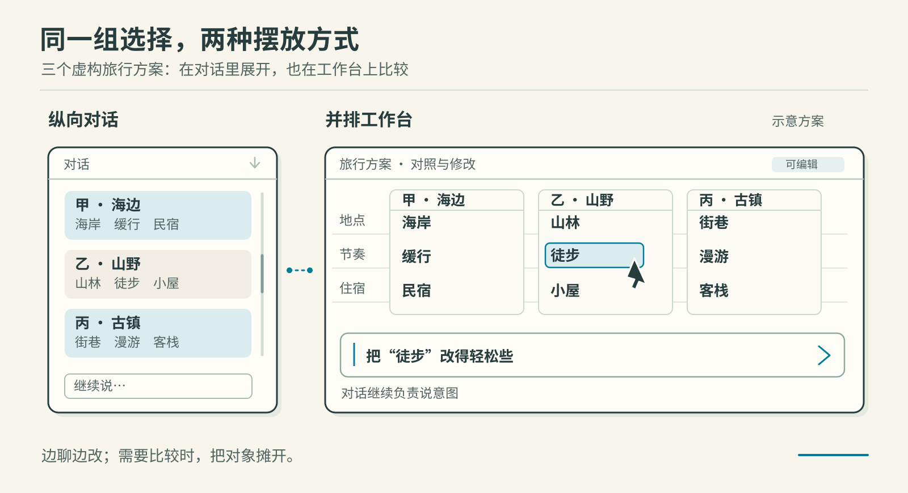

# 为什么对话不是 AI 交互的终点：聊天框的三个问题与工作台的崛起

对话式界面在 AI 普及的初期立下了无可替代的功劳。但把它当成 AI 交互的终点，依然是一个从工程便利出发、而不是从人出发的判断。

把人与人之间的交谈原样搬进人机交互，看上去是一条零门槛的捷径。可一旦任务超出简单问答，这条捷径通往的不是效率的高峰，而是一片充满摩擦的山谷。从几条经过几十年检验的可用性原则出发，就能看清楚：在复杂的探索、比较和创作面前，纯对话为什么会从亲切的入口变成束手束脚的枷锁。

这一篇先讲三个问题，再看 2026 年的产品怎样回应它们。

---

## 一、从“认出来”退回到“想起来”

1994 年，雅各布·尼尔森（Jakob Nielsen）总结了十条可用性原则，其中一条是**“识别优于回忆”（Recognition rather than recall）**：把功能、状态和选项直接摆在人眼前，让人“看着选”，比让人从工作记忆里“想出来”省力得多。这是一条经验准则，不是物理定律：熟练的工程师批量重命名上百个文件时，敲一行命令仍然比点一百次图标快。但图形界面之所以能让计算机走向普通人，很大程度上就是因为它把隐蔽的命令变成了看得见的菜单、日历和表单。

纯对话把大量交互又拉回了“回忆和转述”。这像是走进一家没有菜单的餐馆，有什么菜、配料怎么搭，全凭你自己报出来。它给用户加了两份额外的脑力劳动。

**第一份，是自己记住整个任务的上下文。**

拿订国际机票来说。在一个成熟的订票界面里，往返日期有摊开的月历，人数、舱位、价格区间、最多转机几次，都是并排的选项和滑块。所有约束都锁在面板上，改其中一项，其他条件不动，结果当场重算。

到了聊天框里，同一件事变成了一场小心翼翼的拉锯：

> 你先说：“帮我查三月去法兰克福的机票，转机不超过一次。”
> AI 列出三个方案。你接着说：“第二个不错，但出发时间改到下午。”
> AI 给出一批新方案。

这时一个问题悬在半空：**“转机不超过一次”还算数吗？** 界面上没有任何一处告诉你，上一轮的条件早已被新的长段文字顶出了屏幕。不只是人容易记混，模型也有自己的盲区。刘（Nelson F. Liu）等人的《迷失在中间》（*Lost in the Middle*，TACL 2024）发现，关键信息放在长上下文中间时，许多模型的提取准确率明显低于放在开头或结尾。结果稍有出入，用户就只能往上翻聊天记录，排查到底是模型漏了条件，还是自己前后说得不一致。

**第二份，是把模糊、多维的意图翻译成线性的文字。**

2023 年，尼尔森把大模型对话称为六十年来第三种界面范式：“基于意图的结果指定”（intent-based outcome specification），用户不再逐步告诉计算机怎么做，只需说出想要什么结果。但在真实的工作里，“把想要的结果一次说严密”本身就是一项高强度的劳动，以至于催生出了“提示工程”这个说法。原本应该由界面分担的认知支架，又被推回到了人这一边。

---

## 二、一块没有任何提示的空白

好的工具，形状本身就在说话：门上装一个竖把手，你就知道该握住往外拉；装一块平板，你就知道该推。

唐·诺曼（Donald Norman）对此做过一个重要的区分：物体客观上允许你做什么，叫**“示能”（affordance）**；物体表面告诉你“可以做什么、该怎么做”的线索，叫**“意符”（signifier）**。按这个区分，空白的聊天输入框最大的问题，是它几乎没有任何意符。

除了闪烁的光标告诉你“这里能打字”，它不提供任何关于能力、权限和可靠程度的线索。它能读我的表格吗？能联网查资料吗？在哪类问题上特别容易出错？框上一个字也没写。用户只能像在黑屋子里摸开关一样，靠一次次试错去探边界；在这个产品里摸出来的经验，换到另一个产品又得重来。

更深的隐患来自第 01 篇说的拟人化。AI 用无可挑剔的语法、笃定的语气说话时，人会本能地以为它的判断力和核查能力配得上它的文笔。这种期待撞上模型的“幻觉”，代价就会溢出屏幕。2023 年，美国纽约南区联邦地区法院审理的 *Mata v. Avianca* 案里，律师把 ChatGPT 当作法律检索工具，把模型编造的、格式逼真的多个判例写进了正式文件。法院考虑到提交虚构判例、受到质疑后仍未及时核实撤回等多项失职，对涉事律师和律所处以 5,000 美元罚款。

门把手不会骗人，因为它不会说话。一个不标边界、却能把错误答案说得无比漂亮的对话框，如果没有核验机制，比一个直接报错的按钮危险得多。

---

## 三、一条线，摆不开一面墙

退一步说，就算所有条件都记住了、提示词写得滴水不漏，纯对话依然卡在媒介本身的结构上。

聊天气泡是一条**单向、按时间排列的线**：一条消息接一条，新的把旧的往上顶。书面文字本来可以用表格、大纲和版面做空间排布，但传统聊天窗口把一切都塞进了一条窄窄的单列管道。

而大多数高价值的工作，比如方案比选、数据分析、架构规划、视觉排版，都依赖**空间性的思考**：把关键变量同时摊在一个平面上，让眼睛来回扫、对齐、重组、权衡。在一条上下滚动的对话流里比较三趟航班，就像**透过一根吸管看一整面墙的壁画**：你滚到下面看清第三个方案的退改规则时，第一个方案的转机时长早已滚出了视野。

这不是人矫情，而是认知的限制。乔治·米勒（George Miller）1956 年提出了工作记忆的“组块”概念；纳尔逊·考恩（Nelson Cowan）2001 年的综述进一步认为，人的注意焦点同时能稳定维持的组块，平均只有**大约 4 个**。三趟航班的价格、起降时间、转机机场和行李额加在一起，可能涉及十几个需要核对的细节。若这些信息分散在长对话里，用户往往需要反复滚动或借助笔记；这会增加比较负担，但不能据此断言每个人的工作记忆都会被“撑爆”。

1979 年，丹·布里克林（Dan Bricklin）和鲍勃·弗兰克斯顿（Bob Frankston）做出电子表格的鼻祖 **VisiCalc**，解决的正是这个问题：把要反复权衡的数据摊在一张一直看得见的二维网格上，改一个格子，相关的结果当场重算。分析和设计需要的是一张可以并排陈列、随手标注、局部修改的**工作台**，而不是一个只能排队递纸条的**问询处**。

---

## 四、2026 年的检验：工作台长出来了

2025 年秋天写下“线性的语言摆不开工作台”时，这还主要是一个基于原理的批评。此后 14 个月，它得到了整个行业最密集的证据。

### 1. 对话旁边和对话里面，长出了新的工作面

| 时间 | 产品 | 做了什么 |
|---|---|---|
| 2024-06 / 2024-10 | Anthropic Artifacts、OpenAI Canvas | 在对话旁边开一块独立的区域，放文档、代码和小应用 |
| 2025-10 | OpenAI Apps SDK | 第三方应用以可交互界面的形式出现在 ChatGPT 对话里 |
| 2025-11 | Google 生成式界面（Gemini 3） | Gemini 应用开始实验按提示生成互动界面的 dynamic view，以及带图片和可调整模块的 visual layout；并非每次提问都会触发 |
| 2026-01 | MCP Apps | MCP 官方扩展让兼容的工具和宿主可以提供并呈现可交互界面 |
| 2026-03 / 2026-10 | Claude 对话内可视化、Dashboards | 在回复里生成交互图表；仪表盘上的数字可以追溯到底层查询 |
| 2026-04 | Cursor Canvas | 智能体可生成交互式图表、表格和图示，在代理窗口侧栏或编辑器中使用 |

各家给出的理由，几乎就是上面三节的原话。MCP 官方博客说，界面能做到文本做不到的事：实时更新、原生媒体、持久状态和直接操作。

但实际发展也留下了几个值得校准的问题。

### 2. 工作台和对话是接力，不是替代

斯坦福大学与佐治亚理工学院的陈（Jiaqi Chen）等人（Findings of ACL 2026）先在覆盖十个领域、共 100 个问题的基准上做两两比较：由 Claude 3.7 生成的交互界面，相对同一模型的对话式回答，偏好胜率为 84%；与 GPT-4o 的对话式回答比较时，胜率为 69%，但后一组同时存在底层模型差异。论文报告，数据分析与可视化类的生成界面偏好比例为 93.8%，高级 AI/机器学习类为 50%；简单的“怎么做”类问题中，对话式回答往往更受欢迎。另一组实验让 76 名参与者各提出 5 个自己的问题，共 380 个；生成式界面胜 50.8%、平 8.2%、负 41.1%，还有 18.4% 的参与者在至少八成的问题里更喜欢对话。这组实验中，两种界面使用同一个模型生成。

*图：论文中对话式回答与生成式界面的示例，展示不同的呈现方式，并不意味着生成式界面在所有任务中都更好。来源：Jiaqi Chen 等，[*Generative Interfaces for Language Models*](https://aclanthology.org/2026.findings-acl.74/)，图 1，[CC BY 4.0](https://creativecommons.org/licenses/by/4.0/)。此处从论文发表版裁取图幅。*

菲利埃（Roberto Figliè）等人让 134 名工业领域的决策者比较对话助手和仪表盘：简单任务里，对话更快、主观心理负荷更低；随着任务复杂度增加，这些优势有所减弱。作者的结论是，对话的好处是“有条件的，不是普遍的”，复杂决策仍然需要持久、可以检查的可视化。

所以 2025 年版说对话会“彻底扼杀心流”，说得太绝了。更稳妥的判断是：**面对需要同时比较或反复编辑的信息，单一的线性对话可能增加负担；简单问答和探索意图时，文字对话仍然很有价值。** 对话和工作台可以在同一项任务中接力。

*图：Codex 绘制的概念示意，旅行方案为虚构示例。*

### 3. 工作台的价值在于“让人插手”

KAIST 与 UCSD 的研究者（Eunhye Kim、Bryan Min、Haijun Xia、Juho Kim）在 *Elicitive User Interfaces*（2026）里观察到：在小样本研究中，有参与者觉得精致得像完成品的界面不容易让人想到修改，也有人担心提示词无法限定范围，把已经满意的地方一起改坏。研究者于是尝试让界面在需要用户判断的地方露出标记、备选项和追问；后续研究中，一些参与者借此表达了局部偏好。一位参与者区分说：提示词适合改整体思路，标记适合改局部。这些观察提供了设计线索，还不足以证明所有人都会更愿意修改。

从设计角度看，工作台的价值不只在于生成漂亮的小部件，也在于提供可编辑的计划、可批注的中间结果和必要的检查点：**把内容摊开给你看，也留出地方让你改。**

### 4. 聊天框内部也长出了“识别”

聊天框自己也在补课，办法是让 AI 反过来问人。

一些编码助手的计划模式可以在动手前提出澄清问题、提供选项，并生成供用户审阅或修改的计划；是否提问、如何确认，取决于具体产品和设置。一些深度研究工具也会在检索前询问目标与范围。跨会话的记忆功能可能分担一部分“自己记住全部上下文”的负担，但也带来了新的检查任务（见第 06 篇）。

这不是图形界面意义上的“把所有功能摆出来”，但它解决了同一个问题的一部分：**用户不必一次把话说全，系统会把需要你决定的事，变成几个能认出来的选项。**

### 5. 一个反例：终端为什么回来了

2025 年出现了几款跑在终端里的 AI 编程工具：Claude Code、Codex CLI 和 Gemini CLI。终端一行输入、一屏滚动，看起来像最细的吸管。它们是一个反例，不是重度用户偏好排行榜：人在终端之外还能看见什么？

一种解释是，在很多编程任务里，**人工作的对象并不只有对话**。智能体修改的是代码和文件；开发者还可以借助编辑器、diff 查看器和测试结果检查这些对象。终端对话、文件系统和其他工具共同组成了工作环境，而不是所有信息都必须塞进一串消息里。

不过，代码库本身不等于一个自动好用的工作台：审阅大型改动、理解测试是否覆盖需求，仍需要合适的工具和人的判断。其他任务也不一定非要生成一块新界面；已有的文档、表格或图形工具可能已经足够。

这个反例帮助我们校准原来的判断：**对话可以是表达目标和调整方向的入口，任务需要比较、操作或审阅时，再配合适合的工作对象和工具。** 具体组合取决于任务，而不是预先规定的界面顺序。

### 6. 入口层：平台替你配，还是自己配（2026-11-17 增补）

前面几节讲的是产物怎样摊开、意图怎样澄清。2026 年下半年，另一处变化发生在任务开始之前：**入口本身开始按场景组织。**

据 11 月 17 日光明网转载的豆包工作发布消息，电脑版新增按岗位组织的工作台；智东西 11 月 16 日的报道列举了金融投研、教师等场景。教师组卷的个案转述描述了先选教材、年级和难度再出题，但没有完整原文可核。可以把它当作入口设计的问题：如果先把这三项摆出来，教师还要从头写多长的提示词？

放回本篇的框架里，它回应的正是第一、二节的问题。空白输入框缺少意符，工作台用岗位和任务卡片告诉人“这里能做什么”；用户不必从零写提示词，而是选入口、答几道选择题、交材料。识别又一次替代了一部分回忆。但它没有改变底层的回路：任务页里仍有聊天框，执行仍靠通用智能体，产物编辑也延续了此前的文档和画布。我的理解是：变化主要发生在入口层，而不是把聊天彻底换掉。

也有用户走相反的路：在 Claude Code、Codex 或 DeepSeek Harness 这类智能体框架里，自己写技能说明、配置工具和权限、选择模型，拼出一套贴合自己流程的工作台。两条路把同一份负担分给了不同的人：

| | 平台策展的工作台 | 自己配置的智能体框架 |
|---|---|---|
| 谁负责把话说清楚 | 平台预设入口和追问，上手门槛低 | 使用者自己写配置和技能，“提示的暴政”挪到了上游 |
| 能否看清内部 | 技能的具体规则可能不对外展开 | 指令、权限和运行日志通常都能查看 |
| 能否直接改产物 | 常配有文档、幻灯片或画布编辑 | 多以文本和文件为主，编辑与预览工具要另行组合 |
| 谁划定边界、承担风险 | 平台设定，可选范围有限 | 使用者自己设定，也自己承担 |

每日经济新闻 11 月 16 日的金融投研工作台个案，提到持股比例过时、经指出才改正。这是报道里的那次结果，不是工作台准确率。自己配置的框架把可读性交还给人，但只有人真的去看，它才有用。整理这组文章的参考资料时，我让一个编码智能体批量抓取原文，它把几次网页读取的模型转述拼在一起，标成“全文”；直到核对原始运行日志，我才把它降级为未经逐字核实的转录稿。

这和终端的反例是同一个道理：**熟练者愿意用朴素的界面换取透明和可组合，更多人需要有人先把选项摆出来。** 两种入口大概会长期并存，也在相互靠拢：平台开放自建和分享，自配的框架也在接入编辑器和网页界面。对界面设计来说，值得追问的不是哪一种胜出，而是：**入口降低了“说清楚”的成本之后，能否同样降低“看清楚”的成本。**

---

## 五、工程的捷径，设计的弯路

把这些线索串起来，对话界面的位置就清楚了。

聊天框的流行，是一个特定技术阶段**工程主导、而非设计主导**的产物。对模型开发者来说，它是暴露“文字进、文字出”能力最省事的方式。但它让整个行业一度偏离了韦泽“让机器适应人的环境”、乔布斯“从体验倒推技术”的传统，在复杂的生产和高风险的协作场景里，绕了一段设计上的弯路。

2026 年，一些产品正尝试让对话与工作台配合，并在适当的时候提供澄清或确认；这些做法为修正这段弯路提供了线索。但在屏幕上给聊天框拼一块侧栏，还远不是终点。下一篇，我们把视野拉回整个交互史，提出面向更长远未来的总体框架，并用 2026 年的证据逐条校准五项设计原则。

---

## 相关页面

- [本篇资料附录：参考与来源](#参考与来源)
- **上一篇**：[乔布斯如何重塑人机关系：从直接操控到“指着说”](04-乔布斯如何重塑人机关系：从直接操控到“指着说”.md)
- **下一篇**：[实体虚拟化与下一代智能产品：从聊天框出发的演进框架](06-实体虚拟化与下一代智能产品：从聊天框出发的演进框架.md)
- **2025 初版对应原文**：[AI交互设计04-为什么对话不是AI交互的终点](../AI交互设计系列文章/02-AI交互设计04-为什么对话不是AI交互的终点.md)

## 参考与来源

- **可用性原则、意符与认知心理学**
  - Jakob Nielsen, *10 Usability Heuristics for User Interface Design*（1994）：https://www.nngroup.com/articles/ten-usability-heuristics/ ；*AI: First New UI Paradigm in 60 Years*（2023-06-18）：https://www.nngroup.com/articles/ai-paradigm/
  - Donald Norman, *Signifiers, not affordances*, ACM interactions（2008）；*The Design of Everyday Things*（修订版，2013）
  - Nelson F. Liu 等, *Lost in the Middle: How Language Models Use Long Contexts*, TACL（2024）：https://arxiv.org/abs/2307.03172
  - *Mata v. Avianca, Inc.*, No. 22-cv-1461 (PKC), S.D.N.Y.，制裁裁定（2023-06-22）
  - George A. Miller, *The Magical Number Seven, Plus or Minus Two*（1956）；Nelson Cowan, *The magical number 4 in short-term memory*, Behavioral and Brain Sciences（2001）：https://doi.org/10.1017/S0140525X01003922
- **2024–2026 的工作台**
  - Anthropic Artifacts（2024-06）；OpenAI, *Introducing canvas*（2024-10-03）；OpenAI Apps SDK（2025-10）
  - Google Research, [*Generative UI*](https://research.google/blog/generative-ui-a-rich-custom-visual-interactive-user-experience-for-any-prompt/)；Google, [Gemini 3 发布公告](https://blog.google/products-and-platforms/products/gemini/gemini-3-gemini-app/)（2025-11-18，生成式界面实验）
  - MCP 官方博客, *MCP Apps*（2026-01-26）：https://blog.modelcontextprotocol.io/posts/2026-01-26-mcp-apps/
  - Anthropic, *Claude builds visuals*（2026-03-12）与 Dashboards（2026-10）；Cursor Canvas 文档：https://cursor.com/docs/agent/tools/canvas
- **对话与工作台的边界**
  - Jiaqi Chen, Yanzhe Zhang 等, *Generative Interfaces for Language Models*, Findings of ACL 2026（arXiv:2508.19227）：https://arxiv.org/abs/2508.19227
  - Roberto Figliè 等, *Neither Replacement nor Panacea: Comparing LLM-Based Conversational and Graphical Decision Support in Industrial Tasks*（2026，arXiv:2605.31287）：https://arxiv.org/abs/2605.31287
  - Eunhye Kim, Bryan Min, Haijun Xia & Juho Kim, *Elicitive User Interfaces: Designing How Users Shape Generative Interfaces*（2026，arXiv:2609.23642）：https://arxiv.org/abs/2609.23642
- **聊天框内的“识别”与终端**
  - Anthropic, *Introducing Claude Opus 4.5*（2025-11-24，计划模式更新）；OpenAI Developers, *Run long horizon tasks with Codex*（原草稿所列，原页尚未核实）
  - Claude Code（2025-02）、Codex CLI（2025-04）、Gemini CLI（2025-06）首发说明
- **入口层：场景工作台**
  - 豆包工作官方发布，经光明网转载：*豆包工作宣布：上线“工作台”功能*（2026-11-17）
  - 智东西：*字节一口气端出21种“小豆包”*（2026-11-16）
  - 每日经济新闻：*豆包工作金融投研工作台实测*（2026-11-16）
  - 教师“组卷”个案仅有自媒体转述及部分正文，未取得完整首发材料，不用来证明工具的普遍能力。
