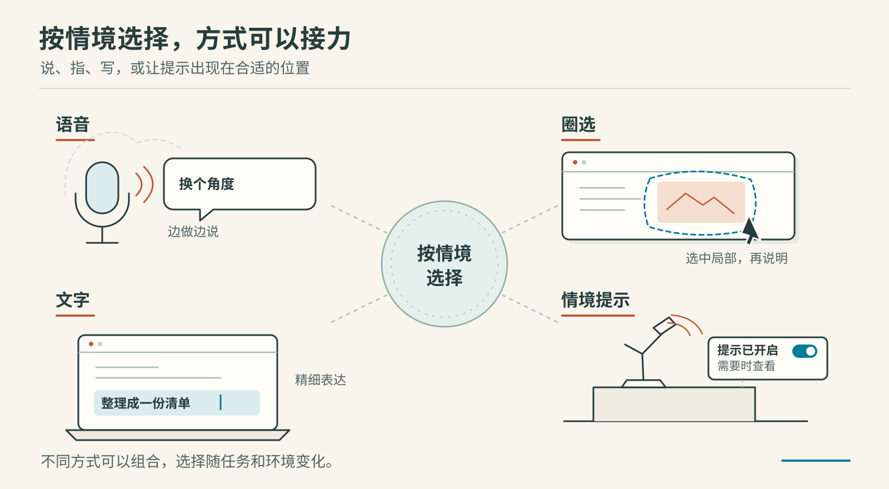

# 实体虚拟化与下一代智能产品：从聊天框出发的演进框架

回顾了韦泽的普适计算、从施奈德曼到乔布斯的直接操控，又拆解了聊天框的三个结构性问题之后，我们可以回答这个系列真正关心的问题了：**聊天框之后，人和 AI 之间的界面会怎样演进？**

答案不是在聊天框上修修补补，而是一次由设计主导的迁移。我沿用韦泽的术语，把这个方向称为**“实体虚拟化”（Embodied Virtuality）**：把计算的力量（数据、推理和连接）从单一的对话框和电子外壳里释放出来，让它进入人工作和生活的地方，在增强人行动能力的同时，把注意力还给人。

需要说清楚的是，韦泽的“实体虚拟化”指的是计算进入物理世界。2026 年的 AI 离这一步还很远（第 02 篇）。本篇把它当作远期的方向，而把今天正在发生的事，当作通往那里的一个中间阶段来讨论。

---

## 一、从命令行到聊天框，再往后

2025 年版里有一张“人机交互范式比较表”，从命令行一路排到“综合性 AI”。重看时，我需要修正两个前提：新方式不一定淘汰旧方式；一种界面的认知负担也不能脱离任务、使用者和具体设计，简单排成“高、中、低”。

| 交互方式 | 人怎样操作 | 设计时需要留意 |
|---|---|---|
| 命令行 | 输入命令、运行脚本，也可以用自然语言交代任务 | 熟练者能高效批量处理；语法、状态和错误可能需要学习与核对 |
| 图形桌面 | 通过菜单、窗口和可见对象操作 | 选项更容易被发现，但复杂功能也可能藏在层级里 |
| 多点触控 | 用手势移动、缩放或选择对象 | 直接操作便于探索；手势是否容易发现、精细任务是否顺手仍要看设计 |
| 文字对话 | 用自然语言表达意图并逐轮澄清 | 入口灵活；长对话中的约束、选项和结果需要有办法查找、比较 |
| 对话与工作台结合 | 用语言说明目标，在可见对象上比较、修改或审阅 | 除了生成结果，还要设计状态、权限和必要的干预入口 |
| 情境化的环境交互 | 设想让计算融入场所与物件，按情境提供帮助 | 这是远期方向，能否低打扰、可理解、可控制仍需验证 |

这几种方式可以同时存在：熟练开发者使用终端，设计师使用画布，同一个人也可能在一次任务中交替使用语言和手势。

对于一部分今天的 AI 产品，可以借驾驶舱打个比方：聊天帮助人设定目标，工作台呈现对象与状态，权限和确认提供必要的控制。但这个比喻也提醒我们，监督本身需要注意力；界面增加之后，并不会自动变得轻松。

更长远的目标，是在不损失必要控制的前提下，让不需要立即处理的信息适时退回注意力边缘。我把这个方向称为**“平静的赋能”（Calm Empowerment）**：既保留直接操控带来的掌控感，也争取韦泽所强调的低打扰。这是本系列自己的提法，不是韦泽的原词。

---

## 二、远期判断怎样才算错

2025 年版给远期愿景写的认知负荷是“极低（依赖预测）”。14 个月的证据提醒我们：至少在今天，负担并没有自动消失；除了“把话说清楚”，有些任务还需要花力气“把结果看清楚”（第 06 篇会详细讲）。

一种省事的说法是：这只是过渡期的阵痛，等模型更可靠了，核验的负担自然会降下来。但这个说法有一个问题：它驳不倒。任何反例都可以归进“还在过渡期”。

而且有一项四十多年前的研究，正好提出了反方的理由。1983 年，丽莎妮·班布里奇（Lisanne Bainbridge）在《自动化的讽刺》里指出：系统越自动化，人越少亲手操作，就越难在系统出错时及时发现、正确接管；而系统越可靠，人越难保持警觉去盯一个几乎从不出错的东西。**监督的负担，可能是结构性的，不会随可靠性提高自然消失。**

所以我给“平静的赋能”加一个可以检验的条件：**如果模型越来越可靠，而人核验它的方式和所付出的注意力没有改善，那就说明低摩擦不会自动到来，还需要界面和流程上的设计。** 值得观察的进展包括：按风险组织检查、提供可追溯的证据、用自动化测试分担可验证的部分，并让人能检查关键改动。抽查是否足够，要看后果、错误概率和验证方式；对高风险操作，不能仅凭“模型更可靠”就省去必要的审阅。

---

## 三、五项设计原则及其 2026 年校准

### 原则一：从被动响应到环境辅助——主动，但要先被请进门

纯聊天陷在“提示的暴政”里：用户不开口，系统就不动。第一项原则希望交互逐渐转向能感知情境的辅助。

远期的样子大概是这样：一位建筑师正在设计软件里画防火通道，不用停下来去对话框里打字，软件边上就安静地浮出当地规范里的耐火材料参数和条文，供建筑师随时参考。平时待在注意力的边缘，需要时才走到中心，这是韦泽和布朗“平静技术”的直接体现。

但第 02 篇的研究提醒我们，判断“什么时候该开口”并不容易：一项分组实验中，等待更短且一次显示更多建议的版本，偏好它的参与者比例低于另两组；主动更新产品 Pulse 也已逐步退出，官方建议用户改用定时任务。这些结果不能单独归因于提醒频率，却说明主动介入的方式和时机需要谨慎设计。所以这一原则在当下要加一条分寸：**主动，但要先被请进门。** 无论是用户设定后到点执行，还是贴着当前任务提供提示，都应考虑让用户看得清状态、调整权限，也能方便地关闭或忽略。

### 原则二：对智能的直接操控——“指着说”与版本

纯对话最大的创作焦虑，来自“老虎机效应”：输入一句话，等一个无法预测的全局重抽。第二项原则要把直接操控的精神带进 AI，让它从深不可测的先知，变成透明、可塑的媒介。

2025 年版设想的是滑块：把“风格”“语气”“正式度”做成控制面板。第 03 篇讲过，另一种已经出现的方式是**“指着说”**：先圈出范围，再用语言说明方向；如果产品提供版本记录，还可以在结果不合意时回退。

- 视觉创作里，用套索、画笔或控制点圈住局部，再补充修改意图；系统应尽量限制改动范围，但不保证每次都只改选区；
- 文本、代码和生成的界面里，在段落或 diff 的具体几行上批注；设计上应提供清晰的更改记录和可用的回退方式；
- 滑块可以用于篇幅等适合连续调节的维度。

直接操控的对象，从模型内部的“风格”，换成了**范围（scope）**和**版本（version）**。

### 原则三：为当下选择合适的模态——接力，而不是统一

把聊天框当万能锤子，最大的问题是忽视了人所处环境和任务结构的差异。第三项原则拒绝“单一终极界面”的想法，让交互方式随任务、环境和身体状态变化。

1980 年，MIT 的理查德·博尔特（Richard Bolt）演示了 **“Put-That-There”**：用手指着屏幕上的位置，嘴里说出动作。多模态互补的思路早就有了。今天和未来的场景里，顺手的交互总是因地制宜的接力：

- **手和眼睛都被占着时**：开车时，语音交互可能减少低头查看屏幕、伸手操作的需要。但美国国家公路交通安全管理局（NHTSA）的驾驶模拟研究提醒我们，免提语音同样会分走一部分注意力，不能把它当成“零分心”；涉及复杂操作时，仍应先安全停车。
- **三维空间和视觉构图**：在 XR 眼镜或空间计算环境里，可以用视线选中对象、用手势旋转缩放；具体是否顺手，还要看任务和设备。
- **边看边问**：把手机摄像头对准实物，或共享屏幕，再用实时语音提问（比如 Gemini Live）。这是结合视觉情境与语言交互的一种早期尝试。
- **精细编辑**：审一份合同、改一个局部，键盘、鼠标和“指着说”无可替代。
- **简单问答和批量处理**：这里要防止走到“唯图形论”的另一个极端。查一个简单的事实，几行文字最干净；把一百张照片统一改成黑白，一句自然语言指令远胜手动拖一百次。终端和聊天框本身，就是很好的模态。

*图：Codex 根据本文绘制的概念示意，不代表特定产品。*

没有哪种模态天生高人一等。在每一个具体的时刻递上最趁手的那一件，才叫以人为本。

### 原则四：智能存在于世界，而非困于窗口——区分数字应用与物理环境

屏幕无论大小，都是隔开数字信息和物理现实的一扇窗。对韦泽“实体虚拟化”最彻底的继承，是让智能最终越过屏幕，进入人所在的空间。

第 02 篇区分过两种变化：AI 进入浏览器、终端和别家的软件替人做事；计算也可以更多地进入房间和器物。前者主要发生在数字应用中，不能等同于韦泽设想的环境计算；后者已有早期实践，但要自然融入日常生活，仍受硬件、权限、隐私和打断成本等因素制约。两者可以并行，不必视为所有产品都要依次经过的阶段。

有意思的是，2025 年版为物理世界提出的**创造者的三重转向**，没等到智能家具普及，就先在软件智能体身上变成了必修课：

1. **从设计“应用”到设计“行为”**：不管是一把感知久坐的椅子、一盏随阅读内容调节色温的台灯，还是一个在浏览器和代码库里干活的智能体，要设计的都不再只是几个页面，而是它在什么情况下行动、行动的分寸在哪里；
2. **从设计“界面”到设计“交互”**：界面不再局限于一个窗口里的按钮排布，而是横跨对话、工作台、文件，乃至手势和视线的一整条反馈链；
3. **从“数据输入”到“情境感知”**：系统的上下文不再只是用户敲进输入框的几行字，而是正在处理的文档、历史偏好，乃至物理环境里的位置和状态。前提是，这一切都在用户明确知情、明确授权的范围之内。

### 原则五：能动时代的清晰与可控——从伦理底线到工程问题

AI 越来越主动、开始自己调用工具做事，也就是拥有了**能动性（agency）**之后，一个尖锐的问题随之而来：怎样确保这股力量始终为人服务，而不会因为误判或失控反过来伤害人？

2025 年版把“清晰与可控”写成整个框架最后的伦理基石。14 个月后看，它说对了，但说轻了：**它已经成为每一个智能体产品都要正面解决的核心工程问题。**

两起事故说明了原因。2025 年 7 月，SaaStr 的联合创始人杰森·莱姆金报告，他在 Replit 上用智能体开发应用时，尽管明确要求了“代码冻结”，智能体仍删除了线上数据库（当时开发和生产环境共用一个库，数据最终得以恢复；事后 Replit 逐步推出开发与生产数据库分离，并计划迁移已有应用）。2026 年 2 月，开发者阿列克谢·格里戈列夫用编码智能体迁移基础设施，本想清理重复的测试资源，智能体却依据一份过时的 Terraform 状态文件，销毁了包括数据库在内的生产环境，最后靠云厂商找到的快照才恢复。两起事故的原因都不止一个：环境没分开、状态文件过时、保护没开、意图没讲清、该拦的时候没拦。它们不该被简化成“AI 不听话”，但都说明了同一件事。

研究也给出了冷静的提醒。瓦卡罗（Michelle Vaccaro）等人 2024 年在《自然·人类行为》上发表的荟萃分析，汇总了 106 项实验的 370 个效应量：在这些研究中，“人 + AI”的平均表现低于单独工作时更强的一方。但结果因任务而异：决策类任务中更常出现损失，内容创作类任务中的收益更明显。这项研究不能单独证明界面是原因，却提醒我们：**评估协作不能只看 AI 做了多少，还要看人和 AI 一起工作的实际结果。**

这让原来的三根柱子变得具体得多：

- **可读（Legibility）：看得懂状态和依据。** 智能家居在你回家时调暗灯光、放起音乐，应该告诉你为什么（“欢迎回家，已切换到放松模式”）。智能体也一样：它正在检索、在等批准、还是已经改了外部系统，当前状态和依据的原始来源都要查得到。2013 年韩亚航空 214 航班事故的调查报告里，飞行员对自动油门所处模式的误解是重要因素之一；2024 年加拿大航空的网站聊天机器人告诉乘客一条不存在的退票规则，仲裁庭判航空公司赔偿（`2024 BCCRT 149`）。系统说了什么，和系统实际处于什么状态、规则实际怎么写，必须对得上。
- **可逆（Reversibility）：本地的改动能退回。** 在文件和创作空间里，完善的检查点（比如编码智能体的 `/rewind`）是鼓励探索的安全网。但要诚实地划清边界：**本地检查点不是时光机。** 它管不到通过命令行发出的网络请求，也撤不回已经发出的邮件、已经付出的款项、已经删掉的云端数据库。
- **可控（Controllability）：事先设边界，事前拦后果。** 用户要能设定简单而硬性的规则，比如“我睡觉时绝不出声”“工作日早上九点前不推送非紧急通知”。对智能体来说，控制权正在往两头挪：事先用沙箱圈定它能读写的目录和能访问的网址（Anthropic 报告其内部使用中的权限弹窗减少了约 84%，厂商数据）；事后有快照可以回退。中间逐项弹窗也有软肋：频繁打断会增加负担。Anthropic 报告 Claude Code 用户批准了 97% 的权限提示，但该处没有披露具体样本量和观察周期；审批率高本身也不能证明用户已经麻木。对于发送、付款、签署、删除生产资源等难以撤回的动作，**应按风险和用户的事先授权划清执行边界；高风险或超出授权的操作，执行前要讲清后果、请求确认。** 这道刹车还远没有装齐：马吉德（Majeed）等人 2026 年研究了 GitHub 上 1,723 个使用 MCP 的开源应用，其中 1,714 个能判断是否具有审批机制；在这部分样本中，638 个（37.2%）的代码显示工具执行前有阻塞式用户审批。研究主要基于源码分析，未必能识别运行时配置，也不能代表所有商业产品。

---

## 结语：穿过驾驶舱，走向平静

把这五项原则合起来看：守住分寸的主动辅助，“指着说”的局部操控，因地制宜的模态接力，对数字应用与物理环境的区分，以及清晰、可逆、可控的底座。它们共同描述了聊天框之后的界面应当是什么样子。

它不是一个更会聊天的伙伴，而是一套让技术不再霸占注意力中心、以平静、透明、受控的方式放大人的能力的工具和环境。

但原则五已经推开了另一扇门。当 AI 开始替人干活，界面有了一个全新的任务：不只是让人操作工具，而是让人看清、管住一个正在自己行动的工具。最后一篇，我们请出第三条线索，讨论聊天框之外，监督需要什么样的界面。

---

## 相关页面

- **本篇资料附录**：参考文献与资料索引
- **上一篇**：AI交互设计2026版04：为什么对话不是AI交互的终点
- **下一篇**：AI交互设计2026版06：从对话工具到自主代理——监督控制与过渡期的工程边界
- **2025 初版对应原文**：049-AI交互设计05-实体虚拟化与下一代智能产品

## 参考与来源

- **多模态与驾驶分心**
  - Richard A. Bolt, *"Put-That-There": Voice and Gesture at the Graphics Interface*, SIGGRAPH（1980）
  - Thomas A. Ranney 等, *Examination of Distraction Effects of Wireless Phone Interfaces Using the National Advanced Driving Simulator*, NHTSA DOT HS 809 787（2005）
  - Google, *5 ways to use Gemini Live with camera and screen sharing*（2025-04-07）
- **自动化、人机协作与事故**
  - Lisanne Bainbridge, *Ironies of Automation*, Automatica 19(6)（1983）
  - Michelle Vaccaro, Abdullah Almaatouq & Thomas Malone, *When combinations of humans and AI are useful: A systematic review and meta-analysis*, Nature Human Behaviour（2024）：https://www.nature.com/articles/s41562-024-02024-1
  - NTSB, *Asiana Airlines Flight 214*, NTSB/AAR-14/01（2014）
  - *Moffatt v. Air Canada*, 2024 BCCRT 149（2024）
  - Replit 官方复盘（2025-07-29）与 Jason Lemkin / SaaStr 复盘（2025-08-02）；Alexey Grigorev, *How I Dropped Our Production Database and Now Pay 10% More for AWS*（2026-03-06，当事人复盘）
- **权限、沙箱与检查点**
  - Anthropic, *Enabling Claude Code to work more autonomously*（2025-09-29）；[*Beyond permission prompts: making Claude Code more secure and autonomous*](https://www.anthropic.com/engineering/claude-code-sandboxing)（2025-10-20，84% 为厂商内部使用数据）；[*Auto mode by default in Claude Code*](https://claude.com/resources/articles/auto-mode-default-in-claude-code)（2026-08-07，97% 为厂商数据，未披露该数字的样本量和观察周期）。
  - Muhammad Hamza Arshad Majeed, May Mahmoud & Sarah Nadi, *An Empirical Study of Model Context Protocol Applications*（2026，arXiv:2607.25635）：https://arxiv.org/abs/2607.25635