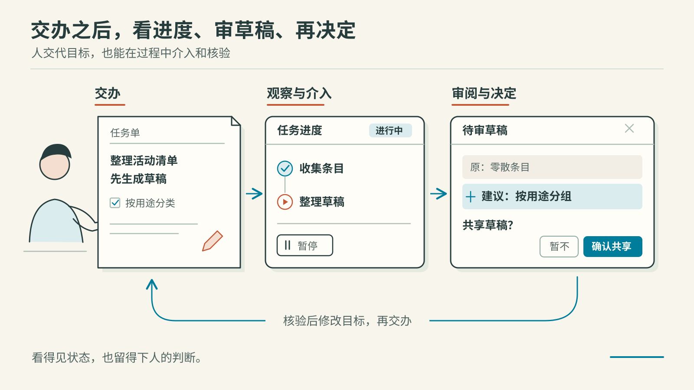

# 从对话工具到自主代理：当 AI 替人干活，聊天框之外还需要什么界面

前五篇讨论的，都是人怎样使用 AI：怎样对它说，怎样指着它改，它应该待在哪里。2025 到 2026 年，AI 产品发生了一个更大的变化：**它从陪你聊天的顾问，变成了替你动手的代理（agent）。** 它在终端里改代码，在浏览器里点按钮，在别家的软件里填表、下单。

这个变化对界面提出了一个新问题。聊天框是为“一问一答”设计的；而当你把一件事交出去，它要独立做上几十分钟甚至几个小时，你需要的就不只是一个对话框，而是一套让你**交代清楚、看得明白、拦得住**的界面。这一篇讨论的就是这套界面。

先看一项研究。Imteyaz 等人的《设计剧场》（*Design Theater*，AIES 2026）让五款生成界面的工具分别完成 24 项设计任务，共生成 120 个界面，然后逐条核对工具对用户讲的设计理由，是否体现在生成的界面中。研究者把完全实现、部分实现和未实现分别记为 1 分、0.5 分和 0 分；五款工具的平均兑现度是 0.75，功能类任务的平均分是 0.66。这些是综合评分，不能直接当作未实现条目的占比。

**说做了，不等于做了。** 即使 AI 只提供建议，错误也可能影响人的决定；当它开始修改工程文件、操作浏览器、付款或对外发送时，错误还可能直接改变外部状态。因此，界面不仅要呈现回答，还要帮助人看清行动和结果。

---

## 一、交办改变了界面的分工

### AI 能独立做多久，人们又交给了它多少

评估机构 METR 在 2025 年提出了“任务时间跨度”：以人类专业人士完成一项任务所需的时间来衡量任务的长度，看模型在多长的任务上还能保持 50% 的成功率。2019 到 2025 年，前沿模型的这个指标大约每七个月翻一番；2025 年初还在“人类一小时的任务”上下。到 2026 年 3 月测试早期版的 Claude Mythos Preview 时，METR 将其 50% 任务时间跨度估计描述为**至少 16 小时**，但 95% 置信区间约为 8.5 到 55 小时。读这个数字要守住三条边界：它以人类专家完成任务所需的时间衡量任务长度，不是 AI 连续运行的时间；228 项测试任务中只有 5 项的人类完成时间达到或超过 16 小时，长任务区间的估计很不稳定；50% 的成功率离放手不管还很远。它提供了一个观察能力变化的指标，不能直接推断实际产品能独立完成任意复杂项目。

使用方式也在分化。Anthropic 的经济指数报告把 Claude.ai 上的对话分成“自动化”（直接交给它做）和“增强”（和它一起迭代、核验、学习）。在聊天客户端里，自动化的比例几年来在 41% 到 49% 之间起伏，并没有一路走高；而在企业通过接口（API）的调用里，交办式的自动化一度占到大多数，之后又有所回落（厂商数据）。**同一个模型，在聊天框里多半是一起干活的伙伴，在程序调用里多半是受托的执行者。**

### 对话如何承载交办

交办之后，聊天框的角色变了。看一个典型的编码智能体会话：你在终端或对话框里交代一件事，它先列一份计划，你改几处、点确认；然后它开始干活，对话流里滚动的是进度汇报；最后你在 diff 里逐行审阅它改了什么，或者在一个拉取请求（PR）里看它的提交。

在这类交办流程中，**对话可以成为任务的入口，而计划、状态和结果也需要各自的呈现方式**：开工前可能是一份计划，干活时是进度和状态，收工后是 diff、测试结果和预览。异步编码代理（在云端运行、把结果作为 PR 交回来的那一类）把这一分工表现得更明显：人交代任务，然后审阅结果。

*图：Codex 根据本文绘制的概念示意，具体控件和任务均为虚构。*

### 一个人，几个代理

再往前一步，人开始同时交出好几件事。2025 年 11 月，Google 随 Gemini 3 发布的 Antigravity 开发平台，在编辑器之外单独做了一个“代理管理器”（Agent Manager），用来同时启动、协调和查看多个在不同工作区里并行干活的智能体；2026 年春，Cursor 3 也推出了以多个代理为中心、可以与 IDE 切换的 Agents Window。

这是聊天框演变中的一个信号：**当人要同时照看几个代理时，除了各自的对话，还可能需要一个总览界面。** 这样的界面可以呈现哪些任务正在运行、哪些需要人处理、哪些结果等待审阅。它是对多个会话的补充，帮助人切换、调度和检查，而不是要求所有产品都采用同一种看板布局。

---

## 二、一张旧清单：监督控制

“人怎样监督一台自己干活的机器”，在消费级产品里是个新问题，在人因工程和自动化研究里却已经研究了半个多世纪。2025 年版的框架里，恰好漏掉了这条线索。

利克莱德（J. C. R. Licklider）曾对这种分工作出有影响力的设想。1960 年，他在《人机共生》里设想：**人设定目标、提出假设、确定标准、做出评价**，计算机完成可以例行化的工作。交出去的只是中间那一段；两头的目标和评价，留在人手里。

把这件事研究成一门学问的，是 MIT 的托马斯·谢里丹（Thomas B. Sheridan）。相关研究涉及深海和太空的遥控机械臂、核电站控制室、飞机驾驶舱，并提出**“监督控制”（Supervisory Control）**：人间歇地给机器下指令、接收它的信息，机器完成具体的闭环控制。有关监督过程的介绍中，常见计划、教会、监视、干预和学习这五项划分。2002 年《人与自动化》的全文本次未取得，这一划分与书中原词的对应仍待核对；下表先把它用作思考智能体界面的类比：

| 监督过程的讨论线索 | 含义 | 可能对应的界面 |
|---|---|---|
| **计划** | 想清楚目标、约束和路径 | 开工前的澄清提问；可以直接编辑的计划文件 |
| **教会** | 把目标、上下文和规则交代给机器 | 项目说明文件、规则文件、技能说明 |
| **监视** | 看着它做，发现偏差 | 进度流、diff、可追溯到底层查询的仪表盘、多代理看板 |
| **干预** | 出了问题时暂停、改指令或接手 | 中途打断、接管浏览器、回退到检查点 |
| **学习** | 监督者复盘这一轮，改进下一轮 | 复盘记录、调整下一次授权的入口（仍需设计） |

最后一项值得注意：这里讨论的“学习”是监督者总结经验、调整下一次的计划和放手程度，不等同于 AI 在后台积累的“记忆”。一些产品已经为前四项提供界面；如何帮助人复盘和调整下一次的授权，也值得作为单独的设计问题。

谢里丹还和合作者提出过一张自动化的分级表：从“机器不提供任何帮助”，到“机器给出几个备选”“机器执行前让人否决”，一直到“机器全权决定、不理会人”，共十级。这张表最早见于谢里丹和维普兰克（William Verplank）1978 年的遥操作研究报告；2000 年，帕拉苏拉曼（Raja Parasuraman）、谢里丹和威肯斯（Christopher Wickens）又把它和信息获取、分析、决策、执行四个阶段结合起来。2025 年 6 月，安德烈·卡帕西（Andrej Karpathy）在 YC 的演讲《软件又变了》里主张做“部分自主的产品”，给它装一根**“自主程度滑块”（autonomy slider）**，思路一脉相承：不是选“人做”还是“AI 做”，而是按任务的风险调节放手的程度。

这和第 03、05 篇的故事正好接上：除了调整内容的风格与语气，**授权和放手的程度也需要让人能够理解与调整。** 滑块只是比喻，具体控件仍须按风险和任务设计。

需要说明的是，监督控制常用于分析工厂和飞行器，把它搬到语言模型智能体上是类比，不是定论。一个值得注意的区别是：语言模型智能体可能把读到的网页或文档误当成指令，因此需要特别处理不可信内容对行为的影响（见第五节）。传统自动化系统也有复杂状态和不确定性，不能一概说成行为完全写死。

---

## 三、负担挪到了“看”

当系统开始代人执行任务，用户的工作可能从亲手操作转向交代、检查和干预。**表达目标的负担与检查结果的负担会怎样变化，要看任务、工具和使用者；自动执行并不意味着核验成本消失。**

除了开头的《设计剧场》，还有两项研究算了这笔账：

- **改了这里，坏了那里。** 彭（Yue Peng）等人的 EvoGenUI-Bench（EMNLP 2026）让模型在连续五轮追加需求中维护同一个界面。最强模型的单轮通过率是 74.9%，但五轮全部通过的任务比例是 37.3%。研究者事后检查了 110 次“前一轮通过、后一轮失败”且有足够归因证据的转换，其中 58 次涉及旧行为退化，有些也同时没有满足新需求。通过与否主要由模型评估器判断，并辅以部分人工复核。
- **它记住了什么，你得自己去看。** 达什（Dash）等人 2026 年分析了 65 名自愿提供记录的常用用户触发的 2,050 条 ChatGPT 记忆。研究者用关键词和规则，在约 4.1% 的记录对应消息中检出明确的记忆操作意图；这些操作既包括要求记住，也包括要求遗忘。按模型辅助标注，28% 的记忆记录含有欧盟《通用数据保护条例》（GDPR）意义上的个人数据。这是特定自愿样本，不代表全部用户。

用户的行为也在变。Anthropic 2026 年 2 月发布的研究发现，在 Claude Code 里，新用户约 20% 的会话完全自动批准，有经验的老用户超过 40%；但老用户中途打断智能体的比例也更高，大约 9% 的回合，而经验较少的用户约 5%（厂商数据，两组比例的口径不同）。这些数据不能直接告诉我们用户的心理状态，但可以提示一种可能的变化：一些人减少逐步审批，同时更频繁地在过程中介入。这与监督控制中的“监视”和“干预”有关，具体原因还需要更多研究。

卡帕西在同一场演讲里，把这件事说成一个循环：AI 生成，人核验，产品要做的是让这个**“生成—核验循环”**转得尽可能快。办法有两个：一是大幅加快核验，比如用图形界面和可视化的 diff 代替让人读一大段文字；二是让 AI 每次只走一小步，不要一次倒出一大堆难以审阅的改动。

这给界面提出了具体的要求：

- **把汇报变成可以核对的形式**：红绿对照的 diff，而不是“我已经改好了”；每个数字都能点开看到底层查询和原始来源，而不是一句结论；上线前必须经过一次预览，而不是直接发布。
- **把步子切小**：一次一个可以审阅的改动，而不是一整个模块。
- **帮人保持在回路里**：第 05 篇提到班布里奇的《自动化的讽刺》，系统越可靠，人越难保持警觉。所以好的监督界面不只是“少打扰”，还要让人在需要接管时接得住：知道它刚才做了什么、为什么这样做、现在停在哪里。

---

## 四、界面有了第二种使用者

2025 年版有一个默认的前提：读界面、点按钮的，只有人。

到 2026 年，图形界面的**第二种使用者**更加受到关注：能够识别屏幕内容、操作键盘和鼠标的智能体。OSWorld 基准在 2024 年发布时，人类在桌面任务上的成功率约为 72%，当时最好的模型只有约 12%；2026 年 3 月，OpenAI 公布的 GPT-5.4 在 OSWorld-Verified 上得分 75.0%（厂商数据；OSWorld-Verified 与原始 OSWorld 的评测口径并不完全相同，评测环境也不同于所有真实桌面任务，不能据此说 AI 比人更会用电脑）。

为这第二种使用者，一批“给机器读的界面”也长了出来：

- **工具接口。** MCP 协议规定 AI 应用怎样连接外部工具和数据；2025 年 12 月，Anthropic 把它捐给了 Linux 基金会旗下的智能体 AI 基金会（AAIF）。MCP 的工具规范建议保留人工拒绝工具调用的能力，并为操作提供确认提示，但不强制规定具体交互形式；审批界面如何设计、是否逐次阻塞，取决于宿主实现。第 05 篇提到的开源应用调查，展示了这些实现之间的差异。
- **网站说明书。** 2024 年，杰里米·霍华德（Jeremy Howard）提议网站在根目录放一个 `/llms.txt`，用 Markdown 给模型写一份导航。它只是一个约定，不保证内容可信。
- **购物与支付。** 2025 年 9 月，OpenAI 和 Stripe 推出智能体商务协议（ACP），让人在聊天里直接下单；2026 年 3 月，OpenAI 改为让商家用自己的结账页面，ChatGPT 侧重帮人发现商品。Google 的 AP2 协议（2026 年 4 月捐给 FIDO 联盟）写了两种授权：人在场时，看过购物车再确认；人不在场时，事先授权价格和时间条件，满足条件后由智能体代为下单。
- **操作系统。** 微软在 Windows 11 的预览中，为智能体提供独立账户和会话，让它操作应用，并按授权访问文件。会话分开并不等于它完全无法接触用户数据。

有意思的是**确认这一步的去向**。MCP 建议宿主保留人工控制；有的购物流程把付款交给商家页面；AP2 则区分了人在场时确认和事先授权两种方式。这些例子反映出不同的授权设计，不能据此推断所有产品都采用了确认机制。支付服务商 NMI 2026 年 8 月对 1,000 名美国消费者的调查里，10% 的受访者愿意把购物完全交给 AI，70% 希望付款前能由自己审核或否决（厂商调查，不能直接代表所有用户）。

这对界面设计意味着：**同一个界面，要同时给人看、给 AI 用。** 给 AI 用的部分要能被准确读懂；给人看的部分，要让人分清哪些是 AI 正在替他做的事。

---

## 五、宿主画的框，是安全边界

AI 替人读网页、读邮件、读文档，而这些内容里可以藏着写给 AI 的指令。这就是**间接提示注入（indirect prompt injection）**：攻击者不需要攻破你的电脑，只需要在 AI 会读到的地方写一句话。

这不是假设：

- 2025 年 8 月，浏览器厂商 Brave 的研究者演示：让 Perplexity 的 Comet 浏览器总结一个网页，网页里对人隐藏的一段文字，就能诱导它的智能体去用户的账户页面取信息并发送出去（研究者构造的演示，且 Brave 本身也做浏览器）。
- 同月，Anthropic 发布 Claude in Chrome 试点时公布了自己的红队测试：在 123 个测试用例上，自主模式下未加防护时，提示注入的成功率是 23.6%；加上网站权限和高风险操作确认之后，降到 11.2%（厂商测试集上的数字，不是真实用户遭攻击的概率）。
- 2025 年 12 月，OpenAI 公布了一个红队例子：用户让浏览器代理帮忙设置外出自动回复，一封恶意邮件里的指令却诱导它改为替用户写一封辞职信。

更进一步，生成式界面普及之后，一段被污染的内容，完全可以在画布中央画出一个以假乱真的“系统权限请求”或者“确认支付 680 欧元”的按钮。如果人分不清哪些是网页或模型生成的内容、哪些是宿主自己的控件，刹车就形同虚设。

这正是第 03 篇说的“一致性”的新含义。浏览器把地址栏、权限弹窗等可信控件与网页内容分开；安全研究中，区分两者的边界常被称为“死亡线”（line of death）。智能体宿主也需要类似的区分：**限制生成内容直接控制或覆盖宿主的审批框、权限提示和身份标识，并让这些控件有稳定、可辨认的来源。** 但隔离不等于无法仿冒：网页仍可能在自己的内容区画一个相似的假按钮，用户也可能认错。除了隔离，还需要清楚的来源提示和权限约束。在 iPhone 时代，一致性帮助人不迷路；在智能体时代，它还要帮助人辨认真正的刹车。

---

## 六、原则六：可监督

在第 05 篇五项原则的基础上，补上第六项：

> **原则六：可监督（Supervisability）——先说再做，验得快，认得出。**
> - **先说再做**：复杂的、长的任务，动手之前先给出一份人可以直接修改的计划；
> - **验得快**：把结果做成可以逐项核对、一键追溯的形式，而不是一段自我汇报；
> - **认得出**：隔离生成内容和宿主控件，为真正的确认与控制提供稳定的来源提示；同时考虑内容区可能出现相似的假按钮。

它和原则五（清晰与可控）是一对：原则五讲的是系统应当具备哪些性质，原则六讲的是**监督这件事本身需要什么样的界面**。

---

## 全系列结语：回到聊天框

走到这里，可以把整个系列连成一条线。

2025 年，我说聊天框不是 AI 交互的终极形态，它是一种拟物的外衣、一条工程的捷径。2026 年回看，这个判断依然成立，只是需要说得更准确：**过渡掉的不是聊天，而是“聊天作为唯一的界面”。**

回看这几年的变化，可以看到几种正在并存、也可能组合的界面方式：

1. **以对话为主的界面**：人用文字或语音提问，系统在对话流中回答；
2. **对话与工作台结合**：人通过对话表达目标，也在文档、画布、表格或代码上直接比较和修改；
3. **交办与审阅界面**：任务可以从对话开始，计划、进度、改动记录和总览帮助人看清与干预；
4. **情境化交互的远期探索**：计算融入环境，尽可能减少不必要的打扰，同时保留必要的控制。能否做到，仍需要验证。

这不是四个必经阶段，也不是说后一种必然取代前一种。下次打开一个准备替你干活的 AI 产品，可以拿五个问题量一量它：

1. 它在动手之前，会先问清楚模糊的地方、给出一份我能改的计划吗？（先说再做）
2. 结果有一处不满意，我能直接指着那里改、随时退回旧版吗？（指着说）
3. 它主动提醒我之前，先得到了我的允许吗？它懂得留在注意力的边缘吗？（先被请进门）
4. 它做完的改动、引用的数字，我能一眼核对清楚吗？（验得快）
5. 遇到发邮件、付款、删数据这类难以撤回的事，我能否辨认确认请求的来源，并按风险设置合适的授权边界？（可控，认得出）

聊天框让人可以用语言表达意图，但复杂任务仍要把要求说清楚。AI 开始替人干活之后，界面还要帮助人**看清过程和结果**：不是让人不用说话，而是让人能够说清楚，也看得过来。等到看得过来、管得住的界面足够成熟，技术才能放心退回背景，兑现那个让人更自由、更从容的承诺。

---

## 相关页面

- **本篇资料附录**：参考文献与资料索引
- **导言**：AI交互设计2026版00：导言
- **上一篇**：AI交互设计2026版05：实体虚拟化与下一代智能产品
- **系列目录**：01 · 02 · 03 · 04 · 05 · **06**

## 参考与来源

- **能力、使用方式与多代理界面**
  - METR, *Measuring AI Ability to Complete Long Software Tasks*（2025-03-19）；*Task-Completion Time Horizons*（持续更新）：https://metr.org/time-horizons/
  - Anthropic, *Economic Index* 系列报告（2025-09 / 2026-01 / 2026-03，厂商）；*Measuring AI agent autonomy in practice*（2026-02-18，厂商）：https://www.anthropic.com/research/measuring-agent-autonomy
  - Google, *Build with Google Antigravity, our new agentic development platform*（2025-11）：https://developers.googleblog.com/build-with-google-antigravity-our-new-agentic-development-platform/ ；Cursor 3 Agents Window（2026-04）
- **人机共生与监督控制**
  - J. C. R. Licklider, *Man-Computer Symbiosis*, IRE Transactions on Human Factors in Electronics HFE-1（1960-03）：https://web.mit.edu/STS.035/www/PDFs/Licklider.pdf
  - Thomas B. Sheridan, *Humans and Automation: System Design and Research Issues*（Wiley, 2002，第 6 章）；更早的系统论述见 Sheridan, *Telerobotics, Automation, and Human Supervisory Control*（MIT Press, 1992）
  - Thomas B. Sheridan & William L. Verplank, *Human and Computer Control of Undersea Teleoperators*（MIT 技术报告，1978）
  - Raja Parasuraman, Thomas B. Sheridan & Christopher D. Wickens, *A Model for Types and Levels of Human Interaction with Automation*, IEEE SMC-A 30(3)（2000）：https://doi.org/10.1109/3468.844354
  - Andrej Karpathy, *Software Is Changing (Again)*, YC AI Startup School（2025-06-17）：https://www.ycombinator.com/library/MW-andrej-karpathy-software-is-changing-again
  - Lisanne Bainbridge, *Ironies of Automation*, Automatica 19(6)（1983）
- **核验负担**
  - Kashif Imteyaz 等, *Design Theater: Evaluating the Gap Between User-Facing Design Reasoning and Implementation in Generative UI Tools*, AAAI/ACM AIES 2026（arXiv:2607.22928）：https://arxiv.org/abs/2607.22928
  - Yue Peng 等, *EvoGenUI-Bench: Evaluating LLMs as Multi-Turn Generative UI Assistants*, EMNLP 2026（arXiv:2608.29387）：https://arxiv.org/abs/2608.29387
  - Dash 等, [*The Algorithmic Self-Portrait: Deconstructing Memory in ChatGPT*](https://informatik.rub.de/aisoc/assets/papers/ChatGPT_Memories_WWW_26_CR.pdf)（The Web Conference，2026；自愿样本，个人数据由模型辅助标注）
- **第二种使用者**
  - Tianbao Xie 等, *OSWorld*（2024，arXiv:2404.07972）；OpenAI, *Introducing GPT-5.4*（2026-03-05，厂商）
  - Linux Foundation, [*Linux Foundation Announces the Formation of the Agentic AI Foundation*](https://www.linuxfoundation.org/press/linux-foundation-announces-the-formation-of-the-agentic-ai-foundation)（2025-12-09，包含 Anthropic 对 MCP 的捐献）；[MCP 工具规范：用户交互模型](https://modelcontextprotocol.io/specification/2025-06-18/server/tools)；Jeremy Howard, *The /llms.txt file*（提案初版 2024-09，本地副本为更新版）
  - OpenAI, *Buy it in ChatGPT*（2025-09-29）与 *Powering Product Discovery in ChatGPT*（2026-03-24）；Google Cloud, *Announcing the Agent Payments Protocol (AP2)*（官网显示 2025-09-17）及捐赠 FIDO 联盟公告（2026-04-28）
  - Microsoft, Windows 11 代理工作区预览（Ignite，2025-11）；NMI 消费者调查（2026-08-26，厂商调查）
- **提示注入与可信界面**
  - Brave, *Agentic Browser Security: Indirect Prompt Injection in Perplexity Comet*（2025-08-20）
  - Anthropic, *Piloting Claude in Chrome*（2025-08-25，厂商红队测试）：https://www.anthropic.com/news/claude-for-chrome
  - OpenAI, *Continuously hardening ChatGPT Atlas against prompt injection attacks*（2025-12-22）：https://openai.com/index/hardening-atlas-against-prompt-injection/
  - Chromium, *Security FAQ*（浏览器可信界面与网页内容的边界）；MCP Apps 安全模型（2026-01-26）