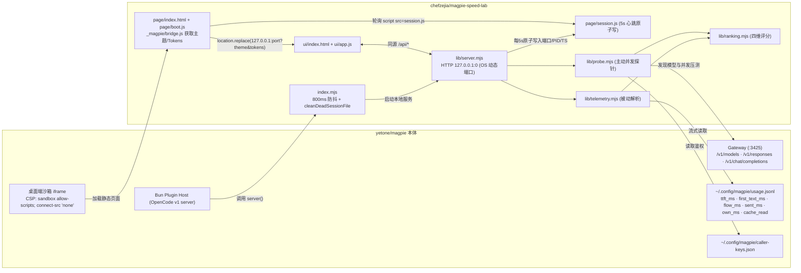

# `chefzejia/magpie-speed-lab` 源码级深度拆解与 Magpie 协同机制分析

> **分析基线**：`chefzejia/magpie-speed-lab`（`v0.3.0`, Commit `75e91f590e6551fdc6173281a161613444120151`）对照 `yetone/magpie`（Commit `70f4593e623e0847fcc2d869240565ce5f73a67a`）  
> **配套过程日志**：`log-02-speed-lab.md`

---

## 一、 项目定位、作者背景与 Magpie 生态协同

### 1.1 项目背景与作者技术脉络

[`chefzejia/magpie-speed-lab`](https://github.com/chefzejia/magpie-speed-lab) 是针对开源本地 LLM 网关 [`yetone/magpie`](https://github.com/yetone/magpie) 开发的社区性能诊断与模型/推理档位选型插件（Package 声明 `engines.magpie >= 0.1.1340`，MIT 协议，零第三方 npm 运行时依赖）。

通过 GitHub API 与仓库提交记录追溯，其作者 **Zejia Wu**（GitHub ID：`chefzejia`，曾用名 `leozejia`，Git 提交者 `wuzj`）长期深耕 Coding Agent 与 LLM 网关可观测性领域：
- **对 `yetone/magpie` 的生态贡献**：作者在 `yetone/magpie` 提交了 Issue [#2128](https://github.com/yetone/magpie/issues/2128)（指出“全部更新”中 npm 退出码为 0 时未校验 Claude Code 原生包是否实际就绪的漏报故障），并收录于 Magpie `v0.1.1234` 贡献者鸣谢。
- **在 `Wei-Shaw/sub2api` 延续的一贯可观测性方法论**：作者向 LLM 中转网关 `Wei-Shaw/sub2api` 提交过 PR [#2485](https://github.com/Wei-Shaw/sub2api/pull/2485)（《为 `/responses/compact` 增加慢请求观测与主动超时护栏》）与 PR [#2402](https://github.com/Wei-Shaw/sub2api/pull/2402)。PR #2485 将慢请求不泄露内容地拆解为 `body read duration`、`upstream header latency`、`upstream total latency` 等物理阶段——这一**“黑盒耗时物理阶段解耦”**思路在 `magpie-speed-lab` 中得到了系统化升级。
- **插件演化轨迹（2026-11-04 单日三版本迭代）**：
  1. **v0.1.0（Commit `ff7fc14`）**：完成 `usage.jsonl` 被动遥测解析与并发流式探针雏形；洞察规则硬编码针对 `gpt-6.1-terra` / `gpt-6.1-sol` 并给出 CLI 命令建议（如 `magpie codex effort high`）。
  2. **v0.2.0（Commit `8b67be1`）**：移除模型名硬编码，引入 `lib/ranking.mjs` 第一性原理四维加权评分引擎、4 类工作负载画像（Workload Profiles）与模型无关（Model-Agnostic）的推理档位边际收益检测器。
  3. **v0.3.0（Commit `ebf05b2` → `75e91f5`）**：适应 `magpie-community/plugins` 校验脚本 `scripts/check.mjs`（保证模块导入无副作用），并废弃固定端口 `3495` 与 `magpie.options`，实现基于 `127.0.0.1:0` 动态端口 + `page/session.js` 原子握手的零配置架构，增加 `magpie-plugin` / `magpie-page` GitHub 发现标签。

---

### 1.2 它解决了 `yetone/magpie` 原生能力的哪些核心痛点？

对照 `yetone/magpie` 源码，原生网关在速度观测与选型上存在三个结构性盲区，`magpie-speed-lab` 正是为此而生：

| 核心痛点 | `yetone/magpie` 原生源码现状 | `magpie-speed-lab` 的针对性突破 |
| :--- | :--- | :--- |
| **1. 原生 `Fastest` 路由只做短期单维均值估算，无选型可解释性** | `internal/gateway/speed.go:23-26` 与 `internal/routes/fastest.go:39-47` 中，`Fastest` 策略仅在内存中维护半衰期 `20min`、过期时间 `1h` 的 TTFT/TPS 指数衰减均值，并按固定短回复模型 `Estimate = ttft + 200 * 1000 / tps` 排序；**重启即清空，不读取历史账单，也不区分 `effort` 档位或任务类型**。 | 从 `~/.config/magpie/usage.jsonl` 跨时间窗口（24h/7d/30d/all）聚合，按 `[Provider × Model × Effort]` 三元组构建矩阵，区分 4 类工作负载并拆解四阶段耗时元凶。 |
| **2. 隐藏思考 + 纯工具调用轮次 `tok/s` 丢失** | `internal/usage/usage.go:768-773` 中 `(r Record) Decode()` 明确规定：`if r.ReasoningHidden && r.FirstText <= 0 { return 0, 0 }`；`internal/gateway/speed.go:87` 亦同。在 `/v1/responses` 加密思考场景下，Agent 工具调用轮次无正文 `first_text_ms`，原生界面全部显示为空。 | `lib/telemetry.mjs:59-65` 利用 Magpie 已记录的底层 `flow_ms` 字段（中间 80% 字节流窗口），按 `(out - reasoning) * 1000 / flow_ms` **还原纯工具调用轮次的真实传输速率**。 |
| **3. 推理档位（Effort）盲选与长尾倍增效应** | Magpie `/v1/models` 暴露各模型支持的 `reasoning_levels`，用户缺乏跨渠道、跨档位（`low/medium/high/xhigh`）的实测对照工具，极易在多轮工具循环中误开 `xhigh` 导致总耗时呈轮数 $N$ 倍膨胀。 | 提供“历史边际收益预警”与“10~15 秒并发流式赛马探针”，并行对比多档位的 TTFT、思考耗时、真实吐字速率及边界漏洞检出率。 |

---

### 1.3 源码级协同架构与零配置动态端口握手协议

`magpie-speed-lab` 与 `yetone/magpie` 通过**四条耦合契约**协同工作（详见下图）：

#### 关键协同细节（对照 Magpie `internal/gui/pluginpage.go` 与 `internal/plugin/host.js`）
1. **为什么 `index.mjs` 需要导入无副作用 + `800ms` 启动防抖（`index.mjs:1-107`）？**
   - `magpie-community/plugins/scripts/check.mjs:31-48` 在生态校验时会直接 `await import(".../index.mjs")`；若顶层直接 `listen()` 会破坏校验器。
   - Magpie 宿主机在运行短命 CLI 命令（如 `magpie ls`）时也可能拉起插件宿主（`docs/subsystems/plugin-runtime.md`）。`index.mjs:73-82` 设置默认 `MAGPIE_SPEED_LAB_BIND_DELAY_MS = 800` ms 延迟，确保短命 CLI 在绑定端口或覆写 `page/session.js` 前已退出，同时通过 `cleanDeadSessionFile()` 检查 `pid` 存活状态清理僵尸会话文件。
2. **为什么不用 `connect()` 直接请求后端，而采用 `page/session.js` + `location.replace`？**
   - Magpie 为页面插件施加了严苛的沙箱 CSP（`internal/gui/pluginpage.go:236-243`）：`sandbox allow-scripts` 与 `connect-src 'none'`，阻止沙箱内页面发起任何 `fetch()`。
   - 作者没有采用 Magpie 官方静态端口声明 `magpie.page.service { port, option }`（会带来固定端口冲突及用户配置负担），而是在 v0.3.0 中让 `lib/server.mjs` 绑定 `127.0.0.1:0` 由 OS 分配空闲端口，通过 `writeFileSync` + `renameSync` 原子写入 `page/session.js`（写入 `globalThis.MagpieSpeedLabSession = { v: 1, port, tag, pid, ts }`，每 5s 更新时间戳）。
   - `page/boot.js` 通过 `_magpie/bridge.js` 读取 `window.magpie?.ready` 获取主题（`dark`/`light`）、设计令牌（`tokens` Base64 编码）和语言后，轮询加载同源静态脚本 `<script src="session.js?t=...">`（不受 `connect-src 'none'` 拦截，最多重试 25 次 × 350ms ≈ 9s，校验 `|Date.now() - s.ts| < 15000`），随后执行 `location.replace("http://127.0.0.1:${session.port}/?...")` 将 iframe 切换至本地服务同源上下文，实现 100% 零配置交互。

---

## 二、 实验设计与双引擎压测/遥测体系拆解

`magpie-speed-lab` 的底层理论基础是**“单轮端到端耗时的四阶段物理正交方程”**（`README.md:27` & `lib/telemetry.mjs:78-133`）：

$$T_{\text{turn}} = T_{\text{gateway}} + T_{\text{prefill}}\big(L_{\text{ctx}}, R_{\text{cache}}\big) + T_{\text{think}}\big(E_{\text{effort}}\big) + \frac{N_{\text{out}}}{V_{\text{decode}}}$$

在多轮 Agent 工具循环中，总任务耗时 $T_{\text{task}} = \sum_{i=1}^{N_{\text{turns}}}(T_{\text{turn}, i} + T_{\text{tool}, i})$。由于单步工具调用产出通常极短（100~250 tokens），前向等待（TTFT）往往占总耗时的 70% 以上；而在长代码/长对话单轮生成中，解码流速 $V_{\text{decode}}$ 成为决定性瓶颈。

---

### 2.1 引擎一：基于 `usage.jsonl` 的被动真实工况遥测（`lib/telemetry.mjs`）

#### 1. 记录清洗与跨尝试去重
- **时间与过滤**：支持 `24h` / `7d` / `30d` / `all`；默认（`includeProbes = false`）剔除 `agent === "magpie-speed-lab"`、`agent === "worker-bench-probe"` 或 `req.startsWith("quality-probe/")` 的测试流量，避免探针数据污染生产统计（L225-226）。
- **多账号故障转移去重**：`if (r.handed_on) continue;`（L238）。与 Magpie `internal/usage/usage.go:194-201` 对齐，跳过多账号重试过程中失败转交的中间计费行，只保留最终结果记录。
- **失败过滤**：`status >= 400 || r.err` 计入 `errorCalls` 后不参与延迟与速度分布计算（L242-245）。

#### 2. 四阶段耗时拆解函数 `decomposeLatency(r)`（L85-133）
针对每条有效记录提取字段 `ms`、`ttft_ms`、`sent_ms`、`own_ms`、`first_text_ms`、`reasoning`：
1. **本地网关与排队发送耗时**：
   $$\text{gatewayMs} = \min(\text{ms},\; \text{sent\_ms} \lor \text{own\_ms} \lor 0)$$
   > 注：由于优先取 `sent_ms`（在 Magpie `usage.go:124-137` 中表示请求真正发送完毕的时刻，等于 `own_ms + retried_ms + queued_ms + 建连发送体传输耗时`），因此 `gatewayMs` 实际上打包涵盖了本地脱敏、网关重试休眠、并发槽位排队以及上行建连时间。
2. **显式可见思考（如 Chat/Anthropic 可见思维链）**：当 `first_text_ms > ttft_ms && first_text_ms <= ms` 时：
   $$\text{prefillWaitMs} = \text{ttft\_ms} - \text{gatewayMs}, \quad \text{thinkWindowMs} = \text{first\_text\_ms} - \text{ttft\_ms}, \quad \text{decodeStreamMs} = \text{ms} - \text{first\_text\_ms}$$
3. **加密/隐藏思考估算（如 OpenAI `/v1/responses` 或只吐 Tool Call）**：当无正文 `first_text_ms` 间隔但 `reasoning > 0` 时，从前向等待 `prefillWaitMs = max(0, ttft_ms - gatewayMs)` 中按经验思考速度估算剥离思考时长（L121-123）：
   $$\text{thinkWindowMs} = \text{round}\big(\min(0.78 \times \text{prefillWaitMs},\; 22 \times \text{reasoning})\big)$$
   $$\text{prefillWaitMs} \leftarrow \max(0,\; \text{prefillWaitMs} - \text{thinkWindowMs}), \quad \text{decodeStreamMs} = \max(0,\; \text{ms} - \text{ttft\_ms})$$
   *(代码审计备注：第 120 行注释写“18ms/token, cap 75%”，但 L121 实际运行常数为 `22ms/token` 与 `0.78` 上限。)*

#### 3. 消失的纯工具调用 `tok/s` 还原算法 `computeRecordSpeed(r)`（L33-76）
定义可见输出 Token 数为 `ansTokens = max(0, out - reasoning)`，前置过滤 `ansTokens < 8 || ttft_ms <= 0 || ms <= ttft_ms`：
1. **优先级 1（常规正文流 + 突发缓冲过滤）**：当 `first_text_ms > 0 && ms - first_text_ms >= 100` 时，窗口 $w = \text{ms} - \text{first\_text\_ms}$。复刻 Magpie `usage.go:744,762` 的 `HeldShare = 4` 校验：`if (flow > 0 && flow * 4 < w)` 则判定为上游/中转攒批后单次突发释放（Burst），丢弃速率（返回 `kind: "none"`）；否则计算 $\text{tps} = \frac{\text{ansTokens} \times 1000}{w}$，要求 $0 < \text{tps} \le 2000$，标记 `kind: "text"`。
2. **优先级 2（纯工具调用 `flow_ms` 还原）**：当 `first_text_ms == 0`（如隐藏思考后直接发出 Tool Call，Magpie 原生 `Record.Decode()` 返回 `0, 0`）且底层 `flow_ms >= 120` 时，直接利用中间 80% 字节流折算窗口还原：
   $$\text{tps} = \frac{\text{ansTokens} \times 1000}{\text{flow\_ms}} \quad (0 < \text{tps} \le 2000)$$
   标记 `kind: "flow"` 并累加至 `recoveredSpeedCalls`。
3. **优先级 3（无思考纯输出兜底）**：`reasoning === 0 && !r.reasoning_hidden && ms - ttft_ms >= 120` 时，以 `ms - ttft_ms` 作为窗口计算 `kind: "text"`。

#### 4. 多维聚合、分桶与五大物理元凶归因雷达
按 **`Provider | Model | Effort`** 聚合生成 `matrix`，计算 P50/P90（使用向下取整索引 `Math.floor(p * (len - 1))`）、均思考 Token、P90 思考 Token、`cacheHitRate`（`cacheReads / (inputs + cacheReads)`）、均上下文体积 `avgContextK`（单位 K tokens）、`hiddenToolShare`、`slowShare` 及平均四阶段毫秒数。同时输出三大诊断视图：
- **思考深度与上下文体积双分桶（L335-384）**：
  - 思考分桶：`0`、`1–99`、`100–400`、`400+`；
  - 上下文分桶（按 `in + cache_read`）：`< 30K`、`30K–100K`、`100K–160K`、`160K+`（同时计算各体积区间下的 `cacheHitRate`）。
- **24 小时分时拥堵热力图（L325-332, L528-541）**：按本地小时统计 `ttftP50/P90` 与 `tpsP50`，排查上游夜间/高峰期账号池拥堵。
- **慢请求五大物理元凶归因雷达（L387-415）**：针对满足 `ms >= 18_000 || ttft_ms >= 13_000` 的慢调用（注：L194 注释仍遗留旧值 `15000 / 12000`，代码与 UI 实际均为 `18s / 13s`），支持单次调用多标签叠加归因：
  1. **深度思考长尾 (`heavyReasoning`)**：`reasoning >= 200`
  2. **重度上下文膨胀 (`heavyContext`)**：`in + cache_read >= 120_000`
  3. **Prompt Cache 冷启动未命中 (`cacheColdStart`)**：`in >= 12_000 && cache_read < in`
  4. **上游通道重试/排队 (`upstreamRetryOrQueue`)**：`retried_ms >= 500 || queued_ms >= 500 || tries > 1`
  5. **本地 PII 脱敏延迟 (`localMaskingLag`)**：`own_ms >= 500 || masking_ms >= 400`（UI 标注对应 `astrlink-guard > 500ms`）
  6. **纯上游响应抖动 (`upstreamJitter`)**：以上 5 项均未触发时的兜底归因。

---

### 2.2 引擎二：多档位并发流式基准探针（`lib/probe.mjs`）

当用户需要横向对比新接入 Provider 或实测当前时刻不同 `effort` 的延迟与智力表现时，探针引擎向 Magpie 网关（`http://127.0.0.1:3425`，鉴权依次取 `MAGPIE_API_KEY`、`MAGPIE_GATEWAY_KEY` 或 `~/.config/magpie/caller-keys.json` 首个可用密钥）发起并发流式压测。

#### 1. 两种标准化受控载荷（`PROBE_MODES`，`lib/probe.mjs:9-26`）
| 模式 ID | 设计目的 | Prompt 载荷核心内容 | Token 上限与温度 | 质量校验机制 |
| :--- | :--- | :--- | :--- | :--- |
| **`code_stream`** | 无复杂推理干扰的确定性代码生成测速，专注剥离 TTFT 与真实 Decode `tok/s` | 要求输出精简 TypeScript 类 `SlidingWindowLimiter`（含 `allow` 与 `cleanup` 方法），禁止输出解释性散文 | `maxTokens: 360`, `temperature: 0.2`（Chat 模式） | 默认 `"输出正常"`（对应 `qualityScore = 85`） |
| **`bug_reasoning`** | 边界推理能力 + 思考开销标定，检验不同 `effort` 是否转化为有效准确率 | 检查一段 8 行异步 JS 转账函数 `transfer(db, from, to, amount)`，要求 4 行列出 2 个隐藏 Bug 并输出 6 行 SQL 事务修复片段 | `maxTokens: 320`, `temperature: 0.2` | **双正则关键词检出**（L349-356）： • 竞态/原子性：`/race\|atomic\|transaction\|lock\|concurrent\|for update\|竞态\|原子\|事务/` • 负数/NaN 校验：`/negative\|nan\|<= 0\|< 0\|amount\|正数\|负数\|校验/` 全中 `✅` (`100`)，中一 `⚠️` (`58`)，全漏 `❌` (`20`) |

#### 2. 候选目标自动发现与双协议 SSE 状态机
- **目标构造**：从 `GET /v1/models` 读取模型列表（排除 `auto/` 组），优先匹配近 7 天调用量 Top 2（CLI `cli.mjs:86`）或 Top 3（UI `app.js:633`）主力模型，展开 `["low", "medium", "high", "xhigh"]` 中模型实际支持的 `reasoning_levels`（若未声明且 `reasoning: true` 则默认 `["low", "medium", "high"]`）。
- **协议路由**：`useResponses = (protocol === "responses") || (protocol === "auto" && (prefersResponses || model.includes("gpt-")))`（其中 `prefersResponses` 来自 `native_endpoints.includes("/v1/responses")`）：
  - `/v1/responses`：发送 `input`、`max_output_tokens`、`reasoning: { effort }`；监听 `reasoning` / `output_item.added` / `content_part.added` 作为 `firstEventMs`（TTFT），监听 `response.output_text.delta` 作为 `firstTextMs` 并采样流控点，从 `response.completed` 的 `response.usage` 解析 Token 账单。
  - `/v1/chat/completions`：发送 `messages`、`stream_options: { include_usage: true }`、`max_tokens`、`reasoning_effort: effort`；监听 `delta.reasoning_content || delta.reasoning` 触发 `firstEventMs`，监听 `delta.content` 触发 `firstTextMs` 并记录 `flowMarks`。
- **与 Magpie `ttft.go` 同源的 `flowMs` 算法（L323-343）**：
  - 探针仅对**可见正文增量**累计 UTF-8 字节序列 `{ atMs, sum }`，提取 10% 至 90% 字节到达时间跨度并乘以 `10/8` 得到 `flowMs`（与 `yetone/magpie` 的 `internal/gateway/ttft.go:144-169` 完全一致）；
  - 当 `flowMs > 80` 时取 `decodeWindowMs = flowMs`，否则回退到 `lastTextMs - firstTextMs`；
  - Note：在 `/v1/responses` 中 `output_tokens` 包含 `reasoning_tokens`，因此正文 `answerTokens = rawOutTokens - reasoningTokens`；若中继未返回 `usage`，则按 `Buffer.byteLength(text) / 3.6` 估算 Token（L312-321）。
- **并发赛马池**：UI 默认 4 路并发（可选 `1/2/4/6` 路，超时 `60s`），CLI `probe` 为全目标并发 `Promise.all`；UI 每 `450ms` 轮询 `/api/probe/status` 实时刷新进度，结束时写入 `~/.config/magpie/speed-lab-history.json`（保留最近 25 批）。

---

## 三、 最优化配置建议（Optimal Config Recommendation）生成机制

`magpie-speed-lab` 的决策核心位于 `lib/ranking.mjs`（服务端与 CLI）及 `ui/app.js`（浏览器端零延迟重排镜像）。

### 3.1 四维正交物理评分数学模型

对任意候选三元组 $c = (\text{Provider}, \text{Model}, \text{Effort})$，系统将其原始物理量映射至 `[0, 100]` 正交四维子分：

#### 1. 首响敏捷度 $S_{\text{resp}}$（`scoreResponsiveness`, `lib/ranking.mjs:58-61`）
使用指数衰减函数刻画等待体感（以遥测 `ttftP50` 或探针 `ttftMs`，单位 ms）：
$$S_{\text{resp}}(t) = \text{clamp}_{0,100}\left(\text{round}\left(105 \cdot e^{-t / 11500}\right)\right) \quad (t > 0,\; \text{否则 } 0)$$
- 特征锚点：`0.5s → 100`、`1.5s → 92`、`3.5s → 77`、`6.0s → 62`、`10.0s → 44`、`18.0s → 22`。

#### 2. 流式吞吐率 $S_{\text{tps}}$（`scoreThroughput`, `lib/ranking.mjs:67-70`）
使用负指数饱和曲线反映人类阅读/代码渲染边际效用（输入 `tpsP50` 或 `decodeTps`，单位 tok/s）：
$$S_{\text{tps}}(v) = \text{clamp}_{0,100}\left(\text{round}\left(100 \cdot \left(1 - e^{-v / 55}\right)\right)\right)$$
- 特征锚点：`30 tok/s → 42`、`55 tok/s → 63`、`90 tok/s → 81`、`150 tok/s → 93`。
- 缺失处理：历史遥测中若候选行未测得有效速率（`tpsP50 <= 0`），给予中性默认分 **`50`**（`ranking.mjs:198`），避免因为纯非流式/极短回复而被直接淘汰；探针中若 `decodeTps <= 0` 则记 `0`。

#### 3. 长尾稳定性 $S_{\text{stab}}$（遥测态 vs 探针态）
- **历史遥测稳定性（`scoreTelemetryStability`, L76-87）**：综合考量相对尾差、绝对上限与慢请求比例：
  $$\text{tailRatio} = \frac{P_{90}}{\max(500,\; P_{50})}$$
  $$S_{\text{ratio}} = 100 \cdot e^{-\max(0,\; \text{tailRatio} - 1.15) / 1.8}, \quad S_{P90} = 100 \cdot e^{-P_{90} / 32000}$$
  $$S_{\text{stab}}^{\text{tel}} = \text{clamp}_{0,100}\Big(\text{round}\big(0.45 S_{\text{ratio}} + 0.35 S_{P90} + 0.20 \max(0,\; 100 - 0.75 \cdot \text{slowShare})\big)\Big)$$
  *(其中 $\text{slowShare} \in [0, 100]$ 为满足 `ms >= 18s || ttft >= 13s` 的调用占比百分数。)*
- **主动探针稳定性（`scoreProbeStability`, L126-132）**：因单次探测无分位分布，直接映射端到端总耗时：
  $$S_{\text{stab}}^{\text{probe}} = \text{clamp}_{0,100}\left(\text{round}\left(105 \cdot e^{-\text{totalMs} / 15000}\right)\right)$$

#### 4. 推理效能比 $S_{\text{eff}}$（遥测态 vs 探针态）
先定义档位深度先验分表 `EFFORT_DEPTH_SCORE`（L38-48）：
`none: 22` · `minimal: 32` · `low: 48` · `default: 68` · `medium: 75` · `high: 96` · `xhigh: 94` · `max: 92` · `ultra: 90`
> **核心设计意图**：`high (96)` 得分刻意高于 `xhigh (94) / max (92) / ultra (90)`，在先验层直接对极高思考档位的边际收益递减施加轻微惩罚！

- **历史遥测效能分（`scoreTelemetryEfficiency`, L93-121）**：
  - 缓存分 $S_{\text{cache}} = \text{clamp}_{0,100}(\text{cacheHitRate})$；
  - 若当前工作负载为 **`deep_reasoning`**：引入思考甜区函数 $\text{sweetThink} = \begin{cases} 96, & 35 \le \text{avgReasoning} \le 350 \\ 74, & \text{avgReasoning} > 350 \\ 52, & \text{avgReasoning} < 35 \end{cases}$，则：
    $$S_{\text{eff}}^{\text{tel, deep}} = \text{clamp}_{0,100}\big(\text{round}(0.50 S_{\text{depth}} + 0.25 \cdot \text{sweetThink} + 0.25 S_{\text{cache}})\big)$$
  - 若为**其余 3 类工作负载**：计算思考 Token 经济性 $\text{reasEconomy} = 100 \cdot e^{-\max(0,\; \text{avgReasoning} - 60) / 380}$ 与思考时间占比克制度 $\text{thinkRestraint} = \text{round}\big((1 - \min(0.85, \frac{\text{thinkWindowMs}}{\sum \text{phases}})) \times 100\big)$，则：
    $$S_{\text{eff}}^{\text{tel, other}} = \text{clamp}_{0,100}\big(\text{round}(0.40 S_{\text{cache}} + 0.35 \cdot \text{reasEconomy} + 0.15 S_{\text{depth}} + 0.10 \cdot \text{thinkRestraint})\big)$$

- **主动探针效能分（`scoreProbeEfficiency`, L137-159）**：
  - 质量分 $S_{\text{quality}}$：`✅` 100，`⚠️` 58，`❌` 20，普通流式探针 85；
  - Token 产出经济比 $S_{\text{tokEff}} = \text{round}\left(\frac{\text{answerTokens}}{\text{answerTokens} + 0.6 \times \text{reasoningTokens}} \times 100\right)$；
  - 综合效能分（注意两个分支中 `depthScore` 与 `tokEff` 权重发生了精确互换）：
    $$S_{\text{eff}}^{\text{probe}} = \begin{cases} \text{clamp}_{0,100}\big(\text{round}(0.55 S_{\text{quality}} + 0.30 S_{\text{depth}} + 0.15 S_{\text{tokEff}})\big), & \text{profile} = \text{deep\_reasoning} \\ \text{clamp}_{0,100}\big(\text{round}(0.55 S_{\text{quality}} + 0.30 S_{\text{tokEff}} + 0.15 S_{\text{depth}})\big), & \text{otherwise} \end{cases}$$

---

### 3.2 场景化加权排行榜与置信度筛选规则

系统内置 **4 大典型工作负载画像**（`WORKLOAD_PROFILES`, `lib/ranking.mjs:11-36`），也可通过 UI 4 条 `0–100`（步长 `5`）滑块实时归一化任意配比：

| 工作负载画像 (`profileId`) | 首响敏捷度 (`resp`) | 流式吞吐 (`tps`) | 长尾稳定 (`stab`) | 推理效能 (`eff`) | 适用典型场景 |
| :--- | :---: | :---: | :---: | :---: | :--- |
| **`agent_loop`**（默认） | **45%** | 15% | **25%** | 15% | 多轮 Agent 工具协同（如 Claude Code / Codex，短输出高频迭代） |
| **`interactive_chat`** | 25% | **45%** | 15% | 15% | 交互问答与长代码块单轮流式生成 |
| **`deep_reasoning`** | 15% | 15% | **30%** | **40%** | 复杂推理、并发 Bug 诊断与架构攻坚 |
| **`cost_efficiency`** | 20% | **30%** | 15% | **35%** | 高频批处理与性价比敏感型任务（看重缓存命中与思考克制） |

**加权总分、样本置信度与分级规则（`lib/ranking.mjs:186-226`）**：
1. **样本门槛自适应回退（服务端/CLI）**：优先筛选 `calls >= minCalls`（默认 `8`）且 `ttftP50 > 0` 的候选；若符合数不足 2 个，自动放宽至 `calls >= 3`；若仍为空则纳入全部 `ttftP50 > 0` 候选。
2. **样本置信度折扣因子（`sampleFactor`）**：
   $$\text{sampleFactor} = \begin{cases} 1.00, & \text{calls} \ge 12 \\ 0.96, & 5 \le \text{calls} < 12 \\ 0.90, & \text{calls} < 5 \end{cases}$$
   $$\text{Composite} = \text{round}\big((w_{\text{resp}} S_{\text{resp}} + w_{\text{tps}} S_{\text{tps}} + w_{\text{stab}} S_{\text{stab}} + w_{\text{eff}} S_{\text{eff}}) \times \text{sampleFactor}\big)$$
   *(探针排行无 `sampleFactor` 折扣；同分时按 `totalP50` 或 `totalMs` 升序决胜。)*
3. **S/A/B/C 评级**：`S` (`≥ 82`) · `A` (`70–81`) · `B` (`56–69`) · `C` (`< 56`)；并列输出置信度标签 `high` (`≥ 50`) / `medium` (`10–49`) / `low` (`< 10`)。

### 3.3 跨档位边际收益递减自动检测器

在 `buildInsights()`（`lib/telemetry.mjs:597-630`）中，系统对调用量 `>= 10` 的同一 `provider/model` 按 `EFFORT_RANK` 排列其各思考档位，自动检测极高档位（`extreme ∈ {xhigh, max, ultra}` 且 `calls >= 15`）相对于中坚档位（`moderate ∈ {high, medium, low}` 且 `calls >= 10`）的长尾退化：
- **跨档位对比预警**：若 `extreme.totalP90 > moderate.totalP90 * 1.25`，生成黄色告警，建议日常多轮任务降档至 `moderate.effort`。
- **绝对长尾提醒**：若存在极高档位但无中坚档位样本可比，且 `extreme.totalP90 >= 20000ms`（20 秒），提醒“在多轮工具循环中每次起步等待都会乘以轮数 $N$”。

---

### 3.4 核心问题穿透核查：它究竟能输出什么“最优化配置建议”？

针对本次调研重点关注的三类最优配置能力，经逐文件代码审校，必须严格区分**“已实现能力”**与**“未涵盖能力”**：

| 寻优维度 | 在 `magpie-speed-lab` 中的真实实现机制 | 未实现的能力边界（Gap） |
| :--- | :--- | :--- |
| **1. 最佳缓存大小 / TTL / 亲和策略建议** | **仅作观测指标与冷启动惩罚归因**： • 统计 `cacheHitRate = cache_read / (in + cache_read)` 并将其作为 `Efficiency` 子分的核心权重（普通场景占 `40%`，`deep_reasoning` 占 `25%`）； • 按 `<30K / 30K-100K / 100K-160K / 160K+` 分桶展示缓存命中率随上下文膨胀的变化； • 慢请求雷达以 `in >= 12_000 && cache_read < in` 标识“Prompt Cache 冷启动未命中”。 | **无缓存容量建议算法**：不计算内存/KV Cache 最佳大小、不分析 Miss Ratio Curve（MRC）、不建议 Anthropic 5m vs 1h TTL 盈亏平衡（甚至未读取 `usage.jsonl` 中的 `cache_write` 和 `cache_write_1h` 字段）、也不分析 `session` 亲和策略或上下文修剪窗口。 |
| **2. 问题难度分级与模型路由映射** | **基于静态工作负载画像的离线/实时多维选型排行**： • 通过 4 类预设负载画像与动态滑块为不同类型工作负载（多轮工具 vs 长输出 vs 深度推理 vs 性价比）分别选出 Top 1~3 `[Provider × Model × Effort]` 坐席； • 通过 `bug_reasoning` 探针校验多档位在边界 Bug 上的检出率差异，辅助决定是否需要升/降思考档位。 | **无在线逐请求难度分类器**：不解析用户 Prompt 语义/复杂度，不根据请求难度自动将简单请求分流至小模型或动态调节 `reasoning.effort`。 |
| **3. 超时/重试/并发参数建议与 Magpie 配置输出** | **仅输出可视化排行榜、CLI 报表与 JSON 历史归档**： • Web UI 展示冠军领奖台卡片、完整排行榜与诊断洞察； • `cli.mjs` 在终端打印 4 大场景榜首最优解对比； • `probe.mjs` 保存推荐摘要至 `~/.config/magpie/speed-lab-history.json`。 | **无配置文件生成/回写与超时参数寻优**：没有导出或回写 Magpie `~/.config/magpie/providers.json`、`settings.json` 或生成 JS 路由策略代码的功能；自 v0.2.0 起连 CLI 推荐命令字符串（如 `magpie codex effort high`）也已从代码输出中移除；亦无计算最佳超时/重试间隔/并发上限的推荐器。 |

---

## 四、 工程亮点、源码级边界缺陷与演进方向

### 4.1 工程方法论亮点
1. **以“物理阶段正交拆解”取代黑盒端到端均值**：严格区分本地网关开销、上下文预填充等待、隐藏/可见思维链生成与流式解码传输，直接命中 LLM 网关调优中“分不清是信道慢、上下文太大还是思考太多”的核心盲区。
2. **与 Magpie 底层契约高度耦合的 `flow_ms` 速率恢复**：精准洞察了 Magpie 本体 `usage.Decode()` 在 `ReasoningHidden && FirstText <= 0` 时留空流速的缺陷，通过读取 `flow_ms` 找回多轮 Agent 工具调用的真实解码吞吐，并同步保留 `HeldShare = 4` 突发缓冲过滤防失真。
3. **纯静态数学映射 + 无依赖零配置工程质感**：仅凭 ~1700 行原生 Node/ESM + 原生 DOM/CSS（零 npm 依赖）即实现单调指数打分（无参考系漂移）、前后端一致 0ms 滑块重排、以及绕过 CSP `connect-src 'none'` 的动态端口握手。

### 4.2 源码审计发现的具体局限与潜在缺陷（Boundary Conditions & Bugs）

1. **未处理 `cache_unknown` 标记导致特定渠道效能分被低估**：
   - Magpie `usage.go:84-89` 为不报送缓存 Token 的供应商（如 Kiro）设置了 `cache_unknown: true`，并在统计总命中率时剔除该分母。`telemetry.mjs` 未读取 `r.cache_unknown` 也未统计 `cache_write`，导致此类渠道在 `magpie-speed-lab` 中 `cacheHitRate` 恒为 `0%`，在 `cost_efficiency` 等高度看重缓存的榜单中排名失真。
2. **未接入真实价格/成本（`cost`）维度**：
   - `lib/telemetry.mjs:186` 声明了 `let totalCost = 0;` 但全文件从未使用，虽然 `probe.mjs:88` 从 `/v1/models` 解析了 `pricing` 字段也未代入评分。所谓的 `cost_efficiency`（高性价比）画像实际上只衡量“缓存命中率 + 思考 Token 克制度 + 流速”，完全忽略了不同模型/渠道的**真实单价差异**（例如旗舰模型高缓存命中可能仍比便宜模型贵 10 倍）。
3. **`magpie web` 远程浏览模式下无法访问（动态握手架构副作用）**：
   - 因为插件放弃了 `magpie.page.service`（`_magpie/service/` 反代）而在 `page/boot.js:87` 直接执行 `location.replace("http://127.0.0.1:${session.port}/...")`，当 Magpie 运行在远程服务器/Docker/NAS 上并通过 `magpie web` 访问时，远端浏览器跳转的 `127.0.0.1` 指向用户本机而非网关宿主机，导致连接失败。
4. **隐藏思考分拆与探针采样假设过于简化**：
   - `decomposeLatency` 对无 `first_text_ms` 的隐藏思考一律按固定 `22ms/token`（上限 `0.78 * prefillWaitMs`）估算思考时长，忽略了不同代际模型/量化/批大小下隐藏思考解码速度的巨大差异（15 tok/s 与 150 tok/s 相差 10 倍）；
   - 主动探针每个 `[Model × Effort]` 仅发 **1 次**请求且默认为 **4 路并发**，单次样本受瞬时网络抖动或并发排队干扰大，且缺乏多轮长上下文前缀缓存冷/热对比压测载荷。
5. **前后端排序逻辑与阈值细节不一致**：
   - 服务端 `rankTelemetryCandidates`（`ranking.mjs:192-194`）仅按综合分排序并将样本量不足（`calls < 12`）者打 `0.90~0.96` 折扣；而前端 `ui/app.js:333-338` 额外硬编码了 `calls >= 8` 的分档置顶排序，导致当 `calls = 7` 的高分模型在 CLI 上排第 1 而在 UI 上被强制压到所有 `calls >= 8` 模型之后。
   - 探针 `bug_reasoning` 质量校验依赖简单中英文关键词正则（L351-352），且正则中包含高频词 `amount`、`transaction`（题目本身函数参数就叫 `amount`！模型只要复述函数签名 `transfer(db, from, to, amount)` 就必然命中 `hitNeg` 的 `/amount/` 分支，存在显著假阳性）。
6. **`gatewayMs` 与归因雷达存在口径混淆**：
   - `decomposeLatency` 用 `sent_ms` 赋值给 `gatewayMs`，UI 上将其展示为“网关开销 (`own_ms`)”，但 `sent_ms` 实际包含了上游并发排队 `queued_ms`、失败重试退避 `retried_ms` 和上行建连传输耗时，容易让用户误以为上游重试耗时是 Magpie 网关自身处理慢。
7. **未考虑 `thinking_budget` 与 Anthropic `/v1/messages` 原生协议探针**：
   - `probe.mjs` 仅构造 OpenAI `/v1/responses`（`reasoning: { effort }`）与 `/v1/chat/completions`（`reasoning_effort`）两种请求体，未适配 Anthropic `/v1/messages` 原生 `thinking: { type: "enabled", budget_tokens }` 探针格式（需依赖 Magpie 网关做协议转换）。
8. **缺乏“发现 → 配置”自动化闭环**：
   - 目前排行结果仅止步于人工阅读。在 Magpie 已开放 **P4 JS 路由策略扩展点（`export const strategies = { name: (pool, seats, options) => order }`）** 与 **P3 `Routes` 配置** 的前提下，`magpie-speed-lab` 尚未提供“一键生成最优模型/档位路由组配置 JSON”或“按场景权重动态生成 JS 路由插件策略”的闭环能力。

### 4.3 总结与演进建议

`chefzejia/magpie-speed-lab` 虽然名义上仅是一个轻量级测速与选型排行插件，但其展示了一套非常清晰的**“第一性原理物理耗时解耦 + `flow_ms` 工具流速率恢复 + 场景化正交加权评分 + 边际收益递减预警”**工程范式。

若将其能力进一步演进为下一代 LLM 网关自动寻优器，最核心的补全方向有三条：
1. **引入真实单位价格与缓存写成本建模**（读取 Magpie `usage.jsonl` 的 `cost`、`cache_write`、`cache_write_1h` 与 `cache_unknown`），将 `cost_efficiency` 升级为真正的帕累托（成本 × 延迟 × 质量）前沿筛选；
2. **补充“静态选型 → 动态配置导出”闭环**：支持根据四大工作负载画像一键输出 Magpie 路由组配置草案（如将 `agent_loop` 冠军绑定至主编码路由组、将 `deep_reasoning` 冠军绑定至架构评审组、并附带最优 `effort` 覆盖规则）或对接 Magpie `strategies` JS 扩展点实现动态慢渠道降权；
3. **增强探针统计学严谨性**：对每个候选增加 `N >= 3` 次重复采样（剔除首轮冷启动或单独分离冷/热缓存测试），修复 `bug_reasoning` 正则假阳性（移除对题干原词 `amount` 的单一匹配），并兼容 `magpie.page.service` 代理路径以支持远程 Web 部署。
