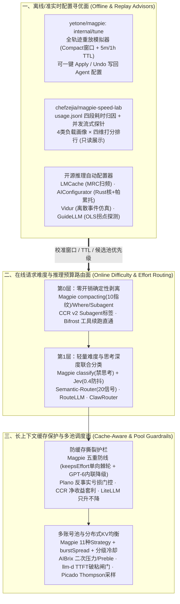

# 最终汇总总结：LLM 网关缓存大小建议、难度自适应路由与全局最优配置全景报告

> **调研基准时间**：2026-11-13  
> **覆盖口径**：57 是两份核心仓与两赛道原报告项数相加（2 + 22 + 33），没有跨赛道去重，不是 57 个独立仓库的同机对跑。证据主要是特定版本的静态核读。
> **公开阅读入口**：
> - [调研问题与纳入标准](01-Magpie_%E4%B8%8E_LLM_%E7%BD%91%E5%85%B3%E6%9C%80%E4%BC%98%E9%85%8D%E7%BD%AE%EF%BC%88%E7%BC%93%E5%AD%98%E5%A4%A7%E5%B0%8F%E5%BB%BA%E8%AE%AE_%26_%E9%9A%BE%E5%BA%A6%E8%87%AA%E9%80%82%E5%BA%94%E8%B7%AF%E7%94%B1%EF%BC%89%E6%B7%B1%E5%BA%A6%E8%B0%83%E7%A0%94%E8%A7%84%E5%88%92.md)；[先看通俗图解](08-%E9%80%9A%E4%BF%97%E5%9B%BE%E8%A7%A3%EF%BC%9A%E5%A4%A7%E6%A8%A1%E5%9E%8B%E7%BD%91%E5%85%B3%E6%98%AF%E5%A6%82%E4%BD%95%E5%B8%AE%E4%BD%A0%E7%9C%81%E9%92%B1%E3%80%81%E6%8F%90%E9%80%9F%E5%8F%88%E4%B8%8D%E5%8F%98%E5%82%BB%E7%9A%84%EF%BC%9F.md)
> - [本体：窗口、TTL 与路由](02-Magpie_%28%60yetone_magpie%60%29_%E6%A0%B8%E5%BF%83%E6%9C%BA%E5%88%B6%E6%B7%B1%E5%BA%A6%E6%8B%86%E8%A7%A3%EF%BC%9A%E7%BC%93%E5%AD%98%E5%AE%B9%E9%87%8F%E8%B0%83%E4%BC%98%E3%80%81%E9%9A%BE%E5%BA%A6%E5%88%86%E7%BA%A7%E8%B7%AF%E7%94%B1%E4%B8%8E%E5%A4%9A%E6%B1%A0%E5%B7%A5%E7%A8%8B%E6%9D%83%E8%A1%A1.md)
> - [插件：测速与评分](03-%60chefzejia_magpie-speed-lab%60_%E6%BA%90%E7%A0%81%E7%BA%A7%E6%B7%B1%E5%BA%A6%E6%8B%86%E8%A7%A3%E4%B8%8E_Magpie_%E5%8D%8F%E5%90%8C%E6%9C%BA%E5%88%B6%E5%88%86%E6%9E%90.md)
> - [生态 A：难度路由](04-%E5%BC%80%E6%BA%90%E7%94%9F%E6%80%81%E8%B0%83%E7%A0%94_A%EF%BC%9A%E6%99%BA%E8%83%BD%E9%9A%BE%E5%BA%A6%E8%B7%AF%E7%94%B1%E3%80%81%E6%8E%A8%E7%90%86%E9%A2%84%E7%AE%97%E5%AF%BB%E4%BC%98%E4%B8%8E_Coding_Agent_%E7%BD%91%E5%85%B3%E6%B7%B1%E5%BA%A6%E5%89%96%E6%9E%90.md)
> - [生态 B：缓存与配置器](05-%E5%BC%80%E6%BA%90%E7%94%9F%E6%80%81%E8%B0%83%E7%A0%94_B%EF%BC%9A%E6%9C%80%E4%BD%B3%E7%BC%93%E5%AD%98%E5%AE%B9%E9%87%8F%E5%AF%BB%E4%BC%98%E3%80%81KV_Prompt_%E6%84%9F%E7%9F%A5%E8%B7%AF%E7%94%B1%E4%B8%8E_LLM_%E8%87%AA%E5%8A%A8%E9%85%8D%E7%BD%AE%E5%99%A8%E6%B7%B1%E5%BA%A6%E6%8A%A5%E5%91%8A.md)
> - [核验记录：哪些结论被打回](06-%E4%BA%A4%E5%8F%89%E6%A0%B8%E9%AA%8C%E4%B8%8E%E4%BB%A3%E7%A0%81%E7%BA%A7%E5%AE%A1%E8%AE%A1%E8%AE%B0%E5%BD%95%EF%BC%88%60verifier%60_%E7%8B%AC%E7%AB%8B%E5%AE%A1%E8%AE%A1%E6%8A%A5%E5%91%8A%EF%BC%89.md)

---

## 核心洞见一图流（Executive Takeaways）

1. **“最佳缓存大小建议”在两类 LLM 网关中是截然不同的两道数学题**：
   - **本地网关不持有 GPU 显存 KV Cache。** Magpie 算的是 Coding Agent 多长该压缩、前缀保温 5m 还是 1h。用本机会话记录重放几组候选窗口和停顿，再给符合条件的客户端设置建议。
   - **集群的旋钮才是容量**：这组样本中，GPTCache 等语义缓存可以设上限，但未见依据负载自动推荐大小；LMCache 回放轨迹画命中率曲线。图线上收益变小只是候选区间，还要问扩容会不会挤掉并发、让队列变长。
2. **“什么难度的问题用什么模型”在 2026 年撞上了最大工程高墙——“多轮缓存撕裂悖论”**：
   - **迁移成本**：单轮按难度选便宜模型很有道理；一段已有 50K–200K token 的长对话换过去，新路径可能重读旧前缀。要算的是这次迁移值不值，而不是假定一换人就把原节点缓存清空。
   - 这些版本提供了几种不同解法：先识别后台任务、在同模型上调 effort、按上下文迁移成本决定是否换模型、工具连续卡住时再升档。不是每个项目都实现四项。
3. **`chefzejia/magpie-speed-lab` 的真实边界与互补定位**：
   - 它按阶段解释延迟，隐藏思考时长是估值，纯工具轮速率按字节传输窗口折算；四类场景的榜单和长尾告警帮助人选档，不替人验证质量。
   - **客观负向边界**：它**不计算**缓存大小或 TTL，**不执行**在线按题难度路由，未消费真实美元单价（`totalCost` 未启用）与 `cache_unknown` 标记，且**“只测不写”**——尚未将选型结果自动导出回写至 Magpie 配置文件或 JS 路由策略扩展点。

---

## 第一部分：`yetone/magpie` 最优配置机制源码级全拆解

> 基准版本 `70f4593`，重放公式见[本体分册](02-Magpie_%28%60yetone_magpie%60%29_%E6%A0%B8%E5%BF%83%E6%9C%BA%E5%88%B6%E6%B7%B1%E5%BA%A6%E6%8B%86%E8%A7%A3%EF%BC%9A%E7%BC%93%E5%AD%98%E5%AE%B9%E9%87%8F%E8%B0%83%E4%BC%98%E3%80%81%E9%9A%BE%E5%BA%A6%E5%88%86%E7%BA%A7%E8%B7%AF%E7%94%B1%E4%B8%8E%E5%A4%9A%E6%B1%A0%E5%B7%A5%E7%A8%8B%E6%9D%83%E8%A1%A1.md)。

### 1.1 最佳缓存大小建议（`Tuned for you` 全轨迹重放引擎）

首先需澄清仓库内的命名误区：`internal/capre` 是防 ReDoS 的正则输入截断器（Capped Regexp），`internal/gateway/advisor.go` 是上游模型特定特性适配，**真正给出最佳缓存窗口与 TTL 配置建议的核心模块是 `internal/tune/tune.go` + `internal/gui/tune.go` + `internal/agent/tune.go`**。

#### （1）为什么“自动压缩窗口”就是 Agent 网关的“最佳缓存大小”？
在 Claude Code / Codex 长会话中，自动压缩阈值 $T$ 决定了上下文膨胀的天花板：
- **$T$ 过大**：每轮对话都要反复读取数十万 Cached Tokens，一旦思考停顿跨过 TTL 还要全价重写；
- **窗口过小**：压缩、写摘要和等待都变频繁；摘要漏掉的信息还可能要找回来。`Rework` 用压缩后额外的 token 增长估计这笔账，不是文件重读记录。

#### （2）四步全轨迹重放寻优算法
1. **跨 Resume 去重与增量解析（`gui/tune.go`）**：扫描本地近 7~30 天会话 JSONL，按文件修改时间升序计算消息 `FNV-64a` 指纹（`msgHash`）剔除 `--resume` 复制的重复计费调用；通过 `tuneKept` 按 `(size, mod)` 增量缓存精简结构体，避免每次轮询消耗 ~500 MB 内存。
2. **提取个体工作流画像中位数（`observe`, `tune.go:239`）**：当同一流相邻两步满足 $P_{i-1} \ge 20,000 \land P_i < 0.6 P_{i-1}$ 时识别为一次真实压缩，跨越所有流提取中位数：单步自然增长 $g$（`Growth`）、压缩后首轮体积 `After`（$P_{\text{at}}$）、压缩耗时 `Took`，以及压缩后 `reworkCalls = 10` 轮内扣除自然增长后的**失忆重读返工量**：
   $$\text{Rework} = \max\Big(0,\; P_{\text{end}} - P_{\text{at}} - k_{\text{steps}} \cdot g\Big)$$
3. **网格扫描与真实渠道倍率重放（`replayCompact`, `tune.go:304`）**：读取用户实际路由渠道价格 `pricedWeights`（例如自动识别 GitHub Copilot 的 `1h` 缓存按 `5m` 倍率计费，而非死套 Anthropic 默认的 `Read=0.1, Write5m=1.25, Write1h=2.0, Out=5.0`），在安全下界 $\text{floor}$ 至 `1,000,000+` 之间按 **`10,000` Token 步长**遍历候选窗口 $T$（扣除 `Reserve`，Claude Code 为 `33,000`），逐步模拟触发压缩时的总加权成本：
   $$\Delta \text{Cost}_{\text{compact}} = \text{ctx} \cdot w.\text{Read} + \text{summary} \cdot w.\text{Out} + (\text{summary} + \text{rework}) \cdot w.\text{Write}$$
4. **“省钱 vs 不打断心流”双准则筛选（`Compact`, `tune.go:333`）**：
   - 若实测计时压缩样本 `Timed >= 3` 且 `Took > 0`：构造压缩次数**不高于当前设置**的 `calm` 集合，在最低成本 `3%` 宽容带（`sameCost = 0.03`）内挑选**压缩次数最少、窗口最大**的解作为 `Best`；仅当相对当前配置净省 $\ge 3\%$ 时才发出迁移建议。
   - **Codex $\ge 0.163$ 后台异步压缩特化（`codexAsyncAt`）**：因后台压缩不阻塞前台交互（等待惩罚归零），直接改取纯 Token 最省点 `r.Cheapest` 换算为百分比建议，并保证早于前台兜底线。

#### （3）主从分离的 Prompt Cache TTL（`5m` vs `1h`）重放建议
`replayTTL`（`tune.go:493`）对同一批历史流按真实请求时间戳差值 $\Delta t_i = t_i - t_{i-1}$ 分别模拟 `5m` 与 `1h` 计费账单，统计 `Quick`（$\le 5\text{m}$）、`Pause`（$5\text{m}\sim 1\text{h}$）、`Away`（$> 1\text{h}$）占比，且**将 Claude Code 主对话（`promptCacheTtl`）与子代理（`subagentPromptCacheTtl`）彻底拆开独立推荐**（主对话常有人类阅读思考停顿可能适合 `1h`，子代理高频连发适合 `5m`）。支持检测环境变量冲突锁（`Locked`）并通过 `stash` 一键 `Apply / Undo`。

---

### 1.2 什么难度的问题用什么模型：三层渐进式路由器

| 路由层级 | 核心模块与源码定位 | 识别特征与路由决策机制 |
| :--- | :--- | :--- |
| **第 0 层：确定性特种流量剥离（不另发分类请求）** | `compacting.go`、`desktop_subagent.go`、`rulecond.go`、`rules.go` | • **10 类 Agent 压缩拦截**：扫描首部 `compactLead = 2048B` 精准捕获 Claude Code / Codex / OpenCode / Gemini CLI 等压缩总结请求，直接卸载至廉价高吞吐模型； • **子代理工具轮剥离**：联合校验 `x-claude-code-agent-id` 与 `hasTools(body)`，仅将带工具的子代理路由至子代理专用模型，无工具标题/摘要请求留在超低价层； • **`outgrown` 95% 溢出重选**：上下文膨胀达当前模型上限 `95%` 时自动打破回合锁定迁往大窗口模型； • **结构化 `Where` AST**：组合匹配 `tokens / images / effort / agent / folder / time` 并原子绑定目标模型与 `UseEffort`。 |
| **第 1 层：双引擎轻量语义与难度分类器** | `classify.go`（通用 Chat） `decide.go`（System One / Jev） | • **通用分类器 (`classify.go`)**：区分主题或难度等级（Prompt 明确要求 `levels` 模式下每条消息含寒暄都必须归级）；输入经 `cutMiddle(3000, 1000)` 与前轮 `priorCap=1000` 裁剪；**强制 `reasoning_effort="none"`** 禁思考降延迟；配 4096 项 `10m` 缓存、`singleflight` 去重与 `30s` 故障静默跳过。 • **Jev 连续难度评分 (`decide.go`)**：输出 `0..3` 连续标量映射至 `[low, medium, high, xhigh]`；设 **`jevSure = 0.4` 置信度防抖门槛**——当用户回复“继续/好的”导致把握度 `<0.4` 时拒绝切模，锁死上轮模型。 |
| **第 2 层：6 套开箱即用路由组模板** | `grouptemplate.go` | 内置 `smart-split`（难易智能分流）、`cheap-first`（省钱优先）、`never-stuck`（3 服务商高可用）、`plan-first`（周配额均衡 `Pace`）、`fastest-first`（实时测速 `Fastest`）、`spread-evenly`（均摊），按输出单价 **`$10/M`** 自动划分强弱梯队并挑最小模型作分类器。 |

---

### 1.3 其他最优化配置：防击穿缓存五重防线与 11 种多池调度策略

1. **破解“动态降级省钱 vs 击穿百万缓存亏钱”的五重防线**：
   - **门槛与真实 TTL 追踪（`affinity.go`）**：仅当上轮缓存量 $\ge \text{cacheWorth}\;(1024)$ 且处于厂商温热期内（默认 `5m`，Codex/DeepSeek/`hourCache` 动态识别为 `1h`）才激活强粘滞；遇突发 5xx 允许原地重试热节点 1 次（`keptAgain`）。
   - **只升不降**：温热期可能拦住调低顶层 effort，以减少无谓的前缀变动；升档时则优先保证任务所需预算。
   - **内联降档**：实验分支尝试保留已有前缀；项目注释记录的模型行为不是厂商规范，也不保证命中。
   - **主从聚拢**：子会话尽量沿用父会话已有的热路径，前提是上游仍允许复用。
2. **多账号池 11 种调度策略与精细化防雪崩机制**：
   - 涵盖 `Smart`（按小时截断重置时间防抖、优先消耗即将过期额度与周限额闲置速率）、`Pace`（周配额按剩余小时匀速释放）、`Fastest`（`20m` 半衰期 EWMA 估算 $TTFT + 200 \times 1000 / TPS$，10% 容差带内保序护缓存，每 5 次探测防饥饿）、`Cheapest`（感知峰谷电价如 DeepSeek 夜间半价）、`Weighted`（带缓存拦截权重欠账回补 `MoveRound` 的平滑加权轮询）等 11 种策略。
   - 并发瞬时请求通过 `burstSpread` 按实时 `inFlight` 打散防冷启动惊群；Gateway Key 通过 `budget.Reserve` 预扣 $\lfloor\text{bodyBytes}/4\rfloor + \text{avgOut}$ 防并发穿透额度墙；异常退避严格区分欠费爬梯（`30m -> 7d`）、`429` 指数退避、`529` 过载短冷（`30s` 且不累增失败计数防全池雪崩）以及同节点同模型连续 2 次首字超时隔离（`restSlow`）。

---

## 第二部分：`chefzejia/magpie-speed-lab` 源码拆解与互补定位

> 插件 v0.3.0，`75e91f5`；原报告所记六项本地单测不是线上测速。见[测速分册](03-%60chefzejia_magpie-speed-lab%60_%E6%BA%90%E7%A0%81%E7%BA%A7%E6%B7%B1%E5%BA%A6%E6%8B%86%E8%A7%A3%E4%B8%8E_Magpie_%E5%8D%8F%E5%90%8C%E6%9C%BA%E5%88%B6%E5%88%86%E6%9E%90.md)。

### 2.1 它解决了 Magpie 本体的什么盲区？
原生 Fastest 看短回复的衰减均值，不按 effort 分档。纯工具轮缺少正文首字时间时，原生速率栏可能为空；插件用现有遥测补一项估计。

### 2.2 核心测速与配置推荐算法拆解
1. **单轮四段耗时估算**（`lib/telemetry.mjs`）：没有直接观测的隐藏思考段从等待中估出。
   $$T_{\text{turn}} = T_{\text{gateway}} + T_{\text{prefill}}(L_{\text{ctx}}, R_{\text{cache}}) + T_{\text{think}}(E_{\text{effort}}) + \frac{N_{\text{out}}}{V_{\text{decode}}}$$
   - **纯工具轮**：用中间 80% 字节的 `flow_ms` 折算速率，不能当作每个 token 的生成时间。
   - **五大慢请求物理归因雷达**：对 `ms >= 18s || ttft_ms >= 13s` 的慢请求自动标注深度思考长尾（`reasoning >= 200`）、上下文膨胀（`>=120K`）、Prompt Cache 冷启动未命中（`in >= 12K && cache_read < in`）、上游重试排队与本地脱敏延迟。
2. **双模式主动并发 SSE 探针（`lib/probe.mjs`）**：
   - `code_stream` 看流式输出，`bug_reasoning` 在一道代码题上统计关键词命中。后者不测准确率。
3. **四项评分与四类负载画像**（`lib/ranking.mjs`）：
   - 将每个 `[Provider × Model × Effort]` 候选映射为 `[0, 100]` 四维子分：
     - **首响敏捷度**：$S_{\text{resp}}(t) = \text{clamp}_{0,100}(\text{round}(105 \cdot e^{-t/11500}))$
     - **流式吞吐率**：$S_{\text{tps}}(v) = \text{clamp}_{0,100}(\text{round}(100 \cdot (1 - e^{-v/55})))$
     - **长尾稳定性**：综合 `P90/P50` 尾差比、绝对 `P90` 与慢请求占比 `slowShare`
     - **推理效能比**：结合缓存命中率、思考克制度与档位先验分（**刻意设定 `high=96 > xhigh=94 > max=92 > ultra=90`**，从数学先验上抑制无脑拉满 `xhigh`！）
   - 按 4 套场景权重（`agent_loop` 重首响 45% + 稳定 25%；`interactive_chat` 重吞吐 45%；`deep_reasoning` 重效能 40% + 稳定 30%；`cost_efficiency` 重效能 35% + 吞吐 30%）乘以样本置信因子 `sampleFactor`（`>=12` 为 `1.0`，`<5` 打 `0.9` 折）输出 S/A/B/C 推荐坐席；当 `xhigh` 的 P90 超过同模型 `high/medium` 的 **`1.25x`** 时自动弹出降档告警。

### 2.3 源码审计确认的能力边界与改进空间
实事求是地看，`magpie-speed-lab` 与 `yetone/magpie` 本体职责边界高度正交：**它不做缓存大小或 5m/1h TTL 计算**（那是 Magpie `internal/tune` 的工作），**不做在线逐请求难度分类路由**，代码中声明了 `totalCost` 但未消费真实美元账单（也未过滤 `cache_unknown` 渠道导致无缓存上报渠道效能分偏低），且目前停留在 UI/CLI 排行榜展示而未自动回写 Magpie 路由配置文件。此外审计还定位了 `bug_reasoning` 正则含题干参数名 `/amount/` 假阳性及前后端 `calls >= 8` 排序分档轻微不一致等可改进细节。

---

## 第三部分：市面同类开源方案全景横向对比（55 个外部项目精选）

我们将除 Magpie 生态外真正实现了**“自动配置建议 / 难度与思考预算自适应路由 / 缓存容量建模与感知调度 / 压测自动寻优”**的代表性开源方案按四大技术赛道归纳如下（完整 55 仓源码细节见 `03` 与 `04` 号报告）：

### 赛道 A：问题难度自适应路由、思考预算控制与 Coding Agent 网关

| 代表开源项目 | 核心定位与热度 | 难度/意图识别与阈值自动推导机制 | 对长上下文缓存的保护机制 | 相较 Magpie 的特色与短板 |
| :--- | :--- | :--- | :--- | :--- |
| **`katanemo/plano`** *(原 ArchGW, Rust, ~7.1k★)* | Agent 原生高性能编排与偏好路由网关 | `Arch-Router-1.5B` 自定义业务意图匹配（裁剪中段保留首尾，`MAX_TOKEN_LEN=8192`）+ 3 次工具死循环自动侦测升档 | **反事实切换净亏损门控**：精算 `switch_cost_in_usd`（仅计确定性输入缓存重算亏损），超 `max_switch_spend_pct` 硬锁锚点模型；自动剥离 `<system-reminder>` 噪声 | 美元级反事实缓存会计模型最为严谨；但无本地会话压缩窗口/TTL 重放建议器 |
| **`vllm-project/semantic-router`** *(+ `agent-router`, Go, ~6.5k★)* | 云原生 Envoy ExtProc 多信号语义与推理路由器 | 单次前向联合评估 **20 类信号**（SystemOne 评定 `easy/medium/hard`），同步输出**目标模型 + `ReasoningEffort`**（自动适配 6 种异构推理协议） | **有界缓存亲和**（加分封顶 `affinityMaxLambda = 0.14`，防贪图缓存误选弱模型）+ 迟滞/冷却防震荡切换门控 | 异构推理协议映射与云原生 K8s 集成极强；偏服务端集群部署而非桌面单机开箱即用 |
| **`musistudio/claude-code-router`** *(CCR v2, TS, ~38.1k★)* | 最流行的 Claude Code 专用分流网关 | 从 v1 免费小模型路由失败转向 v2 **`<CCR-SUBAGENT-MODEL>` 主模型显式委派子模型** + `default/background/think/longContext(tiktoken)/webSearch` 场景映射 + JS 沙箱脚本 | 会话亲和 + **OpenRouter 折扣节点缓存套利精算**：仅当 `grossSavingsUsd - cacheLossUsd >= $0.00005` 且净省 $\ge 5\%$ 时才允许切节点 | 主模型自主指派子代理模型零额外分类延迟，套利公式极实用；缺少自动测算最佳压缩窗口 |
| **`BerriAI/litellm`** *(Python, ~63.2k★)* | 企业级全栈 AI 网关（`complexity_router` + `adaptive_router`） | 5 种复杂度路由器（7 维启发式、**分层 Beta 经验后验 `heuristic_v2`**、NeMo Switchyard 9 规则 Fail-Closed、`llm_v2`、`hybrid`）+ 6 步内 3 次重复工具调用停滞升档 + Thompson Sampling | **`CacheAwareRouting` 只升不降**：确定最低能力 `floor` 后仅在 `order[floor:]` 同级或更强模型中挑选已预热节点且校验 `cost < original_cost` | 企业治理与在线 Bandit 闭环最全；Python 重栈对个人本地轻量化略显厚重 |
| **`maximhq/bifrost`** *(Go, ~9.5k★)* | 高并发分布式 Agent 网关 | 正式弃用纯词法规则，全面收敛至向量语义分类（Chromem/外部向量库）与 LLM 分类器 | 解析 Claude/Codex 子代理请求头做会话域隔离 + 单调只升不降 + **`turnTierStore` 工具回调轮 0 开销直接复用分级** | 多步工具续跑跳过重复分类的设计极干净；无离线配置回放推荐器 |
| **`lm-sys/RouteLLM`** *(Python, ~5.7k★)* | 经典双模型胜率路由与预算校准框架 | 矩阵分解（MF）、相似度加权 Bradley-Terry（`sw_ranking`）、BERT 三分类、`causal_llm`（1–5 分预测）；**`calibrate_threshold.py` 按校验样本中强模型请求比例分位数 `quantile(1-p)` 自动取分流阈值** | **无保护**：逐轮无状态独立打分，多轮长上下文极易反复跳变击穿缓存 | 离线分位数阈值自动校准的教科书基线；不适合多轮有状态 Coding Agent |
| **`ClawRouter` / `NadirClaw` / `CARROT` / `BEST-Route` / `OptiLLM`** | 轻量启发式 / 非对称代价 / 帕累托测试时计算 | • `ClawRouter`：15 维规则 `<1ms` 零 LLM 分类； • `NadirClaw`：ModernBERT + Wide&Deep 非对称降级惩罚（$\lambda=3\sim 20$）； • `CARROT`：双 RoBERTa 同时预测准确率与**输出长度**算线性帕累托； • `BEST-Route`：联合搜 `(model, best_of_n)`； • `OptiLLM AutoThink`：按难度限思考上下界并在激活层注入引导向量。 | `NadirClaw` 强制 `upgrade_if_higher` 只升不降；`ClawRouter` 允许 `SIMPLE` 轮绕过锁定（有断缓存隐患）；其余偏单轮 | 提供了“预测输出长度防成本倒挂”与“非对称错判代价”的重要算法拼图 |

---

### 赛道 B：最佳缓存大小建议（MRC）、KV/Prompt 缓存优化与自动配置实验室

| 细分领域 | 代表开源项目 | 核心寻优算法与输入输出闭环 | 核心发现与对标结论 |
| :--- | :--- | :--- | :--- |
| **1. 最佳缓存容量建议（MRC / 边际收益）** | • **`LMCache/LMCache`** (`cache_simulator`) • **`cacheMon/libCacheSim`** • **`facebook/CacheLib`** | • **`LMCache`**：本次样本中内置离线容量顾问——回放 `MP_LOOKUP` 块日志（`0.5–500 GiB` 30 点对数网格）或 OTLP Token Trace（从 `4096` 起按 **$\sqrt{2}$ 步长**扫 `(chunk_size, capacity)` 二维空间），输出前缀 + CacheBlend 命中率拐点曲线，并配 `ARC` 幽灵列表自适应驱逐。 • **`libCacheSim`**：Olken Splay Tree 单遍 $O(N\log M)$ 精确 MRC + `[0.001..0.8]*WSS` 8 档自动扫频。 • **`CacheLib`**：在线监控 LRU 尾部 Slab 边际命中导数 `MarginalHitsStrategy` 跨池动态调配内存。 | 传统独立块 MRC 会高估具有“连续前缀依赖”的大模型 KV 命中率；语义缓存网关（`GPTCache`/`Bifrost`/`Higress`/`Portkey`/`Kong`）目前**全员缺失**自动容量建议算法。 |
| **2. 云端 Prompt Cache 优化与审计** | • **`montevive/autocache`** • **`easmith/claude-cache-analyzer`** • **`vansye/prompt-cache-optimizer`** | • **`autocache`**：透明注入断点并给出精确盈亏平衡公式——Anthropic **`5m` (`1.25x`) 命中 1 次即回本净省 32.5%**，**`1h` (`2.0x`) 至少需命中 2 次（第 3 次请求）才回本**，但自身 TTL 仍为静态写死。 • **`claude-cache-analyzer`**：事后审计 `.jsonl` 账单与写入溢价损耗。 • **`vansye`**：同角色块按 SHA-256 重排保前缀稳定 + 自动 Padding 对齐最小缓存门槛。 | **跨报告互证亮点**：外部开源项目均未实现按会话间隔分布动态选 `5m` vs `1h`，恰与 **`yetone/magpie` `replayTTL`** 形成鲜明对照，证明 Magpie 在客户端缓存经济调优上处于开源领先身位。 |
| **3. 集群 KV-Cache 感知路由权衡** | • **`vllm-project/aibrix`** • **`vllm-project/production-stack`** • **`llm-d`** (`EPP`) • **`sglang`** (`sgl-model-gateway`) | • **`aibrix`**：KV 剩余 `<10%` 熔断 + 二次方压力惩罚 `1+2(1-kvFree)^2` + 标准差/`1.5x` 防热点护栏 + Preble 3m 滑窗排队计算代价模型。 • **`production-stack`**：无量纲线性效用 $\text{prefixRatio} - \beta \cdot \text{relLoad}$。 • **`llm-d`**：区分介质权重（`gpu=1.0, cpu=0.8`）+ **`MaxTTFTPenaltyMs (18s)` 硬破粘闸门**。 • **`sgl-model-gateway`**：字符基数树 + 队列差 `>32` 且 `>1.1x` 硬切最小负载。 | 回答了自建多卡集群侧“什么时候该放弃缓存亲和、切往空闲节点”的四套成熟工业数学公式。 |
| **4. 推理引擎自动最优配置器（Auto-Configurator）** | • **`ai-dynamo/aiconfigurator`** • **`bentoml/llm-optimizer`** • **`microsoft/vidur`** • **`vllm-project/guidellm`** • **`InseeFrLab/auto-tuning-vllm`** | • **`aiconfigurator`（NVIDIA）**：算子实测库 + Rust 步进核，精确区分 `of_free`/`of_total` KV 预算与 **`--prefix` 非对称算子耗时**，输出 Agg / PD 分离 / AFD 帕累托最优拓扑与并发度。 • **`llm-optimizer`**：显存+算力+带宽三瓶颈 Roofline 秒级推演启动参数。 • **`vidur`**：Ray 离散事件仿真二分搜最大可持续 QPS/Dollar 帕累托前沿。 • **`guidellm`**：2-Segment OLS 四重护栏自动探测吞吐饱和拐点 + Wilson 置信区间 Goodput。 • **`auto-tuning-vllm`**：Optuna NSGA-II/BoTorch 多目标黑盒寻优。 | 从“离线秒级解析估算 $\to$ 混合算子仿真 $\to$ 在线压测拐点识别”构建了完整的服务端参数自动推荐工具链。 |
| **5. 多 API 渠道实测实验室（类 Speed Lab）** | • **`PicadoLabs/ai-model-router`** • **`bytehola/llm-speed-test`** • **`rbadillap/ai-gateways-benchmark`** • **`Yoosu-L/llmapibenchmark`** | • **`PicadoLabs/ai-model-router`**：五维静态分 + 持久化 **Beta-Bernoulli Thompson Sampling**，是本次样本中**打通“测速反馈 $\to$ 在线自动探索选路”闭环**的项目。 • **`ai-gateways-benchmark`**：拆解 `dns->tcp->tls->ttfb->ttft->e2e` 六阶段 + 冷热连接隔离 + 交错轮询防波峰漂移。 • **`llmapibenchmark`**：严格分离 `Prompt TPS` 与 `Decode TPS`。 • **`llm-speed-test`**：Node+Vue+SQLite 并发面板（经源码核实仅支持单向导入 CPA YAML，不支持反向导出配置）。 | 绝大多数 API 测速工具与 `magpie-speed-lab` 一样存在“只测不写”断层，引入 Thompson Sampling 或一键生成网关路由配置是明确蓝海。 |

---

## 第四部分：方法论总结与架构选型 / 演进路线图

### 4.1 按使用场景的开箱选型指南

1. **个人与小团队重度使用 Claude Code / Codex / OpenCode 等本地 Coding Agent**：
   - **首选组合**：**`yetone/magpie` + `chefzejia/magpie-speed-lab`**（或重度 OpenRouter 套利与主模型自主派单场景考虑 **`musistudio/claude-code-router` v2**）。
   - **怎么读自己的样本**：本体的最低条件按调用数计（50 次调用，不是 50 个会话），还需同机日志。先看窗口与主/子代理的停顿建议，再看同模型两档的 P90。插件在极高档至少 15 次、中档至少 10 次调用时比较 1.25 倍门槛；告警只说明长尾变重，不说明少抓或多抓了 bug。
2. **企业级多团队共享 API 网关（兼顾成本治理、防死循环与缓存防撕裂）**：
   - **选底座看约束**：若主要担心迁移费用，看 Plano；若要工具续跑复用同一分级，看 Bifrost；若需要多类路由器，看 LiteLLM。这是按实现列入口，不是同机性能排名。
3. **自建 vLLM / SGLang / TensorRT-LLM GPU 推理集群与云原生调度**：
   - **离线容量与拓扑规划**：先用 **`ai-dynamo/aiconfigurator`**（传入真实业务 `--prefix` 缓存长度）确定 TP/PD 分离配比与并发上限，再用 **`LMCache` `cache_simulator`** 扫出 CPU/Disk Offload 的最佳缓存容量拐点，上线前以 **`vllm-project/guidellm`** 实测验证 2-Segment OLS 吞吐拐点。
   - **线上网关调度**：挂载 **`vllm-project/semantic-router`**（统一控制 20 类信号与 `ReasoningEffort`）+ **`llm-d` / `aibrix`**（执行带 `MaxTTFTPenaltyMs` 破粘闸门与二次压力保护的 KV-Cache 感知路由）。

### 4.2 下一代“自进化 LLM 智能网关”的五大融合设计建议

下面五项是设计提案，不是本体或插件已经能跑通的端到端闭环。

1. **打通 `magpie-speed-lab` 到 Magpie 路由配置的“最后一公里”自动写回**：
   - 在 `magpie-speed-lab` 中消费 `usage.jsonl` 里的真实 `cost`、`cache_write`、`cache_write_1h` 与 `cache_unknown` 字段，构建真正的 **“美元成本 × 分阶段延迟 × 质量检出率”三维帕累托前沿**，并通过 Magpie 的 JS 路由策略插件接口（`export const strategies`）或路由组 JSON 导出器，将 `agent_loop` 冠军与 `deep_reasoning` 冠军一键转化为线上生效配置，辅以 `PicadoLabs/ai-model-router` 式的轻量 **Thompson Sampling** 实现全天峰谷自动漂移。
2. **用“切模净收益会计恒等式”统一所有跨模型路由决策**：
   - 融合 Magpie 的 `keepsEffort` 单向棘轮、`plano` 的 `switch_cost_in_usd` 与 `CCR v2` 的 `cacheLossUsd`，将网关每次模型/思考档位切换抽象为统一的净现值判据：
     $$\text{NetGain} = \mathbb{E}[\Delta \text{OutputSavings}] + \Delta \text{InputRateSavings} - \text{CacheRebuildPenalty}(\text{ctx}, \text{TTL}) - \lambda_{\text{risk}} \cdot \Delta P(\text{Rework/Fail})$$
     在这个提案中，净收益不为正就优先留在当前节点；命中与返工概率仍需要独立观测。
3. **在压缩窗口寻优中补入“质量退化与 3-Strike 返工率”反馈项**：
   - Magpie `internal/tune` 目前已创新地引入了压缩后 10 轮 Token 膨胀量 `Rework`，下一步可结合 `plano` / `LiteLLM` 的 `stall_detector`（连续 3 次重复工具签名或编辑回滚），统计不同压缩窗口下触发死循环与测试失败的频率，避免极小异步压缩窗口虽省了账面 Token 却抬高了隐性任务失败率。
4. **将主对话、子代理（Subagent）、工具续跑（Tool Continuation）与压缩总结（Compaction）彻底分轨**：
   - 可以分开处理压缩和普通会话，工具续跑复用本轮分级，子代理按自己的停顿选 TTL；少做一次分类不等于保证前缀命中。
5. **从本机桌面调优扩展至远程集中式网关遥测（突破 `Gateway: true` 限制）**：
   - 可研究在授权、最小化采集的前提下统计会话增量和停顿。但仅有网关侧观测，能否等价替代客户端压缩轨迹仍待验证。

---

## 第五部分：参考资料与数据来源总索引

项目、论文、费率的来源类型，以及图解哪些数字是示意，可查[参考资料与数据来源总表](09-%E5%8F%82%E8%80%83%E8%B5%84%E6%96%99%E4%B8%8E%E6%95%B0%E6%8D%AE%E6%9D%A5%E6%BA%90%E6%80%BB%E8%A1%A8%EF%BC%88References_%26_Data_Provenance%EF%BC%89.md)。
