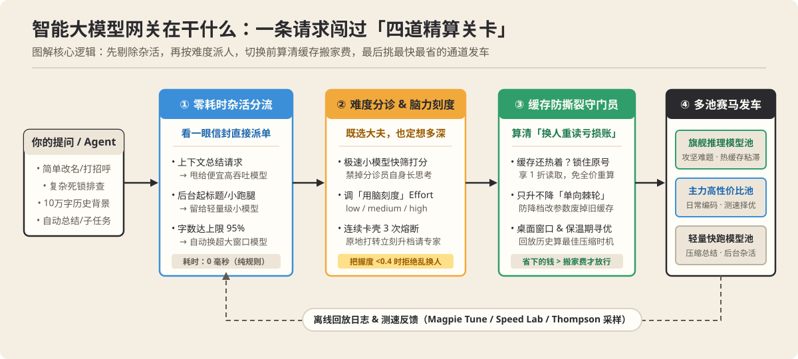
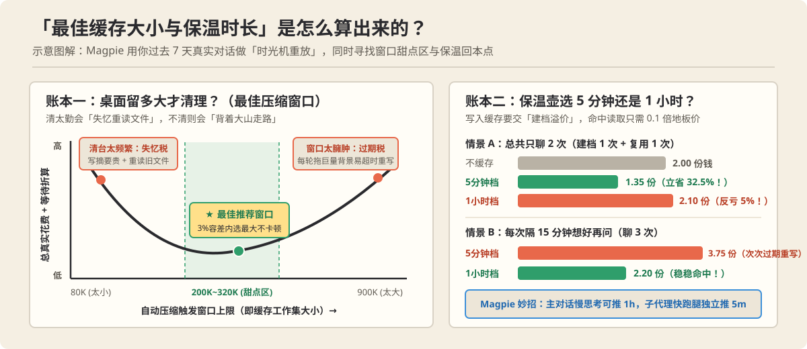
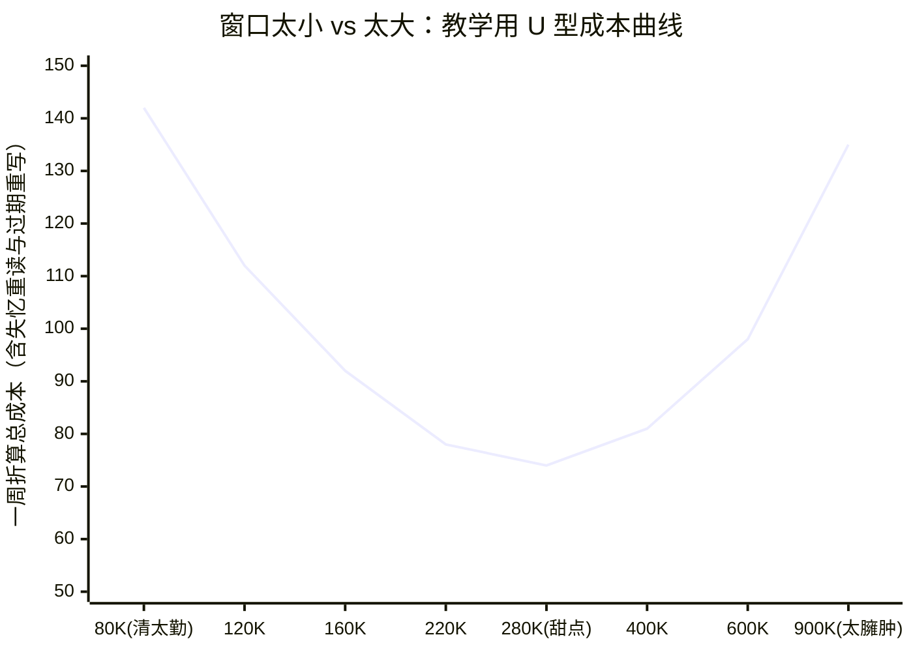
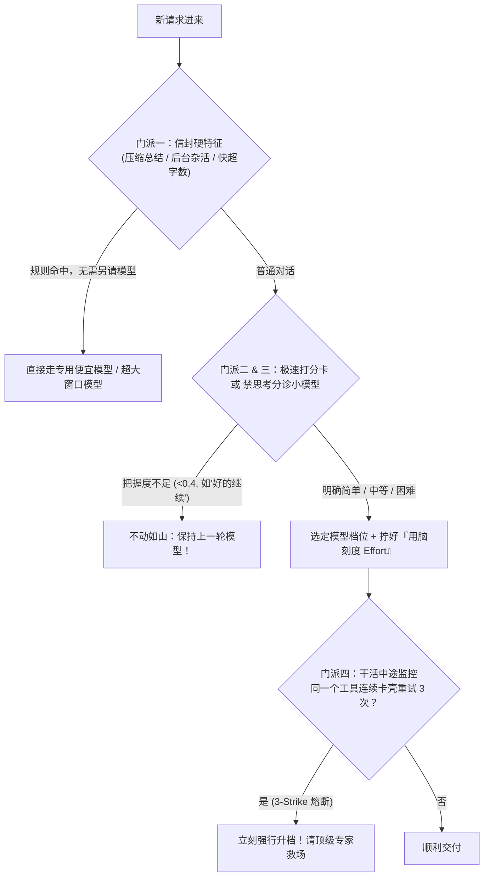
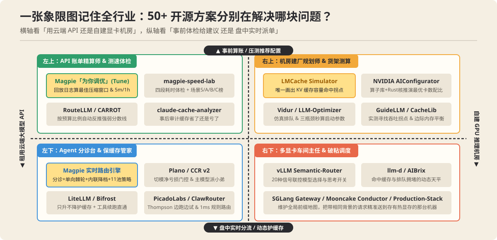

# 通俗图解：大模型网关是如何帮你省钱、提速又不变傻的？

> **导读**：前几篇钻代码、抠公式，这篇换回人话。借医院分诊台、厨师备菜台和搬家算账，配五张图，看看为什么“把下一句交给便宜模型”有时反而更贵。

---

## 一、 为什么直接调大模型会既贵又慢？网关到底在管哪三件事？

想象你开了一家软件设计院，手底下既有年薪百万但说话慢条斯理的**首席架构师**（比如 Claude Opus、GPT-6 高思考档），也有干活麻利、收费只有十分之一的**熟练绘图员**（轻量模型或低思考档）。

如果中间没有一个聪明的**「总调度前台」（LLM 网关）**，你马上会掉进两个极端坑里：
1. **杀鸡全用宰牛刀**：不管你是让 AI“排查一个极其隐蔽的并发死锁”，还是仅仅说一句“把按钮文字改成确定”，全都挂顶级专家号、开最高深度思考。结果改个字也要等专家闭眼冥想 25 秒，月底账单贵得肉疼。
2. **乱换大夫反破产**：为了省钱，你规定“难病找专家，小病找普通大夫”。结果刚和专家聊了 50 页项目病历，下一句随口问个小问题切给了普通大夫——普通大夫没看过前 50 页病历，只能按原价把 50 页从头重读一遍！**省下的那点挂号费，连重印病历的零头都不够。**

所以，今天无论是 **Magpie**、**claude-code-router**、**Plano** 还是 **vLLM Semantic Router**，市面上所有顶尖开源方案绞尽脑汁解决的，其实就是下面这张图里的**四道关卡**：

用一句话概括，所有核心技术思路都围着三个问题转：
- **台面留多大、保温多久最划算？**（最佳缓存大小与生命周期建议）
- **什么活儿派给谁、让他动几分脑子？**（难度识别与思考档位路由）
- **半途换人会不会倒亏一笔“重读费”？哪条通道眼下最快？**（防缓存撕裂与实时测速寻优）

下面我们一关一关拆开看。

---

## 二、 第一大技术：怎么算出「最佳缓存大小」与「保温时长」？

很多人第一次听到“网关给出最佳缓存大小建议”，会以为是在问“电脑内存条该划几个 G”。其实，**你是在自己电脑上租云端 API 用，还是自己在机房摆几十张显卡开厂，算的完全是两本不同的账！**

### 1. 租云端 API 的本地网关（代表：Magpie）：算的是「备菜桌面留多大」和「选哪种保温壶」

当你用 Claude Code 或 Codex 写代码时，对话就像厨师在案板上备菜：你每多聊一轮，案板上堆的历史代码和聊天记录就越厚。云厂商有个规矩叫 **Prompt Caching（前缀缓存）**：
- **好消息**：案板上已经摆好的旧菜（上文），下一轮接着用只要 **1 折读取费（`0.1x`）**；
- **坏消息**：案板不能无限堆下去，堆太满不仅每轮都要交一笔厚厚的 1 折过路费，而且一旦你去倒杯茶超过 5 分钟回来，缓存凉了过期，整桌菜得按 **1.25 倍甚至 2 倍全价重新建档**！

因此，编程工具每隔一阵子要**「清台面」**：比如把前 20 万个 token 压成一小段摘要。这里按模型读进去的 token 算，不是按汉字数。到底堆到多高再清台面才划算？

- **窗口太小，交「失忆返工税」**：刚读完几个核心文件，一清台，摘要里可能只剩个名字。Magpie 不知道 AI 是否又打开了原文件；它看压缩后最多 10 轮比平时多涨了多少 token，把这记作 `Rework`。另算写摘要的钱和你干等的时间。
- **窗口设太大（死活不清）$\rightarrow$ 交「臃肿过期税」**：每次回个“好的”都要背着几十万字历史跑，稍一停顿过期重写就是天价。

**Magpie 的核心绝活——「时光机历史重放法」（Trace-Replay）：**
它用过去一周的本机记录估计平时涨多快、压缩后留下多少，再假设窗口换成 10 万、11 万、12 万……直到 100 万 token。人不用真干同一周的活儿，只要让这几本假设的账互相比一比。

下面这条 U 型线是教学示意，不是任何人的一周实账；甜点会随工作习惯移动。

算完曲线后，Magpie 还会做两件极其贴心的事：
1. **照顾你的耐心**：如果发现某个窗口虽然省了 2% 的钱，但让你这一周多干等了好几次压缩卡顿，它会放弃这个极值点，在**不增加你卡顿次数**的前提下，挑一个相差 3% 以内最大的舒服窗口（而新版 Codex 支持后台悄悄压缩不卡人，Magpie 就自动切回最省钱的那个点）。
2. **主对话和跑腿的分开选保温壶**：按这里采用的倍率，第一次写入，后来都命中，和不缓存相比，5 分钟档到总共第 2 次、1 小时档到第 3 次才划算。主对话常停十几分钟，可能值得保温 1 小时；后台小助手几秒一问，5 分钟也许就够。看各自的停顿，不是一刀切。

---

### 2. 自建 GPU 机房的集群网关（代表：LMCache + NVIDIA AIConfigurator）：算的是「显存货架配多大」

如果你不是租 API，而是自己买了服务器跑 vLLM / SGLang，那缓存就是实打实存在显卡显存（VRAM）和内存（DRAM）里的物理数据块。这时的主流技术思路分两步：
1. **画「尺码收益拐点图」（MRC 命中率曲线）**：开源界里 **`LMCache`** 内置了一个模拟器，把生产环境录下来的请求轨迹，按 $\sqrt{2}$ 倍一步步放大模拟缓存容量（比如 4G $\to$ 5.6G $\to$ 8G $\to$ 11G……一路试到 500G），画出命中率曲线。当容量从 32G 翻倍到 64G、命中率却只涨了 0.5% 时，**曲线拐弯变平的那个肩膀位置**，值得列为候选；得看这点命中收益值不值显存。
2. **防「货架挤占操作台」**：显卡显存总共就那么大，如果全拿来做历史缓存货架，当前同时接待客人的操作台（并发批大小 Batch Size）就被挤没了，反而导致排队卡死。**NVIDIA `AIConfigurator`** 的思路就是把“缓存省下的重算时间”和“并发排队时间”放进同一个天平（并且精确考虑到：命中缓存虽免除了矩阵计算，但注意力层仍得把旧缓存从显存里读出来），比较不同配比，而不是从一条曲线报出整座机房的标准答案。

---

## 三、 第二大技术：什么难度的问题用什么模型？（四大门派与「用脑刻度」）

把活儿按难易分给不同模型，听起来简单，做起来极容易翻车——**如果分诊员自己看病历就要花 5 秒钟、收 2 毛钱，那分诊本身就成了累赘！**

目前开源界演化出了从轻到重的**四大分诊门派**：

| 分诊门派 | 通俗原理（怎么判断难易？） | 聪明在哪 / 踩过什么坑？ | 代表开源项目 |
| :--- | :--- | :--- | :--- |
| **1. 看信封直接派单** | 标题、压缩总结和快碰上窗口上限的请求，可以先用规则认出。 | 不必另请一个模型做分诊，省的是这一步；认错信封还是可能派错人。 | `Magpie`、`claude-code-router`、`Bifrost` |
| **2. 本地打分卡 & 擂台胜率表** *(启发式 / 统计校准)* | 本地数特征（有没有代码块、数学符号、多步逻辑词），或者查人类盲测擂台（Chatbot Arena）的历史相似题，算“贵模型赢便宜模型的概率”。 | **`RouteLLM` 的懒人定线法**：你不用懂阈值，只需说“我想让校验集约 20% 的题走贵模型”，它自动在历史分布上切出前 20% 的分数线；**`CARROT`** 还会同时预测“这道题会吐多少字”，防止选了单价贵又话痨的模型。 | `ClawRouter` 、`RouteLLM`、`LiteLLM`、`CARROT` |
| **3. 雇一个「不许发呆」的分诊实习生** *(轻量小模型快筛)* | 让极快的小模型读一下当前问题（太长就只留头尾、裁掉中间），输出 `1~4` 难度等级。 | **两大保命细节**（Magpie 实战精华）： ① **强行关掉分诊员的深度思考**（`reasoning_effort="none"`），逼它秒回一个数字； ② **拿不准别乱动**：当你回一句“继续”，分诊把握度低于 `0.4` 时，死锁上一轮模型绝不乱降级！ | `Magpie`、`vLLM Semantic-Router`、`Plano` |
| **4. 包工头自己点兵 + 三振出局** *(主模型委派 & 停滞熔断)* | 让正在干活的最强主模型在拆分子任务时，顺手贴个标签指定哪个便宜小弟去跑腿；同时网关盯着执行过程。 | `claude-code-router` 早期让免费小模型当总调度结果天天派错活，改成**主模型自己派小弟**后稳如泰山；`Plano` 和 `LiteLLM` 则加上 **3-Strike 规则**：小模型在原地连续撞墙重试 3 次，立刻强行升档请大神接管！ | `claude-code-router v2`、`Plano`、`LiteLLM` |

> [!TIP]
> **2026 年最划算的新共识：与其跨模型换人，不如拧「用脑刻度」（Reasoning Effort）！**  
> 现在的旗舰模型都有 `low / medium / high / xhigh` 几个思考档位。很多时候，你根本不需要把任务从旗舰模型切给笨一点的小模型——**留在同一个旗舰模型里，把日常步骤调成 `low/medium`，遇到硬骨头再拧到 `high`**，既省掉了漫长的思考等待和废话账单，又不会换掉熟悉项目背景的“老熟人”！

---

## 四、 第三大技术：全行业最反直觉的「省钱破产陷阱」与三把保护锁

理解了前面两点，你就来到了整个大模型网关技术里**最精彩、最见功力**的地方。

2024 年大家做路由器时，都觉得“每句话挑当时最便宜且够用的模型”肯定最省钱。结果到了 2025–2026 年，所有写代码的 Agent 动辄拖着 **10 万～30 万 token**的历史上下文跑，大家突然发现：**越是勤快地切便宜模型，账单反而炸得越惨！**

看图 3 前先定单价：假设全价输入每百万 token 3 美元，缓存读 0.30 美元。同样 20 万 token，热读是 0.06 美元，冷读是 0.60 美元。只算这段输入，不是实际账单，也不是特定模型报价。

一句话点透本质：**在长对话里，“已预热的上下文缓存”就是你花重金建好的地基。为了省一砖一瓦的人工费而频繁换施工队，每次换队都要把地基推倒重打一遍！**

为了堵住这个大窟窿，现在最先进的开源网关发明了**三把精妙的保护锁**：

1. **第一把锁：「只升不降」单向棘轮（代表：Magpie `keepsEffort`、LiteLLM、Bifrost、NadirClaw）**
   - 缓存估计还热乎的时候，宁可先沿用老设置，也别为了省这一句的钱变动前缀。问题真变难了，再往上请专家。省的是无谓的搬家，不等于所有供应商一改设置就给缓存清零。
2. **第二把锁：搬家前先按计算器对账（代表：Plano 反事实门控、CCR v2 缓存套利）**
   - `katanemo/plano` 直接在网关里塞了一个极其抠门的“财务会计”：每次想换模型前，先算一笔账——**把这堆上下文搬去新模型重读一遍要多掏多少钱？** 如果这笔“搬家亏损”超过了你设定的省钱红线，当场一票否决！`claude-code-router` 在挑 OpenRouter 便宜渠道时也是同理：只有**「新渠道省下的毛利 － 丢掉旧缓存的损失 > 净赚 5%」**时才准切流。
3. **第三把锁：不改合同封面，往信封里塞小纸条（代表：Magpie GPT-6 内联降档黑科技）**
   - 还有一种像给合同末页贴便签的办法：实验分支尽量不动前面的设置，只告诉模型“这一步少想一点”。作者在代码注释里说，反过来用便签升档未如预期。保住合同原文是用意，供应商肯不肯按缓存价结账是另一回事。

---

## 五、 第四大技术：怎么揪出「慢在哪里」并自动调优？（从 `magpie-speed-lab` 到自动驾驶）

哪怕配好了缓存和路由，你平时用起来还是经常觉得：“今天这个渠道怎么卡卡的？到底是中转站抽风、上下文太长，还是模型自己在瞎想？”

这就是 **`chefzejia/magpie-speed-lab`** 以及市面上各类测速与自动配置器（Auto-Configurator）登场的舞台。它们的核心思路可以总结为三招：

### 第 1 招：把一句话拆成「四棒接力赛」，抓出真正的拖油瓶
四棒是一种看账的方法，不是每棒都有人掐表。尤其看不到思考开始、结束时，第三棒要从等待时间里估。
- **第一棒（网关与网络握手）**：是不是本地脱敏插件太慢，或者撞上限流排队重试了？
- **第二棒（读背景热身 Prefill）**：是不是十几万字没命中缓存，正在苦哈哈全量重读？
- **第三棒（闭眼暗想）**：同一模型有足够调用时，若极高档的 P90 超过中等档的 1.25 倍，插件会提醒你看看要不要降档。这张黄牌只看慢没慢，不用也不能判定多抓了几个虫。
- **第四棒（张嘴吐字）**：有些工具轮一句正文都没有，原生界面报不出速率。插件拿中间 80% 字节流的传输窗口折算一个数；这是隔着窗看它跑，并非逐 token 的秒表。

### 第 2 招：看菜下碟，按「干活类型」定制打分秤砣
没有哪个模型是全能冠军。`magpie-speed-lab` 给出了一个非常清晰的思路——**换一套权重滑块，排行榜名次立刻大洗牌**：
- **自动编程循环（Agent Loop）**：AI 要连跑二三十步小工具，每步只吐几行指令。这时候吐字快慢不重要，**「第一声响应快不快（TTFT，占 45%）」和「别突然卡死（稳定性，占 25%）」**才是命根子，否则每步慢 5 秒，30 步下来就是两分半钟！
- **日常问答与写长文（Interactive Chat）**：一上来就哗哗写几千字，**「每秒吐字速度（TPS，占 45%）」**直接决定你看着爽不爽。
- **疑难杂症攻坚（Deep Reasoning）**：慢点无所谓，**「推理效能与准确率（占 40%）」**排第一。

### 第 3 招：从看体检单到派侦察兵
通过这次全网源码深挖，我们也看清了 `magpie-speed-lab` 和大多数测速面板（如 `llm-speed-test`）目前留下的**最后半步遗憾**——它们算出了漂亮的 S/A/B/C 排行榜，但**只给眼睛看，不会自动帮你去改网关配置文件**。

那行业里最前沿是怎么打通这最后一步的？答案是借用强化学习里的 **Thompson Sampling（汤普森采样，代表项目：`PicadoLabs/ai-model-router`、`LiteLLM AdaptiveRouter`）**：
- 网关在心里给每个渠道记一本动态信用账（快不快、稳不稳）；
- 每次派单前，各渠道从自己的后验分布里抽一个分数，这一轮交给抽得高的。样本少的选手偶尔也能出头。
- 这不是固定划出 95/5 的流量；图里“大部队和侦察兵”是比方。Magpie 的 Fastest 按次数安排探测，则是另一条规则。
- 把新反馈记回账本，下次抽分的把握就会变。测速插件本身仍只出榜，不会因此自动改路由。

---

## 六、 一张全景图带走：50+ 开源方案到底该怎么对号入座？

最后，如果你以后在 GitHub 上看到五花八门的“AI 网关 / 路由器 / 调优器”觉得眼花缭乱，只需要拿出下面这张**四象限地图**，两秒钟就能看穿它的底细：

我们再把全文出现的核心技术思路浓缩成一张**「一句话记忆卡」**，方便你随时查阅：

| 你关心的核心痛点 | 目前行业最成熟的技术思路 | 一句话生活比喻 | 代表开源标杆 |
| :--- | :--- | :--- | :--- |
| **本地编程缓存窗口留多大？** | **历史会话时光机重放（Trace-Replay）**：把近一周聊天拉出来遍历 10万~100万字窗口重算总账，算入“压缩失忆重读文件”的返工税。 | 算厨师案板多大才既不摆不下，又不用刚切完菜就倒掉重找。 | `yetone/magpie` (`internal/tune`) |
| **缓存选 5分钟 还是 1小时？** | **提问时间差回放 + 主仆拆算**：按你真实的喝茶停顿间隔算回本点；慢思考主对话选 1h，快跑腿子代理选 5m。 | 慢喝茶用大保温瓶，一口闷用纸杯，不花冤枉押金。 | `yetone/magpie`、`autocache`（回本公式） |
| **自建显卡机房缓存配多大？** | **MRC 命中率拐点扫描 + 并发联合寻优**：按 $\sqrt{2}$ 倍递增模拟容量找曲线变平的拐点，同时防止缓存占满显存挤死并发操作台。 | 仓库货架加到刚好够放常卖货就行，别把营业大厅挤没了。 | `LMCache`、`NVIDIA AIConfigurator` |
| **什么难度的问题派给谁？** | **四级漏斗**：① 看信封派杂活，不另发分类请求 $\to$ ② 小模型禁思考秒级打分 $\to$ ③ 优先拧同模型“用脑刻度” $\to$ ④ 连续卡壳 3 次强行升档。 | 小病护士台直接开单，疑难病找主任，实习生连扎三针不中立刻换主任上。 | `Magpie`、`vLLM Semantic-Router`、`claude-code-router`、`RouteLLM` |
| **怎么防止换便宜模型亏掉缓存？** | **三把保护锁**：① 温热期“只升不降”单向棘轮；② 净收益 > 搬家重读费才准换；③ 封面不动、塞内联纸条悄悄降思考档位。 | 50页病历已经在专家桌上摊开了，小问题也顺便问他，别换人重交复印费。 | `Magpie`、`katanemo/plano`、`claude-code-router v2`、`LiteLLM` |
| **怎么测出谁真快并自动调优？** | **四段耗时拆解 + 场景滑块 + 按后验抽样**：拆开排队/读背景/暗想/吐字，用传输窗口估工具轮速率；另有路由器按后验分布选路。 | 给接力赛有表的直接看，没表的注明估值，大部队走熟路、派斥候探新路。 | `magpie-speed-lab`、`GuideLLM`、`PicadoLabs` |

---

## 七、 参考资料与数据来源（References & Data Sources）

下列仓库与文献是理解机制的入口。哪项看过代码，哪项只查到网页，见[公开资料台账](09-%E5%8F%82%E8%80%83%E8%B5%84%E6%96%99%E4%B8%8E%E6%95%B0%E6%8D%AE%E6%9D%A5%E6%BA%90%E6%80%BB%E8%A1%A8%EF%BC%88References_%26_Data_Provenance%EF%BC%89.md)。

### 1. 核心开源项目与关键源码定位
- **`yetone/magpie`**（Commit `70f4593e`）：[https://github.com/yetone/magpie](https://github.com/yetone/magpie)
  - *最佳压缩窗口与 5m/1h TTL 历史重放*：`internal/tune/tune.go`（`observe`、`replayCompact`、`replayTTL`）、`internal/gui/tune.go`、`internal/agent/tune.go`
  - *压缩暗号剥离、禁思考分类器与 Jev 0.4 防抖*：`internal/routes/compacting.go`、`classify.go`、`decide.go`
  - *温热期只升不降棘轮与 GPT-6 内联降档*：`internal/routes/rules.go`（`keepsEffort`）、`internal/routes/effort_update.go`（及 [Issue #617](https://github.com/yetone/magpie/issues/617)）
- **`chefzejia/magpie-speed-lab`**（`v0.3.0`, Commit `75e91f59`）：[https://github.com/chefzejia/magpie-speed-lab](https://github.com/chefzejia/magpie-speed-lab)
  - *四段物理耗时拆解与 `flow_ms` 工具轮流速恢复*：`lib/telemetry.mjs`
  - *并发流式探针与四类工作负载加权排行*：`lib/probe.mjs`、`lib/ranking.mjs`（含 `1.25x` P90 降档告警与场景权重矩阵）
- **智能难度路由与防缓存撕裂代表项目**：
  - `katanemo/plano`（Commit `b13ddd6`，反事实切换亏损门控 `switch_cost_in_usd` & 3-Strike 循环检测）：[https://github.com/katanemo/plano](https://github.com/katanemo/plano)
  - `musistudio/claude-code-router`（Commit `057abaa`，`<CCR-SUBAGENT-MODEL>` 主模型委派 & OpenRouter 缓存损失套利）：[https://github.com/musistudio/claude-code-router](https://github.com/musistudio/claude-code-router)
  - `vllm-project/semantic-router`（Commit `f47e114`，20 类信号联合推理档位重写 & `affinityMaxLambda=0.14`）：[https://github.com/vllm-project/semantic-router](https://github.com/vllm-project/semantic-router)
  - `BerriAI/litellm`（Commit `f4f94cc`，`ComplexityRouter` + 只升不降 `CacheAwareRouting` + Bandit）：[https://github.com/BerriAI/litellm](https://github.com/BerriAI/litellm)
  - `maximhq/bifrost`（Commit `6396397`，子代理隔离 + 工具回调轮 `turnTierStore` 零开销复用）：[https://github.com/maximhq/bifrost](https://github.com/maximhq/bifrost)
  - `lm-sys/RouteLLM`（Commit `0b64fda`）· `BlockRunAI/ClawRouter`（`0bf510b`）· `somerstep/CARROT`（`970436b`）
- **自建集群缓存寻优、自动配置与在线探索代表项目**：
  - `LMCache/LMCache`（Commit `6a316c3e`，`lmcache/tools/cache_simulator` 对数/$\sqrt{2}$ 步长 MRC 命中率曲线扫频）：[https://github.com/LMCache/LMCache](https://github.com/LMCache/LMCache)
  - `ai-dynamo/aiconfigurator`（Commit `6cd6f968`，`--prefix` 非对称算子成本与帕累托自动配比）：[https://github.com/ai-dynamo/aiconfigurator](https://github.com/ai-dynamo/aiconfigurator)
  - `montevive/autocache`（Commit `d01556f6`，5m 2 次回本 vs 1h 3 次回本 ROI 公式）：[https://github.com/montevive/autocache](https://github.com/montevive/autocache)
  - `vllm-project/guidellm`（Commit `b15e11bf`，2-Segment OLS 拐点探测）：[https://github.com/vllm-project/guidellm](https://github.com/vllm-project/guidellm)
  - `PicadoLabs/ai-model-router`（Commit `c6c53559`，Beta-Bernoulli Thompson Sampling 在线选路）：[https://github.com/PicadoLabs/ai-model-router](https://github.com/PicadoLabs/ai-model-router)

### 2. 云厂商计费标准与代表性学术文献
- **官方计费与协议文档**：
  - [Anthropic Docs — Prompt Caching](https://docs.anthropic.com/en/docs/build-with-claude/prompt-caching)（`0.1x` 缓存读取、`1.25x` 5 分钟写入、`2.0x` 1 小时写入）
  - [OpenAI Docs — Prompt Caching](https://platform.openai.com/docs/guides/prompt-caching) & [Reasoning Models](https://platform.openai.com/docs/guides/reasoning)（`>=1,024` tokens 自动前缀缓存与 `reasoning.effort` 档位）
- **代表性学术论文**：
  - *RouteLLM*：Ong et al. (LMSYS / UC Berkeley), ICLR 2025, [arXiv:2406.18665](https://arxiv.org/abs/2406.18665)
  - *FrugalGPT*：Chen et al. (Stanford), 2023, [arXiv:2305.05176](https://arxiv.org/abs/2305.05176)
  - *CARROT*：Somerstep et al., 2025, [arXiv:2502.03261](https://arxiv.org/abs/2502.03261)（准确率 + 输出长度双预测路由）
  - *Arch-Router*：Tran et al. (Katanemo), 2025, [arXiv:2506.16655](https://arxiv.org/abs/2506.16655)
  - *BEST-Route*：Ding et al. (Microsoft), ICML 2025, [arXiv:2506.22716](https://arxiv.org/abs/2506.22716)
  - *CacheBlend*：Yao et al. (UChicago), EuroSys 2025 Best Paper, [arXiv:2405.16444](https://arxiv.org/abs/2405.16444)
  - *Preble*：Srivatsa et al. (UCSD), ICLR 2025, [arXiv:2407.00023](https://arxiv.org/abs/2407.00023)
  - *Vidur*：Agrawal et al. (Microsoft Research), MLSys 2024, [arXiv:2405.05465](https://arxiv.org/abs/2405.05465)

### 3. 图表数据口径说明
- `Rework` 的 10 轮窗口、3% 宽容带与场景权重，是所读版本的计算常数；相对价格属于计费假设，不是物理定律。
- U 型谷底和图 3 的搬家账单都是教学例，不是哪个人的测量。图旁列了单位、假设和单价。

---

> **延伸阅读（同目录源码级深挖报告）**：
> - [图中的数从哪里来](09-%E5%8F%82%E8%80%83%E8%B5%84%E6%96%99%E4%B8%8E%E6%95%B0%E6%8D%AE%E6%9D%A5%E6%BA%90%E6%80%BB%E8%A1%A8%EF%BC%88References_%26_Data_Provenance%EF%BC%89.md)
> - [各赛道怎么横着比](07-%E6%9C%80%E7%BB%88%E6%B1%87%E6%80%BB%E6%80%BB%E7%BB%93%EF%BC%9ALLM_%E7%BD%91%E5%85%B3%E7%BC%93%E5%AD%98%E5%A4%A7%E5%B0%8F%E5%BB%BA%E8%AE%AE%E3%80%81%E9%9A%BE%E5%BA%A6%E8%87%AA%E9%80%82%E5%BA%94%E8%B7%AF%E7%94%B1%E4%B8%8E%E5%85%A8%E5%B1%80%E6%9C%80%E4%BC%98%E9%85%8D%E7%BD%AE%E5%85%A8%E6%99%AF%E6%8A%A5%E5%91%8A.md)
> - [Magpie 本体](02-Magpie_%28%60yetone_magpie%60%29_%E6%A0%B8%E5%BF%83%E6%9C%BA%E5%88%B6%E6%B7%B1%E5%BA%A6%E6%8B%86%E8%A7%A3%EF%BC%9A%E7%BC%93%E5%AD%98%E5%AE%B9%E9%87%8F%E8%B0%83%E4%BC%98%E3%80%81%E9%9A%BE%E5%BA%A6%E5%88%86%E7%BA%A7%E8%B7%AF%E7%94%B1%E4%B8%8E%E5%A4%9A%E6%B1%A0%E5%B7%A5%E7%A8%8B%E6%9D%83%E8%A1%A1.md)与[测速插件](03-%60chefzejia_magpie-speed-lab%60_%E6%BA%90%E7%A0%81%E7%BA%A7%E6%B7%B1%E5%BA%A6%E6%8B%86%E8%A7%A3%E4%B8%8E_Magpie_%E5%8D%8F%E5%90%8C%E6%9C%BA%E5%88%B6%E5%88%86%E6%9E%90.md)
