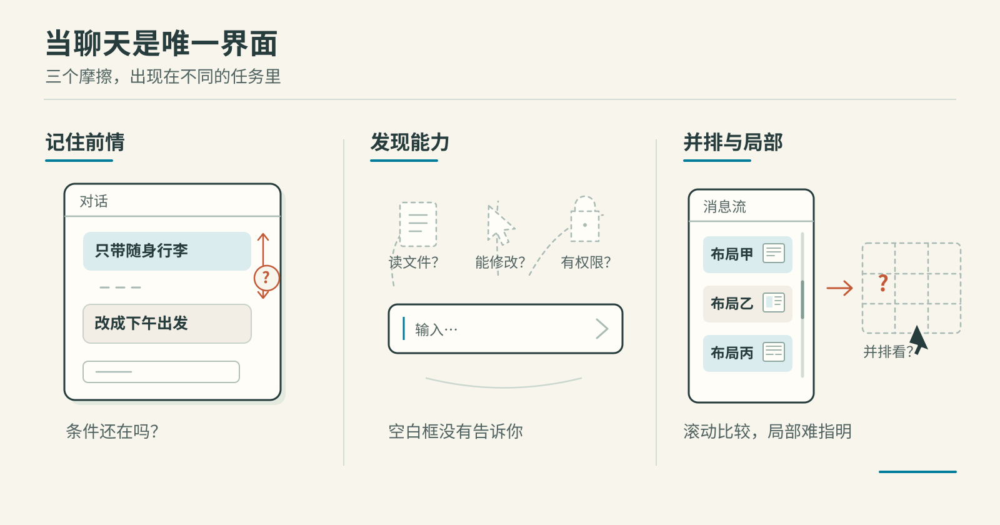

# 为什么聊天框不是终极形态

一个输入框，一串对话气泡，这是今天绝大多数人和人工智能打交道的方式。对话式界面（Conversational User Interface，CUI）几乎没有学习门槛，它把大型语言模型（LLM）送到了数亿人手里。但如果把它当成人机交互的终点，那是一个严重的误判。

这个系列要论证的始终是一件事：**聊天框不是 AI 交互的终极形态。** 它是一种数字时代的拟物化设计：把人们最熟悉的“发消息”借来，套在一项全新的技术上。这层外衣让 AI 迅速普及，也让用户不得不把空间的、多维的意图，一句一句翻译成线性的文字。

2025 年 9 月写这个系列的第一版时，我说聊天框是“终将逝去的过渡阶段”。14 个月后，这句话需要改一半：**正在过渡掉的，不是聊天本身，而是“聊天作为唯一的界面”。** 这一篇先讲聊天框为什么会赢、它付出了什么代价，再讲它在 2026 年变成了什么样子。

---

## 一、聊天框为什么会赢

### 能力早就有了，缺的是入口

2020 年 6 月，OpenAI 就开放了 GPT-3 的接口：给一段文字，模型接着往下写。同年的论文已经证明，这种规模的模型只看几个例子就能完成许多任务。但此后两年多，普通人几乎感受不到它的存在，因为要用它，得先申请接口、写代码。

2022 年 11 月 30 日，ChatGPT 以免费网页的形式上线。底层的机制没有本质变化，依然是“读一段带角色标签的上下文，接着往下写”，只是外面包了一层你一句、我一句的聊天气泡。按 OpenAI 的说法，它上线五天用户就超过一百万；到 2025 年 7 月，每周活跃用户超过 7 亿，每周收发约 180 亿条消息（厂商数据）。

模型能力和产品界面共同影响普及；界面决定了普通人能否方便地接触这些能力，以及怎样使用它们。

### 两股力量：拟物的外衣，工程的捷径

**第一，它借用了人人都会的隐喻。** 新媒介出现时，设计者常借旧事物的样子给人搭一个心理脚手架。初代 iPhone 把日历画成带缝线的皮革记事本，把书架画成木纹书柜，让第一次摸到触屏的人一眼看懂。到 2013 年 iOS 7 改用扁平设计时，大家已经学会了触屏的操作方式，这根拐杖才被拿掉。聊天框就是大模型时代的皮面记事本：每个人每天都在即时通讯软件里打字、发送、等回复，把 AI 放进同样的框里，不需要任何说明书。

**第二，它是最省事的工程方案。** 模型的输入和输出都是文字，那么最快上线的产品，自然是“你打字提问，它回一段文字”。不用设计新的控件，不用为不同的业务场景定制界面，套一层对话循环就能发布。

### 它恰好装下了大部分日常需求

2025 年 9 月，OpenAI 与哈佛、杜克大学的研究者发表了《How People Use ChatGPT》。研究从约 110 万段消费端会话中各抽取一条消息进行分类；估计 2025 年 6 月约 73% 的消费端消息与工作无关。按主题看，实用指导、寻找信息和写作合计约占 77%。这是对所研究产品和抽样范围的估计，不能直接代表所有 AI 产品的使用情况。

问一个建议，查一件事，润色一封邮件，在想法还模糊的时候聊几句理清头绪，这些本来就是一问一答的事。**大多数人用 AI 做的，正好是聊天最擅长的事。** 2025 年版的我对这一点估计不足。

### 这层外衣也有副作用

1966 年，MIT 的约瑟夫·魏岑鲍姆（Joseph Weizenbaum）写了一个模仿心理咨询师的程序 ELIZA，主要靠模式匹配和文字转换生成回应。一则常被归于魏岑鲍姆 1976 年著作《计算机能力与人类理性》的回忆说，秘书明知道程序的机制，交谈后仍请魏岑鲍姆离开房间，好独自继续对话。本次未取得该书全文，故事细节尚不能独立核实。后人用“ELIZA 效应”描述一种相关现象：哪怕理智上知道对面是程序，人也可能把流畅的回应当成理解。

今天的模型比 ELIZA 流畅得多，这种投射也更难察觉。2025 年 3 月，OpenAI 与 MIT 媒体实验室发表的研究发现，情感化使用集中在少数用户身上；较高强度的使用与部分较差的自评指标相关，原因和长期影响仍需研究（这是相关关系，不是因果）。同年 4 月，OpenAI 撤回了一次 GPT-4o 更新，理由是新版本过分迎合用户。**对话的形式本身就在塑造人对系统的期待。** 第 04 篇会讲到，这种期待一旦碰上模型的错误，代价有多大。

---

## 二、它的代价：三个结构性的问题

聊天框的问题不在于它“不好用”，而在于它被当成了唯一的界面。一旦任务超出简单问答，三个问题就会暴露出来，第 04 篇会逐一展开：

1. **它让人凭回忆，而不是凭识别。** 图形界面把选项摆在眼前让人挑；聊天框要人自己想起来、说出来，还要自己记住前面说过什么。
2. **它不告诉你自己能做什么。** 一个空白的输入框，除了“这里可以打字”，没有任何关于能力、权限和风险的提示。
3. **它是一条线。** 消息一条接一条往上滚，而比较、规划、精修这类工作，需要把东西并排摊开。

*图：Codex 根据本文绘制的概念示意，界面和内容均为虚构。*

这三条，是工程便利优先于人的需要留下的痕迹。

---

## 三、2026 年的样子：聊天框旁边长出了什么

站在 2026 年底回看，有三件事值得放在一起看。

**第一，聊天周围长出了更多工作空间。** 从 2024 年 Anthropic 的 Artifacts、OpenAI 的 Canvas，到 2025–2026 年的 OpenAI Apps SDK、Google 在 Gemini 中实验的生成式界面、MCP Apps 和 Cursor Canvas，产品开始提供更多文档编辑区、图示或可交互组件。它们的形式不完全相同：有的在聊天旁边，有的嵌在对话中，有的出现在编辑器里；并非每一种都是模型现场生成的完整工作台。共同之处是，输入框不必独自承担所有交互。

**第二，独立界面和对话之间的分工仍在调整。** 2026 年 5 月，OpenAI 宣布 GPT-5.5 Instant 和 Thinking 不再提供独立 Canvas，写作和代码改由回复中的区块支持；6 月宣布 Pulse 逐步退出，建议用户改用定时任务；截至 10 月，官方帮助页也已说明 Atlas 退役，但该页面没有说明首次宣布退役的具体日期，也不足以证明原有功能怎样迁移。厂商公布了部分调整方向，但没有完整解释每项调整的原因。这些例子说明产品形态仍在变化，不能据此断言所有功能最终都会回到聊天框。

**第三，最古老的界面回来了。** 2025 年最有影响的一批 AI 产品跑在终端里：Claude Code、Codex CLI、Gemini CLI。终端以线性的文字输入和输出为主；自然语言让用户不必事先记住每条命令的语法，但仍需要理解任务、检查结果并了解工具的能力边界。

第三件事看起来和本系列的论点相反：有经验的用户也会选择线性的终端界面。第 04 篇会专门讨论这个反例：在许多编程任务里，终端对话之外还有代码、文件、改动记录和审阅工具。它提醒我们，**对话可以与其他工作对象和工具配合，而不必由一种界面替代所有其他形式。**

对于一些把对话、可见工作对象和控制结合起来的 AI 产品，可以借一辆车来比喻：

- **聊天框是方向盘**：用语言说目标、改方向、把它拉回正轨；
- **工作台是仪表盘**：需要时把状态摊开，让人看清楚，也让人直接指着某一处改；
- **确认、权限和回退是刹车**：在动作造成后果之前提供拦截，并在支持回退的范围内撤销改动；已发送的邮件等外部后果不一定能撤回。

没有人会说方向盘是“终将逝去的过渡阶段”。2025 年版的错误，是把方向盘当成了整辆车，然后宣布它要被淘汰。

但这辆车本身也还是过渡形态。今天的“方向盘 + 仪表盘 + 刹车”，很多时候只是在聊天框旁边拼上一块侧栏、再加几个确认弹窗：人要盯着的东西反而更多了。离一种真正从容的交互，还有很长的路。

---

## 四、三条思想线索

那么，下一代交互会从哪里长出来？这个系列借三条思想线索来回答。它们各自回答界面问题的一个侧面。

**第一条，马克·韦泽（Mark Weiser）：技术应该待在哪里？**
1991 年，施乐帕洛阿尔托研究中心（PARC）的韦泽在《科学美国人》上提出“普适计算”（Ubiquitous Computing）；1995 年，他和约翰·西利·布朗（John Seely Brown）把背后的设计态度称为“平静技术”（Calm Technology）。韦泽认为，最深远的技术会“消失”，融进日常生活，平时待在注意力的边缘，需要时才走到中心。按这个标准，一个不断索取注意力的对话框，离成熟还远。（第 02 篇）

**第二条，本·施奈德曼（Ben Shneiderman）与史蒂夫·乔布斯（Steve Jobs）：人应该怎样操作？**
1983 年，施奈德曼提出“直接操控”（Direct Manipulation）：对象一直看得见，动作快而可逆，结果立刻反馈。2007 年，乔布斯和初代 iPhone 把它从鼠标搬到了亿万人的手指上。按这个标准，在聊天框里一遍遍重写提示词、等一个不可预测的结果，是一次倒退。（第 03 篇）

**第三条，利克莱德（J. C. R. Licklider）与托马斯·谢里丹（Thomas B. Sheridan）：机器替人干活时，界面该让人做什么？**
1960 年，利克莱德在《人机共生》里提出，目标、标准和评价应当留在人这一边。谢里丹在遥控机械臂、核电站和飞机驾驶舱的研究里，建立了“监督控制”（Supervisory Control）理论：人不再亲手操作每一个部件，而是计划、交代、监视、干预、复盘。2025 年版没有充分讨论这一条。随着更多 AI 产品尝试在浏览器、终端和其他软件里替人做事，界面除了要帮助人把话说清楚，还要帮助人看清它做了什么。（第 06 篇）

三条线索指向同一个问题：**人和 AI 之间的界面应当长什么样。** 接下来的五篇依次展开：

- 第 02 篇重读韦泽，并检验“主动的 AI”和“走出屏幕”在 2026 年走到了哪一步；
- 第 03 篇梳理直接操控的谱系，看它怎样在生成式 AI 里变成了“指着说”；
- 第 04 篇拆解聊天框的三个结构性问题，以及围绕它长出来的工作台；
- 第 05 篇提出“实体虚拟化”的总体框架和五项设计原则，并用 2026 年的证据逐条校准；
- 第 06 篇讨论 AI 替人干活之后，聊天框之外还需要什么样的界面。

目标始终没变：不是造一个更会陪人聊天的仿制品，而是做出真正放大人的能力、尊重人的注意力的工具和环境。

---

## 相关页面

- **本篇资料附录**：参考文献与资料索引
- **导言**：`AI交互设计2026版00：导言`
- **下一篇**：`AI交互设计2026版02：重读韦泽的普适计算`
- **2025 初版对应原文**：053-AI交互设计01-为什么聊天框不是终极形态

## 参考与来源

- **插图资料**：本篇原创图的制作说明见插图说明。
- **普及过程与使用数据**
  - OpenAI, *OpenAI API*（2020-06-11）：https://web.archive.org/web/20200611200915id_/https://openai.com/blog/openai-api/
  - Brown 等, *Language Models are Few-Shot Learners*（2020）：https://arxiv.org/abs/2005.14165
  - OpenAI, *Introducing ChatGPT*（2022-11-30）；Sam Altman 关于五天用户破百万的帖文（2022-12-05，厂商）：https://x.com/sama/status/1599668808285028353
  - Chatterji, Cunningham, Deming 等, *How People Use ChatGPT*, NBER Working Paper（2025-09）：https://cdn.openai.com/pdf/a253471f-8260-40c6-a2cc-aa93fe9f142e/economic-research-chatgpt-usage-paper.pdf ；OpenAI 官方解读（周活 7 亿等，厂商）：https://openai.com/index/how-people-are-using-chatgpt/
- **拟人化与 ELIZA 效应**
  - Weizenbaum, *ELIZA—A Computer Program for the Study of Natural Language Communication Between Man and Machine*, CACM（1966）
  - Weizenbaum, *Computer Power and Human Reason: From Judgment to Calculation*（1976，引言）
  - Phang 等（OpenAI 与 MIT Media Lab）, *Investigating Affective Use and Emotional Well-being on ChatGPT*（2025-03）
  - OpenAI, *Sycophancy in GPT-4o: What happened and what we're doing about it*（2025-04-29）
- **2025–2026 的界面变化**
  - Anthropic Artifacts（2024-06）；OpenAI, *Introducing canvas*（2024-10-03）与 *ChatGPT release notes*（2026-05-28，GPT-5.5 Instant 和 Thinking 不再提供独立 Canvas）
  - OpenAI Apps SDK（2025-10）；Google Research, *Generative UI*（2025-11-18）：https://research.google/blog/generative-ui-a-rich-custom-visual-interactive-user-experience-for-any-prompt/ ；MCP 官方博客 *MCP Apps*（2026-01-26）：https://blog.modelcontextprotocol.io/posts/2026-01-26-mcp-apps/ ；Cursor Canvas 文档：https://cursor.com/docs/agent/tools/canvas
  - OpenAI, [*ChatGPT release notes*](https://help.openai.com/en/articles/6825453-chatgpt-release-notes)（2026-05-28，特定 GPT-5.5 模型不提供 Canvas；2026-06-17，Pulse 逐步退出）；[*ChatGPT Atlas retirement*](https://help.openai.com/en/articles/20001371-chatgpt-atlas-retirement)（截至 2026-10 的页面已载明退役，首次公告日期尚未核实）
  - Claude Code（2025-02 研究预览）、Codex CLI（2025-04）、Gemini CLI（2025-06）首发说明
- **三条思想线索**
  - Mark Weiser, *The Computer for the 21st Century*, Scientific American（1991-09）
  - Mark Weiser & John Seely Brown, *Designing Calm Technology*（1995-12）：https://calmtech.com/papers/designing-calm-technology
  - Ben Shneiderman, *Direct Manipulation: A Step Beyond Programming Languages*, IEEE Computer（1983）
  - J. C. R. Licklider, *Man-Computer Symbiosis*, IRE Transactions on Human Factors in Electronics（1960-03）
  - Thomas B. Sheridan, *Humans and Automation: System Design and Research Issues*（Wiley, 2002）