# **前言**

本文旨在记录并整合构建一个基于硬件的 AI 聊天机器人的完整流程。从硬件选购到服务端、设备端的配置，我们将一步步完成这个有趣的项目。

从成本、功能、配置便利性等角度考虑，选择的软硬件如下：

- 硬件： **AtomS3R-M12 火山引擎语音视觉套件（淘宝官网售价￥199，闲鱼价格更低）**
- 软件：**火山引擎的实时对话式 AI场景方案（个人使用￥0）**

整体方案图如下（图片来自[火山引擎实时对话式AI方案集成（嵌入式硬件）文档](https://www.volcengine.com/docs/6348/1438400)）：

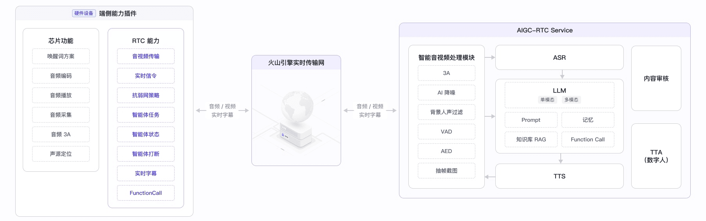


‍

# **一、 硬件准备**

本项目我们选用的是 **AtomS3R-M12 火山引擎语音视觉套件**。

- **核心硬件**：

  - **AtomS3R-M12**：一个高性能的图像采集单元，内置 ESP32-S3 主控、300万像素广角摄像头和九轴传感器，具备边缘计算能力。
  - **Atomic Echo Base**：一个 AI 智能语音处理底座，集成了音频解码、麦克风和扬声器，支持语音唤醒与交互。
- 官网介绍：

  - **AtomS3R-M12 火山引擎语音视觉套件** 是一款将 M5Stack 硬件与火山引擎云端 AIGC 一站式解决方案深度融合的物联网视觉＋语音开发套件，核心由两部分组成，高性能图像采集单元 **AtomS3R‑M12** 与 AI 智能语音处理底座 **Atomic Echo Base**。
  - AtomS3R‑M12 提供 3MP 级别的广角视频采集与边缘计算能力，扩展接口适配多种传感。Atomic Echo Base 集成高保真音频解码，麦克风与扬声器驱动，支持全双工语音唤醒，识别与交互。
  - 火山引擎 RTC 与 M5Stack 合作内置一站式解决方案，通过在芯片侧集成先进的音频处理（包括自动唤醒功能、音频 3A 等），在云侧深度整合大模型，语音识别，语音合成，Function calling，知识库等技术，快速实现用户与硬件之间流畅，自然，真人感觉的实时通话功能，广泛应用于智能安防，远程教育，智能家居和工业监测，AI 机器人等领域。


这个套件基于目前主流的ESP32-S3-PICO-1-N8R8 主控的芯片进行设计，图片中的那个单独的小平板一样的东西是 8Ω @ 1W 扬声器，这套硬件作为产品原型肯定是绰绰有余了。

# **二、 配置安装**

## 0. 仅体验

如果只是想体验一下AI语音对话聊天的话（WIFI热点无法改变、无法配置TTS、ASR、LLM等组件），可以按照[AtomS3R-M12 火山引擎语音助手配置说明](https://docs.m5stack.com/zh_CN/guide/realtime/volcengine/atomic_echo_base)，不需要任何额外的配置。

## 1. 服务端配置

服务端是整个项目的大脑，负责处理语音识别（ASR）、大语言模型（LLM）调用和语音合成（TTS）等复杂任务。

### 1.1 火山引擎注册

在开始之前，你需要注册并登录火山引擎的[控制台](https://console.volcengine.com/)，然后按照下面的步骤开通并获取相关的参数。

### 1.2 开通LLM模型

（需要开通Doubao-Seed-1.6-flash模型）

进入[火山引擎开通模型页面](https://console.volcengine.com/ark/region:ark+cn-beijing/openManagement?LLM=%7B%7D&OpenModelVisible=false)，点击右上角的“一键开通所有模型”，按照提示操作即可。

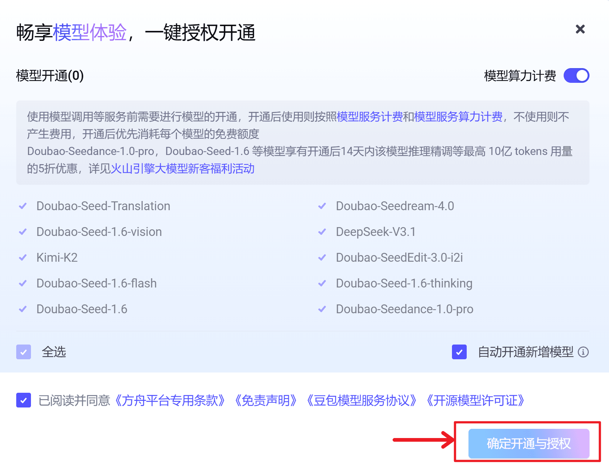


### 1.3 跑通实时对话式AI Demo

点击 [跑通实时对话式 AI Demo](https://console.volcengine.com/rtc/aigc/run)  这个链接，开通实时音视频功能，然后进入到下面的界面，按照提示一步一步开通并配置相关的参数。

#### 1.3.1 加入RTC房间


点击“加入RTC房间”

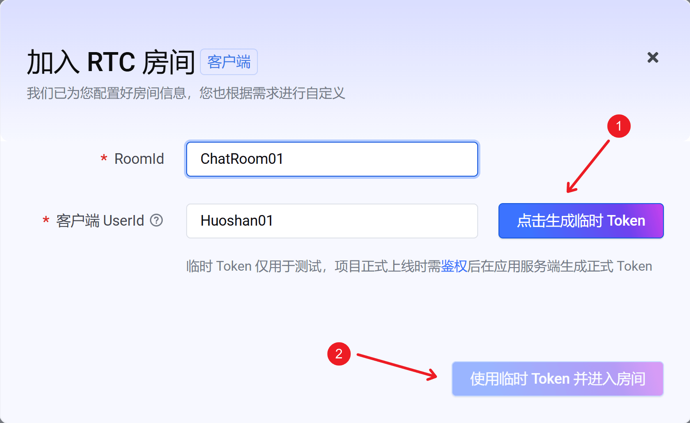


按照提示进行操作。

然后进入到了一个新界面，会弹出一个摄像头使用的提醒，选择“访问该网站时允许”：

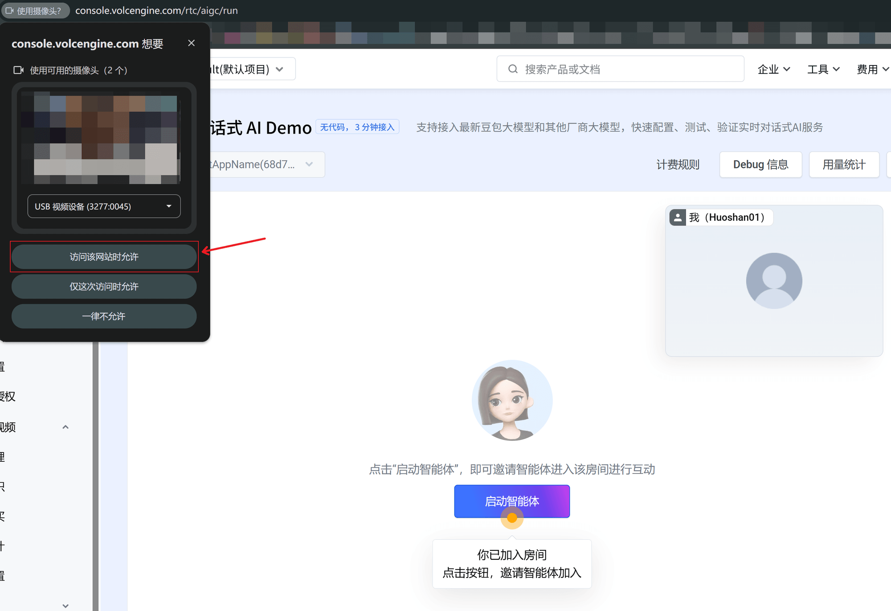


然后会弹出一个麦克风使用提醒，选择“访问该网站时允许”

‍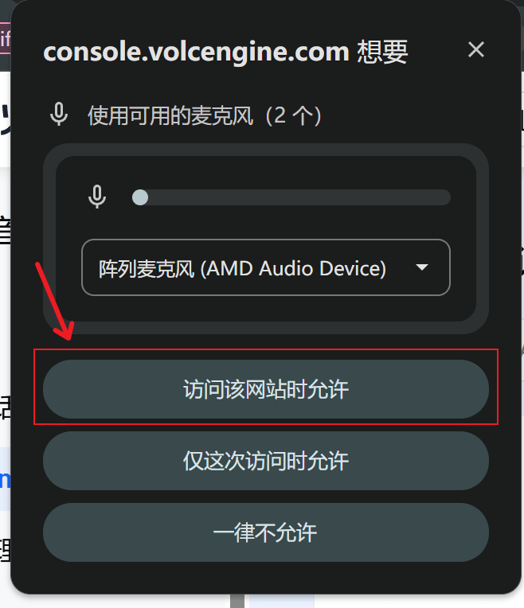


然后可以看到界面上多了一个小摄像头的界面


#### 1.3.2 智能体任务配置

点击“启动智能体”，开始配置各个模块“智能体任务配置”这一步，直接默认选项，点击“配置完成，下一步”

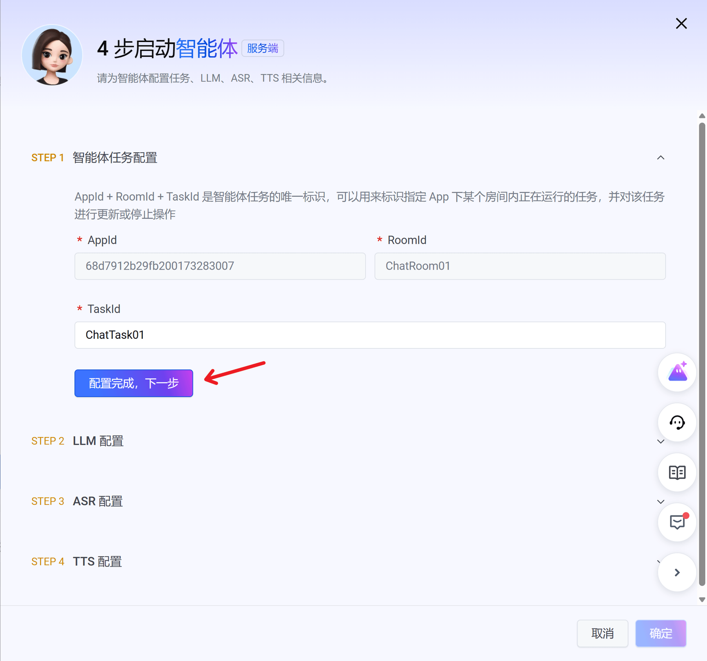


#### 1.3.3 LLM配置

“LLM配置”这一步，默认选择“方舟大模型”

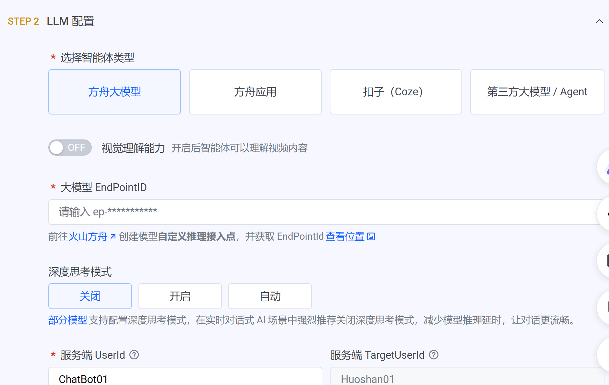


‍

然后大模型 EndPointID这里，点击下面的“火山方舟”链接，添加自定义推理接入

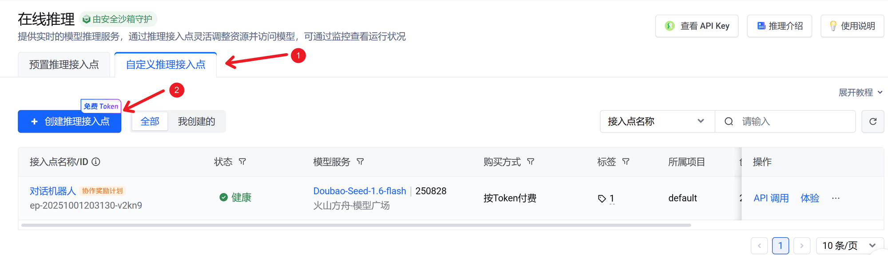

‍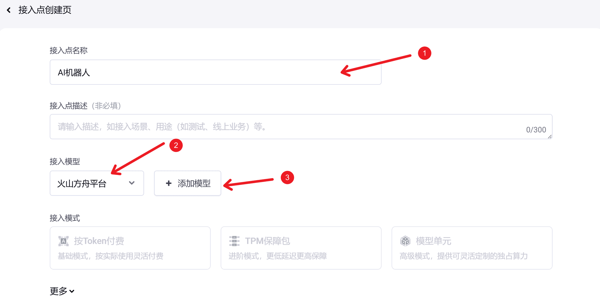


模型选择这里，建议选择Doubao-Seed-1.6-flash，这款模型在速度和性能上取得了比较好的平衡。选好了之后，点击“确定”
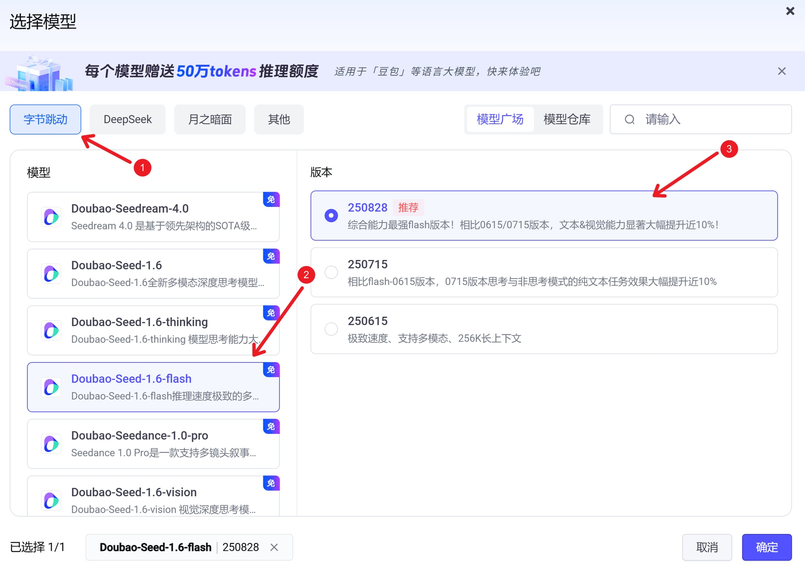


接入模式这里选择“按Token付费”，其他按照默认设置即可
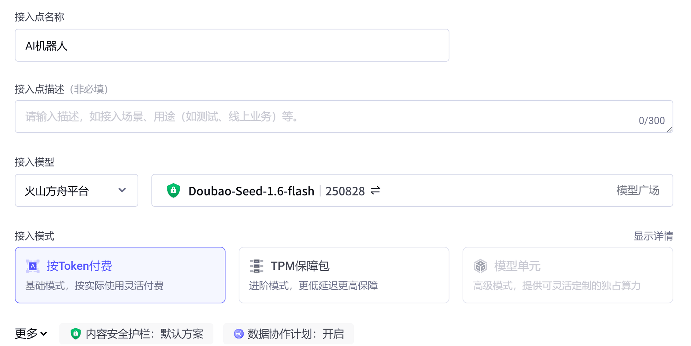


最后点击右下角的“创建并接入”按钮。


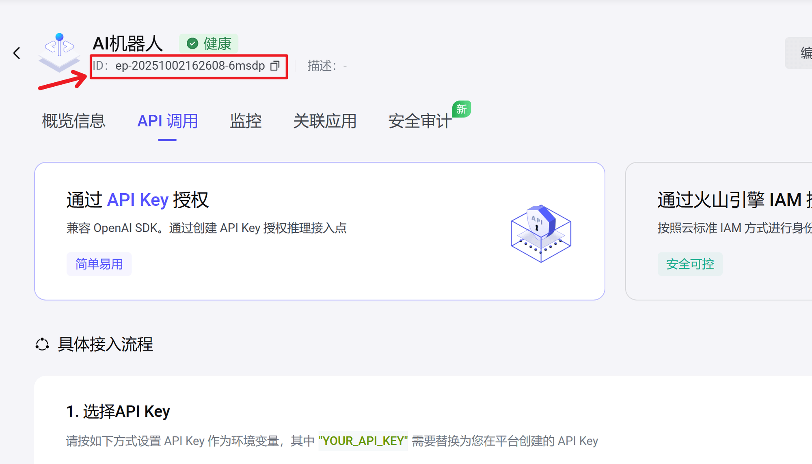

在新出现的页面上，就可以看到LLM的接入点的ID，也就是图中箭头所指的地方，复制这个ID

‍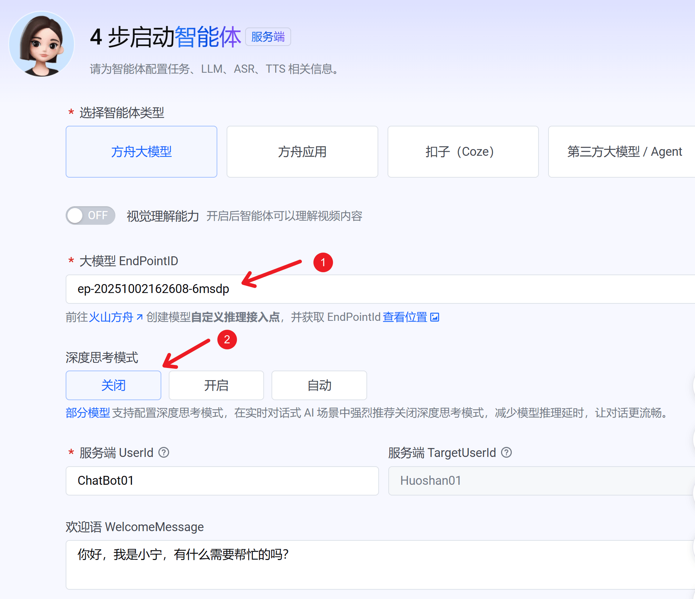


回到刚才的配置智能体服务端的页面，填入大模型EndPointID，然后关闭深度思考模式，其他的保持默认即可。然后页面往下滚动，选择“配置完成，下一步”

#### 1.3.4 后续步骤也类似，这里不再赘述，遇到需要开通的服务按照说明开通即可，大部分都有试用额度。

#### 1.3.5 启用硬件场景配置

 点击 实时音视频功能配置 链接，开启`启用硬件场景配置`

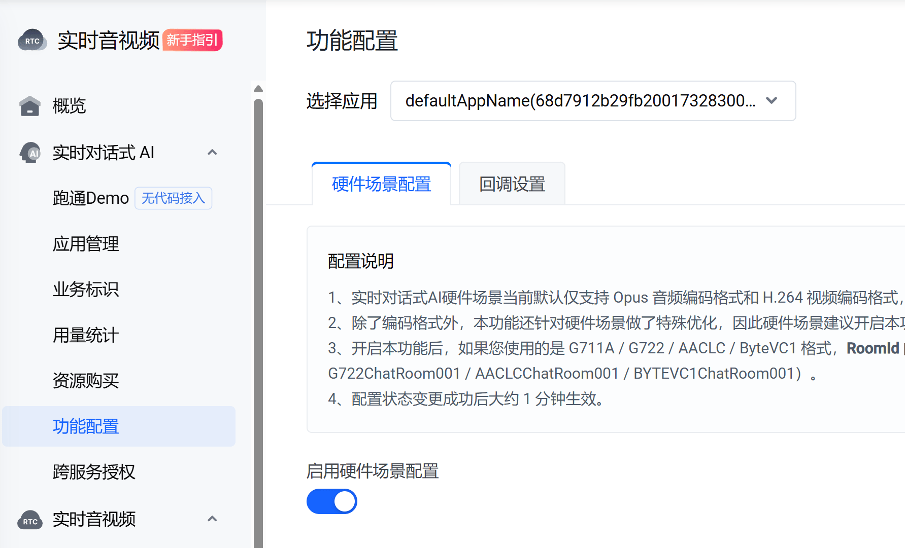


### 1.4 运行服务端程序

服务端示例程序基于 Python：

1. **克隆项目代码**：

    ```bash
    git clone https://github.com/volcengine/rtc-aigc-embedded-demo.git
    ```
2. **安装依赖**：

    ```bash
    pip3 install requests
    ```
3. **配置参数**：  
    进入 `rtc-aigc-embedded-demo/server/src`​ 目录，编辑 `RtcAigcConfig.py`​ 文件。按照要求将 `AK/SK`​, `APPID`​, `Token`​ 等参数填入到对应的变量中。（**需要获取的参数和1.1中的略有不同，按照python文件中的注释操作即可**）

    ```python
    # 示例
    SK = "你的SK"
    AK = "你的AK"
    CONFIG_RTC_APPID = "你的RTC_APPID"
    # ... 其他参数
    PORT = 8080 # 服务端口，可按需修改
    ```
4. **启动服务**：  
    在 `rtc-aigc-embedded-demo/server/src` 目录下，运行以下命令：

    ```bash
    python3 RtcAigcService.py
    ```

    当服务成功启动后，它将开始监听设定的端口（例如8080），等待硬件设备连接。

**注意：如果是windows系统，则需要单独在防火墙上开通对应的端口访问权限，具体操作如下：**

> - 打开「控制面板」→「系统和安全」→「Windows Defender 防火墙」→「高级设置」→「入站规则」
> - 搜索是否有针对 `8080` 端口的规则：
>
>   - 如果没有，​**手动创建规则**：
>
>     - 右键「入站规则」→「新建规则」→「端口」→「TCP」→「特定本地端口」输入 `8000`
>     - 选择「允许连接」→ 勾选「专用」「公用」（根据你的网络环境选择，不确定的话都勾选）
>     - 命名为「允许 8000 端口 TCP 连接」并保存
>   - 如果已有规则，检查规则是否「启用」，且动作是「允许」（而非「阻止」）

## 2. 设备端配置

设备端负责音频的采集、唤醒和播放，并将采集到的音频流通过 RTC 服务发送到服务端。

### 2.1. 搭建乐鑫（Espressif）开发环境

我们使用乐鑫的 ESP-IDF 作为开发平台。 

1. **安装编译工具（windows可跳过）** ：

    ```bash
    brew install cmake ninja dfu-util
    ```
2. **克隆并配置 ADF 框架**：  
    请注意，项目依赖特定版本的 ADF (ESP-ADF) 和 IDF (ESP-IDF)。

    ```bash
    # 克隆乐鑫ADF框架
    git clone https://github.com/espressif/esp-adf.git
    cd esp-adf
    # 切换到指定的版本
    git reset --hard eca11f20e56f9b5321b714da4305e123672d92a9
    # 同步子模块
    git submodule update --init --recursive
    ```
3. **安装开发依赖**：

    ```bash
    ./install.sh esp32s3  # windows系统（需要是命令提示符界面，而不是PowerShell）的命令为 install.bat
    ```
4. **设置环境变量**（**注意：每次打开新的终端窗口都需要执行此命令**）：

    ```bash
    . ./export.sh # windows系统（需要是命令提示符界面，而不是PowerShell）的命令为 export.bat
    ```

**2.2. 下载并编译固件**

1. **下载示例工程**：  
    将 `rtc-aigc-embedded-demo`​ 项目克隆到 ADF 的 `examples`​ 目录下。（**在windows的命令提示符环境下，下面的$ADF_PATH需要替换为%ADF_PATH%** ）

    ```bash
    cd $ADF_PATH/examples
    git clone https://github.com/volcengine/rtc-aigc-embedded-demo.git
    ```
2. **应用补丁**：

    ```bash
    cd $ADF_PATH
    git apply $ADF_PATH/examples/rtc-aigc-embedded-demo/0001-feat-disable-volc-esp-libs.patch
    ```
3. **配置项目**：  
    进入设备端代码目录：

    ```bash
    cd $ADF_PATH/examples/rtc-aigc-embedded-demo/client/espressif/esp32s3_demo
    ```

    - 设置编译目标平台为 `esp32s3`：

      ```bash
      idf.py set-target esp32s3
      ```
    - 打开图形化配置菜单：

      ```bash
      idf.py menuconfig
      ```

      - 在 `Example Configuration`​ 中，填入你的 **RTC APPID** 和 **服务端地址及端口号**（例如 `<你的服务器IP>:8080`）。
      - 在 `Audio HAL`​ -> `Audio board`​ 中，选择开发板型号为 `M5STACK-ATOMS3R`。
      - 保存并退出（先按S保存，按空格确认，然后按Q退出）。

‍

4. **编译固件**：

    ```bash
    idf.py build
    ```

**2.3. 烧录与运行**

1. **连接设备**：使用 USB 线将 AtomS3R-M12 连接到电脑。请长按复位键约2秒，直到绿色LED亮起，设备进入下载模式。
2. **烧录固件**：

    ```bash
    idf.py flash
    ```
    烧录完成后，需要按一下硬件上的Reset-Pin重启硬件或者拔插Type-C口
3. **监控日志**：  
    烧录完成后，可以通过 monitor 查看设备运行日志和调试信息。

    ```bash
    idf.py monitor
    ```
4. **Wi-Fi 配网**：

    - 设备启动后会创建一个名为 `VolcRTC-XXXXXX` 的 Wi-Fi 热点。
    - 使用手机连接该热点。
    - 打开手机浏览器，访问 `http://<内部服务器>`。
    - 在页面中输入你希望设备连接的 Wi-Fi 名称和密码，并提交。
    - 设备会自动连接你配置的 Wi-Fi，并开始与服务端通信。

**注意：这里的wifi需要和之前的服务端在同一个局域网内，这样才可以访问到。**

# **三、 效果演示**

完成以上所有步骤后，AI 聊天机器人就准备就绪了，然后开始与它进行实时对话。


# **四、 总结**

这两天折腾下来，感觉虽然AI硬件的生态相比过去有了很大的进步（像esp32这种Soc就节省了大量的调试安装时间，著名的AI开源硬件小智AI也是基于这颗SoC开发的），但是依旧对于普通人甚至软件开发者存在一定的门槛。文档说明不全（有些问题是我加技术群查聊天记录才找到解决办法的），涉及到的技术栈众多（软硬件都有涉及，任意环节出现问题都有可能导致AI硬件没法正常工作），这些问题还有很大的进步空间。

从另一个角度看，这两年涌现出的各种AI硬件产品，也从侧面反映出了门槛确实已经降了不少了，最后大家拼的还是想法和创意，以及对于AI的理解。

接下来，我将会探索AI硬件结合LLM Agent方案，实践我之前文章中提到的“实体虚拟化”的AI交互。


