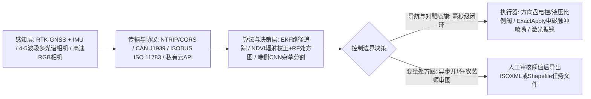
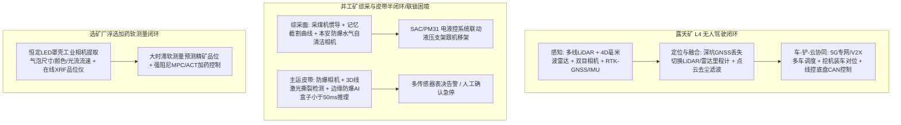

# 第一产业与资源工程 AI 应用深度调研：技术栈、开闭环边界与深水区踩坑尸检

> [!IMPORTANT] 调研口径与工程底线声明
> 本报告严格遵循“四有四禁”原则，聚焦 **大田精准种植与农机、设施农业与采摘分选、规模化畜牧与渔林、智能矿山（露天/井工/选矿）、建筑工程施工与预制构件（PC）** 的一线生产与工程执行现场，**彻底剔除**农产品电商直播、品牌营销、泛行政办公等非生产环节。所有案例、硬件协议与量化水位均基于 2024–2026 年公开工程实践与产业财报交叉核验。

---

## 全局洞察：非结构化自然战场与“冷热分化”的落地现实

第一产业与资源工程（矿山、建筑）是人工智能物理落地**环境最恶劣、数据最脏、容错与 ROI 约束最撕裂**的战场。与恒温恒湿的离散制造无尘车间截然不同，田间、猪舍、深海、矿坑与建筑毛坯房直面风霜雨雪、高氨气强腐蚀、浑浊水体、极寒扬尘以及高频动态改变的非结构化几何地形。

2024–2026 年的工程实证表明，该领域呈现出极端的**“感知替代加快、物理执行受阻、商业模式被迫重构”**特征：

| 产业板块 | 典型高成熟度跑通工位 | 仍卡在试点炼狱/低ROI的工位 | 主流控制边界 | 商业模式收敛趋势 |
| :--- | :--- | :--- | :--- | :--- |
| **大田种植与农机** | 北斗 RTK 直线/曲线自动辅助驾驶、大田行作物对靶除草（See & Spray） | 多光谱处方图全自动闭环变量施药、碎片化散户地块无人作业 | 导航与对靶喷施为**局部闭环**；处方图生成与农艺决策为**异步开环** | 硬件买断转向**按英亩软件订阅+节药担保**，大疆/极飞走封闭飞防生态 |
| **设施农业与采摘分选** | 玻璃温室 MPC 环控、双孢蘑菇架式采摘、产后 Vis-NIR/SWIR 糖度与内部病害分选 | 草莓/番茄/苹果非结构化枝叶遮挡下的高节拍全自动采摘 | 温室环控为**前馈闭环**；采摘多遇遮挡**主动跳过**；分选为**编码器硬触发闭环** | 第三方纯卖采摘机大批倒闭或被并购，转向 **RaaS** 或**垂直农场一体化** |
| **规模化畜牧与渔林** | 通道式 3D 视觉估重、猪舍咳嗽声纹预警、溶氧联动水产投饵、林区无人机松材线虫普查 | 老旧散养猪舍全自动“一畜一策”精准饲喂改造、高浊度淡水池塘水下视觉精准计数 | 疫病预警为**纯开环报警**；精喂站与溶氧断料为**局部闭环** | 牧原全自研降本、扬翔/影子生态输出、水产算“料比（FCR）省料账” |
| **智能矿山** | 露天矿规模化无安全员无人矿卡编队、井下辅助巡检与皮带异常识别报警 | 井工综采工作面复杂断层煤岩全自动识别、主运皮带AI直接联锁急停、高波动原矿全自动浮选加药 | 露天矿卡为**车-铲-云L4闭环+远程兜底**；井下综采与浮选主靠**记忆/软测量+人工微调半闭环** | 从卖软硬件改装转向 **TaaS（按吨公里承运）** 与 **ATaaS** 规模化摊薄重资产 |
| **建筑施工与预制** | BIM 自动放线喷印（大面积洁净楼板）、室内抹灰/涂装单品机器人出海 | 复杂图纸全自动结算算量、毛坯杂乱楼层实测实量机器人全自动巡检、塔吊高空AI安全带抓拍 | 算量与安全视觉为**纯开环人工复核**；放线/抹灰为**强前置约束执行闭环** | 博智林由全品类烧钱扩张转向收缩，蔚建/领鹊靠**高人力成本海外市场**跑通 ROI |

---

## 一、 大田精准种植与农机作业（含林木病虫害与表型延伸）

### 1.1 具体业务工位与真实技术栈拆解

1. **工位 A：北斗 RTK + 视觉融合农机自动驾驶**
   - **传感器与执行硬件**：双天线 RTK-GNSS（北斗/GPS/GLONASS，动态定位精度 $\pm 2.5\text{ cm}$）、9 轴工业级 IMU 惯性测量单元、转向角传感器（电位计/霍尔编码器）、电动方向盘（后装改装主流）或电控液压比例阀（前装大马力拖拉机主流）；辅助避障增加单/双目相机或毫米波雷达。
   - **协议与通信**：差分信号通过 NTRIP 协议经 4G/5G CORS 基站网络或 UHF 便携电台传输（RTCM 3.x 报文）；车辆底层执行通过 **CAN 总线（SAE J1939）** 与农具通用标准 **ISOBUS（ISO 11783）** 通信，实现拖拉机与播种机/施肥机的任务控制器（TC）联动。
   - **核心算法**：GNSS+IMU 紧耦合扩展卡尔曼滤波（EKF）解决姿态与航向估计；路径规划采用 AB 直线、曲线及地头 Dubins/Reeds-Shepp 掉头算法，结合 Pure Pursuit（纯追踪）或 MPC 控制方向盘转角，边缘计算单元控制周期通常在 20ms–50ms（20–50Hz）。
2. **工位 B：无人机多光谱遥感处方图与变量施药/施肥（VRA）**
   - **传感器与数据源**：低空巡田无人机搭载 RGB + 绿/红/红边/近红外（G/R/RedEdge/NIR）4~5 通道多光谱相机，顶部集成太阳光辐射传感器（Sunlight Sensor）用于实时记录环境光辐照度变化。
   - **软件流与协议**：航测影像导入地面/云端拼图引擎生成反射率正射影像，计算 NDVI（归一化植被指数）、NDRE（红边归一化指数，抗高密冠层饱和），结合土壤采样 EC/氮磷钾网格，利用随机森林（RF）、XGBoost 或线性分级规则生成网格化变量处方图，导出为 **Shapefile（.shp）** 或 **ISOXML（`TASKDATA.XML`）** 格式。
   - **执行层控制**：无人机飞控（如大疆农业平台/极飞 SuperX 5）或拖拉机 ISOBUS 终端读取坐标网格，实时调节播撒绞龙转速/仓口开度（如大疆 T50/T60 的“绞龙供料+离心甩盘”）或螺旋变量送料器电机转速（如极飞 P150 的“睿播”系统）。
3. **工位 C：行间实时机器视觉精准对靶除草与激光灭草**
   - **传感器与算力**：喷药机/除草机横梁（Boom）密集挂载全局快门高清 RGB/近红外工业相机（每隔 0.5–1 米一台）及高功率 LED 主动补光灯（压制日光阴影），车载部署多颗工业级嵌入式 GPU 算力盒（如多路 NVIDIA Jetson/Orin 阵列，IP67/IP69K 防尘防水与抗震封装）。
   - **算法与执行闭环**：在 `24 km/h`（15 mph）作业时速下，系统每秒扫描超过 `2,100` 平方英尺（约 `195 m²/s`）的农田，边缘侧轻量化语义分割/目标检测模型在 **10–30ms** 内完成 **Green-on-Green（绿中辨绿：行作物幼苗 vs 杂草）** 或 **Green-on-Brown（裸地/休耕地除草）** 分类，直接通过高带宽车载以太网/CAN 触发单个 **ExactApply 电磁脉冲喷嘴** 局部点喷，或驱动振镜控制高功率二极管激光器（LaserWeeder）毫秒级热击毁杂草分生组织。
4. **延伸工位 D：林业病虫害监测、森林防火与商业化育种高通量表型**
   - **智慧林业（松材线虫与防火）**：针对《全国松材线虫病疫情防控五年攻坚行动计划（2021–2025）》重点场景，采用“卫星大尺度初筛 + 无人机多光谱/高分辨率 RGB 局部详查 + 地面 App 核查”的“天空地”一体化架构，利用 YOLO/U-Net/DenseNet 模型对松树早期变色木与针叶光谱纹理异常进行精准分割（特定小班示范准确率宣称达 98%+）；同时叠加机载 **LiDAR 点云** 测算树高、胸径、郁闭度及林下可燃物载量，配合热红外相机 24 小时巡检烟火隐患。
   - **商业化辅助育种表型**：利用无人机多光谱/热红外与地面轨道式高通量表型平台，批量提取育种小区内作物的株高、冠层温度、抗旱指数与持绿期（Stay-green），结合基因组选择（GS）模型加快抗逆品种筛选周期。

### 1.2 国内外具名企业真实落地水位与指标对比

| 企业与系统 | 核心技术路线 | 实证作业指标与商业化规模（2024–2026） | 硬件/软件成本与收费模式 | 明确的工程适用边界 |
| :--- | :--- | :--- | :--- | :--- |
| **John Deere See & Spray Ultimate / Premium** | 横梁多相机阵列 + 边缘 GPU 实时视觉 + ExactApply 独立脉冲喷嘴 | **2024 年**：覆盖超 100 万英亩，省药 800 万加仑，平均省除草剂 **59%**； **2025 年**：扩至超 **500 万英亩**，非残留除草剂平均省药近 **50%**（约 3,100 万加仑），田间净节省约 **$12.63–$35+/英亩**；最高作业时速 **15 mph（约 24 km/h）** | **Premium 后装套件**（适配 2018 年后机型）约 **$2.5 万–$10 万+**；软件按亩订阅（约 **$5/英亩** 或年度包干），附带“节药担保” | 主要仅支持玉米、大豆、棉花及休耕地；杂草呈“地毯式”高密度连片发生时退化为全喷，节省归零 |
| **Carbon Robotics LaserWeeder G2** | 高精度视觉 + 多 GPU 算力 + 高功率二氧化碳/二极管激光阵物理点杀 | 单次除草 **100% 物理替代化学除草剂**；Western Growers 实测人工除草账单平均节省 **$450+/英亩**；实际蔬菜田平均作业效率仅约 **0.89 英亩/小时**（配置差异范围 0.4–6 英亩/小时，日均 15–20 英亩） | 整机售价 **$50.1 万–$100 万+ 美元**，另收年度软件与远程运维订阅费 | **吞吐量极低**，无法用于小麦/玉米/大豆等低毛利大田作物，仅在洋葱、生菜等高价值蔬菜有机农场算得过账 |
| **Ecorobotix ARA 超精准点喷机** | 6 米折叠遮光罩横梁 + AI 植物级识别 + 超微距精准电磁阀点喷 | 除草剂/植保药剂减量 **80%–95%**；作业时速可达 **7.2 km/h**，处理能力 **2.8–4 公顷/小时（7–10 英亩/小时）**，典型回本周期 **2–4 年** | 拖拉机悬挂机具整套约 **$30 万美元**（欧洲区部分配置约 **£10.6 万**）+ 按作物模型收取年度算法订阅费 | 依赖已商业化训练的特定作物杂草算法包（Niche 作物缺模型则无法启闭）；仍受农药飘移法规与抗药性制约 |
| **大疆农业 Mavic 3M + 大疆智图 + T50/T60** | 多光谱航测（4光谱+太阳传感器）→ 云端 NDVI 处方图 → 无人机变量播撒/喷洒 | T60 喷洒载重 50kg / 播撒载重 **60kg**，配前后相控阵雷达与双目避障，绞龙供料+离心甩盘自动调仓口开度 | 消费级/商用级低门槛硬件买断，依托大疆智慧农业平台免费/低价生成基础处方图 | **生态高度封闭**：底层飞控与播撒总线加密，禁止第三方传感器直连硬件控制，第三方 ISOBUS/ISOXML 处方图导入兼容性差 |
| **极飞科技 P150 / P150 Pro** | SuperX 5 Ultra 飞控 + 4D 成像雷达 + 螺旋变量送料器（睿播） | 最大工业载重达 **80kg**，支持螺旋送料器电机无级变速控制下料量，兼容地面水肥传感器云端联动 | 硬件买断为主，绑定 XAG 农服 App 生态 | 同等存在核心总线与硬件加密校验，严禁私自改装大流量泵或外挂非认证传感器实时控制飞行 |
| **华测导航（NX系列）/ 联适 / 中联重科 / 北大荒** | 北斗地基/星基 RTK（$\pm 2.5\text{ cm}$）+ 方向盘/液压电控 + 北大荒“一张图” | 主粮插秧、播种、收割作业直行交接误差控制在厘米级，在黑龙江北大荒等大型国营农场实现大规模连片无人化示范 | 后装自动驾驶套件已降至万元人民币级别；前装智能农机整机集成 | 国内拖拉机厂与农机具 **ISOBUS（ISO 11783）协议普及与兼容残缺**，换农具常导致接口与控制协议打架 |

### 1.3 开环与闭环边界：为什么“全自动处方图闭环”在大田依然罕见？

- **农机轨迹追踪与对靶喷施（已跑通真实毫秒级闭环）**：方向盘转角纠偏与 ExactApply 对靶开阀属于“物理几何/瞬时图像分类 $\rightarrow$ 单一执行器动作”的强确定性链路，即便算法偶发单点误判，物理后果仅是漏杀几株草或路径偏差几厘米，系统可立即依靠下一帧闭环修正。
- **多光谱巡田 $\rightarrow$ 变量施肥/施药（卡在“异步离线 + 农艺师人工核验”开环）**：全行业超过 90% 的变量处方图作业仍是**“今天航测拼图 $\rightarrow$ 农艺师看图划定阈值 $\rightarrow$ 明天导出任务文件上车/上机作业”**。原因在于 **NDVI 与真实缺氮/病虫害之间不存在单射关系**：低 NDVI 可能是土壤积水反光、出苗期裸土比例高、甚至被飘过的云影（Cloud Shadow）污染所致。若不经过人工现场踏勘（Ground-truthing）而直接将遥感指数闭环映射为肥料/除草剂剂量，一次误判足以烧苗或造成大面积减产。

### 1.4 深水区踩坑复盘

1. **物理与环境坑**：
   - **RTK 丢星与树荫盲区**：林带边、山地丘陵及高秆玉米后期遮挡卫星信号，一旦 RTK 固定解退化为浮点解或丢星，农机发生急刹停机或突然大幅偏航压苗。
   - **扬尘糊镜与光照突变**：收割/喷药机后方浓密尘土数小时即可糊住横梁相机镜头（John Deere 不得不在 MY27 机型专门前移并升级前置防尘镜头）；清晨/黄昏低光照、强烈逆光及云影过境会击穿多光谱与视觉分类阈值；高密度冠层下枝叶遮挡导致底层杂草漏喷，以及植被封垄后 NDVI 产生光学饱和失真。
   - **空间分辨率错配**：Mavic 3M 航测地面采样距离（GSD）高达 2–5cm，但无人机离心播撒幅宽 7–10 米且存在风场飘移与开关阀延迟，超精细像素级处方图在物理执行层完全无法兑现，纯属算力浪费。
2. **脏数据与协议割裂坑**：
   - 国内农机行业 **ISOBUS（ISO 11783）协议落地极其割裂**，雷沃、东方红、中联重科主机与华测、联适后装终端、第三方变量施肥机线束与通讯协议互不兼容；而大疆、极飞则出于飞行安全与商业壁垒采取全封闭加密总线，农场自购的土壤墒情站数据往往只能通过“人工下载 Excel $\rightarrow$ 肉眼定区间 $\rightarrow$ 手动导入处方图”的方式流转，形成严重的 IT/OT 孤岛。
3. **模型失效与农艺断层坑**：
   - 农艺模型极度依赖地域品种与气候（东北黑土大豆与中原冬小麦的 NDVI 需肥曲线截然不同），没有经过本地标定板（Reflectance Panel）辐射校正的“相对 NDVI”无法跨周、跨季复用；绝大多数中小合作社与家庭农场缺乏既懂 GIS 又懂植物营养学的复合人才，买来的软件沦为只看RGB航拍照片的摆设。
4. **ROI 算不过账的死结**：
   - **小地块碎片化陷阱**：中国南方与丘陵地带耕地破碎（户均数亩至数十亩），拖拉机在田间作业 **30%–40% 的时间花在地头掉头**，加装万元级自动驾驶后“省不了工时也省不了油”，仅靠省药几块钱根本算不过账。
   - **重资产对靶装备的高门槛**：Carbon Robotics 动辄百万美元售价与不到 1 英亩/小时的龟速，注定与低毛利主粮绝缘。
5. **一线农机手与组织抵触坑**：
   - 跨区作业老机手普遍按**亩数计件领薪**，在系统掉头慢、报错频繁或怀疑“系统比我开得慢”时，会直接关掉自动驾驶手动超车；此外，许多自动驾驶终端绑定了政府农机作业补贴的面积核查与轨迹监控功能，部分机手出于“怕被老板/监管实时盯梢、留存虚报面积证据”的抵触心理，甚至出现故意拔天线、干扰定位的消极对抗。

---

## 二、 设施农业、果蔬采摘机器人与产后无损分选

### 2.1 具体业务工位与真实技术栈拆解

1. **工位 A：智能玻璃温室多变量环控（MPC + 植物生理模型）**
   - **传感器与执行网络**：温室内外温湿度、PAR 光合有效辐射传感器、非色散红外 $\text{CO}_2$ 探头（如 Vaisala）、基质含水量/EC（电导率）/pH 传感器；底层现场仪表多通过 **Modbus RTU/TCP** 接入过程计算机/PLC，上层与云端分析平台及 SCADA 通过 **OPC UA** 互联；执行器覆盖天窗开合电机、内外遮阳保温幕布、湿帘风机、燃气锅炉供暖混水阀、高压迷雾与水肥一体机。
   - **控制算法**：以“植物赋能（Plant Empowerment）”与 24 小时水分/能量平衡模型为机理底座，叠加气象预报前馈的 **模型预测控制（MPC）**，在多输入多输出（MIMO）约束下提前 2–6 小时协同调节天窗、幕布与加热阀，兼顾作物蒸腾最佳 VPD（饱和水汽压差）与燃气/电耗极小化。
2. **工位 B：温室/果园采摘机器人**
   - **感知与定位**：RGB-D 深度相机（主动双目结构光/ToF，配合局部补光）或轻量级 LiDAR 构建局部三维点云，利用实例分割网络（如 Mask R-CNN / YOLOv8-Seg）识别成熟果实与果梗，通过点云配准估算果实 **6DoF 位姿** 与碰撞障碍物（主蔓/铁丝/邻果）八叉树地图。
   - **执行机构与规划**：多自由度机械臂（SCARA 或 6 轴协作臂）配合异步双臂运动规划（MoveIt/定制逆解），末端采用硅胶柔性气动夹爪、负压吸盘或热切/旋转剪断机构，避免压伤浆果表皮。
3. **工位 C：产后高速无损糖度与内部霉变分选线**
   - **多模态检测通道**：水果在“自由果托/滚轮杯”上高速旋转通过检测暗箱，同步经过：**① 多视角高分辨率 RGB 相机**（识别果径、着色率、表皮机械伤/果锈）；**② Vis-NIR / 短波红外 SWIR（400–1000nm / 900–1700nm）透射与漫反射光谱仪或线扫高光谱相机**（利用 $\text{O-H}$、$\text{C-H}$ 化学键在特定波段的吸收特征，无损反演可溶性固形物 Brix 糖度、酸度以及内部水心病、褐变、苹果霉心病）。
   - **硬实时同步与剔除**：输送链驱动轴安装高精度增量旋转编码器（Encoder），PLC 根据编码器脉冲精确追踪每只果杯的微秒级位置，边缘工控机（PLS 偏最小二乘 / 1D-CNN 光谱分类模型 + 2D-CNN 视觉模型）必须在 **几十毫秒内** 完成判定，硬触发对应分选出口的气动吹气阀或机械翻盘摆臂完成分级落果。

### 2.2 国内外具名企业落地水位与“淘汰赛”复盘

| 细分领域 | 具名企业与系统 | 真实技术水位与商业化现况（2024–2026） |
| :--- | :--- | :--- |
| **温室环控** | **Priva（Plantonomy）** **Hoogendoorn（IIVO）** | 全球连栋温室绝对双寡头，通过云端生物逻辑（BioLogics）与 OPC UA/Modbus 打通自动环控；但软件体系按欧洲温带海洋性气候与能源价格标定，对外部国产机器人的开放接口相对封闭 |
| **温室环控** | **中国“寿光型”智能玻璃温室** | 针对荷兰纯文洛型玻璃温室在中国北方“冬烧气太贵”、南方“夏太热度夏难”的水土不服，寿光研发出大斜面、外保温、正压通风、余热回收与空气能热泵等 120 余项专利体系，综合能耗较纯荷兰模式**降低 50% 以上** |
| **草莓/番茄采摘** | **Octinion（Rubion 草莓）** **MetoMotion（GRoW 番茄）** | Rubion 单果采摘节拍约 **3.0–4.0 秒/颗**，可采可达果成功率 **70%–87%**（遇碰撞风险主动跳过）；MetoMotion GRoW 双臂平均 **8.6 秒/颗**，温室试验成功率约 **85%**。两者均远慢于熟练人工（1.5–2.5 秒/颗） |
| **垂直农场与整合** | **Tortuga AgTech → Oishii** **Abundant Robotics（已破产）** | Tortuga 曾部署约 150 台草莓/葡萄双臂机队，但纯第三方卖机器给传统农场难跨过改造与现金流坎，最终在 **2025 年初被高端垂直草莓农场 Oishii 收购**（内部消化硬件成本于高溢价 Omakase 草莓）；苹果真空采摘鼻祖 **Abundant Robotics** 早在 **2021 年中即因非结构化果园单位经济账破产而清算关闭**；**Tevel**（系留飞行采摘机）与 **FFRobotics** 被迫转向半自动人机协同与果园数据服务 |
| **唯一近盈利采摘赛道** | **4AG Robotics** （双孢蘑菇采摘） | 避开枝叶遮挡与阳光乱入，聚焦全黑/恒温可控、标准荷兰架式（Dutch-rack）种植的蘑菇。利用定制高速 SCARA 机械臂配合推-拉-扭视觉序列，成功率达 **80%–90%+**，帮助菇场砍掉高达 **50%** 采摘人工，2025 年完成 **2,900 万美元（4,000 万加元）B 轮融资**并出现订单排期供不应求 |
| **产后无损分选** | **TOMRA（Spectrim + LUCAi）** **江西绿萌（Reemoon / Infruscan）** | TOMRA 以高稳定光学/SWIR 传感器与 LUCAi 深度学习领跑全球高端产线；国产龙头**绿萌 Reemoon** 联合中科院微电子所等推出近红外全透射内部检测（Infruscan），综合外观分选精确度宣称约 **98%**、称重误差 $\pm 1.0\text{ g}$，已实现柑橘、苹果糖度及霉心病商业化下沉 |

### 2.3 开环与闭环边界剖析

- **温室环控**：属于**“有约束条件的前馈闭环”**——在传感器正常且气象波动温和时，MPC 算法直接闭环驱动天窗、遮阳网与供暖阀门；但在遭遇极端寒潮/台风或发现电导率/湿度曲线异常跳变时，资深温室经理必须强行切回手动规则兜底，防止低温冻害或高温灼苗。
- **采摘机器人**：属于**“保守型局部闭环（遇不确定性即放弃）”**——一旦枝叶遮挡导致末端执行器碰撞置信度升高，系统必须放弃该果实留待人工补采（二遍工），绝不允许盲目强行抓扯折断主蔓。
- **产后无损分选**：属于**“严苛硬实时闭环”**——编码器追踪到执行器吹气剔除必须在毫秒级自动完成，但背后的**“光学预测阈值与标定曲线”必须由质检员开环校准维护**。

### 2.4 深水区踩坑复盘

1. **物理与环境坑**：
   - **文洛式玻璃温室的“中国能耗黑洞”**：纯正荷兰玻璃温室照搬到中国华北/东北，冬季维持 18–20℃ 的天然气加温费足以吞噬全部番茄卖菜利润；夏季强太阳辐射下湿帘降温失效，温室被迫空置 2–3 个月“歇夏”。
   - **传感器高湿腐蚀与漂移**：温室长期 80%–95% 高湿凝露与叶面喷药，导致相对湿度探头、pH 玻璃电极与 EC 电极极易结垢或电解质中毒漂移；若不定期用标准缓冲液和参考仪标定，“Garbage in, garbage out”的 MPC 会把温室推向持续错误温湿区间。
   - **果体曲率与表面水珠**：分选线果体呈椭球形，果柄、花萼与清洗后残留水珠会引发近红外漫反射光程剧变（水峰在 970nm、1450nm 吸收极强），直接淹没糖度微弱吸收信号；输送皮带轻微打滑或轴承磨损造成的**速度校准误差（Speed Calibration Error）**，会导致气阀提前或滞后开闭，瞬间演变为大批“错踢好果或漏放烂果”。
2. **模型失效与标定灾难坑**：
   - **近红外模型的“跨季跨产地失效”**：同一品种的苹果，换了产区、土壤、采摘成熟度或冷库贮藏温度，其光谱响应就会发生系统性漂移。新果季上市时，分选厂不得不切碎成百上千颗好果做破坏性折光仪测糖实验，重新拟合 PLS/CNN 定标模型；至于**真正的高光谱成像（HSI）**，因图谱合一数据量极其庞大，在每秒分选十余颗果子的高速线上难以做到低成本实时边缘推理，绝大多数商业线仍妥协采用“多光谱/点阵近红外”。
   - **枝叶遮挡（Occlusion）死结**：草莓、番茄果实天然藏于叶片之下且成熟期参差不齐，采摘机器人漏采率常高达 15%–30%，往往倒逼上游农业把普通大棚改造成极其昂贵的立体高架水培+人工疏叶，否则机器人根本找不到果梗。
3. **ROI 死结**：
   - 采摘机器人集成了 3D 视觉、多轴臂、底盘与定制抓手，单机成本动辄数十万至百万元人民币，且水果采收具有强烈的**季节性（一年仅工作 2–4 个月）**，其余大半年的资产折旧与维护成本无人买单。这也是为什么“四季恒温无休的蘑菇工厂（4AG）”与“高端垂直农场内部自用（Oishii 收购 Tortuga）”能活下来，而露天/普通大棚纯卖采摘机的创企纷纷折戟。
4. **组织与农艺断层坑**：
   - 引入一套 Priva 或 Hoogendoorn 系统需要极高水平的温室植物生理职业经理人看懂生长曲线并与算法协同；国内大量园区“硬件花了几千万建顶级温室，却按传统菜农习惯开天窗”，最后干脆把昂贵的环控计算机锁定在固定手动档位当普通开关使。

---

## 三、 规模化畜牧与智慧水产养殖

### 3.1 具体业务工位与真实技术栈拆解

1. **工位 A：生猪/奶牛/家禽非接触式 3D 视觉估重与体况评分（BCS）**
   - **传感器与防护**：猪牛俯拍通道上方或挤奶机器人/分群门上方安装工业级 ToF 深度相机或双目结构光相机，外加耐酸碱防腐密封罩、防起雾加热视窗或定时气吹除尘嘴；家禽（肉鸡/蛋鸡）平养与笼养禽舍顶部安装广角深度相机/高清 IPC 或滑轨式巡检视觉云盒；边缘侧采用带 NPU 的工业计算盒做本地点云过滤与推理。
   - **算法栈**：猪牛端通过深度图去噪与前景分割（剥离栏杆、料槽及粘连猪体）$\rightarrow$ 姿态矫正（去除抬头/弓背/行进扭曲畸变）$\rightarrow$ 提取体长/体高/胸围/臀部背膘曲率体积 $\rightarrow$ PointNet++ 或深度图回归模型输出体重估算或 1–5 分制 BCS 评分。家禽端则结合轮廓分割与三维体态重建计算群体平均体重与均匀度（指导最佳出栏日龄），并通过地面/笼内全时段姿态与运动轨迹扫描实现**死鸡/瘫痪弱鸡分钟级死淘网格定位**，防相互啄癖扩散疫情。
2. **工位 B：畜禽舍咳嗽/喘息声纹疫病提前预警**
   - **硬件部署**：猪舍或密闭禽舍顶部每单元挂装 IP67/IP68 防腐 MEMS 麦克风阵列或声学传感器节点，通过 LoRa/有线以太网 PoE 传至本地边缘网关。
   - **算法栈**：端侧带通滤波与谱减法降噪（分离机械刮粪、负压风机低频轰鸣与金属碰撞声）$\rightarrow$ 提取 MFCC（梅尔频率倒谱系数）/ Log-Mel 频谱图 $\rightarrow$ CNN/ResNet 声纹分类模型统计单位小时异常咳嗽、喘气与打喷嚏频次 $\rightarrow$ 在生猪端合成呼吸道健康指数（如 ReHS）提前至多 **5 天**预警，在肉鸡/蛋鸡端较精神萎靡、甩头等临床症状提前 **2–3 天**触发异常告警。
3. **工位 C：“一畜一策” RFID + AI 动态营养精准饲喂闭环**
   - **感知与身份绑定**：耳标采用 **134.2kHz 低频（LF）RFID**（穿透动物体液与潮湿环境抗衰减优于高频，配合防碰撞算法）或 UHF 超高频耳标；电子母猪饲喂站（ESF）与智能精喂仪集成称重/余料传感器与超声波液位检测。
   - **算法与执行**：云端/边缘平台融合猪只胎次、妊娠日龄、背膘/3D估重与历史采食量，基于 NRC 营养需求曲线与机器学习采食预测生成单头日粮配方（水料比、精料克数），通过 **RS-485 / Modbus RTU / CAN** 驱动步进电机、螺旋下料绞龙与定量给水电磁阀。
4. **工位 D：智慧水产声呐/水下视觉智能投饵**
   - **感知与环境联动**：深远海网箱与高密度对虾高位池/工厂化车间部署**主动水声声呐（Echosounder，回声测深探测鱼群上浮抢食聚散与残饵下沉回波）**或**水下双目立体视觉相机**（配备特定波长激光/窄带补光与图像去散射增强），并串联在线荧光法溶解氧（DO）、水温、pH 与盐度传感器（RS-485/LoRa）。
   - **控制链路**：水声行为/摄食活跃度模型计算鱼群实时饱食度，变频调节气动或离心抛料机下料速率；**硬安全联锁**——一旦溶氧低于安全阈值，PLC 强制启动增氧机并**立即切断投饵机下料**。

### 3.2 国内外具名企业真实落地水位对比

| 领域与企业 | 技术模式与代表产品 | 实证工程水位与量化指标（2024–2026） | 架构定位与局限边界 |
| :--- | :--- | :--- | :--- |
| **牧原股份** | **全栈自研派**：自研无臭猪舍环控、轨道巡检、精准饲喂系统与“养猪大模型” | 打通采食、环控与生长数据降低各场区成本方差；标杆猪场 PSY 达 **32.6 头**，育肥日增重稳定约 **800g** | 高度绑定牧原标准化百万级产能楼房/平房猪舍体系，重资本自研门槛非中小猪场可复制 |
| **扬翔股份 + 影子科技** | **生态输出派**：影子科技（脱胎于扬翔）FPF 未来猪场平台、AIFeeder 3.0 精喂坊、3D 视觉估重 | 3D 通道估重生产环境误差稳定在 **3%–5%**；精准饲喂助母猪 PSY 提升 **6%–8%**、育肥节粮约 **5%**；截至 2024–2025 年 FPF 已服务数十万头能繁母猪与数百万头肉猪 | 在楼房智能化猪场效果显著，但在空间狭窄、网络电力薄弱的存量散户老猪舍落地成本高 |
| **温氏股份 / 圣农发展** | **开放协同与全产业链禽猪智控**：温氏联合拉塞特推进猪舍轨道巡检与 AI 兽医，并在黄羽鸡舍推进 IoT/环控；圣农推进白羽肉鸡从种鸡到商品代的环控、精准饲喂与 AI 防疫 | 温氏试点种猪场实现 PSY 提升 **1.2 头**、基础母猪死亡率下降 **20%**；禽舍轨道/视觉死淘巡检将死鸡上报滞后从“天”压至“分钟级” | 面对“公司+农户”庞大的分布散点家庭农场，硬件全覆盖与运维响应半径仍受考验；禽类高密度拥挤下个体遮挡极严重，视觉估重仅能输出群体均值与离散度 |
| **德康集团 / 农信互联（猪小智）** | **精细育种与平台改造派**：德康聚焦种猪性能测定与精细营养转换；农信互联以“猪小智”软硬一体方案赋能大中型猪场防非、繁育与精准饲喂 | 服务大规模商品猪场与育种场，通过数据测定与精准给料压缩料肉比波动以穿越猪价薄利周期 | 在建筑规格参差不齐的非标存量场推进全套硬件改造时，强弱电施工与传感器运维依然构成主要落地阻力 |
| **Boehringer Ingelheim SoundTalks** | 猪舍连续声纹采集 + AI 咳嗽频次分析 + 呼吸道健康指数（ReHS） | 经多场临床验证，比人工肉眼发现猪群呼吸道疾病（支原体、蓝耳 PRRSV 等）**最多提前 5 天**发出黄/红预警 | 只能定位到猪舍“单元/栏位”而无法精确定位到个体病猪；强机械噪音易引发波动 |
| **DeLaval BCS 相机 / Cainthus（Cargill 合作）** | DeLaval 为分群门上方 3D 深度背膘评分；Cainthus 为牛舍多目 CCTV 面部与采食视觉 | DeLaval BCS 与资深专家评分相关性达 **$r \approx 0.78 - 0.85$**，在正常体况（BCS 3.00–3.75）最准 | DeLaval 在极瘦（<3.00）或过肥（>3.75）极端值出现明显压缩失真；Cainthus 因全牛舍高密 CCTV 布线 CAPEX 过高，2024–2025 年独立商业扩张明显退潮 |
| **CageEye / Aquabyte / 粤海·通威·海大** | 挪威 CageEye（主动声呐测饱食）、Aquabyte（水下双目估算体重与海虱）；国内对虾/大黄鱼智能投饵机+溶氧联动 | 国内标准化对虾/大黄鱼养殖应用智能投饵与水质精控后，**饵料系数（FCR）优化 0.1–0.2**，用药减少约 **15%**，日常人工体力减约 30%，高密度场通常 **1–2 个养殖周期（约 1 年）回本** | 淡水土塘高浊度令水下视觉彻底失效；海上网箱与高位池几周内的生物附着大幅衰减光学与声学精度 |

### 3.3 开环与闭环边界剖析

- **声纹疫病预警（严守纯开环红线）**：SoundTalks 及国内猪场声纹系统**只允许推送告警至场长/兽医 App，严禁自动联动饮水加药或自动隔离**。原因极其现实：一是猪舍环境音误报可能引发整栏无端用药；二是兽药涉及休药期、剂量耐药性与非洲猪瘟等烈性疫病上报红线，必须由兽医进行口腔液采样/鼻拭子 PCR 检测及临床触诊后人工确认。
- **水产溶氧安全联锁 vs 饱食投喂**：**“低溶氧断料 + 自动开启增氧机”已是成熟全闭环**（因为缺氧状态下鱼虾拒食，继续撒料必导致沉底腐败氨氮暴涨泛池）；但依托声呐/视觉反推饱食度的“动态减料控制”，在多数养殖场仍带有人工上限保护（即算法只能在人工设定的日投喂区间内上下微调），防止模型误判导致整池鱼虾长期吃不饱。
- **母猪精准饲喂（条件闭环）**：在装备了电子饲喂站（ESF）与防串读通道的新建现代化母猪舍，RFID 识别 $\rightarrow$ 按怀孕阶段下发水料比已实现**单头闭环**；但在大栏混养育肥猪舍，个体抢食与耳标脱落使得“一畜一策”无法成立，仍是以“群体平均视觉估重 $\rightarrow$ 料线分栏总量调控”为主。

### 3.4 深水区踩坑复盘

1. **物理与极端腐蚀坑（硬件“慢性谋杀”）**：
   - **猪舍高氨气/硫化氢与糊镜**：高密度猪舍充满强腐蚀性氨气、硫化氢、水雾与饲料粉尘，普通工业相机外壳与未镀膜电路板数月即锈蚀短路；3D 镜头和拾音孔往往 **3–7 天就被飞虫粪污和饲料灰糊死**，若无高压气吹或密封隔离设计，模型直接瘫痪。
   - **水产水下生物附着（Biofouling）与高浑浊“致盲”**：中国绝大部分淡水池塘及高位池对虾养殖水体富含有机质与微藻，能见度常常 **不足 20 厘米**，昂贵的水下立体视觉相机下水即“失明”（被迫退化为水面波纹视觉或声呐探测）；而在海区大黄鱼网箱，仅浸泡 **2–3 周**，水下镜头与声呐换能器表面即长满藤壶、藻类和生物膜，声波发射衰减严重、画面全黑，雇佣潜水员定期刮洗的运维费甚至高过节省的饲料钱。
2. **脏数据与采集姿势坑**：
   - **群体拥挤与打架粘连**：无论是通道猪只扎堆抢跑，还是奶牛在 DeLaval 通道门处扭曲转身、毛发厚重冬毛或沾染粪块，都会导致 3D 点云空洞或畸变，大量采集帧被系统丢弃为“Failed Images”；对虾底栖且半透明、大黄鱼高速群游互相遮挡（Occlusion），令水下视觉计数误差飙升。
   - **RFID 漏读与串读**：低频耳标在金属栏杆电磁屏蔽或猪只啃咬损坏脱落时失效；湿拌料管路堵塞或料塔“结拱”，导致后端系统记录“已完成下料”，实则料槽空无一物，脏数据直接污染后续生长模型。
3. **ROI 算不过账与老旧场改造死结**：
   - 存量老旧猪舍普遍缺少弱电强电桥架与稳定网络，猪栏高度与宽窄各异导致俯拍相机视场角（FOV）不够，全面布线与换装智能料线的单栏改造成本动辄数千至上万元；在 2024–2025 年生猪养殖进入“薄利精耕与周期波动”时期，中小猪场对重资产 CAPEX 极度敏感，“装一套顶一万斤猪肉利润，不如多雇一个饲养员靠桶喂”。
4. **养殖户组织人性博弈**：
   - 资深水产养殖户和猪场场长普遍存在**“宁可多喂浪费，绝不敢让鱼/猪饿着掉膘”**的保守心理。一旦 AI 建议某天减料 15%，若遇到换季生长稍微放缓，一线饲养员立刻把锅甩给“算法饿坏了鱼猪”，直接切回人工定时大水大料投喂。

---

## 四、 智能矿山（露天矿、井工矿综采与选矿加工）

### 4.1 具体业务工位与真实技术栈拆解

1. **工位 A：露天矿无人驾驶矿卡编队**
   - **传感与防恶劣环境技术栈**：车规防震多线机械/半固态激光雷达（LiDAR） + **4D 毫米波雷达**（具备高度维点云能力，核心解决普通激光雷达在露天矿扬尘、暴雪、浓雾下的激光散射“鬼点”致盲问题）+ 工业级耐高低温相机 + 高精度组合惯导（IMU）与 RTK-GNSS。
   - **定位与通信**：依赖高精动态地图（每日由采剥面推土机/无人机更新）与 5G 矿区专网 V2X；当矿卡驶入深凹采坑高陡边坡导致 GNSS 失锁（GPS-Denied）时，迅速切换为多传感器融合 SLAM / 雷达里程计短时航迹推算。
   - **线控与云端调度**：通过硬线与 CAN 总线深度改造燃油/纯电/混动宽体车或刚性矿卡的转向、电缓速器、AEB 制动与举升系统；云控平台（车-地-云协同）负责主干道防拥堵调度、破碎站排土场边界安全控制及挖机/电铲（车-铲协同）动态停靠对位。
2. **工位 B：井工矿智能综采工作面（液压支架跟机与煤岩识别）**
   - **装备底座**：采煤机（配备高精度光纤/MEMS **惯性导航系统**找直与滚筒高度/牵引速度编码器）+ 刮板输送机 + 液压支架（天地玛珂 SAC 型或 PM31 **电液控制系统**，国内正加速向基于华为**矿鸿 MinerOS** 的分布式支架控制器演进）+ 本安防爆高压水气自清洁摄像仪。
   - **控制逻辑**：采煤机首刀由老司机手动示范割煤并记录三维截割轨迹，后续开启**记忆截割**自动复现；尝试融合截割电机电流、滚筒振动声发射、红外热成像、自然伽马射线及矿山大模型视觉尝试实时判断煤岩分界面；液压支架依据采煤机惯导位置执行**滞后自动跟机移架、推溜与喷雾**。
3. **工位 C：井下主运皮带撕裂与异物视觉联锁**
   - **感知与算力**：本安型防爆高速线阵/面阵相机 + 激光结构光（3D 线激光测皮带下方横向/纵向撕裂深度与煤流体积），直连防爆边缘 AI 盒子（NPU 端侧推理时延 **< 50ms**），跑轻量化目标检测与分割模型（YOLOv8 等）识别锚杆、槽钢、木料、超大块矸石及皮带跑偏纵向撕裂。
4. **工位 D：选矿厂浮选泡沫视觉 + AI 智能加药**
   - **感知与软测量**：浮选槽上方安装防爆工业相机 + **封闭式恒定 LED 环形光源罩壳**（彻底隔绝车间自然光及水汽照明波动），实时提取泡沫静态特征（气泡直径分布、Lab 颜色亮度、坍塌纹理）与动态特征（光流法测泡沫溢出速度与稳定度）；同时集成矿浆流量计、浓度计与在线载流 X 荧光品位分析仪（XRF，如 Metso Courier）。
   - **控制逻辑**：视觉特征 + 矿浆参数输入软测量模型预测精矿品位与回收率，联动 MPC 或专家规则引擎调节捕收剂（黄药）、起泡剂加药泵频、充气量与矿浆液位（如美卓 ACT / ExactLevel）。

### 4.2 国内外具名企业真实落地水位对比

| 领域与厂商 | 核心技术与商业模式 | 真实落地下限与公开量化指标（2024–2026） | 财务/工程瓶颈真相 |
| :--- | :--- | :--- | :--- |
| **易控智驾** （HKEX: `07687.HK`） | 聚焦国内百吨级宽体车/新能源矿卡，自研“御石”增量线控与云控平台；主打 **TaaS / ATaaS** 运营 | 2025 年底活跃车队 **2,580 台**，2026 年中突破 **3,100 台**（国内市占 >50%，纯电无人矿卡超 1,480 台）；新疆单矿部署超 **500 台**；2026 年 7 月港交所上市 | 2025 年营收突破 **14 亿元**但**依然处于净亏损状态**，重资产车队自持、基建与长期驻场调优拉低短期利润 |
| **踏歌智行 / 慧拓** | 踏歌“旷谷”系统（含包钢白云鄂博等复杂金属与极寒高尘矿）；慧拓“愚公”云边端协同系统 | 踏歌服务超 30 个矿山项目、装车数百至近千台，2025 年营收超 **5 亿元**（同比 +240%+），现金流转正并于 2026 年中向港交所递表；全国无人矿卡 2025 年底已破 **4,000 台**，**常态化无安全员运行占比超 55%** | 单个矿区地质与采剥工艺高度非标，落地往往需要数月驻场调试；早期纯卖软硬件交付难以做大毛利 |
| **Caterpillar（MineStar Command）** **Komatsu（FrontRunner AHS）** | 前装重型刚性矿卡（100–300 吨级）+ 一站式矿山车队管理系统（FMS） | 小松全球累计投运 AHS 矿卡突破 **1,000 台**；卡特在 Suncor/Syncrude、BHP、FMG 部署百台级大规模编队，Cat 支持跨品牌混编改造 | 极度依赖 RTK-GNSS 定位，进入深坑高陡边坡 GPS 盲区触发安全急停极易引起全矿排队瘫痪；泥泞软路需切入定制“Mud Mode”或人工介入平路 |
| **华为矿山军团 + 天地玛珂 + 郑煤机** | **矿鸿 MinerOS** + 盘古矿山大模型 + SAC/PM31 电液控系统 + 惯导找直 | 在国家能源集团神东、陕煤黄陵等示范矿推进采煤机惯导找直与记忆截割常态化少人巡视 | **煤岩识别准确率依然受限于复合顶底板与井下喷雾水雾**；快速推进时液压支架易出现“跟机滞后”与冲击地压“压架” |
| **Metso（FrothSense+）** **紫金矿业** | 防爆泡沫视觉软测量 + Courier XRF 在线品位 + MPC/ACT 自动液位充气加药 | 替代传统操作工每小时进高温高湿浮选车间肉眼看泡调阀，实现秒级泡沫流速反馈与药剂单耗收敛 | 浮选槽是大时滞强耦合化学过程，XRF 采样滞后往往长达 **15–30 分钟**，加药动作极易矫枉过正振荡 |

### 4.3 开环与闭环边界剖析

- **露天矿卡编队（真正跑通“去安全员 L4 闭环 + 远程接管”）**：成熟矿区已稳定在**无安全员 7×24 小时无人驾驶运行**，利用不受交接班和疲劳限制的优势，无人车队**年工作时长普遍比人工多出 500 小时以上**，在成熟编组下综合运输效率可达人工的 **100%–104%**（同时综合能耗降 8%–15%）；**但必须破除“单车绝对跑得比老司机快”的幻觉**——在挖机动态移位对位、泥泞打滑、爆破后大块落石绕行场景，无人车受制于安全制动保守距离，单趟敏捷度常低于人工老司机（往往仅达 **80%–95%**），且仍需“1 名远程安全员监控多台车”做异常接管兜底。
- **井工矿综采与主运皮带（严格卡在“半闭环 / 人工确认停机”）**：
  - 综采工作面实质是**“记忆截割自主重复 + 地面集控室操作工紧盯多路视频远程手工微调滚筒高度”**的半闭环；遇到煤层断层突变立刻交由跟机工干预。
  - 主运皮带视觉防撕裂与异物检测**绝不敢轻易接通全自动闭环急停**：因为满载数千吨原煤的大倾角主井皮带一旦被误报无故急停，重载再启动极易拉断皮带、烧毁电机并“压死”上游刮板机，导致全矿停产半天！目前主流只能停留在**“视觉 + 3D 线激光 + 机械撕裂开关多传感器表决告警 + 集控员复核视频确认停机”**。
- **选矿浮选加药**：由于 XRF 化验死区滞后和原矿性质剧变，行业极少敢放开无约束的全自动加药闭环，普遍采取**“泡沫视觉软测量推荐设定值 + 严苛限幅阻尼 APC 闭环 + 浮选工微调基准”**。

### 4.4 深水区踩坑复盘

1. **物理与极端工况坑**：
   - **极寒与重度扬尘**：呼伦贝尔、新疆准东冬季 **$-30^\circ\text{C} \sim -40^\circ\text{C}$** 低温造成液压油粘滞、三电续航腰斩、激光雷达视窗结霜；干冷大风与卡车排土扬尘导致激光雷达点云产生满屏密集“鬼点”，迫使企业高价加装 4D 毫米波雷达并做严苛的点云滤尘算法。
   - **湿滑打滑破定位与深坑丢星**：暴雨融雪后长坡泥泞路面导致百吨矿卡打滑，轮速里程计瞬间失效并引发 GNSS/INS 融合定位跳变急刹；深凹采坑边缘卫星仰角遮挡造成的意外停车，在单车道会造成整条采-运-排链条“多米诺骨牌式堵死”。
   - **井下全黑高雾遮挡**：采煤机滚筒高速割煤配套高压喷雾降尘，整个工作面被水雾与煤粉笼罩，摄像机哪怕配有水气自清洁雨刷，能见度也经常只有一两米，“煤岩识别”在视觉维度几乎退化为瞎子。
2. **脏数据与大时滞坑**：
   - 选矿厂入选原矿的品位、氧化率、泥化程度（矿泥罩盖气泡）每班剧烈波动，导致**“表面泡沫看起来一模一样，但槽底实际精矿品位已经彻底漂移”**；加上载流 XRF 取样管路十多分钟的传输延迟，纯靠表观视觉和滞后数据的 AI 模型会输出反相调药指令，导致回收率断崖下跌。
3. **ROI 账本与重资产盈利陷阱**：
   - 一台百吨级矿卡后装线控+智驾传感套件改造费高达**数十万元**，加上矿区 5G 专网基站、高精地图日更团队、充换电站基建，中小露天矿和仅剩几年开采寿命的老矿根本算不过账。正是由于前期 CAPEX 客户不愿买单，逼出了易控智驾等企业采用 **TaaS（自己买车组车队按每吨公里承包运力）** 模式——但这又直接将重资产负债与巨额折旧压在智驾公司自己身上，造就了“营收突破 14 亿仍持续巨亏”的行业阵痛。
4. **一线矿工与机电队长对抗坑**：
   - 当皮带 AI 视觉因为湿煤反光、矿灯照射、顶板滴水频繁误报并联动急停时，一线机电队长和集控工承受产量考核扣罚重压，最真实的现场反应是**“直接拿绝缘胶布贴死联锁继电器或软件手动旁路（Bypass）AI 急停信号”**，让耗资数百万的智慧矿山视觉系统沦为只亮灯不工作的合规摆设。

---

## 五、 建筑工程施工与预制构件（PC）生产

### 5.1 具体业务工位与真实技术栈拆解

1. **工位 A：BIM / CAD 图纸 AI 智能算量与审图**
   - **技术栈**：底层利用自研或第三方几何内核直接解析 `.dwg` / `.dxf` 矢量图元及 IFC 模型；针对设计院交付的非矢量扫描 PDF 变更单/大样图，采用多模态版面分析（OCR + 表格识别 + 符号图例提取）+ 规则引擎（严格对齐国标清单计价规范 GB 50500）+ 行业大模型辅助识别构件拓扑关系，自动生成工程量清单（BOQ）。
2. **工位 B：预制构件（PC）厂智能排样与 APS 排产**
   - **技术栈**：上游 BIM 拆分深化 $\rightarrow$ 模台（固定模台或环形流水线）**二维异形装箱排样（2D Nesting，遗传/启发式算法最大化模台空间利用率）** + 多约束 APS 排产求解（考虑模具套数、蒸汽养护窑温湿度曲线闭环、塔吊吊装顺序与堆场容量约束）；出厂质检通过双目视觉/激光扫描比对预埋套筒与线盒孔洞位置。
3. **工位 C：施工现场智能建造机器人（放线、抹灰、实测实量）**
   - **放线机器人（如 Dusty Robotics FieldPrinter）**：从 Revit/BIM 直接导出施工坐标（File-to-Field），地面由全站仪激光跟踪 Prism 实时回传毫米级定位（$1/16\text{ 英寸} \approx 1.6\text{ mm}$ 精度），控制工业喷墨头直接在现浇混凝土楼板上喷绘出墙线、机电管线（MEP）预留位与二维码。
   - **抹灰/涂装机器人（如蔚建科技、领鹊科技）**：基于 2D/3D 激光雷达建图与室内无 GPS 定位，通过泵送恒压控制与多轴机械臂实现“泵、抹、压、收”一体化或边走边喷，控制墙面恒定压抹力。
   - **实测实量机器人与自主巡检狗（如博智林、Boston Dynamics Spot）**：搭载三维激光扫描仪（LiDAR）+ 全景相机基于 SLAM 自主行走，获取房间海量三维点云，与虚拟靠尺算法或 BIM 模型配准比对墙面垂直度、平整度、阴阳角方正度与施工进度偏差。
4. **工位 D：塔吊安全与现场 EHS 视觉监控**
   - **技术栈**：塔吊大臂前端加装高变倍光电云台+毫米波防碰撞雷达，无线网桥/4G 传回驾驶室实现**吊钩可视化**；工地大门、基坑临边与高支模区域部署常规 IPC 摄像头推流至边缘 AI 视频盒子，识别未戴安全帽、反光衣、高空未系安全带、区域闯入及违规动火。

### 5.2 国内外具名企业真实落地水位与兴衰复盘

| 业务环节 | 具名企业与产品 | 真实工程指标与行业转折（2024–2026） | 商业生死线与核心短板 |
| :--- | :--- | :--- | :--- |
| **AI 算量** | **广联达** （AecGPT + GTJ 算量平台） | 依托亿级建筑 Token 知识库辅助读图与构件识别，可将超大型复杂项目算量初稿周期从传统 **3 个月压缩至约 2 周** | 遇异形节点、变截面构件及不规范图纸仍会漏算误判，造价师必须逐项人工复核兜底 |
| **PC 构件厂** | **远大住工（PC-CPS）** **三一筑工（SPCS）** | 打通虚拟预制造数字流，管理叠合板、剪力墙、楼梯等模具排样与蒸养节拍，减少错漏碰缺 | 国内户型标准化率低导致异形模台频换、周转率惨淡；工地临时催货/停吊频频击穿厂内 APS 计划 |
| **施工放线** | **Dusty Robotics** （FieldPrinter） | 放线精度达 **$1/16$ 英寸（约 1.6mm）**，速度比人工弹线快近 10 倍，减少放线总工时约 **68%**、早期碰撞返工率降达 **96%** | 租赁日费约 **$1,250/天**，ROI 门槛要求 **50,000+ 平方英尺（约 4,600+㎡）** 连片工程；楼板必须彻底清扫无碎石粉尘，且分段浇筑间歇停机立即亏钱 |
| **抹灰/涂装与国内大洗牌** | **蔚建科技**（抹灰） **领鹊科技**（移动喷涂） **博智林**（收缩复盘） | 蔚建抹灰机器人日均 **300–400㎡**（效率达人工 5–10 倍），靠 30kg 恒压控料将传统 **0.7%–1.2%** 的墙面空鼓率压至 **0.08% 以下**，并成功落地迪拜 122 层超高住宅；领鹊大批量进驻新加坡 HDB 公屋项目。 反观曾号称“五年投入 800 亿”全品类铺开的**博智林**，受地产深度下行与商业化承压影响，在 2024–2026 年经历显著**战略收缩，砍掉冷门鸡肋品类**，聚焦高刚需单品输出 | 国内人工抹灰价格在地产下行期不升反降、工地管理粗放，迫使蔚建、领鹊靠人工极其昂贵、标准极其严苛的**中东与新加坡出海**完成商业变现闭环 |
| **实景采集与安全视觉** | **Boston Dynamics Spot** **广联达智慧工地** | Spot 具备 **IP54 防护**与约 **300mm 越障能力**，可背负激光雷达自主爬楼梯扫点云回传 Autodesk/Revizto 平台比对 | 极其怕重度磨蚀性硅尘与凌乱挂线；若项目部把扫回来的海量点云扔在云端文件夹里没人看，ROI 直接归零 |

### 5.3 开环与闭环边界剖析

- **BIM/CAD AI 算量（法律锁死的纯人工复核开环）**：哪怕算法精度达到 90% 以上，工程造价直接挂钩数千万元合同结算与**造价工程师终身责任制**（差一个小数点就是几十万审计索赔纠纷）。全行业无一例外停留在“AI 快速出初稿底稿 $\rightarrow$ 资深造价师全流程核对签章”。
- **施工机器人执行（强前置结构化约束闭环）**：放线、抹灰、喷涂本身动作一旦启动即在机载传感器引导下闭环执行；但前提是**环境必须被人为强制“半工厂化”**（先清场扫地、架设反射棱镜、移开脚手架与交叉施工班组）。一旦遇到未建模的现场障碍，机器人直接停车报警等待人工搬运或跳过。
- **现场安全 AI 视觉（名义闭环、实际纯开环甚至静默）**：除了少数严管高风险区可实现语音柱现场喊话外，绝大部分安全视觉识别（如安全带/安全帽）仅止步于“抓拍上传智慧工地大屏留痕”，根本不敢与塔吊断电或门禁强制联锁。

### 5.4 深水区踩坑复盘

1. **物理现场“非标混乱”对机器人的暴力劝退**：
   - **建筑垃圾与“预清扫税”**：工地毛坯楼层满地混凝土残渣、截断钢筋头、积水、拖拽的电线与各工种堆料。轮式放线机器人和实测实量机器人遇到一小块凝固砂浆或线管即卡死偏航或底盘打滑，迫使总包方必须**先专门派两名小工拿扫把吸尘器彻底清场**——算下来雇小工清场和搬运机器人上下无电梯楼层的耗时，常常比工人拿着激光测距仪和传统靠尺直接干还慢！
   - **粉尘与高空物理极限**：Spot 的 IP54 防护阻挡不住极细水泥与石膏粉尘侵入关节密封圈，镜头每天必须多次擦拭；塔吊大臂距离地面动辄 **50–100 米以上**，高空俯拍地面工人肩膀的安全带在普通 200 万/400 万像素画面中仅占几个像素点，物理上根本无法分辨“真系了安全带还是衣服褶皱”，强行上高变倍球机又导致覆盖死角极大、现场无线网桥带宽瞬间挤爆卡顿。
2. **脏图纸与多专业“两张皮”坑**：
   - 算量与放线最大的坑不在算法，而在**设计院交付图纸极度不规范**：CAD 图层乱放、块参照多层嵌套、设计师懒得改图面直接用文字备注“此处柱截面加宽 100mm”、设计说明与大样图自相矛盾、施工期高频下发口头/微信零星签证变更。AI 解析出来的 BIM 模型如果不经现场总工核对直接推给 Dusty 放线或 PC 厂开模，只会**以 10 倍的速度在现场批量制造错误构件和返工拆墙**。
3. **模型误报引发的安全员“脱敏静音”**：
   - 露天工地的强烈日照斜影、外架密目安全网随风晃动、电焊刺眼弧光、扬尘水雾，极易被 AI 视觉误报为“未戴安全帽”、“违规动火”或“塔吊碰撞风险”。高误报率产生的“狼来了”效应令项目安全员每天手机被上千条废告警刷屏，最终普遍选择**把报警阈值调到最高、关闭弹窗声音，甚至直接拔掉边缘盒子电源**。
4. **ROI 算不过账与“迎检花架子”组织病**：
   - 国内分包班组按平方米包工包料计价，人工便宜且极为灵活（工人自己背着桶钻脚手架角落，无需专门清场、无需保护娇贵传感器的防撞外壳）。在普通住宅现浇工地，买一套实测实量或喷涂机器人的购置折旧与专职操作手薪资，**远高于直接雇佣农民工**。因此，大量国内工地购置 AI 巡检设备、实测机器人与大屏系统，本质是为了应付住建部门的“智慧工地评优”或甲方考察，仅在领导视察和验收前推出来摆拍一小时，随后常年锁进项目部集装箱吃灰。

---

## 六、 跨行业横向总结：第一产业与资源工程 AI 落地成熟度与破局法则

纵观种植、畜牧、渔林、矿山与建造五大硬核实体战场，2024–2026 年的真实产业周期已经完成了一次残酷的“工程祛魅”：

### 6.1 五大行业“闭环边界与技术成熟度”横向对照

| 评价维度 | 大田农机与除草 | 设施温室与采摘/分选 | 畜牧 3D 视觉/声纹/水产 | 露天矿卡 vs 井工综采/选矿 | 建筑算量/机器人/现场安全 |
| :--- | :--- | :--- | :--- | :--- | :--- |
| **主导有效技术栈** | RTK-GNSS+IMU / 端侧实时视觉分割+电磁脉冲阀 | MPC+作物生理模型 / Vis-NIR&SWIR 光谱+编码器硬同步 | ToF 点云回归 / Mel 频谱 CNN / 主动水声声呐 | **露天**：LiDAR+**4D毫米波雷达**+V2X **井下**：惯导+线激光+矿鸿 | CAD图元+规则库+LLM / 全站仪追踪喷印 / SLAM点云 |
| **当前真实控制边界** | 对靶除草为**毫秒闭环**；处方图 VRA 为**异步开环** | 环控为**前馈闭环**；采摘遇遮挡跳过；分选**硬同步闭环** | 声纹**严格开环报警**；低溶氧断料**闭环** | **露天**：无安全员 **L4 闭环** **井下/选矿**：**半闭环/人工兜底** | 算量/安全视觉为**人工核验开环**；放线抹灰为**强前置约束闭环** |
| **头号技术卡脖子点** | 光照云影/重度扬尘、农具 ISOBUS 协议割裂 | 枝叶遮挡与 4~8s 节拍死结、近红外跨季标定漂移 | 氨气腐蚀、水体浑浊致盲、2周内水下生物污损 | 泥泞打滑、挖机对位慢、水雾下煤岩难辨、XRF大时滞 | 脏图纸变更、毛坯地面垃圾“预清扫税”、高空像素不足 |
| **商业盈利验证度** | **已验证**（John Deere 百万亩级订阅；大疆/极飞硬件爆品） | **分化剧烈**（分选与蘑菇采摘盈利；浆果/苹果采摘机大面积阵亡/被并购） | **中等偏稳**（龙头猪企降本增效刚需；水产 FCR 算得过账） | **跑通规模但仍承压**（易控破3000台但暂亏损，踏歌现金流转正） | **国内内卷亏本，出海盈利**（蔚建/领鹊靠迪拜/新加坡高人力成本跑通） |

### 6.2 典型场景 CAPEX/OPEX 成本投入结构与回本周期实证对比

| 典型落地场景 | 初期 CAPEX / 租赁结构 | 持续 OPEX 与隐性运维代价 | 实证经济收益与回本周期（ROI 边界） |
| :--- | :--- | :--- | :--- |
| **大田精准对靶除草** （John Deere See & Spray Premium） | 后装套件 **$2.5 万–$10 万+ 美元**（适配 2018 年后机型） | 约 **$5/英亩**软件订阅（或年度包干）+ 镜头高频防尘清擦 | 省除草剂 **50%–59%**，田间净省 **$12.63–$35+/英亩**；需万亩级连片大农场方能摊薄套件成本 |
| **高附加值蔬菜激光/点喷除草** （Carbon Robotics / Ecorobotix） | 整机 **$50.1 万–$100 万+ 美元**（激光）或 **~$30 万美元**（ARA 点喷） | 年度软件与算法订阅费 + 慢吞吐量下拖拉机人工机时占用 | 激光除草人工账单省 **$450+/英亩**；ARA 点喷省药 **80%–95%**，典型回本 **2–4 年**（仅限高毛利经济作物） |
| **高密度水产智能投饵+溶氧联动** （对虾高位池 / 大黄鱼网箱） | 声呐/溶氧探头 + 智能投饵机 + 网关（单池数千至数万元级，网箱更高） | 水下 **2–3 周一次**生物附着刮洗 + 传感器电极/膜头耗材 | **FCR 料比降 0.1–0.2**、用药减约 **15%**、省力 30%，标准化高密度场通常 **1–2 个养殖周期（约 1 年）回本** |
| **露天矿山无人矿卡编队** （国内百吨级矿卡方案） | 单车线控+传感后装改装 **数十万元** + 5G/高精地图/充换电基建 | 远程安全员盯屏人力 + 极寒扬尘硬件损耗 + 长周期驻场调优 | 年作业多出 **500+ 小时**、能耗降 **8%–15%**；单矿需达**数十至上百台**规模方现边际效应，当前靠 **TaaS** 替代矿企 CAPEX |
| **施工现场 BIM 自动放线** （Dusty Robotics FieldPrinter） | 纯租赁主导（**约 $1,250/天** + 初期导入培训费） | 强制“**预清扫税**”（专人扫清楼板碎石粉尘）+ 全站仪架设配合 | 放线工时降 **68%**、早期碰撞返工降 **96%**；ROI 死线要求 **50,000+ 平方英尺连续无间断楼面**，分段停机即亏损 |

### 6.3 给一线甲方技术负责人与工业 AI 架构师的 4 条破局铁律

1. **在“传感器自清洁与物理防护”上预算打满，哪怕为此砍掉一半算法预算**：在猪舍、水下网箱、露天矿与工地，决定系统上线 3 个月后是“创造利润”还是“被拔电线”的，90% 不是模型精度差 2 个点，而是有没有**4D 毫米波雷达穿透扬尘、高压气吹防糊镜、防氨气硫化氢密封镀层、可自动升降刮洗的抗生物污损探头**。
2. **先做“半结构化农艺/工艺改造”，再上昂贵机器人**：指望算法在枝叶乱长、杂草连片、地面堆满水泥渣的纯自然混沌状态里硬啃视觉和运动规划，必然遭遇节拍崩溃和硬件天价。像 4AG 蘑菇采摘用标准荷兰架、Oishii 收购 Tortuga 进驻全控温垂直农场、Dusty Robotics 要求先彻底扫净 5 万平方英尺整块楼板——**谁先用工程手段把环境“工厂化/规范化”，谁的 AI 才能算出正 ROI**。
3. **死守“高容错闭环、低容错开环”的工程与责任边界**：把毫秒级确定性闭环留给“单株除草开关阀、低溶氧停料、分选吹气剔除、恒压墙面抹灰”；对“满载斜井皮带急停、高滞后浮选药剂突加、猪群投药处方、百万元工程算量定案、农田全自动重剂量施肥”，必须坚定保留 **Human-in-the-loop（人工表决/专家签字）** 与硬限幅保护，绝不拿全矿停产和法律终身责任去赌神经网络的泛化边缘。
4. **重构商业账本，用 OPEX 运营思维代替一次性设备卖断**：在农林牧矿建等低毛利、重周期行业，动辄数十上百万元的 CAPEX 是项目落地的最大天敌。凡是无法在 **1–2 年内通过硬省料（省药 50%+、水产 FCR 降 0.15、节粮 5%）、替代极高危缺工岗位（矿卡司机、迪拜/新加坡建筑工）或大幅减少返工**直接回收现金流的方案，在当前行业周期中必将迅速死于“迎检试点”之后。

---

## 参考来源与权威信源索引（References & Sources）

> **说明**：以下信源涵盖本分册调研过程中检索核验的官方披露、学术与工程文献、龙头企业案例库及行业媒体原始报道（均已还原为直达 URL）：

1. **John Deere 官方技术公报与田间实测数据（See & Spray 除草剂平均节省 59% 及 500 万英亩应用规模）**：
   - [John Deere News: See & Spray 59% Herbicide Savings](https://www.deere.com/en-us/john-deere-news/see-spray-59-percent-herbicide-savings)
   - [Cultivation Corridor: John Deere Customers Use See & Spray Across Five Million Acres (2025)](https://www.cultivationcorridor.org/news-events/industry-news/john-deere-customers-use-see--spray-technology-across-five-million-acres-in-2025)
   - [Michigan Farm News: See & Spray Field ROI Analysis](https://www.michiganfarmnews.com/john-deere-see-spray-technology-that-pays-for-itself-in-the-field)
2. **大疆农业 / 北大荒集团 / 中国农业大学：无人农场、多光谱处方图与北斗 RTK 变量作业案例**：
   - [北大荒集团智慧农业与无人农场应用报道](https://www.chinabdh.com/h-nd-6505.html)
   - [大疆农业（DJI Agriculture）全球应用案例库](https://ag.dji.com/cn/case-studies)
   - [中国农业大学新闻网：智慧植保与变量作业实践](https://news.cau.edu.cn/mtndnew/d26d46e9fcf946ad9174171b9bad178a.htm)
   - [华测导航（CHCNAV）农机自动驾驶北斗 RTK 产品技术规格](https://www.huace.cn/pdDetailNew/119)
3. **设施农业环控、采摘机器人商业化困境与果蔬高光谱无损分选**：
   - [荷兰 Priva 园艺生产自动化与环控开放平台](https://www.priva.com/zh/%E5%9B%AD%E8%89%BA%E7%94%9F%E4%BA%A7%E8%87%AA%E5%8A%A8%E5%8C%96/get-connected/%E5%9B%AD%E8%89%BA%E8%87%AA%E5%8A%A8%E5%8C%96%E5%BC%80%E6%94%BE%E5%B9%B3%E5%8F%B0)
   - [Agtecher / Agricultural Robotics：Tortuga 农业采摘机器人型号与商业化分析](https://agtecher.com/en/robotics/tortuga/) ｜ [Tortuga F & G Models](https://www.agricultural-robotics.com/robot/tortuga-f-and-g-models-for-strawberry-or-table-grape)
   - [陶朗（TOMRA Food）光学与近红外分级分选技术底座](https://www.tomra.cn/food/food-technology/)
   - [Specim 高光谱成像用于水果成熟度与内部缺陷无损检测](https://www.specim.com/cn/library/ripeness-and-aging-of-fruits/)
4. **现代畜牧（生猪/奶牛/水产）AI 视觉估重、声纹预警与智能饲喂**：
   - [新华网：现代农业与智慧畜牧 AI 落地实践报道（2026）](https://www.news.cn/20260713/fa64f78cbafd4e4d99332adae217e6ab/c.html)
   - [AgriPost：中国畜牧养殖进入 AI Agent 时代深度观察（2026）](https://www.agripost.cn/2026/09/14/chinas-ai-livestock-farming-enters-the-agent-era-as-agribusinesses-adoption/)
   - [日本 Desamis（U-motion）奶牛穿戴式行为监测官方通报](https://www.desamis.co.jp/information/0831)
5. **智能矿山（露天矿卡无人编队常态化去安全员）与建筑工程（BIM 智能算量与建筑机器人复盘）**：
   - [中国产业信息网：露天矿无人驾驶（易控智驾/踏歌智行等）商业化规模与极寒扬尘挑战分析](https://www.chyxx.com/industry/1229906.html)
   - [中国日报 / 36氪：广联达 AecGPT 建筑行业大模型、BIM 智能算量及预制构件落地剖析](https://cn.chinadaily.com.cn/a/202405/29/WS6656eadea3109f7860ddffd2.html) ｜ [36kr.com/p/1928591062469256](https://m.36kr.com/p/1928591062469256)
   - [前瞻经济学人：博智林等建筑机器人业务收缩原因与工地非结构化落地痛点复盘](https://t.qianzhan.com/caijing/detail/240904-6175ffa8.html)
6. **核心行业规范与法规依据**：
   - 国家矿山安全监察局《煤矿智能化建设指南》《智能矿山建设规范》；国际农机总线标准 `ISO 11783 (ISOBUS)`。