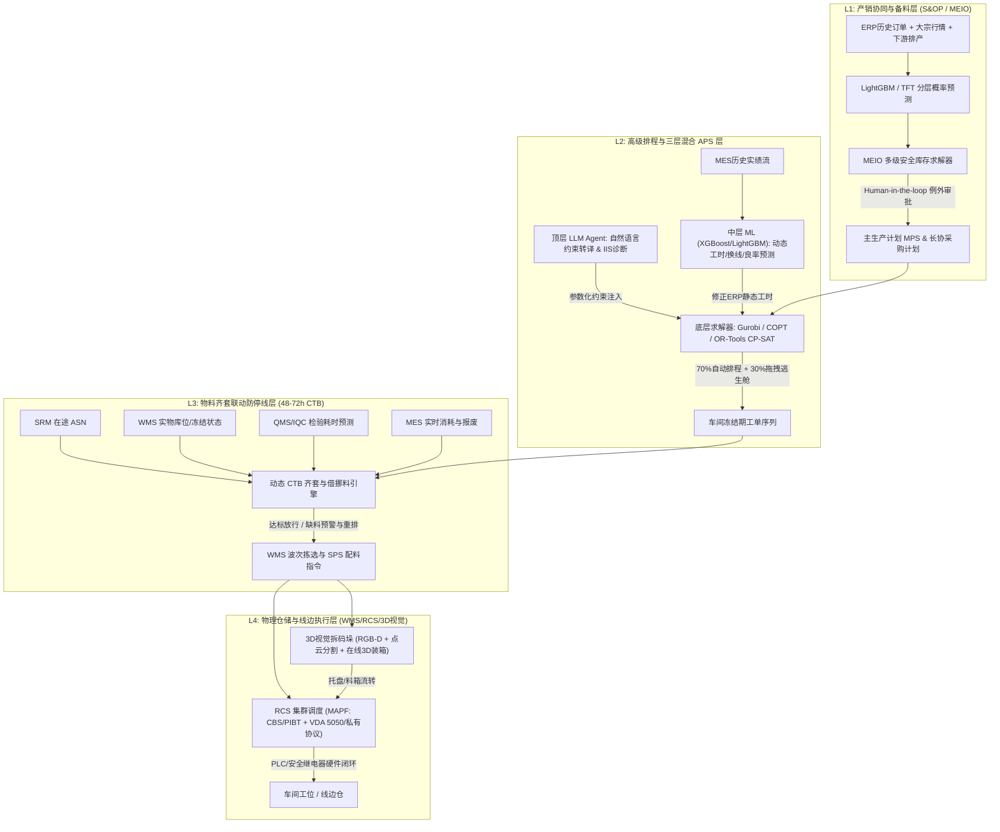
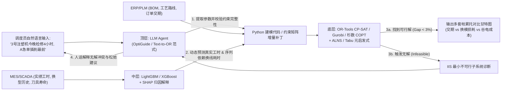

# 生产计划排产与实体供应链物流 AI 应用深度调研

> **调研边界声明**：本报告严格聚焦第一、二产业及制造型企业内部的**产销协同与备料预测（S&OP/MEIO）、高级计划与排程（APS）、SRM–WMS–MES 齐套联动防停线、工厂立库视觉拆码垛与车间线边 AMR 物理调度**，彻底剥离 C 端即时配送（外卖/快递末端派送）及营销侧流量预测。所有技术路线与工程复盘均基于 2024–2026 年公开工程文献、产业实践及软硬件架构解构，贯彻**“有技术栈、有开闭环边界、有具名水位、有踩坑复盘”**铁律。

---

## 导论：计划与物流 AI 的冷热现实及全链路协同架构

在制造业全链条中，生产计划（S&OP / APS）与厂内物流（WMS / 3D视觉 / AMR）呈现出极度撕裂的“冰火两重天”：

* **越靠近物理实体执行工位（如标准纸箱 3D 视觉拆垛、单品牌闭环货到人 AMR），工程确定性越高、ROI 越容易算清（1.1–1.6 年回本）**；
* **越靠近多主体博弈与强耦合决策中枢（如长周期需求预测、全厂 APS 动态重排、跨厂商 VDA 5050 混合车队调度），烂尾率越高**——国内自主或第三方落地的制造企业 APS 项目，真正达到预期、实现动态排程而不被车间主任架空的比例**不足 20%**。

其底层技术演进的核心共识是：**大模型（LLM）不能取代运筹求解器与物理传感器，必须走“确定性底座（数学规划/物理规则/运动控制）+ 专用机器学习小模型（时序预测/动态工时修正/点云分割）+ 顶层 LLM Agent（语义转译/异常诊断）”的三层协同路径**。



---

## 第一章 需求预测、产销协同（S&OP）与多级库存优化（MEIO）

### 1.1 技术栈拆解：从单点外推到分层概率预测与大宗因子融合

传统 ERP 依靠移动平均或指数平滑预测单点均值，在长链条制造业面对季节性跃迁、大宗原料巨幅震荡与多级分销网络时极易产生结构性偏差。2024–2026 年主流工业级方案的技术栈拆解如下：

1. **数据源与接口层**
   * **内部结构化数据**：ERP/SAP 历史发货与未交订单（Open Orders）、主生产计划消耗速率、渠道经销商 Sell-out 与库存水位（通过 EDI、REST API 或数据库 CDC 同步）。
   * **外部产业链与大宗因子**：针对铜、铝、碳酸锂、玉米、豆粕等核心原料，接入 Wind、Mysteel、生意社价格基差（LME/SHFE 期现货价差）、港口库存、冶炼厂/锂盐厂开工率、USDA 供需报告、能繁母猪存栏量、船舶到港 AIS 数据与极端气象指数（厄尔尼诺/拉尼娜）。
2. **核心算法流派与分工**
   * **表格梯度提升树（LightGBM / XGBoost）**：处理数万至数十万 SKU 的主力基线模型。擅长将滞后特征（Lag Features）、滚动窗口统计、促销日历、价格弹性、工程迭代阶段等高维异构表格特征快速拟合，训练推理开销极低，适合周级/日级大规模批处理。
   * **多视野时序深度学习（Temporal Fusion Transformer, TFT / LSTM / TCN）**：TFT 能够同时融合**静态元数据**（产品族、工厂、区域）、**已知未来协变量**（法定假日、既定检修停线、已签约长单交付窗口）与**历史未知观测序列**，通过 Multi-Horizon Quantile Loss 直接输出分位数预测区间（如 P10 / P50 / P90），为下游安全库存提供概率分布输入而非单一均值；对于碳酸锂等极端非线性波动品种，工业界常采用 **ARIMA-LSTM 或 XGBoost-GARCH 组合模型** 分别捕捉线性趋势与残差波动率聚集效应。
   * **分层一致性调和（Hierarchical Reconciliation / MinT）**：解决“总部按产品大类预测之和 $\neq$ 各工厂/区域分仓 SKU 预测之和”的 S&OP 口径打架问题。
   * **多级库存优化（MEIO, Multi-Echelon Inventory Optimization）**：以分层概率预测的分位数分布为输入，结合随机规划（Stochastic Programming）或商业数学规划求解器（如 COPT、Gurobi），在“原材料仓 → 区域成品仓（RDC）→ 工厂线边仓”之间联合求解安全库存水位，打破传统的“单级各自加厚缓冲”导致的库存虚胖。
3. **算力与时延形态**
   * S&OP 与 MEIO 属于策略与战术级计划，通常部署在云端或企业私有数据中心集群，**推理时延容忍度为分钟级至小时级**（周度滚动全量重训，日级增量更新 Demand Sensing 短期信号）。

### 1.2 具名厂商与制造业真实水位

| 厂商/平台 | 核心技术特征 | 具名制造案例与场景 | 公开可核实工程指标与边界条件 |
| :--- | :--- | :--- | :--- |
| **o9 Solutions** (Digital Brain / APEX) | 企业知识图谱（EKG）+ 神经符号 AI + 机器学习基线 | **惠普企业（HPE）**：管理超 10 万个 SKU、12 层深度 BOM、长达 72 周物料交期及 60 余家合约制造商的全球网络 | 预测准确率提升 **6–15 个百分点**，加急空运等溢价物流成本下降 **30%**，库存周转率提升 **6%**；大型企业 Touchless 自动化计划覆盖率可达 **70%–90%**（持续准确率约 87%–89%） |
| **Kinaxis** (Maestro，原 RapidResponse) | 内存级并发计划（Concurrent Planning）+ 数字孪生推演 | **大型跨国工业集团**（航空航天、自动化与过程控制）/ **默沙东（Merck）**等生命科学制造 | 实时评估需求波动对供应链各层级的级联影响；前述工业集团通过端到端统计预测与 What-If 推演成功缓解超 **1200 万美元** 物料短缺风险；医药端通过效期颗粒度计划大幅压降过期报废 |
| **Blue Yonder** (Cognitive Demand Planning) | 概率预测 + 机器学习异常识别 + MEIO | **大型食品饮料代工制造商**（替换老旧 SAP APO 及第三方外挂模型） | 整体预测准确率提升 **10%**（纯统计基线直接提升 1%–4%），年化节约成本 **50 万美元**；平台级 MEIO 在精准实施下可带来最高 **30%** 的专项库存压降 |
| **杉数科技** (Planiverse / Demand.ai / Inventory.ai + COPT) | 机器学习预测 + 自研商业求解器 **COPT** 混合整数规划 | **某大型化工制造集团**（高寄售占比、强季节性长链分销网络）；**头部美妆与快消/制造“一盘货”项目** | 化工案例中运用 MIP 与 ML 统筹航母仓与大经销商库存，**库存周转率提升 50%**、**经销商库存降低 20%**、客户满意度 +5% |
| **悠桦林** (YHL) | 行业 Know-How + AI 预测 + 运筹学一体化平台 | **国内全球家电龙头（如海尔系场景）** / **快消与调味品龙头** | 家电一体化计划推动计算效率提升 **150 倍**、交付及时率 **98%**、库存下降 **50%**；快消连续制造案例库存周转天数从 **44 天降至 28 天** |
| **联想集团** (SCI 供应链智能控制塔) | 全球资源本地交付 + IPD 早期预测协同 + 区域运营中心联动 | **联想全球自营网络**（协同 2000+ 供应商、35 家制造工厂含合肥联宝/武汉基地） | 将市场预测直接切入产品设计与区域仓网调配，Gartner 审计其消费级订单准时交付率长期维持 **98% 以上** |
| **京东供应链** (YAIR 平台 / 诸葛·智享) | 大规模时间序列预测 + 存货布局仿真模拟 | **服务千万级 SKU 网络及制造业商家开放赋能** | 以“计划协同+需求预测+智能决策+风险感知”四位一体压减下游牛鞭效应与周转天数 |

* **大宗原料采购预测（农牧与新能源实战）**：
  * **农牧饲料（玉米、豆粕）**：饲料配方中玉米与豆粕成本占比超 **70%**。头部养殖与饲料企业构建接入能繁母猪存栏量、大豆进口船期、USDA 报告的多变量时序模型，滚动预测未来 4–8 周价格拐点与置信区间；下行区间自动切换“低库存按需采购”，拐点上行前触发“分批锁价/期货套保建议”，实操中可压降原料综合采购成本 **1.5%–3%**。
  * **工业金属与锂电材料（铜、铝、碳酸锂）**：某新能源车企及电池制造商针对碳酸锂“过山车”波动，接入上游锂盐厂开工率、盐湖提锂释放进度及下游电芯厂排产数据，结合时序神经网络输出未来 1–3 个月价格区间与 **VaR（在险价值）** 风险评估，精准核定长协锁定与现货补库的黄金配比，有效规避巨额存货跌价减值。

### 1.3 开环与闭环边界：为什么“AI 绝不能自动拍板大宗采购与长协”？

* **常规补货的半闭环/Touchless 边界**：对于需求平稳、单价低、交期短的标准化成品或辅料（即满足高可预测性的 AX/AY 类物料），主流平台允许 AI 模型自动生成补货建议并直接转入 MRP/采购申请（即 70%–90% 的 Touchless Planning），仅在超出安全阈值时弹窗触发例外管理（Exception-Based Planning）。
* **大宗商品与长协锁单的严格开环红线**：对于动辄数千万至上亿元的铜/铝/碳酸锂期货点价、豆粕进口船期锁单或长达半年的芯片长协买断（LTA），AI 预测结果**严格停留在决策支持看板（Open-loop Decision Support）**。原因在于模型无法感知地缘政治突袭、金融资本短期逼仓、企业自身实时现金流底线及供应商非正式口头让利博弈，必须由采购总监结合金融套保敞口人工签批。

### 1.4 血泪踩坑复盘：预测模型为何在一线频频失灵？

1. **牛鞭效应的数学级放大与滞后指标失效**：
   传统计划依赖工厂历史出库单而非下游真实消耗（POS/实绩耗用），面对市场波动时极易引发逐级放大。行业实证表明，当终端消费者购买出现 **10%–15%** 的小幅波动时，分销商为防缺货可能加码订购 **25%**，信号层层回传至上游制造厂与原料端时，会被人工与安全系数扭曲成 **40% 以上** 的虚假产能需求脉冲；一旦企业据此扩班备料，需求回稳后便留下巨额呆滞库存在厂内积压。当预测准确率跌破 **70%** 红线时，下游车间调度立刻陷入全面依赖加急空运与临时插单救火的恶性循环。
2. **计划员“拍脑袋覆盖（Manual Override）”造成的负 FVA 灾难**：
   《国际预测杂志》（*International Journal of Forecasting*）多项针对数十万条工业预测记录的实证研究表明：计划员人工干预修改（Override）统计/AI 基线预测，**仅在刚超过 50% 的 SKU 上提升了准确率**——意味着近半数人工调整反而把模型算准的结果改错了，造成 **FVA（Forecast Value Added，预测增值）为负**。尤其是销售团队驱动的“正向乐观上调（Positive Override）”，往往将短期单一客户大单或考核压指标的噪音误当成趋势信号，直接制造大量呆滞成品；而缺乏 FVA 审计机制的 S&OP 会议，往往沦为业务部门与计划部门互相甩锅的政治博弈场。
3. **52 周长交期瓶颈料（进口芯片/精密轴承）下的预测彻底失灵**：
   对于车规级 MCU 芯片、高端进口主轴轴承或特种催化剂，交期动辄长达 **16–52 周（半年至一年）**。此时基于近期消费量的时序模型面对两大无解死结：
   * **“时间视界陷阱”与技术迭代错配**：AIoT、新能源汽车与工业装备产品迭代周期常短于半年，今天根据 52 周后需求预测锁定的进口芯片型号，到货时整机已完成工程改型（ECN）而被直接废弃；
   * **“恐慌性虚报订单（Watering Orders）”泡沫**：当市场传闻原厂紧缺或出口管制时，下游客户与渠道会同时向多家供应商重复虚报双倍需求抢占产能配额，训练数据被全行业“注水”，一旦原厂扩产释放或终端砍单，提前半年锁定的高价买断料瞬间沦为巨额资产减值包袱。**工业界务实解法并非强求 52 周预测算准，而是依靠商业契约重构**——推行 **VMI/寄售（Consignment）**、设立 **“4 周硬冻结 + 后续月度 $\pm 20\%$ 滑动缓冲”协议（Buffer Agreement）**，并在 R&D 阶段强制推行 Pin-to-Pin 替代料冗余设计。

---

## 第二章 高级计划与排程（APS）——彻底祛魅“纯大模型排产”与烂尾尸检

### 2.1 彻底祛魅：为什么纯 LLM 大模型绝对算不了工厂排产？

2024 年以来市面上频繁出现“用通用大模型直接生成生产计划甘特图”的伪命题炒作。从计算数学与工业控制本质看，纯 LLM（大语言模型）做工厂排产属于**计算范式的根本性错配**，只要走出 10 个工单的玩具级 Demo，在真实工厂必死无疑：

1. **概率 Token 预测 vs. NP-Hard 指数级组合爆炸**：
   柔性作业车间调度（FJSSP）属于经典的 **NP-Hard 问题**——仅 100 个工单、每道工序 5 道可选设备，其可行解空间即呈 $O(n!)$ 级指数爆炸。LLM 本质上是基于 Transformer 的自回归“下一个 Token 概率采样”，没有任何分支定界（Branch-and-Cut）、割平面（Cutting Planes）与对偶下界证明（Optimality Gap Proof）机制。它无法判断当前排程离理论最优解还差 2% 还是 50%，更无法在亿万种组合中执行系统性状态回溯。
2. **100% 硬约束红线的灾难性幻觉崩溃**：
   工厂排程中的硬约束（Hard Constraints）是“违反任意一条整张计划即作废”的刚性逻辑——例如“模具 A 同一毫秒只能装在一台注塑机上”、“物料未通过 IQC 不准排产开工”、“前道烘烤未满 4 小时绝不可进入下道涂装”。当约束条件达到数百条且跨天交织时，LLM 的长上下文注意力衰减与概率生成特性几乎必然引发**时间倒流、机台物理撞车（Overlap）或超能力负荷**。
3. **Token 化对多维矩阵与数值计算的天然残缺**：
   LLM 的 Tokenizer 会把连续时间戳、浮点加工工时与多维索引矩阵切碎成离散词元，连带小数点的几百个工时累加都会频频算错，更遑论动态计算连续几十天的峰谷电价阶梯分段积分。
4. **高频增量重排的算力延迟与随机性不可控**：
   车间遇到突发断料或设备报修时，调度员要求在 **1–3 分钟内**基于现有未完工状态热启动（Warm Start）局部重排；纯 LLM 推理高延迟、Token 账单高昂且受采样温度影响存在不可复现性，无法承担高频生产基线任务。

### 2.2 2025–2026 唯一跑通的黄金三层混合架构（Neuro-Symbolic Hybrid APS）

全球工业软件与运筹智能领军者（如微软 OptiGuide 研究范式、杉数科技、悠桦林、Kinaxis Maestro）在 2025–2026 年收敛出唯一的工程可行解：**“底层运筹求解器算最优化 + 中层机器学习修准参数 + 顶层 LLM Agent 做语义交互与异常解释”**。



1. **底层核心：数学规划求解器 + 约束规划 + 元启发式的工程选型与算力边界**
   针对复杂排程，绝不是单一求解器通吃，而是依据问题结构严格分层选型：

| 求解流派 | 代表引擎 | 建模核心与优势 | 规模与运行时延边界（真实工厂水位） |
| :--- | :--- | :--- | :--- |
| **约束规划 (CP)** | **Google OR-Tools (CP-SAT)** | 原生提供区间变量（`NewIntervalVar`）及全局调度约束（`AddNoOverlap` / `AddCumulative`），无需为每个离散时间步定义海量 0-1 变量，内存与变量数极度紧凑 | 在数百台机台、数千道工序的柔性车间排程中，**秒级至 3 分钟内即可收敛出高质量可行解**；但面对超大规模高度对称实例时，下界收敛可能停滞（Proof of Optimality 耗时久） |
| **混合整数线性规划 (MILP)** | **Gurobi** / **杉数 COPT** | 基于矩阵与分支定界（Branch-and-Cut），强在对偶下界证明与连续变量（如库存液位、峰谷电价阶梯成本、物流配比）耦合建模 | 面对大跨度多时段离散时间步易发生“二元变量爆炸”（变量飙升至数十万级）；工业界通常采用 **Logic-Based Benders 分解** 或先做时间粗粒度聚合（Bucketed），将求解时长控制在 **3–15 分钟** 调度窗口内 |
| **混合元启发式 (Meta-heuristics)** | **遗传算法 (GA) / 禁忌搜索 (Tabu) / 自适应大邻域搜索 (ALNS)** | 当上万道工序、百余条强非线性物理规则同时存在且商业求解器超时时，依靠局部邻域破坏与重构造快速寻找工程满意解 | 通常作为求解器的 **热启动（Warm Start）初解生成器**，或与 CP-SAT/MILP 组合构成 **Matheuristic**，确保无论规模多大，在设定截止时间（如 180 秒）必吐出可执行甘特图 |

2. **中层校验：机器学习动态修正 ERP“假工时”与序列换型矩阵**
   * **工程架构**：从 MES/SCADA 提取历史报工实绩与 IoT 设备真实启停时间戳，构建时间窗口切分（严禁随机交叉验证以防未来数据泄露），输入 **LightGBM / XGBoost** 回归模型。
   * **关键特征工程**：机台编号与刀具磨损/累计模次、班次与操作工熟练度、材料牌号与零件几何复杂度、以及极其关键的**“上一道工单属性 vs 当前工单属性”转移特征**（精确量化不同颜色/材质/模具切换的真实换线耗时与首件调试报废率）。
   * **真实收益与可解释性**：学术及工业平行机台排程测试表明，用 LightGBM 动态预测工时替代 ERP 静态工时后输入优化算法，可驱动总完工时间（Makespan）压降高达 **30%**；同时引入 **SHAP（SHapley Additive exPlanations）** 向车间主任解释“为何某产品在 4 号机台预估耗时比标准多 25 分钟”，解决黑盒不信任问题。
3. **顶层交互：LLM Agent 担当“翻译官与故障诊断师”**
   * 借鉴微软 **OptiGuide** 及 **Text-to-OR / OR-LLM-Agent** 框架，顶层 LLM（如配合推理链与代码沙盒的规划模型）仅做三件事：① 将“3号注塑机今晚检修4小时、A客户订单提前”等自然语言精确映射为求解器结构化约束参数；② 当过度插单导致数学无解（Infeasible）时，调用求解器 **IIS（Irreducible Inconsistent Subsystem，最小不可行子系统）** 接口，向计划员用业务语言解释冲突根源（如“因为 3 号机台维修叠加 B 订单锁死模具，交期冲突 6 小时，建议将 C 订单延后或转至 5 号机台”）；③ 自动生成“保交期优先 vs 压低换模损耗 vs 谷电避峰生产”等多套对比方案交由人工决断。

### 2.3 具名标杆案例与“峰谷电价避峰”进阶实践

* **联想合肥基地（联宝科技，LCFC）Smart APS 实战**：作为全球最大 PC 研发制造基地，联宝日常订单中 **80% 以上为单笔小于 5 台** 的极小批量定制需求，单台笔记本电脑涉及上千个零部件、300 余种原材料且定制率超 50%。通过深度整合智能排产（Smart APS）与柔性调度系统，联宝在多级 BOM 齐套与有限产能平衡的基础上实现高频模拟插单，**排产时间缩短 67%（由数小时压缩至 3 分钟以内），车间作业效率提升超 50%**。
* **杉数科技 × 某头部 ICT/3C 电子制造集团**：面对单工厂 APS 无法解决的多基地协同瓶颈，基于 COPT 求解器打通跨工厂产能、工艺与试产/替代料约束，上线后实现**订单满足率提升 20%、产能损失率降低 30%**，排产缩至分钟级。
* **峰谷电价（TOU）与需量平抑驱动的能耗感知 APS**：在工商业峰谷电价差拉大至 3:1 以上且包含高额最大需量电费（Demand Charge）的背景下，2024–2025 年注塑、化工与冶金企业已将电价分段曲线写入求解器多目标函数：
  * **注塑与压铸**：将大吨位注塑机长周期连续订单与耗电巨大的模具预热尽量平移至夜间谷电/平电段，避免在尖峰电价段停机换模后重启加热。国内某大型精密注塑/压铸企业部署能耗感知 APS 后，**综合电费成本下降 8%–15%**，并避免变压器需量超标罚款。
  * **化工与冶金**：在中间体设有缓冲罐（Buffer Tank）的半连续化工段，APS 于谷电时段拉满反应釜/压缩机负荷积攒中间液位，峰电时段降负荷保温；冶金电弧炉/热处理炉则把熔炼、高功率保温挤入谷电窗口，峰电期安排吊装与自然冷却，同时通过**功率平抑约束**严防多台大功率电炉在峰段同时启动击穿需量红线。

### 2.4 APS 高烂尾率尸检报告：为什么国内真正跑通自动排产的比例不足 20%？

尽管算法框架日趋成熟，业内调研普遍指出国内 APS 项目真正达到预期、实现动态排产而不被架空的比例**不足 20%**。深水区致死率最高的四大病灶如下：

#### 病灶一：基础数据腐烂（ERP BOM 与标准工时准确率不足 70%）
APS 排程能够稳定运行的基准前提是 **BOM、替代料关系与工艺工时准确率达到 95% 以上**。但现实中小至几千万、大至十数亿产值的工厂普遍存在：
* ERP 里的标准工时多为数年前财务核算成本拍脑袋估算的静态常量，根本未反映模具磨损、不同模穴数、冷却曲线及操作工差异，实绩偏差普遍在 **20%–30% 以上**；
* 工程变更（ECN/ECO）频繁，研发改了图纸和配比但 ERP 工艺路线滞后数周未同步，或者注塑水口料回用比例波动未建入 BOM。
**结果**：APS 算出的完美甘特图，下发车间执行 **5 分钟即因节拍漂移或物料对不上号而全面作废**。

#### 病灶二：隐性约束建模地狱（标准 APS 产品的“行业盲区”）
标准通用 APS 只认“机台+人+标准工时”，但制造业现场真正卡死生产的是难以量化的非标准“隐性约束”：

| 典型行业 | 决定生死的核心隐性约束（未建入模型必烂尾） |
| :--- | :--- |
| **注塑行业** | ① **深浅色/材质转换矩阵**：黑色切白色/透明料必须拆螺杆停机洗机数小时；② **共模互斥与一模多腔**：同一套模具同一时间仅能挂一台合适吨位机台，且有顶针/模穴封闭与模具保养寿命上限；③ **辅机匹配**：模温机、机械手、色母机与烘干料斗的资源强绑定 |
| **纺织印染** | ① **染缸吨位载量匹配**：50kg/100kg/500kg 染缸严禁“小缸大用”，且“大缸小用”会直接导致浴比失调报废或染化料暴涨；② **色序与洗缸约束**：必须严格按“特白→浅色→中色→深黑”排布（如环思、致景科技、华遨软件核心 Know-How），逆序插单浅色必须高耗水汽洗缸；③ **缸差归集**：同一大单分多缸投染需严控同工艺同批缸差，且前处理→染色→定型间有严格湿布堆放时间窗限制 |
| **化工流程** | ① **反应釜洗釜排毒（Cross-Contamination）**：A 化学品转 B 化学品前必须执行严格酸洗/碱洗/蒸煮排空；② **连续热力学边界**：聚合与反应一旦开启不可按“下班/换班”时间片机械截断，必须具备连续保温与不可中断约束 |
| **离散装备** | **双资源约束（DRC）与技能矩阵**：同一道精密焊工或调试工位必须同时锁定特定设备与持有对应特种资质证书的熟练工，无法由普通新工替补 |

#### 病灶三：MES 报工滞后、倒冲机制失灵与冻结期崩溃
* **报工滞后（Data Latency）**：“用昨天的假现场，排明天的生死局”。国内大量车间工人仍习惯干完一批在纸单打勾、下班前甚至隔天集中录入 MES。夜间 APS 触发重排时，读取的在制品进度严重失真（系统以为 A 机台还在做工单 1，现场早已换模做工单 2），直接吐出荒唐排产序列。
* **倒冲扣料（Backflush）导致负库存死锁**：系统因平时不发料、待完工后按 BOM 自动倒冲扣账，只要现场发生超领、损耗、临时替代或漏报工，立刻触发系统负库存；APS 校验物料约束时判定“无料可配”，求解器直接无解锁死。
* **冻结期（Frozen Horizon）失控**：“朝令夕改的插单暴力”。缺乏按“最长换模准备时间 + 物料配送提前期 + 报工滞后时间”测算的刚性冻结区，业务员与老板一句话强插急单，频繁击穿冻结期触发全盘重排，车间刚热好的料筒和装好的模具被迫拆下，引发一线全面抵触。

#### 病灶四：组织人性与灰色权力博弈（研报绝不敢碰的真相）
* **“派工老王”的隐性权力剥夺**：在传统工厂里，车间调度（老计划员）手握排单生杀大权——谁能拿到高计件单价、加工顺畅的“肥活”，谁去啃频繁换模、工时吃亏的“硬骨头”，全凭老调度口头指派。APS 上线后排产规则透明化、派工权力收归系统，既削弱了调度员话语权，也迫使其担心一旦把脑中几十条“隐性换模诀窍”完全交给系统后自身被优化替代。因此一线骨干往往采取**隐瞒真实约束规则、或刻意抓系统一个细微边界 Bug 全厂宣扬“软件根本排不了”**，最终迫使管理层退回 Excel 与微信群派工。
* **唯一破局原则（开闭环边界）**：工业级 APS 绝不可搞全无人黑箱下发，必须遵循 **“70% 算法自动排程 + 30% 人工可视化甘特图拖拽逃生舱”**，且严守冻结期不自动改写已派工的机台指令。

---

## 第三章 物料齐套联动（SRM–WMS–MES 协同防停线）

### 3.1 生死线：从“差一颗螺丝停全线”到 48–72 小时滚动 CTB

在工程机械、新能源整车、服务器组装等离散装配厂，“99 颗核心大件全齐，独缺 1 颗特种高强螺栓或 1 颗贴片电容导致整条总装线停工待料（Line Down）”是侵蚀毛利的最大黑洞。传统的 MRP 按周/月静态跑净需求，完全无法应对生产前 **48–72 小时黄金执行窗口** 内的临时损耗、在途延误与质检卡顿。

因此，制造企业必须以 **CTB（Clear-to-Build，可制造齐套确认）引擎** 为枢纽，在 SRM、WMS、QMS 与 MES 之间构建高并发的实时状态闭环：

```text
[ SRM 供应商门户/EDI/物流GPS ] ──> 掌握在途ASN真实发货与预期到厂波动
               │
[ QMS / IQC 来料检验排队队列 ]  ──> ML 预测检验耗时与待检冻结放行时点
               │
               ▼
[ 48-72h 动态 CTB 齐套与借挪引擎 ] <── [ MES 实时报工/损耗/报废/Andon呼叫 ]
               │
        ┌──────┴──────┐
        ▼             ▼
[ 100% 齐套放行 ]  [ 缺料风险触发 (<48-72h) ]
        │             ├──> 1. 触发替代料 BOM 自动匹配重算
        ▼             ├──> 2. 触发高优工单电子借料/挪料 (Material Pegging 变更)
  WMS 下发波次拣选    └──> 3. 联动 APS 将缺料工单后移，严禁未齐套半成品上产线拥堵
```

### 3.2 跨系统核心算法与防呆链路

1. **在途 ASN 可信度与交期动态修正**：
   通过 SRM 接入供应商采购订单确认（PO Ack）、高级发运通知（ASN）以及外部货运轨迹，结合该供应商历史准时交货率（OTD）与延迟方差，对“系统在途数”做概率折扣或延迟风险打分，避免虚幻的在途数字误导齐套结果。
2. **IQC 来料检验周期预测（破解“门口黑洞”）**：
   实务中物料虽已入厂卸货至待检区（AR 区），但受限于化验/精密测量仪排队及抽检加严规则，常卡死数天。AI/时序回归模型基于**物料品类检测复杂度、供应商历史来料合格率（决定抽检等级放宽或加严）、当前待检区队列积压工单量、IQC 班组排班产能**预测准确的预计放行时间戳（ETA of Release），写入 CTB 可用时间轴。
3. **多级 BOM 替代料优先与动态挂钩（Material Pegging）**：
   当主料（Primary Part）在未来 48–72 小时内预测断供，引擎自动检索 PLM/ERP 维护的**群组替代料（Alternate Group）**或**单向局部替代规则**进行净需求重算；若依然缺口，系统按照订单毛利、违约金权重与客户等级，自动推荐“借料/挪料”方案（将低优先级未来工单的硬预留库存转移给当前即将开工的高优急单），并在 WMS/MES 中强绑定电子审批过账与“还料回冲”追踪标识。
4. **齐套门槛硬拦截（Kitting Gate）**：
   设定刚性齐套率门槛（如关键件 100%、标准件 $\ge 98\%$ 且有确定补料时间），不达标工单严禁向 WMS 下发成套拣选（Kitting）指令，防止大量“半成品骨架”上产线后半路卡死，把宝贵的装配工位塞成昂贵的“露天停车场”。

### 3.3 具名标杆实践与工程指标

* **三一重工长沙 18 号“灯塔工厂”（重工离散装配标杆）**：
  面对工程机械极其深厚的 BOM 层级与巨型非标结构件+海量标准件并存难题，18 号厂房打通树根互联工业互联网平台、MOM“工厂大脑”、WMS 南北立体库与激光导航重载 AGV，精准协同调度多达 **101,320 种零部件**（从 72 米长臂架到 2 毫米螺丝）。通过上线前严格执行单台单工位齐套校验与波次精准配送，其实现**整体准时交货率高达 99.2%、相同面积下产能提升 123%、人员效率提升 98%、单位制造成本降低 29%**。
* **电子与服务器制造（联宝科技、浪潮集团）**：
  电子表贴（SMT）产线面临元器件价格剧烈波动、高频工程变更（ECO）与海量可替代电阻/电容管理。通过建设具备智能替代料匹配与实时 CTB 算力的供应链系统，在主料断供瞬间毫秒级重算合规替代料余量，保障多品种极小批量（单笔 $<5$ 台）服务器与 PC 高速换线下的连续开机率。
* **汽车整车总装（一汽、上汽、比亚迪等 JIS/JIT 协同）**：
  针对座椅、仪表盘、保险杠等占地极大、配置繁多的总成件，实现按整车总装上线顺序的 **JIS（Just-in-Sequence，按序配送）**，单车下线节拍达数十秒级，缺料风险由 MES 安灯（Andon）秒级联动 WMS 启动边线替代或紧急跨库调拨。

### 3.4 血泪踩坑真相：账面 100% 齐套，开工即停线的三大陷阱

1. **“伪齐套”陷阱（QMS 与 WMS 状态割裂）**：
   众多企业上线了齐套看板，却依然频频开工即断线，头号元凶便是**“账面可用库存掺水”**——供应商把货卸进厂区待检区，ERP 即显示在库；或者 IQC 已经判退的不良品、客户退回的待返修品未做物理隔离或系统库位冻结（Status Lock），统统被齐套引擎算作可用好料。等到仓库波次拣选发到工位，工人拆包上机发现全是坏料或根本还在待检区卡着，整线被迫停摆切换。
2. **线边仓沦为账目“法外之地”（两张皮迷局）**：
   总仓管理严格，但物料一旦调拨进入车间线边仓，管理瞬间陷入粗放：工人随手拿取多领不退、报废隐瞒不报、甚至夜班跨产线“盲拿救急”，导致总仓账本干净，线边仓却是一笔糊涂账。由于系统显示线边尚有余料，CTB 算法不再触发总仓补料，直到产线彻底拿空才拉响安灯（Andon）报警，此时再急调早已错过 48 小时安全提前期。
3. **倒冲扣料失真与线下私自借料的连锁雪崩**：
   对于电子组装与高频变更（ECO）产线，若对高价值、易损或高替代率器件强行采用完工“倒冲（Backflush）”，BOM 与实际消耗哪怕存在 1% 偏差，一周累积下来便会使系统库存彻底失真；同时，若允许车间班组长通过微信群口头“拆东墙补西墙”私自挪用相邻工单物料而不走 WMS/MES 线上调拨过账，不仅直接造成财务工单成本核算混乱，更会导致被借料工单次日开工前依然呈现“账面假齐套”，引发更大面积的连环断线。**铁律：高价值、高替代、易损耗物料必须严格实行按工单扫码“实发实扣”；仅低值标件可保留倒冲并强制周期性盲盘校偏。**

---

## 第四章 厂内实体仓储与线边物流（WMS + 3D视觉拆码垛 + AGV/AMR集群调度）

### 4.1 混合纸箱/麻袋 3D 视觉无序拆码垛与在线 3D 装箱

#### 1. 传感器、视觉算法与在线 3D 装箱技术栈
* **硬件感知层**：大视野工业级 3D 相机（如梅卡曼德 **Mech-Eye DEEP / LSR** 抗反光激光结构光系列、Zivid 结构光相机），通常部署于机器人腕部或龙门支架（Eye-to-Hand 模式覆盖 $1.2\text{m} \times 1.0\text{m} \times 1.8\text{m}+$ 完整托盘垛型）；前端搭配工业边缘工控机（配备 RTX 级别 GPU 加速推理）与机械手本体（ABB、发那科 Fanuc、库卡 KUKA、安川等六轴/四轴码垛机器人）。
* **点云处理与分割算法**：针对多 SKU 混合、紧贴无间隙或表面带有透明胶带/标签反光的垛型，采用 **抗反光多曝光三维重建 + 2D RGB 边缘纹理与 3D 点云特征融合的深度学习实例分割（如改进版 PointNet++ / Mask-based 3D 分割）**，精准解算单个箱体或软包麻袋的 6D 抓取位姿与最外层优先抓取序列；同时结合 **MoveIt / 采样类避障轨迹规划** 确保吸盘/腕部不擦碰托盘护栏与邻近纸箱。
* **在线 3D 装箱算法（Online 3D Bin Packing, Online 3D-BPP）**：
  * **核心难题**：物流输送线上混合纸箱随机乱序到达，机器人仅能前瞻 $k$ 个（Look-ahead $k$）箱体，放定后无法返工，传统离线全局优化彻底失效。
  * **算法演进与水位**：早期启发式规则（Bottom-Left、EMS 空最大空间法）空间利用率卡在 **70%** 左右且面对异形扁长箱极其僵化；2024–2026 年学术与头部落地前沿采用 **深度强化学习（DRL）+ Transformer 架构（如 GOPT / PCT Packing Transformer / 解耦动作空间策略）**，并将“支撑面稳定度校验（复杂度由 $O(N^2)$ 压至 $O(N \log N)$）”及“机械臂无碰撞进出可可达性”写入 Reward 函数，在仿真与部分受控真机场景下把空间利用率从人工码垛的 **50%–60%** 推升至 **80%–90%**。
* **开环/闭环边界**：**全自动实时闭环控制**。3D 相机采集点云 → AI 推理抓取位姿与落点坐标 → 机械臂控制器执行无碰撞轨迹规划（单次视觉推理与路径解算通常要求在 **数百毫秒至 1.5 秒内** 完成，以匹配高速节拍）；仅在相机报错点云遮挡、真空负压检测连续跌落报警时停机呼叫人工复位。

#### 2. 纸箱 vs 麻袋工程指标、成本造价与 ROI 算账明细

| 比较维度 | 标准化/混合纸箱拆码垛 | 化工/饲料/粮油软包装麻袋拆码垛（含破袋投料） |
| :--- | :--- | :--- |
| **物理形变与视觉难度** | 刚体六面体、边缘清晰，点云平面拟合难度较低（深黑/高反光膜除外） | **行业硬骨头**：软体易挤压塌陷、高度不固定、表面极多褶皱与粉尘覆盖，无缝贴合难寻抓点 |
| **末端执行器设计** | 海绵吸盘 / 阵列气动真空吸盘 | 机械夹抱夹爪、**针刺式抓手**（扎入麻袋提拉），或大面积高功率负压海绵吸盘 |
| **真实运行节拍 (CPH)** | 单抓常规 **400–650 箱/小时**（如 ABB/发那科+梅卡曼德稳定约 500 CPH）；采用整层/矩阵多抓可达 **800–1,000+ 箱/小时** | 显著偏低，通常仅 **250–400 袋/小时**（软体位姿计算耗时较长且需控制加减速防甩脱） |
| **单工位系统造价 (2024–2025 行情)** | 标准单品小负载（$<50\text{kg}$）：**25–45 万元**；复杂多 SKU 混合拆码：**45–70 万元+** | 专用麻袋工作站：**35–60 万元**（比同等吞吐纸箱线贵 10%–20%，贵在定制防漏料夹具与非标防尘调优） |
| **替代人力与 ROI 算账真相** | 以三班倒（24h）每班省 2 人（共 4–6 人，年人力成本约 24–32 万，扣除年维保 2–3 万），30 万级投入 **ROI 约 1.1–1.4 年** | 25–50kg 重袋粉尘大招工极难，24h 替代每班 3 人（年人力成本 35–40 万，扣除易损件维保 4 万），45 万级投入 **ROI 约 1.3–1.6 年** |
| **算不过账的红线** | 若工厂仅**单班倒（8 小时/天）**、SKU 杂乱且熟练装卸工薪资偏低，ROI 会直接拉长至 **3–4 年以上**，绝大多数企业核算后放弃改造 | 袋装破损撒料返工率一旦超过人工耐受度，或下游拆包投料未联动自动化，仅买一台拆垛机反而增加理料人工 |

* **具名案例参考**：梅卡曼德（Mech-Mind）在某大型化工厂落地的白麻袋拆垛破包项目，采用 **Mech-Eye DEEP** 3D 相机克服白色麻袋堆叠松散、表面褶皱与高粉尘干扰，精准输出抓取位姿并规划“抖料、搬运”联动下游自动破袋机，实现强粉尘高危岗位的 7×24 小时无人化替代。

#### 3. 物理与现场工程踩坑清单
* **“理论严丝合缝，物理塞不进去”的纸箱变形坑**：算法普遍基于“理想刚体假设”，但实际车间纸箱受潮、打包过紧或内物晃动会导致**鼓肚（Bulging）、塌边与公差累积**。在线 3D 装箱算出的零间隙放置坐标，到了真机下落阶段直接把相邻纸箱撞歪甚至压塌整垛；且追求角落极致利用率往往引发机械臂腕部与周边高垛箱体的**碰撞干涉**，迫使工程团队牺牲 5%–10% 空间利用率换取安全避让裕度（由远及近严格序列与软硬件柔性顺应夹爪）。
* **麻袋破袋撒料与吸盘漏气滑落**：编织袋覆膜透气性不均、袋口扎带悬空或粉尘附着导致真空吸盘瞬间失压；改用针刺抓手若刺深未自适应调节，极易直接划破内衬袋导致剧毒化工粉料或高价原料撒漏全线停机洗地。
* **反光膜与黑箱点云空洞**：裹缠透明缠绕膜、高光胶带或黑色吸光吸塑周转箱在普通消费级 RGB-D 相机下大面积出现点云空洞（缺失深度数据），必须上昂贵的抗反光激光结构光或高动态多曝光 3D 相机，推高硬件成本。

---

### 4.2 车间线边仓 SPS 成套配送与多品牌 AGV/AMR 混合集群调度

#### 1. 具名标杆与主流设备商图谱
在汽车总装、3C 电子 SMT 与新能源制造车间，基于 **SPS（Set Parts Supply，成套零部件配送）** 模式的线边物料流转已成为柔性混线生产的标配，头部实践具有清晰的量化指标：
* **华晨宝马沈阳大东工厂 × 极智嘉（Geek+）**：针对多车型共线引发的中小件（F-koli）复杂度暴增难题，部署极智嘉 **P800R** 拣选机器人舰队，并将宝马 **MES、SAP 物流系统与机器人控制系统 RCS 全链条打通**。落地后**拣选效率提升 400%、人力投入节约 64%、拣选员单日行走距离锐减 22.5 公里，拣选准确率达 99.99%**。
* **海康机器人（Hikrobot）**：累计下线移动机器人突破 **10 万台**，覆盖潜伏式 LMR、叉取式 FMR、货箱到人 CTU 及重载移载 CMR 全序列。在一汽解放、纬创等制造项目中，依托自研 **RCS-2000** 调度系统实现 MES/WMS 深度协同、跨楼层智能梯控与多设备交通管制。
* **海柔创新（Hai Robotics）**：凭借 **ACR 箱式仓储机器人（HaiPick 库宝系统）** 切入高密度线边仓改造，在占地极其受限、SKU 繁杂的汽配/电子车间，通过多层高架配合自动装卸机可在数周内完成自动化上线，将**存储密度提升 80%–130%，拣选效率提高 3–4 倍**。
* **新能源与重工高壁垒线边搬运**：宁德时代、比亚迪等电池厂在电芯与极卷线边周转中广泛引入洁净防爆级重载 CMR/无人叉车并与 WMS（如唯智信息等）对接保持账实同步；三一重工 18 号厂房则通过激光+高反光板导航的重型 AGV 实现数吨级结构件的跨跨间重载线边衔接。

#### 2. 多品牌集群协议（VDA 5050）与 MAPF 调度算法真相
当工厂同时采购了 A 品牌的重载潜伏车、B 品牌的料箱 ACR 与 C 品牌的无人叉车时，便面临“多品牌混行调度”的深水区。

* **VDA 5050 协议标准结构与 2024–2026 现实鸿沟**：
  由德国汽车工业协会（VDA）与 VDMA 联合推进、经宝马/大众/博世（AGV Mesh-Up）实战打磨的 **VDA 5050（从 2024 年 8 月发布的 v2.1.0 演进至 2026 年 3 月发布的 v3.0.0）**，采用 **MQTT + JSON** 规范主控系统（Master Control）与车辆的交互主题树：`{interfaceName}/{majorVersion}/{manufacturer}/{serialNumber}/{topic}`（例如 `uagv/v2/bosch_agv/robot_001/state`），核心包含 `order`（节点与边行驶任务）、`state`（实时位姿/电量/报错回传）、`instantActions`（急停/取消指令）、`connection` 与 `factsheet`。
  **然而在真实工厂落地时存在四大血淋淋的鸿沟**：
  1. **标准演进与现场存量适配的割裂（AGV 刚性轨道 vs 真 AMR 自由绕障）**：早期 **VDA 5050 v2.0** 仅支持刚性离散节点与边（`nodes` & `edges`）行驶；尽管 **v2.1.0** 在 `edge` 定义中首次引入静态 **`corridor`（走廊带左右容差宽度）** 概念允许 AMR 在带状边界内局部避障，且 **v3.0.0（2026 年 3 月发布）** 进一步补齐了 **`path sharing`（`plannedPath`/`intermediatePath` 自主规划轨迹回传共享）**、**`zone concepts`（轮廓限速/禁入区与运动学中心优先区交管）** 及走廊申请释放机制（`releaseRequired`），但在 2024–2025 年乃至当前大量存量厂房中，多数老旧主控平台与国产低成本车端仍仅适配 v2.0 子集或未完整开放走廊动态交管，导致具备自由绕障重规划能力的 AMR 一旦偏离预设边线，主控即丢失安全互锁状态引发交通卡死。
  2. **“假 VDA 5050”与私有字段魔改**：尽管不少国产中小厂商宣称支持 VDA 5050，但各自对规范中可选字段（Optional Fields）、节点容差半径、错误码与上报频率做了大量私有魔改，且不同品牌底盘的**最大速度、过弯半径、加减速与急刹距离运动学特性完全不同**，主控系统推算出的狭窄路口时间窗在现实中频繁失效。
  3. **外设与门禁握手缺失**：VDA 5050 明确仅管“主控 ↔ 车”，**完全不管“车 ↔ 电梯/卷帘门/流水线辊筒 PLC”的局部 M2M 握手**，集成商仍须针对每台门控和输送站做大量定制化 PLC 协议补丁。
  4. **头部厂商的闭环商业壁垒**：海康机器人、极智嘉等行业龙头的核心利润壁垒在于自家高度成熟的全栈 RCS 生态闭环，除非应对欧洲出口强制合规要求或主机厂强势招标压迫，否则大厂通常不愿将底层精细交通控制权完全交由第三方 VDA 5050 主控调度。国内生态破局点正转向**底层标准控制器（如仙工智能 SRC 控制器原生全面兼容 VDA 5050）**或**第三方独立异构调度中间件（如磅旗科技跨品牌 RCS 协同引擎）**。

* **MAPF（多智能体路径规划）算法边界与防死锁逻辑**：
  真实厂内物流并非一次性找路，而是 7×24 小时连续派单的 **Lifelong MAPF（L-MAPF）**，业界通常按规模选取两类架构：
  1. **冲突基础搜索（CBS / EECBS）与滚动窗口碰撞消解（RHCR）**：能够输出最优或有界次优的无碰撞路径，但在高密度交叉路口车数突破数百台时计算复杂度急剧恶化；且滚动窗口截断预测（Windowed Planning）在极度拥挤区极易遗留“窗口外隐性死锁”，2024–2025 年最新工业界研究（如 *WinC-MAPF* 与 *SS-CBS*）专门针对窗口完备性加装了闭环死锁规避校验。
  2. **优先级继承回溯（PIBT, Priority Inheritance with Backtracking）**：以牺牲全局路径绝对最优性换取极速响应，可轻松支撑 **1,000+ 台规模级车队** 在毫秒级完成局部冲突消解与退避。为弥补纯 PIBT 短视钻入死胡同或瓶颈通道的缺陷，成熟 RCS 均采用**“全局时间无关引导流场（Global Traffic-Flow Guidance）+ 底层实时 PIBT 局部防碰撞”**混合方案。

* **开环/闭环边界**：**全自动实时闭环调度 + 硬件级安全 PLC 强制兜底**。RCS 集群系统根据 WMS/MES 拉动信号实时下发毫秒级/秒级路径与交通锁闭指令；但涉及**紧急碰撞刹停与安全区域越界防护**时，绝不依赖软件调度或 Wi-Fi 指令，必须经由符合 **ISO 3691-4 及 PLd / SIL2 等级** 的**车端本地硬件安全 PLC** 直接切断驱动动力电源。

#### 3. “30% 实验室算法 + 70% 现场工程”：老旧厂房四大物理灾难坑

1. **Wi-Fi 漫游粘连与金属货架屏蔽导致小车“集体失联趴窝”**：
   车间密布的金属高位货架、冲压机床与水泥承重柱会造成剧烈的无线多径衰减；车载网卡若死粘旧 AP 不肯释放，跨区行驶时会在 AP 交界处反复抖动或出现 **数十秒断联丢包**，上层 RCS 收不到心跳立刻触发全域交通锁闭，导致整条过道瘫痪。**工程铁律**：严格执行无线工勘保证相邻 AP **15%–20% 信号重叠**、配置客户端在 **RSSI 低于 -70dBm 时强制主动漫游切换**（高干扰场景需切入工业 5G 专网），并在车端底层强加**“离线本地避障与安全轨迹续航策略”**——哪怕断网 10–30 秒，小车也必须平稳完成当前安全边缘通行而非原地急刹瘫痪。
2. **地面沉降、伸缩缝与油污打滑毁掉纯激光 SLAM**：
   老旧机加工与重工车间普遍存在环氧地坪起砂破损、跨跨间伸缩缝落差超标以及切削液/机油渗漏。纯轮式里程计遇到油污急刹/起步打滑时产生“原地空转但系统以为小车已前进半米”的致命位姿跳变，瞬间引发激光 SLAM 定位丢失飞车。**工程解法**：切勿盲从无轨纯 SLAM 宣传，对恶劣地面实施**“高精度 IMU（惯导）高频纠偏 + 反光板/地贴二维码强校正”复合导航**，对大落差伸缩缝与斜坡强制要求业主整改硬化并换装高抓地力聚氨酯/花纹防滑轮。
3. **激光雷达“空气墙急停”引发的窄通道连环死锁**：
   单线避障激光雷达存在高度扫描盲区（低矮叉车货叉或悬空料板扫不到导致直接碰撞），同时车间金属粉尘、蜘蛛网挂在雷达防护罩上或地面反光水渍，会触发雷达满屏噪点“撞空气”，小车在空旷通道毫无征兆触发急停，紧随其后的多台 AMR 依次被堵死，形成波及半个车间的**连环活锁/死锁**。解法必须叠加上**“单线雷达 + 3D 深度视觉/防撞安全触边”立体防护与分级减速区（预警降速→缓停→硬件急停）**，并在厂房动线规划期坚持**“宁设双倍路程单行大循环，严控窄路双向对头交叉口”**。
4. **人车混行与一线操作工的“恶意试探”**：
   车间装配工急于赶计件产量时，习惯横穿通道、随手把空料箱丢在 AMR 航道上，甚至有新员工用脚故意去试探防撞触边导致小车报错停摆；人工驾驶的传统叉车视野盲区大，侧撞 AMR 事故屡见不鲜。现场必须实施人车物理护栏硬隔离、加装高亮度蓝光投射地灯警示，并将安全合规红线纳入全员考核。

---

## 第五章 全链路技术水位总结与制造企业务实落地路线图

### 5.1 四大环节横向对比矩阵

| 业务环节 | 主流稳健技术架构 | 真实开闭环边界 | 核心ROI/关键收益参考（具名基准） | 最高频致死陷阱（排雷必查） |
| :--- | :--- | :--- | :--- | :--- |
| **1. 需求预测与 MEIO** | LightGBM + TFT 分层概率预测 + ARIMA-LSTM/GARCH 大宗因子融合 + 随机规划 MEIO | 常规 AX/AY 类物料 **70%–90% Touchless 自动生成**；高价大宗期货/长协严守**开环看板决策** | 预测准确率提升 **6–15 pct**；库存下降 **20%–50%**；周转天数压减 **30%+**；大宗采购降本 **1.5%–3%** | 盲目人工 Override 致 **FVA 为负**；牛鞭效应放大虚报需求；52 周长交期芯片买断变呆滞减值 |
| **2. 高级计划排程 (APS)** | **三层混合架构**：Gurobi/COPT/OR-Tools CP-SAT + LightGBM动态修正MES工时 + LLM Agent 转译/IIS诊断 | **严格半闭环（Human-in-the-loop）**：**70% 自动排程 + 30% 人工拖拽逃生舱**，绝对禁止纯大模型直接出甘特图 | 排产时长由数小时压缩至 **3 分钟以内**（如联宝降 67%）；产能损失 **-30%**；电价避峰降电费 **8%–15%** | 国内达预期比例 **不足 20%**；BOM/工时准确率 $<70\%$；漏建洗机/洗缸/缸差隐性约束；报工滞后与“派工老王”软抵抗 |
| **3. 物料齐套联动 (CTB)** | SRM在途ASN + WMS物理冻结状态 + IQC检验周期回归预测 + 多级替代与借挪电子挂钩 | **状态闭环拦截（Kitting Gate）+ 跨区借挪人工审批**，不齐套工单自动锁死不予推入车间 | 如三一 18 号厂房协同 10 万+ 物料准时交付 **99.2%**、产能 **+123%**、单位成本 **-29%** | QMS 待检/不良品未锁库导致的 **“伪齐套”**；线边仓成“法外之地”；倒冲触发负库存死锁与私下借料拆东墙 |
| **4. 视觉拆码垛与 AMR** | 抗反光 RGB-D + 点云分割 + DRL在线3D装箱；L-MAPF（CBS/PIBT+流场引导）+ VDA 5050/RCS | **业务运行级闭环自动调度 + 车端安全 PLC（PLd/SIL2）硬件级独立闭环急停** | 视觉拆垛三班倒 **ROI 1.1–1.6 年**；宝马×极智嘉拣选效率 **+400%**、人力 **-64%**、准确率 **99.99%** | 纸箱受潮变形与破袋；单班倒 ROI $>3$ 年算不过账；Wi-Fi 漫游丢包趴窝；油污打滑/空气墙急停；“假 VDA 5050”多品牌死锁 |

### 5.2 制造企业务实落地四步走路线图

1. **第一铁律：先治“数据与管理之病”，再谈“AI 算法之美”**
   未把 ERP 基础 BOM、替代料逻辑与库存账实率治理至 **95% 以上**，未在车间通过工位扫码/IoT 采集消除 MES 隔天补录报工滞后前，**严禁直接重金采购重型 APS 排程或全厂自动化黑灯物流**，否则必沦为“百万级看板摆设”。
2. **第二铁律：预测与计划层面引入“FVA 负优化审计”与契约弹性**
   对市场与计划员的每次手工篡改预测记录强制计算 FVA，收回对稳定 SKU 的随意微调权限；面对 52 周长交期进口芯片/轴承，与其强调时序大模型参数，不如优先改签 VMI 寄售或滑动缓冲协议，并在研发 BOM 阶段强推双源替代设计。
3. **第三铁律：APS 拒绝一步到位，从单瓶颈与能耗成本切入**
   遵循“先固化行业隐性约束规则引擎（注塑换色/印染缸序/化工洗釜）→ 再引入 GBDT 用 MES 实绩修正标准工时 → 最后上求解器与 LLM Agent 问答”，为现场调度留出 30% 拖拽逃生舱并锁死短期冻结期，用谷电避峰和减少洗机/洗缸停机等直接真金白银收益换取一线班组支持。
4. **第四铁律：厂内物理物流算清“三班倒账本”并保留断网兜底**
   3D 视觉拆码垛与 AMR 搬运优先切入 **24 小时连续三班倒、重体力强粉尘或招工极其困难的高危工位**（确保 ROI 压在 1.5 年内）；跨品牌调度优先采用同一生态闭环或具备底层标准化控制器的方案，坚决对“纸面 VDA 5050 即插即用”保持工程警惕，现场必须用 **单向大循环动线、IMU+二维码复合纠偏与断网离线本地导航兜底** 扛住真实工厂的物理不确定性。


---

## 参考来源与权威信源索引（References & Sources）

> **说明**：以下信源涵盖本分册调研过程中检索核验的供应链优化白皮书、运筹学与大模型协同论文、AMR 国际协议文档及物流机器人头部厂商实践（均已还原为直达 URL）：

1. **S&OP 需求预测、多级库存优化（MEIO）与牛鞭效应剖析（o9 / Kinaxis / 杉数科技）**：
   - [o9 Solutions Industrial Manufacturer Case Study: Demand Planning & Supply Chain Transformation](https://o9solutions.com/case-studies/industrial-manufacturer)
   - [Procurement Magazine: o9, Blue Yonder, and Kinaxis Extending Supply Chain & Procurement Operations](https://procurementmag.com/news/o9-blueyonder-and-kinaxis-extending-procurement-operations)
   - [华为云 & 杉数科技联合白皮书 PDF：《杉数科技供应链智慧决策平台解决方案实践》](https://support.huaweicloud.com/iscpps-retail/%E6%9D%89%E6%95%B0%E7%A7%91%E6%8A%80%E4%BE%9B%E5%BA%94%E9%93%BE%E6%99%BA%E6%85%A7%E5%86%B3%E7%AD%96%E5%B9%B3%E5%8F%B0%E8%A7%A3%E5%86%B3%E6%96%B9%E6%A1%88%E5%AE%9E%E8%B7%B5.pdf)
   - [北京大学光华管理学院案例研究 PDF：智能供应链决策与多级库存协同](https://www.gsm.pku.edu.cn/__local/D/F0/FB/7A709460DB19DDF0620B64C9551_60DC795C_8C3AB.pdf)
2. **APS 高级计划排产：为什么纯 LLM 无法求解 NP-Hard 排产及“LLM + OR 求解器”混合架构**：
   - [Microsoft Research Paper (arXiv:2307.03875): *Large Language Models for Supply Chain Optimization (OptiGuide)*](https://arxiv.org/abs/2307.03875)
   - [arXiv (2025, 2509.18180): LLM Agent & Mathematical Optimization Solver Integration for Manufacturing Scheduling](https://arxiv.org/html/2509.18180v1) ｜ [Eindhoven University of Technology Research PDF](https://research.tue.nl/files/372020665/2509.16865v1.pdf)
   - [APS 算法工程对比：启发式算法与商业数学规划求解器（Gurobi / COPT / CP-SAT）边界探讨](https://www.szratetec.com/aps%E7%AE%97%E6%B3%95%E6%8E%A2%E8%AE%A8-%E5%90%AF%E5%8F%91%E5%BC%8F%E7%AE%97%E6%B3%95%E5%92%8C%E5%95%86%E4%B8%9A%E6%B1%82%E8%A7%A3%E5%99%A8%E7%9A%84%E6%AF%94%E8%BE%83/)
3. **智能立库 3D 视觉拆码垛、线边 SPS 配送与多品牌 AMR 混合调度（VDA 5050 标准）**：
   - [梅卡曼德（Mech-Mind）AI + 3D 视觉在物流拆码垛与工业上下料场景官方案例](https://www.mech-mind.com.cn/NewsStd/mkmdAI3Daljjwlhy.html)
   - [ABB Robotics 官方通报：3D 视觉机器人高速拆垛工站节拍与应用](https://new.abb.com/news/zh-chs/detail/93934/robotic-depalletizer) ｜ [兰剑智能（Blueswords）智能仓储拆码垛系统](https://www.blueswords.com/palletizing-and-depalletizing)
   - [海康机器人（Hikrobotics）移动机器人线边配送与智能制造最佳实践案例](https://www.hikrobotics.com/cn/mobilerobot/bestpractice/detail/?id=59)
   - [仙工智能（SEER Robotics）技术专栏：VDA 5050 多品牌 AGV/AMR 混合调度接口解析](https://seer-robotics.ai/zh/media/149) ｜ [Fabrico: What is VDA 5050 AGV/AMR Interface?](https://www.fabrico.io/blog/what-is-vda-5050-agv-amr-interface/)（德国汽车工业协会 VDA/VDMA 开源标准仓库：`github.com/VDA5050/VDA5050`）。