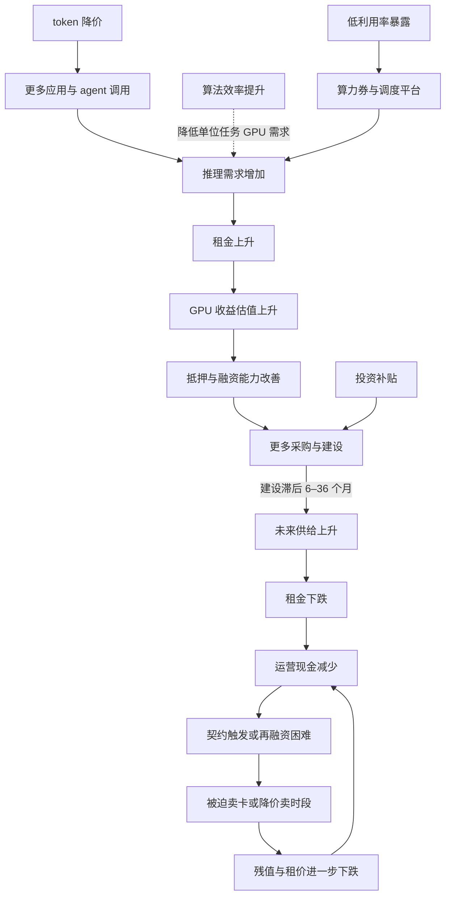

# 算力交易市场建模调研：总览与逐题回答

> 本笔记是四份详细报告的**导读与综合回答**。每个市场按同一套问题回答：交易什么 → 谁在交易 → 主体有多复杂 → 为什么交易（动机/目标函数）→ 哪些行为理性、哪些不理性、为什么。最后把三类传统市场映射到算力市场，给出第一版建模框架。
>
> 详细报告（每份 6–9 万字节，带出处和日期）：
> - [01_A股市场主体与行为](02-A_股市场的主体、动机与行为.md)（63 个来源）
> - [02_有色金属现货市场](03-有色金属现货交易市场：以铜为主线的市场结构与算力建模启示.md)（42 个来源）
> - [03_有色金属期货市场](04-有色金属期货交易市场：从铜、铝、镍到算力衍生品.md)（76 个来源）
> - [04_算力交易市场现状与主体](05-算力交易市场现状与主体.md)（68 个来源）
>
> 标记沿用报告约定：**【事实】**有公开来源；**【推断】**为经济解释或建模建议；**【待核实】**为缺口。本页数字均出自上述报告，出处见对应报告文末。信息截止日为 2026-10-28。

---

## 〇、先建立一套通用的分析框架

讲具体市场之前，先统一几个概念。后面四个市场都用这套框架拆解，建模时也可以直接沿用。

### 0.1 描述一个市场主体的“八个维度”

| 维度 | 要回答的问题 | 举例 |
|---|---|---|
| 规模 | 有多少钱、多少货、占多少份额 | 散户持股约三成，但贡献约七成成交 |
| 动机 | 为什么要进场交易 | 赚钱、避险、保供、完成考核、政策目标 |
| 目标函数 | 具体在最大化/最小化什么 | 绝对收益、相对排名、加工费、现金流不断裂 |
| 约束 | 什么限制了它的选择 | 资金、杠杆、保证金、监管、合同、预算不可结转 |
| 信息 | 它知道什么、不知道什么 | 冶炼厂知道自己库存，不知道全球需求 |
| 时间尺度 | 决策频率与持有期 | 高频量化以毫秒计，矿山投资以十年计 |
| 理性程度 | 行为在“目标+约束+信息”下是否最优 | 见 0.2 |
| 互动 | 它的对手方是谁，如何影响别人 | 套保者把价格风险转给投机者 |

### 0.2 “理性 / 非理性”怎么判断

这是你最关心的问题。四份报告的共同结论是：**很多看起来不理性的行为，换成该主体真实的目标函数和约束后，其实是理性的。**判断分三层：

1. **完全理性**：在给定目标、约束和信息下选了最优动作。例如冶炼厂卖出期货锁定价格，即使事后期货亏钱，也是理性的套期保值。
2. **约束下理性（看似非理性）**：从“整体最赚钱”看是错的，但对该主体自己的考核、合同或现金约束是最优的。典型例子：
   - 基金经理抱团买热门股：按相对排名考核，跟错了大家一起错，比独自错更安全。
   - 被迫平仓：保证金不足时只能卖出，即使明知价格被低估。
   - 年底突击采购：预算不能结转到下一年。
   - 新云低于全成本出租旧卡：只要收入覆盖可避免成本，就能改善现金流。
3. **真正的行为偏差（非理性）**：系统性、可重复、违背自身利益的偏差，例如处置效应（过早卖盈利股、死扛亏损股）、彩票偏好、过度自信、羊群/FOMO、锚定、沉没成本谬误。

> **【推断】建模原则**：先建一个“无心理偏差、但约束异质”的基线模型，再逐个加入行为偏差。否则分不清波动来自制度约束还是心理偏差。

### 0.3 “主体复杂性”的五个来源

| 来源 | 含义 | 后果 |
|---|---|---|
| 异质性 | 资金、信息、期限、目标各不相同 | 同一价格信号引出相反动作 |
| 反身性 | 价格改变预期，预期又改变价格 | 泡沫与踩踏 |
| 杠杆 | 借钱放大头寸 | 价格下跌触发强平，引发连锁抛售（保证金螺旋） |
| 委托—代理 | 操盘人与出资人的目标不一致 | 追排名、追规模、避免“独自犯错” |
| 制度/政策 | 规则改变可行动作 | 涨跌停、T+1、出口管制、补贴考核 |

---

## 一、A 股市场

详见 [01_A股市场主体与行为](02-A_股市场的主体、动机与行为.md)。

### 1.1 交易的是什么

【事实】交易的是**公司股权份额**。它是标准化的，同一只股票每一股权利相同，可以无限期持有。成交依靠交易所集中的**限价订单簿**：开盘集合竞价，盘中连续竞价，按价格优先、时间优先撮合。A 股特有的制度包括：

- **T+1**：当天买入，次日才能卖出。
- **涨跌停**：主板单日 ±10%，创业板和科创板 ±20%。
- **融资融券**：可以借钱买股，也可以借股票卖出。
- **股指期货**：可用于对冲。

量级方面，2026 年 9 月 A 股总市值约 111 万亿元，日均成交约 1.8 万亿元。

### 1.2 主体有哪些、为什么交易

| 主体 | 主要动机 | 实际目标函数 | 关键约束 |
|---|---|---|---|
| 散户（按资产分层） | 财富增值、娱乐、博取暴富 | 主观效用，含博彩快感；小资金户偏好低价“彩票股” | 信息弱、资金小、易受情绪和社交媒体影响 |
| 公募主动基金 | 管理费收入 | **相对排名**、规模增长（规模决定管理费） | 仓位与集中度限制、赎回压力 |
| 被动/指数基金 | 跟踪指数 | 跟踪误差最小 | 必须按指数权重买卖，对价格不敏感 |
| 私募 | 业绩报酬 | 绝对收益、高水位线 | 募资、清盘线 |
| 量化/高频 | 统计套利、做市价差 | 夏普比率、容量 | 监管（程序化交易报告）、拥挤度 |
| 保险、社保、养老金 | 负债匹配 | 长期稳定收益、偿付能力 | 权益仓位上限、会计波动 |
| 券商自营、做市 | 价差与佣金 | 资本回报 | 净资本监管 |
| 外资（QFII、北向） | 全球配置 | 全球相对收益 | 汇率、额度、地缘政治 |
| “国家队”（汇金、证金等） | 稳定市场 | 防止系统性踩踏，属于政策目标而非利润 | 政策授权 |
| 产业资本、上市公司 | 融资、回购、减持 | 控制权、公司价值、个人流动性 | 减持规则、信息披露 |
| 游资 | 短线题材 | 快进快出的短期收益 | 涨跌停、监管问询 |
| 监管 | 市场稳定、投资者保护 | 多目标 | — |

### 1.3 复杂性：A 股最突出的特征

【事实】**交易量和持股量严重不对称。**2014–2015 年，家庭投资者持有约 25.1% 的市值，却贡献了约 86.6% 的成交。2024 年的估计为：散户持股约 32.3%，交易量约 70%。2024 年 4 月，程序化交易持股仅约 5%，却贡献了约 29% 的成交。

【推断】换句话说，**决定价格短期波动的主体，和决定资产长期归属的主体不是同一批**。建模时必须把“持仓者”和“交易者”分开。

### 1.4 理性与非理性

| 行为 | 判断 | 逻辑 |
|---|---|---|
| 散户处置效应、过度交易、追涨 | **行为偏差** | 有大量实证；交易越多，收益越差 |
| 散户偏好低价小盘“彩票股” | **偏差**，但符合博彩效用 | 用小钱买极小概率的暴富 |
| 公募抱团热门赛道 | **约束下理性** | 相对排名考核，加上规模与管理费挂钩 |
| 指数基金不看价格买卖 | **规则理性** | 目标是跟踪指数，不是选股 |
| 2015 年杠杆资金被强平、踩踏 | **个体被迫理性，集体灾难** | 保证金约束迫使卖出，卖出又压低价格，形成螺旋（Bian 等的研究） |
| 2024 年初微盘股、雪球产品、DMA 踩踏 | 同上 | 结构化产品的敲入机制，加上杠杆与拥挤 |
| “国家队”在暴跌中买入 | **政策理性** | 目标函数是系统稳定，不是利润 |
| 2024 年 9 月政策驱动行情 | 理性预期与羊群交织 | 政策信号改变预期，随后被情绪放大 |

### 1.5 对算力建模的意义

【推断】A 股可以借鉴的是：**订单簿撮合、异质预期、杠杆螺旋、做市商、制度规则如何塑造行为**。不可直接借鉴的是：股票可无限期持有、高度标准化、可做空。而“GPU 小时”过期即作废，且高度异质。

---

## 二、有色金属现货市场（以铜为主）

详见 [02_有色金属现货市场](03-有色金属现货交易市场：以铜为主线的市场结构与算力建模启示.md)。

### 2.1 交易的是什么

【事实】交易的是**有形的实物货物**：带牌号、品牌、纯度，有交货地点和交期。定价的关键在于：现货**不是独立定价**，而是

> **现货价 = 期货基准价（LME/SHFE） + 升贴水（premium/discount）**

再配合以下机制：

- **点价/作价期（QP）**：买方在约定时段内选择以哪天的期货价结算。
- **长单/零单**：年度合同与临时成交。
- **加工费（TC/RC）**：矿山付给冶炼厂的冶炼费，冶炼厂的利润主要来自这里。
- **报价机构**：SMM、长江有色、Mysteel、Fastmarkets、Argus 等提供升贴水参考。
- **洋山铜溢价与进口套利公式**：国际与国内价差扣除运费、关税、汇率后，决定进口是否有利可图。

### 2.2 主体与动机

| 主体 | 规模锚点（来自报告02） | 动机/目标函数 | 关键特征 |
|---|---|---|---|
| 矿山 | BHP 年产铜 200 万吨以上；紫金 109 万吨 | 卖出精矿、锁定现金流；产量和成本是核心 | 投资周期长达 5–10 年，短期供给几乎无弹性 |
| 冶炼厂 | 江西铜业产能 200 万吨以上 | **赚加工费，不赌铜价**，价格风险用期货对冲 | 利润取决于 TC/RC，而不是铜价 |
| 加工厂/终端 | 线缆、电机、空调、汽车 | 赚加工费，原料成本转嫁给客户 | 需要稳定供货，库存是生产缓冲 |
| 贸易商 | Glencore 年经营 380 万吨 | 赚**时间、空间、质量价差**和物流价值；掌握信息 | 高周转、高杠杆、靠贸易融资 |
| 废料回收 | — | 精废价差 | 对价格敏感，供给弹性较大 |
| 仓储/物流 | — | 仓储费 | 库存可见性的关键环节 |
| 银行/贸易融资 | — | 利息与抵押安全 | 2014 年青岛港重复质押事件 |
| 国储 | 2021 年投放储备 | 战略安全、平抑价格（政策目标函数） | 吞吐行为可改变市场预期 |
| 政府 | 出口管制（镓/锗、锂电相关） | 产业与安全 | 规则冲击 |

### 2.3 复杂性

- **产业链很长**（矿 → 精矿 → 冶炼 → 加工 → 终端，再加上废料回收）。每一环都有库存和交期，因此有**牛鞭效应**：终端需求的小波动，被每一环的“目标库存+安全库存”逐级放大。
- **库存分三种**：可见库存（交易所仓单）、隐性库存（贸易商与保税区）、可用库存（真正能马上交付的）。【推断】这对算力极其重要，因为“挂牌的 GPU”不等于“可交付的 GPU”。
- **融资属性**：铜可以质押融资，于是出现“融资铜”。当抵押折价率收紧时（报告示例：货值从 100 跌到 90、折价率从 80% 降到 70%，借款人需要补的资金缺口为 17），会出现被迫抛货的螺旋。

### 2.4 理性与非理性

| 行为 | 判断 | 逻辑 |
|---|---|---|
| 冶炼厂、加工厂做套期保值 | 理性 | 主营是加工费，不赌价格 |
| 短缺时囤库存、多渠道重复下单 | **个体理性，集体放大** | 断供损失很大，但重复下单会让上游误判需求（牛鞭效应） |
| 贸易商在升水高时囤货 | 理性套利，有风险 | 前提是有融资和仓储能力 |
| 融资铜、重复质押 | 监管套利乃至欺诈 | 利用信息不对称；2014 青岛港案（Mercuria v Citibank） |
| 国储收储/抛储 | 政策理性 | 目标不是利润 |

### 2.5 对算力建模的意义

【推断】**GPU 硬件买卖与金属现货非常像**：经纪商和贸易商、质量异质、升贴水定价、库存、配额与交期、抵押融资、出口管制带来的区域价差。产业链映射为：

> 芯片厂 ≈ 矿山　|　OEM/ODM ≈ 冶炼厂　|　云/新云 ≈ 加工厂　|　模型推理商 ≈ 深加工　|　token ≈ 终端加工品

此外，CoreWeave 合同的加权期限约 5 年，与金属长单类似，都是用长约支撑融资。

---

## 三、有色金属期货市场

详见 [03_有色金属期货市场](04-有色金属期货交易市场：从铜、铝、镍到算力衍生品.md)。

### 3.1 交易的是什么

【事实】交易的是**未来某日交割标准化货物的合约**，而不是货物本身：

- **保证金 + 逐日盯市**：只付一小部分押金，每天按收盘价结算盈亏，亏损时必须追加保证金。LME 有特殊的折价/或有变动保证金安排。
- **交割**：通过仓单完成实物交割，多数合约到期前就会平仓。
- **基差** = 现货价 − 期货价。
- **期限结构**：
  - 正向市场（contango）：远期价格更高，表示库存充足，持有有回报。
  - 反向市场（backwardation）：近期价格更高，表示现货紧缺。
- **定价公式**：期货价 ≈ 现货价 + 仓储费 + 资金成本 − 便利收益。其中，“便利收益”指手上有现货带来的保供价值。

主要交易所包括 LME、SHFE/INE、COMEX，以及做碳酸锂的广州期货交易所（GFEX）。

### 3.2 主体与动机：三大类加基础设施

| 类别 | 主体 | 动机 | 目标函数 |
|---|---|---|---|
| **套保者** | 矿山、冶炼厂、加工厂、贸易商、国储 | **转移价格风险** | 最小化整体（现货+期货）收益的方差；最优套保比率 h* = Cov(ΔS, ΔF)/Var(ΔF) |
| **投机者** | 散户、自营、CTA（趋势跟踪）、宏观基金、指数基金 | 承担风险换取收益 | 期望收益、夏普比率；CTA 按规则追趋势 |
| **套利者** | 期现套利、跨市场（LME↔SHFE）、跨期 | 无风险或低风险价差 | 价差扣除成本 |
| **做市商** | 交易所指定做市商 | 买卖价差 | 库存风险最小化 |
| **基础设施** | 期货公司、交易所、中央对手方（CCP）、监管 | 手续费、市场完整性 | 违约不外溢 |

【事实】持仓数据可以显示各类主体的方向。2026-10-20 的 COMEX 铜 COT 报告显示：商业持仓（以套保者为主）**净空 77,406 手**，管理基金（投机者）**净多 47,690 手**。这正是“套保者把价格风险转给投机者”的典型格局。SHFE cu2611 合约前 20 名会员持仓集中度约 70%。

### 3.3 复杂性

- **杠杆和逐日盯市**造成非线性：价格不利变动 → 追加保证金 → 无钱则强平 → 进一步推动价格，即保证金螺旋。
- **实物交割的稀缺性**会被利用：如果一方控制了可交割库存，空头无货可交，就会被逼仓。
- **金融化**：指数基金和 CTA 让金属价格更多受宏观和资金流驱动，而不仅是供需。

### 3.4 理性与非理性

| 行为/事件 | 判断 | 逻辑 |
|---|---|---|
| 冶炼厂卖期货，事后期货亏钱 | **理性** | 套保看整体，现货端赚回来了 |
| 投机者净多 | 理性 | 承担风险，获取风险溢价；同时为套保者提供流动性 |
| CTA 趋势跟踪 | 规则理性，集体放大 | 动量效应，同向交易造成拥挤 |
| 1996 住友铜事件（滨中泰男） | **委托—代理与欺诈** | 交易员隐瞒亏损，长期操纵 |
| 2005 国储铜事件 | **越权投机，加上风控失灵** | 套保机构的交易员变成了大额投机空头 |
| 2022 LME 镍逼空 | 空头保证金危机，交易所干预 | 青山集团持有巨额空头，镍价一日内暴涨；LME 取消交易，后被 FCA 罚款 920 万英镑 |
| 保证金螺旋 | 个体被迫理性，集体灾难 | 与 A 股 2015 年同一机制 |

### 3.5 对算力建模的意义：最重要的一个结论

【推断】**GPU 小时不能储存，所以 GPU 租赁期货更像电力期货，而不像铜期货。**

- 铜期货可以用“持有成本”定价：今天买铜放进仓库，到期交割。
- 今天空闲的 GPU 小时无法留到下个月用，所以**持有成本套利不成立**。期货价只能由“对未来现货的预期 + 风险溢价”决定，期限结构可以剧烈变化。
- 电力市场的经验可以直接借鉴：分时段合约（基荷/峰荷）、节点价格、价格上限、现金结算。

【事实】截至 2026-10-28，算力衍生品仍处于起步阶段：

- Silicon Data 有 H100 租价指数（SDH100RT）。
- Ornn 与 ICE 合作推出 OCPI 指数。
- CME/NYMEX 计划推出以 730 GPU 小时为单位、现金结算的 H100/B200 租价期货，原定 10 月上线，后宣布延期，等待监管审查。
- CFTC 已发布《Request for Comment on the Listing of Compute Derivatives Contracts》，就算力现货市场规模、操纵风险、永续期货等征求意见（本笔记已核对官网原文）。

**目前没有成熟的算力期货成交和持仓数据。**

---

## 四、算力交易市场：GPU 租赁、GPU 买卖、token 买卖

详见 [04_算力交易市场现状与主体](05-算力交易市场现状与主体.md)。

### 4.1 三层标的：不能合并定价

| 标的 | 买到的东西 | 计价单位 | 到期后剩下什么 | 最像哪个传统市场 |
|---|---|---|---|---|
| **GPU 买卖** | 硬件所有权 | 美元/卡、节点、机柜 | 可转售的设备，但需要机房、电力和网络才能用 | **金属现货** |
| **GPU 租赁** | 指定时段使用指定硬件的权利 | GPU·小时、月租、多年集群合同 | 时段消逝，机器仍归卖方 | **电力** |
| **token 买卖** | 某模型处理输入、生成输出的 API 服务 | 每百万输入/输出/缓存 token | 生成的结果（不可转给别人复用） | **加工品/服务**，但没有固定的“投入产出率” |

【推断】三层的关系是：硬件 → 加上机房、电力和运维，成为 GPU 小时 → 加上模型和推理优化，成为 token。**同一笔最终支出会依次表现为推理商收入、云租赁收入、硬件采购，三层交易额不能相加。**另外注意，这里的 token 是模型计量单位，**不是加密货币**。

### 4.2 市场现状要点

- **GPU 租赁**分三层：
  - 超大规模云：AWS、Azure、GCP、OCI，以及国内阿里、腾讯、华为和运营商。
  - GPU 新云：CoreWeave、Lambda、Nebius、Crusoe 等。
  - 撮合平台：Vast.ai、RunPod、SF Compute、Akash。
  
  【事实】交易机制有多种：双边多年长约、承诺消费折扣、按需、可中断 spot、容量订单簿（SF Compute）、反向拍卖（Akash）。AWS 的 spot 价格是平台逐步调整的，**并非实时竞价**。
- **中国**：国家算力网**不是统一交易所**，而是由上海、北京、贵州、宁夏、武汉等多个平台互联，并叠加算力券和地方智算中心。
  - 【事实】截至 2026-08，官方公布有 20 余家调度主体入驻国家试验验证平台，145 万 PFLOPS（FP16）纳入监测。
  - 【事实】“接入”“可调度”“已成交”是不同口径。
- **价格**：H100 复合租价从 2023 年下半年的 6.62 美元/小时，降到 2025 年 7 月的 2.79 美元。【事实】2026 年一年期合同价反而回升到 2.00–2.70 美元，**不是单边下跌**。2026-10 的指数水平约为：A100 1.56、H100 2.90、H200 3.47、B200 6.47 美元/GPU·小时。
- **GPU 买卖**：
  - 一级市场是配额加交期，而不是统一价格。
  - 二级市场靠经纪商。H100 SXM5 二手报价约 2.2–2.7 万美元，仅为单一卖方报价。
  - 出口管制造成区域分割：2026-01-13 起，BIS 对 H200 等改为逐案审查（已核对官网）。
  - GPU 抵押贷款已经存在（CoreWeave 2023 年融资 23 亿美元）。
- **token**：
  - 输入、输出、缓存、Batch、高低峰、优先级各自定价。
  - 能力成本前沿在 2022–2024 年下降超过 280 倍，但同一厂商在升级后也会涨价。
  - 聚合路由（如 OpenRouter）与灰色中转（账号来源和模型身份有风险）要分开对待。

### 4.3 主体、动机与目标函数

| 主体 | 为什么进场（动机） | 目标函数 | 关键约束 | 类比 |
|---|---|---|---|---|
| 芯片厂（NVIDIA、AMD、国产） | 卖卡、扩大软件生态 | 利润 + 生态延续 | 先进制程、HBM、封装、出口许可 | 矿山 |
| OEM/ODM、集成商 | 集成和交付 | 集成毛利 − 资金占用 | 配额、营运资金、验收 | 冶炼厂 |
| 超大规模云 | 云生态与客户留存 | 整体生态利润（GPU 单项低毛利也可接受） | 资本预算、供电 | 综合加工巨头 |
| GPU 新云 | 把 GPU 变成租金 | 名义上是长期利润，**实际常是“下期现金不断裂”** | 高杠杆、客户集中（CoreWeave 2025 年 Microsoft 约占收入 67%） | 高杠杆贸易商/加工厂 |
| IDC/电力/矿工转型 | 提高电力和土地的价值 | 长期可收费功率的现金流 | 并网、冷却；矿场 MW 不等于 AI 可交付容量 | 仓储/能源 |
| 金融资本（PE、私募信贷、银行、ABS） | 风险调整收益 | 利息、抵押回收、股权增值 | 难判断技术残值；客户与抵押品同受 AI 需求冲击（错向风险） | 贸易融资银行 |
| 大实验室/模型公司 | 保证训练集群、抢发布窗口 | 研发速度 + 产品收入 − 成本 − 延期损失 | 资金、需要大规模同质互联集群 | 大型终端用户（签长单） |
| AI 应用公司 | 服务用户 | 单客毛利、现金跑道 | 质量、SLA、预算 | 中小加工厂（买零单） |
| 科研机构 | 按期完成实验 | 科研产出、公平 | 预算周期、采购规章 | — |
| 个人开发者 | 学习、项目 | 效用 − 价格 − 维护时间 | 小额资金 | 散户 |
| 撮合平台、经纪商 | 降低搜索与验货成本 | 佣金 − 履约/声誉损失 | 市场异质、薄 | 经纪商/报价机构 |
| token 中间商 | 路由服务费（合法）或价差（灰色） | 服务毛利；灰色者追逐短期现金 | 上游封禁、身份风险 | 贸易商 / 灰色渠道 |
| 政府/公共平台 | 产业、科研、安全、区域发展 | 多目标公共效用；**考核口径决定行为** | 财政、能耗、任期与投资周期错配 | 国储 + 监管 |

**一个关键区别**：A 股和金属期货里有大量**纯投机者**，但目前算力市场几乎**没有纯金融投机者**。因为没有标准化、可做空、能现金结算的合约，参与者基本都是有实际用途或实际资产的产业主体。【推断】一旦 CME 或 ICE 的指数期货上线，投机者、CTA 和做市商才会进入，市场性质会改变。这是一个值得在模型中做情景对比的结构性变量。

### 4.4 理性与非理性：算力市场的典型行为

| 观察到的行为 | 可能的理性解释 | 可能的行为偏差 | 如何识别 |
|---|---|---|---|
| 2023–2024 年抢卡、提前下单 | 断供损失大、项目时间价值高、交期不确定 | FOMO、羊群、过度外推 | 对比自有任务增长与订单增长；检查重复下单与取消 |
| 签多年固定价格长约 | 保供，并支持供应方融资 | 锚定短缺时期的价格，低估代际替代 | 比较有效任务成本，而不只比较单卡小时价 |
| 低于全成本出租旧卡 | 覆盖可避免成本，减少空置 | 拒绝承认减值，延迟退出 | 是否有更高价值用途，电费能否覆盖 |
| 继续建设低利用率中心 | 已签合同、政策外部性 | **沉没成本谬误**、地方竞赛、规模崇拜 | 只看“从今天起追加投入”的净收益 |
| token 降价或免费 | 真实成本优化（缓存、批处理）、获客 | 只追调用量，忽视付费转化 | 观察优惠结束后的留存和真实付费量 |
| 追逐新一代芯片 | 每任务、每瓦成本改善 | 技术光环、彩票偏好 | 用真实负载做基准测试 |
| 高息借款买卡 | 赶上高价值合同的交付窗口 | 为维持估值盲目扩张 | 看是否有已签约的付费需求对应 |

【事实】中国的闲置问题有报道依据，但口径不一。科技日报 2025 年报道，某西部千卡中心上架率不足 50%、利用率不足 30%；另有报道引用全国智能算力使用率 36.8%（原表与分母【待核实】）。同时也有公司自报使用率接近 100%。**低利用率与高利用率并存，本身就说明市场高度异质。**

【事实】循环融资确实存在：NVIDIA 投资 CoreWeave，CoreWeave 买 NVIDIA 卡，NVIDIA 又承诺购买 CoreWeave 未售出的容量（63 亿美元）。【推断】**存在循环关系不等于已证明是泡沫**。需要检验的是：不依赖关联方的终端收入，能否覆盖整个链条的投入。

### 4.5 复杂性：算力市场为什么比股票和金属都难建模

| 维度 | 股票 | 金属 | **算力** |
|---|---|---|---|
| 可储存 | 可以 | 可以（有仓储费） | **硬件可存，GPU 小时不能存** |
| 同质性 | 高 | 中（有牌号标准） | **极低**：型号、显存、互联、地点、连续时长、SLA 共同定义商品 |
| 折旧 | 无物理折旧 | 几乎不折旧 | **快**：物理寿命、经济寿命、合同期、会计折旧（CoreWeave 按 6 年）是四个不同概念 |
| 供给调整 | 快 | 慢（数年） | 制造、整机、机房、并网多环节滞后，缺一环就不能交付 |
| 需求结构 | 可小额分散 | 工业需求 | **训练需要成批同质卡同时可用（互补性）**；推理可切分 |
| 交割 | 即时 | 仓单 | 必须是“某地、某配置、某时间窗口连续可用” |
| 加工转换 | 无 | 有稳定投入产出率 | GPU 小时 → token 的转换率随模型、精度、批量剧烈变化 |
| 套利 | 容易 | 运输成本 | 数据搬运、出口管制、数据驻留、集群分割都会阻碍套利 |
| 清算 | 集中清算 | 交易所清算 | **以双边合同为主，履约与质量验收比价格更重要** |

### 4.6 四条核心反馈回路

1. **扩张正反馈**：租金上升 → 融资更容易 → 更多建设。由于建设滞后，**当前短缺与未来过剩可以同时存在**。
2. **杠杆负反馈**：租金下跌 → 现金紧张 → 被迫抛售 → 残值下跌 → 其他借款人的抵押品贬值。机制同 A 股 2015 年和金属融资铜，但设备贷款的规则不同于每日盯市。
3. **技术反身性**：token 降价带来更多需求，算法进步又减少单位需求。两股力量谁占主导，取决于需求弹性。
4. **政策反馈**：补贴建设 → 低利用率 → 用算力券刺激使用 → 再扩张。**考核口径决定这条回路的方向。**

---

## 五、跨市场映射：从传统市场借什么、不借什么

| 可借鉴的机制 | 来源市场 | 适用的算力标的 | 不能直接照搬的地方 |
|---|---|---|---|
| 限价订单簿、做市、异质预期 | A 股 | 已标准化的 SKU+时段（如 SF Compute） | 做空、无限可分、即时交割、统一盯市 |
| 杠杆螺旋、强制平仓 | A 股 / 金属期货 | 新云的设备贷款 | 设备贷款按契约触发，不是每日追保 |
| 散户 / 机构异质 | A 股 | 个人开发者 vs 大实验室 | — |
| 升贴水定价、经纪商、质量折价 | 金属现货 | GPU 二手与一级配额 | 无统一“纯度标准” |
| 产业链、牛鞭效应、扩产滞后 | 金属现货 | GPU 供应链、多渠道重复下单 | — |
| 长单 vs 零单 | 金属现货 | 多年集群合同 vs 按需/spot | — |
| 融资铜、抵押折价 | 金属现货 | GPU 抵押贷款、ABS | GPU 残值下跌速度远快于金属 |
| 区域价差、进口套利 | 金属现货 | 出口管制下的中外价差 | 管制改变的是“能否交易”，而不只是加价 |
| 套保者 vs 投机者、COT 持仓 | 金属期货 | 未来算力指数期货 | 目前没有投机者群体 |
| 持有成本定价 | 金属期货 | **不适用于 GPU 小时** | GPU 小时不可储存 |
| 分时合约、节点价格、价格上限 | **电力** | GPU 租赁 | 电力同质，GPU 不同质 |
| 加工费、加工利润 | 金属加工 | GPU 小时 → token | 转换率随任务变化，不固定 |

---

## 六、第一版建模框架（建议）

完整规格见 [04_算力交易市场现状与主体](05-算力交易市场现状与主体.md) 第十节，以及 [01_A股市场主体与行为](02-A_股市场的主体、动机与行为.md)、[02_有色金属现货市场](03-有色金属现货交易市场：以铜为主线的市场结构与算力建模启示.md)、[03_有色金属期货市场](04-有色金属期货交易市场：从铜、铝、镍到算力衍生品.md) 各自的“建模启示”章节。下面是综合后的最小版本。

### 6.1 结构：三层市场 × 两条区域线 × 五类账本

- **三层**：硬件所有权、GPU 时段、token 服务。
- **两条区域线**：全球开放市场与中国境内市场。两者通过受许可约束的硬件流相连。中国线额外加入政府、算力券、国产芯片适配和跨域调度。
- **五类账本**：
  1. 设备与所有权
  2. 容量日历：未来每个时段卖给了谁，同一时段不能重复卖
  3. 任务队列与完成质量
  4. 合同义务、预付与应收
  5. 现金、债务与抵押

  一家公司可以同时扮演多种角色，但资产和收入不能重复计数。

### 6.2 第一版只需 6–7 类主体

| 主体 | 最小状态 | 决策规则 |
|---|---|---|
| 供给方（云/新云/智算中心） | GPU 队列、容量日历、利用率、长约、债务、现金 | 按利用率调价：p(t+1) = max{底价, p(t)·exp[k(u(t)−u*)]}；在融资和电力可行时扩产；**现金约束优先于账面利润** |
| 大买方（模型公司） | 训练任务、截止期、预算、长约 | 比较“长约 / 自建 / 按需”的风险调整任务成本，加上延期损失 |
| 弹性买方（应用公司、开发者） | 请求到达率、质量阈值、余额 | 在满足质量和 SLA 的方案中选最低总成本，失败要重试 |
| 推理商（GPU 小时 → token） | 吞吐函数、模型、缓存 | 加工利润 = token 收入 − GPU 成本 |
| 撮合平台/经纪商 | 订单、质量评分、库存（可选） | 先按兼容性筛选，再匹配 |
| 金融方 | 可贷资金、LTV、DSCR 阈值 | 按压力情景下的清算值放贷，按契约触发处置 |
| 政府（中国线） | 补贴预算、考核指标 | 分配算力券、设准入；考核口径作为可调参数 |

### 6.3 四种清算机制并存

1. **双边长约**：谈判后锁定日历，附带预付和 take-or-pay 条款。
2. **挂牌价 + 配额**：普通云的按需/spot 由平台调价，不建模为竞价。
3. **订单簿或反向拍卖**：仅限标准化的 SKU、地点和时段。
4. **RFQ/报价撮合**：二手硬件，带质量折价。token 则按请求级路由。

### 6.4 时间尺度

请求和推理用秒或分钟，spot 租赁用小时，现金和合同用日或月，建设与采购用月（滞后 6/18/36 个月三档）。**如果都按年更新，就看不到缺货、价格战和现金危机。**

### 6.5 建议优先做的五个对比实验

1. 同样总卡数下，**互联碎片化**对缺货与闲置的影响。
2. **长约比例上升**：融资更稳定，但 spot 市场更薄。
3. **算力券（补需求）vs 建设补贴（补供给）**对有效利用率的不同影响。
4. 技术突破在不同**需求弹性**（0.5 / 1 / 2）下是否导致总支出反弹。
5. 抵押估值内生化后，**清算是否放大租金下跌**。

此外还有一个值得加的实验：**引入指数期货和投机者前后**，现货波动与套保效果的变化。

### 6.6 参数：经验锚点与实验区间要分开

【事实】可用作锚点的数据：

- H100 租价轨迹（6.62 → 2.79 → 2026 年一年期 2.00–2.70 美元）
- 各代相对租价
- 合同期限（1–6 年；IDC 10–15 年）
- 预付款（20%–25%）
- 会计折旧 6 年
- 客户集中度（CoreWeave 案例）

【推断】只能作实验区间的参数：利用率三簇（0.2–0.4 / 0.5–0.7 / 0.8–0.95）、LTV（0.3/0.5/0.7）、清算折价（20%/40%/60%）、FOMO 超买幅度（10%/30%/50%）、需求弹性。**这些不是行业统计。**

### 6.7 验证顺序

1. **守恒检查**：容量、所有权、现金、收入。
2. **匹配特征事实**：H100 价格趋势、期限价差、供应者价差、利用率分层。
3. **尾部情景**：大客户违约、二手折价。

---

## 七、待核实清单（数据缺口）

建模时这些参数**不要硬填**，宜设为情景或敏感性区间：

| 缺口 | 现状 |
|---|---|
| 全球/中国三层市场规模与各主体份额 | 无消重口径的统一数据 |
| H200/B200 在 2024–2025 年的连续价格；中国四型号租价历史 | 断档 |
| 中国平均利用率（30%？36.8%？） | 指标定义与分母不统一 |
| GPU 二手真实成交残值、中国区溢价 | 只有报价，无成交数据 |
| GPU ABS 发行规模与回收率 | 只有评级研究，无发行全样本 |
| H20/H200 对华实际逐批供给 | 许可、进口、发货、收入确认是四个不同事件 |
| 字节豆包 2026 年完整 API 价格 | 官方页面抓取超时 |
| token 灰色中转规模与欺诈率 | 只有个案调查 |
| CME/ICE 算力期货正式上市与流动性 | 已延期，待监管审查 |
| 地方平台“交易额”口径 | 合同额还是结算额、是否含转售与补贴，均不清楚 |

---

## 八、一句话总结

- **A 股**教你：**交易者≠持有者**；异质预期、委托—代理和杠杆会让个体理性汇成集体踩踏。
- **金属现货**教你：**实物市场靠“基准价+升贴水”、长单与零单、库存与融资运转**。GPU 硬件买卖最像它。
- **金属期货**教你：**套保者转移风险、投机者承接风险**；保证金螺旋与逼仓是尾部风险来源。但持有成本定价**不适用于不可储存的 GPU 小时**，后者应参考电力市场。
- **算力市场**的本质是：**异质、不可储存、快速折旧、长约主导、高杠杆、强政策**的三层市场。目前几乎没有纯金融投机者，判断行为是否理性的关键，在于识别每个主体真实的**目标函数与约束**（现金约束、考核口径、交付窗口），而不是事后的价格。