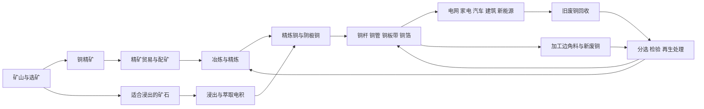

# 有色金属现货交易市场：以铜为主线的市场结构与算力建模启示

> 调研截止：2026-10-28。对象：中国及跨境有色金属实物贸易，兼顾相关期货、信用与仓储网络。

## 摘要

铜现货市场是一张连接生产、贸易、加工、物流与信贷的合同网络。成交不仅确定价格，还确定品牌、地点、交期、付款和货权；期货提供公共价格基准，升贴水表达局部稀缺性。矿山、冶炼厂和加工厂赚取不同利润，全球铜不缺也可能出现某地可用货短缺。库存与信用相互强化，融资收缩能触发跨主体抛售。GPU 买卖可借鉴这种市场结构，但须加入配置差异、技术过时与机房电力约束；GPU 租赁和 token 则须按到期消失的服务能力建模。本文给出主体画像、定价公式、反馈机制和可执行的 ABM 起点。

### 阅读方法与证据边界

- **【事实】**：有公开来源支持的制度、披露或事件；公司自述只证明该公司披露了什么，不代表独立审计结论或全市场统计。
- **【推断】**：经济解释、行为假设、建模方案、教学算例。这里的参数试验区间不是行业实测范围。
- **【待核实】**：缺乏可比公开统计、来源版本不明或尚需交易级数据确认的内容。
- 无日期的方法论和产品页注明“发布日期未标注，访问 2026-10-28”；不以搜索引擎抓取时间充当发布日期。2026 全年数据尚未形成，预测与实际值分开使用。

## 一、外行如何理解“现货市场”

### 1.1 买到的是一批具体货，以及一组履约承诺

【推断·解释】假设一家电线厂下周需要铜。采购员联系冶炼厂和贸易商，询问：“哪个品牌、多少吨、在哪个仓库、能否明天提走、开何种发票、付款后交货还是给账期？”双方确认后，可能只转移仓库里的货权，也可能装车运到工厂。货权转移、实物移动和付款可以发生在不同日期。

【事实】LME 对实物合同的介绍明确区分基准金属价格与具体物料的溢价；港口、运输和交付条件会影响后者。上期综合业务平台也允许标准仓单采用固定全价或“指定月份期货合约＋升贴水”挂牌。因此，现货可以线上交易，也可以高度标准化；“现货＝只能线下、完全非标准化”并不成立。[LME 实物合同定价说明](https://www.lme.com/Education/Online-resources/LME-Digest/How-are-the-LME-prices-referenced-in-physical-contracts)（发布日期未标注，访问 2026-10-28）；[上期平台常见问题](https://otc.shfe.com.cn/home/question/)（发布日期未标注，访问 2026-10-28）。

### 1.2 与交易所集中撮合股票的区别

【推断·制度比较】以下比较普通交易所股票交易与主流金属实物贸易，不排除股票大宗交易、金属电子平台等例外。

| 维度 | 集中撮合股票 | 铜现货贸易 | 模型影响 |
|---|---|---|---|
| 标的 | 同一证券代码下的股份高度同质 | 铜有标准牌号，但品牌、形状、地点、税务及交期不同 | 商品须带属性向量 |
| 成交方式 | 公开订单簿和统一撮合规则 | 熟人网络、经纪询价、双边议价、招标、平台挂牌并存 | 采用询价和关系网络，不能只用一个订单簿 |
| 交易关系 | 通过集中清算结算基础设施完成 | 常须评估具体对手方信用及履约能力 | 信用额度决定谁能与谁成交 |
| 价格 | 同一时点同一股票有公开报价 | 同一时刻可有多个合理的到厂价格 | 价差未必是套利机会 |
| 结算与交付 | 资金和证券账户记录转移 | 货款、仓单、发票、质检、运输和报关多步骤 | “成交”不能直接等同“可生产使用” |
| 库存 | 股份不被工业生产消耗 | 铜进入铜杆、汽车等产品，退出流通库存 | 必须满足物料守恒 |
| 持有成本 | 主要为资金成本等 | 资金、仓租、保险、装卸、损耗与合规成本 | 决定跨期价差和库存选择 |

【事实】铜仍有很强的标准化基础：上海国际能源交易中心现行交割细则要求阴极铜满足注册品牌、质量证明和入库检验等条件，国际铜交割单位为 **25 吨**。这是期货交割子市场的规则，不等于所有铜现货交易都必须按该单位成交。[能源中心交割细则](https://www.shfe.cn/regulation/ineregulation/businessmethods/delivery/202606/t20260626_832297.html)（2026-06-26）。

【推断】现货的关键是以实物或其货权为履约核心，并按合同约定交收；“现”不保证当天付款、当天到厂。实物远期供货合同也属于产业实物贸易网络，须与标准化期货合约区别。现货总成交吨数还会重复包含同一批铜在贸易商之间的转手，不能直接当成最终消费。

## 二、铜产业链：同一种金属对应不同的利润池



【事实】铜既有精矿冶炼路线，也有浸出—萃取—电积路线；再生料可作为精炼原料，部分合适废料直接进入加工。图中为流程概括，并不表示所有废铜都能直接制成所有铜材。[ICSG《World Copper Factbook 2025》](https://icsg.org/download/2025-10-the-world-copper-factbook/)（2025-10-13，下载页后续有更新）；[IGF/OECD 铜定价框架征求意见稿](https://www.igfmining.org/wp-content/uploads/2025/07/igf-oecd-draft-copper-transfer-pricing-framework.pdf)（2025-07，征求意见稿）。

### 2.1 矿山与精矿：卖的是可计价金属含量

【事实】精矿合同通常围绕干重、铜含量、可计价比例、金银等伴生金属、杂质罚款和作价期组织。**TC** 是处理费，通常按美元/干吨精矿计；**RC** 是精炼费，常按美分/磅可计价铜计。两者不能直接相加，也不能把一吨精矿当成一吨铜。[IGF/OECD 铜定价框架征求意见稿](https://www.igfmining.org/wp-content/uploads/2025/07/igf-oecd-draft-copper-transfer-pricing-framework.pdf)（2025-07）。

【推断·简化合同公式】

$$
V_{精矿}=Q_{干吨}\,g_{铜}\,a_{计价}\,\bar P_{QP}
+V_{金银等计价}-Q_{干吨}TC-Q_{可计价铜磅}RC/100-杂质罚款
$$

这里的 $a$ 是可计价比例，$QP$ 是约定作价期。实际合同还会涉及水分、检验仲裁、运费、暂结算和尾款；公式只能作为 ABM 的最简交易接口。

【推断】精矿多、冶炼能力少时，冶炼厂更容易提高 TC/RC；精矿少、冶炼能力多时，矿山议价能力上升，TC/RC 下降。年度长单 Benchmark 是大买卖双方谈判形成的参照，不是政府统一指导价，更不保证每份合同同价。

【事实】IEA 2026 年分析记录：2025 年相关年度 TC 基准约 **21 美元/吨**；2026 年初该代表性年度 TC/RC 基准降至 **0 美元/吨与 0 美分/磅**，同时现货加工费在此前已出现负值。基准来自特定矿商与中国冶炼企业的年度协议，不能外推为所有地区和所有合同加工费均为零。[IEA 铜冶炼专题](https://www.iea.org/commentaries/copper-prices-have-hit-record-highs-but-smelters-face-mounting-strategic-pressures/)（2026-03-02）。

### 2.2 冶炼厂：铜价高，不保证加工利润高

【推断·目标函数】外购精矿冶炼厂的贡献利润近似为：

$$
\Pi_{冶炼}=TC/RC收入+净副产品收益+金属回收收益+阴极铜升水
-能源-人工-维护-物流-融资-套保残余损益。
$$

“净副产品收益”要扣除已支付给矿商的金银计价及相关成本，不能把全部副产品销售额都算作冶炼利润。自有矿冶炼一体化企业还须在集团层面合并评估，避免内部转移价格制造虚假盈利。

【事实】IEA 指出，副产品金银、硫酸及精炼铜升水可缓冲低加工费；有自有矿的冶炼厂与完全外购原料的冶炼厂承压不同，一些企业还存在产量目标等约束。[IEA 铜冶炼专题](https://www.iea.org/commentaries/copper-prices-have-hit-record-highs-but-smelters-face-mounting-strategic-pressures/)（2026-03-02）。

【推断】因此短期负 TC 不能机械触发停产。连续生产设备的停启成本、长单原料、伴生收益、现金成本与债务偿付，都会改变停产阈值。模型至少分别记录原料库存、产成品库存与现金流。

### 2.3 精炼铜、加工与终端：传导有时滞，也有替代

【推断·解释】铜杆主要进入电线电缆；铜管服务制冷换热等用途；铜板带、铜箔等进入电气、电子和电池等产品。电网建设、家电排产、汽车及新能源订单最终改变加工厂补库。终端用户可能买的是电缆或铜管，并不亲自交易阴极铜。

【事实】IEA 2025 年报告将中国电网投资扩张列为此前两年铜需求增长的重要来源，说明“新能源增长”不宜只用新能源汽车销量一个变量代表。[IEA《Global Critical Minerals Outlook 2025》执行摘要](https://www.iea.org/reports/global-critical-minerals-outlook-2025/executive-summary)（2025-05-21）。

【推断】加工厂常力图获得“铜材售价－铜原料成本”的加工收益。销售和采购的基准月份、数量及点价时间一致，才能较好锁住金属成本；订单取消、回款拖延和废料损耗仍会侵蚀收益。需求可近似为“订单量×单位耗铜”，加入取消率、良率和以铝代铜等替代选择。

### 2.4 废铜与再生铜：第二条供给链

【推断】加工边角料形成快、来源较可预测；报废电缆、建筑和车辆形成的旧废铜取决于历史资产存量、回收网络和拆解活动。价格上涨可能鼓励回收，也可能使持货人惜售，短期响应方向并不固定。

废铜折价需覆盖铜含量、污染杂质、分拣和熔炼损耗、发票及交付差异。判断“精废价差”是否足以推动替代，应比较**每吨合格成品的总成本**，而非两个报价直接相减。对高导电率、纯度或稳定性有要求的产品，替代受质量约束。

【待核实】本次未确认可与“直接利用废铜＋再生精炼铜”统一口径的 2026 年再生占比，因此不引用单一“废铜占铜供应多少”的比例。再生精炼铜不能在精炼铜总产量之外再次加总。

## 三、价格如何谈成：基准、升贴水与合同条款

### 3.1 “期货价格＋升贴水”到底是什么意思

【事实】LME 铜官方结算价被广泛用于实物铜合同；国内 SMM 电解铜升贴水页面明确以 SHFE 当月合约为参照，并规定上海主流仓库自提等条件。因此行业所说“期货价”须落实为哪家交易所、哪个合约或官方价格、哪个时点或均价。[LME 实物定价说明](https://www.lme.com/Education/Online-resources/LME-Digest/How-are-the-LME-prices-referenced-in-physical-contracts)（发布日期未标注，访问 2026-10-28）；[SMM 电解铜升贴水规格](https://hq.smm.cn/copper/category/201102250185)（动态规格页，访问 2026-10-28）。

【推断·价格分解】

$$
P_{合同}=P_{指定基准,指定QP}+\pi_{品牌/质量/地区/交期}
+C_{额外交付}+C_{信用及账期}+T_{适用税费}。
$$

这是一种核算分解。若报价已含运费、税费或某项溢价，就不能再加一次。不是全部有色品种、全部合同都用期货加法定价；指数乘折扣、加工系数及固定全价也存在。

【推断·教学算例，非真实行情】约定某沪铜合约点价 **80,000 元/吨**、升水 **200 元/吨**，同一含税及交付口径下合同价为 **80,200 元/吨**。若另约定送厂运费，再按合同加计。升水 200 表示这批现货相对该基准的差额，并不表示铜价整体上涨了 200。

### 3.2 点价、作价期与“价格敞口”

【事实】实物合同可引用日价、月均价等基准，生产者和消费者可以选择锁价或浮动；对实物升贴水的风险仍需另外处理。[LME 实物定价说明](https://www.lme.com/Education/Online-resources/LME-Digest/How-are-the-LME-prices-referenced-in-physical-contracts)（发布日期未标注，访问 2026-10-28）。

【推断·合同状态】点价相当于在约定窗口内把浮动基准转成已知价格。作价期规定使用哪些交易日的价格，可能是装船月、到货后某月或其平均。数量已签、货已发、金额未最终确定并不矛盾；暂付款与最终补差会增加营运资金需求。必须记录由买方还是卖方持有点价权、截止日及逾期处理。

【推断】套保看的是价格敏感度，不只是库存吨数：持有已定价铜而未来销售未定价，通常暴露于跌价风险；未来需买铜、销售售价已锁定，则通常怕涨价。反之，已定价销售合同可能抵消库存敞口。可定义：

$$
\Delta_{金属}=\partial(资产价值-合同负债价值)/\partial F,
\qquad H_{目标}\approx-\Delta_{金属}。
$$

同一账面库存可以对应不同目标套保头寸。用当月现货对冲远月主力，还会留下跨期基差；交付品牌、地区与货币不同，又产生质量、地域和汇率风险。

### 3.3 长单与零单

| 维度 | 长单／长协 | 零单／临时现货 |
|---|---|---|
| 【推断】主要功能 | 保供、安排产销与信用关系 | 补缺口、处理超产库存、试新交易对手 |
| 【推断】谈判变量 | 年度或周期数量、容差、分批交货、基准与升水重置、账期 | 当批数量、即时可提性、现金条件和当时升贴水 |
| 【推断】价格性质 | 可以长期锁量但价格浮动，也可以部分锁价 | 也可以先锁升水、后点基准 |
| 【推断】核心风险 | 市场变化后合同价格偏离、需求不足、违约与重新谈判 | 短缺时买不到货、临时融资贵、信息不完整 |

【待核实】铜各环节 2024—2026 年长单比例、点价权分配及账期分布缺少统一公开统计。精矿采购、阴极铜进口、贸易商国内转手不能共用一个“长单占比”。

### 3.4 报价平台提供什么，不提供什么

| 平台／系列 | 【事实】可观察对象与依据 | 【推断】建模使用方式与边界 |
|---|---|---|
| SMM 上海有色网 | 电解铜现货价、升贴水、精矿及再生料等；价格来自符合其标准的交易、报价与评估信息 | 建立“评估价观测器”，保留采样窗口、样本及规格，不能当作全市场成交均价 |
| 长江有色 | 平台区分“长江现货”和“长江综合”，前者与长江经济带交易参考相关 | 合同须写明具体系列；不同系列不可直接拼接 |
| 上海物贸等传统现货报价 | 公开研报仍使用“平均价：铜：上海物贸”等数据系列 | 作为历史可比序列前，核实原始发布者、现行采价方法和版本 |
| Mysteel | 电解铜方法论、现货及保税区库存等数据 | 将库存样本范围、调查频率作为观测误差来源 |
| Fastmarkets | 铜阴极升水等价格评估，其上海 CIF 升水有专门方法论 | 可作区域升水参照；不同机构规格不同须先标准化 |
| Argus | 非铁金属方法论列出质量、批量、交付窗口、地区及报价单位 | 可借鉴其合约规格字典及进口套利计算口径 |

来源：[SMM 方法论目录](https://www.smm.cn/methodology/base-metals)（动态页，访问 2026-10-28）；[SMM 铜采价公告](https://news.smm.cn/news/100774051)（2017-12-29）；[长江平台价格声明](https://www.ccmn.cn/helpCenter/long_river_price.html)（发布日期未标注，访问 2026-10-28）；[中证鹏元公开报告中的上海物贸序列](https://file.finance.sina.com.cn/211.154.219.97%3A9494/MRGG/CNSESZ_STOCK/2025/2025-6/2025-06-30/11209929.PDF)（2025-06-30）；[Mysteel 电解铜方法论](https://mfs.mysteelcdn.com/group1/M00/15/E3/rBL64GnDiTyAL8JQAAdhjTIXVi0274.pdf)（所获版本发布日期未确认）；[Fastmarkets 铜阴极升水方法论](https://www.fastmarkets.com/uploads/2024/05/fm-mb-copper-cathode-premium.pdf)（2024-05 目录版本）；[Argus 非铁金属方法论](https://www.argusmedia.com/-/media/project/argusmedia/mainsite/english/documents-and-files/methodology/argus-non-ferrous-markets.pdf?rev=3037fcf822964b35a2c3d0c94fa56e6f)（2026-05 更新）。

【待核实】“上海物贸报价”“上海金属网 SHMET”“上海有色金属交易中心 SME”不应仅凭名称相近就视为同一序列。本次未获得上海物贸铜报价当前完整采价规则，因此不编写其发布时点、覆盖份额或直接将 SHMET 当作替代。

### 3.5 洋山铜溢价、LME“升水”与进口窗口

【事实】SMM 洋山铜溢价方法论区分保税仓单货和提单货，参照 LME 铜价，反映相应条件下的进口铜现货溢价；两者交期、货权和物流状态不同。[SMM 洋山铜溢价方法论](https://static.smm.cn/comp.smm.cn/2.0.12/static/comp.smm.cn/pdf/v3/en/SMM%20Yang%20Shan%20Premium%20Methodology.pdf)（发布日期未标注；访问 2026-10-28 时可检索文本，原链接重开失败，正式取数前需更新版本）。

【推断】“LME 升水”存在歧义：一是某地某品牌实物相对 LME 基准的溢价；二是 LME Cash 相对 3M 的跨期价差。后者是期限结构，不是运到上海的到岸加价。数据库应分别设 `physical_premium` 和 `cash_minus_3m`。

【推断·进口核算】用同一时点、币种及税务口径计算：

$$
\Pi_{进口/吨}=P_{国内可实现售价}
-\left[(P_{LME,匹配QP}+\pi_{进口})FX+C_{物流清关}
+C_{融资}+T_{净税负}+C_{套保及换月}\right]。
$$

【事实】Argus 方法论的进口套利指标同样对齐沪铜近月基准、国内现货升水、LME 衍生近月价、CIF 升水、汇率、增值税及行政费用，说明简单沪伦价格比不足以定义盈利。[Argus 非铁金属方法论](https://www.argusmedia.com/-/media/project/argusmedia/mainsite/english/documents-and-files/methodology/argus-non-ferrous-markets.pdf?rev=3037fcf822964b35a2c3d0c94fa56e6f)（2026-05）。

【推断】“窗口打开”表示某组条件下进口具有经济吸引力，不保证立即有可买的合格货，也不保证可以获得信用证和运力。CIF 已包含约定运输保险内容，不能重复加计。可抵扣增值税主要形成现金占用与时点问题，不能全部当永久成本。出口还须另查税制、退税、品牌准入和政策，不能将进口公式简单反号。

【待核实】截至截止日的具体税率、税号、退税和国别限制不在本文固定为单值；实际模拟应接入生效日期明确的政策表。

## 四、市场主体逐一展开

### 4.1 谁在场，规模如何理解

【事实／待核实】下面提供公开披露的规模锚点。公司产量、经手量、营业额与交易所成交量是不同口径；企业之间经手同一批货还可能重复计算。除特别注明外，不据此推算市场份额。

| 主体 | 代表、规模锚点与来源 |
|---|---|
| 矿山企业 | 必和必拓 FY2025 铜产量超过 **200 万吨**，财年止于 2025-06-30，不能当自然年；[BHP 经营报告](https://www.bhp.com/news/media-centre/releases/2025/07/bhp-operational-review-for-the-year-ended-30-june-2025)（2025-07-18）。自由港 2025 年矿山铜产量约 **34 亿磅**，为合并口径；[FCX 2025 Form 10-K](https://www.sec.gov/Archives/edgar/data/831259/000083125926000012/fcx-20251231.htm)（2026-02 披露）。紫金披露 2025 年矿产铜约 **109 万吨**；[紫金年报新闻](https://www.zijinmining.com/news/news-detail-122647.htm)（报道年报于 2026-03-20 发布）。江铜也有矿山业务，不能只归为冶炼厂 |
| 冶炼企业 | 江铜、铜陵有色、金川及海外冶炼厂。江铜披露 2026 年上半年报告时，阴极铜年产能超过 **200 万吨**，自有矿年产铜精矿含铜约 **20 万吨**、不含第一量子权益产量；这是不同产品和产能/产量口径。[江铜半年报](https://static.cninfo.com.cn/finalpage/2026-08-26/1225505938.PDF)（2026-08-26） |
| 国际贸易商 | 嘉能可兼有矿山与贸易，2025 年铜金属及精矿营销量 **380 万吨含铜量**，不等于自产或全球独占供应；[嘉能可年报第 50 页](https://www.glencore.com/.rest/api/v1/documents/static/9b103e11-72e7-40bf-ae7c-eabe57361522/GLEN-2025-Annual-Report.pdf)（2026-03-10）。托克 FY2025 金属及矿产板块收入约 **733 亿美元**，含大宗矿产，不能作为铜成交额；[托克财务回顾](https://www.trafigura.com/news-and-insights/insights/2025-trafigura-annual-results/financial-review/)（2025-12-09）。摩科瑞披露 2025 年金属约占集团营业额五分之一，铜专属量【待核实】；[摩科瑞业绩页](https://mercuria.com/media-room/our-performance/)（发布日期未标注，访问 2026-10-28） |
| 国内大型国企贸易平台 | 建发、国贸、物产中大等；应区分集团和上市公司。厦门国贸年报披露有色等产业链的采购、分销、价格管理及物流服务。[厦门国贸 2025 年报](https://static.cninfo.com.cn/finalpage/2026-04-23/1225150576.PDF)（2026-04-23）。各家国内铜现货份额【待核实】 |
| 中小贸易商与经纪商 | 区域批发商、品牌分销商、撮合经纪；前者可持货并承担价格风险，纯经纪主要收佣金。全市场家数、交易量及集中度【待核实】 |
| 下游加工厂 | 铜杆、铜管、板带、箔和再生铜加工厂；江铜等一体化企业也涉足加工。主体规模宜用加工产量、产能、订单和周转资金衡量；各类现货采购占比【待核实】 |
| 终端用户 | 电网及设备企业、家电、汽车、建筑和新能源企业，许多通过加工厂间接买铜。直接采购阴极铜的比例【待核实】，不能把终端铜需求全部记成交易所买单 |
| 仓储物流与交割库 | 交易所指定库、保税库、普通商业库、港口、运输及检验机构；交易所认可与普通库不能混同。容量不等于实际库存，覆盖市场份额【待核实】 |
| 金融机构 | 银行、保理、融资租赁及期货风险管理机构；资金规模应按具体贸易融资及授信口径估计，不能用银行总资产替代。铜专属融资余额【待核实】 |
| 国家储备机构 | “国家储备局/SRB”是常用历史称呼，相关公开政策由国家粮食和物资储备局等发布。2021 年首批投放铜 **2 万吨**、铝 **5 万吨**、锌 **3 万吨**。[国家发改委说明](https://www.ndrc.gov.cn/fggz/fgzy/shgqhy/202107/t20210720_1290820.html)（2021-07-20）。当前储备总量【待核实】 |
| 数据与资讯机构 | SMM、Mysteel、Fastmarkets、Argus；它们的收入规模或报价数量不能直接表示实物成交控制力。各基准在合同中的实际引用份额【待核实】 |
| 衍生品参与者与交易所 | 实业套保盘、银行、基金等交易基准价格风险；交易所提供合约规则和清算体系。期货成交量包括反复开平仓，不能当现货份额；交易所本身也不是典型实物囤货者 |

### 4.2 动机、目标函数与硬约束

【推断·供 ABM 使用的角色假设】同一企业可以同时执行多种策略，不能仅凭公司名称固定一个动机。下表中的最大化目标均是建模抽象，须用企业披露和访谈估计权重。

| 主体 | 为什么交易、最大化什么 | 主要约束与可执行规则 |
|---|---|---|
| 矿山 | 出售产出、收回建设投资，最大化矿山全寿命净现值和供应合同价值 | 品位、储量、许可、水电、罢工、运输及债务；短期按采矿计划出货，长期以预期价格决定扩建 |
| 冶炼厂 | 获得原料并兑现加工及副产品收益，维持连续生产 | 原料兼容性、环保、能源、最低负荷、停启成本；比较继续生产现金收益与停机/违约损失 |
| 国际贸易商 | 赚地区、时间、品质、配矿与信用服务收益，掌握长期包销资源 | 全球授信、VaR、保证金、船期、贸易限制；仅在扣除全成本和风险缓冲后搬货或持货 |
| 国内大型国企平台 | 贸易利润、资金周转与客户经营，部分有稳链保供和考核目标 | 集团授信、集中度、真实贸易要求、利润及资本回报考核；兼顾吞吐与风险资本占用 |
| 中小持货贸易商 | 分销毛利、信息差、库存升值，追求有限资本收益 | 自有资金少、账期及地区集中、回款；日内调升水、短周期补货，信用收紧时主动缩表 |
| 纯经纪商 | 提高有效成交概率和佣金收入，维护对手方网络 | 信任、客户绕开经纪、信息泄露；优先匹配规格、地点、信用合格的买卖双方 |
| 加工企业 | 最大化订单加工利润，降低停线和原料成本波动 | 订单、良率、设备、库存和回款；按预计耗铜与安全库存下单，对净金属敞口套保 |
| 终端用户 | 最大化产品或项目收益，确保零部件可得 | 预算、产品认证、交付承诺和供应商审批；采购合格铜材，短缺时支付连续生产溢价 |
| 仓储物流 | 仓租、装卸、运输和检验服务收益，维护可靠性 | 容量、出库速度、安全、保险与认可资质；按队列安排交付，不能假设立即提走 |
| 银行等金融机构 | 利息和服务费减预期信用损失与资本占用 | 抵押率、集中度、货权、资本和流动性；按可处置价值授信，价格跌或争议出现时追保 |
| 储备机构 | 供应安全、应急保障、稳价等社会目标 | 授权、预算、库容、质量与政策时点；可逆周期买入或定向投放，不能只按账面收益评价 |
| 数据资讯机构 | 订阅与基准业务长期价值、信誉与代表性 | 样本、数据许可、独立性、审计和方法论；过滤异常数据并发布评估，不直接承担客户实物风险 |
| 基金及衍生品交易者 | 套利、风险溢价、趋势或组合收益 | 保证金、持仓限额、回撤与投资授权；影响基准价格及产业保证金需求，未必持有实物 |

【事实】国资委公开答复将融资性贸易监管聚焦于“名为贸易实为借贷”，不能据此把真实赊销及所有供应链金融都判作虚假贸易。[国资委融资性贸易答复](https://wap.sasac.gov.cn/n2588040/n2590387/n9854167/c27333644/content.html)（2023-02-07）。

### 4.3 信息、时间尺度、理性与对手方

【推断·异质性假设】下表的行为偏差是待检验机制，不是对某个具名企业的心理诊断。高价买入、低价卖出本身不能证明非理性。

| 主体 | 信息优势／劣势与时间尺度 | 理性行为、可能偏差、约束下的理性 | 对手方、流动性与风险去向 |
|---|---|---|---|
| 矿山 | 熟悉本矿产量与品位，不掌握全部终端订单；出货按月、投资按年及更久 | 锁定包销与融资合理；价格高时过度外推、共同扩产可造成过剩 | 向贸易商/冶炼厂供原料，承担地质及项目风险 |
| 冶炼厂 | 熟悉原料库存、工艺和检修；难看清隐性矿库存；日度运行、季度采购、年度谈判 | 低 TC 下不停机可能合理；以历史加工费锚定采购、扩产过度自信则需检验 | 与矿商/贸易商买精矿，向贸易商/加工厂卖铜，承担工艺与加工价差 |
| 国际贸易商 | 多地区船货与客户网络，仍不完全知道竞争对手头寸；盘中对冲、周月搬货、长期包销 | 搬货和套保合理；将历史相关性当永久规律、低估尾部信用风险可能失误 | 连接生产者与买家，是库存缓冲和跨区流动性提供者，也把信用风险传给银行 |
| 大型国内平台 | 客户和授信网络优势，层级信息有延迟；日周交易、月季风控 | 保供和稳关系可合理；唯规模考核可能诱导低质量周转或忽视风险 | 对接冶炼厂、国际商和中小客户，提供拆批、账期及物流 |
| 中小持货商 | 本地客户需求敏感，宏观及境外货流信息弱；日内至数周 | 快速周转合理；追涨囤货、损失厌恶导致拒绝止损；被迫卖货可能只是偿债 | 提供最后一段配送与零单流动性，资金压力下容易同时退出 |
| 经纪商 | 掌握询报价网络，不必了解每批货真实质量；盘中至数日 | 提高匹配效率；选择性展示询价、羊群传播可能扭曲预期 | 撮合买卖双方；若不持货通常不承担铜价敞口，但承担信誉风险 |
| 加工厂 | 自身订单信息强，其他厂排产未知；日周采购、月季订单 | 保最低库存合理；把客户重复下单误当真实需求会放大补库 | 买阴极铜/废铜，卖加工材；承担加工毛利、质量和应收账款风险 |
| 终端 | 自身项目与销售较清楚，金属供应链透明度低；月季至项目全周期 | 停线代价高时抢购合理；新闻驱动的过度备货、锚定原材料旧价可能失误 | 从加工厂和设备供应商买材料，合同可向上游传递部分成本 |
| 仓储物流 | 对保管范围内货物与队列有局部信息；不天然知道场外全部权利负担；逐日作业 | 排队和风控合理；过信客户单据、声誉光环效应会削弱核验 | 服务货主和资金方，是实物与货权网络关键节点 |
| 金融机构 | 了解本行授信，未必看清多家融资和真实货权；每日盯市、月季授信 | 追保满足资本约束；共同提高折扣可产生系统性抛售，即使单家理性 | 给贸易及生产企业融资；违约时承接抵押物处置风险 |
| 储备机构 | 有政策与部分库存信息，终端需求仍不完全可知；事件、季度至多年 | 高价抛储、低价收储可服务公共目标；不应直接套用散户损失厌恶解释 | 从生产/贸易端采购，向合格使用者投放，改变预期与可流通库存 |
| 资讯机构 | 跨主体样本较广，但存在非回应、幸存者和策略性报数；日度报价、周月调查 | 剔除异常与谨慎延续报价合理；样本同质化、锚定昨日价可能迟钝 | 连接全链条信息，报价被写入合同后反过来影响报数激励 |
| 基金/衍生品盘 | 宏观和盘口较强，可能忽视局部实物可交付性；盘中至季度 | 风险管理合理；趋势追随和止损会形成反馈；交割品不匹配导致套保失效 | 与产业盘、银行及其他投资者交换价格风险，通过保证金与现货资金链相连 |

【推断】现实中的“做市”通常不是所有品牌、地点都持续双向报价格的义务。贸易商通过持库存、给账期、收购滞销货提供弹性；一旦资金受限，他们可以停止报价。因此流动性供给应是内生选择。

## 五、理性、行为偏差与制度性放大

### 5.1 囤货、恐慌采购和牛鞭效应

【推断】对停线损失高的买方，只要“多持库存的成本＜缺货概率×停线损失”，提前采购就是合理保险。持有库存等待地域价差修复也可能合理。要认定恐慌性采购，应观察其是否系统性高估断供概率、重复下单又取消，或在需求未变时仅因他人购买而大幅上调目标库存。

【推断·反馈机制】终端担忧缺货，多向几家供应商询价或下单；加工厂把这些订单全部当真实需求，增加原料采购；贸易商据询价热度囤货；升水上升又被解释成进一步短缺。当物流恢复或重复订单取消，所有环节同时去库，订单跌幅可以大于最终消费跌幅。这是补库/去库的牛鞭效应，不必假设每个参与者都有完美信息或恶意。

可将目标库存写为：

$$
I_i^*=\widehat d_i(L_i+s_i)+\theta_i\,\text{断供担忧},\qquad
Q_i^{买}=\max(0,I_i^*-I_i^{可用}-Q_i^{确认在途})。
$$

【推断】$L$ 为交货期，$s$ 为安全库存天数；交期越长，错误需求信号被放大的时间越长。过度自信可提高预测权重；羊群可令断供担忧跟随同业；锚定可能使买方迟迟不接受新价格；处置效应则表现为持有亏损库存过久。这些参数须与真实订单、取消和库存数据比较，不能用价格曲线单独识别。

### 5.2 融资铜：金融需求可以改变实物流向

【推断】真实货物、可核验货权和真实供销关系下，库存融资是正常经营工具。融资驱动的购铜则把金属视作可抵押资产，其收益可能来自资金利差、汇率或其他资产投资；它会增加进口及库存需求，却未必同步增加工厂耗铜。若融资退出，金属可能集中转卖或流出保税库。

【事实】2015 年英国商事法院的 Mercuria v Citibank 判决记载，2014 年青岛、蓬莱港口金属出现货物存在性和重复质押疑点，争议涉及铜、铝库存回购交易。法院区分了背书仓库收据与合同要求的有效交付，说明纸面单据不能自动证明货物、权属及可提性。该案判决不是整个青岛事件全部损失的审计报告，也没有认定摩科瑞参与所涉欺诈。[判决原文，尤其第 1—4、26—33、158 段](https://www.bailii.org/ew/cases/EWHC/Comm/2015/1481.html)（2015-05-22）。

【推断】建模应区分三类情况：正常存货贷款；以融资为主要动机但具有真实货权的交易；隐瞒权利负担、虚构货物或循环开票的欺诈。欺诈可以是局部利益驱动的策略行为，不能简单归入“非理性噪声交易”。同一物上依法存在多个有顺位的担保权，也不等同于隐瞒在先权利而多次骗贷。

【事实】人民银行征信中心说明，统一登记系统用于公示动产和权利担保，不对填报内容进行实质审查；新一代系统于 **2025-06-02** 上线。制度提高可查询性，但不替代查货、质检与权属核验。[统一登记系统简介](https://www.pbccrc.org.cn/tydjfw/xtjj/20210701/9fae38201f8f1adb9384e3c1209f5d1b.html)、[新系统上线说明](https://www.pbccrc.org.cn/tydjfw/hydt/20250625/b23da08db0dd435cbc5c9e095d61694b.html)（均发布于 2025-06-25）。

### 5.3 杠杆与连锁清算：有资产不等于有现金

【推断】设贷款 $D$、合格抵押物价值 $V$、可贷比例 $a$，要求 $D\leq aV$。价格下跌使 $V$ 降低，银行同时下调 $a$，企业便须补现金、补货或还款。若无法获得新资金，只能卖铜；卖出又压低可实现价格并触发其他借款人的追保。

【推断·教学算例】抵押铜值 **100**，可贷比例 **80%**，贷款 **80**。价格下跌后货值为 **90**，银行把可贷比例降到 **70%**，允许贷款仅 **63**，缺口为 **17**。全部数字为归一化压力测试值，非行业典型抵押率。

【推断】另一条渠道发生在上涨时：持现货、卖期货的套保商要给期货空头补保证金，而现货升值收益未必已经收款。方向风险对冲成功，仍可能因现金不足被迫卖货或平仓。必须同时模拟净资产、可用现金和每日结算。

【事实】LME 2025 年回应监管最终通知时表示，2022 年镍市场的大额场外头寸影响传入交易所，独立复核发现事发前有超过 **10 亿美元**场外客户追保未付。该案例说明交割品、场外风险与交易所风控互相作用，不能只归因于情绪。[LME 回应 FCA 最终通知](https://www.lme.com/news/press-releases/2025/lme-response-to-fca-final-notice)（2025-03-20）；[独立复核入口](https://www.lme.com/trading/initiatives/nickel-market-independent-review)（2023-01-10 发布复核报告）。

### 5.4 政策、地缘政治与资源民族主义

【事实】2021 年国家储备首批铜铝锌投放通过网络竞价，超过 **200 家**加工制造企业参与；国家发改委同时强调保供稳价及政策预期作用。[国家发改委发布会](https://www.ndrc.gov.cn/fggz/fgzy/shgqhy/202107/t20210720_1290820.html)（2021-07-20）。

【推断】收储把可流通货转入政策库存，抛储释放供给；公告还会改变持货和采购预期。国家为供应安全提前采购、高成本保留产能，可能是社会目标下的理性选择。模型需让政策主体的效用包含断供损失、价格波动和财政成本。

【事实】中国对镓锗相关物项的出口许可要求由 2023 年第 23 号公告引入，自 **2023-08-01** 实施。2025 年第 72 号公告暂停的是 2024 年第 46 号公告第二款特定措施，至 **2026-11-27**，不应表述成所有镓锗许可要求取消。[2023 年第 23 号公告](https://www.mofcom.gov.cn/zcfb/dwmygl/art/2023/art_52b9a321087f402bb3d310d18b07967e.html)（2023-07-03）；[2025 年第 72 号公告](https://www.mofcom.gov.cn/zcfb/blgg/gg/2025/art/2025/art_bc4513421bb24faaa84e44c2e4f36dc5.html)（2025-11-09）。

【事实】2025 年第 58 号公告涉及特定锂电池、正极材料和石墨等物项，不是“全部锂资源出口禁令”；第 70 号公告已将其暂停至 **2026-11-10**。截至本文截止日，应同时读取原公告和暂停公告。[第 58 号公告](https://www.mofcom.gov.cn/zwgk/zcfb/art/2025/art_79646f0161564975a938fe00fee158d5.html)（2025-10-09）；[第 70 号公告](https://www.mofcom.gov.cn/zwgk/zcfb/art/2025/art_b1ec77dd3f0d4762952904df7cdaadec.html)（2025-11-07）。

【事实】OECD 2026 年非洲关键矿产报告讨论津巴布韦原锂出口限制、刚果（金）钴出口从临时禁令转为配额等政策，显示矿产国可能借出口规则推动国内加工和资源收益。[OECD 非洲关键矿产区域说明](https://www.oecd.org/content/dam/oecd/en/events/2026/04/critical-minerals-forum/oecd-critical-minerals-regional-note-africa.pdf)（2026-04）。

【推断】政策要建成有生效期、适用品级、原产地、目的地、主体及许可概率的网络边约束。许可、配额、关税、技术出口限制、矿权税制不能压缩成一个“政策加价”。

## 六、库存与价格：总库存、可见库存和可用库存

### 6.1 什么是显性与隐性库存

| 库存层次 | 【推断】含义与建模处理 |
|---|---|
| 交易所库存 | 在指定统计和仓储范围内的库存；须区分在库总量、有效仓单和注销待提货物 |
| 社会与保税库存 | 调研机构覆盖仓库或保税区的库存；与交易所覆盖范围可能重叠，不可简单相加 |
| 隐性库存 | 未被相应公开统计完整覆盖的生产者、加工厂、贸易商、储备及部分保税库存；“隐性”不自动意味着非法 |
| 可用库存 | 对某买方、某地点和期限而言，质量合格、货权清楚、可取得并可按时送达的数量 |
| 在途与在制品 | 船上精矿、冶炼在制品、运往工厂的铜；不能全部当作当天能交付的阴极铜 |

【事实】LME 从 **2025-04-01** 提供其仓库内 off-warrant 库存的每日报告，订阅者可获得 T+1、公众有 T+3 延迟数据。这提高了可见性，但不是全球所有仓外铜库存统计。[LME 库存透明度公告](https://www.lme.com/en/News/Press-releases/2025/LME-provides-daily-insight-into-off-warrant-stocks)（2025-03-17）。

【事实】ICSG 的 2026 年 4 月预测注明，中国表观需求计算不纳入未报告的国家、生产者、消费者、贸易商和部分保税库存变化；补库去库可能显著改变推算的全球平衡。同一报告当时预计 2026 年精炼铜过剩约 **9.6 万吨**，这是当时预测，不能称为 2026 年实际结果或十月最新预测。[ICSG 预测原文](https://icsg.org/download/2026-04-23-press-release-icsg-copper-market-forecast-2026-2027/?filename=2026-04-23-ICSG-Forecast-Press-Release.pdf&ind=69ea529460d24&refresh=9a8e40d5&wpdmdl=9245)（2026-04-23）。

【待核实】ICSG 官网已列出 2026 年十月预测，但本次未稳定获取该版原始表，故不将媒体转述的十月平衡数字作为已核实基线。[ICSG 发布目录](https://icsg.org/)（动态页，访问 2026-10-28）。

### 6.2 库存周期、季节性与 Backwardation

【事实】Contango 指远期高于近端现货，Backwardation 指远期低于近端；持货能保障生产的便利收益可以使低库存时的近端价格偏高。它不等于未来价格必然下跌。[CME 期限结构课程](https://www.cmegroup.com/education/courses/introduction-to-base-metals/what-is-contango-and-backwardation)（页面未标注发布日期，访问 2026-10-28）。

【推断·近似持有成本关系】

$$
F_{t,T}\approx S_t\exp[(r+u-y)(T-t)]。
$$

$r$ 为融资成本，$u$ 为仓储保险等折算成本，$y$ 为便利收益；在可储存、可交付且套利受限程度较低的条件下使用。局部现货升水还会受到品牌、船期及信用影响，不能从该式直接推出。

【推断】当某地可用铜减少，买家愿意为立即交货付高价，贸易商可能去库，外地货流入又压低升水。若通关、品牌或货权阻碍套利，紧张会持续。相反，库存增加使仓储融资压力加大，持货商可能贴水出货。但“低库存必涨”不是确定规则：预期需求大跌可同时压低价格和补库意愿。

【推断·待实证的季节项】中国春节期间下游停工与上游连续生产可能造成阶段累库；复工、工程开工、家电生产节奏及年末资金安排改变补库。雨季运输、限电和检修也有地域季节性。模型应以历年周度库存、开工与交期验证这些模式，并使用春节的农历日历，不能硬编码每年固定公历月份必涨必跌。

## 七、铝、锌、镍、锂与钴：哪些铜经验适用

| 品种 | 【事实】制度或产业差异 | 【推断】必须新增的状态 |
|---|---|---|
| 铝 | 中国铝业年报称，2025 年末国内电解铝建成产能约 **4,483 万吨/年**，已接近行业容量约束；[中国铝业 2025 年报](https://www.chalco.com.cn/tzzgx/thygg/202603/P020260330341392300660.pdf)（2026-03-30） | 铝土矿—氧化铝—电解铝分层；电价、水电季节性、复产成本、合金与区域升水，适合连接机房电力约束 |
| 锌 | LME 和 SHFE 均有锌交易与实物交割制度；精矿和精炼锌是不同市场。[LME 非铁产品目录](https://www.lme.com/Metals/Non-ferrous)（动态页，访问 2026-10-28） | 精矿加工费、冶炼电力成本、镀锌订单及建筑需求；勿照搬铜精矿可计价与副产品规则 |
| 镍 | LME 独立复核将精炼镍交割与镍铁、镍生铁、镍锍等非交割产品的不完全替代列为重要问题。[镍市场复核材料](https://www.lme.com/-/media/files/news/notices/2022/07/trading-22-181--22043-independent-nickel-market-trading-review--market-engagement.pdf)（2022-07） | 镍产品形态、可交割率、转化成本与产能；总镍充裕不等于可交割精炼镍充裕 |
| 锂 | 广期所已有碳酸锂期货；LME 氢氧化锂合约则属引用评估价的现金结算产品。[广期所碳酸锂合约](https://www.gfex.com.cn/gfex/sytslqhhy/202307/9ad927b8ec4c458594e172fd1ada2a9b.shtml)（2023-07-18，具体交割须另查当期细则）；[LME 现金结算说明](https://www.lme.com/Education/Online-resources/LME-Digest/Introduction-to-cash-settled-futures)（发布日期未标注，访问 2026-10-28） | 锂辉石/盐湖、碳酸锂/氢氧化锂、工业级/电池级及客户认证；指数折扣和期货加减价均需支持 |
| 钴 | 既有 LME 实物钴合约，也有 Fastmarkets 基准现金结算合约；矿产国政策会改变贸易可得性。[LME 钴产品](https://www.lme.com/Metals/EV/LME-Cobalt)（动态页，访问 2026-10-28）；[OECD 非洲报告](https://www.oecd.org/content/dam/oecd/en/events/2026/04/critical-minerals-forum/oecd-critical-minerals-regional-note-africa.pdf)（2026-04） | 金属钴、氢氧化钴、硫酸钴分层；伴生供给、计价系数、化学体系替代与配额 |

【事实】Mysteel 2025 年行业会议报道给出了碳酸锂长协及流通市场期货定价占比的估计，但适用范围是其统计口径，不宜当作所有锂化合物市场普查。[Mysteel 会议介绍](https://www.mysteel.com/a/25062517/6A8243D03A422384.html)（2025-06-25）。

【推断】锂钴等市场比阴极铜更需要检验纯度、杂质、形态和客户认证。即使期货基准逐渐成熟，也不能假定所有现货已成为可无成本互换的同质商品。这一点与 GPU 配置差异更接近。

## 八、建模前的数据清单与待核实项目

【推断】现货市场应表示为三张相连的网络：**货物流**（生产、运输、入库与消耗）、**合同和信用流**（点价、账期、抵押和保证金）、**信息流**（询价、评估价、库存报告）。交易所基准连接这些网络，但不是全部交易的撮合器。

| 数据 | 最低可用字段 | 用途及限制 |
|---|---|---|
| 实物成交与询价 | 时间、品牌、地区、吨数、基准合约、升水、税务及账期、成交/未成交 | 估计议价、搜索和信用溢价；询价不能记作已成交 |
| 物流和货权 | 批次、唯一货物标识、仓库、在途、可提日、权利负担、质检 | 避免重复库存与虚构供给；仓单转手不新增铜 |
| 企业财务 | 现金、授信、应收应付、抵押物、保证金、到期日 | 识别资产充足但现金不足的违约 |
| 生产与需求 | 原料/产成品、订单与取消、开工、检修、回收量 | 分开最终需求与渠道补库 |
| 公共报价与制度 | 期货曲线、升贴水、报价版本、样本范围、公布时滞、规则生效日 | 区分真实状态与主体观察到的状态 |

【待核实】优先缺口包括：各主体国内现货份额和净敞口；长单比例、账期与坏账率分布；仓单融资实际可贷比例与集中度；隐性及国家储备库存；上海物贸现行报价方法；ICSG 十月版原始平衡表；洋山方法论可访问的当前版本。没有这些数据，模型适合做机制与情景比较，不宜声称已准确预测市场价格。

【推断·校准原则】价格、升水和库存相关性不能单独识别囤货动机。应同时拟合报价离散度、订单满足率、库存周转、账期、违约率与价差回归速度；用不同数据验证需求冲击、物流冲击和授信冲击。先重现平稳状态，再测冲击；不能靠增加行为偏差参数掩盖物料或现金记账错误。

## 九、对算力交易市场建模的启示

### 9.1 GPU 是有形商品，但“吨铜式同质化”不足以描述它

【事实】NVIDIA DGX 文档列出的 H100 与 H200 系统均含 **8 张 GPU**，总显存分别为 **640 GB、1,128 GB**；GB200 NVL72 则是连接 **36 个 Grace CPU 与 72 个 Blackwell GPU** 的液冷机架系统。这些数字指特定系统配置，不能概括所有 H100/H200 卡型，也不能把 GB200 当作任意单卡。[DGX H100/H200 官方文档](https://docs.nvidia.com/dgx/dgxh100-user-guide/introduction-to-dgxh100.html)、[GB200 NVL72 官方规格](https://www.nvidia.com/en-us/data-center/gb200-nvl72/)（均未标注页面发布日期，访问 2026-10-28）。

| 维度 | 【推断】铜与 GPU 的映射及边界 |
|---|---|
| 非标准化 | 铜的牌号、品牌、地区对应 GPU 型号、显存、PCIe/SXM、整机/底板/单卡、网络及保修；H100、H200、B200、GB200 须分层，不能按卡数直接换算 |
| 折旧与过时 | 铜可经回收恢复材料用途；旧 GPU 性能不能通过翻新恢复为新架构。GPU 价格需区分物理故障、会计折旧、技术进步与工作负载替代 |
| 地域与电力 | 铜到厂须物流，GPU 形成服务还须可通电机位、冷却、网络和运维；有卡不等于能提供训练集群 |
| 检验与货权 | 铜有质检、仓单；GPU 需要序列号、配置、压力测试、保修可转移性和实际控制权验证；同一设备出售、抵押和出租可能互相冲突 |
| 物流及出口管制 | 两者均有运输与跨境约束；GPU 还可能按性能、目的地、最终用户与用途控制，二手不自然获得豁免 |

【事实】BIS 于 **2026-01-13** 宣布，对符合条件的 H200 等芯片对华出口许可采取个案审查。这是附条件的审查政策变化，不是所有 GPU 自由出口。[BIS 官方发布](https://media.bis.gov/press-release/department-commerce-revises-license-review-policy-semiconductors-exported-china)（2026-01-13）。

【待核实】任何具体 GPU 跨境交易在 2026-10-28 的可行性，仍需结合当时最新规则、个别许可证、最终用户和进口侧要求；本文不将一月公告当成十月所有交易的通行证明。

### 9.2 GPU 二级市场是否像金属现货

【事实】公开经营页面已有买卖和经纪二手 GPU/服务器的商家；Codelace 的回购说明将报价与型号、显存、形态、成色、配套设备及保修关联，并在序列号核验和测试后确认。这证明相关业务形式存在，不证明其全市场份额、成交规模或宣传价格。[Restacked Compute 业务页](https://restackedcompute.com/)、[Codelace 回购流程](https://codelace.com/gpu-buyback)（发布日期未标注，访问 2026-10-28）。

【推断】在经纪询价、贸易商持货、批量拆分、跨区调货、质量折价和账期上，GPU 二级市场与金属现货很像。可定义某标准配置参考价加上现货交期、保修、地区、成色及信用调整。但 GPU 尚不能由一个铜价式总基准解释；应建立“型号×形态×地区×状态”的参考价族，数据不足时保留价格区间和成交置信度。

【事实】CoreWeave 披露，截至 2025 年末其承诺合同加权平均期限约 **5 年**。这能说明算力供给存在长期承诺，不能证明二手 GPU 硬件买卖具有同样长单结构。[CoreWeave FY2025 Form 10-K](https://s205.q4cdn.com/133937190/files/doc_financials/2025/q4/CoreWeave-Inc-FY25-10-K-7.pdf)（2026-03 披露）。

【待核实】GPU 二级买卖的经纪份额、实际成交折价、回购长单比例，以及当前租赁合约可转售性缺少统一证据。不要把单家页面挂牌价当作市场清算价，或把租赁长约当作硬件采购长单。

### 9.3 三个市场应分开记账，再连接

| 市场 | 【推断】可迁移机制 | 【推断】不能直接迁移的机制 |
|---|---|---|
| GPU 买卖 | 双边询价、库存贸易、质量与地域价差、保修、账期、抵押及交割 | 金属耐储存与近似同质假设；永久稳定的单一基准；默认随时能找到期货对冲 |
| GPU 租赁 | 长约保供、零单补缺、信用、交期溢价、经纪与渠道分销 | 未用 GPU 小时到期消失，不能像铜库存那样结转；集群互联和任务可迁移性形成强约束 |
| token 买卖 | 上游容量长约、渠道价差、授信、预付及违约网络 | token 通常是模型推理服务或配额，不是可无损存储再交割的金属；不同模型、版本、上下文与延迟不可直接等价 |

【推断】token 转售必须增加 API/合同许可、限流、有效期、账户与服务可转移性；不存在转售权时，该交易边应关闭。不能把所有未使用额度都当自由流通库存。训练与推理也不共用固定的“每张 GPU 每秒产出 token”系数。

### 9.4 最小主体集合、状态与效用

【推断】初版可设七类策略主体：硬件制造/OEM 供给方，持货贸易商，经纪平台，机房与算力运营商，训练/推理需求方，token 服务商/渠道商，银行或租赁资金方。另设检验托管、资讯评估与政策规则模块；涉及储备或公共保供时再加入政策买方。主体可组合角色，但资金和货权必须统一，避免集团内部“卖给自己”制造市场需求。

【推断】基本状态向量：

```text
硬件：型号、形态、显存、互联、数量、成色、年龄、序列号、所在地、可交付日
容量：已上电/待上电、机位、电力/冷却、网络、故障、排程、可用连续集群规模
合同：所有者、使用者、抵押权、承诺时段、价格/点价规则、预付、到期与转售权
财务：现金、授信、债务到期、应收应付、抵押折扣、保证金
需求与认知：工作负载、SLA、截止期、预算、私有预测、报价样本及信息滞后
```

【推断】贸易商最大化风险调整库存利润；运营商最大化租赁收入减电力运维、资本与违约成本；需求方最大化完成任务的价值减费用和延期损失；资金方最大化利差减预期损失。运营商不能只最大化利用率，需求方也不能只最小化每卡时价格，因集群性能与完成时间改变实际成本。

### 9.5 定价与事件驱动决策规则

【推断】先用外生参考价格启动模拟，再让询价和成交反馈参考价；没有可靠衍生品时，不凭空提供无基差套保工具。

$$
P_{GPU,k}=P_{参考,k,t}+\pi_{交期/地区/保修/配置}-\text{成色与过时折价}
$$

$$
V_{硬件}=\mathbb E\left[\sum_t
\frac{\text{可实现租金}_t-\text{运行及维护现金成本}_t}{(1+r)^t}
+\frac{\text{期末残值}}{(1+r)^T}\right]。
$$

【推断】租金预期抬升硬件估值，硬件抵押融资支持扩容，新增容量投产又可能压低租金；预期反转时残值、抵押和租赁违约相互作用。这是可从金属库存—信用反馈迁移的反身性。

```text
每个硬件日、每个租赁调度时段：
  执行到货、测试、上电、故障、合同到期和应收应付事件
  依有效规则生成“可交易对手 × 可交付配置 × 时段”集合
  买方按任务价值、性能、现金和延期损失生成保留价与需求
  卖方按可交付存量、合同承诺和风险资本生成报价
  经纪搜寻有限个合格对手；可成交则议价并锁定货权或时段
  定金、余款、转售及违约义务写入合同，未到货不增加可用容量
  资金方重估可处置价值与授信；缺口触发追保、出售或违约
  公布带时滞和样本偏差的评估价；主体更新需求与库存预测
  断言：每件硬件唯一记账；同一容量时段承诺不超过可服务能力
```

【推断】若按小时更新服务容量，按日更新信用和硬件价格即可；不用把所有主体都强行变成高频交易者。金融抵押权、所有权和租赁权可以依法并存，但必须显式记录权利优先级和违约后可执行性。

### 9.6 参数：经验锚点与试验区间严格分开

| 参数 | 【事实】经验锚点／【待核实】数据缺口 | 【推断】初始试验范围与校准 |
|---|---|---|
| 商品批量 | 国际铜交割单位 25 吨；GPU 既有整机又有机架产品，见前述官方规格 | 按真实 SKU 定义批量，不用吨铜换算卡数 |
| 搜索能力 | GPU 合格询价对手数量【待核实】 | 每轮 2—10 家；用询价日志校准 |
| 交付延迟 | 不同 GPU 地区与渠道交期【待核实】 | 库存硬件 1—30 天；进口/上电 30—180 天；属压力场景 |
| 账期与抵押 | 企业间差异和可贷比例【待核实】 | 账期 0—90 天；可贷比例 30%—80%，冲击下调 10—30 个百分点 |
| 贸易库存 | GPU 周转分布【待核实】 | 目标库存 3—60 天预期销售；与订单、价格一并拟合 |
| 长约与零单 | CoreWeave 的特定合同口径约 5 年，非行业均值 | 容量长约 1—60 个月、承诺占比 0—90%；按主体分布 |
| 经济折价 | GPU 二手实际残值曲线【待核实】；会计寿命不等于经济寿命 | 每月 0.5%—4% 平滑变化，代际冲击另测 0—40%；允许稀缺升值 |
| 认知与信息 | 报价调查有发布窗口，主体私有信息【待核实】 | 预测记忆 7—90 天，信息滞后 0—7 天，羊群权重 0—0.6 |
| 电力与可用性 | 必须取具体整机功耗、机房与故障记录 | 按 MW 和设备规格约束上电；利用率场景 20%—95%，不直接等于需求 |

【推断】以上范围全部是便于敏感性分析的研究设计，不能作为“GPU 行业经验参数”引用。无数据时应报告不同范围下的结论稳健性，而非选一组参数给出精确价格。

### 9.7 制度实验与模型验收

【推断】至少比较：代际新品发布、需求方重复预订、延迟上电、关键地域交易边关闭、资金方共同收紧授信五类冲击。分别记录硬件成交价与租金、报价离散、成交率、等待时间、闲置容量、未满足任务、违约与清算损失。

【推断】制度实验可测试唯一设备及容量登记、独立检测、分阶段付款、履约保证和信用集中度限制。衡量它们降低重复出售、超售及坏账的收益，也计入核验成本与交易延迟；不能预设区块链或电子仓单自动解决实物真实性。

【推断】验收首先要求物料、时段和现金账本闭合，并能同时出现“有卡但无可用机位”“总库存高而特定配置紧张”“净资产为正但现金断裂”。再检验长期合同与零单价差、库存周期和信用冲击反馈。金属市场最值得迁移的是这些约束及互动规则，而不是将所有算力交易压成一个同质商品价格。

### 参考来源清单

以下仅列实际使用的公开来源。无明确发布日期者不补造日期；动态网页和规则应在正式取数时留存版本。上文已就关键数字与事件就近给出日期和链接。

| 编号 | 来源与发布日期／版本 |
|---|---|
| 01 | [LME：实物合同如何引用交易所价格](https://www.lme.com/Education/Online-resources/LME-Digest/How-are-the-LME-prices-referenced-in-physical-contracts)，日期未标注，访问 2026-10-28 |
| 02 | [上期综合业务平台：常见问题](https://otc.shfe.com.cn/home/question/)，日期未标注，访问 2026-10-28 |
| 03 | [能源中心交割细则](https://www.shfe.cn/regulation/ineregulation/businessmethods/delivery/202606/t20260626_832297.html)，2026-06-26 |
| 04 | [ICSG：World Copper Factbook 2025](https://icsg.org/download/2025-10-the-world-copper-factbook/)，2025-10-13；网页后续更新不代表报告更名 |
| 05 | [IGF/OECD：铜转移定价框架征求意见稿](https://www.igfmining.org/wp-content/uploads/2025/07/igf-oecd-draft-copper-transfer-pricing-framework.pdf)，2025-07；不是正式终稿 |
| 06 | [IEA：铜价与冶炼环节压力](https://www.iea.org/commentaries/copper-prices-have-hit-record-highs-but-smelters-face-mounting-strategic-pressures/)，2026-03-02 |
| 07 | [IEA：Global Critical Minerals Outlook 2025 执行摘要](https://www.iea.org/reports/global-critical-minerals-outlook-2025/executive-summary)，2025-05-21 |
| 08 | [SMM：电解铜升贴水](https://hq.smm.cn/copper/category/201102250185)、[基本金属方法论目录](https://www.smm.cn/methodology/base-metals)，动态页，访问 2026-10-28 |
| 09 | [SMM：铜价格更新公告](https://news.smm.cn/news/100774051)，2017-12-29 |
| 10 | [SMM：洋山溢价方法论](https://static.smm.cn/comp.smm.cn/2.0.12/static/comp.smm.cn/pdf/v3/en/SMM%20Yang%20Shan%20Premium%20Methodology.pdf)，日期未标注，索引文本可读、原链接重开失败；待更新版本 |
| 11 | [长江有色：价格体系说明](https://www.ccmn.cn/helpCenter/long_river_price.html)，日期未标注，访问 2026-10-28 |
| 12 | [中证鹏元：含上海物贸铜序列的公开报告](https://file.finance.sina.com.cn/211.154.219.97%3A9494/MRGG/CNSESZ_STOCK/2025/2025-6/2025-06-30/11209929.PDF)，2025-06-30；二手序列出处，非原始采价方法 |
| 13 | [Mysteel：电解铜价格方法论](https://mfs.mysteelcdn.com/group1/M00/15/E3/rBL64GnDiTyAL8JQAAdhjTIXVi0274.pdf)，发布日期未确认；[有色数据目录](https://youse.mysteel.com/)，访问 2026-10-28 |
| 14 | [Fastmarkets：铜阴极升水方法论](https://www.fastmarkets.com/uploads/2024/05/fm-mb-copper-cathode-premium.pdf)，2024-05 目录版本 |
| 15 | [Argus：Non-Ferrous Markets 方法论](https://www.argusmedia.com/-/media/project/argusmedia/mainsite/english/documents-and-files/methodology/argus-non-ferrous-markets.pdf?rev=3037fcf822964b35a2c3d0c94fa56e6f)，2026-05 更新 |
| 16 | [BHP：FY2025 经营报告](https://www.bhp.com/news/media-centre/releases/2025/07/bhp-operational-review-for-the-year-ended-30-june-2025)，2025-07-18 |
| 17 | [Freeport-McMoRan：2025 Form 10-K](https://www.sec.gov/Archives/edgar/data/831259/000083125926000012/fcx-20251231.htm)，2026-02 披露 |
| 18 | [紫金：2025 年报新闻](https://www.zijinmining.com/news/news-detail-122647.htm)，记载年报于 2026-03-20 发布 |
| 19 | [江西铜业：2026 半年报](https://static.cninfo.com.cn/finalpage/2026-08-26/1225505938.PDF)，2026-08-26 |
| 20 | [嘉能可：2025 年报](https://www.glencore.com/.rest/api/v1/documents/static/9b103e11-72e7-40bf-ae7c-eabe57361522/GLEN-2025-Annual-Report.pdf)，2026-03-10 |
| 21 | [托克：FY2025 财务回顾](https://www.trafigura.com/news-and-insights/insights/2025-trafigura-annual-results/financial-review/)，2025-12-09 |
| 22 | [摩科瑞：2025 业绩](https://mercuria.com/media-room/our-performance/)，发布日期未标注，访问 2026-10-28 |
| 23 | [厦门国贸：2025 年报](https://static.cninfo.com.cn/finalpage/2026-04-23/1225150576.PDF)，2026-04-23 |
| 24 | [国家发改委：首批铜铝锌储备投放](https://www.ndrc.gov.cn/fggz/fgzy/shgqhy/202107/t20210720_1290820.html)，2021-07-20 |
| 25 | [国资委：融资性贸易界定答复](https://wap.sasac.gov.cn/n2588040/n2590387/n9854167/c27333644/content.html)，2023-02-07 |
| 26 | [英国商事法院：Mercuria v Citibank，2015 EWHC 1481](https://www.bailii.org/ew/cases/EWHC/Comm/2015/1481.html)，2015-05-22 |
| 27 | [征信中心：统一登记系统简介](https://www.pbccrc.org.cn/tydjfw/xtjj/20210701/9fae38201f8f1adb9384e3c1209f5d1b.html)、[新一代系统上线](https://www.pbccrc.org.cn/tydjfw/hydt/20250625/b23da08db0dd435cbc5c9e095d61694b.html)，2025-06-25 |
| 28 | [LME：镍独立复核入口](https://www.lme.com/trading/initiatives/nickel-market-independent-review)，2023-01-10；[复核问题材料](https://www.lme.com/-/media/files/news/notices/2022/07/trading-22-181--22043-independent-nickel-market-trading-review--market-engagement.pdf)，2022-07 |
| 29 | [LME：回应 FCA 最终通知](https://www.lme.com/news/press-releases/2025/lme-response-to-fca-final-notice)，2025-03-20 |
| 30 | [商务部：镓锗第 23 号公告](https://www.mofcom.gov.cn/zcfb/dwmygl/art/2023/art_52b9a321087f402bb3d310d18b07967e.html)，2023-07-03；[第 72 号公告](https://www.mofcom.gov.cn/zcfb/blgg/gg/2025/art/2025/art_bc4513421bb24faaa84e44c2e4f36dc5.html)，2025-11-09 |
| 31 | [商务部：第 58 号公告](https://www.mofcom.gov.cn/zwgk/zcfb/art/2025/art_79646f0161564975a938fe00fee158d5.html)，2025-10-09；[第 70 号暂停公告](https://www.mofcom.gov.cn/zwgk/zcfb/art/2025/art_b1ec77dd3f0d4762952904df7cdaadec.html)，2025-11-07 |
| 32 | [OECD：非洲关键矿产区域说明](https://www.oecd.org/content/dam/oecd/en/events/2026/04/critical-minerals-forum/oecd-critical-minerals-regional-note-africa.pdf)，2026-04 |
| 33 | [LME：每日 off-warrant 库存公告](https://www.lme.com/en/News/Press-releases/2025/LME-provides-daily-insight-into-off-warrant-stocks)，2025-03-17 |
| 34 | [ICSG：2026—2027 年供需预测](https://icsg.org/download/2026-04-23-press-release-icsg-copper-market-forecast-2026-2027/?filename=2026-04-23-ICSG-Forecast-Press-Release.pdf&ind=69ea529460d24&refresh=9a8e40d5&wpdmdl=9245)，2026-04-23；[后续发布目录](https://icsg.org/)，访问 2026-10-28 |
| 35 | [CME：Contango 与 Backwardation](https://www.cmegroup.com/education/courses/introduction-to-base-metals/what-is-contango-and-backwardation)，页面日期未标注，访问 2026-10-28 |
| 36 | [中国铝业：2025 年报](https://www.chalco.com.cn/tzzgx/thygg/202603/P020260330341392300660.pdf)，2026-03-30 |
| 37 | [广期所：碳酸锂合约](https://www.gfex.com.cn/gfex/sytslqhhy/202307/9ad927b8ec4c458594e172fd1ada2a9b.shtml)，2023-07-18；[LME：现金结算期货说明](https://www.lme.com/Education/Online-resources/LME-Digest/Introduction-to-cash-settled-futures)，日期未标注 |
| 38 | [Mysteel：碳酸锂指数及升贴水介绍](https://www.mysteel.com/a/25062517/6A8243D03A422384.html)，2025-06-25 |
| 39 | [NVIDIA：DGX H100/H200 文档](https://docs.nvidia.com/dgx/dgxh100-user-guide/introduction-to-dgxh100.html)、[GB200 NVL72](https://www.nvidia.com/en-us/data-center/gb200-nvl72/)，日期未标注，访问 2026-10-28 |
| 40 | [BIS：半导体对华出口许可审查调整](https://media.bis.gov/press-release/department-commerce-revises-license-review-policy-semiconductors-exported-china)，2026-01-13 |
| 41 | [Restacked Compute](https://restackedcompute.com/)、[Codelace GPU 回购](https://codelace.com/gpu-buyback)，日期未标注，访问 2026-10-28；商业自述 |
| 42 | [CoreWeave：FY2025 Form 10-K](https://s205.q4cdn.com/133937190/files/doc_financials/2025/q4/CoreWeave-Inc-FY25-10-K-7.pdf)，2026-03 披露 |
