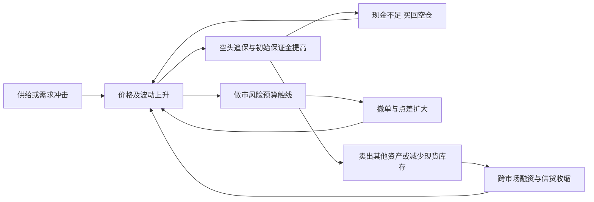

# 有色金属期货交易市场：从铜、铝、镍到算力衍生品

> 调研截止：2026-10-28。面向期货初学者及多主体建模（ABM）研究者。
>
> **摘要**：金属期货把未来价格风险转化为可交易的标准合约，交割资格、库存、保证金和中介信用共同约束价格。矿山、加工厂、基金和套利商的目标不同，产业套保者也可能因现金不足被迫平仓。LME、上期所与COMEX的日期结构、交割网络和参与渠道不同，不能用一个无摩擦市场替代。GPU小时属于随时间消逝的服务，适合借鉴电力的分时现货、容量承诺和指数结算。2026年CME及ICE已推进算力期货，但公告、申报和正式交易必须区分；现金结算只能对冲指数价格，不能保证拿到集群。

**阅读与证据约定**：下文【事实】包括有来源的制度、数据和事件；【推断】表示分析、机制抽象或建议；【待核实】表示公开资料不足或存在版本冲突。带“教学假设”“模拟初值”的数字均属【推断】，不表示市场统计。动态网页未署发布日期时如实注明，以访问日替代版本识别，不能冒充发布日。来源编号均可点击，文末附完整清单。本文不把成交额、保证金、持仓名义金额和基金资产规模混用。

## 1. 先把期货讲清楚

### 1.1 标准化合约：今天约定未来价格

【事实】期货是交易所统一规定数量、质量、到期时间和结算方式的合约。买入称“做多”，卖出称“做空”；开空仓不要求先借来相同数量的金属。交易形成相对应的多空责任，平仓、到期交割或现金结算后责任结束。与之相比，远期通常由双方协商数量、日期、信用安排；“未来交货的合同”并不自动成为交易所期货。[S01：CFTC期货经济功能](https://www.cftc.gov/LearnAndProtect/AdvisoriesAndArticles/economicpurpose.html)（未署日期，访问2026-10-28）。

【事实】沪铜CU、沪铝AL每手分别对应5吨，沪镍NI每手对应1吨；交易单位与交割单位还可能不同，例如铝的标准仓单重量为25吨。因此“买一手”与“可以拿一手去交割”并非同一条件。[S02：上期所日周数据说明](https://www.shfe.com.cn/reports/tradedata/)（动态页，访问2026-10-28）；[S03：铝业务细则](https://www.shfe.cn/regulation/exchangerules/productrules/202512/t20251231_829955.html)（页面发布日期2026-01-01）。

【推断·教学假设】电缆厂三个月后需要100吨铜，担心涨价；冶炼企业届时预计销售100吨，担心跌价。两者可以分别买入、卖出20手沪铜。实际成交不要求这两家公司直接相遇：基金可以接走一部分价格风险，经纪商和清算体系负责连接交易及履约。

### 1.2 保证金、杠杆与逐日盯市

【事实】保证金是履约担保，不是分期买货的首付款。初始保证金用于覆盖潜在风险，维持保证金等规则决定何时追加；经纪商可以在交易所标准之上加收。期货每日按结算价重估，亏损可能在最终现货销售前就必须补足；极端情况下还会盘中追保。[S01](https://www.cftc.gov/LearnAndProtect/AdvisoriesAndArticles/economicpurpose.html)（未署日期）；[S04：BIS商品市场保证金研究](https://www.bis.org/publications/margin-dynamics-centrally-cleared-commodities-markets-2022)（2023-05-24）。

【推断·教学假设】铜价80,000元/吨，一手5吨，名义敞口400,000元；假设保证金率10%，占用40,000元，相当于以这笔保证金支撑10倍名义敞口。铜价下跌5%，多头亏20,000元，相当于最初保证金的一半。若账户另有现金，实际账户杠杆会更低；亏损也不以最初保证金为上限。

【推断·会计抽象】对于通常的期货现金盯市，可写成：

$$
VM_{i,t}=n_{i,t-1}q(F_t-F_{t-1}),\qquad IM_{i,t}\approx m_t|n_{i,t}|qF_t.
$$

其中多头手数$n>0$，空头$n<0$，$q$是每手数量。亏损结算和新增担保占用必须分别记账；不能把已支付的变动损益又当成冻结保证金再扣一次。现金不够时先追保，逾期才依规则平仓；涨跌停、跳空和盘口深度会决定能否成交。

**【事实】LME的重要例外**：传统基本金属母合约具有远期式现金流特征，采用贴现或有变动保证金（DCVM），浮盈并不等于到期前可提现现金；LMEmini等产品使用已实现变动保证金（RVM）。因此“都每日重估”不能推出“各所每天把全部浮盈现金划给赢家”。ABM必须按合约类型写现金流。[S05：LME保证金说明](https://www.lme.com/Education/Online-resources/LME-Digest/An-introduction-to-LME-margins)、[S06：LMEmini FAQ](https://www.lme.com/about/FAQs/LMEminis-FAQs)（均未署日期，访问2026-10-28）。

### 1.3 实物交割：交的是合格仓单，不是任意一块金属

【事实】交割链条是：合格生产者或品牌生产符合标准的金属→运到指定交割库→检验、单证与入库审核→注册仓单→按规则交款及转移仓单→买方选择继续存储或办理提货。LME仓单代表对特定批次合格金属的权利；LME批准独立仓库运营商，不拥有仓库内金属，也不自行经营这些仓库。[S07：LME warrants](https://www.lme.com/en/sustainability-and-physical-markets/warehousing/lme-warrants)、[S08：LME仓库网络](https://www.lme.com/sustainability-and-physical-markets/warehousing/warehouse-network)（未署日期，访问2026-10-28）。

【事实】品牌、成分、形状、包装、地点和单证共同决定交割资格。CME铝要求交易所批准品牌及设施；LME镍交割也有纯度、形状和注册品牌要求。镍铁、镍中间品与符合期货标准的精炼镍不能仅按“含镍吨数”直接互换。[S09：CME铝交割说明](https://www.cmegroup.com/articles/2024/key-attributes-of-cme-aluminum.html)（2024-01-16）；[S10：LME原生镍交割规则修订](https://www.lme.com/-/media/Files/News/Notices/2024/12/RULEBOOK-24-299-AMENDMENT-TO-PART-6-OF-THE-LME-RULEBOOK-SPECIAL-CONTRACT-RULES-FOR-PRIMARY-NICKEL.pdf?sc_lang=en)（2024-12，24/299号）。

【推断】“全球产量很大”无法排除逼仓：能在最后期限前运入指定仓库、完成注册、且愿意出售的存量可能很小。仓单是产权和资格的标准化，提货则仍受运力、费用与排队约束。

【事实】现金交割合约到期按约定指数计算差额，不要求搬运金属。例如COMEX的铜金融期货HGS按基准HG合约的月均价结算，与可实物交割的HG应分别处理。[S11：Copper Financial Futures FAQ](https://www.cmegroup.com/education/articles-and-reports/copper-financial-futures-faq)（2022-01-14）。

### 1.4 移仓、基差、期限结构和期权

【推断·定义与教学示例】下表用统一记号解释后文；实际规则依合约文本。

| 概念 | 外行解释 | 建模时容易混淆之处 |
|---|---|---|
| 移仓换月 | 平掉临近到期合约，同时建立更远期同方向头寸 | 不是自动延期；有两腿成交、手续费、价差和流动性风险 |
| 基差$b=S-F$ | 同一时点现货价格减去指定期限期货价格 | 必须写现货地点、品牌、含税口径及合约月份；基差不天然固定 |
| Contango | 远期高于现货或近月，曲线上倾 | 不表示“未来价格必涨”；可能只是融资和仓储成本 |
| Backwardation | 近端高于远端，曲线倒挂 | 可反映眼下稀缺、持有现货的经营价值，也可能含挤仓因素 |
| 看涨期权Call | 买方付权利金，取得按执行价买入标的的权利 | 裸卖方承受尾部风险；行权可能生成期货仓位 |
| 看跌期权Put | 买方取得按执行价卖出标的的权利 | 产业卖方可用其保护收入下限，并保留价格上涨收益 |

【事实】曲线、便利收益及到期收敛的基本解释见[CME期限结构课程S12](https://www.cmegroup.com/education/courses/introduction-to-base-metals/what-is-contango-and-backwardation)（未署日期）；期权买方拥有权利、卖方承担相应义务，权利金和期货保证金不是同一个概念，见[S13：期货期权基础](https://www.cmegroup.com/education/whitepapers/fundamentals-of-options-on-futures)（2017-07-10）。

【推断】持有多头、不断从低价近月换到高价远月，可能持续承受不利的展期收益；倒挂可能相反。但换月当下不应把两张不同到期日合约的价差直接全记成已实现亏损。应逐合约计算损益，再解释曲线收敛和再投资的累计影响。

### 1.5 期货怎样给现货“定价”和“保险”

【事实】金属企业可以用期货对冲现货价格波动；交割并非套保的必要步骤，企业可以在原有供应链采购或销售，同时平掉期货。CME给出的铜套保案例还包括“买到现货后卖期货保护库存”，可见加工企业并不永远只买保。[S14：Hedging with COMEX Copper Futures](https://www.cmegroup.com/education/articles-and-reports/hedging-with-comex-copper-futures)（未署日期，访问2026-10-28）。

【推断】定价可抽象为“现货价＝交易所参考价＋地区、品牌、物流及信用升贴水”。公开期货价降低反复议价的信息成本，但现货升贴水仍由真实货源决定；价格发现可能在不同市场之间交替领先，不能预设某交易所永久领先。

【推断·教学假设】卖方按80,000元/吨卖出期货，三个月后现货跌到70,000、期货跌到70,500。卖现货收入70,000，加期货盈利9,500，合计79,500元/吨，尚未计费用。一般地，卖保有效售价为$F_0+b_T$；买保有效采购成本也为$F_0+b_T$，但两者的现金流方向相反。套保把绝对价格风险主要换成基差、数量、期限和融资风险；期权才更接近付保费购买非对称保障。

## 2. 三大市场与新品种：制度差异会改变交易行为

### 2.1 横向比较

【事实】以下为主要合约架构；不是2026-10-28全部月份的实时保证金或交易时段表。

| 维度 | LME | 上期所SHFE／上期能源INE | COMEX／CME Group |
|---|---|---|---|
| 基本金属定位 | 国际产业定价及全球交割网络 | 中国境内人民币定价；INE国际铜提供保税定价接口 | 美国市场、美元风险管理及金融投资的重要接口 |
| 铜、铝、镍交易单位 | 铜25吨、铝25吨；镍6吨 | CU、AL各5吨；NI为1吨；BC为5吨 | HG铜25,000磅；ALI铝25公吨；不把镍假定为与铜同等成熟的COMEX主力基准 |
| 时间结构 | 近端按日指定prompt date，随后按周、按月 | 月份合约 | 月份合约，另有不同规模及现金结算产品 |
| 交易渠道 | Ring、LMEselect电子交易、会员间电话市场 | 集中电子竞价及规则允许的其他业务 | Globex电子交易及规则允许的大宗交易、ClearPort报送等 |
| 清算 | LME Clear；传统母合约有特殊保证金现金流 | 上期所及INE各自依规则组织结算 | CME Clearing；COMEX是集团内交易所之一 |
| 交割 | 注册品牌、指定库及仓单 | 品级、品牌、仓库、仓单；境内及保税制度分品种适用 | HG、ALI有实物交割；地区升水衍生品和现金结算合约须另外建模 |

表中规格来源：[S15：LME铜规格](https://www.lme.com/metals/non-ferrous/lme-copper/contract-specifications)、[S16：LME镍规格](https://www.lme.com/en/Metals/Non-ferrous/LME-Nickel/Contract-specifications)、[S17：CME铜概述](https://www.cmegroup.com/education/lessons/copper-product-overview)（均未署日期）；[S09](https://www.cmegroup.com/articles/2024/key-attributes-of-cme-aluminum.html)（2024-01-16）；[S02](https://www.shfe.com.cn/reports/tradedata/)及[S18：INE国际铜合约](https://www.ine.com.cn/eng/market/futures/metal/bc/contract/)（2020-11-17）。LME铝规格见[S19](https://www.lme.com/en/metals/non-ferrous/lme-aluminium/contract-specifications)（未署日期）；均访问2026-10-28。

【推断】各所“一手”的经济大小不同，不能直接比较手数大小得出市场份额。铜跨市场比较至少要统一吨数、币种、到期日、税费和成交计数口径；期权还要说明是合约数、名义数量还是Delta等价数量。

### 2.2 LME：会员接入、每日到期日与Ring

【事实】LME的“会员制”主要体现准入、交易及清算权限。第一类会员可以进入Ring；不同类别在客户经纪、自营、清算权限上不同。它并不意味着普通产业客户必须成为会员才能间接使用市场，也不意味着交易所仍由老会员共同拥有；LME现属HKEX集团。[S20：会员准入](https://www.lme.com/Trading/Access-the-market/Become-a-member)、[S21：Ring](https://www.lme.com/en/trading/trading-venues/the-ring)（动态制度页，访问2026-10-28）；[S22：香港政府关于LME仓库公告](https://www.news.gov.hk/eng/2025/04/20250415/20250415_165300_673.html?name=finance&tl=t&type=category)（2025-04-15）。

【事实】LME基本金属近三个月具有逐日prompt date，三至六个月按周，其后按月；最远期限因金属而异，铜铝可达123个月，镍为63个月。“日日交易”指可选择很多不同交割日，并不是每天重新订一张永久滚动的三月合约：今天成交的3M在落地后会固定为特定日期。Ring仍用于发现Official Prices，并与电子、电话渠道并行；不能把Ring官方价、电子最新价和每日Closing Price混为一谈。[S23：prompt date结构](https://www.lme.com/en/Sustainability-and-Physical-Markets/Physical-market-benefits/Prompt-date-structure)、[S16](https://www.lme.com/en/Metals/Non-ferrous/LME-Nickel/Contract-specifications)、[S21](https://www.lme.com/en/trading/trading-venues/the-ring)（未署日期，访问2026-10-28）。

【推断】每日到期日让产业套保贴近真实船期，代价是流动性分散。ABM可设少数高流动性的锚点期限，再由会员报价提供短期carry（日期间价差）连接，而不是为每一天设同样厚的订单簿。

### 2.3 LME仓库与镍事件后的改革

【事实】LME从2025年4月起将off-warrant库存披露由月度改为日度，订阅和公开数据延迟不同；这类库存不等同于已注册且可直接交割的仓单。香港仓库获准并于2025年7月起开展相关业务，说明交割网络会随制度变化扩展。[S24：off-warrant reporting](https://www.lme.com/market-data/reports-and-data/warehouse-and-stocks-reports/off-warrant-stock-reporting)（2025年安排，网页未署发布日期）；[S25：香港仓库上市通知25/069](https://www.lme.com/-/media/Files/News/Notices/2025/04/WAREHOUSING-25-069-LISTING-OF-WAREHOUSES.pdf?sc_lang=en)（2025-04-15，生效2025-07-15）。

【事实】2022年镍事件后，LME引入基本金属每日价格限制，并在2023年强化市场行动计划中将其永久化，同时加强场外持仓报告、集中度监测和问责机制。2025年的行动计划更新继续涉及LME Clear韧性和治理；2026年还推进电子流动性、交叉交易及大宗交易门槛改革。[S26：2023行动计划23/053](https://www.lme.com/-/media/Files/News/Notices/2023/03/23-053-Action-Plan-to-Strengthen-the-LME-Groups-Markets.pdf)（2023-03-30）；[S27：强化市场进展](https://www.lme.com/en/Trading/Initiatives/Strengthening-the-market)（更新至2025-05）；[S28：26/109实施进度](https://www.lme.com/-/media/files/news/notices/2026/04/trading-26-109-market-structure-modernisation-delivery-update.pdf)（2026-04-17）。

【事实】26/109号公告明确：MVT大宗交易门槛规则2026-03-30生效，其执法宽限期延至2026-08-24；LOOP流动性计划当时拟改至2026-08-03启动。这些是公告所载实施安排，后续是否再改期应查对应终局通知，不能只拿2025年的预计时间表当2026年的落地证据。[S28](https://www.lme.com/-/media/files/news/notices/2026/04/trading-26-109-market-structure-modernisation-delivery-update.pdf)（2026-04-17）。

【推断】改革将改变订单路由、屏幕深度、经纪商内化和场外风险可见度。历史回测应将2022年前后及2026年市场结构变动设为制度状态，不宜用同一撮合、涨跌停和报告函数覆盖全部年份。

### 2.4 SHFE、INE与COMEX的具体差别

【事实】INE国际铜BC采用人民币报价、不含税及关税的保税定价，交易单位5吨，实物交割；CU与BC不能不经税费和地点调整直接相减。国内铝业务细则也已列有完税、保税交割安排，因而不能把“SHFE所有品种永远只完税”当固定边界。[S18](https://www.ine.com.cn/eng/market/futures/metal/bc/contract/)（2020-11-17）；[S03](https://www.shfe.cn/regulation/exchangerules/productrules/202512/t20251231_829955.html)（2026-01-01）。

【事实】2026年4月22日，上期所镍期货及期权引入境外交易者；同日国际铜期权等产品上市。因此截至本次调研，不能再把“境外产业只能经LME套保、中国金属合约一律不开放”作为建模前提。应分别设置特定品种、QFI及其他准入渠道。[S29：上期所开放进展](https://www.shfe.cn/eng/CircularNews/SHFEinSpotlight/202604/t20260424_831490.html)（2026-04-24）；[S30：境外参与镍公告](https://www.shfe.cn/eng/CircularNews/Circular/202603/t20260320_830795.html)（2026-03-20）。

【事实】COMEX是CME Group旗下交易所；CME Group的产品也可能挂牌于NYMEX等其他法人交易所。“CME算力期货”后述实际申报主体是NYMEX。HG铜按磅报价，ALI铝按公吨报价；铝锭基准价与美国中西部等地区升水合约管理的风险不同。[S09](https://www.cmegroup.com/articles/2024/key-attributes-of-cme-aluminum.html)（2024-01-16）；[S17](https://www.cmegroup.com/education/lessons/copper-product-overview)（未署日期）；[S50：NYMEX算力合约申报](https://www.cftc.gov/filings/ptc/ptc08112615405.pdf)（2026-08-11）。

### 2.5 广期所碳酸锂：标准化本身会迭代

【事实】广期所碳酸锂期货于2023年7月上市；现行产品网页列交易单位1吨/手、实物交割。网页原始日期为2023-07-18，但内容已包含后续修改后的20元/吨最小变动价位，不能据此说该参数从上市当天就如此。2025年初的规则优化还涉及替代品贴水和临近交割期风控安排。[S31：广期所碳酸锂合约](https://www.gfex.com.cn/gfex/sytslqhhy/202307/9ad927b8ec4c458594e172fd1ada2a9b.shtml)（网页日期2023-07-18，现行内容访问2026-10-28）；[S32：规则调整解读](https://edu.cfachina.org/index/mtkqs2/202501/t20250108_78253.html)（2025-01-08）。

【事实】2025-12-12公布的碳酸锂业务细则修改，部分质量规则适用于LC2612及以后合约，而其他条款当日生效；2026年的交易和到期安排必须识别合约版本。[S33：广期所原通知的期货公司转载](https://m.hicend.com.cn/h5/CommonArticleDetail/14472)（原通知2025-12-12，转载2025-12-15）。广期所2026年7月的三周年座谈会还讨论基差贸易、含权贸易及特定品种开放。[S34](https://www.gfex.com.cn/gfex/bsyw/202607/0c0e607c86664566a2c3caf68420a7f4.shtml)（2026-07，会议2026-07-21）。

【推断】新品种初期，若交割规格不贴近产业需求，“期现背离”可能来自可交割集合而非交易者失去理性。GPU合约更需版本管理：修改显存、互联或验收要求时，新旧月份不能悄悄当成同一商品。

## 3. 市场主体：身份、目标函数、约束与互动

### 3.1 怎样理解下表的“规模”

【事实】公开持仓报告通常识别大类业务，不能把矿山、冶炼厂、贸易商、CTA、宏观基金和做市商全部独立统计。CFTC明确指出，其了解交易者主营业务，但不能确定某交易者所有交易都是套保。[S35：Disaggregated COT说明](https://www.cftc.gov/MarketReports/CommitmentsofTraders/DisaggregatedExplanatoryNotes/index.htm)（未署日期，访问2026-10-28）。

【推断】所以采用“已知大类规模＋子类不可识别”的表述，不补造百分比。下表的动机、目标函数、偏差和时间尺度均为建模抽象，不是对某一家机构心理的事实判断；各类持仓规模的事实锚见第4节。

### 3.2 产业套保者逐一展开

| 主体与规模可见度 | 动机、目标函数与决策逻辑【推断】 | 主要约束、信息及时间尺度【推断】 | 理性、偏差与交易对手【推断】 |
|---|---|---|---|
| 矿山；包含于生产／贸易／加工／使用者，单独份额【待核实】 | 对尚未定价的可销售产量卖保；最大化经营利润减现金流波动与破产成本 | 产量不确定、套保授权、融资契约、税费；了解矿石品位及停产，宏观信息未必占优；月到年 | 现金安全优先时放弃上涨收益合理；按乐观产量过度卖保可能过度自信；向下游、贸易商或风险投资者转移风险 |
| 冶炼厂；与上述大类合并，单独份额【待核实】 | 锁加工利润；按原料和产成品的点价差管理净敞口，可买保也可卖保 | 原料采购及销售定价期、TC/RC加工费、回收率、电价和物流；熟悉订单及工艺；周到季 | “产铜所以全卖保”可能把原本已对冲的敞口做反；考核只看期货损益会引发错误止损；与矿山、加工厂、经纪商互动 |
| 加工企业：铜杆、电缆、铝材厂等；独立份额【待核实】 | 已签固定售价、原料未购时买保；有未售库存时卖保；最大化加工毛利并减少缺料损失 | 订单交期、库存周转、现金、客户点价条款；需求信息领先金融交易者；日到月 | 买保上涨获利不是目的；客户取消订单后不减多仓会变成投机；价格锚定、损失厌恶可能拖延调整；接矿冶供给并向终端传导 |
| 贸易商、库存融资商；商业类别或其他类别，独立份额【待核实】 | 赚地区、品牌、期限、信用和服务价差；库存多头通常用期货空头覆盖 | 信用额度、仓库、运输、关税、汇率、注册及交割期限；订单流、库存和升贴水信息较强；日到年 | 现金套利在期限错配时会破产；流动性收缩时缩表是约束下的理性；可能兼任报价商，连接产业与金融持仓 |
| 国家储备／政策性采购销售机构；通常不单列，占比【待核实】 | 库存安全、保供稳价和政策绩效，商业利润可能次要 | 预算、储备计划、授权、进出口及行动时间；政策信息强，公开透明度有限；月到年 | 逆周期买入不能直接称“抄底失败”；代理人越权交易又是另一类治理问题；通过拍卖、采购改变流通货源 |

【推断】对前三类，可采用共同形式：

$$
\max_{n_i}\ E[\Pi_i^{\mathrm{spot}}+\Pi_i^{\mathrm{deriv}}]
-\lambda_i Var(\Pi_i)-\kappa_i\Pr(\text{现金违约})-\text{交易与融资成本}.
$$

套保方向取决于净价格敏感度$e_i=\partial\Pi_i^{spot}/\partial S$，而非公司名称。简化的最小方差套保比例$h^*=Cov(\Delta S,\Delta F)/Var(\Delta F)$只考虑价格协动；最终头寸还应被产量、交付置信度、授信和压力追保预算截断。若加工厂原料和产品都按相同均价浮动，它的铜价净敞口可能很小，主要风险反而是加工费和订单量。

### 3.3 投机与配置主体逐一展开

| 主体与规模可见度 | 动机和目标函数【推断】 | 信息、时间与约束【推断】 | 理性程度、偏差及互动【推断】 |
|---|---|---|---|
| 散户；不等于COT全部非报告交易者，真实成交占比【待核实】 | 方向收益、短期刺激或参与感；效用可能包含彩票型上行偏好 | 资金少、信息滞后、手续费、强平；秒到周 | 风险偏好交易可理性；高杠杆追涨、处置效应、过度交易和锚定成本价会放大损失；可能主动吃单，也可能限价供给流动性 |
| 自营交易机构／交易台；COT分类依业务，单独份额【待核实】 | 扣风险、冲击和费用后的利润；既可方向也可相对价值 | 风险预算、止损、库存及延迟；盘口和技术优势；毫秒到月 | 拥挤止损、奖金周期可能导致共同减仓；不能将自营等同高频；与客户流、CTA及套利者成交 |
| CTA／趋势跟踪；属于Managed Money的一部分，拆分比例【待核实】 | 根据历史收益与波动率配置头寸，追求组合风险调整收益 | 策略容量、回撤、风险预算、合约流动性；日到月，亦有更短策略 | 趋势跟随本身可以是理性系统规则；同信号与波动率缩放会同步减仓，形成非意图羊群；接产业卖保并可能顺趋势扩大波动 |
| 宏观对冲基金；也可能在Managed Money，无法与CTA直接拆分 | 交易中国需求、美元利率、供给及政策预期；最大化组合收益扣尾部风险 | 赎回、风控限额、融资与跨资产相关性；新闻和研究优势；日到季 | 同叙事、确认偏差和过度自信可能拥挤；赎回驱动卖出是约束下的理性；可多可空并跨市场传导冲击 |
| 商品指数基金／被动多头；部分通过掉期商传导，不能等同掉期商全部头寸 | 复制指数、分散配置、跟踪误差最小；按指数权重和移仓日历交易 | 申赎、指数规则、持仓及展期成本；月度移仓、季度或年度再平衡 | 对单品种基本面不敏感未必非理性；遵守授权本身合理；可预测换月流被套利商交易，组合申赎产生共同买卖压力 |

【事实】CFTC的指数投资说明将被动配置与直接经营性套保区分，且通过掉期商交易的终端客户可能是产业客户，也可能是投资者。因此Swap Dealers的净头寸不能直接解释成“指数基金看多或看空”。[S36：指数投资数据说明](https://www.cftc.gov/MarketReports/IndexInvestmentData/ExplanatoryNotes/index.htm)、[S35](https://www.cftc.gov/MarketReports/CommitmentsofTraders/DisaggregatedExplanatoryNotes/index.htm)（未署日期，访问2026-10-28）。

### 3.4 套利者：交易的是价差，承担的仍是真实风险

【推断】套利者可来自贸易公司、银行、自营机构、基金或产业企业，与“产业／金融”的身份维度交叉，不能在人口统计里重复计数。

| 策略与规模 | 目标及交易逻辑【推断】 | 约束、优势与期限【推断】 | 理性／偏差及互动【推断】 |
|---|---|---|---|
| 期现套利；独立份额【待核实】 | 远期高于现货加全成本时买现货、卖期货，储存后交割 | 贷款、仓容、注册品牌、交割物流、货权真实性；产业信息优势；周到季 | 以模型价格代替可执行价格是模型偏差；向金融买盘供应远期、增加现货库存 |
| 跨期套利；独立份额【待核实】 | 做近远月价差，赚库存与融资变化或偏离修复 | 两腿流动性、保证金抵扣、交割资格、可借货；日到月 | 价差可扩张并追保，绝非天然低风险；同一库存稀缺信息可同时吸引倒挂交易和逼仓 |
| 跨市场：沪伦比值、COMEX-LME等；独立份额【待核实】 | 统一吨数币种税费后，比较可进口／出口平价 | 汇率、税费、品牌互认、航期、关税政策、准入和资金跨境；小时到月 | 比值历史均值不是无套利定律；价差过大却无法转运时继续扩张可合理；实际搬货连接各地现货 |
| 跨品种；独立份额【待核实】 | 铜铝替代、镍与不锈钢或电池原料加工链相对价值 | 替代弹性、配方、转换成本、产能及交期；周到年 | 工艺和政策结构突变会使历史协整失效；锚定旧价差可能亏损；连接产业产能选择与金融价差 |

### 3.5 做市、中介、清算与监管

【推断】以下按功能建立独立模块：同一法人可拥有多个功能，但经纪客户资产、自营库存和风险管理业务必须分账户记账。

| 功能主体与规模口径 | 动机／目标函数【推断】 | 信息、时间和约束【推断】 | 行为及与其他主体的互动【推断】 |
|---|---|---|---|
| 做市商／流动性提供者；独立持仓及成交份额【待核实】 | 点差＋激励收入－逆向选择－库存风险－对冲成本 | 盘口信息与速度、净库存、资本、最大报价宽度；毫秒到日 | 主动双边报价平常稳定市场；风险预算触线后撤单合理，却会集体抽走深度；以方向交易者为客户、到关联市场对冲 |
| 期货公司、FCM、LME经纪／清算会员；客户持仓不能算公司自营资产 | 经纪及服务收入－客户穿仓预期损失－资本成本；部分提供保证金融资 | 客户订单、余额及授信信息；隔离、资本、报告和合规要求；实时至日 | 对客户加保、限开仓和强平可保护自身，却提前触发系统去杠杆；连接客户和交易所，承担客户违约传导风险 |
| 交易所；交易量是业务规模而非方向仓位 | 交易费、数据和长期信誉，同时履行有序交易职责 | 订单、持仓及部分场外信息；技术容量、规则和监管授权；实时至年 | 可能面临短期成交收入与长期韧性权衡；改变费用、限仓和涨跌停，影响所有主体策略 |
| 清算所／CCP或交易所结算职能；用IM、违约基金及清算敞口衡量 | 降低成员违约和损失外溢，管理抵押物及流动性 | 成员资产、保证金模型、压力测试与支付时限；实时至日 | 中央对手方将风险集中管理，不能消灭风险；加保可能顺周期；出现违约时依规则处置头寸与担保资源 |
| 监管者；不适用持仓占比 | 市场诚信、客户保护、金融稳定及服务产业等公共目标 | 报告延迟、跨境信息、法定权限和执法资源；实时监测至多年 | 不宜把所有干预视为价格操纵；可预测救助也会改变事前冒险激励；监管交易所、中介和市场滥用 |

【事实】上期所2026-07-06施行的风控办法列明保证金、涨跌停、持仓及交易限额、大户报告、强平和风险警示；同一客户跨会员编码的持仓应汇总限仓。强平在涨跌停等情形下可能顺延，不能保证当日退出。[S37：上期所风险控制管理办法](https://www.shfe.cn/regulation/exchangerules/otherrules/202606/t20260622_832192.html)（页面发布日期2026-07-06）。

【事实】英国FCA监管LME，英格兰银行监管LME Clear；美国CFTC监管相关期货市场及中介体系，中国证监会履行国内期货监管职责。不同市场的涨跌停、动态价格控制及套保豁免不完全一致。[S38：LME运营韧性及监管](https://www.lme.com/en/about/governance/business-continuity)（未署日期）；[S39：《期货和衍生品法》实施安排](https://www.csrc.gov.cn/csrc/c100028/c5359121/content.shtml)（2022-08）；[S40：CME基本金属风控概览](https://www.cmegroup.com/markets/metals/base.html)（动态页，访问2026-10-28）。

【推断】成交对手方与最终风险承担者不是同一概念：屏幕上接单可能是做市商，其风险随即转给另一基金；客户法律关系还隔着经纪与清算层。最小模型至少同时保留“订单撮合网络”“现货供货网络”“融资担保网络”。

## 4. 用持仓数据看主体结构，避免把分类误当动机

### 4.1 CFTC COT：一个可复核的最新铜样本

【事实】COT传统版区分Commercial、Non-commercial及Non-reportable；细分版将可报告交易者分成生产／贸易／加工／使用者、掉期商、管理资金及其他报告者。通常周二取样、周五发布，节假日等会调整。截至2026-10-28，本次取得的官方最新铜样本是**2026-10-20持仓、常规发布日2026-10-23**，不能把尚未发布的10月27日持仓用于回测当日决策。[S35](https://www.cftc.gov/MarketReports/CommitmentsofTraders/DisaggregatedExplanatoryNotes/index.htm)（未署日期）；[S41：CFTC细分期货持仓](https://www.cftc.gov/dea/futures/other_lf.htm)（报告日期2026-10-20，访问2026-10-28）。

【事实】COMEX Copper #1，代码085692，**期货单独口径、全部交割月份汇总**，总未平仓量327,119手。下表多空为报告原列，不把Spreading混进方向栏；百分比和净额为对原数的计算。

| 类别 | 方向多头／手 | 方向空头／手 | Spreading／手 | 净多头／手 | 方向多头÷OI | 方向空头÷OI |
|---|---:|---:|---:|---:|---:|---:|
| 生产／贸易／加工／使用者 | 52,941 | 130,347 | 不适用此列 | -77,406 | 16.2% | 39.8% |
| 掉期商 | 53,260 | 40,150 | 10,268 | 13,110 | 16.3% | 12.3% |
| Managed Money | 67,225 | 19,535 | 53,320 | 47,690 | 20.6% | 6.0% |
| 其他报告者 | 31,310 | 21,603 | 41,959 | 9,707 | 9.6% | 6.6% |
| 非报告者，按总量扣减计算 | 16,836 | 9,937 | 不单列 | 6,899 | 5.1% | 3.0% |

数据来源：[S41](https://www.cftc.gov/dea/futures/other_lf.htm)及[同日短表](https://www.cftc.gov/dea/futures/other_sf.htm)（2026-10-20）。各类净头寸合计为零；将各类方向多头加上已单列Spreading，得到总多头OI，空头亦然。Spreading不等于“全部套利交易量”，也不说明每个价差持仓都无价格风险。

【推断】商业类净空与资金类净多可以是正常风险转移。该样本不能推出“40%都是矿山卖保”或“所有散户只占5%”；小机构也可能低于报告门槛，大个人也可能达到门槛。CTA和宏观基金的分布、资金量及日内交易占比仍【待核实】。校准时宜约束大类净敞口和总持仓，不把该周单点当长期常数。

### 4.2 LME COTR：含期权Delta，分类不同

【事实】LME COTR按主营业务分投资公司或信贷机构、投资基金、其他金融机构、商业企业等，通常周二公布上周五持仓，含期权Delta等价头寸。期权处理、暂停清算交易等可能导致多空总数或与其他OI报表不完全一致。[S42：LME COTR说明](https://www.lme.com/Market-Data/Reports-and-data/Commitments-of-traders)（未署日期，访问2026-10-28）。

【事实】实际读取LME官方XLSX，铜持仓日2026-10-23、生成时间2026-10-27，得到以下Total行；单位为报告的LOTS，可因Delta折算出现小数。

| 类别 | 多头／等价手 | 空头／等价手 | 净头寸／等价手，计算值 |
|---|---:|---:|---:|
| 投资公司／信贷机构 | 184,080.13 | 187,082.44 | -3,002.31 |
| 投资基金 | 51,434.26 | 26,103.37 | 25,330.89 |
| 其他金融机构 | 13,453.10 | 8,879.35 | 4,573.75 |
| 商业企业 | 164,432.36 | 190,069.72 | -25,637.36 |

来源：[S43：铜COTR原始文件](https://www.lme.com/-/media/files/data/cotrs/ca-copper/mifid-weekly-cotr-report--ca--27102026.xlsx)（生成2026-10-27；持仓日2026-10-23）。文件还区分“与商业活动直接相关的风险降低头寸”与Other：**商业企业也有Other持仓，金融机构也有风险降低持仓**。这比把所有商业仓位一律视为套保更适合ABM。

### 4.3 上期所前20名会员：集中度有用，身份识别有限

【事实】上期所公开日周数据及成交、持仓排名，量和持仓用“手”，现行数据说明采用单边统计；会员排名通常按合约列成交量、持多单和持空单以及变化。前20会员汇总的是席位所承载客户及其他适用业务，并非20个终端投资人。[S02：官方数据入口](https://www.shfe.com.cn/reports/tradedata/)（动态页，访问2026-10-28）。

【推断】可计算$C_{20,L}=\sum_{j\in Top20_L}L_j/OI$、$C_{20,S}=\sum_{j\in Top20_S}S_j/OI$，但多、空、成交三份名单可能不同；计算某会员净仓必须按名称连接名单，缺席不等于零。将各合约“前20”相加不等于品种全部会员的总持仓，更不等于产业客户占比。

【事实】从上期所2026-10-27官方排名文件与同日行情文件取得以下样本。选择共同的2611月份用于演示，**不声称它们均是该品种当日主力合约**。排名中1—20行相加与RANK=999汇总行相符，分母取同一合约行情中的OPENINTEREST：

| 合约 | 单边OI／手 | 前20多头／手 | 前20空头／手 | 多头集中度 | 空头集中度 |
|---|---:|---:|---:|---:|---:|
| cu2611 | 91,999 | 64,225 | 62,658 | 69.81% | 68.11% |
| al2611 | 100,922 | 73,688 | 83,246 | 73.01% | 82.49% |
| ni2611 | 34,717 | 25,024 | 27,936 | 72.08% | 80.47% |

来源：[S75：会员排名原始JSON](https://www.shfe.com.cn/data/tradedata/future/dailydata/pm20261027.dat)（报告2026-10-27，文件更新时间15:25:27）；[S76：同日行情JSON](https://www.shfe.com.cn/data/tradedata/future/dailydata/kx20261027.dat)（报告2026-10-27，更新时间15:25:45）。集中度为本文计算值，表示经纪席位层面的集中，而非终端客户或产业套保集中度。后续面板须保留会员、合约、公布时间与分类版本，尤其不能把席位成交量按持仓分母解释为资金占比。

### 4.4 市场大小与主体份额是两组统计

【事实】LME年量页面列2025年日均756,996手，2024年为702,639手，且说明包含UNA等交易；它还另外列出剔除UNA及非收费交易后的同比口径。不同年报和宣传材料可能采用收费成交口径，不能拼在一起计算基金占比。[S44：LME Annual volumes](https://www.lme.com/en/market-data/reports-and-data/volumes/annual-volumes)（2025全年统计，网页未署发布日期，访问2026-10-28）。

【推断】对每类主体至少保留四个独立规模指标：账户数、毛持仓与净敞口、订单及成交份额、可用现金与授信。报价商可以成交很多而隔夜仓位很小；矿山可以交易少但长期套保很大。用COT持仓比例生成订单到达率，会系统性低估做市和日内交易。

## 5. 理性、非理性与制度反馈：三个历史事件

### 5.1 趋势、羊群、动量与反转

【事实】Moskowitz、Ooi、Pedersen在跨资产期货样本发现时间序列动量：自身过去收益对未来一段时期收益有预测力，更长周期部分反转；这是历史样本结果，不保证铜镍或GPU上的未来收益。[S45：Time Series Momentum原论文](https://docs.lhpedersen.com/TimeSeriesMomentum.pdf)（2012年，Journal of Financial Economics 104）。

【推断】同样的追涨订单可由四种机制产生：新供给消息逐步扩散；资金按趋势规则理性跟随；经理为避免落后同行而抱团；散户因外推和FOMO追涨。仅观察成交无法识别心理原因。ABM应同时模拟“信号相同”“风险预算相同”“观察他人后调整”三条路径，并用反转速度、同向订单相关性和冲击衰减检验。

### 5.2 金融化：联动增强不等于泡沫已被证实

【事实】Tang与Xiong发现指数投资扩张期间，纳入主要商品指数的期货之间相关性上升更明显，支持金融化改变共动结构的观点。[S46：Index Investment and Financialization](https://www.nber.org/papers/w16385)（工作论文2010-09；期刊版2012）。Irwin与Sanders的OECD研究则未发现指数资金在其样本中引发商品期货泡沫的证据，并明确农业数据的识别力更强。[S47：OECD原研究](https://www.cftc.gov/sites/default/files/idc/groups/public/%40swaps/documents/file/plstudy_23_oecd.pdf)（2010）。

【推断】两者研究对象和识别问题并不完全相同。配置资金可以提高流动性，同时通过共同申赎、抵押品压力和换月放大共振。不能由“基金净多增加”单独证明其把铜价推离基本面；应控制库存、现货升水、供给冲击与反向因果。

### 5.3 1996住友铜：控制可交割存量与期限价差

【事实】CFTC于1998-05-11就住友在1995—1996年的铜市场操纵达成和解，认定其在LME建立主导期货及实物仓单地位、制造人为高价与近端溢价，要求支付合计1.5亿美元；和解以既不承认也不否认调查认定的方式达成。[S48：CFTC执法公告4144-98](https://www.cftc.gov/sites/default/files/opa/enf98/opa4144-98.htm)（1998-05-11）。

【推断】建模核心是对“可流通仓单＋到期多头”的联合控制，非只看总期货净多。控制者可通过收货、惜售和期限展期抬高近端融资价格。单一订单簿加随机噪声无法复现此类行为，需要库存所有权和可借货数量。

### 5.4 2005国储铜：货在国内不等于能按期境外交割

【事实】2005年11月公开报道将刘其兵及国储相关交易与LME大额铜空头联系，报道中的头寸估计存在差异；2008年报道援引法院及财经杂志信息，涉及越权交易和损失认定。[S49：China Economic Review](https://chinaeconomicreview.com/copper-dealer-disappears/)（2005-11-13）；[S51：SCMP后续报道](https://www.scmp.com/article/635888/justice-catches-rogue-copper-trader)（2008-05-01）。

【待核实】本次未取得完整原始审判材料、逐日头寸与最终清算账，因此不把常见的“20万吨”“最终亏损某亿美元”作为确定值，也不认定某一个海外机构是唯一逼仓者。

【推断】该事件适合检验授权链、内部隐瞒、出口及物流时滞、境内实物与境外合格仓单的错配。政策储备与代理人的投机目标必须拆开；不能用代理人行为推断整个政策机构的目标函数。

### 5.5 2022 LME镍与青山：套保、品级和场外杠杆叠加

【事实】2022-03-08，LME三月镍价超过100,000美元/吨，随后暂停交易并取消当日镍交易。FCA在2025-03-20因市场压力下系统及控制不足，对LME罚款920万英镑。Oliver Wyman独立复盘于2023-01-10发布，讨论大额空头、场内外持仓可见度和风控等问题。[S52：FCA处罚公告](https://www.fca.org.uk/news/press-releases/first-fca-enforcement-action-and-fine-against-recognised-investment-exchange)（2025-03-20）；[S53：独立调查及原报告入口](https://www.lme.com/Trading/Initiatives/Nickel-market-independent-review)（2023-01-10）。

【事实】青山是事件中的重要空头产业参与者；其镍铁／高冰镍等产品与LME精炼镍交割规格不同，2023年增加Class 1原生镍生产的计划也受到关注。[S54：S&P Global镍产业研究](https://www.spglobal.com/market-intelligence/en/news-insights/research/nickel-cbs-january-2023-price-falls-on-tsingshans-new-supply-plans)（2023-02-07）；交割资格见[S10](https://www.lme.com/-/media/Files/News/Notices/2024/12/RULEBOOK-24-299-AMENDMENT-TO-PART-6-OF-THE-LME-RULEBOOK-SPECIAL-CONTRACT-RULES-FOR-PRIMARY-NICKEL.pdf?sc_lang=en)（2024-12规则版本，不能反推每项新条款在2022年已生效）。

【推断】价格上涨让产业现货价值增加，却即时产生期货及场外追保；可交割货不足或融资不及时时，空头买回推高价格，形成轧空。长期产量能覆盖名义吨数，也不代表短期现金和合格交割货覆盖全部责任。事件中的实际净头寸、峰值追保及各方最终损益，若无完整审计账仍应【待核实】。

【推断】交易取消又改变了各方对规则的预期：获利多头无法按原成交兑现，潜在会员违约压力被重新分配，参与者未来报价可能变宽或迁往场外。应同时模拟干预的当期稳定效果和长期信任成本，不能简单把“未取消时最后成交价”视为可实现清算价。

### 5.6 保证金螺旋与强平传染

【事实】BCBS、CPMI、IOSCO对2022年商品市场的研究讨论了保证金顺周期、盘中追保和参与者现金准备不足的问题；有经营资产的套保公司也可能遭遇流动性危机。[S04](https://www.bis.org/publications/margin-dynamics-centrally-cleared-commodities-markets-2022)（2023-05-24）。

【推断】可用以下反馈图建模，不必先假定交易者“恐慌失智”：



【推断】涨跌停把部分价格发现变成排队和延迟，不是损失上限；提高保证金降低未来杠杆，却可能挤出现有套保者。预期交易所会救助还可能增加事前风险承担，这就是规则干预的反身性。

## 6. 期现联动：库存、持有成本与基差回归

### 6.1 持有成本（cost of carry）、便利收益（convenience yield）及适用边界

【事实·机制】对可储存金属，常用持有成本框架概括融资、仓储和便利收益的关系，后者是拥有现货能维持生产、应对缺货的隐含价值。库存低时便利收益往往更高。[S12](https://www.cmegroup.com/education/courses/introduction-to-base-metals/what-is-contango-and-backwardation)（未署日期，访问2026-10-28）。

【推断·模型表达】在可复制、融资及储运可行的理想条件下：

$$
F_{t,T}=S_t\exp[(r+u-y)(T-t)].
$$

$r$为融资利率，$u$为按年折算的仓储保险成本，$y$为便利收益；若费用以元/吨绝对额表示，应先统一维度。现实中便利收益不可直接交易，借货和卖空现货困难，因此更适合作为结构关系，不能对任意品牌和地点强加精确等式。

【推断】通常，期货高于“买入现货＋全持有成本”的幅度过大，会吸引买现卖期；反向套利则要求能借到货并交还，约束更严。于是价格受到不对称的套利区间约束，低库存下可出现剧烈倒挂。

### 6.2 收敛只针对同一可交割集合

【推断】到期时$F_{T,T}$应趋向对应交割品在交割地点的可执行现货价值，但未必趋向“全国现货均价”。地点、品牌、税费、检验、提货时间和结算窗口都会留下差异。可将匹配基差写成均值回复过程，但让回复速度依可交割存量、运力、信用和距离到期日变化；连续停板时甚至暂时不回复。

【事实】LME分别披露live与cancelled warrants、库点库存变化、出入库及提货等待信息。[S55：仓库和库存报告说明](https://www.lme.com/Market-data/Reports-and-data/Warehouse-and-stocks-reports)（未署日期，访问2026-10-28）。

【推断】至少区分：全部社会库存、指定库内库存、有效仓单、注销待提仓单、未质押且愿卖的流通仓单。注销仓单可能尚未出库；交易所库存下降可能是移库或注销，不等于当期被工业消费。铜、铝、镍的库存—曲线关系应分别估计，并允许品牌、地理和集中度改变关系。

### 6.3 沪伦比值：一条有摩擦的转换链

【推断·示意公式】对某一铜进口路线，统一口径后的进口平价可近似为：

$$
P_{CN}^{parity}\approx(F_{LME,T}+p_{brand}+c_{freight})\times FX_{T}\times(1+\tau)\times(1+v)+c_{local}+c_{finance}.
$$

其中$\tau,v$是该路线、日期、税基及贸易方式适用的关税和增值税；这里不填统一经验税率。可抵扣税项仍可能占用现金。期现错期须加carry，美元风险须考虑远期汇率及融资成本。只有实际可采购、可进口、可交割时，价差才构成可执行套利。

【推断】模型应由进口盈亏决定搬货和双边头寸，不能只规定“沪伦比值偏离均值就买低卖高”。税收、制裁、品牌注册或关税预期变化可使均值长期迁移。

## 7. 电力参照：不能储存的服务仍能有现货与期货

【推断】电能可以经电池等形式跨时储存，但其受容量、损耗与成本限制；“不可储存”在此指无法像铜锭那样无条件买入今日现货、低成本保存到任意交割日。GPU硬件可保存，**已经流逝的一小时服务能力不能库存到明天**。这正是电力比金属更有用的参照。

【事实】美国有组织电力市场将日前安排和实时偏差结算结合，地点边际电价LMP反映位置相关的供电成本及网络约束。EEX德国电力期货提供Base／Peak等负荷形状的金融合约。澳洲ASX电力期货和期权按NEM地区参考节点现金差额结算，产品包括月／季基荷、峰荷及300澳元/MWh门槛的cap。[S56：FERC电力市场说明](https://www.ferc.gov/understanding-energy-markets)、[S57：EEX德国电力市场](https://www.eex.com/en/markets/power/german-power-markets)、[S58：ASX Electricity](https://www.asx.com.au/electricity)（均为未署日期的制度页，访问2026-10-28）。

| 电力设计【事实】 | 对GPU的对应建议【推断】 | 迁移限制【推断】 |
|---|---|---|
| 日前计划＋实时偏差 | 提前预订集群，临时增加或短供按实时价及责任结算 | 训练作业可延期或中断重启，不等同必须瞬时平衡的电网 |
| 节点／区域价格与输电约束 | 地域、数据主权、机房、电网及互联域分别定价 | 数据迁移和作业可移植性决定连接，不能照抄电网潮流方程 |
| Base／Peak负荷合约 | 月度连续容量、工作时段推理容量、可抢占批处理分开 | 同样GPU小时数，连续集群与碎片空闲不等价 |
| 区域指数现金期货 | 月均租金指数结算，独立于具体供应商履约 | 指数对冲不能让某机房凭空多出可用GPU |
| 电力cap保护尖峰 | 推理服务商购买价格上限保护 | 若同时需要保供，需另配实物容量选择权和履约担保 |

【事实】澳洲cap卖方在现货超过约定门槛时支付超额差价；它不是免费把实际用电价格封顶，买方需付合约价格并承担用量匹配问题。[S59：AEMC现货及合约市场](https://www.aemc.gov.au/energy-system/electricity/electricity-market/spot-and-contract-markets)（未署日期，访问2026-10-28）。

【推断】非储存性商品的远期价仍可写$F_{t,T}=E_t[S_T]+\rho_{t,T}$，其中$\rho$是依符号约定定义的风险溢价；也可在适当定价测度下表达。它不是机械的现货复利。买方怕高价和短供，卖方怕闲置和跌价，两边套保压力、融资约束、扩产时滞及可移时需求共同塑造曲线。

## 8. GPU指数与算力衍生品：2025—2026年的真实进展

### 8.1 已有指数不等于已有可成交的期货曲线

【事实】Silicon Data于2025-05-27公告推出H100租赁指数SDH100RT，并说明对不同配置、地域和平台条件进行标准化。其当前产品页将neo-cloud与hyperscaler分开，已覆盖多种GPU及token相关指标。[S60：首发公告原文](https://0e190a550a8c4c8c4b93-fcd009c875a5577fd4fe2f5b7e3bf4eb.ssl.cf2.rackcdn.com/EINPresswire-816436923-silicon-data-launches-world-s-first-daily-gpu-rental-index-to-bring-transparency-to-the-ai-infrastructure-economy-1.pdf)（2025-05-27）；[S61：H100指数页](https://www.silicondata.com/products/silicon-index/h100)（动态页，访问2026-10-28）。

【待核实】同一次访问中，Silicon Data页面主读数显示2026-10-28为2.90美元/GPU小时，而FAQ仍写2.53美元；故本报告不将网页单值直接用作实证校准数据。其覆盖比例宣传、原始样本成交／报价构成、历史修订及完整可授权数据仍需方法文件和数据字典核验。

【事实】Ornn现行FAQ称OCPI采用已执行交易、按GPU型号发布，用成交量加权且对极端值缩尾；同时经营算力预订及转售业务。[S62：Ornn方法及产品FAQ](https://data.ornn.com/faq)（未署日期，访问2026-10-28）。ICE的2026-05-19公告也将OCPI描述为交易数据形成的算力价格指数。[S63：ICE与Ornn公告](https://ir.theice.com/press/news-details/2026/ICE-and-Ornn-to-Launch-GPU-Compute-Futures-Contracts/)（2026-05-19）。

【推断】报价、成交、已付费成交、预订合同报价及长期合同摊销价格是不同样本。缩尾只能减少异常值影响，不能自动排除关联交易和选择性报送。Ornn兼营服务交易也使数据治理、关联方排除和独立监督成为必要研究变量，不能仅凭“transaction-based”宣称不可操纵。

【事实】Silicon Data媒体页列有2025-12-05指数修订及B200／hyperscaler指标、2026-04-20 GPU forward curve等发布记录。[S64：官方媒体与公告索引](https://www.silicondata.com/media)（上述事件日期，访问2026-10-28）。【推断】数据商公布的forward marks可能是模型估值、调查或推导曲线；未见逐笔交易前，不能把它当成真实期货成交价、持仓或交易深度。

### 8.2 CME／NYMEX：已申报，原定上线后延期

【事实】NYMEX于2026-08-11申报H100及B200租赁指数期货，代码GPU1／GPU2：**每手730 GPU小时、现金结算、报价美元/GPU小时，拟按交割月各营业日指数结算价的算术均值结算**，地理配置为美国。产品页列每跳价值7.30美元、月度合约远至36个月。730是标准合约乘数，不表示每个自然月都有730小时。[S50：26-370原申报及拟定规则](https://www.cftc.gov/filings/ptc/ptc08112615405.pdf)（2026-08-11）；[S65：CME Compute Futures产品页](https://www.cmegroup.com/markets/energy/power/compute-futures.html)（未署日期，访问2026-10-28）。

【事实】原拟交易日为2026-10-05，但CFTC于2026-09-21将审查期延长至2026-11-09；官网申报记录截至访问仍为“Approval Pending”。CME的9月28日Globex公告随后明确相关上线准备延期、等待监管审查。[S66：CFTC产品记录62544](https://www.cftc.gov/IndustryOversight/IndustryFilings/TradingOrganizationProducts/62544)（记录日期2026-09-21）；[S67：延期审查原函](https://www.cftc.gov/filings/documents/2026/orgdcmnymexcompcontr260921.pdf)（2026-09-21）；[S68：Globex延期公告](https://www.cmegroup.com/notices/electronic-trading/2026/09/20260928.html)（标题日期2026-09-28，页面Notice Date为2026-10-01）。

【推断】截至2026-10-28应写“已申报、原计划延期、待审查”，不能写“10月5日已上市并形成深度”。尤其不能用仍待批准的合约规格生成一段伪造的2026年实际期货收益序列。

### 8.3 ICE／Ornn：有正式规格，仍需区分交易状态

【事实】ICE于2026-05-19宣布与Ornn计划推出美元计价现金结算GPU期货。现行ICE B200产品规格列月均指数结算、合约量为该合约期间小时数、最多24个连续月，关联页面还列H100产品。[S63](https://ir.theice.com/press/news-details/2026/ICE-and-Ornn-to-Launch-GPU-Compute-Futures-Contracts/)（2026-05-19）；[S69：ICE OCPI B200规格](https://www.ice.com/products/83050009/Ornn-Compute-Price-Index-OCPI-B200-Future)（未署发布日期，访问2026-10-28）。

【待核实】本次未取得ICE算力期货正式首笔成交、有效成交量／OI及最终上市状态的相互印证材料；规格页面本身不足以证明产品已实际交易。也不将其他网站自称“受监管算力市场”的宣传视为已取得特定交易所或清算许可的证据。

【事实】CFTC于2026-08-19对算力衍生品公开征求意见，议题包括现货市场规模与流动性、操纵风险、客户保护和永续算力期货。[S70：CFTC 9286-26](https://www.cftc.gov/PressRoom/PressReleases/9286-26)（2026-08-19）。【推断】这证明监管与基础设施正在形成，不证明一个统一且成熟的全球GPU期货市场已经建立。

### 8.4 Compute Exchange、SF Compute：实物服务与转售更具体

| 平台 | 已核实的产品定位【事实】 | 对建模的含义【推断】 |
|---|---|---|
| Compute Exchange，compute.exchange | 官网列GPU硬件、预留租赁和未来交付。远期由平台匹配，双方直接协商签约；平台声明不作为硬件持有人或远期对手方。[S71](https://compute.exchange/forward-contracts)、[S72](https://compute.exchange/)（未署日期，访问2026-10-28） | 建模为撮合／询价平台＋双边信用及履约网络；网站使用“futures hedging”等词也不能替代中央清算证据 |
| SF Compute | 2025-11-18条款把价格、开始时间、节点数、时长、地域、实例类型和SLA列入合同规格；预付或信用卡付款，未使用部分转售须平台授权。[S73](https://sfcompute.com/legal/terms-of-service)（2025-11-18） | 可转售的是有时间和条件的服务权；预付市场与杠杆期货现金流不同 |
| SF Compute的2026年扩展 | 公司2026-09-10公告称售出合计2.45亿美元、两份各36个月的B300集群合同，并说明自身运行集群、支持转售。[S74](https://sfcompute.com/news/tcv-q3-2026)（2026-09-10） | 大额长期承诺和短期二级市场可以共存；公告合同总额不是已实现营收、全平台成交额或衍生品OI |

【待核实】上述平台的标准化远期实际成交、二级转售深度、违约率、可跨平台转让性、经审计规模均缺少完整公开序列。对Ornn、Compute Exchange、SF Compute不可依据融资额估计交易量，也不可把预付租赁、可转售容量、现金掉期和交易所期货混成一个市场。

## 9. 对算力交易市场建模的启示

### 9.1 可行性判断：分别建模价格风险与交付风险

【推断】**GPU远期可行、指数衍生品已有明确产品设计；建立持续流动性的期货市场仍取决于标准、指数可信度和双向套保需求。**GPU小时的非储存性不妨碍风险转移，却切断金属“买现货—入库—未来交割”的复制链。不能把GPU的折旧率直接塞入金属持有成本公式，制造一个所谓无套利租金曲线。

| 市场标的 | 可迁移机制【推断】 | 不能照搬及原因【推断】 |
|---|---|---|
| GPU租赁／GPU小时 | 期限、地域、质量标准；现货、容量远期、现金指数期货和期权并存 | 过期小时无法入库；相同总小时数不等于相同连续集群；价格对冲不保证拿到设备 |
| GPU卡／整机买卖 | 品牌认证、检验、交割库、货权、库存融资和期现套利 | 可储存但有代际淘汰、故障、保修和配置差异；旧卡不能视为无折旧铜锭 |
| 大模型token买卖 | 分型号参考价、用量掉期、采购成本上限和长期服务承诺 | token是特定模型服务的计费单位；输入／输出、缓存、质量、速率与版本不等价；预付额度是服务权而非可跨供应商兑付的标准仓单 |

### 9.2 两种交割合同应如何写

【推断】**实物履约**＝在指定未来时间窗开放合格GPU或集群的可用访问权。合同至少规定GPU型号及形态、显存、节点CPU／RAM、NVLink／InfiniBand及跨节点带宽、集群连续性、地域及数据限制、时长、最低吞吐、SLA、抢占性、运维支持、失败补偿与替换责任。质量转换应由可复测基准支持，不可仅按理论FLOPS换算。

【推断】“算力仓单”应是经验证、未重复质押或出售的未来时隙权利，设置唯一的“设备或容量池—地域—时间窗—质量”标识。可交割卖空额度由可靠可用产能及已承诺交付决定；验证机房有卡还不足以证明有电、有互联、无重叠预订。

【推断】**现金结算**＝每手GPU小时乘以合同结算指数与建仓价差。指数需明确样本资格、成交量权重、地域、GPU形态、税和带宽成本、营业日／自然日均价、修订和数据中断后备规则。企业实际采购价若是$p_i=I+b_i$，期货对冲后仍承担$b_i$及数量风险。零售小时指数未必能对冲大规模连续训练集群的价格。

【推断】指数操纵激励可用“衍生品敞口×可造成的结算价位移”与“影响真实成交的成本”比较。限制单一供应商及关联方权重、扩大有效结算窗口、稀疏样本时降权或停用，比单纯增加网页报价源更有意义。

### 9.3 主体映射与最小状态空间

【推断】主体列表：算力供应商、训练客户、推理服务商、容量转售商、硬件融资方、趋势／宏观资金、相对价值交易者、做市商、平台、结算及信用提供者、规则监管者。供应商以未锁价的可靠小时卖保；训练客户对预期采购买保；固定token售价的推理商对GPU成本买保；预付容量转售商视净库存卖保；贷款人关注借款人收入与硬件残值，未必适合只做GPU小时空头。

| 层 | 最小状态变量【推断】 |
|---|---|
| 真实服务 | 各型号、地域、互联域每时段可用容量$K$；重叠承诺$C$；故障、上电、扩产时滞；作业截止期及可延期小时 |
| 价格与信息 | 即时报价、真实成交、月均指数累计值、剩余待采样时段、各期限价格、地域／质量基差、信息发布时间 |
| 资产负债 | 现金、预付款、冻结担保、可用信用、抵押折扣、期货及期权、实物合同、融资到期日 |
| 微观结构 | 买卖价差、深度、订单优先级、取消率、双边合同可转让性、保证金、限仓与干预状态 |

【推断】服务容量必须按时段消耗：$delivered_{g,r,t}\le K_{g,r,t}$，不能写成“昨日闲置小时自动进入今日库存”。需求可延期是另一状态转移；硬件新增、跨区迁移和转换也分别有时滞与成本。

### 9.4 可直接实现的决策顺序

【推断·伪代码】下列框架将产业需求、金融撮合和信用清算分开，避免价格凭空决定全部需求：

```text
for 每个服务时段 t:
    更新硬件可用性、上电/故障、订单、作业截止期与公开信息
    核销过期时隙；按合同版本验收交付并记录短供责任
    生成企业在各期限的净价格敞口和可靠可交付量
    产业目标仓位 = -套保比例 * 净价格敞口 / 每手数量
    用授信、压力追保预算、交割能力与持仓额度截断目标
    CTA目标 = 趋势信号 * 风险预算 / max(估计波动率, 波动下限)
    套利者仅在价差超过迁移、融资、失败及冲击成本时下单
    做市商按库存、逆向选择和资本约束调整双边报价
    撮合订单；记录价格冲击和真实可成交深度
    按产品规则重估：预付服务、普通期货、LME式远期分别记账
    计算新增担保和现金追保；到期未补足者进入限开仓/强平队列
    按实际盘口执行强平；无成交则保留风险并继续处理
    更新指数样本、抵押折扣、信用额度及规则干预预期
```

【推断】现金月均合约到交割月中途时，一部分指数已经实现，只剩剩余天数的不确定性；模拟时应使用“已实现均价＋剩余预期”，而不是对整月继续施加全幅随机波动。

### 9.5 参数初值：经验锚与探索区间分开

| 参数 | 事实锚或建议区间 | 使用方式与证据性质 |
|---|---|---|
| 合约量 | CME拟定730 GPU小时；ICE按期间小时数 | 【事实】来自S50、S69，分别实现；不能混用固定月长 |
| 预订期限 | 首版比较1、3、12个月；延伸36个月 | 【推断】情景网格；S74证明36个月实物合同存在，不证明普遍期限分布 |
| 套保比例 | 0、25%、50%、75%、100% | 【推断】敏感性区间；按可交付量及现金约束动态压缩，不称产业经验比例 |
| 初始保证金 | 比较名义敞口10%—40%，另做全预付服务市场 | 【推断】压力实验区间，不是GPU或三所现行费率；实际以公告和模型估计为准 |
| 现金缓冲 | 能承受1、3、10个压力结算周期 | 【推断】以压力损失倍数表示，比跨行业统一现金金额更可比 |
| 持仓集中度 | 单一终端承担5%—30%可交付浮动容量 | 【推断】集中度实验；要合并关联方，金融限仓另按合约OI定义 |
| 趋势／估波窗口 | 5、20、60个服务日或交易日 | 【推断】规则实验；服务日与交易日历分开，不冒充CTA行业分布 |
| 信息延迟 | 实时、1日、5日三档 | 【推断】异质性实验；持仓报告应按真实公开日进入信息集 |
| 波动、点差、故障、转售折价 | 无可靠统一经验范围【待核实】 | 从同规格成交、SLA及履约日志估计，保留供应商异质性；不能用网页最高最低报价代替收益波动 |

### 9.6 如何判断模型是否有解释力

【推断】先分别比较“只有实物预付”“双边容量远期”“加入指数期货”“再加入杠杆投机”四种制度。校准订单量、点差、基差和交付率，同时做样本外检验；不能只拟合价格轨迹。

【推断】至少运行五类压力情景：热门型号短供；新型号发布造成旧卡租金及抵押残值同时下降；大供应商违约并短供；低成交量指数被大衍生品头寸影响；全市场加保与做市撤单叠加。观察经营利润方差、缺算力率、保证金峰值、强平冲击、违约链长度和指数偏差。算术上价格敞口被对冲，而现金违约或短供上升，是模型应能产生的重要结果。

### 9.7 待核实清单与后续数据优先级

【待核实】优先取得：GPU指数完整版本历史及可审计成交构成；ICE正式上市与成交／OI证据；各平台转售深度和短供率；交易者子类及现金／授信分布；国储铜原始审判及清算记录；LME部分2026改革的最终运行通知。官方COT及COTR样本已取得，但不代表完整历史面板。仿真参数范围仅为试验设计，尚不是估计结果。

### 9.8 参考来源清单

以下来源均于2026-10-28检索或访问；“未署日期”指原页未显示可靠发布日期，不能由搜索引擎抓取时间补造。表内版本、发布日与观察日已在正文分开。

| 编号 | 来源链接 | 发布／版本日期 |
|---|---|---|
| S01 | [CFTC：期货市场经济功能](https://www.cftc.gov/LearnAndProtect/AdvisoriesAndArticles/economicpurpose.html) | 未署日期 |
| S02 | [SHFE：日周数据与统计口径](https://www.shfe.com.cn/reports/tradedata/) | 动态页 |
| S03 | [SHFE：铝期货业务细则](https://www.shfe.cn/regulation/exchangerules/productrules/202512/t20251231_829955.html) | 2026-01-01 |
| S04 | [BCBS／CPMI／IOSCO：2022年商品保证金研究](https://www.bis.org/publications/margin-dynamics-centrally-cleared-commodities-markets-2022) | 2023-05-24 |
| S05 | [LME：保证金说明](https://www.lme.com/Education/Online-resources/LME-Digest/An-introduction-to-LME-margins) | 未署日期 |
| S06 | [LMEmini FAQ](https://www.lme.com/about/FAQs/LMEminis-FAQs) | 未署日期 |
| S07 | [LME仓单](https://www.lme.com/en/sustainability-and-physical-markets/warehousing/lme-warrants) | 未署日期 |
| S08 | [LME仓库网络](https://www.lme.com/sustainability-and-physical-markets/warehousing/warehouse-network) | 动态页 |
| S09 | [CME铝实物交割关键属性](https://www.cmegroup.com/articles/2024/key-attributes-of-cme-aluminum.html) | 2024-01-16 |
| S10 | [LME原生镍规则24/299](https://www.lme.com/-/media/Files/News/Notices/2024/12/RULEBOOK-24-299-AMENDMENT-TO-PART-6-OF-THE-LME-RULEBOOK-SPECIAL-CONTRACT-RULES-FOR-PRIMARY-NICKEL.pdf?sc_lang=en) | 2024-12 |
| S11 | [CME铜金融期货FAQ](https://www.cmegroup.com/education/articles-and-reports/copper-financial-futures-faq) | 2022-01-14 |
| S12 | [CME：Contango与Backwardation](https://www.cmegroup.com/education/courses/introduction-to-base-metals/what-is-contango-and-backwardation) | 未署日期 |
| S13 | [CME：期货期权基础](https://www.cmegroup.com/education/whitepapers/fundamentals-of-options-on-futures) | 2017-07-10 |
| S14 | [CME：铜期货套保案例](https://www.cmegroup.com/education/articles-and-reports/hedging-with-comex-copper-futures) | 未署日期 |
| S15 | [LME铜规格](https://www.lme.com/metals/non-ferrous/lme-copper/contract-specifications) | 动态规则页 |
| S16 | [LME镍规格](https://www.lme.com/en/Metals/Non-ferrous/LME-Nickel/Contract-specifications) | 动态规则页 |
| S17 | [CME铜产品概述](https://www.cmegroup.com/education/lessons/copper-product-overview) | 未署日期 |
| S18 | [INE国际铜合约](https://www.ine.com.cn/eng/market/futures/metal/bc/contract/) | 2020-11-17 |
| S19 | [LME铝规格](https://www.lme.com/en/metals/non-ferrous/lme-aluminium/contract-specifications) | 动态规则页 |
| S20 | [LME会员准入](https://www.lme.com/Trading/Access-the-market/Become-a-member) | 动态规则页 |
| S21 | [LME Ring](https://www.lme.com/en/trading/trading-venues/the-ring) | 未署日期 |
| S22 | [香港政府：LME香港仓库获批](https://www.news.gov.hk/eng/2025/04/20250415/20250415_165300_673.html?name=finance&tl=t&type=category) | 2025-04-15 |
| S23 | [LME prompt date结构](https://www.lme.com/en/Sustainability-and-Physical-Markets/Physical-market-benefits/Prompt-date-structure) | 未署日期 |
| S24 | [LME off-warrant库存披露](https://www.lme.com/market-data/reports-and-data/warehouse-and-stocks-reports/off-warrant-stock-reporting) | 2025年安排／动态页 |
| S25 | [LME仓库上市25/069](https://www.lme.com/-/media/Files/News/Notices/2025/04/WAREHOUSING-25-069-LISTING-OF-WAREHOUSES.pdf?sc_lang=en) | 2025-04-15 |
| S26 | [LME强化市场行动计划23/053](https://www.lme.com/-/media/Files/News/Notices/2023/03/23-053-Action-Plan-to-Strengthen-the-LME-Groups-Markets.pdf) | 2023-03-30 |
| S27 | [LME强化市场进展](https://www.lme.com/en/Trading/Initiatives/Strengthening-the-market) | 更新2025-05 |
| S28 | [LME现代化实施更新26/109](https://www.lme.com/-/media/files/news/notices/2026/04/trading-26-109-market-structure-modernisation-delivery-update.pdf) | 2026-04-17 |
| S29 | [SHFE开放镍并上市国际铜期权](https://www.shfe.cn/eng/CircularNews/SHFEinSpotlight/202604/t20260424_831490.html) | 2026-04-24 |
| S30 | [SHFE境外参与镍公告](https://www.shfe.cn/eng/CircularNews/Circular/202603/t20260320_830795.html) | 2026-03-20 |
| S31 | [GFEX碳酸锂合约](https://www.gfex.com.cn/gfex/sytslqhhy/202307/9ad927b8ec4c458594e172fd1ada2a9b.shtml) | 页面2023-07-18，内容后续更新 |
| S32 | [中期协转载期货日报：碳酸锂规则调整](https://edu.cfachina.org/index/mtkqs2/202501/t20250108_78253.html) | 2025-01-08 |
| S33 | [碳酸锂细则修改通知转载](https://m.hicend.com.cn/h5/CommonArticleDetail/14472) | 原通知2025-12-12 |
| S34 | [GFEX碳酸锂上市三周年座谈会](https://www.gfex.com.cn/gfex/bsyw/202607/0c0e607c86664566a2c3caf68420a7f4.shtml) | 2026-07，会议07-21 |
| S35 | [CFTC细分COT说明](https://www.cftc.gov/MarketReports/CommitmentsofTraders/DisaggregatedExplanatoryNotes/index.htm) | 未署日期 |
| S36 | [CFTC指数投资统计说明](https://www.cftc.gov/MarketReports/IndexInvestmentData/ExplanatoryNotes/index.htm) | 未署日期 |
| S37 | [SHFE风险控制管理办法](https://www.shfe.cn/regulation/exchangerules/otherrules/202606/t20260622_832192.html) | 2026-07-06 |
| S38 | [LME运营韧性与监管分工](https://www.lme.com/en/about/governance/business-continuity) | 未署日期 |
| S39 | [中国证监会：落实期货和衍生品法](https://www.csrc.gov.cn/csrc/c100028/c5359121/content.shtml) | 2022-08 |
| S40 | [CME基本金属及风控](https://www.cmegroup.com/markets/metals/base.html) | 动态页 |
| S41 | [CFTC期货单独细分COT长表](https://www.cftc.gov/dea/futures/other_lf.htm) | 持仓日2026-10-20；滚动URL |
| S42 | [LME COTR定义与频率](https://www.lme.com/Market-Data/Reports-and-data/Commitments-of-traders) | 未署日期 |
| S43 | [LME铜COTR原始XLSX](https://www.lme.com/-/media/files/data/cotrs/ca-copper/mifid-weekly-cotr-report--ca--27102026.xlsx) | 持仓10-23，生成2026-10-27 |
| S44 | [LME全年成交统计](https://www.lme.com/en/market-data/reports-and-data/volumes/annual-volumes) | 2025全年／动态页 |
| S45 | [Moskowitz等：Time Series Momentum](https://docs.lhpedersen.com/TimeSeriesMomentum.pdf) | 2012年期刊版 |
| S46 | [Tang、Xiong：商品金融化](https://www.nber.org/papers/w16385) | 2010-09；2012年期刊版 |
| S47 | [Irwin、Sanders：指数资金与泡沫研究](https://www.cftc.gov/sites/default/files/idc/groups/public/%40swaps/documents/file/plstudy_23_oecd.pdf) | 2010年 |
| S48 | [CFTC住友铜执法公告](https://www.cftc.gov/sites/default/files/opa/enf98/opa4144-98.htm) | 1998-05-11 |
| S49 | [China Economic Review：国储铜报道](https://chinaeconomicreview.com/copper-dealer-disappears/) | 2005-11-13 |
| S50 | [NYMEX算力期货申报26-370](https://www.cftc.gov/filings/ptc/ptc08112615405.pdf) | 2026-08-11；拟议条款 |
| S51 | [SCMP：刘其兵案后续报道](https://www.scmp.com/article/635888/justice-catches-rogue-copper-trader) | 2008-05-01 |
| S52 | [FCA对LME处罚](https://www.fca.org.uk/news/press-releases/first-fca-enforcement-action-and-fine-against-recognised-investment-exchange) | 2025-03-20 |
| S53 | [LME独立镍调查入口](https://www.lme.com/Trading/Initiatives/Nickel-market-independent-review) | 2023-01-10；含原报告链接 |
| S54 | [S&P Global：镍产业及青山生产转换](https://www.spglobal.com/market-intelligence/en/news-insights/research/nickel-cbs-january-2023-price-falls-on-tsingshans-new-supply-plans) | 2023-02-07 |
| S55 | [LME仓库及库存数据说明](https://www.lme.com/Market-data/Reports-and-data/Warehouse-and-stocks-reports) | 动态页 |
| S56 | [FERC电力市场基础](https://www.ferc.gov/understanding-energy-markets) | 未署日期 |
| S57 | [EEX德国电力市场](https://www.eex.com/en/markets/power/german-power-markets) | 动态页 |
| S58 | [ASX电力期货与期权](https://www.asx.com.au/electricity) | 动态页 |
| S59 | [AEMC电力现货、差价合约及cap](https://www.aemc.gov.au/energy-system/electricity/electricity-market/spot-and-contract-markets) | 未署日期 |
| S60 | [Silicon Data首发新闻稿](https://0e190a550a8c4c8c4b93-fcd009c875a5577fd4fe2f5b7e3bf4eb.ssl.cf2.rackcdn.com/EINPresswire-816436923-silicon-data-launches-world-s-first-daily-gpu-rental-index-to-bring-transparency-to-the-ai-infrastructure-economy-1.pdf) | 2025-05-27；公司发布 |
| S61 | [Silicon Data H100指数页](https://www.silicondata.com/products/silicon-index/h100) | 动态页，存在数值版本冲突 |
| S62 | [Ornn指数FAQ](https://data.ornn.com/faq) | 未署日期；公司自述方法 |
| S63 | [ICE与Ornn合作公告](https://ir.theice.com/press/news-details/2026/ICE-and-Ornn-to-Launch-GPU-Compute-Futures-Contracts/) | 2026-05-19 |
| S64 | [Silicon Data媒体及发布索引](https://www.silicondata.com/media) | 包含2025-12-05、2026-04-20等 |
| S65 | [CME算力期货产品页](https://www.cmegroup.com/markets/energy/power/compute-futures.html) | 动态页；待监管审查 |
| S66 | [CFTC H100期货申报状态62544](https://www.cftc.gov/IndustryOversight/IndustryFilings/TradingOrganizationProducts/62544) | 记录2026-09-21 |
| S67 | [CFTC延长NYMEX算力期货审查原函](https://www.cftc.gov/filings/documents/2026/orgdcmnymexcompcontr260921.pdf) | 2026-09-21 |
| S68 | [CME Globex延期公告](https://www.cmegroup.com/notices/electronic-trading/2026/09/20260928.html) | 标题09-28／Notice Date 2026-10-01 |
| S69 | [ICE OCPI B200期货规格](https://www.ice.com/products/83050009/Ornn-Compute-Price-Index-OCPI-B200-Future) | 未署日期；非成交证明 |
| S70 | [CFTC征求算力衍生品意见](https://www.cftc.gov/PressRoom/PressReleases/9286-26) | 2026-08-19 |
| S71 | [Compute Exchange远期合同说明](https://compute.exchange/forward-contracts) | 未署日期；平台自述 |
| S72 | [Compute Exchange产品及交易流程](https://compute.exchange/) | 动态页；平台自述 |
| S73 | [SF Compute服务条款](https://sfcompute.com/legal/terms-of-service) | 2025-11-18 |
| S74 | [SF Compute B300长期合同公告](https://sfcompute.com/news/tcv-q3-2026) | 2026-09-10；公司自报金额 |
| S75 | [SHFE会员排名原始JSON](https://www.shfe.com.cn/data/tradedata/future/dailydata/pm20261027.dat) | 报告及更新2026-10-27 |
| S76 | [SHFE行情原始JSON](https://www.shfe.com.cn/data/tradedata/future/dailydata/kx20261027.dat) | 报告及更新2026-10-27 |
