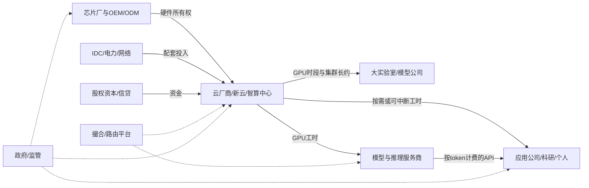

# 算力交易市场现状与主体

> 摘要：算力交易包含相互连接、但不能合并定价的三层：GPU 硬件所有权、特定时间地点的计算服务、模型 API 推理服务。全球市场以云厂商、新云和大模型客户的双边长约为骨架，按需、可中断实例及撮合平台处理边际需求；中国还叠加运营商、地方智算中心、算力券和跨域调度。2023—2025 年部分租价明显下降，2026 年出现回升与分化，不能假设单边贬值。建模宜采用“异质资产—容量日历—任务队列—合同—信用网络”的多层 ABM，重点识别可交付集群、利用率、期限错配与客户集中风险。

## 一、先弄清楚：究竟在交易什么

本文以 **2026-10-28** 为信息截止日。标记规则：**【事实】**表示有公开来源支持，包括明确注明的企业自报与媒体报道；**【推断】**表示经济解释或建模建议；**【待核实】**表示缺少原始材料、完整口径或可复核数据。引用集中列于文末，均带链接与发布日期；动态页面注明访问日期，访问日期不冒充发布日期。

### 1.1 三层市场与现金流

| 标的 | 买到的东西 | 常见卖方—买方 | 主要计价单位 | 到期后剩下什么 |
|---|---|---|---|---|
| GPU 卡、整机、服务器 | 硬件所有权及约定保修 | 芯片厂/OEM/经纪商—云厂商、企业、研究机构 | 美元或人民币/卡、节点、机柜 | 可转售的设备，仍需机房、电力、网络 |
| GPU 租赁 | 在指定时段使用约定硬件与配套系统的权利 | 云厂商/新云/闲置资源持有人—实验室、应用公司 | GPU·小时、节点·小时、月租、集群合同 | 服务时段消逝；机器通常仍归卖方 |
| token 服务 | 某模型处理输入、生成输出的 API 服务 | 模型厂商/推理商/聚合商—应用、企业、个人 | 每百万输入、输出、缓存 token；另有吞吐预留费 | 已生成的文本等结果，以及可能保留的缓存 |

【推断】租赁更像“机器工时”，token 更像“机器工时经过模型与软件加工后的服务”。这里的 token 是文本或多模态内容的计量单位，**不是加密货币**。Akash 的结算代币、模型 API 的 token、GPU 容量凭证也必须分开。



### 1.2 四组最容易混淆的口径

【推断】第一，**挂牌价不等于成交价，更不等于有货价**。价格页上存在一个型号，不代表可以买到所需地域、数量、连续时长与互联拓扑。没有成交量、可用量和订单拒绝率，难以识别供需。

【推断】第二，**机房上架率、GPU 出租率、任务忙碌率、算术利用率不同**。客户签约并付款但未满负载运行，出租率可以很高，GPU 核心忙碌率却很低；有卡但无法组成大集群，也不是训练客户的有效供给。

【推断】第三，**合同总额、backlog、融资额度不是当年收入或实付金额**。同一笔应用支出，可能先表现为推理商收入，再表现为云租赁收入和硬件采购，不能将三层交易额相加当作最终需求。

【待核实】截至本次检索，未获得全球或中国覆盖三层市场、消除内部交易且可审计的成交份额数据库。本文用合同、财报、平台交易额和接入规模说明量级，不编造“新云占 GPU 租赁市场多少”等比例。

## 二、GPU 租赁：全球商业分层与中国算力网

### 2.1 全球：三种供给组织方式并存

【事实】AWS、Azure、Google Cloud 与 OCI 均有 GPU 计算产品；下面的组织分类以官方产品文档为依据，竞争优势与适用需求为【推断】。它描述功能分层，不代表四家公司的 GPU 市占排名。[^clouds]

| 层次与代表 | 核心商品/组织方式 | 信息与市场力量 | 适合的需求；主要局限 |
|---|---|---|---|
| 超大规模云：AWS、Azure、GCP、OCI | GPU 实例、专用集群，叠加存储、身份、网络及模型服务 | 掌握既有企业客户与自有需求，可跨业务配置资本；部分需求转向 TPU、Trainium 等替代芯片 | 企业合规、生产推理、大集群；客户有迁移与生态依赖 |
| GPU 新云：CoreWeave、Lambda、Nebius、Crusoe、Together | 围绕 AI 集群、裸金属、调度软件和推理优化组织服务 | 供应关系、集群交付与运维是竞争点；通常更暴露于 GPU 残值、融资和大客户风险 | 训练、持续推理、专用集群；交付、现金流与再融资约束突出 |
| 市场/撮合：Vast.ai、RunPod、SF Compute、Akash | 异质资源发现、预订、转租、反向拍卖或订单撮合 | 聚合分散供给、降低搜索成本，但不同平台资产持有与担保责任差别很大 | 弹性推理、微调、研发和闲置资源变现；连续规模、可靠性可能受限 |

【事实】Together 同时销售 GPU 集群与按 token 计费的推理服务，因此“新云”“推理服务商”是功能分类，不能当成互斥公司名单。Lambda 的产品包括实例、互联集群及更大规模部署；Crusoe 提供 GPU 云、推理及微调，计算产品有按需、spot 与预留；RunPod 则同时提供 Pods、Serverless、Clusters 和预留集群。[^together][^lambda][^crusoe][^runpod]

【事实】Vast.ai 的供应者定价体系提供按需、可中断和预留方式；Akash 官方将机制描述为买方提出资源需求、供应者提交报价、买方选中后形成租约的**反向拍卖**。SF Compute 自建数据中心与集群，并允许客户转售未使用的预留计算时间；其文档明确存在订单、SKU、交付时段、节点数量与 standing order。三者分别接近异质商品市场、采购拍卖与容量订单簿，不能统称为“交易所”。[^vast][^akash][^sf][^sfdocs]

【推断】RunPod 这类多产品平台也不能只建成一个“经纪人”。应按产品分别建模：它可能组织基础设施、撮合供给，也可能提供 Serverless 服务并承担弹性调度风险。平台是否拥有机器、是否承诺交付，是比营销类别更重要的分类轴。

### 2.2 长约、按需、spot 与真正拍卖

| 机制 | 买方得到什么、承担什么 | 卖方得到什么、承担什么 | ABM 中的关键条款 |
|---|---|---|---|
| 双边多年长约 | 锁定容量、拓扑、交期；承担闲置与技术过时风险 | 较可预测现金流；承担建设延期、服务违约、客户信用风险 | take-or-pay、预付款、起租条件、转租权、终止赔偿、升级条款 |
| 云承诺消费/折扣计划 | 承诺一定支出换折扣；是否保证容量取决于产品 | 改善客户留存、收入可见度 | 消费承诺与容量预订分设变量 |
| 按需实例 | 灵活启停；承受缺货与价格变动 | 保留重新定价能力；承担空置 | 报价有效期、最小计费粒度、配额、SLA |
| 可中断/抢占式 spot | 低价；承担回收、重启与进度损失 | 出售剩余容量并保留收回权 | 中断强度、通知时间、checkpoint 成本 |
| 容量订单簿/转租 | 买卖同一 SKU、地点、交付窗口的使用权 | 平台降低过度预订的成本 | 时间优先、限价、交付资格、卖方履约保证 |
| 反向拍卖 | 多供应者竞争满足一份需求 | 按任务能力与报价争单 | 准入、密封/公开报价、评分与支付规则 |

【事实】AWS 官方明确，Spot 价格由 EC2 根据长期供需变化逐步调整；它不是今天常被想象的实时竞价拍卖。Savings Plans 则以承诺每小时消费换取折扣，不能自动等同于专用 GPU 集群预留。AWS 的 2025 年价格调整公告同时区分了 Savings Plans 与 Capacity Blocks。[^awsspot][^aws]

【推断】长约与 spot 是相互影响、又分割的市场：大客户先锁定优质集群，剩余容量进入按需与可中断池。即使总卡数很多，spot 市场也可能很薄；长约期限越长，短期可交易供给越少。

### 2.3 中国：供给不只是互联网云

【事实】中国的参与者包括阿里云、腾讯云、华为云及三大运营商，地方国资/产业方运营的智算中心，以及提供算力或机房服务的上市公司。中贝通信 2025 年报披露智算业务收入 **6.20 亿元**，截至报告披露日运营规模超过 **22,000P**，并自报算力使用率接近 **100%**；这些是公司口径，不能外推全行业。润泽科技 2025 年报披露当年新增交付约 **220MW**，属于交付功率口径，不能直接换算成可出租 GPU 数量。[^zhongbei][^runze]

【推断】润泽等 IDC/AIDC 企业的“算力业务”可能包含托管、集群交付或运营服务；中贝、鸿博/英博数科等的业务还可能混合硬件集成与租赁。建模前需逐份拆解合同：谁出资买卡、谁拥有机器、谁付电费、谁签终端客户、收入按设备验收还是按服务期间确认。不能把所有“算力概念上市公司”当成同一类出租人。

| 地区/层级 | 已核实的进展 | 可观测量与解释边界 |
|---|---|---|
| 上海 | 2023 年已有算力交易平台试运行；2025 年升级为“中国算力平台（上海）暨上海算力交易平台”，2026 年进一步组织行业互联互通节点建设[^shanghai][^shnode] | 同时存在交易、公共算力调度、行业节点等体系；同城平台不能随意合并。不同材料对 2025 年具体启动日有差异，本文只确认到月 |
| 北京 | 2024-09 正式上线互联互通平台；通信管理局 2025-05-26 公布，截至当年 4 月汇聚 7 省市资源，超过 **60EFLOPS（FP16）**[^beijing] | 汇聚资源并非当月成交或实际可立即交付资源；适合研究京津冀蒙供给走廊 |
| 贵州 | “大衍”调度平台承担算力汇聚、运营与交易；贵州大数据集团 2025-01-26 工作会议报道自报，截至 2024 年底汇聚 **36 家服务商、496 家需求方**，可调度 **4.5Eflops**，交易额超 **100 亿元**[^guizhou] | 交易额涵盖何种算力、统计期限、合同额或实结算额、是否含转售，仍需原始流水核实 |
| 宁夏 | 国家数据局 2026-09-03 公布宁夏平台接入全国监测调度试验验证平台；监测模块已对接，调度模块仍进行技术验证与对接[^ningxia] | 监测接入与商业调度成熟度不同；不能据此宣称已形成全国统一连续竞价市场 |
| 武汉（补充观察） | 2026-08-25 官方转载报道平台 3.0，支持模型调用和 token 化计量；累计可调度 **1465P**、累计交易额 **6240 万元**[^wuhan] | 少数披露交易额的地方样本，但仍需查清累计窗口、交易品种及是否包含补贴 |
| 国家层面 | 2023-12-29“东数西算”实施意见；2025-05-21《算力互联互通行动计划》；2026-02-06 开展国家互联互通节点建设。2026-08-28 官方公布 **20 余家调度主体**入驻试验验证平台、**145 万 PFLOPS（FP16）**纳入监测[^eastwest][^interconnect][^nodes][^national] | 政策目标、标准化接入、监测、可调度、已履约交易依次不同，不应相互代替 |

【推断】“国家算力网”不是一家统一购买全国 GPU 的公司，也不是已经完成标准化清算的单一交易所。可将其理解为**多个经营主体借助标识、网络、监测与调度规则互联**。企业站点使用“全国”“国家”字样，也不能仅凭名称判定监管授权或交易规模。

【推断】中国模型宜将“政策性建成容量”和“可商业交付容量”分别记录：前者进入地方投资考核，后者才进入订单可行集。算力券则是有条件的需求补贴，需记录受益企业、指定供应者、兑付时滞与财政预算。

## 三、GPU 买卖：配额、二手流动性与抵押融资

### 3.1 一级市场是供应链采购，不是统一证券发行

【推断】典型链条为 NVIDIA/AMD 等芯片设计商，经板卡、HGX/DGX 或服务器整合体系，通过 Dell、HPE、Lenovo、Supermicro 等 OEM，以及 ODM 与分销渠道交付云厂商和企业。链条并非每笔交易都逐层经过：大型客户可直接谈芯片或系统配额，由整机伙伴完成集成。中国还需纳入华为昇腾等国产加速器及其服务器、软件生态。

【事实】NVIDIA 最新季度报告将先进制造、供应链、数据中心、电力和客户资金等列为业务约束，并披露中国销售受许可证与中国进口限制共同影响。这说明“芯片生产出来”与“客户可部署”至少存在供应、许可、交付、机房四道门槛。[^nv26]

【推断】配额与交期通过客户关系、付款承诺、订单规模和交付能力分配。短缺时，报价之外的“更早交货”具有价值；需求方可能同时向多渠道下单，造成上游看到的订单高于最终用量，即供应链的牛鞭效应。具体各厂 2026 年配额算法和真实交期分布属于【待核实】，不能用 2023 年极端等候期代表今天。

### 3.2 二级市场：交易的是不同质量的资产

【事实】二手交易可通过设备经纪商、IT 资产处置商、专业服务器转售商及 eBay 等发生。Compute Exchange 的动态页面给出二手 **H100 SXM5 约 2.2万—2.7 万美元**、**H100 PCIe 约 1.6万—2 万美元**、**A100 80GB 约 7000—9500 美元**的指示价；这是单一卖方的**报价区间**，不是成交指数或全球公允价值。[^used]

【推断】卡、SXM 模组、HGX 基板与可通电整机不能互换比较。需要同时记录显存、形态、使用历史、故障、保修、互联、附属 CPU/内存/电源、税费与交货地。二手卡便宜但缺少底板、冷却和厂商支持，可能无法立即出租。经纪商提供流动性与验货服务，也通过库存承担价格风险。

【推断】残值至少有三种：正常持续经营时的收益价值、可在数月内卖出的市场价格、债务违约时的快速清算价。贷款建模若把第一种当成第三种，会低估回收损失；训练集群被拆卖后，互联与部署价值也可能无法全额回收。

### 3.3 中国：出口控制造成区域分割，但不等于全面断供

【事实】Reuters 2024-01 对招标文件的调查发现，中国部分机构取得了受限制 NVIDIA 芯片的小批量供给，显示二级/非官方渠道确实存在；这不能证明渠道合法，也不能据小批量样本推算整体进口量。[^greyhardware]

【事实】2025 年 H20 被纳入新增许可要求。NVIDIA 披露因此在 FY2026 第一季度确认 **45 亿美元**库存及采购承诺相关费用。2026-01-13，BIS 宣布对 H200、AMD MI325X 等向中国出口改为满足条件的逐案许可审查；NVIDIA 2026-08-27 季报仍称，中国政府限制部分已获许可产品销售，其数据中心计算业务在中国仍受实质性限制。**获得美国许可、允许进口、实际发货、收入确认是不同事件。**[^bis][^nv26]

【推断】区域价格可写为“全球设备价＋运保税费＋渠道与合规成本＋断供期权价值＋售后折损”。限制收紧可能抬高存量卡价格，也可能因客户转向国产或境外算力降低某型号需求；方向取决于替代能力。H20 的价值尤其应按显存、带宽与实际推理任务评价，而非仅按训练 FLOPS 排名。

【待核实】灰色渠道的真实交易量、按型号/日期可比的中国溢价、H20/H200 截至 2026-10 的逐批许可与到货数量，本次没有可审计全样本。不能预设“禁运必然带来固定百分比溢价”，更不能将灰色渠道供给视作无风险、无限弹性。

### 3.4 GPU-backed loans、私募信贷与 ABS

【事实】CoreWeave 2023-08-03 公布 **23 亿美元**债务融资，Reuters 报道其以 NVIDIA 芯片作抵押，领投方包括 Magnetar 与 Blackstone。2026 年第二季度，公司披露季度收入 **25.75 亿美元**、净利息费用 **6.40 亿美元**、净亏损 **6.26 亿美元**，以及约 **1040 亿美元** revenue backlog。高订单量不自动等于盈利或可自由支配现金。[^loan][^loanreuters][^cwq2]

【推断】新云常见融资链是：先争取可融资的客户长约及预付款，再取得股权和设备/合同支持的贷款，购买 GPU、租机房并交付服务，以客户付款偿债。银行或私募信贷买的其实是**合同现金流＋客户信用＋抵押设备＋运营连续性**的组合，而非只看一块卡的转售价。

【事实】S&P 的《ABS Frontiers: Equipping Data Centers Through Securitization》讨论 SPV 持有或取得 GPU 抵押、以租赁收入支撑证券化的结构。它是评级研究，不能据此断言全球已形成规模明确、标准统一的纯 GPU ABS 市场。[^abs]

【待核实】部分综合设备 ABS 可能包含 GPU 贷款，但公开评级摘要未必披露 GPU 占比；纯 GPU ABS 的发行总额、分层收益率、违约和残值回收率，本次未取得足够原始发行文件。ABM 应把设备抵押贷款设为基线，把 ABS 分层转移设为可选机制，避免将贷款、数据中心不动产证券化与 GPU ABS 重复统计。

### 3.5 折旧争议：四个“寿命”必须分开

【事实】CoreWeave 2025 年 10-K 披露，自 2023-01-01 起将数据中心计算设备预计使用年限从 **5 年延长至 6 年**，当前技术设备按 6 年折旧。[^cw10k]

【推断】争议的核心不是“新一代芯片每年发布，所以旧卡一年报废”，而是：旧卡仍能工作多久、在哪些任务上仍有成本优势、可获得多少租金、以及清算时有人出什么价格。应分别建模**物理寿命、经济使用寿命、合同期限、会计折旧年限**。

【推断】延长折旧会降低当期会计费用，不能创造现金、缩短贷款期限或保证残值；反过来，旧卡租价下降也不必然意味着应立即停机。只要任务收入覆盖可避免成本且没有更优用途，继续出租可以是理性选择。旧机房若无法承载新卡功率密度，其上运行旧卡的机会成本也可能较低。

## 四、token 买卖：从模型厂定价到路由与灰色转售

### 4.1 商品是带质量与交付条件的推理服务

【事实】模型厂商 API 包括 OpenAI、Anthropic、Google、DeepSeek、阿里百炼、字节火山方舟等；Together、Fireworks、硅基流动等又以开放权重模型和推理优化提供服务。Fireworks 官方同时提供按 token 计费的 Serverless，以及按 GPU 秒计费的部署；硅基流动也提供模型 API 与预留实例。因此，同一家公司可能在租赁层是买方、在 token 层是卖方。[^openai][^claude][^google][^deepseek][^aliyun][^together][^fireworks][^siliconflow][^sfreserved]

【推断】用户并不是先买一批可以库存和转交的通用 token，而通常是购买 API 余额、调用权限或吞吐保障。不同 tokenizer 对同样中文、代码生成的 token 数不同；模型质量、上下文长度、思考 token、延迟、限流和数据驻留也不同。“每百万 token 最低价”无法单独代表完成任务的成本。

### 4.2 2026-10-28 可核查的价格样本

以下都是 **每百万 token**，美元与人民币保留原币种，不暗中汇率换算；标准实时、非缓存价格为主。它们是选定 SKU 的报价样本，**不代表厂商最先进产品全集，也不是等能力排名**。

| 厂商/选定模型 | 输入 | 输出 | 缓存、时段与适用口径 | 证据 |
|---|---:|---:|---|---|
| OpenAI `gpt-6.1-sol` | $2.00 | $10.00 | 标准、短上下文表；缓存读取 $0.10；Flex/Batch 表为 $1/$5 | 官方动态价目表，访问 2026-10-28[^openai] |
| Anthropic Claude Sonnet 5.5 | $2.00 | $10.00 | 缓存读取 $0.10；写缓存另计；地域等条件可影响费用 | 官方动态文档，访问同日[^claude] |
| Google Gemini 2.5 Flash-Lite | $0.10 | $0.40 | 文本等输入档，音频另价；缓存输入 $0.01，显式缓存存储另计 | 官方价目表中保留的 SKU，访问同日[^google] |
| DeepSeek V4.1-Flash-1017（`deepseek-flash`） | $0.30 | $1.20 | 高峰标准；缓存命中 $0.006；低峰三项均半价 | 官方价目表，访问同日[^deepseek] |
| DeepSeek V4-Pro-0813 | $1.32 | $3.96 | 高峰标准；缓存命中 $0.044；低峰半价 | 同上[^deepseek] |
| 阿里 `qwen-plus-2025-12-01` | ¥0.80 | ¥2.00 | 华北 2、输入不超过 128K、非思考；思考输出为 ¥8；更长上下文另档 | 官方百炼价目表，访问同日[^aliyun] |
| 字节豆包 | — | — | 官方火山方舟价目文档入口已定位，但本次抓取超时；2026 年完整 SKU、缓存与输入长度档位【待核实】 | 2024 年历史样本见下一节；不拿旧价充当现价[^doubaoprice] |

【事实】DeepSeek 当前官方高峰窗口为工作日 UTC 01:00—04:00、06:00—10:00，且排除中国法定节假日；其余时段为低峰。这里按官方时区记录，不能直接套用硅基流动等第三方服务的低峰窗口。[^deepseek]

### 4.3 差异化定价背后的经济逻辑

| 定价方式 | 已有机制 | 【推断】模型中代表的经济含义 |
|---|---|---|
| 输入/输出分价 | 各厂商普遍分别报价；长上下文与思考输出可有独立规则 | prefill 与 decode 的资源瓶颈不同，不能只用总 token 数 |
| 缓存读取/写入/存储 | Anthropic、OpenAI、Google、阿里等官方价目表区分相关费用[^openai][^claude][^google][^aliyun] | 缓存可复用前缀，减少重复计算；写入、驻留也有成本 |
| Batch | Anthropic、Google 公布批量异步折扣；阿里部分模型 Batch 按实时价 50% 计费，且其文档明确相关缓存折扣不能同时生效[^claude][^google][^aliyun] | 用更宽交付期限换取排队、拼批和填谷机会；折扣不可机械相乘 |
| 优先级/快速通道 | 官方服务中可见 Standard、Flex、Fast/Priority 等层级[^openai][^google][^fireworks] | 更高支付换更低等待与更强可用性，形成服务等级筛选 |
| 高低峰 | DeepSeek 当前官方表有分时价格[^deepseek] | 通过价格迁移可延迟需求，改善容量利用 |
| 预留吞吐/专用部署 | Together、Fireworks、硅基流动提供相关方案[^together][^fireworks][^sfreserved] | 把需求不足风险更多交回客户，换取确定吞吐及单位成本优惠 |

【推断】把所有折扣归因于“补贴价格战”会漏掉生产优化。批量、缓存和容忍排队能真实降低交付成本；另一方面，免费额度及临时优惠可能是获客投入。判别是否长期亏损，需要模型实际吞吐、利用率、电价、折旧及获客回收数据，单看 API 售价无法识别。

### 4.4 聚合路由、推理商与中转商

【事实】OpenRouter 官方说明其按价格、延迟、吞吐、可靠性等进行供应者路由，且通常传递上游推理价格、通过余额购买等环节收费。其 BYOK 免费额度和收费政策会变化，本文不以过往“固定费率”代替当前所有套餐。[^openrouter][^orprovider]

【推断】聚合平台降低接入与切换成本，可能通过故障回退提供可用性；推理商则以批处理、量化、内核和调度能力把 GPU 工时加工成 token。即使运行同一开放模型，精度、最大上下文、吞吐和数据处理条款也可能不同。路由的目标应是“满足任务质量与 SLA 后最低总成本”，而不是最低 token 报价。

【事实】2025 年论文《Are You Getting What You Pay For?》研究了 API 隐蔽替换模型及检测问题；2026-05-09 的媒体调查报道了中国低价 API 中转网络涉及账号来源、模型替换与数据再利用的风险。后者是调查报道，不能推断所有中转服务都有相同行为。[^audit][^proxy]

【推断】至少应分为合约允许的代理/企业转售、技术聚合路由、来源不透明的账号额度转售，以及欺骗模型身份的服务。前两类可以提供真实生产价值；后两类的低价可能来自不可持续额度、违反合同、付款风险或质量折损。不存在“买低价 token、无成本加工成高价 token”的普遍无风险套利。

【待核实】灰色 token 市场规模、盗用额度占比、模型替换率、封号概率和平均存活时间，缺乏有代表性的公开总体样本。不能用单篇调查中的极端折扣给整个市场设定均值。

## 五、价格数据：2023 稀缺、2024—2025 降价与 2026 分化

### 5.1 H100：同一来源的历史锚点

【事实】SemiAnalysis 的公开表提供以下 H100 历史值。复合指数结合多类云市场观察，按需与一年期栏目是不同口径；一年期范围为报告的分位区间，通常涉及预付款，不能当成全市场成交量加权均价。页面动态访问于 2026-10-28。[^semi]

| 时段 | 复合指数，美元/GPU·小时 | 一年期合同报价区间，美元/GPU·小时 |
|---|---:|---:|
| 2023 下半年 | 6.62 | 2.65—3.30 |
| 2024 第一季度 | 5.78 | 2.50—3.10 |
| 2024 第二季度 | 4.77 | 2.20—2.50 |
| 2024 第四季度 | 3.91 | 1.90—2.10 |
| 2025 第一季度 | 3.60 | 1.80—2.10 |
| 2025 年 7 月 | 2.79 | 1.70—2.00 |
| 2025 年 10 月 | 2.84 | 1.45—1.95 |
| 2026 年 3 月 | 2.80 | 2.00—2.70 |

【推断】按上述同源复合指数计算，2023 下半年到 2025 年 7 月约下降 **57.9%**；这是表内端点比较，不是每张卡、每类合同都降同样比例。一年期区间在 2026 年抬升，而复合指数变化较小，说明合约结构和供给可得性会改变观察结果，不能强行压成一条“GPU 市价”。

### 5.2 H100/H200/B200/A100：能确认什么，哪里断档

| 型号 | 2023—2025 的可核查历史证据 | 2026 年最新样本 | 能否形成连续可比曲线 |
|---|---|---|---|
| H100 | 上表；AWS 于 2025-06-05 公告按需 P5 降 **44%**，从 6 月 1 日适用[^semi][^aws] | Silicon Data 2026-10-28 日期表 **$2.90/GPU·小时**[^sdh100] | 可用同一指数做片段，跨指数须保留分段 |
| H200 | AWS 同次公告 P5en 按需降 **25%**；H200 不存在可直接用于 2023 年的同型号主流租赁序列[^aws] | Silicon Data 日期表 2026-10-27 **$3.47**[^sdh200] | 2024—2025 完整同源公开月序列未取得；不能补造 |
| B200 | AWS P6-B200 2025-05-15 先以 Capacity Blocks 上线，6 月扩展 Savings Plans；2023 年没有同型号商业租赁可比价[^aws] | Silicon Data 日期表 2026-10-28 **$6.47**[^sdb200] | 2025 初期完整公开成交序列未取得；不把推出后的价差误当全程降幅 |
| A100 | AWS P4d/P4de 同次按需降 **33%**；CCIR 档案样本称 A100 中位挂牌价 2022 年峰值 **$3.05**，2025 年低点 **$1.75**[^aws][^ccir] | Silicon Data 日期表 2026-10-28 **$1.56**[^sda100] | 可交叉验证方向；A100 40/80GB、PCIe/SXM 必须再细分 |

【事实】AWS 上述降价以 2025-05-31 为基准，不等于“全年平均成交价降幅”。CCIR 2026-07-08 研究基于历史价格页档案重建挂牌价，发现部分供应者自 2025 年末起上调旧代际租价；其“挂牌中位数”“回归年降幅”“端点变化”是不同统计量。该研究机构与档案覆盖仍宜交叉复核，本文将其作为补充证据。[^aws][^ccir]

【事实】本次抓取 Silicon Data 时，多个页面顶部及日期表与 FAQ 中的“当前价格”不一致，例如 H100 日期表为 $2.90，FAQ 仍显示 $2.53。本文只摘录**带日期的表格观察值**，保留该数据质量问题，不将 FAQ 文本拼入时间序列。不同型号最新观察日也未必相同。[^sdh100][^sdh200][^sda100][^sdb200]

【推断】因此，用户提出的“2023 稀缺→2024—2025 下降”对 H100 和部分成熟型号有依据，但不能延伸为 H200/B200 自 2023 年起的共同价格轨迹，更不能据此断言 2026 年继续下降。

### 5.3 指数应该怎样使用

| 数据源 | 实际度量 | 用于校准什么 | 局限 |
|---|---|---|---|
| SemiAnalysis GPU 指数与合同调查[^semi] | 多来源复合价、按期限调查；公开方法说明会抑制样本变化造成的跳动 | 代际价格冲击、期限价差、缺货状态 | 权重及底层样本不完全公开，历史产品/方法版本需保留 |
| Silicon Data H100/A100/B200/H200 指数[^sdh100][^sdh200][^sda100][^sdb200] | 按其方法对期限、规模、互联等标准化的日度观察，部分区分新云与超大规模云 | 日度水平、分市场价差与波动 | 不是完整全球逐笔成交带；本次发现页面内陈旧文本 |
| CCIR 历史价格档案[^ccir] | 供应者历史挂牌价、月度样本中位数 | 挂牌调价频率、黏性、供应者异质性 | 样本结构、档案间隔、样本数都会影响结果；模型推导长约价不是实签价 |
| 云厂商官方价目表与变更公告[^aws][^runpod][^vast] | 单一渠道可售 SKU 报价 | 价格离散、产品差异、调价事件 | 需另查可用量；页面默认地域与选项可能无法从文本抓取确定 |
| 地方平台披露[^guizhou][^wuhan] | 累计交易额、接入资源、需求方数 | 中国场景的规模锚点、网络拓扑 | 无法仅凭汇总数识别真实流动性、利用率和成交价分布 |

【事实】CME 于 2026-08-11 宣布拟推出 H100/B200 租价指数期货，原计划 10 月 5 日交易，附监管审查条件；9 月 28 日官方技术通知称相关推出安排延期，等待审查。截至本次检索未核实后续正式开市公告，**不能写成已有成熟期货成交、持仓和套保流动性**。[^cmeplan][^cmedelay]

### 5.4 token 价格下降：至少分三条曲线

【事实】Stanford《2025 AI Index》指出，达到 GPT-3.5 水平的推理成本在 2022-11 至 2024-10 下降超过 **280 倍**。这是**达到给定能力的成本前沿**，不是同一模型不变质量、不变 tokenizer 的官方报价降幅。[^stanford]

| 曲线/事件 | 可核实数据 | 正确解释 |
|---|---|---|
| 中国特定产品降价 | 2024-05-21 阿里 Qwen-Long 输入报价由 ¥0.02/千 token 降为 ¥0.0005/千，即 **¥20→¥0.50/百万，降 97.5%**；媒体标题多四舍五入为 97%[^qwen2024] | 同一产品公告降价；不证明质量等于当时任何国际模型 |
| 中国低价新品进入 | 2024-05-15 豆包通用 pro-32k 输入价 **¥0.0008/千，即 ¥0.80/百万**；报道中 pro-128k 为另一档[^doubao2024] | 型号与上下文条件必须保留；不是所有豆包现行模型价格 |
| 缓存形成独立价格 | DeepSeek 2024-08-02 公布缓存命中 **$0.014/百万**、未命中 **$0.14/百万**[^dscache] | 同一时间两种输入服务价格，不能说所有输入都便宜十倍 |
| 技术升级可能涨价 | DeepSeek 2024-12-26 的 V3 公告明确，优惠结束后 2025-02-08 起未命中输入 **$0.27**、缓存输入 **$0.07**、输出 **$1.10/百万**[^dsv3] | 同一厂商升级、优惠退坡可以抬价，长期能力成本下降不代表报价单调下降 |
| 2026 年分层与分时 | 前述官方表包含昂贵前沿模型、低价小模型、缓存、Batch 和高低峰 | 应同时保存固定 SKU 价格、固定任务成本、用户实际支出三条序列 |

【推断】真正有经济意义的指标是：`每次成功任务成本 = 全部重试、输入、思考、输出与工具费用 / 成功任务数`。价格下降可能通过更长思考链、更多 agent 调用和新应用带来更大 token 需求，因此 **token 单价下降与 GPU 需求上升可以同时发生**。是否出现总支出反弹，取决于需求价格弹性与使用强度，不能预先断定。

## 六、市场主体逐一展开：规模证据、目标、信息与对手方

### 6.1 主体总表

表中有出处的量级为【事实】；动机、信息与行为机制为【推断】。没有公开总量的主体明确标为【待核实】，不以项目金额冒充市场占比。

| 主体 | 是谁；规模证据或缺口 | 最大化目标与约束 | 信息、时间尺度与互动 |
|---|---|---|---|
| 芯片厂商 | NVIDIA、AMD、国产加速器厂；全球 GPU 成交份额【待核实】；NVIDIA 2026-01 追加投 CoreWeave **20 亿美元**[^nvinvest] | 产品利润、生态与代际渗透；制造、HBM、封装、出口许可约束 | 熟悉路线图、供货与成本，未必看清终端真实需求；季度—多年；向 OEM/云销售，也可能投客户 |
| OEM/ODM、集成商 | 服务器制造、组装、分销与交付；独立算力交易占比【待核实】 | 集成利润、库存周转与客户关系；配额、营运资金、验收及保修约束 | 知道订单与交期；月—年；衔接芯片商和硬件买方，承担交付与库存风险 |
| 超大规模云 | AWS、Azure、GCP、OCI，以及中国头部云/运营商；GPU 专项份额【待核实】 | 云生态利润、内部 AI 战略与客户留存；资本预算、供电、服务合规 | 有细粒度客户负载和自有需求；秒级调度、年度建设；兼为芯片买家、新云客户与 token 渠道 |
| GPU 新云/租赁运营商 | CoreWeave、Lambda、Nebius、Crusoe、Together；CoreWeave 2026Q2 收入 **25.75 亿美元**，仅代表该公司[^cwq2] | 集群现金流、扩张与股权回报；债务偿付、交付、残值及客户集中 | 有机房/设备状态与大客户合同；分钟级分配、月—多年投资；买设备卖工时，向 IDC 和资本付费 |
| IDC/电力/能源方 | 托管商、电网、发电与供电伙伴；Core Scientific 2024 公布约 **200MW** HPC 合作[^coresci] | 稳定租金、电力销售、资产利用；并网、冷却、土地与能源许可 | 掌握接电排队和本地供电；年—十年以上；出租基础设施，未必拥有 GPU |
| 金融资本 | PE、产业资本、银行、私募信贷、设备 ABS 投资者；23 亿美元历史融资仅是单笔案例[^loan] | 风险调整收益、债务覆盖与回收；募资、集中度、抵押和期限 | 合同尽调强，真实技术残值可能弱；月度监控、多年持有；为新云扩张融资，违约时接收或处置资产 |
| AI 实验室/大模型公司 | 全球与中国训练/推理大买家；Nebius—Microsoft 合同基础总额约 **174 亿美元**、服务至 2031 年[^nebius] | 能力进步速度、产品收入、上市时间；资金、数据、人才、集群规模 | 熟悉自身研发、对未来商业需求不确定；训练项目按周/月，采购按年；可买硬件、签长约、再卖 API |
| AI 应用公司/初创 | SaaS、agent、游戏、内容与企业应用；总体 GPU/token 消费份额【待核实】 | 单客毛利、增长、现金 runway；质量、SLA、并发与预算 | 清楚用户支付，较难辨别底层成本/模型真实性；请求级路由、月度预算；按需消费与预留混用 |
| 科研机构 | 大学、国家实验室、公共科研平台；市场份额【待核实】 | 科研产出、进度、公平分配；拨款周期、采购规章与数据安全 | 算法/任务信息强，商务与供应判断可能弱；项目按月—年；购买设备，也通过云额度和排队用算 |
| 个人开发者 | 独立开发者、学习者、爱好者；总体规模【待核实】 | 学习、项目效果、时间与预算效用；小额资金、安装与支付能力 | 价格比较容易，可靠性与售后信息弱；分钟—周；提供长尾需求，偶尔出租自有消费卡 |
| 矿工转型 | IREN、Core Scientific 等；IREN 2025-11 公告 Microsoft 五年合同约 **97 亿美元**、预付 **20%**[^iren] | 提升既有电力/土地机会价值；AI 改造、客户信用与旧业务收益 | 电力和场址优势，AI 网络/运维能力需建设；月—多年；向新云提供机房或自行购卡卖云服务 |
| 撮合平台/经纪商 | Vast.ai、RunPod 部分产品、SF Compute、Akash，硬件经纪人；全市场撮合占比【待核实】 | 手续费、成交率、留存；供给认证、欺诈、履约和薄市场 | 跨卖方报价/质量信息强；秒—月；降低搜索成本，是否承担库存取决于模式 |
| token 中间商 | OpenRouter、代理渠道与来源不明中转站；不能作为同一种法律/技术主体 | 合法者优化路由、收费；不透明者可能追逐价差与短期现金 | 掌握跨渠道限流/价格，客户难验证；请求级—月；把上游故障、额度与身份风险传到应用 |
| 政府/公共平台 | 地方政府、运营商协调部门、财政与监管；全国监测规模见第二节[^national] | 公共服务、产业、安全、就业与绿色发展；财政、能耗、监管及考核 | 汇总信息强，单任务质量弱；年度—规划周期；补贴需求、设准入、控制跨境与协调供电 |

### 6.2 供应端：芯片、整机、云与能源为什么进场

【推断】**芯片商**既希望销售更多卡，也希望开发者采用自身软件生态。投资客户可以促进集群建设、扩大可运行软件与开发者基础；风险是产业资本和销售共同依赖同一终端需求。理性行为是按风险配置产能与客户；过度自信则表现为忽视需求回落、把客户融资当成终端盈利验证。

【推断】**OEM/ODM 与集成商**赚交付和服务的钱，短缺时可能囤库存、争取配额。提前采购可以缩短客户等待；若把短缺溢价锚定为长期价格，库存反而占用现金。其直接对手方是芯片/部件供应者与设备采购者，不能把整机毛利全部解释为 GPU 投机。

【推断】**超大规模云**可以从数据库、存储、网络、模型托管和企业合同整体盈利，局部 GPU 服务低毛利仍可能合理。它们既与新云竞争，也向新云买补充容量：自建尚未交付时，外购能保护企业客户关系。行为偏差主要是以竞争者资本开支为锚、因组织考核不愿错过战略窗口；需与真实机会成本区分。

【推断】**新云**把建设速度和 AI 运维专长变成租金，但高杠杆使其目标常从“长期利润最大”变为“下期现金不断裂”。即使某个短单低于完全成本，只要高于可避免成本、又不挤占更高价值订单，也能改善偿债能力。若为维持估值不断按乐观需求买卡，则是扩张反馈与过度自信的组合。

【推断】**IDC、电力和能源方**往往出售的是可用功率与可持续运行环境。其投资期限可能比 GPU 长得多：机房长租不能天然匹配几代硬件收益。理性策略是取得可信租户、限定改造责任；非理性风险是把“签约 MW”当成已通电可收费 MW，或忽视水、接电和散热瓶颈。

### 6.3 资金端：谁提供杠杆，谁最终承担贬值

【推断】**金融资本**不是统一的“投机者”：PE 关注股权增值与退出，私募信贷关注利息、契约与抵押回收，银行受资本和集中度约束，ABS 投资者承担不同优先顺序的现金流风险。贷款方可能凭长约与强客户降低利差，但“客户和抵押品一起受 AI 需求冲击”会形成错向风险。

【推断】其信息优势是合同与财务尽调，劣势是难判断跨代际任务适用性、重新部署成本与清算市场深度。客户取消或延期会先挤压运营者现金，再影响偿债与设备估值；最终损失由股东、次级资本、债权人和未获赔客户按合同顺序分担，并非由 GPU 厂商自动兜底。

【推断】看似非理性的高息借款，有时是为了赶上已有高价值合同的交付窗口；若延期损失大于融资成本，它可以是约束下的理性。反之，金融机构跟随热门赛道而忽视独立需求、仅凭“知名客户”统一放款，可能是羊群与声誉激励。

### 6.4 需求端：为什么大实验室长约，小应用按需

【推断】**大实验室/模型公司**购买的是大量 GPU 同时、持续、互联良好地工作。零散低价卡无法保证同步训练效率和项目截止期；错过发布窗口的损失可能远大于几个月设备贬值。多年长约同时给供应者融资依据，买方预付款实质上也参与供应链融资。

【推断】它们会比较“保供价值＋研发时间收益”与“价格下降＋闲置＋替代技术风险”。提前锁量并非自动 FOMO；超出合理置信区间反复采购、忽视任务与人才约束，才更像恐慌采购。其价格信息强于小买家，但对模型突破与未来营收同样可能过度自信。

【推断】**应用初创**通常需求不稳定，先用 API/按需 GPU 可以保留现金与试错机会；流量稳定后才可能自托管或预留吞吐。它们最大化用户价值与毛利，并受现金 runway 限制。低价切换若导致错误率、重试和延迟上升，可能损失更多；把模型榜单名次等同于真实任务质量，是锚定与代表性偏差。

【推断】**科研机构**看重按期完成实验与公平获得算力，其采购制度、预算到期和共享排队会改变选择。年底采购并不必然是个人非理性，可能是预算不可结转；真正的制度风险是花钱与成果脱钩。公共队列提供的隐性价格是等待时间，不能在模型里当成无限免费供给。

【推断】**个人开发者**偏好低预付、小粒度计费和易用环境。便宜消费卡、spot 与小模型常符合预算；忽略维护时间或盲目追新卡则可能是彩票偏好和注意力偏差。个人可快速退出，但每人订单小，通常难支撑大型集群的固定成本；该规模判断需用实际平台订单分布验证。

### 6.5 转型者、中介与政府

【事实】Core Scientific 2024-06 公告以约 200MW 基础设施支持 CoreWeave，初始合同期限 **12 年**，预计累计收入超过 **35 亿美元**；IREN 的 Microsoft 合同则涉及专用 GPU 服务、设备采购和预付。[^coresci][^iren]

【推断】**矿工转型**的资产优势主要是电力、土地、接电和运营经验。比特币 ASIC 不能直接变成 AI GPU；以太坊 GPU 挖矿转云与比特币场址改造是两条路径。AI 服务需要不同网络、散热、稳定性与客户支持，转型应比较“继续挖矿收益”与“改造投资后的风险调整 AI 收益”，不能把矿场 MW 全额计入当期 AI 供给。

【推断】**平台与经纪商**卖的是降低搜索、验货、匹配与结算成本的能力。市场越异质，其服务越有价值，但也越难形成厚实订单簿。持库存经纪人承担贬值，不持库存平台主要承担履约、争议和声誉风险；平台补贴供需两端可能改善网络效应，也可能诱发刷量。

【推断】**token 中间商**可赚可靠路由与账单整合的服务费。若其盈利依赖频繁获取不稳定额度或隐瞒模型身份，则风险表现为账号池突然失效、退款挤兑和上游封禁；客户难验证模型形成信息不对称，不能将这类风险与合约允许的聚合路由混同。

【推断】**政府**的目标函数包括产业外部性、公共科研、安全与区域发展，因此短期商业回报低的投资可能仍满足政策目标。但若只奖励建成卡数、投资额或接入规模，会鼓励建设超过有效需求；按实际履约、有效任务和补贴后净支出考核，激励会不同。官员任期与 GPU/机房投资周期错配，是“制度塑造行为”的关键来源。

## 七、理性、非理性与主体复杂性

### 7.1 抢卡、囤卡与过度建设，怎样区分

【事实】H100 历史复合价与长约区间显示 2023 年稀缺、此后下降，但长期合同一直不同于最高按需价格；不能将峰值按需价视为所有买家的采购基准。2025 年 AWS 官方也承认需求增长曾超过行业供给。[^semi][^aws]

【推断】“囤卡”至少有三种机制：经营者保留生产安全库存；大实验室购买提前交付的研发期权；投机者押注现货稀缺与转售价。前两种可有真实生产理由，第三种也未必不理性，但更依赖转售流动性。判断行为偏差要看**决策时可获得的信息、预期收益分布与预算约束**，不能以事后价格下降倒推当初非理性。

| 观察到的行为 | 可能的理性机制 | 可能的行为偏差 | 可检验的识别办法【推断】 |
|---|---|---|---|
| 2023—2024 抢卡、提前下单 | 断供损失、项目时间价值、采购交期不确定 | FOMO、羊群、可得性偏差、过度外推 | 比较自有任务增长与订单增长，检查重复下单/取消订单及闲置持续期 |
| 多年固定价格合同 | 保供、降低协调成本、支持供应者融资 | 锚定短缺价、低估代际替代 | 比较拓扑一致的有效任务成本、期限与迁移成本，而非只比较单卡小时 |
| 低于全成本出租旧卡 | 覆盖可避免成本，减少空置；短期填谷 | 损失厌恶、拒绝承认减值、延迟退出 | 看是否存在更高价值用途，以及未来维护和电费能否覆盖 |
| 继续建设低利用率中心 | 已签交付义务、政策外部性、承诺资金无法撤回 | 沉没成本谬误、地方竞赛、规模崇拜 | 只比较“从今天起追加投入”的净收益；分开沉没成本与违约赔偿 |
| token 降价或免费 | 成本优化、试用获客、云生态交叉销售 | 为追调用量而忽视付费转化，赢家通吃幻想 | 追踪优惠结束后留存、任务毛利、获客回收期、真实付费量 |
| 追逐新一代芯片 | 每有效任务/每瓦成本改善，满足显存或延迟约束 | 技术光环、彩票偏好、过度自信 | 对实际模型与负载做基准，加入改造、等待和切换成本 |

### 7.2 中国闲置报道：证据存在，口径不能扩大

【事实】科技日报 2025-07-17 报道，某西部千卡中心上架率不足 **50%**，已上架服务器实际利用率不足 **30%**；其采访亦明确部分地区缺少准确统计。报道引用浪潮人工智能研究院的全国平均使用率约 **30%** 估算。这是媒体采访与机构测算，不能当成公开逐中心审计结果。[^idle2025]

【事实】Reuters 2025-07-24 报道中国拟通过网络出售富余算力、整顿数据中心建设；第一财经 2026-10-26 评论又引用全国智能算力使用率 **36.8%**。后者本次未取得对应统计原表及分母定义，**该比例作为报道事实保留，作为全国校准值则【待核实】**。它也不能与北美数据中心机房空置率直接对比。[^reuterschina][^idle2026]

【事实】与此同时，中贝通信 2025 年报自报算力使用率接近 100%。低利用率样本与高利用率公司可以并存；这既提示异质性，也提示必须统一使用率定义、样本选择与统计期。[^zhongbei]

【推断】潜在结构原因包括：中心位置远离付费需求；数据迁移和网络延迟过高；集群规模/互联不足；软件与客户模型不匹配；机房建成但未通电或未上卡；缺乏运维和商业销售能力。平台联网能降低搜索与跨域成本，不能自动修复所有这些约束。

### 7.3 循环融资：事实网络与泡沫推论分开

【事实】NVIDIA 2026-01-26 公告向 CoreWeave 追加 **20 亿美元**股权投资。CoreWeave 2025 年 8-K 披露与 NVIDIA 签订初始金额 **63 亿美元**的订单安排，涉及未售出剩余云容量的使用。因此，供应商、股东、容量客户的身份确实可能重合。[^nvinvest][^nvbackstop]

【推断】正面解释是供应商承担一部分需求与交付风险，帮助生态形成规模；负面风险是以投资和容量承诺支持客户融资，客户再购买设备，导致上游销售看起来比最终付费需求更强。**存在循环关系不等于已证明虚假收入或泡沫必然破裂**。需要穿透资金来源、回购义务、关联交易、真实服务交付与独立终端现金流。

【推断】检验泡沫应拆为可证伪问题：不依赖关联方的终端收入能否覆盖全链条投入？预订是否变为付费任务？租金下降时杠杆还能否偿付？新增性能是否带来足够付费需求？“资本开支很大”或“某家公司亏损”都不足以单独回答。

### 7.4 四条反馈回路

【推断】**扩张正反馈**：租金上升 → GPU 收益估值上升 → 抵押与融资能力改善 → 更多采购/建设 → 未来供给上升。建设延迟使当前短缺与未来过剩可能同时出现。

【推断】**杠杆负反馈与连锁清算**：客户需求下降/延期 → 运营现金减少 → 触发契约或再融资困难 → 被迫出售设备/降价卖时段 → 残值与租价下跌 → 其他借款人抵押覆盖率变差。能否追保、何时清算取决于具体合同，不能把证券融资的每日盯市规则直接套用设备贷款。

【推断】**技术与需求反身性**：更便宜的 token 降低应用门槛 → 更多应用与 agent 调用 → 推理需求增加 → 某些显存/电力/低延迟资源变紧。与此同时，算法、蒸馏、量化和专用芯片降低单位任务 GPU 需求，两股力量可能抵消或轮流主导。

【推断】**政策反馈**：投资补贴刺激建成容量 → 低利用率暴露 → 调度平台与算力券刺激使用 → 新订单改善融资 → 再扩张。若考核只看总交易额，关联方转售或重复计算可能放大“需求”；若奖励经验证的最终任务并限制预算，回路会不同。这里是需检验的激励机制，不是对具体平台刷量的指控。

## 八、算力市场为何不同于股票与金属

| 维度 | 股票 | 标准金属 | 算力市场的特殊性及建模后果【推断】 |
|---|---|---|---|
| 可储存性 | 持有证券权利跨期延续 | 库存可跨期，支付仓储与融资费 | GPU 硬件可库存；**已过去的 GPU 工时不能库存**。未来时段预订是权利，不是把昨天的空闲小时存到明天 |
| 同质性 | 同一证券同权，交易所标准化较强 | 牌号、纯度、交割地有差异，但可依标准交割 | 型号、显存、互联、软件、地点、连续时长、SLA 共同决定商品；订单应先检查技术可行性 |
| 价值与折旧 | 企业现金流与估值变化，没有按股硬件折旧 | 金属可长期保有物理用途 | GPU 快速迭代，残值还受电价、软件支持、场址可改造性影响；折旧不应固定等于租价下降率 |
| 供给调整 | 增发、减持与做市可较快改变流通供给 | 矿山、冶炼扩产较慢 | 制造、整机、机房、并网各有滞后；缺某一环即无法提供计算服务 |
| 需求结构 | 投资者通常可以买小额、分散证券 | 工业买家有行业集中与库存需求 | 前沿训练对大批同质互联卡有互补性；推理更适合切分，但也受显存与延迟约束 |
| 时间交付 | 证券持仓无需绑定未来某小时 | 交割期与仓储体系明确 | 需要交易“某地某配置在某窗口连续可用”；同一卡未来多个时段可卖，重叠时段不能重复卖 |
| 加工关系 | 股票之间无稳定生产转换 | 矿石—金属—加工品有投入产出率 | GPU 工时经模型、软件与调度转为 token；转换率随任务变化，不存在统一固定“吨耗” |
| 套利约束 | 同证券跨场价差可受资本与制度约束 | 运输、仓储决定区域价差 | 数据搬运、冷启动、出口许可、地域数据规则与集群分割阻碍价差收敛 |
| 清算和对手方 | 成熟市场有标准保证金与集中清算 | 期货有仓单、保证金等规则 | 主体多依赖双边合同，质量验收与实际履约比单纯价格成交更重要 |

【事实】IEA 2025-04-10《Energy and AI》估算，2024 年全球数据中心用电约 **415TWh**，基准情景下 2030 年约 **945TWh**。这是全部数据中心用电，不是 GPU 专项，也不是确定发生的未来值。[^iea]

【推断】电力限制应按场址建模，不能只设一个全球电价。便宜电力如果没有网络、冷却和客户可接受地域，不能替代高价地区的可交付服务。大集群需要同址或合适拓扑，不能把全国不同地点的 FLOPS 相加后假定线性等价。

【推断】“token 类似金属加工品”的类比可用于成本传导、产能转换与加工利润；不可用于固定质量标准、稳定物料转换率和库存套利。输出文字可保存，不意味着客户可拿别人生成的 token 满足自己的新请求；有可复用性的通常是缓存、模型权重和已完成结果，且受权限和任务适用性约束。

## 九、证据缺口与优先核实清单

| 【待核实】事项 | 当前能说到哪里 | 需要补齐什么 |
|---|---|---|
| 全球/中国三层市场规模与主体占比 | 能看到部分公司收入和平台累计金额；没有统一消重口径 | 分层成交账本、GPU 专项收入、内部交易标识与最终需求支出 |
| H200/B200 的 2024—2025 连续价格；中国四型号租价历史 | 有公告和部分最新指数，不能连成无缺口曲线 | 同地域/SKU/期限的历史页面或授权数据，成交量、可用量和预付款字段 |
| 中国平均利用率与空置率 | 有报道、机构测算及公司自报，指标并不统一 | 原始样本、设备容量分母、忙碌/出租/上架定义、时间窗与权重 |
| GPU 二手真实残值与灰色溢价 | 有报价和小批量流通证据 | 已成交发票、规格、卡况、保修、税费、交货地与逐时政策状态 |
| GPU ABS 实际发行与回收表现 | 可确认评级研究讨论其结构；综合设备 ABS 不等于纯 GPU ABS | 发行说明书、资产池 GPU 占比、分层、触发条款与回收数据 |
| H20/H200 中国最新逐批供给 | 2026 年逐案许可与进口约束并存 | 企业后续发货/收入披露和双方监管原文，不能只读宣布获许可的新闻 |
| 字节现行完整 API 价格 | 有 2024 年历史价；2026 官方价页本次超时 | 型号、输入长度、缓存、思考输出、地域与折扣的当日表 |
| token 中转市场规模与欺诈率 | 有模型替换研究与灰色市场调查 | 有代表性的样本框、付款/封号、质量审计与存活期跟踪 |
| CME 算力期货后续状态与流动性 | 已有延期官方公告，未核实重新开市 | 正式上市公告、合约规则、每日成交持仓；不得先填非零交易量 |
| 中国平台交易额定义 | 官方/企业报道披露累计金额 | 合同额还是结算额、是否包含多次转售、补贴、设备采购和关联交易 |

## 十、对算力交易市场建模的启示

### 10.1 初步 ABM：三层市场、两条区域线、五类账本

【推断】第一版不必复制全世界。建议建立**全球开放市场、中国境内市场**两条区域线，通过受许可约束的硬件流、跨境服务可行边和模型供给相连；中国线额外启用地方政府、算力券、公共采购、国产架构适配与跨域网络。区域壁垒不应只是固定加价，而应改变可行交易集合与交付概率。

【推断】共用五类账本：①设备资产与所有权；②容量日历；③任务队列及完成质量；④合同义务与预付/应收；⑤现金、债务与抵押关系。公司可同时承担多种角色，但其资产、收入和义务不能重复计数。训练型客户要求一组卡同时可用；推理需求可按延迟、质量与吞吐分级。

【推断】采用不同时间尺度：推理排队用秒/分钟的子步长或解析排队模型，租赁现货按小时，财务与合同按日/月，设备采购和机房建设按月。若所有行为都按年度更新，模型无法观察缺货、价格战、排队和短期现金危机。

### 10.2 每类主体的状态变量与决策规则

以下是【推断】的可实现规格，**不是对真实公司的完整行为复刻**。

| 主体类型 | 最小状态变量 | 决策规则与目标函数 |
|---|---|---|
| 芯片厂 | 各代产能、在手订单、交期、成本、研发进度、客户股权/承诺、许可矩阵 | 在产能和政策约束下选择价格、配额、代际投资与客户支持，最大化销售利润＋生态延续价值 |
| OEM/ODM | 部件库存、组装产能、配额、采购付款、验收应收、保修负债 | 选择采购/交付与库存缓冲，最大化集成毛利减资金占用、延期和退货成本 |
| 超大规模云 | 设备/功率、内部负载、客户合同、跨服务收入、替代芯片、现金 | 先满足既定 SLA 与内部策略，再分配长约/按需/spot；自建与外购比较总成本及交期价值 |
| 新云/算力租赁商 | GPU 队列、容量日历、利用率、期限合同、预付、借款、残值、交付工程 | 按需求预期调整报价、库存和投资；仅在融资、电力可行时扩产；现金约束优先于账面利润 |
| IDC/能源方 | 场址 MW、并网排队、冷却能力、PUE、PPA/电价、建设进度、租约 | 选择改造、接电与租户；最大化长期可收费功率现金流，遵守电力/冷却与许可约束 |
| 金融资本 | 可贷资金、风险限额、贷款期限、担保/抵押、LTV、DSCR、违约关联、回收延迟 | 按压力情景现金流和清算残值放贷/重定价；只依具体契约执行限额、补担保或处置 |
| 大实验室/模型公司 | 训练任务图、模型能力、发布期限、推理流量、预算、长约、迁移成本 | 选择买卡/租赁/长约；最大化研发及产品价值减成本、延期损失与闲置风险 |
| 应用公司 | 请求到达率、付费用户、任务价值、质量阈值、延迟 SLA、余额、缓存、供应者信誉 | 在满足质量、地域与 SLA 的方案中路由；稳定需求超过阈值时比较 API 与自托管/预留 |
| 科研机构 | 项目截止期、拨款及失效日、队列优先级、设备、数据约束 | 最大化完成实验/科研产出；考虑采购时延和共享公平约束，而非只选即时最低价 |
| 个人开发者 | 预算、技能/配置时间、任务规模、等待容忍、硬件、供应者认知 | 最大化任务/学习效用减价格与维护时间；资金或耐心耗尽时退出，可选出租闲置卡 |
| 矿工转型者 | 土地/电力、现有 ASIC/GPU、挖矿收益、改造成本、AI 客户、交付能力 | 比较继续挖矿、托管 AI、买卡自营三种 NPV；完成改造且达标后才计入 AI 可交付容量 |
| 平台/硬件经纪商 | 资源图、质量评分、报价/订单、保证金、成交历史、争议、库存（可选） | 按兼容性筛选后匹配；选择费率和补贴，最大化长期佣金减履约/声誉损失；库存商另承担残值 |
| token 中间商 | 上游账户/授权、配额、价格、余额、路由、模型真实性、故障/封禁概率 | 合法者优化服务毛利与可靠性；灰色变体另设身份风险、失效与客户审计/退出机制 |
| 政府/公共平台 | 补贴预算、兑付延迟、公共项目、接入资源、就业/产业、安全和能耗指标、考核周期 | 分配算力券/采购、设准入与建设条件；目标为多目标公共效用，允许不同地区权重异质 |

【推断】每个主体再附加信息集与行为参数：需求预测误差、风险厌恶、价格锚定、同业模仿、学习速度与考核压力。先跑无偏差、异质约束的基线，再逐项增加 FOMO 等行为；否则无法识别波动来自技术约束还是心理偏差。

### 10.3 生产、定价与偿债的最小方程

**（1）容量守恒与可行性。**【推断】

$$
\sum_j x_{i,g,j,t}\le N^{ready}_{i,g,t}\,a_{i,g,t},\qquad
P^{IT}_{i,t}\,PUE_{i,t}\le P^{grid}_{i,t}.
$$

`x` 为同时分配的 GPU 数，`N_ready` 仅含完成验收、通电、适配的设备，`a` 为可用比例。还需满足显存、网络拓扑、地理与服务等级；租约已出售时段要从可售日历扣除。付费保留但未运行的容量，应计入合同收入、从可售池扣除，同时保留低任务利用率。

**（2）按需价格与利用率。**【推断】

$$
C^{full}_{g}=\frac{A^{annual}_{g}+F^{annual}_{g}}{8760\,u_g}
+C^{variable}_{g},\qquad
p_{t+1}=\max\{p^{floor},p_t\exp[k(u_t-u^*)]\}.
$$

`A_annual` 是设备/网络资本的年化成本，`F_annual` 是每卡分摊固定运营成本，`u` 是付费利用率，变量成本按付费 GPU 小时计算。复杂模型应再细分空闲耗电、客户已付但闲置与工作负载。`p_floor` 可设为短期可避免成本；长期退出则检查完全成本与现金流。年化资本成本已包含资本回报要求时，不应再重复加一次全部利息；实际偿债另走现金账。

**（3）自建、租赁与硬件残值。**【推断】

$$
V^{hold}=\sum_{\tau=t}^{t+T}\frac{E[CF_\tau]}{(1+r)^{\tau-t}}
+\frac{E[R_{t+T}]}{(1+r)^T}.
$$

报价低于设备历史购入价不是买入理由。买家比较设备现价、交期、可预期任务收益与退出残值；贷方使用压力清算值 `R_liq`，而非直接把 `V_hold` 当抵押估值。还应扣除撤架、检验、运输和重新部署时间。

**（4）token 生产与实际账单。**【推断】

$$
B=\frac{p_{miss}T_{miss}+p_{hit}T_{hit}+p_{out}T_{out}}{10^6}
+B_{write}+B_{storage}+B_{tools}.
$$

输入、缓存与输出数量分别记录；思考 token 按具体厂商规则进入计费。生产端用任务基准拟合 `吞吐 = f(型号,模型,精度,上下文,拼批,并发,SLA)`，不能设常数“1 GPU 小时＝若干通用 token”。训练 token 和 API 推理 token 也不应混为一种产出。

**（5）流动性与信用。**【推断】

$$
Cash_{t+1}=Cash_t+Collections_t+NewFunding_t
-Opex_t-Capex_t-DebtService_t-Refunds_t.
$$

`DSCR = 可偿债现金流/当期债务本息`；`LTV = 贷款余额/合格抵押估值`。某些合同可通过现金锁箱、优先还款、补担保或加速到期控制风险，但需要逐笔设置。违约不应被编成“LTV 一涨就立刻卖尽所有卡”的通用股票式追保规则。

### 10.4 四套清算机制与任务级流程

| 场所 | 初步机制【推断】 | 应保留的摩擦 |
|---|---|---|
| 双边长约 | 供应者提交容量/交期方案；买方按有效任务成本及保供价值议价；签约后锁定日历 | 预付、信用、最低量、交付条件、转租/升级及终止条款 |
| 按需/spot | 普通云采用平台挂牌价与配额分配；可中断池设置回收事件；特定标准 SKU 才开订单簿 | AWS 类 spot 不模拟成竞价；SF 类订单必须带地点、交付窗口与节点数 |
| 采购拍卖/撮合 | Akash 类买方需求触发供应者竞标；其他平台按质量、地域、成本匹配 | 买方可选择非最低报价；支付、认证和信誉约束进入匹配 |
| GPU 二手与 token 路由 | 硬件采用经纪 RFQ/带质量折价的报价撮合；token 按质量和 SLA 做请求级采购 | 二手验货/物流，API 冷启动/缓存损失/限流/身份与地域约束 |

```text
每个日步：
    更新芯片交期、许可、电价、通电与机房改造进度
    验收新设备；将合格容量写入未来日历
    处理长约交付、预付、到期与客户付款
    各买方按自身任务、期限、预算生成需求
    先筛选显存、互联、地域、授权、质量、SLA 的可行交易
    大买方比较 长约 / 自建 / 按需 的风险调整任务成本

    对小时/请求子步：
        执行平台挂牌分配、特定SKU订单簿或反向拍卖
        只向未占用容量分配任务；更新队列与中断/checkpoint
        路由API请求；执行缓存、拼批、限流、重试并记录成功质量
        计算已交付工时、实际token、服务费、能耗与赔付

    月末：
        收款、付电费与债务本息；核查逐笔贷款契约
        比较继续运营 / 改造 / 转售 / 退出价值
        根据可行订单和压力情景决定投资；排入建设队列
        更新预测与信誉；记录未成交需求、缺货与违约传染
```

### 10.5 参数建议：经验锚点与实验区间必须分列

| 参数 | 经验锚点【事实】 | 第一版取值/敏感性设计【推断，非行业统计】 |
|---|---|---|
| H100 租价水平 | 2023H2 复合 6.62、2025-07 2.79；2025-10 一年期 1.45—1.95 美元/GPU·小时[^semi] | 作为不同时间/合同情景，不能同时当成同一 spot 分布 |
| 各代相对租价 | Silicon Data 2026-10 日期值约 A100 1.56、H100 2.90、H200 3.47、B200 6.47 美元[^sdh100][^sdh200][^sda100][^sdb200] | 仅做初始水平，按同源历史重估转移过程；不跨口径拼接涨跌幅 |
| 利用率分层 | 有约 30% 的报道估算与接近 100% 的公司自报，均非统一口径[^idle2025][^zhongbei] | 设低/中/高三簇：0.2—0.4、0.5—0.7、0.8—0.95；这是实验范围，需重标定 |
| 合同期限 | IREN—Microsoft 五年；Nebius—Microsoft 服务至 2031 年；Core Scientific 机房合同 12 年[^iren][^nebius][^coresci] | GPU 长约可试 1—6 年；IDC 租期另设 10—15 年；短单小时—月 |
| 预付款 | IREN 合同 20%；SemiAnalysis 一些长约调查通常 25%[^iren][^semi] | 长约试 0%、20%、25%，结合交付时点入账，禁止全额提前确认为收入 |
| 折旧/经济寿命 | CoreWeave 技术设备会计 6 年[^cw10k] | 会计基线 6 年；经济寿命另试 2—6 年及旧卡延寿；不得预设“所有 GPU 2 年报废” |
| 建设和并网滞后 | 存在场址与电力约束；本次无可审计行业交期分布 | 试 6、18、36 个月；将买卡、整机验收与机房并网分别设队列 |
| 杠杆与抵押折价 | GPU 支持贷款机制已确认，统一 LTV 分布【待核实】[^loanreuters] | 初始 LTV 试 0.3/0.5/0.7；清算折价试 20%/40%/60%，均仅压力设定 |
| 利率/契约 | 不同贷款结构差异大，无统一 GPU 借款利率 | 用基准利率＋信用利差；利差试 300/700/1200bp，DSCR 阈值试 1.1/1.3/1.5，随后以合同替换 |
| 客户集中度 | CoreWeave 2025 年 Microsoft 占收入约 67%、前两大约 77%，不是市场买家份额[^cw10k] | 构造分散与集中网络，用实际合同权重替换；不要让所有新云共享该比例 |
| token 折扣 | DeepSeek 分时半价、若干厂商 Batch 50%；缓存读取各有规则[^deepseek][^claude][^google][^aliyun] | 逐 SKU 账单函数，禁止不加限制叠乘折扣 |
| 需求价格弹性/反弹 | 本次没有可靠全市场估计 | 试 0.5/1/2，并分别设训练、普通推理、agent 长任务弹性；不称其为经验均值 |
| 恐慌采购与模仿 | 没有可识别的行业心理参数分布 | 先设零偏差；再让部分主体预测超买 10%/30%/50%，检验是否额外放大库存与违约 |

【推断】经验锚点主要用于匹配量级、方向和异质性；实验区间用于发现敏感机制，两者不能混同。参数之间也不宜独立抽样：高杠杆可能与高客户集中、低资本缓冲共同出现；优质互联与高 SLA 通常也对应更高成本。

### 10.6 外生冲击与可迁移机制

| 冲击 | 应改变的状态【推断】 | 不能只做什么 |
|---|---|---|
| 新一代芯片发布/交付 | 任务吞吐、显存、能耗、适配/改造成本、旧卡残值、订单与交期预期 | 不能只给所有旧卡价格统一减半；公布与可交付日期分开 |
| 出口管制/进口政策变化 | 合法交易边、许可概率、交期、渠道风险、区域替代成本 | 不能只加固定关税或固定溢价 |
| 模型突破 | 单任务 GPU 需求、token 消耗、质量、应用进入与需求弹性 | 不能默认“效率提升必然减少总算力支出” |
| 电价/供电冲击 | 场址边际成本、容量上限、并网进度与故障概率 | 不能让所有地点同幅调价且瞬间搬迁 |
| 融资收紧/大客户违约 | 可贷资金、利差、抵押折价、预付与应收、客户替换速度 | 不能只让运营者股价下跌而保持现金不变 |
| 算力券/公共采购变化 | 客户有效支付、资格、财政兑付延迟、供应者现金流 | 不能把券额等同于新增真实最终需求 |

【推断】可从股票市场迁移的是异质预期、限价订单簿、信誉、流动性冲击和资产负债网络，但只适用于**已经定义清楚的 SKU 与时段**；做空、无限可分份额、即时交割与统一盯市不可自动迁移。从金属市场可迁移的是供应链、扩产滞后、区域基差、加工利润和硬件库存；GPU 工时的库存套利、统一金属纯度式标准和固定投入产出率不可迁移。

【推断】最有解释力的比较实验是：①同样总卡数，互联碎片化对缺货与闲置的影响；②长约比例上升对融资稳定与 spot 深度的相反作用；③需求券与建设补贴对有效利用率的差异；④技术突破在不同需求弹性下的总支出反弹；⑤抵押估值内生化后清算是否放大租金下跌。

### 10.7 可校准的数据、观测方程与验证顺序

| 关键数据 | 优先来源 | 必须保留的字段/偏差 |
|---|---|---|
| 租价、缺货、期限价差 | 官方价格公告；SemiAnalysis、Silicon Data；Vast/RunPod 合法公开接口或页面；SF 公开文档[^aws][^semi][^sdh100][^vast][^runpod][^sfdocs] | 抓取时间、地域、型号形态、数量、互联、期限、预付、税费、可得性；成交/挂牌/模型估计分列 |
| 设备价格与残值 | OEM/分销商报价、设备经纪成交记录、政府采购验收、上市公司资产处置公告 | 卡/整机边界、卡况、保修、物流、税与实际交付；公开报价仅是上限线索 |
| 合同、债务、折旧 | SEC 10-K/10-Q/8-K、公司 IR；中国巨潮资讯、交易所年报；发行与评级材料[^cw10k][^cwq2][^nebius][^iren][^zhongbei][^runze] | 起租/验收条件、终止权、剩余履约义务、预付款、关联方、抵押、现金锁箱；backlog 不当收入 |
| token 价格和实际支出 | 模型厂商价表、OpenRouter 模型/供应者目录、推理商价表、授权账单[^openai][^claude][^google][^deepseek][^aliyun][^openrouter] | 精确模型版本、tokenizer、输入/缓存/思考/输出、并发、时段、重试和服务费 |
| 有效吞吐、服务质量 | MLPerf；实际任务基准；SemiAnalysis InferenceX 等公开基准[^bench] | 模型、精度、输入输出长度、batch、TTFT、每 token 延迟、质量与成功率；峰值 FLOPS 不能替代 |
| 中国供需与政策网络 | 国家数据局、工信部、地方算力平台、算力券公示和采购文件[^national][^nodes][^beijing][^ningxia][^wuhan] | 监测/接入/可调度/成交/结算分开；汇总交易额消重；政府目标不当成实现值 |
| 功率与建设 | IEA、场址运营者文件、供电与机房项目公告[^iea][^coresci] | contracted/active/IT/grid MW、PUE、实际通电日期；不能用全部数据中心电量当 GPU 电量 |

【推断】建立观测方程：财报“收入”是特定期间交付/确认结果，平台“接入容量”是资源目录，标价是报价策略，实际利用率是任务执行；它们分别映射不同模型状态。校准时先拟合各自观测过程，避免用观测口径冲突逼出错误行为参数。

【推断】验证顺序为：先通过容量、所有权、现金与收入确认的守恒检查；再匹配 H100 历史趋势、期限价差、供应者价差、缺货和利用率分层；最后才拟合大客户集中、违约与二手折价的尾部情景。采用多组随机种子与样本外事件验证，并报告能产生相同价格曲线的多组参数，避免把 ABM 拟合当成唯一因果证明。

### 10.8 参考来源清单

下列来源均在 2026-10-28 检索。动态页不具有可靠固定发布日期时，明确写“动态页”；同一网页的旧 FAQ、广告宣称和日期表不自动视作同等证据。媒体与企业自报均保留其证据层级。

[^aws]: AWS，Channy Yun，[Announcing up to 45% price reduction for Amazon EC2 NVIDIA GPU-accelerated instances](https://aws.amazon.com/blogs/aws/announcing-up-to-45-price-reduction-for-amazon-ec2-nvidia-gpu-accelerated-instances/)，**2025-06-05**；含型号降幅、基准日、实施日和购买方式。
[^awsspot]: AWS，[Amazon EC2 Spot Instances Pricing](https://aws.amazon.com/ec2/spot/pricing/)，**动态页，访问 2026-10-28**；价格由平台逐步调整。另见官方 [EC2 purchasing options](https://docs.aws.amazon.com/decision-guides/latest/decision-guides/ec2-purchasing-options-aws-how-to-choose.html)，动态页，明确当前机制不同于历史竞价。
[^lambda]: Lambda，[Rent NVIDIA GPUs on demand](https://lambda.ai/instances)，**动态页，访问 2026-10-28**；实例与互联集群产品结构。本次页面未解析出可用的完整数值价表，未从旧第三方报价补填。
[^runpod]: RunPod，[GPU Cloud Pricing](https://www.runpod.io/pricing)，页面标注更新 **2026-10-08**，访问 2026-10-28；Pods、Serverless、Clusters 与预留产品。页面选项会影响价格，本文未将默认抓取价冒充所有产品价。
[^vast]: Vast.ai，[GPU Pricing — Live Platform Rates](https://vast.ai/pricing)，**动态页，访问 2026-10-28**；供应者定价、按需/可中断/预留机制。平台宣传性节省比例未作为市场平均折扣使用。
[^akash]: Akash 官方文档仓库，[Marketplace](https://github.com/akash-network/docs/blob/master/glossary/marketplace.md)，**动态版本，访问 2026-10-28**；反向拍卖与租约流程。
[^sf]: SF Compute，[Supercomputers you can sublease](https://sfcompute.com/)，**动态页，访问 2026-10-28**；自建集群及未使用预留容量转售。
[^sfdocs]: SF Compute，[Quickstart](https://docs.sfcompute.com/preview/quick-start)，**动态页，访问 2026-10-28**；SKU、节点时段、限价、standing order。文档示例报价不是实时报价。
[^zhongbei]: 中贝通信，[2025 年年度报告](https://static.cninfo.com.cn/finalpage/2026-04-23/1225145508.PDF)，**2026-04-23**；经营情况、智算收入、截至披露日规模与使用率自报。
[^runze]: 润泽科技，[2025 年年度报告](https://disc.static.szse.cn/download/disc/disk03/finalpage/2026-04-10/042f8659-3eb7-4872-9b21-90c399bc7926.PDF)，**2026-04-10**；交付规模及合作运营/直签模式。
[^shanghai]: 上海市企业出海综合服务平台，[全球算力金融化加速，上海如何下好先手棋](https://desk.sh.gov.cn/zxfw/xwzx/20260824/19bec06d45844226bbb8299a8a0a9554.html)，**2026-08-24**；平台演进的综述性材料。另见 ODCC，[中国算力平台大事记@2025](https://www.odcc.org.cn/news/p-2008360569926410242.html)，**2026 年发布，具体日未核实**；有关启动日期的报道存在差异。
[^shnode]: 上海市政府，[关于组织开展国家算力互联互通行业节点建设的通知](https://www.shanghai.gov.cn/qtsj/20260326/82c35c655ab243188098d4a09dfbecd0.html)，**2026-03-19 印发、03-26 网页发布**；国家、区域、行业节点及统一标识/标准/规则。
[^beijing]: 北京市通信管理局，[北京市算力互联互通平台](https://bjca.miit.gov.cn/ztzl/bjsslhlhtpt/art/2025/art_04769ed3d2e8416399001c0ac88ec00d.html)，**2025-05-26**；上线时间与截至 4 月汇聚规模。
[^guizhou]: 贵州大数据集团工作会议报道，[从“新”出发，向“质”而行](https://finance.sina.com.cn/roll/2025-01-26/doc-inehinct9558327.shtml)，**2025-01-26**，新浪转载；平台企业自报，截至 2024 年底的数据，交易额口径待核实。
[^ningxia]: 国家数据局，[宁夏自治区算力监测调度平台正式接入全国一体化算力网监测调度试验验证平台](https://www.nda.gov.cn/sjj/swdt/dfdt/0903/20260903131554193890680_pc.html)，**2026-09-03**；来源宁夏数据中心，区分监测与调度模块进展。
[^wuhan]: 武汉市数据局，[武汉算力公共服务平台升级，提供“买算力”到“用模型”一站式服务](https://whsj.wuhan.gov.cn/sjjczlwl/cjfn/202608/t20260825_2838382.shtml)，**2026-08-25**，转载长江日报；平台 3.0 与累计规模。
[^eastwest]: 国家发展改革委等，[关于深入实施“东数西算”工程加快构建全国一体化算力网的实施意见](https://www.ndrc.gov.cn/xxgk/zcfb/tz/202312/t20231229_1363000.html)，**2023-12-29**，发改数据〔2023〕1779 号。
[^interconnect]: 工信部，[《算力互联互通行动计划》](https://app.www.gov.cn/govdata/gov/202505/30/530146/articleNew.html)，**2025-05-21 印发、05-30 网页发布**，工信部信管〔2025〕119 号。
[^nodes]: 工信部，[关于组织开展国家算力互联互通节点建设工作的通知](https://www.miit.gov.cn/jgsj/xgj/gzdt/art/2026/art_b9a559aefc8d47b0afbd5b173d2ca8e5.html)，**2026-02-06**。
[^national]: 国家数据局/央视，[全国一体化算力网加快构建，20 余家算力调度主体入驻](https://www.nda.gov.cn/sjj/swdt/mtsy/0828/20260828204453751416091_pc.html)，**2026-08-28**；监测规模，非成交规模。
[^used]: Compute Exchange，[Used GPUs for Sale](https://compute.exchange/hardware-market/used-gpus)，**动态页，无固定发布日期，访问 2026-10-28**；单一商业平台指示报价，非成交指数。
[^greyhardware]: Reuters，[China’s military and government acquire Nvidia chips despite US ban](https://www.investing.com/news/stock-market-news/exclusivechinas-military-and-government-acquire-nvidia-chips-despite-us-ban-3274170)，**2024-01-14 发布、01-15 更新**，Investing.com 转载；招标文件调查。
[^bis]: 美国 BIS，[Department of Commerce Revises License Review Policy for Semiconductors Exported to China](https://www.bis.gov/press-release/department-commerce-revises-license-review-policy-semiconductors-exported-china)，**2026-01-13**；正式规则于 **2026-01-15**《Federal Register》刊登，逐案审查不等于无条件放行。
[^nv26]: NVIDIA，[FY2027 Q2 Form 10-Q](https://investor.nvidia.com/files/doc_financials/2027/NVDA-2027-Q2-10Q-Final-including-exhibits.pdf)，**2026-08-27**，截至 2026-07-26；H20 历史费用、H200 许可与中国市场限制。公司财政年度与日历年度不同。
[^loan]: CoreWeave，[Secures $2.3 Billion Debt Financing Facility](https://coreweave.com/blog/coreweave-secures-2-3-billion-debt-financing-magnetar-capital-blackstone)，**2023-08-03**。
[^loanreuters]: Reuters，[CoreWeave raises $2.3 billion in debt collateralized by Nvidia chips](https://www.investing.com/news/stock-market-news/coreweave-raises-23-billion-in-debt-collateralized-by-nvidia-chips-3143942)，**2023-08-03**，Investing.com 转载；设备抵押细节。
[^cwq2]: CoreWeave，[Reports Strong Second Quarter 2026 Results](https://investors.coreweave.com/news/news-details/2026/CoreWeave-Reports-Strong-Second-Quarter-2026-Results/default.aspx)，**2026-08-11**；截至 2026-06-30，收入、利息、净亏损与 backlog。backlog 含公司估计、受交付条件约束。
[^cw10k]: CoreWeave，[FY2025 Form 10-K](https://s205.q4cdn.com/133937190/files/doc_financials/2025/q4/CoreWeave-Inc-FY25-10-K-7.pdf)，**2026-03-02 提交**；PDF 第 19 页客户集中，第 96 页折旧年限。上述页码按文档印刷页码。
[^abs]: S&P Global Ratings，[ABS Frontiers: Equipping Data Centers Through Securitization](https://www.spglobal.com/ratings/en/regulatory/article/abs-frontiers-equipping-data-centers-through-securitization-s101645975)，**2026 年，具体发布日期【待核实】**；本次可检索摘要、正文访问受限，仅用于确认评级机构讨论过该结构，不用于推定已发行规模。
[^openai]: OpenAI 官方文档，[API Pricing](https://developers.openai.com/api/docs/pricing)，**动态页，访问 2026-10-28**；使用 Standard 短上下文与 Flex/Batch 相应表，缓存写入与读取分开。未将 ChatGPT 订阅价当作 API token 价。
[^claude]: Anthropic，[Pricing — Claude Platform Docs](https://platform.claude.com/docs/en/about-claude/pricing)，**动态页，访问 2026-10-28**；模型、缓存、Batch 及地域定价。
[^google]: Google，[Gemini Developer API pricing](https://ai.google.dev/gemini-api/docs/pricing)，**动态页，访问 2026-10-28**；Flash-Lite 为指定保留型号，不能代表所有当前前沿模型。
[^deepseek]: DeepSeek，[Models & Pricing](https://api-docs.deepseek.com/quick_start/pricing/)，**动态页，访问 2026-10-28**；模型版本、高低峰、缓存与并发限制。后续页面变化需重新采样。
[^aliyun]: 阿里云百炼，[模型调用价格](https://help.aliyun.com/zh/model-studio/model-pricing)，**动态页，访问 2026-10-28**；按地域、输入长度、思考模式拆分；价格表示例不含控制台临时活动。
[^doubaoprice]: 火山引擎，[模型价格文档入口](https://www.volcengine.com/docs/82379/1544106)，**动态页，2026-10-28 抓取超时**；本项仅作待补资料入口，未作为现行价格已核实证据。
[^together]: Together AI，[Pricing](https://www.together.ai/pricing)，**动态页，访问 2026-10-28**；Serverless、吞吐预留、专用推理与 GPU 集群。
[^fireworks]: Fireworks AI，[Pricing](https://fireworks.ai/pricing)，**动态页，访问 2026-10-28**；token、GPU 秒、部署与服务层级。
[^siliconflow]: 硅基流动，[模型价格总览](https://www.siliconflow.cn/pricing)，**动态页，访问 2026-10-28**；第三方模型与时段/缓存报价，不等于原厂价格。
[^sfreserved]: 硅基流动，[预留实例服务](https://cloud-rd.siliconflow.cn/reserved)，**动态页，访问 2026-10-28**；预留算力与企业级推理部署。
[^openrouter]: OpenRouter，[Pricing](https://openrouter.ai/pricing)及 [Support](https://openrouter.ai/support/)，**动态页，访问 2026-10-28**；套餐、余额购买及 BYOK 条件会变化。
[^orprovider]: OpenRouter，[Become a Provider](https://openrouter.ai/providers/apply)，**动态页，访问 2026-10-28**；按价格、延迟、吞吐、可靠性和地域条件路由。
[^audit]: 研究论文，[Are You Getting What You Pay For? Auditing Model Substitution in LLM APIs](https://arxiv.org/abs/2504.04715)，**2025-04-07 首次提交**；模型替换识别问题，不能由此推定整个灰色市场替换率。
[^proxy]: Tom’s Hardware，[Chinese grey market sells Claude API access at 90% off…](https://www.tomshardware.com/tech-industry/artificial-intelligence/chinese-grey-market-sells-claude-api-access-at-90-percent-off-through-proxy-networks-that-harvest-user-data)，**2026-05-09**；调查报道的二级转述，只用于描述风险类别，未采用其极端折扣/比例作为总体估计。
[^semi]: SemiAnalysis，[GPU Daily & Contract Pricing Index](https://gpu-index.semianalysis.com/)，**动态页，访问 2026-10-28**；历史表、分位区间、预付款与复合方法说明。进一步见 [AI Cloud TCO Model](https://semianalysis.com/ai-cloud-tco-model/)，动态产品说明；完整底层数据需授权。
[^ccir]: Compute Credit Index Research，[GPU Rental Rates by Generation: Nine Years of Posted Prices](https://ccir.io/research/rental-rates-by-generation)，**2026-07-08**；档案窗口 2017-10 至 2026-04，宣称基于 1430 份历史页面捕获；属于独立研究者的原始重建，宜用官方档案交叉检查。
[^sdh100]: Silicon Data，[H100 Rental Price Index](https://www.silicondata.com/products/silicon-index/h100)，**动态日度表，观察值 2026-10-28，访问同日**；日期表 $2.90 与 FAQ 的 $2.53 不一致，以日期表作本次样本。
[^sdh200]: Silicon Data，[H200 Rental Price Index](https://www.silicondata.com/products/silicon-index/h200)，**动态日度表，本次最新明确日期 2026-10-27，访问 10-28**；日期表 $3.47，FAQ 存在陈旧值。
[^sda100]: Silicon Data，[A100 Rental Price Index](https://www.silicondata.com/products/silicon-index/a100)，**动态日度表，观察值 2026-10-28**；$1.56，FAQ 存在陈旧值，细分规格应查方法文件。
[^sdb200]: Silicon Data，[B200 Rental Price Index](https://www.silicondata.com/products/silicon-index/b200)，**动态日度表，观察值 2026-10-28**；$6.47，FAQ 存在陈旧值。
[^cmeplan]: CME Group，[CME Group and Silicon Data to Launch Compute Futures on October 5](https://www.cmegroup.com/media-room/press-releases/2026/8/11/cme_group_and_silicondatatolaunchcomputefuturesonoctober5tounloc.html)，**2026-08-11**；原计划，附审查条件。
[^cmedelay]: CME Group，[CME STP Notice: September 28, 2026](https://www.cmegroup.com/notices/stp/2026/09/20260928.html)，**2026-09-28**；推出延期等待监管审查，不能用原新闻当作已上市证明。
[^stanford]: Stanford HAI，[2025 AI Index Report](https://hai.stanford.edu/ai-index/2025-ai-index-report)，**2025-04-07 发布**；第 7 项要点与技术表现章节，固定能力推理成本变化。
[^qwen2024]: Reuters，[Chinese tech giants slash prices of language models used to power AI chatbots](https://finance.yahoo.com/news/chinese-tech-giants-slash-prices-104457116.html)，**2024-05-21**，Yahoo 转载；Qwen-Long 降价的旧/新价格。97.5% 为本文按两端价格计算，标题 97% 是报道口径。
[^doubao2024]: 证券时报，[2024-05-22 报纸相关报道](https://epaper.stcn.com/att/202405/22/09d2d43e-6b19-420e-a66f-6b4bf7842d27.pdf)，**2024-05-22**；回顾 5 月 15 日豆包发布，并列 pro-32k 与 pro-128k 不同输入价。可交叉参见信通院 [《人工智能治理蓝皮书（2024 年）》](https://www.caict.ac.cn/kxyj/qwfb/bps/202412/P020241227660032159191.pdf)，**2024-12**。
[^dscache]: DeepSeek，[API introduces Context Caching on Disk](https://api-docs.deepseek.com/news/news0802/)，**2024-08-02**；历史缓存/未缓存价格，不当作当前报价。
[^dsv3]: DeepSeek，[Introducing DeepSeek-V3](https://api-docs.deepseek.com/news/news1226/)，**2024-12-26**；明确 2025-02-08 优惠后报价，不能当作 2026 当前价。
[^nvinvest]: NVIDIA，[NVIDIA and CoreWeave Strengthen Collaboration to Accelerate Buildout of AI Factories](https://nvidianews.nvidia.com/news/nvidia-and-coreweave-strengthen-collaboration-to-accelerate-buildout-of-ai-factories)，**2026-01-26**；追加 20 亿美元股权投资。
[^nvbackstop]: CoreWeave，[Form 8-K，NVIDIA Order Form](https://www.sec.gov/Archives/edgar/data/1769628/000176962825000047/crwv-20250909.htm)，**2025-09-15 披露，协议日 09-09**；初始金额 63 亿美元与剩余未售云容量安排。
[^nebius]: Nebius，[Multi-billion dollar agreement with Microsoft](https://nebius.com/newsroom/nebius-announces-multi-billion-dollar-agreement-with-microsoft-for-ai-infrastructure)，**2025-09-08**；交叉参见 [SEC 6-K](https://www.sec.gov/Archives/edgar/data/1513845/000110465925088312/tm2525580d1_6k.htm)，**2025-09-08**；基础合同约 174 亿美元、附加容量可提高总额，均受交付条件约束。
[^iren]: IREN，[Secures $9.7bn AI Cloud Contract with Microsoft](https://irisenergy.gcs-web.com/news-releases/news-release-details/iren-secures-97bn-ai-cloud-contract-microsoft)，**2025-11-03**；五年服务与 20% 预付。另见 [截至 2025-09-30 的 10-Q](https://www.sec.gov/Archives/edgar/data/1878848/000187884825000081/iren-20250930.htm)，**2025-11-06 提交**；期后事项中披露合同，报告期末不代表签约日。
[^coresci]: Core Scientific，[Provide Approximately 200MW of Infrastructure to Host CoreWeave’s HPC Services](https://investors.corescientific.com/news-events/press-releases/detail/74/core-scientific-to-provide-approximately-200-mw-of-infrastructure-to-host-coreweaves-high-performance-computing-services-capturing-significant-ai-compute-opportunity)，**2024-06-03**；12 年初始合同与预计收入，MW 是基础设施容量。
[^idle2025]: 科技日报，[七成闲置！这个市场“香饽饽”怎么了](https://finance.sina.cn/tech/2025-07-17/detail-inffukxq5128749.d.html)，**2025-07-17**，新浪转载；匿名个案与浪潮测算并列，不能替代全国统一统计。
[^reuterschina]: Reuters，[China plans network to sell surplus computing power in crackdown on data centre glut](https://finance.yahoo.com/news/china-plans-network-sell-surplus-061531509.html)，**2025-07-24**，Yahoo 转载；报道可检索，本次全文抓取受到限流，未采用无法复核的细分投资/取消项目数字。
[^idle2026]: 第一财经，郭进，[让500座智算中心“好用又赚钱”](https://m.yicai.com/news/103409871.html)，**2026-10-26 20:06**；评论中引述 36.8% 等统计。本次未取得底层报告，相关全国参数留待核实。
[^iea]: IEA，[Energy and AI](https://www.iea.org/reports/energy-and-ai)，**2025-04-10**；2024 年估计与 2030 年基准情景，[报告 PDF](https://iea.blob.core.windows.net/assets/40a4db21-2225-42f0-8a07-addcc2ea86b3/EnergyandAI.pdf)。
[^bench]: 基准数据入口：[MLCommons MLPerf Results](https://mlcommons.org/benchmarks/)及 [SemiAnalysis InferenceX](https://inferencex.semianalysis.com/)，**动态库，访问 2026-10-28**；本文未引用未经逐项核对的跑分数字，仅列为后续可校准数据源。
[^clouds]: 超大规模云官方资料：Microsoft Azure，[ND family GPU accelerated virtual machine size series](https://learn.microsoft.com/en-us/azure/virtual-machines/sizes/gpu-accelerated/nd-family)；Google Cloud，[Understand GPUs](https://docs.cloud.google.com/docs/compute-area/gpus)；Oracle，[Cloud Price List](https://www.oracle.com/cloud/price-list/)；AWS 产品见前引价格公告。**动态文档，访问或检索 2026-10-28**；Oracle 本次正文抓取超时，仅使用可检索的 GPU 产品类目，不摘录具体报价。
[^crusoe]: Crusoe，[Cloud Pricing](https://www.crusoe.ai/cloud/pricing)，**动态页，访问 2026-10-28**；计算、推理、微调与按需/spot/预留产品，未将文本抓取中无法逐行对齐的数字当作型号报价。