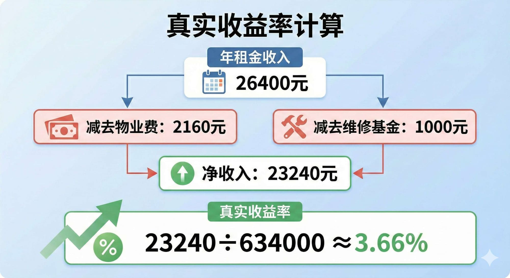
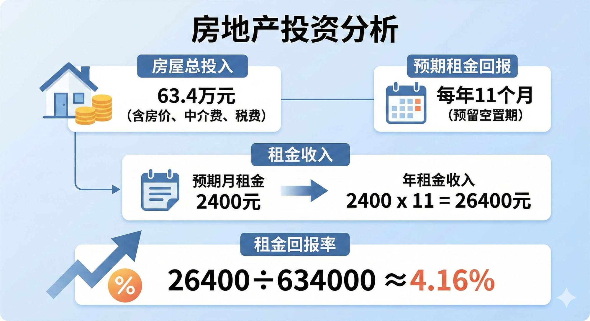

# 买房还是租房：如何算清人生这笔账

假设有一间 36 平米的公寓，总投入 63.4 万元，同一间房每月可以租 2,400 元。喜欢它的人说了两句话：“租出去，回报率能到 4.16%。”“我想有一间真正属于自己的房间。”

我觉得第二句话比第一句话更有分量。自己的房间，不必向谁解释为什么墙要刷这个颜色，也不必在搬家时问那张桌子到底带不带走。但要判断 **4.16%** 是不是个好数字，先要决定一件有点扫兴的事：这间房里，究竟住着谁？

## 第一张账：如果租给别人

假定全款买入，每年能收到 11 个月租金。那 **2,400 × 11 ÷ 634,000 ≈ 4.16%**，算术没错。这是预留了一个月空置后的租金收入比，还没扣持有成本。

再假设物业费由房东承担，每月每平米 5 元，一年就是 **36 × 5 × 12 = 2,160 元**。每年另留 1,000 元维修预算。用同一组假设看两种租金：

| 月租 | 年实收（11个月） | 扣物业和维修后 | 占总投入 |
|---|---:|---:|---:|
| 2,400元 | 26,400元 | 23,240元 | 约3.67% |
| 1,000元 | 11,000元 | 7,840元 | 约1.24% |

图里写 3.66%，按上述数值四舍五入是 3.67%。比这点舍入差异重要得多的是：租金会降，物业费不会跟着降。空置多久、谁付物业、哪一年碰上大修，往往比标出小数点后两位更值得问。这个比率仍不是总投资回报；售价变化、适用税费和融资成本都未计入。

## 第二张账：如果自己住五年

现在租客是我自己，就不能在账上既收房租又省房租。设两种方案住的是**同一间房、同样五年**。沿用 63.4 万元的起点，假设租金不变且已含租客应付的物业费用。为了让假设透明，这里都不贷款，不算通胀、租金变化和复利；租金和日常持有费从每年收入支付。

| 五年后比较什么 | 买下自住 | 租房并保留本金 |
|---|---:|---:|
| 为居住付出的现金 | 物业和维修合计 15,800 元 | 租金 144,000 元 |
| 本金的去向 | 变成房屋，最后按实际卖出净回款收回 | 假定本金不损失，若每年净获 2.5%，五年单利 79,250 元 |
| 最后净成本 | 15,800 元 +（634,000 元 − 卖出净回款） | 144,000 − 79,250 = 64,750 元 |

在这组数里，两边打平时，**卖出净回款是 585,050 元**。换句话说，相对于最初的总投入，只要最终少拿回的钱超过 48,950 元，租住这边更便宜；少拿回的不足这个数，买住这边更便宜。这笔差同时容纳买入时的费用、房价涨跌和卖出费用，**不是说这套房一定要交 4.9 万元税**。2.5% 也只是假设，不是承诺；若只能取得 1% 的净收益，租住的五年净成本就变为 112,300 元，打平点随之改变。

真要做决定，我会先问清房屋登记用途和权属，索取针对这套房、这个交易时间的费用试算，再看同类房源最近的实际成交和出租记录。把净回款填进表，比套一句“商业公寓税很重”有用。如果需要贷款，就另列利息和现金占用，不能把归还本金也算成房子“亏掉”的钱。

## 有些东西不写在收益率里

想要自己的房间，是一个完整的理由，不是一个有待财务证明的弱点。租来的屋子也能换窗帘、添一盏喜欢的灯，搬家时把书桌带走；可有些人看重的，恰恰是以后不必再搬这张桌子。两者都有道理。

我会把纸翻过来，在账的背面再写两个问题：**如果五年后得比预想更便宜地卖，我是否还愿意买？如果可能要搬两次家，我是否还愿意租？** 第一面的账告诉我能否承担，第二面的答案才告诉我想选什么。别让一句“有房才有家”替你做主，也别让一个漂亮的百分比替你说出真正的愿望。
