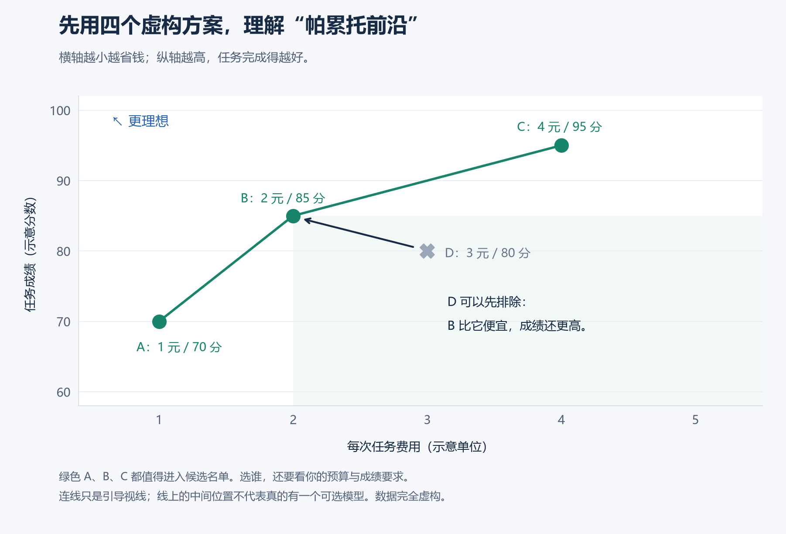
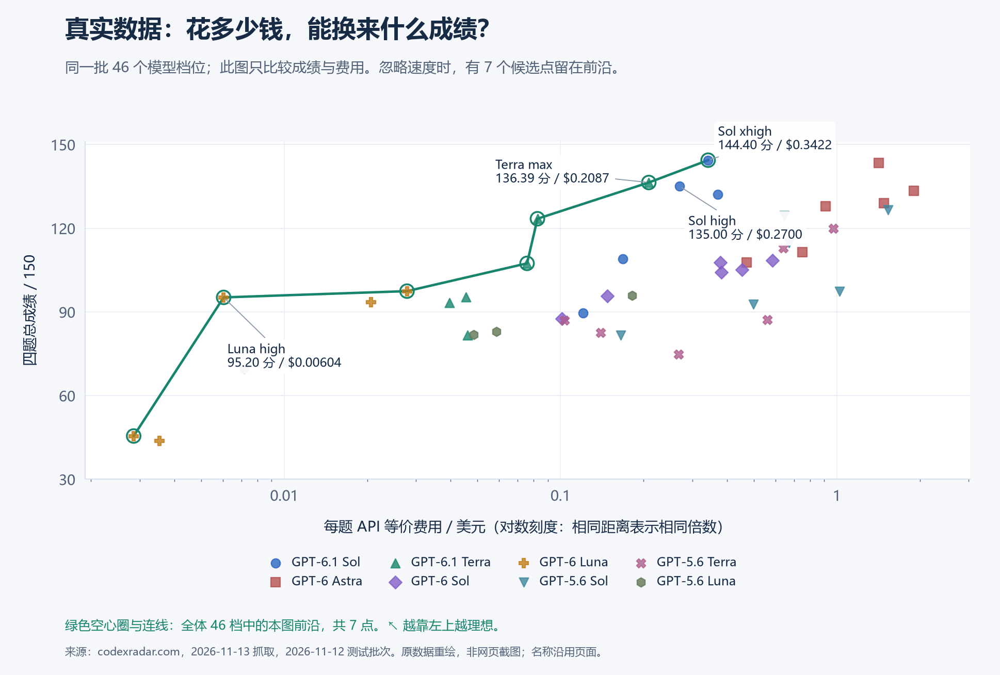
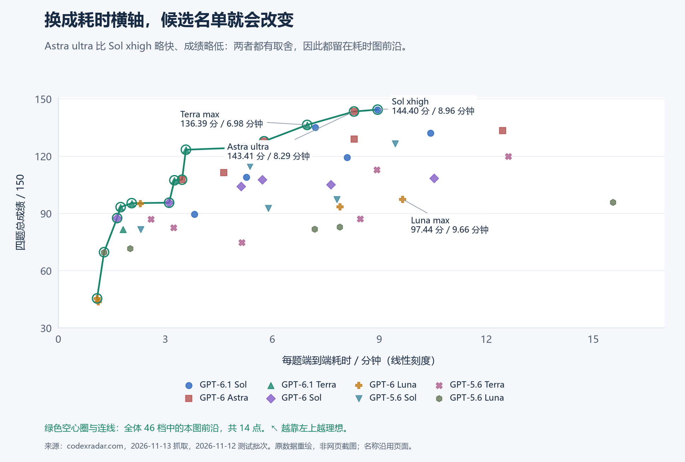
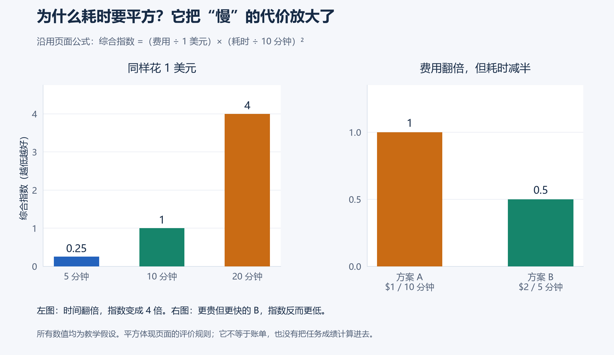
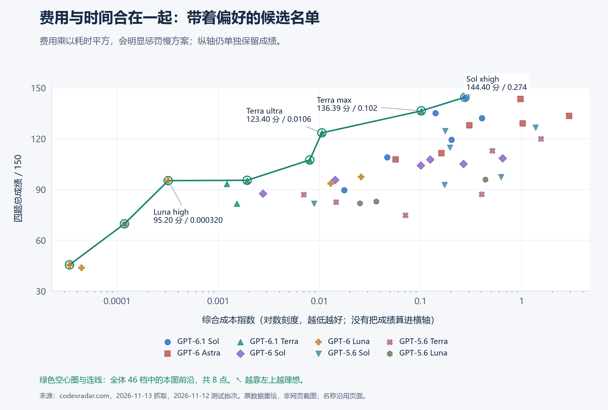

# 从零看懂 CodexRadar 的帕累托图：做得好、花钱少、等得短，怎么选？

你打开一个模型排行榜，看到某个档位成绩最高，很容易觉得：“那我以后就用它。”

但用模型完成任务时，你还会遇到另外两个问题：它要花多少钱？我要等多久？

如果只是让模型改一句话，为多一点分数等上十分钟，你可能觉得不值。如果是解决一个重要问题，多花一点钱、等得久一点，你也可能愿意。

**这个页面用帕累托图，就是为了把“结果好不好”和“为它付出多少代价”放到一起，让选择有依据。** 图表会先帮你筛选候选，最终的选择仍取决于你的需求。[资料 1、4、5]

本文资料核对于 **2026 年 11 月 13 日**。真实例子来自页面展示的 **2026 年 11 月 12 日批次，8 个模型、46 个档位**。模型名称沿用页面；本文分析的是该站这批记录，并未另行验证模型身份或官方产品对应关系。

**1．先不管模型，想象你在挑四家做同一份工作的服务商**

下面全部是教学假设。先只考虑两个指标：完成质量和价格。

| 方案 | 费用 | 完成质量 |
|---|---:|---:|
| A | 1 元 | 70 分 |
| B | 2 元 | 85 分 |
| C | 4 元 | 95 分 |
| D | 3 元 | 80 分 |

看看 D 和 B：D 收你 3 元，只做到 80 分；B 只收 2 元，却能做到 85 分。

在只考虑价格和完成质量的前提下，**B 比 D 更便宜，做得还更好。选 D 就没有这两个指标上的优势。**

用数学语言说：B **支配** D。你可以把这个词理解成“在关心的指标上，B 没有一项比 D 差，而且至少有一项更好”。

再看看 A、B、C：

- A 最便宜，不过成绩最低。
- B 多花 1 元，换来更高成绩。
- C 成绩最高，不过要付出更多钱。

这三个方案之间都有取舍。你不能只凭价格和成绩，就说其中一个把另外两个全面比下去了。

**没有被其他方案这样比下去的候选，组成了“帕累托前沿”。** 在这个例子里，就是 A、B、C。[资料 4]

“前沿”的作用可以记成：**先把有明显更好替代品的选项放到一边，再认真比较留下来的选项。**

这里还有一个容易混淆的地方：你可能听过“帕累托法则”，也就是常说的二八法则。读这张图时，我们使用的是多目标优化里的“帕累托前沿”概念，不需要套用 20% 和 80% 的比例。

**2．回到网页：先认清一个点，再认清两个方向**

网页里的每一个点，代表一个“模型 + 档位”。例如，同一模型的 `high` 和 `xhigh` 是两个点。

三张图的纵轴相同：**这批四道题的总成绩，满分 150 分，越高越好。**

横轴则分别是三种代价：

| 图 | 横轴表示什么 | 这张图帮助你问什么 |
|---|---|---|
| 成绩与费用 | 每题平均的 API 等价费用 | 这个成绩要花多少钱？ |
| 成绩与耗时 | 每题平均的端到端耗时 | 要等多久，才能得到这个成绩？ |
| 成绩与综合成本 | 费用与耗时平方组合成的指数 | 按这套兼顾钱与时间的规则，哪个更合算？ |

所以三张图都可以按一个方向读：

**向上，表示成绩更高；向左，表示该图衡量的代价更低。**

一个点如果在另一个点的左上方，就意味着：代价更低，成绩还更高。这样的替代关系很直观。相同成绩下更靠左，或者相同代价下更靠上，也可以形成支配。

但“看左上”不能变成“只选最左边”或“只选最上边”。最左边可能成绩不够，最上边可能超出预算。你是在找适合自己要求的取舍。[资料 1、4]

**3．用页面里的一个真实对比，感受它能解决什么问题**

在保存的快照里，有下面两个档位：

| 页面中的档位 | 成绩 / 150 | 每题 API 等价费用 | 每题平均耗时 |
|---|---:|---:|---:|
| GPT-6.1 Terra · max | 136.39 | 0.2087 美元 | 6.98 分钟 |
| GPT-6.1 Sol · high | 135.00 | 0.2700 美元 | 7.21 分钟 |

第一行比第二行成绩略高、费用更低、耗时也略短。只按这次记录中的这三个指标，第一行有更好的数据表现。

如果只看模型名、档位名，或者只看总分榜，你不一定马上发现这件事。画成散点图，就容易看到第一行在更有利的位置。[资料 1、2、3；已逐项复算]

图里的绿色空心圈标出“成绩与费用”这两个指标上的前沿。绿色连线帮助你沿着这些候选看过去。

**连线中间并不代表还有一个可以买到的模型档位。** 候选是实际测过的那些点；连线只是读图辅助。

也别从这个例子推导出“某个模型以后永远更好”。它说明的是：**在这次测试、这些任务和这套计分方式下，可以观察到这样的比较结果。**

**4．为什么同一个档位，在一张图里值得保留，换张图就不一样？**

因为你问的问题变了。

继续看真实数据：

| 页面中的档位 | 成绩 / 150 | 每题 API 等价费用 | 每题平均耗时 |
|---|---:|---:|---:|
| GPT-6.1 Sol · xhigh | 144.40 | 0.3422 美元 | 8.96 分钟 |
| GPT-6 Astra · ultra | 143.41 | 1.4187 美元 | 8.29 分钟 |

先看“成绩与费用”：Sol xhigh 成绩更高，费用还低。Astra ultra 在这张图里有更好的替代候选，因此没有进入这张图的前沿。

再看“成绩与耗时”：Sol xhigh 成绩更高，但 Astra ultra 更快一些，大约少等 40 秒。这就出现取舍了。按全部 46 个档位计算，两者都进入了耗时图的前沿。[资料 1、2；已按网页前端同一规则复算]

这也解释了为什么要提供三张图：**省钱、赶时间，以及兼顾两者，是不同的选择问题。**

每张图里的前沿，只针对“成绩 + 当前横轴”计算。“费用图中不在前沿”并不等于“考虑速度后也没有价值”。如果要同时保留成绩、费用、耗时三个独立目标，就需要在三个维度上比较，不能把单张二维图的结论直接扩大。

**5．“综合成本”具体怎么算？一步一步来**

网页使用的规则可以写成：

$$
综合指数
=
\frac{每题费用}{1\text{ 美元}}
\left(\frac{每题耗时}{10\text{ 分钟}}\right)^2
$$

先不要被公式吓住。假设一次任务花 1 美元，用时 10 分钟：

$$
(1÷1)×(10÷10)^2=1
$$

如果同样花 1 美元，用时只有 5 分钟：

$$
(1÷1)×(5÷10)^2=0.25
$$

如果同样花 1 美元，用时变成 20 分钟：

$$
(1÷1)×(20÷10)^2=4
$$

| 假设情形 | 费用 | 耗时 | 综合指数 |
|---|---:|---:|---:|
| A | 1 美元 | 5 分钟 | 0.25 |
| B | 1 美元 | 10 分钟 | 1 |
| C | 1 美元 | 20 分钟 | 4 |

你会发现：**时间翻倍，指数会变成原来的四倍。** 这是“平方”产生的效果。

相反，在时间不变时，费用翻倍，指数只翻倍。换句话说，这套规则对时间的相对变化更敏感。

再比较两个假设方案：

- 方案甲：1 美元、10 分钟，指数是 1。
- 方案乙：2 美元、5 分钟，指数是 0.5。

乙虽然贵了一倍，但用时减半，所以按这套规则，它的综合指数更低。[资料 1、2；上述数值为教学计算]

**这项指数表达了一种评价偏好：希望模型既省钱又快，而且尤其不喜欢等待变长。**

它有三个地方需要分清：

第一，**它是一个指数。** 指数为 0.5，不能读成“实际花了 0.5 美元”。钱和时间已经被组合进一个没有货币单位的比较量。

第二，**1 美元和 10 分钟是统一的参照尺度。** 对所有档位使用同样的参照，只会整体缩放横轴数值，不会改变排序。例如把公式展开，就是数值上的“费用 × 分钟数的平方 ÷ 100”。

第三，**横轴的综合指数没有把成绩算进去。** 成绩仍然在纵轴。因此，最小指数也可能对应很低的成绩，不能直接当成最佳模型。

**6．为什么选“平方”？这样设合理吗？**

从数学效果可以判断：平方会放大速度差异，推动评价倾向更快的方案。

但页面没有提供足够说明，证明“平方”对所有用户都是最合适的。我们也不能由这个公式推断站长已经测量过每个人的等待损失。

你可以用三个场景感受它的适用程度：

- 你盯着屏幕等待回答，下一步工作必须等它完成：速度很有价值，这项指数可能贴近你的感受。
- 你睡前提交任务，早上来看结果：5 分钟还是 10 分钟，可能没有太大区别，平方对慢方案的惩罚就可能过重。
- 任务必须在 3 分钟内完成：先筛掉超时方案更直接。一个 10 分钟的方案即使指数很低，也不符合这个要求。

如果你想自行设定评价方式，可以考虑：

$$
I=C×T^\alpha
$$

在正费用、正耗时的前提下，取 $\alpha=0$ 就相当于只看费用；取 1 是费用与时间相乘；取 2 就会更强调时间的相对变化。这里的 $C$、$T$ 最好也先除以固定参照值。

另一种思路是给“主动等待”标价，例如：

$$
任务代价=模型费用+每分钟等待价值×主动等待分钟数
$$

这些是帮助你理解取舍的建模例子，不是网页提供的可调参数。**帕累托的支配规则不要求你先定这样的权重；一旦把钱和时间合成一个数，就已经选择了一种取舍方式。**[资料 4、5]

**7．为什么不直接给一个总排名，或者算“成绩 ÷ 费用”？**

直接排名当然更简洁，但往往要先决定钱怎么换时间、时间怎么换成绩。

例如，有人愿意花更多钱追求最高成绩；有人只需要成绩达到 90 分；还有人根本不能等超过 2 分钟。给他们同一份“唯一最佳”排名，可能无法表达这些不同要求。

帕累托图的好处是：**在还没有决定偏好时，先保留那些有不同长处的候选。** 等你提出具体要求，再从里面选。[资料 4、5]

“成绩 ÷ 费用”也有用途，但它回答的是“每单位费用获得多少成绩”这个特定问题。它会丢掉一些你可能在意的信息。

举个完全虚构的例子：

| 方案 | 成绩 | 费用 | 成绩 ÷ 费用 |
|---|---:|---:|---:|
| A | 60 | 0.01 | 6000 |
| B | 95 | 0.10 | 950 |

比值会偏爱 A；但如果你的工作必须达到 90 分，A 就不能满足要求。

更进一步，测试分数通常也不能简单解释成产出价值的比例。“120 分”未必意味着业务价值是“60 分”的两倍。因此，比值可以作参考，具体任务要求仍要单独保留。

图还有一个表格不容易一眼呈现的好处：**你能直接看见升级付出的代价。** 是多花一倍钱只提高一点成绩，还是只多等几十秒就明显提高成绩？知道这个，才容易判断值不值。

**8．为什么横轴有时不是等距离的？**

网页“自动”模式下，费用图和综合成本图使用对数横轴，耗时图使用线性横轴。[资料 2、3]

你可以先这样理解：

- 线性刻度：走同样的距离，数值增加同样多。例如 2、4、6 分钟。
- 对数刻度：走同样的距离，数值扩大同样的倍数。例如 0.01、0.1、1 美元。

费用有时相差几十倍、几百倍。如果全部采用线性横轴，便宜档位会挤在左边，难以分开。对数刻度能同时展示小费用和大费用区间里的差异。

但对数图上，一厘米不能理解成固定的“几毛钱”。读差额时，要看刻度和具体数值。

**改变刻度不会改变谁支配谁。** 对数对正数保持大小顺序，因此相同候选集合的前沿成员不会因为从线性换到对数就改变。图上看起来的距离、斜率和“拐点”会变化，不宜只凭视觉形状确定最佳选择。

**9．回到网页，你可以按这个顺序操作**

**第一步，先确定这批题目和你自己的任务有多少关系。** 如果你主要做长文写作，这四题的总分未必能代表你的真实体验。

**第二步，先提一个具体要求。** 例如“这批测试里至少达到 120 分”，或者“每题平均耗时不超过 5 分钟”。这样你才知道在图上寻找哪一片区域。

**第三步，选择当前最在意的横轴。** 预算敏感先看费用；需要连续交互先看耗时；钱和时间都在意时，再看综合指数，并确认自己能接受平方这项设定。

**第四步，保留符合要求的前沿候选，查看具体数值。** 如果同时有预算和时间上限，应同时核对两项数据，必要时先筛选符合全部约束的集合，再在其中比较。单张投影图只显示了两个指标，不能代替多项约束检查。

**第五步，用你自己的任务试一次。** 检查准确性、返工量和实际等待。重要任务可以多次比较，避免把某次偶然表现当成稳定差异。[资料 5、6]

网页的其他开关也有具体含义：

- **帕累托前沿**：显示当前可见模型中的非支配候选。
- **档位轨迹**：按档位顺序连接同一模型，方便观察调高档位后，代价和成绩怎样变化；连线不保证成绩持续提高。
- **模型显示开关**：隐藏模型后，前沿会按剩下的可见候选重新计算。原先被隐藏模型比下去的点，可能因此成为“当前可见前沿”。

所以，**前沿必须连同候选范围一起理解**。只显示两三个模型时看到的前沿，和显示全部模型时看到的前沿，回答的是不同范围内的问题。[资料 3]

**10．最后再认清页面的数据口径，读图才不会走偏**

这里的费用是依据用量估算的 **API 等价费用**。页面说明测试使用订阅环境，所以这些金额不能直接当成你的订阅账户实际扣款。

这里的耗时是 **成功执行记录从开始到完成的端到端时间，再按题数取平均**。它和“每秒输出多少 token”不同，也和“四题并行运行，总共过了多久”不同。

图表没有把所有可能的开销都纳入：页面注明不计评审，费用口径不含失败尝试。你实际做项目时，还可能遇到重试、返工、人工检查等额外代价。

总分是四题按 60、45、22.5、22.5 的权重合成的 150 分。不同类型工作的需求可能与这些权重不同。

本文核验的是公开记录内部的计算一致性，并未重跑测试。这批数据也没有为各档位提供可用于本次分析的重复测量置信区间。相差一两分、几十秒的地方，适合作为进一步试用的线索，不能自动视为稳定、显著的能力差距。[资料 1、2、6]

当你再看到这张图，可以依次问三个问题：

> 这个档位的成绩够我用吗？
>
> 有没有别的档位，在我关心的代价上更低，成绩还不差？
>
> 剩下的候选之间，我愿意用多少钱或多少等待，换取更好的结果？

你能这样问，就已经掌握了这张图最实用的读法。

---

资料编号和核验细节见 **[02-资料来源与计算核验.md](02-资料来源与计算核验.md)**。本文图 1 和图 5 为原创教学示例，图 2—4 为站点数据重绘，均非网页截图。
