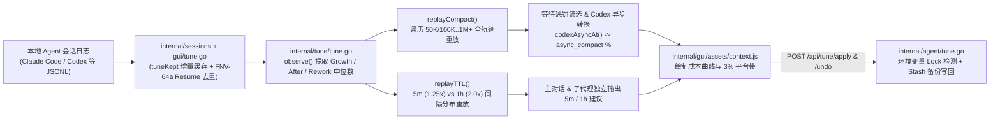
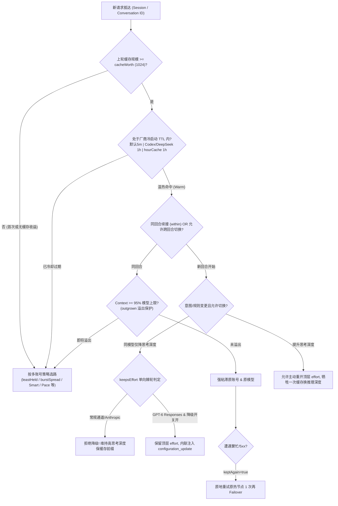

# Magpie (`yetone/magpie`) 核心机制深度拆解：缓存容量调优、难度分级路由与多池工程权衡

> **调研基准版本**：`yetone/magpie` Commit `70f4593e623e0847fcc2d869240565ce5f73a67a`（2026-11-13）  
> **关联原始日志**：`log-01-magpie-core.md`  
> **核心结论速览**：
> 1. **最佳缓存大小与上下文窗口建议**：Magpie 并非使用缓存学中的 Ghost Cache / MRC 曲线或黑盒机器学习，而是在 `internal/tune` 中实现了一套**“历史会话全轨迹重放模拟器（Trace-Replay Simulator）”**（GUI 名为 **Tuned for you / 为你调优**）。它从本地代理日志提取增量、压缩留存与压缩后 `10` 轮文件重读惩罚（`Rework`），遍历候选阈值生成“Token 成本—等待时间”权衡曲线，输出**最优上下文压缩窗口**（含 Codex >= 0.163 后台异步压缩百分比）以及**最优 Prompt Cache TTL（5m vs 1h）建议**，并联动支持一键写回与可撤销回滚。
> 2. **问题难度分级与自适应路由**：采用**“确定性多维规则前置剥离 + 语义分类器双引擎 + 模板化路由组”**架构。既能精准拦截 8+ Coding Agent 的压缩指令、带工具子代理回合与长上下文溢出（95% 阈值重路由），也支持通用 Chat 模型（强制关闭思考 `reasoning_effort="none"`）与 OpenAI System One / Jev 连续难度评分模型（`jevSure = 0.4` 防抖粘滞）。
> 3. **“动态切模型/省钱 vs. 击穿 Prompt Cache”悖论的系统化解法**：围绕 `cacheWorth = 1024` 与提供商真实冷启动 TTL，构建了**“回合内锁死 + 思考深度只升不降单向棘轮 (`keepsEffort`) + GPT-6 `configuration_update` 内联降级 + 主从会话聚拢 + 同带保序”**五重防线。

---

## 一、最佳缓存大小建议（Optimal Cache Size Recommendation）与全链路缓存优化机制

### 1.1 命名辨析与子系统全景定位

在 `yetone/magpie` 仓库检索 `cap` / `cache` / `recommend` 时，容易与 `internal/capre/capre.go` 产生混淆：
- **`internal/capre` 并非容量建议引擎**，而是 **Capped Regexp（有输入长度上限的正则封装）**，用于在规则引擎匹配用户输入和系统提示词前截断过长文本，防止 ReDoS 阻塞网关请求。
- **真正承担“最佳上下文缓存大小 / 压缩窗口 / Cache TTL 建议”的核心子系统**是由以下四层构成的 **Tuned for you（为你调优）** 闭环：
  1. **数据采集层**：`internal/sessions`（`calls.go`, `call_cache.go`）负责读取并增量缓存本地 Coding Agent 的会话历史记录；
  2. **重放计算层**：`internal/tune/tune.go` 执行核心数学模拟——包括最佳压缩窗口扫描（`Compact` / `replayCompact`）与 Prompt Cache 生命周期对比（`CacheTTL` / `replayTTL`）；
  3. **接口与配置落地层**：`internal/gui/tune.go` 暴露 `GET /api/tune`、`POST /api/tune/apply`、`POST /api/tune/undo` 与 `POST /api/settings/claude-cache`；`internal/agent/tune.go` 读取并安全写回代理配置文件；
  4. **交互可视化层**：`internal/gui/assets/context.js`（`renderTune` / `adviceRow`）渲染费用对比曲线、`Now → Fewest tokens / Tokens + wait` 推荐标签、压缩等待警告、以及 `"Other window…"` 逐档成本对比下拉菜单。



---

### 1.2 遥测数据采集与跨恢复会话去重架构

1. **采集对象与入口分离**：
   - `internal/gui/tune.go` 中的 `tuneCallsSince` 调用 `sessions.CallSources()`，针对 `"claude"` 与 `"codex"` 在指定时间窗（`days`，默认 `7`，上限 `30`）内的会话文件提取 `sessions.Call`，并压缩精简为 `tune.Call`。
   - **Gateway 模式硬隔离**：当网关运行在远程服务端模式时（`ownSessionsOff() == true`），终端编码代理及其会话文件位于另一台物理机上。此时 `/api/tune` 返回 `Gateway: true`（前端直接隐藏卡片），`/api/tune/apply` 与 `/api/tune/undo` 直接拒绝并返回 `409 Conflict`。
2. **Resume 复制记录去重（`msgHash`）**：
   - Claude Code 在执行会话 `--resume` 时会把历史消息完整复制到新产生的 JSONL 文件中。若直接遍历全部文件会导致历史调用被双倍计费。
   - `tuneCallsSince` 将源文件按 `Modified` 升序排列（更早的文件拥有消息所有权），对每条消息文本计算 `FNV-64a` 哈希（`msgHash`，末位置 `1` 防零值碰撞）；后续文件凡命中 `seen[m]` 的调用均跳过，确保每轮历史调用仅参与一次重放计算。
3. **增量解析内存优化（`tuneKept` + `tuneAnswer`）**：
   - 背景痛点：Usage/Context 标签页默认每 5 秒轮询一次；若每次全量解析过去 7 天 30 万条 `sessions.Call`，单次会瞬间占用 ~500 MB 内存与约 0.5–1 秒 CPU。
   - 优化实现：按文件 `(size, mod)` 缓存在 `tuneKept.files` 中仅保留约 ~100 字节/条的 `tune.Call` 切片；计算结果由 `tuneAnswer` 按 `ctxAgain = 1m` 缓存防抖，并在 `apply` / `undo` / `claude-cache` 修改配置后调用 `tuneForget()` 立即失效重算。

---

### 1.3 最佳压缩窗口（缓存上界）推荐的数学模型与重放算法

在长上下文 Agent 场景中，**压缩阈值（`autoCompactWindow` / `CompactAt`）本质上就是决定 KV/Prompt Cache 复用上限的“缓存大小”**：
- 窗口设得过大 $\Rightarrow$ 长尾对话每次续写都需要重读几十万甚至上百万 Cached Input Tokens，若间隔超出 TTL 还面临高额重写，或单步递增造成上下文通胀；
- 窗口设得过小 $\Rightarrow$ 频繁触发压缩，每次压缩都需要重读整个旧上下文以生成 Summary、支付高倍率的 Summary 输出费用、将新 Summary 重新写入缓存，并导致 Agent 在压缩后丢失工作记忆，必须在后续多轮重新读取刚刚读过的文件（源码称之为 **`Rework` 返工成本**），同时打断用户等待耗时（`Took`）。

#### 第一步：真实价格权重归一化（`WeightsFor` & `pricedWeights`）
在 `internal/tune/tune.go:81-86`，基准相对权重以普通 Input Token 为 `1.0`：
$$
\text{WeightsFor}(\text{model}) =
\begin{cases}
(R=0.1,\; W_{5\text{m}}=1.25,\; W_{1\text{h}}=2.0,\; O=5.0), & \text{Claude 系列} \\
(R=0.1,\; W_{5\text{m}}=1.0,\; W_{1\text{h}}=1.0,\; O=8.0), & \text{非 Claude 系列 (如 Codex)}
\end{cases}
$$
此外，`internal/gui/tune.go:239-257` 的 `pricedWeights` 会按用户实际路由映射（`provider/model`）读取 `provider.EffectivePriceIn` 覆写上述默认比率。例如 GitHub Copilot 对 1 小时缓存按 5 分钟写入计费，此时会精确写入 `Write1h = pr.OneHour() / pr.Input`（避免误按 Anthropic 原生 2x 计算而给出错误建议）。

#### 第二步：压缩事件检测与会话特征中位数提取（`observe`）
在 `internal/tune/tune.go:175-189, 226, 239-285` 中：
- **压缩事件识别（`compacted`）**：当同一条会话流中连续两步满足
  $$P_{i-1} \ge \text{dropFrom}\;(20000) \quad \land \quad P_i < \text{dropShare}\;(0.6) \times P_{i-1}$$
  即判定该处发生了一次上下文压缩。
- 对每条历史对话流提取四项特征，并跨越全部流取**中位数**作为用户工作习惯画像（`Facts`）：
  1. `Growth`（$g$）：未压缩步中单次调用自然上下文增量 $\Delta P_i = P_i - P_{i-1}$ 的中位数；
  2. `After`：压缩发生后首轮调用 Prompt 规模 $P_{\text{at}}$ 的中位数；
  3. `Rework`：在压缩发生后的连续最多 `reworkCalls = 10` 次调用窗口内（至下一次压缩前 `end`），重新膨胀的额外上下文并扣除正常自然增长部分：
     $$\text{Rework} = \max\Big(0,\; P_{\text{end}} - P_{\text{at}} - k_{\text{steps}} \cdot g\Big)$$
  4. `Peak` 与 `Took`：各流峰值 Prompt 与（日志中记录的）压缩耗时中位数。若周期内实测压缩不足 5 次（`Compacts < 5`），按启发式兜底：`after = b + 10000`，`rework = max(rework, 10000)`（$b$ 为流起始基线 Prompt 大小）。

#### 第三步：全轨迹重放模拟器（`replayCompact`, `L304-328`）
给定候选窗口上限 $T$，扣除模型保留区 `Reserve` 得到实际触发压缩线 $\theta = T - \text{Reserve}$。在每条流的首轮计入全写开销：
$$\text{Cost}_0 = \text{ctx}_0 \cdot w.\text{Write} + \text{Out}_0 \cdot w.\text{Out}$$
对于后续第 $i$ 步，取历史净增量 $d_i = \max(0, P_i - P_{i-1})$（若原轨迹该步为压缩跌落则 $d_i = 0$）：
1. **触发模拟压缩判定**：当且仅当 $\text{ctx} + d_i > \theta \;\land\; \text{ctx} > \text{after}$ 时：
   - 生成摘要估算长度 $\text{summary} = \max(0, \text{after} - b)$；
   - 累加一次模拟压缩的全额成本（读旧上下文 + 输出摘要 + 重写摘要及返工文件）：
     $$\Delta \text{Cost}_{\text{compact}} = \text{ctx} \cdot w.\text{Read} + \text{summary} \cdot w.\text{Out} + (\text{summary} + \text{rework}) \cdot w.\text{Write}$$
   - 将模拟当前上下文回落重置为：$\text{ctx} \leftarrow \text{after} + \text{rework}$，模拟压缩次数 $n \leftarrow n + 1$。
2. **常规前向步计费**：
   $$\Delta \text{Cost}_{\text{step}} = \text{ctx} \cdot w.\text{Read} + d_i \cdot w.\text{Write} + \text{Out}_i \cdot w.\text{Out}, \qquad \text{ctx} \leftarrow \text{ctx} + d_i$$

#### 第四步：搜索空间边界与多目标最优解筛选（`Compact`, `L333-450`）
- **采样前提**：`Calls >= 50 && Streams > 0`。
- **网格扫描参数**：
  - **Claude Code**：`Min = 100,000`，`Max = 1,000,000`，`Step = 10,000`，`Reserve = 33,000`；若发现任意调用带 `[1m]` 标记或 Prompt 实测超过 `200K`，则物理 `Window = 1,000,000`，否则 `200,000`。
  - **Codex**：`Min = 50,000`，`Max = max(1,000,000, window, cur, st.CompactAt)`，`Step = 10,000`，`Reserve = 0`。
- **安全下界（防压缩死循环）**：
  $$\text{floor} = \max\Big(\text{Min},\; \text{roundUp}\big(\text{after} + \max(\lfloor\text{after}/2\rfloor,\; 20 \cdot g) + \text{Reserve},\; \text{Step}\big)\Big)$$
  确保压缩后至少还留有足够 20 轮增长的喘息空间。
- **最优解抉择准则（两套策略切换）**：
  1. **无压缩耗时数据（`Took == 0`）**：寻找总加权 Token 成本最低点 `low`，在允许 `1%` 容差带内（$p.\text{Cost} \le 1.01 \times \text{low}.\text{Cost}$）选择**最大**窗口值，在几乎同等成本下尽量减少上下文打断。
  2. **有计时压缩数据（`Timed >= minTimed (3)` 且 `Took > 0`）**：为避免为了省几千 Token 而让用户频繁陷入几十秒等待，构造 `calm` 集合，只允许压缩次数**不超过当前设置**的候选点（$p.\text{Compacts} \le \text{now}.\text{Compacts}$）；在 `calm` 最低成本点 $cl$ 的 `sameCost = 3%` 宽容带（$p.\text{Cost} \le 1.03 \times cl.\text{Cost}$）内选取**压缩次数最少、窗口最大**的解作为 `Best`，同时额外记下纯省 Token 最小点 `Cheapest` 供 UI 提示权衡。
- **显著性门槛**：仅当推荐配置相对于当前配置可节约 $\ge 3\%$（$(\text{Cost}_{\text{now}} - \text{Cost}_{\text{best}}) / \text{Cost}_{\text{now}} \ge 0.03$）时才主动推荐迁移。

#### 第五步：Codex 后台异步压缩的去惩罚换算（`codexAsyncAt`, `internal/gui/tune.go:68-83`）
Codex ≥ `0.163` 支持在回合进行中触发**后台异步压缩**（不让交互等待卡顿），因此前端同步等待成本 `Took` 在后台模式下归零。此时 `codexAsyncAt` 放弃 `Best`，直接选取纯 Token 最省点 `r.Cheapest`，计算百分比：
$$\text{Percent} = \text{clamp}_{[1,100]}\!\left(\left\lfloor \frac{v \times 100}{\text{Window}} \right\rfloor\right), \qquad \text{Value} = \left\lfloor \frac{\text{Window} \times \text{Percent}}{100} \right\rfloor$$
并校验其严格早于前台自动压缩线（`Value < min(0.9 * Window, Current)`），保证后台压缩提前介入而保留原前台阈值作为兜底（Backstop）。

---

### 1.4 最佳 Prompt Cache TTL（5m vs. 1h）重放算法

同样基于 `internal/tune/tune.go:493-573`（`replayTTL` 与 `CacheTTL`），Magpie 对 `Calls >= 50` 的历史流分别以 **5 分钟缓存写单价（`w.Write`）** 与 **1 小时缓存写单价（`w.Write1h`）** 进行逐步时间戳重放：

对流中相邻两次请求 $\Delta t_i = t_i - t_{i-1}$：
$$
\Delta \text{Cost}_i =
\begin{cases}
P_i \cdot w.\text{writeTTL}, & \text{if } \Delta t_i > \text{TTL} \;\lor\; \text{compacted}(P_{i-1}, P_i) \quad (\text{缓存过期/压缩重置，全量重写}) \\
P_{i-1} \cdot w.\text{Read} + (P_i - P_{i-1}) \cdot w.\text{writeTTL}, & \text{else if } P_i \ge P_{i-1} \quad (\text{命中前缀 + 增量写入}) \\
P_i \cdot w.\text{Read}, & \text{else } (P_i < P_{i-1}, \text{前缀读取})
\end{cases}
$$

- **特征统计与独立决策**：`CacheTTL` 统计相邻调用间隔落在 `Quick`（$\Delta t \le 5\text{m}$）、`Pause`（$5\text{m} < \Delta t \le 1\text{h}$）、`Away`（$\Delta t > 1\text{h}$）的比例，**仅当 `r.Hour < r.Short` 且节省 $\ge 3\%$（`sameCost`）时才建议切换为 `"1h"`**。
- **主从分离评估（`internal/gui/tune.go:174-185`）**：Claude Code 的**主对话（`TuneCache -> promptCacheTtl`）**与**子代理/辅助流（`TuneSubCache -> subagentPromptCacheTtl`）**分开独立重放并给出各自建议（子代理往往短促高频适合 5m，主对话偶有 10 分钟思考停顿可能适合 1h）。
- **配置冲突检测与可逆回滚（`internal/agent/tune.go:219-410`）**：
  - 在应用建议前校验是否存在更高优先级的环境变量覆盖，包括：`CLAUDE_CODE_AUTO_COMPACT_WINDOW`、`FORCE_PROMPT_CACHING_5M`、`CLAUDE_CODE_PROMPT_CACHE_TTL`、`CLAUDE_CODE_SUBAGENT_PROMPT_CACHE_TTL` 以及 Codex `config.toml` 的 `model_auto_compact_token_limit`。一旦命中直接锁定只读（`Locked`）阻止无效写入；
  - 初次修改前通过 `stash` 保存原配置状态，保证用户随时可点 `Undo` 原样复原。

---

### 1.5 上游断点自动注入、实时评分与全链路缓存保障

除离线历史重放调优外，Magpie 网关在运行时对 Prompt Cache 链路做了一系列细粒度工程优化：

| 优化维度 | 核心源码与符号 | 具体算法 / 工程实现 |
| :--- | :--- | :--- |
| **实时 Context 100 分健康评分** | `internal/gui/context.go:784-804` (`scoreAgent`) | 由 4 项加权构成：`cache` 35 分 $\big(\text{clamp01}(\text{HitRate}/0.9)\times 35\big)$、`lean` 25 分（基线占窗口比 `5%` 满分，`30%` 归零）、`pace` 20 分（单轮增长占窗口比 `1%` 满分，`6%` 归零）、`reliable` 20 分（错误率 `20%` 归零）。 |
| **Anthropic `cache_control` 自动化断点** | `internal/gateway/anthropic.go:88-93, 1032-1074, 1160-1162` | 当跨协议翻译请求未携带客户端 `cache_control` 时，自动在 `system`（若无 system 则标在末尾 `tool`）以及**末尾非 `thinking / redacted_thinking` 块**注入最多 2 个断点（留足空间不超出 Anthropic 4 断点限制）；若 `Request.hourMarks` 为真，则统一切换为 `ttl: "1h"`（保证不违反长 TTL 不可位于短 TTL 之后的 API 规则）。 |
| **Claude TUI vs `-p` 模式大上下文缓存保护** | `internal/gateway/claude_cache.go:52, 57-79` (`marksPrintAt`, `markedHistory`, `keptByPrint`) | 当开启交互式 Claude TUI 时，**仅针对携带客户端 `cache_control` 标记的 Auto-Mode 安全分类器请求（`autoModeClassifier(req) == true`）**，且消息历史截至最后一个客户端缓存标记点为止的累计字节数 `markedHistory(req) >= marksPrintAt`（`64 << 10`，64 KiB）时，才绕过交互模式切往 `claude -p` 通道（普通对话回合仍留在交互模式），以免分类器按全量转录历史重付高额缓存写入费用。 |
| **OpenAI / Mistral 路由缓存键与兼容性自适应** | `internal/gateway/gateway.go:8579-8660` (`ownCacheKey`, `withMistralCacheKey`, `mistralAffinity`) | 为 OpenAI API、Mistral（含基于会话 SHA256 的 `x-affinity` 头与 `prompt_cache_key`）及自建中继自动补齐会话 `prompt_cache_key`；遇到不识别 `prompt_cache_retention` 或 `prompt_cache_key` 报 `400` 的上游时，记入 `unfit` 并在本请求及后续请求自动剥离重试。 |
| **异构缓存返回字段标准化对齐** | `internal/gateway/chattidy.go:209` (`openAIUsage`) | 将 Anthropic（`cache_read_input_tokens`）、DeepSeek（`prompt_cache_hit_tokens`）、Moonshot（`cached_tokens`）返回的缓存计量字段在流式与非流式响应中实时归一化回写至 OpenAI `prompt_tokens_details.cached_tokens` 与 `cache_write_tokens`（并在缺省时补入 `prompt_tokens`），修复下游编码代理前端（如 `pi-ai`）误报 0% 缓存命中的问题。 |

---

## 二、问题难度分级与自适应模型路由机制

Magpie 网关解决“什么难度/类型的问题用什么模型”依赖**三层渐进式路由器**：**确定性规则筛选层 → 语义意图与难度分级双引擎 → 开箱即用模板策略层**。

### 2.1 确定性条件规则与特种流量精确识别

所有路由组规则定义于 `internal/provider/grouprule.go`（`Rule` 结构体）与 `internal/provider/rulecond.go`（结构化 `Where` 条件引擎），由 `internal/gateway/rules.go` 在请求期求值：

1. **多维确定性特征匹配**：
   - **上下文体积（`Tokens`）**：按 `promptOf` + UTF-8/CJK 比例（`tokensOf`: ASCII 4 字符/token、非 ASCII 1 字符/token；图像固定计 `1600` tokens）实时估算，支持 **95% 上限阈值防溢出重路由（`outgrown`, `rules.go:410-432`）**——当回合内上下文膨胀达到当前命中规则或模型窗口 `limit * 95 / 100` 时，自动打破回合锁定重新触发规则，迁移至更大上下文成员。
   - **多模态与客户端特征**：`Images`（图片数）、`Effort`（客户端请求思考深度）、`Agents`（通过 `magpie-<name>` 密钥前缀或 User-Agent 提取小写产品名匹配特定 Agent，如 `codex`、`sillytavern`）、`Time`（支持跨午夜时段）、`Folders` / `ExceptFolders`（工程目录工作区匹配）。
   - **嵌套结构化 `Where` AST（`rulecond.go`）**：支持针对 `tokens`、`effort`、`agent`、`subagent`、`message`、`system`、`last` 等字段执行 `gte/gt/lt/lte/is/not/contains/excludes/starts/matches` 逻辑组合，其正则表达式统一经 `capre` 限长防护；支持配置 **`UseEffort`** 将匹配模型与思考深度绑定为原子输出。
2. **上下文压缩请求的跨 Agent 精准捕获（`internal/gateway/compacting.go`）**：
   - 通过 `compactSystems` 与 `compactAsks` 内置指纹库，精准识别 **Claude Code、OpenCode、Pi、Gemini CLI、Qwen Code、Minis、Kimi Code、Alma、Codex、DeepSeek Harness** 共 10 种形态的压缩请求，使配置了 `Compact` 规则的路由组能够直接将昂贵的总结任务分流到低成本高吞吐模型。
   - **防误杀机制**：限定匹配窗口 `compactLead = 2048` 字节（仅扫描系统提示词或末条用户消息头部，或在 `opens` 导引块下搜索），防止历史对话或记忆块里“引用了压缩提示词文本”导致正常主对话被误降级（#1635 修复）。
3. **Subagent 工具回合与工具less辅助请求分离（`internal/gateway/desktop_subagent.go`）**：
   - `desktopSubagentPick` 与 `subagentTurnOf` 通过请求头 `x-claude-code-agent-id` 并严格联合校验 `hasTools(body)`（是否挂载了工具声明），**只将真正执行 Agent 循环的子代理工具回合路由至子代理专用模型**；而子代理顺带发起的无工具辅助请求（标题生成、摘要探测等）则保留在原有的 Haiku 等低价层，避免过度用高配模型浪费配额。

---

### 2.2 语义级意图与难度分级双引擎（Chat 分类器 vs. System One/Jev 分类器）

当路由规则配置了语义 `Intent` 或自动思考深度（`AutoEffort`）时，Magpie 调用独立的小模型决策路径。源码存在两大并行引擎（`internal/gateway/classify.go` 与 `internal/gateway/decide.go`）：

#### 引擎 A：通用 Chat 意图与难度分级器（`internal/gateway/classify.go`）
任何配置为分类器的普通 Chat 模型均可驱动，关键设计包括：
1. **完整内置分类器 Prompt（原文）**：
   - **意图/难度分类 System Prompt（`classifyPrompt`, L337-341）**：
     > `You route a user's message to a coding assistant. Given numbered kinds and the user's message, answer with the number of the kind that fits the message best. The kinds may be topics, or levels such as how hard or how big a request is; when they are levels, every message has one, a greeting or a question about the assistant included. Answer 0 only when the message is plainly none of the kinds. Answer with the number only.`
   - **自动思考强度评级 System Prompt（`effortPrompt`, L551-552）**：
     > `You judge how much reasoning a coding assistant needs to handle a user's message well. Given numbered levels and the user's message, answer with the number of the level it needs. Answer with the number only.`
   > 注意：`classifyPrompt` 特意声明**当类别为难度等级（`levels`）时，每条消息都必须落入某个等级（包括打招呼或自我介绍），禁止轻率回答 `0`**。
2. **输入截断与低成本延迟优化**：
   - **当前轮输入截断（`userText`, L264-268）**：按 `cutMiddle(text, 3000, 1000)` 保留首 3000 与尾 1000 个 rune 字符；
   - **上一轮前情摘要（`turnBefore`, L296, 306-321）**：受 `priorCap = 1000` 约束，上一条用户消息按 3:1 比例调 `cutMiddle(user, priorCap*3/4, priorCap/4)`（即首 `750`、尾 `250` runes），上一条助手文本回复则保留末尾最多 `1000` runes，极大控制分类 Input Token；
   - **强制关闭思考过程（`classifyEffort`, L432-438）**：只要不是 `Reasonless` 模型，一律注入 `reasoning_effort = "none"`（设置 `max_tokens: 2048`、`temperature: 0`），避免分类小模型耗时耗费大量 Thinking Tokens；
   - **三层性能保护**：基于 SHA256 的 **4096 项内存缓存**（TTL `classifyKeep = 10m`）+ **并发同键去重（`singleflight` 机制）** + **故障保护窗**（分类器失败后静默降级跳过 `classifyRest = 30s`，保障主链路绝不因分类器抖动中断）。

#### 引擎 B：OpenAI System One / Jev 概率决策分级器（`internal/gateway/decide.go`）
针对支持快速决策评分协议的端点（如 Jev / Clef 等专用路由决策模型），`decide.go` 采用更精密的概率校准模式：
- **双模式映射**：
  - 主题路由：向分类模型输入候选 `intents` 列表并返回概率分布；
  - 连续难度评级（`jevLevelled`, `jevLevels`）：输出 `0..3` 连续难度标量，平滑映射至 `[low, medium, high, xhigh]` 四个等级（或当前路由组自定义的子级别集合）。
- **置信度防抖门槛（`jevSure = 0.4`, L37, 279）**：多轮对话中若分类器对新判决的把握度 `< 0.4`（例如用户在连续编码调试中随口回了一句“继续”或“好的”），Magpie **拒绝盲目重切模型**，自动沿用上一回合命中的意图与模型，从根源上防止简短跟进词把模型降级打断任务与缓存。

#### 引擎 C：Claude Code Auto-Mode 安全审查保护（`internal/gateway/automode.go`）
当 Claude Code 开启 `autoModeClassifier` 并将安全审查模型路由至自带推理特性的后端时，`fitAutoModeClassifier` 会检测请求并自动在客户端给定的 `max_tokens` 上追加 **`classifierRoom = 2048`**，防止思考模型因内置 CoT 消耗完原定的超短 `max_tokens` 而截断导致安全判决失败。

---

### 2.3 路由组预设模板与自动化强/弱/分类器选型（`internal/provider/grouptemplate.go`）

Magpie 内置了 6 套针对不同优化目标的路由模板（`TemplateKinds`）：

| 模板标识 | ID (`TemplateIDs`) | 默认意图分层与模型编排逻辑 |
| :--- | :--- | :--- |
| `TemplateSmart` | `smart-split` | **智能难易分流**：复杂/高难度意图路由至 Top 强推理模型；常规/简单意图分流至性价比中低配模型队列，配置自动识别的小型模型担当分类器。 |
| `TemplateThrifty` | `cheap-first` | **省钱优先**：默认流量优先命中低价模型，高难问题与兜底才进入强模型。 |
| `TemplateSteady` | `never-stuck` | **高可用不卡死**：选取最多 3 个 Provider 的最强模型组成顺位主备高可用池。 |
| `TemplatePlan` | `plan-first` | **计划余量优先**：同类最强模型池下启用 `Pace`（按周重置速率配额均匀消耗）。 |
| `TemplateFast` | `fastest-first` | **极速响应优先**：同类最强模型池下启用 `Fastest`（按实时 TTFT+TPS 测速选路）。 |
| `TemplateEven` | `spread-evenly` | **均匀分摊**：覆盖全部服务商的最强模型按轮询/负载均衡均摊压力。 |

在选型算法上，`grouptemplate.go` 以输出价格 **`frontierOut = $10.0 / M`** 为强弱模型分水岭、**`tooDear = $100.0 / M`** 为异常高价过滤上限，并结合 `smallWords` / `tinyWords` 等命名规则从用户当前激活账号中选择最廉价快速的模型充当 `classifierFor`。

---

## 三、其他最优化配置建议与核心工程权衡

### 3.1 核心工程悖论破解：按轮省钱动态切换 vs. 击穿 Prompt / KV Cache

在 LLM 网关工程中，最大的隐藏成本陷阱在于：**若仅凭单轮输入字数或难度把正在多轮对话中的长上下文从模型/账号 A 动态切到便宜节点 B，会导致 B 上原有几十万 Token 的 Prompt Cache 完全 Miss，按 1x Input 全额重算并重写缓存的费用往往数倍于模型单价差，同时首字延迟（TTFT）暴涨至数秒甚至数十秒。**

Magpie 通过以下机制体系（核心代码位于 `internal/gateway/affinity.go`, `rules.go`, `effort_update.go`, `gateway.go`）精细化解这一矛盾：



1. **缓存价值门槛与真实厂商 TTL 感知（`affinity.go:51-190`）**：
   - 只有上轮实测 `CacheRead + CacheWrite >= cacheWorth (1024)` 时才认为值得锁死节点，避免对普通零缓存短对话造成负载倾斜。
   - **差异化 `coldAfter` 时长**：默认 `cacheCold = 5m`；识别 Codex (ChatGPT) 与 DeepSeek 为 **`1h`**；若响应含 `CacheWrite1h > 0`，建立 `hourCache` 状态并随 `CacheRead >= h.tokens` 动态续期 1 小时。
2. **思考深度“只升不降”单向棘轮（`keepsEffort`, `rules.go:500-522`）**：
   - 当会话处于缓存温热期且未发生上下文减半缩水（`< tr.size/2`）时，如果自动分类器认为新回合更简单并试图**调低** `Effort`，`keepsEffort` 会**拦截本次降级**，继续沿用旧的高思考深度——原因在于**修改顶层思考参数会立即使 Anthropic/OpenAI 的前置缓存前缀失效（0% Hit）**，省下的几个输出思考 Token 远不够重付全量输入写的代价；相反，当新问题明显更难需要**提升** `Effort` 时允许穿透执行。
3. **OpenAI GPT-6 内联思考深度降级黑科技（`internal/gateway/effort_update.go`）**：
   - 当开启环境变量 `MAGPIE_EFFORT_UPDATES=on` 且路由向支持 `configuration_update` 的 GPT-6 Responses 端点时，若要**调低**思考强度，Magpie 不改动请求顶层 `reasoning.effort`，而是精准在当前 Turn 第一条新用户消息前插入：
     ```json
     {"type": "configuration_update", "reasoning": {"effort": "medium"}}
     ```
     既让前缀 KV Cache **100% 保持连续命中**，又能降低当前轮推理开销。
   - **不对称源码实测结论（#617 洞察）**：源码注释明确指出实测发现若从 `low` 启动后通过内联 `configuration_update` 升至 `xhigh`，模型实际仅发挥相当于 `high`（约 1/4）的推理量！因此 Magpie 明确规定：**仅降级走内联更新保缓存；只要出现升级，就主动重写顶层参数并承担一次缓存重建**，绝不以牺牲强问题推理质量换取假省钱。
4. **主从会话缓存汇聚 & 热节点容错（`withLead`, `withSession`, `keptAgain`, `foreignReasoning`）**：
   - **Subagent 与标题流归拢**：带有父会话关联的 Subagent 或辅助调用优先亲和至主对话已建好缓存的账号（`withLead` / `withSession`），共享同一份大段 Repository 系统背景与项目文件的热缓存。
   - **热节点弹性护航**：`keptAgain` 允许温热缓存节点在突发 5xx/繁忙时先原地重连试探 1 次，避免立刻切走丢掉几十万 Token 缓存；当不得不跨账号故障转移时，`withoutSeals` / `foreignReasoning` 自动清理上一账号加密签名的思考块（如 Anthropic `thinking` signature），防止新账号直接报 `400` 拒绝。

---

### 3.2 多账号池负载均衡、配额/费率寻优与分级冷却体系

#### 1. 11 种内置池调度策略矩阵（`internal/routes/strategies.go`, `fastest.go`, `round.go`）
Magpie 将“池内账号/成员排序”抽象为 `Strategy` 扩展点，并通过 **“同类带保持原始序（Stable Sort within Band）”** 避免两个性能或价格相近的渠道每轮互相抢占从而破坏双方的 Prompt Cache：

| 策略名 | 核心排序指标 | 缓存保护与反饥饿精妙设计 |
| :--- | :--- | :--- |
| **`Smart`（默认）** | 三级阶梯（0 正常 / 1 `>=90%` 高占用低频限流 / 2 `>=98% SpentShare` 耗尽） | **按小时截断排序**（`Truncate(time.Hour)`）：相差数分钟重置的账号维持稳定次序护缓存；识别 `WeekLow`（仅周上限满而速率充裕）保留在 tier 0 防止周重置白白浪费；`Learns` 未知额度新号优先探测一次；`Lapse`/`Lapsing` 即将过期积分与高余额钱包 `byLeft` 优先。 |
| **`Pace`** | `Pace`（剩余周配额 / 距重置剩余小时） | 划分 **$0.9 \times \text{top}$ 十分位同带**，带内按 `Tokens`（以 `usageHalfLife = 1h` 指数衰减流量）打散；同一账号若即将按自身重置耗尽也会调大权重。 |
| **`Fastest`** | 预期短回复延迟 $Est = TTFT + \frac{200 \times 1000}{TPS}$ (`RefTokens = 200`) | 速度统计以 **`speedHalfLife = 20m` 半衰期指数加权移动平均**、`speedStale = 1h` 陈旧淘汰（`speed.go`）；设定 `alike = 1.1`（10% 容差带内保序护缓存）；每 `ProbeEvery = 5` 次探测一个未测/陈旧渠道防永久饥饿。 |
| **`Cheapest`** | 实时电价 `PriceAt`：优先总价 `Input + Output`，其次 `CacheRead` | 自动感知供应商**峰谷时段折价**（如 DeepSeek 错峰半价时段自动切往官方 API，高峰期切回固定单价渠道）；`sameCost = 1e-6` 极小价差内维持原序护缓存。 |
| **`LeastUsed`** | 已用百分比 + 近 1h 衰减消耗 + 即将过期积分 (`Lapsing >= 0.1`) | 显式将未知余额的付费 API Key 置于有配额报告的订阅账号之后（#4535 修复：防止未知使用率默认读 0 导致白烧付费钱包而订阅配额闲置）。 |
| **`Weighted`** | NGINX 平滑加权轮询（`Round`） | 配合 `MoveRound`：当缓存亲和拦截并把请求保留在 `kept` 节点时，动态把原本记在轮询命中者 `picked` 上的权重欠账回补转记给 `kept`，使长周期严格维持设定权重比例。 |
| **`FreeFirst` / `FreeExpiring`** | 模型免费标识 (`Free`) / 免费计划 (`FreePlan`) + 最早到期时间 | 优先消耗免费且最快到期的签到/试用额度，用完回退至 `Smart` 排布付费池。 |
| **`Drain`** | 黏着单通道直至耗尽或被上游拒付（`Drained`） | 面向免费试算账户群：耗尽即顺移下一账号并锁定不回跳，即使前号配额重置也不切回。 |
| **`Ordered` / `Rotate`** | 静态列表顺序 / 逐请求轮换 | `Ordered` 为严格主备；`Rotate` 在非温热场景轮换打散。 |

#### 2. 并发瞬时雪崩防护与预算预留
- **并行并发打散（`burstSpread`, `internal/gateway/burst.go`）**：由于响应结束后才更新 `Tokens` 与额度账本，同时刻并发到达的多个新请求会看到完全相同的权重表而全部挤向同一个“最优账号”。`burstSpread` 在 `inFlight.Lock()` 互斥保护下识别与首位候选 `burstAlike`（条件同等且非缓存粘滞/固定成员）的其他节点，挑选当前 `inFlight` 最少者置顶并即时计数，终结冷启动惊群现象。
- **并发额度预留锁（`budget.Reserve`, `internal/budget/budget.go:625-651`）**：对限制并发与限额的 Gateway Key，在转发前即时按
  $$\text{ReservedTokens} = \max\Big(0, \lfloor\text{bodyBytes}/4\rfloor\Big) + \text{historicalAvgOutput}$$
  预先扣占配额与预算费用，响应结束后再按真实用量多退少补，杜绝高并发请求穿透 Key 额度墙。

#### 3. 精细化分级冷却退避矩阵（`internal/gateway/routing.go`, `sink.go`, `rest_store.go`）

| 异常类型 | 退避算法 / 冷却阶梯 | 隔离作用域与关键边界机制 |
| :--- | :--- | :--- |
| **API Key 欠费 / 余额不足** | **`creditLadder`**（持久化至 `rests.json`）：<br/>`30m → 2h → 8h → 24h → 3d → 7d` | 识别 OpenRouter `in_flight_budget` / `fewer max_tokens` / 含短时重试提示的 `creditSoon`，豁免爬梯锁定 `creditRest = 30m`；一旦成功响应即清零阶梯。 |
| **429 速率限制 (`rateRest`)** | 指数退避 $\min(1\text{m}\times 2^{n-1},\; \text{RestCapOr}(30\text{m}))$，记忆窗 `rateForget = 30m` | 优先信任上游 `Retry-After` / `resetsAt`（封顶 `longestQuota = 8d`，月限额 `longestMonthly = 35d`）；同时配合 **`sink`** 将仍有余量但频发 429 的候选下沉到排序末尾。 |
| **529 服务过载 (`overloaded`)** | 固定短冷 `overloadRest = 30s`（读 Header 上限 `1m`） | **绝不递增连续失败计数 `Failures`**：防止供应商全站瞬时拥堵导致池内全部健康账号瞬间爬到 10 分钟大冷却引发全线不可用。 |
| **首字超时断路 (`restSlow`)** | 同账号同模型 `slowForget = 30m` 内连续 **`slowRests = 2` 次** 首字超时后触发：$1\text{m} \times 2^{n-2}$，封顶 `longestRetry = 10m` | 严格按**节点+模型 (`restID`)** 维度统计，容忍单次长上下文偶发卡顿，只隔离卡死模型而不连累同账号下的其他正常模型。 |
| **按模型 vs 按账号隔离** | 动态降级粒度 | 识别 `PaidBesideFree`（付费模型欠费不连累免费模型）、`Pooled` 独立桶配额耗尽、以及 `LimitRestOff` / `NoFailRest` 聚合中继免静默开关。 |

#### 4. 跨协议路由翻译与参数语义保留（`internal/gateway/gateway.go:9061+`, `anthropic.go`, `codex_tier.go`, `decide.go`）
在 `Server.translate` 协议转换枢纽中，支持 **Anthropic Messages / OpenAI Chat / OpenAI Responses / Gemini** 任意双向转换，核心配置对齐能力包括：
- **强制流式聚合**：翻译通道上游统一以 `stream: true` 交互以维持长静默心跳保活（`keepThroughSilence`, `translatedQuietLongest = 30m`），即便客户端请求非流式也能平滑防断连并在末端组装输出；
- **Thinking 深度精准跨协议映射（`withModelEffort` / `withGeminiEffort`）**：正确处理 Anthropic Opus 4.7+ 的 `adaptive` + `output_config.effort`、旧版 `budget_tokens`、Gemini 2.5 的 `thinkingBudget` 区间限制与 Gemini 3 的 `thinkingLevel (low..high)` 映射；
- **Codex Service Tier 自适应降级（`codex_tier.go`）**：对于声明 `ultrafast` 但账号未开放此能力的模型自动降级询问 `priority`，确保不会因服务等级标签 mismatch 被上游直接拒答。

---

## 四、实施边界与架构局限性分析（客观评估）

通过源码深入剖析，Magpie 展现出了极具一线实战积累的工程精巧性，但在落地与配置调优时也存在以下**客观架构边界与局限**：

1. **最优缓存调优仅针对本机可访问的 Claude Code 与 Codex 日志**：
   - `internal/tune/tune.go` 与 `internal/gui/tune.go` 目前仅解析 `"claude"` 与 `"codex"` 两类代理记录；在 **Gateway 服务端集中部署模式（`ownSessionsOff() == true`）**下，由于客户端历史会话文件留在开发者本机，服务端无法读取、模拟重放或写入远程主机配置，导致“为你调优”看板与 `/api/tune/*` 接口在纯远程集中网关形态下不可用。
2. **压缩窗口模拟基于静态均值假设，不度量任务质量衰减（Quality Loss Blindspot）**：
   - 正如 `context.js:1346` 与 `tune.go` 自身注释所坦承，当前重放模拟仅从 **Token 消耗金额与等待时长**出发，通过全局中位数 `Growth / After / Rework` 假设各窗口表现，**未建立压缩摘要后的代码质量下降或幻觉率模型**，也暂未接入线上真实 KV-Cache LRU 驱逐压力测试（Ghost Cache 真实命中率拟合）。
3. **语义分类器带来的首包串行开销与长对话短响应抖动风险**：
   - 尽管 `classify.go` 已做到关闭推理、`10m` SHA256 缓存和并发合并，首次遇新用户消息仍须同步穿行一次外部小模型请求才能决出目标池；对于强依赖毫秒级交互的高频短问场景，仍建议优先启用 **`Where` / `Compact` / `Subagent` 确定性规则**或专用的低延迟小模型分类端点。
4. **实验特性依赖手工环境变量开关**：
   - 突破顶层思考参数变更缓存失效的利器 **`configuration_update`（`effort_update.go`）** 目前受限于 `MAGPIE_EFFORT_UPDATES=on` 环境变量门控，仅限 OpenAI API / ChatGPT 账号上的 GPT-6 系列 Responses 协议有效，且**状态仅存于进程内存**，网关重启会丢失上下文索引并引发一次缓存未命中。

---

## 五、核心源码索引附录

| 领域 | 关键文件（相对仓库根目录） | 核心符号与行数定位 |
| :--- | :--- | :--- |
| **最佳缓存/压缩调优** | `internal/tune/tune.go` | `WeightsFor` (L81), `compacted` (L226), `observe` (L239), `replayCompact` (L304), `Compact` (L333), `replayTTL` & `CacheTTL` (L493-573) |
| **调优服务接口与权重适配** | `internal/gui/tune.go` | `codexAsyncAt` (L68), `adviseOf` (L118), `pricedWeights` (L239), `codexWindow` (L285), `tuneRoutes` (L333), `tuneCallsSince` (L489) |
| **本地配置读写与撤销** | `internal/agent/tune.go` | `TuneRead` (L263), `TuneApply` (L360), `asyncRead/Apply/Undo` (L590-639), `ClaudeCacheSet` (L652) |
| **Context 实时健康评分** | `internal/gui/context.go` | `scoreAgent` (L784-804), `ctxAgain` (L873) |
| **Prompt Cache 断点与转换** | `internal/gateway/anthropic.go`, `claude_cache.go`, `chattidy.go`, `gateway.go` | `addedMark` (`anthropic.go:88`), `marksPrintAt` / `markedHistory` / `keptByPrint` (`claude_cache.go:52,57,77`), `openAIUsage` (`chattidy.go:209`), `ownCacheKey` (`gateway.go:8596`) |
| **难度分级与意图分类** | `internal/gateway/classify.go`, `decide.go`, `automode.go` | `classifyPrompt` (`classify.go:337`), `effortPrompt` (L551), `classifyEffort` (L432), `jevSure` (`decide.go:37`), `jevLevelled`, `fitAutoModeClassifier` (`automode.go`) |
| **规则引擎与模板策略** | `internal/provider/grouprule.go`, `rulecond.go`, `grouptemplate.go`; `internal/gateway/rules.go`, `compacting.go`, `desktop_subagent.go` | `Rule`, `Where`, `TemplateSmart..Even` (`grouptemplate.go:27-47`), `outgrown` (`rules.go:410`), `keepsEffort` (`rules.go:500`), `compacting` (`compacting.go:85`), `desktopSubagentPick` (`desktop_subagent.go:23`) |
| **缓存亲和与内联降级** | `internal/gateway/affinity.go`, `effort_update.go` | `coldAfter` (`affinity.go:92`), `hourCache` (L168), `affine` (L569), `keptAgain` (L1550), `withEffortUpdates` (`effort_update.go:92`) |
| **多池路由、测速与并发冷却** | `internal/routes/strategies.go`, `fastest.go`, `round.go`; `internal/gateway/speed.go`, `burst.go`, `routing.go`, `sink.go`; `internal/budget/budget.go` | `Smart/Pace/LeastUsed/Cheapest/Drain/FreeExpiring`, `Fastest` (`fastest.go:60`), `Round/MoveRound` (`round.go:27,67`), `noteSpeed` (`speed.go:59`), `burstSpread` (`burst.go:32`), `creditLadder` (`routing.go:296`), `rateRest` (L2106), `restSlow` (L2035), `Reserve` (`budget.go:560`) |
