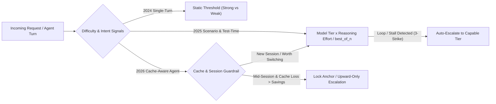

# 开源生态调研 A：智能难度路由、推理预算寻优与 Coding Agent 网关深度剖析

> **调研范围与定位**：本报告系统拆解 Magpie 生态之外，开源界在**“问题难度/意图自适应路由”“Reasoning Effort 推理预算寻优”“最优路由阈值/配置推导”**及**“多轮长上下文 Prompt/KV Cache 保护”**四个核心技术命题上的工程与算法实践。所有结论均经 GitHub 源码浅克隆核验或权威搜索交叉验证，严格剔除仅做静态转发与普通轮询的纯代理。完整检索记录、提交哈希、排除清单及原始 Prompt/公式摘录详见 `log-03-oss-routers.md`。

---

## 一、开源智能路由演进脉络（2024—2026）

过去两年，开源 LLM 路由方案经历了三次清晰的技术拐点：

1. **第一代（2024）：单轮双模型胜率路由（RouteLLM / RoRF / FrugalGPT）**
   - 核心问题：给定一条独立 Query，应该发给强模型（如 GPT-4）还是弱模型（如 Mixtral-8x7B）？
   - 代表解法：基于人类偏好数据集训练矩阵分解（MF）、BERT、随机森林（RoRF）或序贯 DeBERTa 评分器，并通过分位数（Quantile）将成本比例转化为静态阈值。
   - 致命盲区：**无视多轮会话粘性与 Prompt Cache**、无法调节同一模型内部的思考预算（Reasoning Effort），且对新发布模型的冷启动泛化较差。

2. **第二代（2025）：Coding Agent 场景规则与测试时计算联合寻优（CCR v1 / BEST-Route / AutoThink）**
   - 随着 Claude Code、Codex、Cursor 等 Agent 普及，开发者发现学术级小分类器难以应付长达数十轮的工具调用流。`musistudio/claude-code-router`（CCR）早期尝试用 **1 个免费小模型**充当分发器路由到 4 个角色模型失败后，转为务实的 **场景硬映射**（`default`、`background`、`think`、`longContext`、`webSearch`）；与此同时，`microsoft/best-route-llm` 和 `optillm` 将决策空间从“选哪个模型”扩展至“选哪个模型 × 采样几次（`best_of_n`）× 允许思考多少 Token”。

3. **第三代（2026）：Cache-Aware 多目标 Agent 控制面（vLLM Semantic Router / Plano / LiteLLM / Bifrost / CCR v2）**
   - 2026 年主流生产级开源项目集体撞上同一堵工程高墙——**“多轮缓存撕裂陷阱”**：在高达 50K–200K Token 的 Coding Agent 会话中，若第 8 轮因为用户发了一句“谢谢”或简单改名指令就把请求从 `Sonnet/Opus` 切给便宜模型，会导致 Anthropic/OpenAI 上游 Prefix Cache 瞬间失效，下一次切回强模型时重算整段前置上下文反而倒亏成本与延迟。
   - 由此演化出四大工程护城河：`vllm-project/semantic-router` 的**有界缓存亲和（`affinityMaxLambda = 0.14`）与迟滞防震荡门控**、`katanemo/plano` 的**反事实切换成本上限门控（`max_switch_spend_pct`）**、`BerriAI/litellm` 的**只升不降 `CacheAwareRouting`**，以及 `maximhq/bifrost` 与 `NadirClaw` 的**子 Agent 作用域隔离 + 单调只升不降会话锁定**。

---

## 二、流派一：数据驱动与算法级难度感知路由、推理寻优与级联框架

### 2.1 `lm-sys/RouteLLM`（5,699 Stars `[API]`）：双模型胜率建模与分位数阈值校准

- **仓库与核验版本**：`lm-sys/RouteLLM`（Commit `0b64fda`, `2024-08-10`, Python, Apache-2.0）。
- **核心算法拆解**：RouteLLM 把路由建模为**对“强模型相对弱模型胜率”的条件概率估计**，底层支持四类路由器（`routellm/routers/routers.py`）：
  1. **`mf`（Matrix Factorization）**：将模型映射为隐向量 $v_m \in \mathbb{R}^d$，把投影后的 Query Embedding 映射为 $u_q$，通过双线性内积结合 Bradley-Terry 模型估计胜率 $P(\text{win}_{\text{strong}} \mid q) = \sigma(\text{score}(m_s, q) - \text{score}(m_w, q))$。
  2. **`sw_ranking`（Similarity-Weighted Ranking）**：在 Chatbot Arena 历史偏好库上按余弦相似度计算指数加权 $w_i = 10 \cdot 10^{\text{sim}_i / \max \text{sim}}$（`routers.py:173-175`），现场拟合局部 Bradley-Terry 模型，无需离线重训即可吸收新样本。
  3. **`bert`（`BERTRouter`, `routers.py:106-130`）**：微调 BERT 三分类头（`num_labels=3`，预测强模型胜 / 平局 / 弱模型胜），以 `1 - sum(softmax_scores[-2:])` 输出强模型胜率。
  4. **`causal_llm`（`CausalLLMRouter`, `causal_llm/model.py:122-127`）**：基于微调 Llama-3-8B 对单助手回答预估 **1–5 分绝对质量分**（`system_ft_v5.txt` 要求输出 ``predicted rating``），按 `score_threshold=4` 累加 `softmax_scores[3:]` 并取 `1 - binary_prob` 作为强模型胜率。
- **配置/阈值自动推荐机制**：`routellm/calibrate_threshold.py:55` 摒弃手工调参，输入用户在校验集上愿意流向强模型的成本比例预算 $p \in [0, 1]$，直接通过 pandas **`thresholds_df[router].quantile(q=1 - args.strong_model_pct)`** 自动导出分流阈值。
- **工程边界**：严格面向单轮无状态文本 Query；不支持多轮 Prefix Cache 延续、工具调用循环检测或 Reasoning Effort 调节。

---

### 2.2 `vllm-project/semantic-router`（6,460 Stars `[API]`）+ `theagentrouter/agent-router`（2,392 Stars `[API]`）：统一信号评估、推理努力度联动与缓存防震荡

- **仓库与生态整合**：`vllm-project/semantic-router`（Commit `f47e114`, `2026-11-13`, Go）与原 `envoyproxy/ai-gateway` 更名而来的 **`theagentrouter/agent-router`**（Commit `165733c`, `2026-11-10`, Go）形成云原生黄金搭档——后者提供基于 Envoy 的双层 AI 控制面（Tier-1 认证/限流/协议路由 + Tier-2 自部署模型节点调度），并通过 Envoy `ExtProc` 将复杂语义选模与思考开关委托给前者。
- **20 类信号与 SystemOne 复杂度批评估**：
  - `pkg/decision/engine.go:59-83`（`SignalMatches`）及 `pkg/config` 定义支持 **20 类信号**（Keyword、Domain、FactCheck、UserFeedback、Language、Context、Complexity、Modality、Authz、Jailbreak、Safety、PII、Hallucination、Refusal、TurnRelation、Conversation、Metadata、InputModality、SystemOne、Projection）。
  - 为避免多路分类器串行叠加延迟，`pkg/classification/classifier_signal_systemone.go` 经 `askSystemOneRules` 在一次模型前向内联合判定预设规则。其中核心复杂度预设（`pkg/presets/catalog.go`）直接发问 `"How difficult is this request to answer well?"` 并映射到 `easy` / `medium` / `hard` 三档语义定义。
- **模型选择与 `ReasoningEffort` 联合决策**：
  - 每一条命中决策除指定候选模型外，还同时携带 **`UseReasoning` 与 `ReasoningEffort`**，使系统在“路由给哪个模型”之外同步决定“是否开启高开销深度思考及思考强度”。
  - `pkg/extproc/fallback_dispatch.go` 与 `req_filter_reason_selection.go` 按 `candidateRef.ReasoningEffort -> DefaultReasoningEffort`（受 `ReasoningFamilyConfig.Levels` 约束）`-> family.Default -> "medium"` 顺序求解努力度，并自动完成 **6 种异构推理协议传输映射**（独立开关、DeepSeek 官方字段、`reasoning` 对象、`thinking` 对象、`output_config` 及 `ChatTemplateKwargs`），彻底屏蔽 OpenAI/Anthropic/DeepSeek/vLLM 协议割裂。
  - `pkg/routing/budget/budget.go` 提供原子级 `Ledger`，硬性限制单次请求的物理上游重试/级联跳转次数。
- **2026 长上下文缓存与会话保护**：
  - **有界缓存亲和（`pkg/selection/cache_affinity.go:46`）**：为命中 KV/Prefix 缓存的候选模型注入打分加权，但上限严格封顶为 **`affinityMaxLambda = 0.14`**，防止网关为了贪图缓存命中而把明确需要强模型的难题错派给已预热的弱模型。
  - **迟滞与防震荡切换门控（`pkg/selection/session_switch_gate.go`）**：引入迟滞门槛（Hysteresis）、冷却窗口（Cooldown）与震荡守卫（Oscillation Guard），防止在复杂度边界徘徊的连续对话反复切模型清洗缓存。

---

### 2.3 `katanemo/plano`（7,116 Stars `[API]`，原 `archgw`）：`Arch-Router-1.5B` 与反事实缓存切换预算护栏

- **仓库与定位**：`katanemo/plano`（Commit `b13ddd6`, `2026-10-24`, Rust, Apache-2.0），面向 Agent 流量的高性能 Rust 路由与编排代理。
- **`Arch-Router-1.5B` 偏好与意图路由机制**（`crates/brightstaff/src/router/orchestrator_model_v1.rs`）：
  - 与只看通用“难/易”不同，Arch-Router 主打**开发者自定义业务偏好路由**（`routes` 列表附自然语言描述）。
  - 上下文窗口工程防御：剥离冗长的 `Role::System`、`Developer` 与 `Tool` 消息，限制最多保留 `MAX_ROUTING_TURNS = 16` 轮且长度封顶 `MAX_TOKEN_LEN = 8192`；超长时调用 `trim_middle_utf8`（保留前文任务设定与末尾最新提问，截断中段历史），要求小模型返回严格 JSON `{"route": ["route_name_1", ...]}`。
- **隐式会话亲和与 Harness 噪声剥离**（`affinity.rs` / `session_router.rs`）：
  - 利用带盐 `"plano-affinity-v1"` 的 64 位 FNV-1a 对 `(tenant, system, tools)` 计算 `prefix_hash`（检测前缀漂移），并对 `(tenant, system, tools, first_user)` 生成 `implicit:{hex}` 会话键。
  - 专门清洗 `<system-reminder>` 与 `<user-prompt-submit-hook>` 等 Claude Code 外壳注入标签，防止编码工具附带的隐式系统提示触发误分类或新建会话。
- **核心亮点——反事实切换成本上限门控（`orchestrator.rs` / `session_router.rs`）**：
  - Plano 不凭感觉决定“多轮对话能否切换模型”，而是引入极其保守且严谨的美元会计模型：
    $$\text{switch\_cost\_in\_usd} = \frac{(\text{fresh} \times r_{\text{cand\_uncached}} + \text{warm} \times r_{\text{cand\_cached}}) - \text{context\_tokens} \times r_{\text{anchor\_read}}}{10^6}$$
  - 该公式只计算当前长上下文搬迁到新模型产生的**确定性输入缓存重算净亏空**，拒绝把“新模型未来可能省多少输出费用”作为赌注提前透支；同时滚动累计默认模型对照基线 `baseline_usd`，要求切换净损失不得突破上限 $\text{ceiling} = (\text{max\_switch\_spend\_pct} / 100.0) \times \text{baseline\_usd}$。一旦超限直接否决切流、锁定 `anchor_model`，并支持留存反事实（Counterfactual）观测指标。
- **执行死循环自动侦测**：`signals/execution/loops.rs` 内建 `RETRY_THRESHOLD = 3`、`PARAMETER_DRIFT_THRESHOLD = 3` 与 `OSCILLATION_CYCLES_THRESHOLD = 3`，捕捉 Agent 工具调用原地打转并触发模型升级信号。

---

### 2.4 `BlockRunAI/ClawRouter`（6,663 Stars `[API]`）与 `NadirRouter/NadirClaw`（~661 Stars `[Web]`）

两者同为 2026 年极活跃的 AI Agent 本地网关路由器，但代表了截然不同的两种技术路线：

| 对比维度 | `BlockRunAI/ClawRouter` + `router-core` (`0bf510b` / `2c2d0a5`, TS) | `NadirRouter/NadirClaw` (`06059e1`, Python, **PolyForm Noncommercial 1.0.0**) |
| :--- | :--- | :--- |
| **难度识别算法** | 零外部 LLM 开销的 **15 维加权启发式规则 + Sigmoid 置信映射**（<1ms），配合 V3 Portfolio **30 天时间衰减**评分体系。 | 4 类可插拔分类器：`BinaryComplexity`（相似度差值）、`DistilBert`、`Laya`（ModernBERT-large, 风险阈值 `cutoff=0.40`）及 **`Wide&Deep`**（768 维 BGE + 33 维结构特征 + Neyman-Pearson 门控 `complex_gate_v1.pt`）。 |
| **防误降级策略** | 低置信度走稳妥档，支持短期避坑记忆 `outcome-memory.ts` 与连续失败 3 次自动升档。 | **`cost_sensitive` 非对称代价解码**：计算期望损失 $E[\text{cost}\mid j] = \sum_i P(i) C_{i,j}$，降级错判惩罚设为 $\lambda(i-j)$（平衡档 $\lambda=3$、极限安全档 $\lambda=20$），宁可多花钱升档也不放过潜在难题。 |
| **级联与自我校验** | 无生成后级联，前置一次性选模。 | 内置 `Cascade`（接受门槛 `τ=0.80`，熔断 `KILL_SWITCH_THRESHOLD=3`）。需警惕**开源免费版 `HeuristicVerifier` 仅约 0.60 AUROC**，官方报告的 98.3% 质量保留（`0.67` 接受率、`0.017` 灾难错误率，RouterBench `n=11,420`）依赖 Pro 版微调 DeBERTa 校验器。 |
| **缓存/会话保护** | 支持 Session Pinning，但允许 **`SIMPLE` 极简轮次绕过**锁定模型直切弱模型（牺牲局部缓存换极简请求零成本）。 | `server.py` 强制 **`upgrade_if_higher` 只升不降**；并在代理层静默剥离弱模型不支持的 `effort` 字段、把 Anthropic `thinking.budget_tokens` 钳制于 `max_tokens` 之下防崩溃。 |
| **配置推导 / 臂选取** | 依赖固定策略矩阵与钱包 x402 微支付单价。 | **`nadirclaw/tier_config/selector.py`**（`L1-13, L113-163`）**不**自动生成配置：档位与模型池由静态 YAML 预置；`mode: flat` 下 `_assign_flat(score)` 仅做逐请求**运行时起始臂选取**（`score_rank[i] = abs(i/max(1,n-1)-score)` 与 `cost_rank` 按 `lambda_cost` 混合，OSS 版未读 `tier.quality`）。 |

---

### 2.5 学术级联、测试时计算寻优与统一路由库

1. **`ulab-uiuc/LLMRouter`（3,078 Stars `[API]`）+ `GraphRouter` + `FusionGate`**：
   - 将 19 种学术模型路由算法工程化为统一 CLI/YAML 库，其中两大特色模块直接切中前沿痛点：
     - **`GraphRouter`（`graphrouter/graph_nn.py`）**：将所有历史 Query、候选 LLM 抽象为二部图节点，经 `FeatureAlign` 对齐特征后通过两层 `GeneralConv` 聚合边表现矩阵，最终以节点嵌入内积预测任意 `(query, llm)` 成功率，能够零样本泛化至训练期未见过的新晋大模型。
     - **`FusionGate`（`custom_routers/fusion_gate`）**：超越“单模型非此即彼”，搭建 **`single` -> `budget_fusion` -> `fusion`** 三段门控（默认 `budget_threshold=0.3`、`threshold=0.5`，支持 `high_stakes=true` 强制融合），复杂请求通过 `openrouter:fusion` 并发聚合多模型输出并经 Judge 综合；同时先估算 `(input_price*prompt_tokens + output_price*512)/1e6`，超 `cost_ceiling` 则安全退回 `single`。
2. **`FrugalGPT` / `RouterBench` / `Not-Diamond RoRF`**：
   - `stanford-futuredata/FrugalGPT`（292 Stars `[API]`）确立多模型**序贯级联 + DeBERTa 质量打分 + `scipy.optimize.brute(..., Ns=40)` 求解各阶段分位数退出阈值**的经典范式。
   - `withmartian/routerbench`（189 Stars `[API]`）定义行业通用积分评估指标 **AIQ**，用于横向比较 KNN/MLP/Cascade 在全成本区间下的曲线面积。
   - **`Not-Diamond/RoRF`**（245 Stars `[API]`）：由于 `Not-Diamond/notdiamond-python` 已于 2025-12-11 正式归档、主路由转向闭源商业 API，RoRF 成为其最重要的开源可本地部署方案——利用 Jina/Voyage/OpenAI 向量训练 **4 分类随机森林**（`[A only, Both, Neither, B only]`），在 $P[0]+P[1] \ge \text{threshold}$ 时落入廉价模型 A，完全无需本地 GPU 推理分类器。
3. **测试时计算（Test-Time Compute）联合寻优三剑客**：
   - **`microsoft/best-route-llm`（HybridLLM & BEST-Route）**：路由空间不再仅仅是模型集合，而是联合搜索 **`(model, best_of_n)`**（`results_interpretation.ipynb`），在满足 DeBERTa 奖励模型相对强模型置信下界 `_p >= t` 下挑选综合 Token 成本最低的模型-采样次数组合。
   - **`automix-llm/automix`（120 Stars `[API]`）**：小模型回答后追加少样本自校验得到 `p_ver_13b`，再通过 `POMDPSimple` 将连续验证分离散化并依据 `{NEEDY, GOOD, HOPELESS}` 信念状态分布求解最优升级规则。
   - **`somerstep/CARROT`（7 Stars `[API]`）**：用双 `roberta-base` 模型在调用前**同时预测候选模型的正确率 `scores` 与预期输出长度 `output_tokens`**（弥补了只看输入长度导致按输出高价模型反而更贵的盲区），用单滑块 `mu ∈ [0, 1]` 求解线性帕累托前沿 $\arg\max_m [(1-\mu)\cdot\text{scores}_m - \mu\cdot\text{costs}_m \times 100]$。
   - **`algorithmicsuperintelligence/optillm`（~4,300 Stars `[Web]`, AutoThink）**：借助 `adaptive-classifier/llm-router`（阈值 `0.6`）判断 `LOW / HIGH` 难度后动态设定思考预算上下界（如 `256..1024` vs `1024..4096`），更在解码器 **Layer 19 挂载激活引导向量（Steering Vectors）**，未达下限即试图 `</think>` 时自动注入 `"Wait,"` / `"Alternatively,"` 等思维切换词延长思考，突破上限时硬插入 `</think>` 及时止损。

---

## 三、流派二：Coding Agent 专用网关与多场景最优分流器

### 3.1 `musistudio/claude-code-router`（38,129 Stars `[API]`，CCR）：从实验失败走向实用场景化与缓存套利

CCR 是目前 Coding Agent 赛道影响力最大的开源路由器，其 **v1 -> v2 架构演进笔记（`blog/zh/项目初衷及原理.md` 与 `057abaa` 源码）**提供了极为宝贵的反脆弱经验：

- **v1 踩坑实录**：作者在最早阶段试图**用 1 个免费小模型**充当路由器入口，将请求分发到 `router`、`tool`、`think`、`coder` 四个角色模型，**实测失败**（小模型分发精度不足叠加早期 Agent 架构缺陷，多步骤编码链路极不稳定）；随后转入实用场景硬分流：
  1. `default`（常规开发主力模型）
  2. `background`（Claude Code 内部摘要/标题等轻量后台请求，切往本地 Ollama 或超低价模型）
  3. `think`（复杂推理请求显式转接 DeepSeek-R1 等推理模型）
  4. `longContext`（本地 `tiktoken` 计算超过 32K 阈值自动切高上下文窗口模型）
  5. `webSearch`（联网检索专用模型）。
- **v2 大重构（`packages/core/src/config/config.ts:121-127`）**：`REMOVED_LEGACY_ROUTER_RULE_IDS` 彻底下线死板的旧规则栈，升级为三大生产级机制：
  1. **Subagent 工具 Schema 显式协作路由**：直接在 `Agent` / `Task` / `Workflow` 工具描述里向主模型注入候选模型能力说明，由最强的主编码模型自主决定派给哪个子模型，并在回复中写入标签 **`<CCR-SUBAGENT-MODEL>provider/model</CCR-SUBAGENT-MODEL>`** 触发下游精确路由；
  2. **跨生态与脚本扩展能力**：内置 Codex 自由格式 `apply_patch` -> `virtual_apply_patch` 自动桥接；支持 Worker 线程沙箱隔离运行自定义 JS 规则脚本（限制脚本 $\le 5\text{ MiB}$、超时 `10–30,000 ms`、输出 $\le 64\text{ KiB}$、故障 Fail-Open），并用 `applyResponsesSessionAffinity` 维护会话亲和。
  3. **极客级工程亮点——`openrouter-discount-provider-router.ts` 缓存损失套利网关**：面对 OpenRouter 上同一模型多下游供应商价格浮动，CCR **绝不盲目切换最便宜节点**，而是按默认假设（`cacheHitRate=0.75`、`endpointTtlMs=600_000`、`minOutputTokens=256`、`outputTokenRatio=0.35`、`minUptime5m=98`）实时对账：
     $$\text{grossSavingsUsd} = \text{baseline.uncachedCostUsd} - \text{cheapest.uncachedCostUsd}$$
     $$\text{cacheLossUsd} = \max(0, \text{baseline.uncachedCostUsd} - \text{cacheReadCostUsd})$$
     $$\text{netSavingsUsd} = \text{grossSavingsUsd} - \text{cacheLossUsd}$$
     仅当扣除缓存重建亏损后的净收益 $\text{netSavingsUsd} \ge 0.00005$ 且 $\text{netSavingsUsd} / \text{cacheReadCostUsd} \ge 0.05$（`minSavingsRatio`）时才放行切流。

### 3.2 `BerriAI/litellm`（63,200 Stars `[API]`）：全栈复杂路由器、`CacheAwareRouting` 与在线 Bandit

LiteLLM 近年将大量企业路由科研成果沉淀进 `litellm/router_strategy/complexity_router/` 与 `adaptive_router/`，早已超越简单转发代理：

1. **五阶递进式 Complexity Router**：
   - **`heuristic` (v1)**：直接吸纳 ClawRouter 设计，采用 7 维固定权重（`codePresence: 0.30`、`reasoningMarkers: 0.25`、`technicalTerms: 0.25`、`tokenCount: 0.10`、`simpleIndicators: 0.05`、`multiStepPatterns: 0.03`、`questionComplexity: 0.02`）配合边界 `0.15 / 0.35 / 0.60`。
   - **`heuristic_v2`**（`tier_predictor.py`）：通过**分层 Beta-共轭经验后验**（`global -> domain -> similarity_cohort`，先验质量 `200.0` / `20.0`）与跨层级单调概率包络实现零 LLM 开销的统计校准，自动选取满足 `routing_threshold=0.75` 的最低 Tier。
   - **`capability`**（`capability_classifier.py`）：显式嵌入 NVIDIA NeMo Switchyard 的 9 条能力界定规则（`SUP-1..5`、`UNC-1..2`、`LIM-1..2`），提取结构化 `{crux, primary_rule, capability_boundary, p_solve}`，随边界信心阶梯抬高门限（$p_{\text{solve}} \ge \text{base\_threshold} + k \times \text{threshold\_step}$），**且严格 Fail-Closed 到高能力档位**。
   - **`llm_v2` & `hybrid`**：`llm_v2` 同时评估 `efficient` 与 `capable` 模型的胜率；`hybrid` 仅在局部分数距离最近阈值大于余量（`hybrid_boundary_margin`，如 `0.03`）时跳过外部 LLM 分类。
   - **Agent 停滞侦测（`stall_detector.py`）**：监视最近 `window=6` 次工具调用中相同签名重复 `repeat_threshold=3` 次即强制升档；代码注释显式规定其与 `session_affinity` / `user_turn` 不共用，避免策略打架。
2. **只升不降的 `CacheAwareRouting`（`litellm/proxy/common_utils/cache_aware_routing.py`）**：
   - 在通过分类器确定请求最低能力要求 `floor` 后，`eligible_models` 严格切片 **`order[floor:]`**：仅允许在**同档或更高能力模型**里排查处于 `"warm"` 或 `"partial"` 状态且未过期的部署，并通过预估成本对比 `cost < original_cost` 完成替换——**宁可放弃缓存也不允许降级答错**。
3. **在线反馈闭环（`adaptive_router/bandit.py` & `lar1_routing.py`）**：
   - `AdaptiveRouter` 在 7 类 `RequestType` 上为每个候选模型维护 `Beta(alpha, beta)` 后验（`COLD_START_MASS=10`, `SAMPLE_CAP=200`），用 Thompson 采样与归一化成本联合打分，并根据请求后满意度/错位/停滞/循环事件动态更新分布。
   - `lar1_routing.py` 允许 Agent 直接上送置信度并依阈值 `0 < 0.3 < 0.5 < 0.7 < 1` 阶梯路由。

### 3.3 `maximhq/bifrost`（9,532 Stars `[API]`）：去词法化、Subagent 隔离与工具续跑直通

Bifrost（Go 实现）的 `plugins/routing/` 展示了极高工程纪律的 2026 最佳实践：
- **弃用纯词法规则**：正式标弃早年词法启发式（`complexity/analyzer.go:9-13` 注明请求路径已不再调用，`complexity/config.go:81,111` 标明 `TierBoundaries` / `DefaultTierBoundaries` 为 deprecated lexical thresholds）；核心路由线收敛至 **`complexity/semanticclassifier.go`**（本地 Chromem 或外部向量库检索，即使低于 `MinSimilarity` 也被保留入日志便于可观测性调参）与 **`complexity/llmclassifier.go`**，配合根目录的 `decisionclassify.go` 与 `llmclassify.go`。
- **针对 Claude Code / Codex 的细粒度会话隔离（`complexitysession.go`）**：不仅强制会话内**单调只升不降**，更主动解析 `x-claude-code-agent-id` 与 `x-codex-parent-thread-id` 将主 Agent 与衍生 Subagent 隔离在各自会话域中；并通过 **`turnTierStore` 在同一推理轮次的多步工具回调（Tool Continuations）间复用首次分级结果**，免除多轮工具往返重复分类的延迟与成本。
- **分布式部署协同（`complexitykvwarmcoordinator.go`）**：集群水平扩容时通过 Redis `SetNX` 抢占向量范例库预热权，杜绝 N 个副本同时狂刷 Embedding API。

### 3.4 云原生、订阅制零 API Key 与独立 Agent 路由器的差异化路径

1. **`higress-group/higress`（9,761 Stars `[API]`）**：路由职责高度正交拆分——`model-router` 仅处理 Header 转发；**`ai-intent`** 插件在网关侧把末尾用户输入发往低价模型（如 `qwen-long`）写入 `intent_category` 属性实现业务意图路由；**`ai-endpoint-picker`** 则基于 WASM 收集底层 vLLM 的 `kv_cache_usage_perc` 与前缀块哈希做同模型集群副本级 KV 调度。
2. **`ypollak2/llm-router`（127 Stars `[API]`）**：精准切中个人开发者痛点——通过 **Hook + MCP** 寄生于已有 Claude/Codex 订阅客户端实现“无额外 API Key” **6 步拦截链**（`hooks/auto-route.py:5-11`：Skip 模式 -> `+3/+2/+1` 强启发式打分 -> 本地 Ollama -> 廉价 API -> 弱启发式匹配 -> `llm_route` 自动兜底）。
3. **`nidhi-singh02/agent-router`**：本地 CLI 启动台，遵循“策略优先、语义次之”——硬核保留 40% 共享账号订阅配额安全缓冲后，结合 TypeSafe / Jev 计算最佳模型与推理努力度并在 Herdr 分屏自动拉起 Cursor、Claude Code、Codex 或 OpenCode。
4. **`Egham-7/adaptive`（~108 Stars `[Web]`）**：基于 Go 构建 `adaptive-proxy`，引入 NVIDIA Prompt Task & Complexity Classifier 结合 UniRoute 思路做低延迟语义缓存与模型分流。
5. **纯规则/纯桥接边界对照（不列入难度智能路由核心对比）**：`Portkey-AI/gateway`（13,376 Stars, 仅元数据条件匹配+Fallback）、`router-for-me/CLIProxyAPI`（~58.4k Stars, OAuth CLI 桥接+轮询）、`tensorzero/tensorzero`（11,703 Stars, 已于 2026-06-11 归档）、`Not-Diamond/notdiamond-python`（已于 2025-12-11 归档，转向商业 API）。

---

## 四、五大维度横向技术对比矩阵

| 项目 / 模块 | ① 难度识别核心算法 | ② 阈值 / 配置自动推荐能力 | ③ 对长上下文 Prompt/KV Cache 的保护与破坏性 | ④ 额外路由延迟开销 | ⑤ 最优适用场景 |
| :--- | :--- | :--- | :--- | :--- | :--- |
| **`lm-sys/RouteLLM`** | MF 双线性、SW 近邻 Bradley-Terry、BERT(3分类)、`causal_llm`(1–5分打分) | **强（分位数反解）**：按强模型占比预算 $p$ 计算 `thresholds_df[router].quantile(q=1-p)` | **无保护（高破坏）**：逐轮独立决策，易在长对话中反复跳变清缓存 | 视路由器而定：Embedding/BERT 级本地推理，或 `causal_llm` (Llama-3-8B) 一次前向 | 单轮问答/离线基准评测与双模型成本缩减 |
| **`vllm-project/semantic-router` (+ `agent-router`)** | 20 类信号 + SystemOne 单次批评价 (`easy/medium/hard`) | **中（策略+预算账本）**：支持模型×努力度索引与请求级交换次数上限 | **强保护**：`affinityMaxLambda = 0.14` 有界缓存亲和 + `EvaluateSwitchGate` 迟滞/冷却防震荡 | 低：ExtProc + 单次 `SystemOne` 轻量批评估（避免多分类器串行叠加） | K8s 生产级云原生推理底座、需精细控思考努力度的混合池 |
| **`katanemo/plano`** | `Arch-Router-1.5B` 偏好/意图对齐 + 中段文本裁剪 | **中-强（反事实预算护栏）**：依 `max_switch_spend_pct` 动态算切流预算 | **极强保护**：FNV-1a 隐式会话亲和 + 剥离 `<system-reminder>` + 只算输入重算亏损的切模门控 | 中低：1 次 `Arch-Router-1.5B` 推理（受 `MAX_ROUTING_TURNS=16` / `8192` 封顶保护） | 多轮长上下文 Agent 平台、对缓存抖动与重复失败循环敏感网关 |
| **`BlockRunAI/ClawRouter` (`router-core`)** | 15 维加权启发式 + Sigmoid 置信 + 30 天时间衰减权重 | **弱（静态配置+评分衰减）**：预设权重策略矩阵，无自动预算求解 | **中（有隐患）**：有 Session Pinning，但 **`SIMPLE` 轮允许绕过锁定**降级，可能局部断缓存 | **极低 (<1 ms)**（纯本地确定性 CPU 规则计算） | OpenClaw 生态高频轻请求分发、极度敏感首字延迟且依赖本地规则场景 |
| **`NadirRouter/NadirClaw`** | Binary / DistilBERT / Laya (`0.40`) / Wide&Deep + Neyman-Pearson + 启发式级联 | **弱-中（静态 YAML 预置档位）**：`TierSelector._assign_flat` 仅基于 `score` 与 `cost_rank` 做运行时起始臂选取，无离线自动配置推荐 | **强保护**：`upgrade_if_higher` 严格单调只升不降 + 兼容参数静默剥离/钳制 | 视选型而定：Embedding/BERT 或 ModernBERT (~843MB)；触发级联需串行重跑 | 个人/非商用（注意 PolyForm Noncommercial 许可）本地模型与云端混合节省成本 |
| **`ulab-uiuc/LLMRouter` (`GraphRouter` / `FusionGate`)** | GNN 二部图边预测；`FusionGate` 三段式 route-vs-fuse | **中**：支持训练拟合，`FusionGate` 按美元 `cost_ceiling` 兜底降级 | **无保护**：单请求视角路由，多模型并行 `fusion` 不适用共享会话缓存 | 中（GNN/Embedding 编码）；`fusion` 并发耗时取决于最慢 Panel 模型 + Judge | 学术研究评测、新晋未见模型快速归纳接入、高价值疑难问答并发融合 |
| **`FrugalGPT` / `RouterBench`** | 序贯级联 + DeBERTa 质量打分 / 多种离线基线 | **极强（数学优化）**：`scipy.optimize.brute` 搜索各层分位数退出阈值 | **高破坏**：先弱后强序贯试错本质上要求推翻重跑，难共享上游缓存 | **极高（级联）**：需等待弱模型完整生成并经 DeBERTa 校验后决定是否重跑 | 离线批处理、容忍尾延迟且对单次高准确率有硬指标的流水线 |
| **`microsoft/best-route-llm` (`BEST-Route`)** | DeBERTa 奖励模型相对强模型预测 `(model, best_of_n)` | **强（帕累托/余量校准）**：满足 `_p >= t` 下界自动挑最低成本样本数 | **无显式会话缓存模型**：聚焦单问多采样的测试时计算最优配比 | 中（奖励评估）+ 多并发采样计算开销 | 推理/数学代码题在同模型与跨模型间自动权衡 `best_of_n` 算力预算 |
| **`somerstep/CARROT`** | 双 `roberta-base` 并行预测正确率与预期输出 Token 数 | **极强（线性帕累托滑块）**：单参数 `mu` 直接导出准确率-美元最优模型 | **无保护**：每条请求独立回归预测 | 低：双 `roberta-base` 局部编码推理 | **输入短但输出长度差异悬殊**导致单靠输入估算成本失真的场景 |
| **`OptiLLM (AutoThink)`** | `adaptive-classifier/llm-router` 二分类 + 表征干预 | **中（思考上下界配比）**：依据 `LOW/HIGH` 难度切换思考 Token 预算区间 | **内部推理层适配**：同模型内按单卡 KV Cache 动态延长/硬截断 `</think>` | 1 次轻量分类开销 + 思考 Token 增减导致的生成时延变化 | 本地/自托管开源推理模型（如 QwQ/R1 蒸馏版）细粒度控“想多久” |
| **`musistudio/claude-code-router` (v2)** | 规则/JS 沙箱脚本 + 主模型 `<CCR-SUBAGENT-MODEL>` 自主标记 + `tiktoken` 长窗切分 | **弱-中**：需手配场景模型，但 **OpenRouter 插件支持纯利润自动决策** | **强保护**：`applyResponsesSessionAffinity` + **`grossSavingsUsd` vs `cacheLossUsd` 精算后才允许切节点** | 极低（规则/JS 脚本沙箱受限于 10–30,000 ms）；Subagent 零额外分类请求 | Claude Code / Codex 开发主力网关、重度依赖多轮 Prompt Cache 的长程编程 |
| **`BerriAI/litellm`** | 5 选 1（7 维启发/`heuristic_v2`/Switchyard 9 规则/`llm_v2`/`hybrid`）+ Bandit | **强（经验后验/Bandit）**：`heuristic_v2` 分层 Beta 更新；`AdaptiveRouter` Thompson 采样 | **强保护（只升不降）**：`CacheAwareRouting` 限定 `order[floor:]` 搜寻已预热模型，绝不降级换缓存 | 极低（纯本地 `heuristic`/`heuristic_v2`）到 1 次外部 LLM 分类 RTT；`hybrid` 可跳过大部分调用 | 企业级多团队统一网关、兼具模型治理、防死循环与精细缓存成本控制 |
| **`maximhq/bifrost`** | 向量语义最近邻 / Decision API / LLM（显式淘汰词法打分） | **中**：支持保留被 `MinSimilarity` 拒收分数辅助阈值的可观测性调优 | **极强保护**：Subagent 头隔离（Claude/Codex）+ 单调锁 + Tool Continuation 直接复用避免重算 + `SetNX` 防并发预热 | 低（本地 Chromem 向量检索或远端向量库）+ 工具回调轮 **0 分类开销** | 分布式高并发 Go 网关、大规模接入 Claude Code / Codex 团队底座 |
| **`higress-group/higress`** | `ai-intent` 外调廉价小模型打标 `intent_category` | **弱**：需静态映射意图名到目标模型 | **同模型实例级强保护**：`ai-endpoint-picker` 按 vLLM KV 使用率与前缀哈希调度 Pod，不跨强弱模型撕裂缓存 | `ai-intent` 增加 1 次小模型 RTT；`ai-endpoint-picker` 为 WASM 内核近零开销 | 阿里云/K8s 云原生微服务与自建 vLLM 集群统一入口 |
| **`ypollak2/llm-router`** | 6 步拦截链（Skip -> `+3/+2/+1` 强规则 -> Ollama -> 廉价 API -> 弱规则 -> `llm_route` 兜底） | **弱（手工阈值/权重）** | **弱**：依赖客户端原有会话上下文，本地强弱切换会失效局部缓存 | 极低（正则命中）至 1 次本地 Ollama / `llm_route` 判定耗时 | 个人开发者依靠现有 Claude/Codex 订阅叠加本地 Ollama 极简省钱流 |

---

## 五、对 Magpie 智能路由与“LLM 网关最优配置推导”的核心启示

综合上述 20 余个开源系统的源码得失，为 Magpie 生态设计下一代智能路由与配置自动推荐引擎可提炼五条关键工程准则：

1. **用“切模净收益（Cache Loss vs Gross Savings）”替代单纯的“单价对比”**
   - 借鉴 `katanemo/plano` 的 `switch_cost_in_usd`（严格不透支未来输出节省）与 `CCR v2` 的 `cacheLossUsd` 精算：任何模型降级/迁移决策必须把**现有上下文 Prefix Cache 重建成本**作为硬减项；一旦处于多轮工具会话中段，遵循 `LiteLLM CacheAwareRouting` 与 `Bifrost/NadirClaw` 的**“只升不降 + 同级/升级复用缓存”**纪律，防止为省几分钱的简单轮次反而付出数十万 Token 的缓存重构账单。
2. **明确隔离主 Agent、Subagent 与 Tool Continuation 三类请求**
   - `CCR v2`（`<CCR-SUBAGENT-MODEL>`）与 `Bifrost`（解析 `x-claude-code-agent-id` / `x-codex-parent-thread-id` 并用 `turnTierStore` 跨工具回调复用分级）证明：**Coding Agent 的高频连续请求中存在大量工具执行结果回传或独立子探索任务，并非全新用户输入**。子代理可以安全落到轻量模型，而同一 Turn 内的工具回传必须跳过难度分类器、原路复用锚定模型。
3. **建立“3-Strike 死循环侦测与 Fail-Closed”底线，警惕开源级联校验器幻觉**
   - `NadirClaw` 的开源启发式校验器仅有约 `0.60 AUROC`，证明在编码/推理任务中“弱模型答完再让便宜规则打分兜底”极不可靠；真正稳健的防线应向 `LiteLLM capability`（边界不明确直接 Fail-Closed 至强档）、`NadirClaw Wide&Deep`（降级错误施加 $\lambda=3\sim 20$ 倍非对称惩罚）与 `Plano/LiteLLM stall_detector`（相同工具参数连续重试 3 次立刻无条件升档）看齐。
4. **“路由模型”必须与“调节 Reasoning Effort / 输出预算”联合求解**
   - `vllm-project/semantic-router` 在 6 种推理传输协议上自动重写 `UseReasoning` 与 `ReasoningEffort`，以及 `OptiLLM AutoThink` 按难度限制思考 Token 上限，揭示了一个高性价比事实：**把强模型降档为中低推理努力度（如 `effort: low/medium`），往往比跨模型切换到小模型既更稳健、又能保住原有的模型专属 Prompt Cache**。
5. **填补当前开源生态的最大空白：从“静态阈值”迈向“历史轨迹驱动的最优配置反演”**
   - 纵观所有调研项目，无论是 `RouteLLM` 的分位数校准、`FrugalGPT` 的 `scipy` 网格搜索，还是 `CARROT/BEST-Route` 的单轮采样与成本权衡、`LiteLLM` 的分层 Beta 后验，目前开源界**尚无任何工具能将“本地真实编码轨迹（含缓存命中率、实际输出长度、3-Strike 返工率与多档位 `ReasoningEffort` 组合）”统合起来反推最优网关配置文件**——这恰好正是 Magpie 数据集驱动的“最优网关配置推荐系统”可以占据绝对制高点的关键技术窗口。
