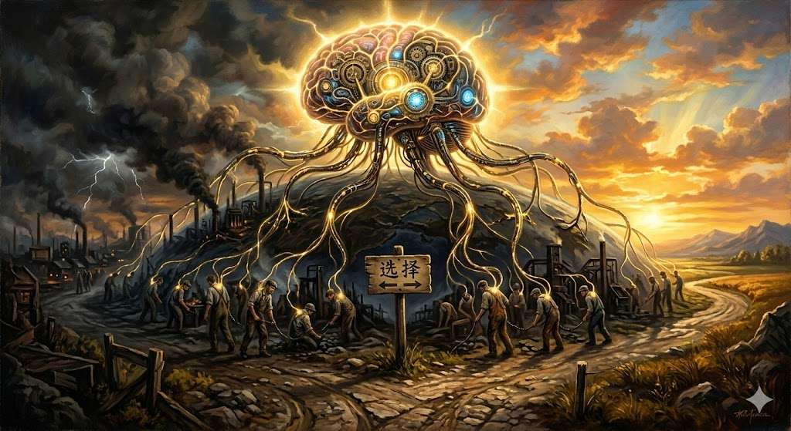
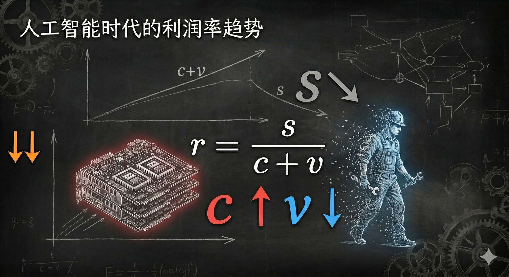
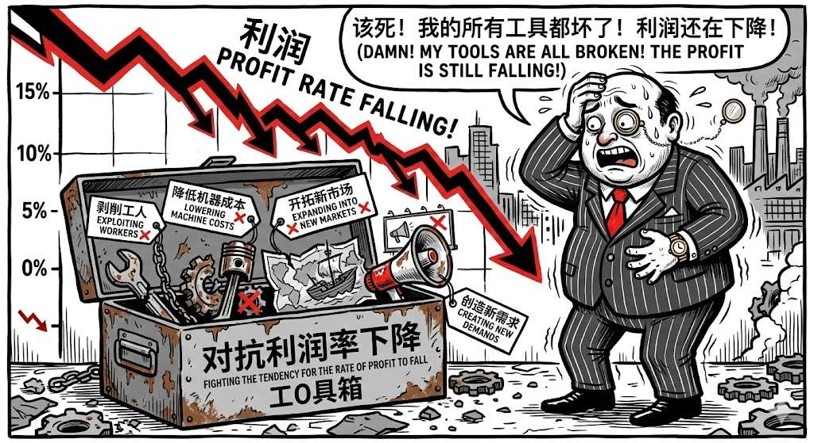
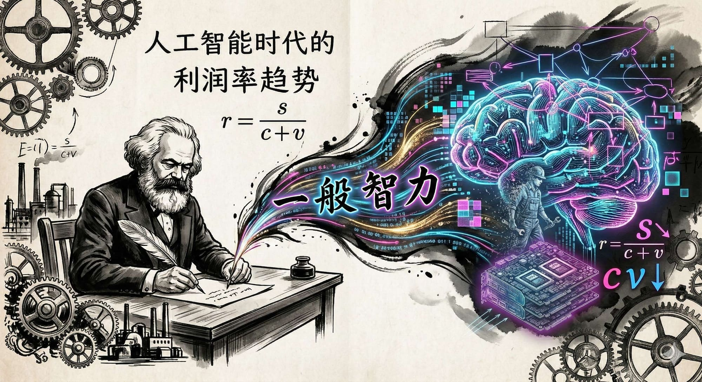
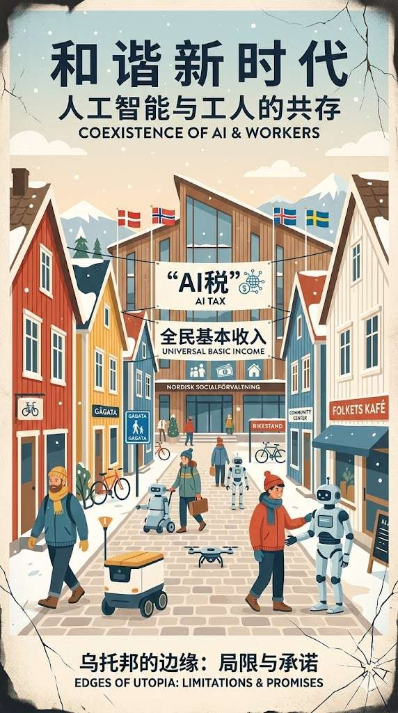
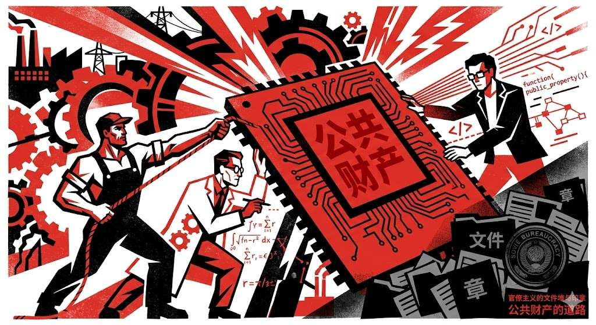

《AI大收割：人类智慧的最后一次"圈地运动"》系列 · 第七篇（终篇）

AI时代的五条道路

## 一、回顾：六篇文章论证了什么

在展开最后的分析之前，让我们回顾这个系列的完整论证链条。

第一篇（引论） 提出了核心命题：AI既是资本逻辑的巅峰展开，又是这一逻辑的自我否定。我们建立了分析框架，介绍了将要使用的马克思主义理论工具。

第二篇（五层攫取体系） 揭示了AI背后被遮蔽的全球价值攫取结构——从数据标注工人的血汗劳动到人类文明遗产的被"吞噬"。AI不是从天上掉下来的魔法，它站在数十亿人的劳动之上。

第三篇（数字劳动理论） 引入了"数字劳动"理论，严肃讨论了它的解释力和局限。我们提出了分层使用理论工具的方法，并指出了一个核心问题：如果AI的价值来源于全人类的贡献，全人类是否应该分享其收益？

第四篇（知识私有化） 论证了人类集体知识的价值如何被系统性私有化——不是知识本身被"拿走"了，而是"从知识中提取价值的能力"被垄断了。知识获取的中介化正在形成一个自我强化的闭环。

第五篇（开源的幻象） 解构了AI开源运动的政治经济学。科技巨头的"开源"是商业竞争武器，不是知识共享的胜利。算力壁垒使得表面的开放导致了实质的依附更深。

第六篇（中国方案） 严肃审视了中国特色社会主义与AI的交汇。中国模式展示了国家约束资本的可能性，但也面临市场逻辑与社会主义目标之间的深层张力。

将这六篇串联起来，我们得到一条完整的逻辑链：

::: block-1
AI是机器替代劳动的历史巅峰（第一篇）

        ↓
        
AI背后存在五层全球价值攫取体系（第二篇）

        ↓

数字劳动理论揭示了被遮蔽的剥削（第三篇）

        ↓

人类集体知识的价值被系统性私有化（第四篇）

        ↓

开源运动不但未打破垄断，反而强化了资本控制（第五篇）

        ↓

中国模式提供了一种制度替代的可能，但充满张力（第六篇）

        ↓

那么，终局是什么？
::: 

这就是本篇要回答的问题。

---

## 二、利润率趋向下降的终极版本

### 2.1 马克思的公式在AI时代的推演

让我们回到第一篇介绍过的马克思利润率公式：

$利润率 = \frac{s}{c + v}$

其中：
*   s = 剩余价值（只由活的人类劳动创造）
*   c = 不变资本（机器、原材料、基础设施——在AI时代，主要是算力）
*   v = 可变资本（工人工资）

现在，让我们看看AI对这个公式中每个变量的影响：

c（不变资本）急剧上升： 训练和部署前沿AI模型需要天文数字的算力投入。英伟达GPU集群、数据中心、电力消耗、冷却系统——这些投入正在以惊人的速度增长。据估算，下一代前沿模型的训练成本可能达到数十亿美元。而且这不是一次性投入——AI的军备竞赛意味着这些投入必须持续增加。

v（可变资本）大幅下降： AI的核心功能就是替代人类劳动。翻译、客服、初级编程、内容创作、数据分析、基础法律咨询……越来越多的岗位被AI替代或部分替代。随着AI能力的提升，被替代的劳动范围将继续扩大。v——花在人类劳动力上的资本——在相对量上（占总资本的比例）甚至可能在绝对量上持续下降。

s（剩余价值）与v同步下降： 这是关键。在马克思的理论中，剩余价值只能由活的人类劳动创造。机器（包括AI）本身不创造新价值，它只是将自身的价值转移到产品中。因此，当v下降时——当人类劳动在生产过程中的比重持续降低——s也随之下降。

极端情景推演： 如果AI的发展最终使得v→0（生产过程中几乎不需要人类劳动），那么s也→0（因为没有活劳动就没有剩余价值），而利润率→0。

$\lim_{v \to 0} \frac{s}{c + v} = \frac{0}{c + 0} = 0$

### 2.2 资本的反制手段正在耗尽

历史上，资本从来不是被动地接受利润率下降。马克思自己就分析了多种"反趋势"——资本用来对抗利润率下降的策略。但在AI时代，这些策略正在一一失效：

策略一：提高剥削率（增加s/v的比率）。 传统做法：延长工时、加强劳动强度、压低工资。AI时代的问题：如果工人被替代了，连剥削的对象都没有了。你不能对一台不需要工资的AI"提高剥削率"。

策略二：降低不变资本的价值。 传统做法：技术进步使机器变得更便宜。AI时代的情况：GPU芯片的单价确实在下降（摩尔定律），但AI的军备竞赛驱使企业不断投入更大规模的算力。就像汽车的单价在下降，但每家企业拥有的车队规模在疯狂扩大——总投入仍然在膨胀。

策略三：开拓新市场。 传统做法：殖民扩张、全球化、开辟新的消费领域。AI时代的现实：全球市场已经被充分覆盖。互联网已经连接了全球大部分人口。还有多少"处女地"可以开拓？

策略四：创造新需求。 传统做法：广告、品牌、消费主义文化。AI时代的困境：如果大量消费者因为AI替代而失去收入或收入大幅下降，他们就没有购买力来满足"新需求"。AI可以高效地生产任何东西——但如果没有人买得起，生产就毫无意义。

### 2.3 一个理论上的"死亡线"

需要强调的是：利润率趋向零不意味着资本主义会在某一天突然崩溃。它描述的是一个趋势——一个越来越难以维持的趋势。

但这个趋势的含义是深刻的：资本主义的内在矛盾正在被AI推到前所未有的极端。 系统性危机的概率在增加，危机的深度和广度也在增加。当利润率持续下降而维持利润率的手段一一耗尽时，整个系统就会进入一种越来越不稳定的状态。

---

## 三、需求端的崩溃：AI的产品卖给谁？

利润率趋向下降描述的是生产端（供给侧）的危机。但还有一个同样严重的需求端（消费侧）危机正在展开。

### 劳动者就是消费者

这是一个常常被忽视的事实：在资本主义经济中，劳动者和消费者在很大程度上是同一群人。 工人用工资购买商品。如果工人大规模失去工作或收入大幅下降，他们的消费能力就会崩溃。

AI正在推动这个过程。随着越来越多的工作被自动化，越来越多的人面临失业或就业不稳定，中产阶级正在萎缩。

### 马克思的"实现危机"

马克思称这种情况为"实现危机"（realization crisis）：商品被生产出来了，但无法被售出，因为消费者缺乏购买力。

在AI时代，这种危机有一种新形态：

*   AI使生产效率极大提高——商品的产出急剧增加
*   同时，AI替代了大量劳动者——消费者的收入和购买力下降
*   结果：生产能力膨胀，但市场在萎缩

**AI可以替你生产一切，但AI不能替你消费。**

### 现实迹象

这不仅仅是理论推演。我们已经可以在现实中观察到一些迹象：

*   就业极化： 高薪技术岗位和低薪服务业岗位增长，中间层的工作岗位在消失。
*   中产萎缩： 发达国家的中产阶级占比持续下降，这已经是一个持续了几十年的趋势，AI将加速它。
*   消费疲软： 尽管生产力在提升，但消费增长乏力——因为消费增长的基础是收入增长，而收入增长正在放缓。
*   债务驱动消费： 为了维持消费水平，越来越多的人依赖借贷——这只是把危机向后推延，并不能真正解决问题。

---

## 四、一般智力的觉醒——价值规律本身的危机

### 4.1 重新解读《大纲》机器论片段

在第一篇中，我们简要提到了马克思在1858年《大纲》中的惊人预言。现在让我们更深入地解读它。

马克思使用了"一般智力"（General Intellect）这个概念来指称人类社会积累的全部知识和科学。他写道：

> "自然界并没有制造出任何机器……它们是人类的手创造出来的人类头脑的器官；是物化的知识力量。固定资本的发展表明，一般社会知识已经在多大程度上变成了直接的生产力。"

关键段落：

> "一旦直接形式的劳动不再是财富的巨大源泉，劳动时间就不再是、也不应当是财富的尺度，因此交换价值也不再是使用价值的尺度……于是，以交换价值为基础的生产便会崩溃。"

### 4.2 AI时代的验证

这段写于168年前的文字，正在被AI时代的现实所验证。

**AI就是"一般智力"的物化形态。** 人类几千年积累的知识、科学、文化——全部被"吸收"进了AI模型，变成了直接的生产力。AI不是某一个人的发明创造——它是全人类智慧的结晶，被物化为一种可以自动运行的系统。

以劳动时间衡量价值正在变得无意义。 ChatGPT生成一篇两千字的文章需要几秒钟。一个人类作家写同样质量的文章可能需要几个小时。按照劳动价值论，AI生成的文章几乎没有价值（因为几乎没有投入劳动时间），而人类作家的文章有很高的价值。但在实际市场上，两篇文章的使用价值可能相差无几。

这意味着什么？意味着"劳动时间"作为价值尺度正在失效。 而如果价值规律失效了，以价值规律为基础的整个资本主义经济组织方式就失去了根基。

### 4.3 这意味着什么？

这里我们触及了一个比"资本主义危机"更深层的问题。

利润率下降和需求崩溃是资本主义的危机——它们可以通过改变分配方式（如UBI）或改变所有制（如公有化）来应对。

但价值规律的失效是一种更根本的危机——它意味着以劳动时间为基础的价值计量方式本身不再适用了。这不仅是资本主义的危机，更是以价值规律为基础的整个经济组织方式的危机。

我们需要的不仅仅是"更公平的分配"，而是全新的生产关系来适应这种全新的生产力。

---

## 五、五条可能的道路

分析了AI如何将资本主义推向极限之后，让我们展望可能的出路。在第六篇对中国模式详细分析的基础上，我们现在可以全面比较五条可能的道路。

### 5.1 道路一：数字封建主义（最坏的情况）

核心特征： 少数科技寡头垄断AI及其基础设施，大多数人沦为数字附庸。

想象这样一个世界：

*   3-5家科技巨头控制了全球的AI系统。它们垄断了算力、数据和模型。
*   大多数人完全依赖这些公司提供的AI服务来工作、学习、就医、社交。
*   传统的就业市场大幅萎缩。大量人口不再是"劳动者"（因为没有工作可做），也不是传统意义上的"消费者"（因为缺乏收入）。
*   他们成为了某种"数字附庸"——依附于科技平台的恩赐性服务来维持基本生活。
*   权力不再通过政治体制来运作，而是通过技术平台来运作。

希腊前财政部长Yanis Varoufakis（亚尼斯·瓦鲁法基斯）将这种情景称为"技术封建主义"。他认为，我们已经不再生活在资本主义中——资本主义至少还有竞争和市场——而是进入了一种新的封建主义，其中科技平台扮演了封建领主的角色。

这不是资本主义的超越，而是一种文明的倒退。历史上曾有过类似的倒退：罗马帝国晚期，庄园经济取代了商品经济，自由民变成了农奴。

为什么这条路径是可能的： 资本集中的趋势如果不加制约，就会自然走向这个方向。AI的发展具有天然的集中化特征（算力壁垒、数据优势、网络效应），这使得"赢家通吃"的逻辑更加强化。

### 5.2 道路二：资本主义框架内的改良（社会民主路径）

核心方案： AI税、全民基本收入（UBI）、数据分红、加强监管。

这是目前西方主流讨论中最常被提及的方案。其基本思路是：

*   不触动AI的资本主义所有制结构
*   承认AI可能加剧不平等
*   通过再分配来缓解矛盾

具体措施可能包括：

*   对AI公司征收"自动化税"或"数据使用税"
*   用税收收入为所有公民提供全民基本收入
*   建立数据权利框架，让用户对自己的数据拥有更多控制权
*   加强反垄断执法，防止AI市场的过度集中

优点： 政治阻力相对最小。它不需要根本性地改变现有的政治经济制度。它可以渐进实施，每一步都是可逆的。

局限： 正如马克思所指出的——改良无法解决根本矛盾。

如果AI的核心生产资料——算力、数据、模型——仍然是私有的，那么税收和再分配只是在不改变权力结构的前提下做出的妥协。科技巨头仍然控制着AI的发展方向，仍然决定着哪些工作被替代、哪些知识被"炼化"、哪些服务被商品化。

代表方向： 北欧社会民主模式的延伸。

### 5.3 道路三：中国特色社会主义路径（现实存在的替代方案）

第六篇已经对中国模式做了详细分析。此处做一个比较性的总结。

核心特征： 国家保留对AI资本的最终控制权，同时允许市场竞争在一定范围内运作。

在五条道路中的独特位置： 这是唯一一个已经在大规模实践中的非纯粹资本主义替代方案。其他四条道路——数字封建主义尚未完全成型，改良方案大多停留在讨论阶段，全面公有化没有大规模实践，数字公地只有极小规模的萌芽——只有中国模式已经在一个14亿人口的经济体中实际运行。

与其他道路的比较：

*   比道路二（改良）更有制度深度：不仅是再分配，还有公有制经济的存在和国家对资本的直接约束能力。
*   比道路四（全面公有化）更具现实基础：不是理论设想，而是正在发生的实践。
*   但面临第六篇详细论证的那些内在张力：市场竞争逻辑与社会主义目标的矛盾、国家角色的复杂性、AI能力的双面性、国际竞争的压力。

关键变量： 中国模式最终走向何方，取决于市场逻辑与社会主义目标之间的张力如何在长期实践中演化。

### 5.4 道路四：AI的全面公有化/社会化（激进路径）

核心方案： AI模型、算力基础设施和数据的三位一体社会化。

这是最彻底的方案。它主张：

*   AI模型应该是公共品： 由社会集体投资开发，所有人免费使用。就像公路和国防一样——由公共财政支持，服务于全社会。
*   算力应该是公共基础设施： 像电网、自来水网一样由社会集体所有和管理。
*   数据应该是公共资源： 建立公共数据信托（data trust），由民主选举的治理机构管理，确保数据的使用符合公共利益。

困难：

*   如何避免官僚化？ 苏联的计划经济提供了前车之鉴——公有制不一定意味着效率和创新。
*   如何保持创新动力？ 市场竞争虽然带来了不平等，但也驱动了快速创新。消除竞争之后，如何确保AI技术持续进步？
*   如何实现治理？ 公有制的AI由谁来管理？如何确保管理者真正服务于公共利益？需要全新的民主治理模型。
*   现实可行性： 目前没有任何国家或地区在AI领域实现了全面公有化。

### 5.5 道路五：新型数字公地（后资本主义想象）

核心理念： 超越"国家vs市场"的二元对立，建设全球性的数字公地。

这是最具想象力的方案。它汲取了开源运动的精神（真正的社区开源，而非资本驱动的"开源"），并将其推向一个更宏大的制度构想：

*   全球性的数据公地： 人类的数据不属于任何公司或国家，而是由全球公民共同治理的公共资源。
*   全球性的算力公地： 算力资源像互联网带宽一样被分布式地管理和分配，不被任何单一实体垄断。
*   全球性的知识公地： AI模型和训练方法论完全公开，任何人都可以使用、修改和分发。
*   自下而上的民主治理： 不是由国家行政机构自上而下管理，也不是由市场机制自发调节，而是由参与者通过民主协商来决定AI的发展方向。

可能的萌芽：

*   真正的社区驱动AI项目（如EleutherAI）
*   数据合作社模式——用户集体拥有和管理自己的数据
*   区块链等去中心化技术提供的治理工具
*   开放科学运动和知识产权改革
*   全球学术界的开放获取（Open Access）传统

优点： 这是最具解放性的愿景。它最彻底地回应了马克思关于"自由人联合体"的理想——不是被国家或资本所控制，而是由自由的个人自愿协作来组织生产和分配。

困难： 目前严重缺乏制度框架和政治力量。在一个由主权国家和跨国资本主导的世界中，全球性的数字公地如何建立？谁来发起？如何抵抗资本的收编？这些都是悬而未决的难题。

### 5.6 五条道路的比较矩阵

| 维度 | 数字封建主义 | 改良 | 中国路径 | 全面公有化 | 数字公地 |
| --- | --- | --- | --- | --- | --- |
| 生产资料所有制 | 极端私有 | 私有+再分配 | 混合（国家主导） | 完全公有 | 公地共有 |
| 现实基础 | 趋势已现 | 部分国家探索 | 已在实践 | 无大规模实践 | 极小规模萌芽 |
| 对劳动者的保护 | 最差 | 有限改善 | 制度空间存在 | 理论上最佳 | 理论上最佳 |
| 创新动力 | 高但极不均 | 中等 | 争议中 | 待解决 | 待解决 |
| 主要风险 | 文明倒退 | 治标不治本 | 内在张力 | 官僚化 | 缺乏可行性 |
| 马克思会怎么看 | 最反动 | 改良主义 | 需要具体分析 | 方向正确 | 最接近理想 |

---

## 六、这些道路不是互相排斥的

在现实中，人类社会的未来不太可能整齐地走向上述五条道路中的某一条。更可能的情景是：

多条路径的并存和竞争。 不同国家和地区可能走向不同的方向。美国可能在道路一（数字封建主义）和道路二（改良）之间摆动。中国可能沿着道路三继续探索。欧洲可能偏向道路二。全球的公民社会力量可能在推动道路五。

同一社会内部的张力。 即使在一个国家内部，不同的倾向也在同时作用。美国既有走向数字封建主义的趋势（科技巨头的权力集中），也有改良主义的力量（AI监管呼声、UBI讨论）。中国既有社会主义的制度遗产，也有市场竞争的日常逻辑。

关键的历史变量。 最终走向哪条道路，取决于几个关键变量：

*   政治力量对比： 劳动者、消费者、公民社会与科技资本之间的力量对比。如果前者组织起来，可以推动更进步的方向；如果资本继续主导，数字封建主义的趋势就会加强。
*   社会运动： 历史上每一次重大的社会变革都伴随着强大的社会运动。AI时代的社会运动会是什么形态？数据权利运动、AI工人组织、数字公地倡导……
*   危机事件： 大规模的经济危机、技术灾难或社会冲突可能成为转折点——它们可以加速变革，也可以导致倒退。
*   中国实践的走向： 作为目前唯一大规模存在的非纯粹资本主义AI发展模式，中国的实践走向将对全球格局产生重大影响。

---

## 七、回到马克思——一个根本性的提醒

### 7.1 技术不决定社会形态

在结束这个系列之前，我们需要回到马克思理论中一个最根本性的洞察：**技术不自动决定社会形态。**

AI本身不会自动带来解放，也不会自动带来压迫。同样的AI技术：

*   可以用来替代工人、压低工资、集中财富——也可以用来减少必要劳动、释放自由时间、提升每个人的生活质量。
*   可以用来监控公民、操纵舆论、维护权力——也可以用来提供免费教育、改善公共医疗、帮助残障人士。
*   可以用来垄断知识的获取渠道——也可以用来让全人类免费获取人类文明的全部知识遗产。

蒸汽机可以驱动工厂的血汗车间，也可以驱动连接城市的公共铁路。核能可以造核弹，也可以造核电站。互联网可以成为监控机器，也可以成为自由交流的平台。

关键永远是：**谁控制技术？为了谁的利益？在什么样的社会制度下使用它？**

### 7.2 历史不会自动进步

马克思曾说：资本主义创造了共产主义的物质条件。但从条件到实现，中间需要自觉的人类行动——需要人们认识到当前制度的矛盾，需要组织起来推动变革，需要在政治上做出正确的选择。

物质条件是必要的，但不是充分的。

AI创造了比以往任何时候都更充分的物质条件——它使得物质财富的极大丰富在技术上成为可能，使得"各尽所能、按需分配"不再只是乌托邦幻想。

但如果没有正确的政治选择，如果人们没有意识到并且组织起来改变现有的权力结构——这些物质条件完全可以被用于相反的目的：更极端的财富集中，更精密的社会控制，更深刻的不平等。

**历史不是自动扶梯——它不会自己把我们带到一个更好的地方。** 它是一条充满分岔路口的道路，每一个岔路口都需要选择。AI正在将我们带到一个关键的岔路口。

---

## 八、最终论断

AI是资本主义内在矛盾的终极表现形态。

它通过对人类知识公地的数字原始积累、对全球数字劳动的系统性攫取、对劳动过程的全面控制，将资本追求利润最大化的逻辑推至历史巅峰。

但同时，AI作为"一般智力"的物化形态，通过大规模消灭活劳动，正在从根本上瓦解以劳动时间为基础的价值规律，从而将资本主义推向一个必须超越自身的历史临界点。

在这个临界点上，人类面临着真正的选择：

是滑向少数人统治的数字封建主义？

是在资本主义框架内修修补补？

是沿着中国特色社会主义的方向探索国家引导下的替代方案？

是走向更彻底的AI社会化和数字公地？

**AI不会替我们做出这个选择。**

**这是我们的时代必须回答的问题——而答案将决定人类文明的下一个形态。**

---

## 附录

### 推荐阅读清单

| 著作 | 作者 | 与本系列的关联 |
| --- | --- | --- |
| 《资本论》第一卷 | 马克思 | 剩余价值、原始积累、机器与大工业 |
| 《政治经济学批判大纲》 | 马克思 | 机器论片段、一般智力 |
| 《数字劳动与卡尔·马克思》 | Christian Fuchs | 数字劳动理论 |
| 《新帝国主义》 | David Harvey | 剥夺性积累 |
| 《技术封建主义》 | Yanis Varoufakis | 数字封建主义 |
| 《幽灵工作》 | Mary Gray & Siddharth Suri | AI背后的隐形劳动 |
| 《监控资本主义时代》 | Shoshana Zuboff | 行为数据的商品化 |

### 关键概念索引

| 概念 | 首次出现 | 核心含义 |
| --- | --- | --- |
| 不变资本/可变资本 | 第一篇 | 资本投入的两种形态，只有可变资本（劳动力）创造新价值 |
| 剩余价值 | 第一篇 | 工人创造的超过其工资的那部分价值 |
| 利润率趋向下降 | 第一篇/第七篇 | 技术进步导致利润率长期趋势性下降 |
| 原始积累 | 第一篇/第四篇 | 通过非市场手段将公共资源转化为私有资本 |
| 一般智力 | 第一篇/第七篇 | 社会积累的全部知识和科学，成为直接生产力 |
| 五层价值攫取 | 第二篇 | AI背后从标注工人到人类文明的多层剥削结构 |
| 数字劳动 | 第三篇 | 互联网用户的在线活动作为无偿劳动的理论 |
| 知识的价值私有化 | 第四篇 | 公共知识的经济价值被少数资本攫取 |
| 知识获取的中介化 | 第四篇 | AI成为人与知识之间的私有收费中介 |
| 剥夺性积累 | 第四篇 | Harvey提出的概念，价值转移即使资源名义上仍在 |
| 实际包摄 | 第四篇 | 资本从内部改造生产过程本身 |
| 商品化互补品 | 第五篇 | 让互补品免费以增加核心产品利润的商业策略 |
| 数字封建主义 | 第七篇 | 科技寡头垄断AI，大多数人沦为数字附庸 |
| 实现危机 | 第七篇 | 商品无法被售出因为消费者缺乏购买力 |

---

全文完

回到系列起点：引论：AI是资本主义的巅峰还是掘墓人？

