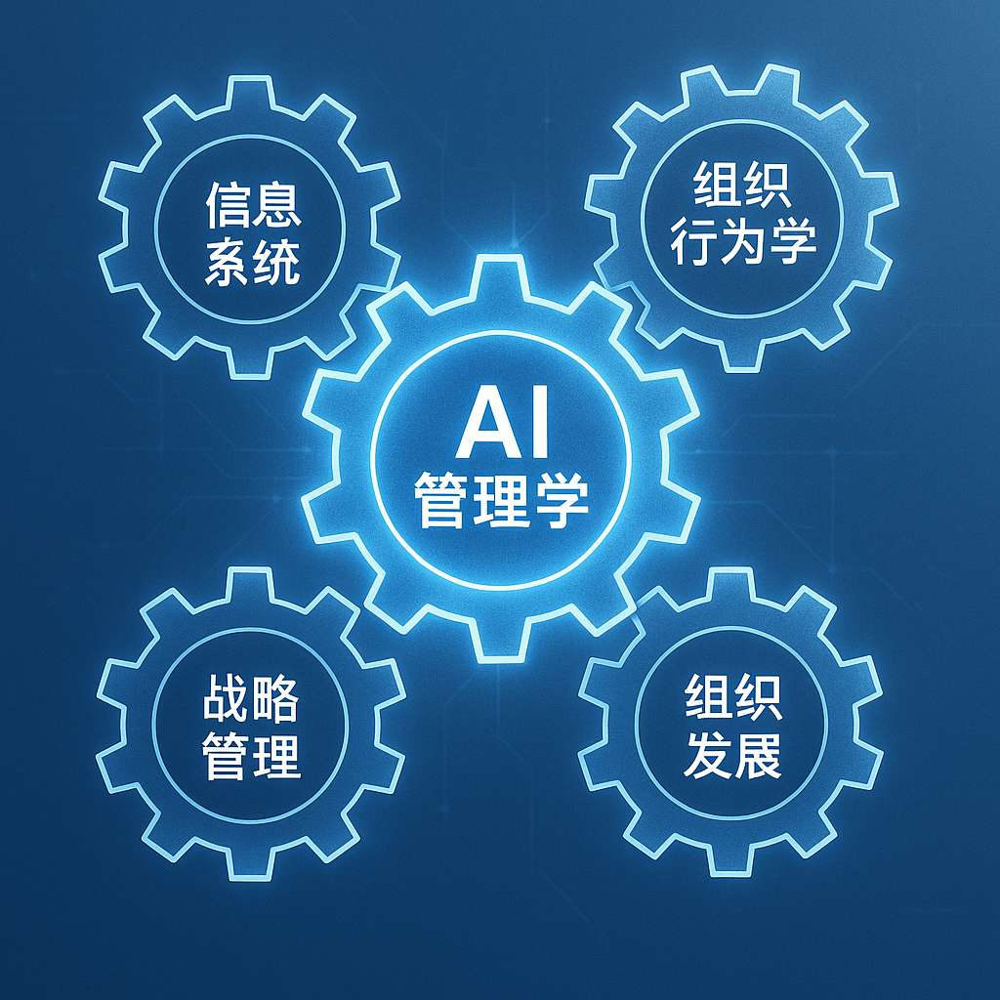
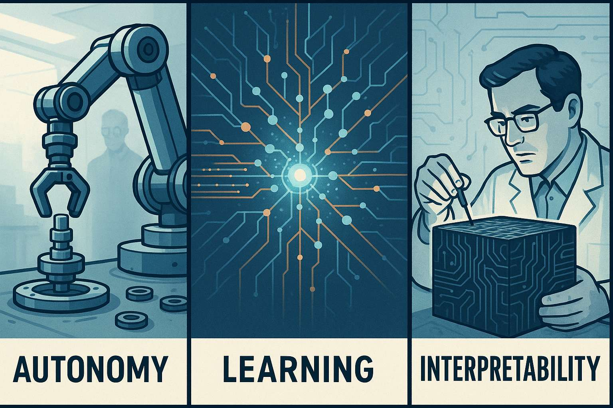
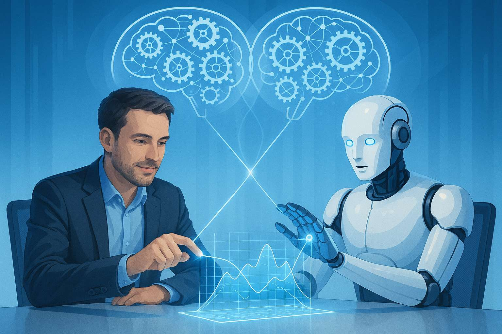
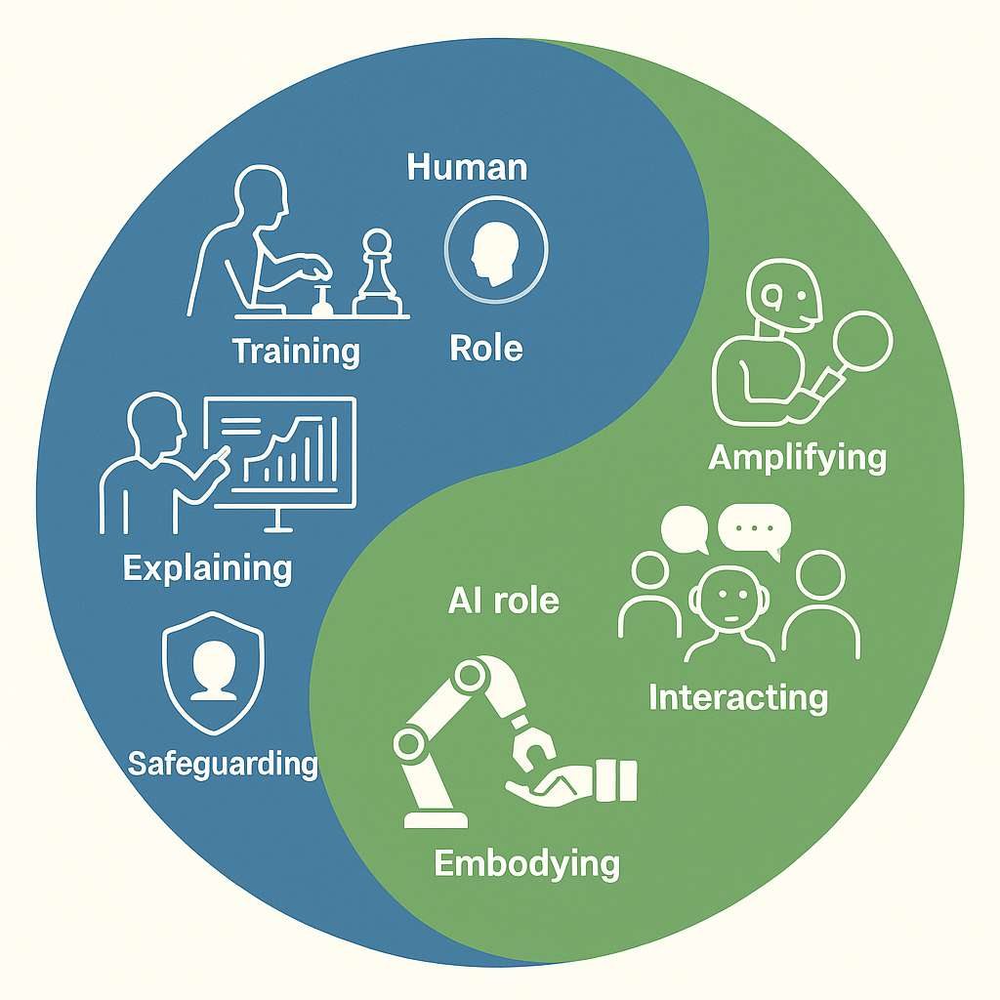
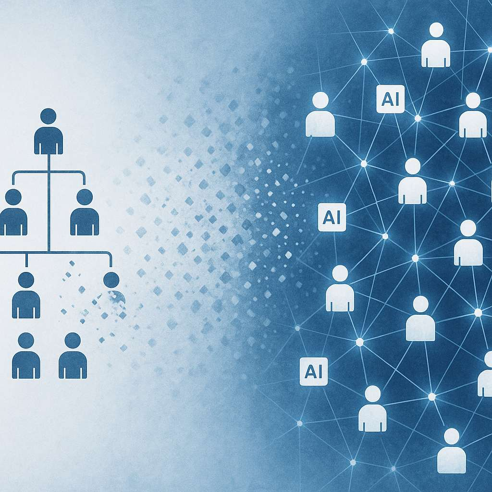

在人工智能（AI）日益成为组织中不可或缺的“数字同事”的时代，“AI管理学”作为一个新兴的管理学科应运而生。它并非凭空出现的理论孤岛，而是深深植根于多个交叉学科领域的智慧结晶。为了系统性地构建这门新学科，理解其思想源头和理论基础至关重要。

本文将聚焦于构成AI管理学理论支柱的四大先驱概念与框架，深入剖析它们如何为管理由人类与AI智能体组成的混合劳动力提供理论基石。

## **信息系统视角：“AI的管理”（Managing AI）**

信息系统（Information Systems, IS）领域的学者率先对AI带来的管理挑战进行了系统性探索。他们将AI视为一种独特的IT产物，其管理方式与传统的软件或硬件截然不同。一篇在信息系统领域顶级期刊《MIS Quarterly》上发表的奠基性文章，为“AI的管理”提供了一个影响深远的技术-管理框架，指明管理者必须在三个相互关联且不断演进的核心特性上做出决策和寻求平衡。

1.  **自主性 (Autonomy)** ：指的是**AI系统在无人干预的情况下独立执行任务并作出决策的能力**。 当代AI日益增强的自主性是其区别于传统IT系统的最显著特征之一。管理AI的自主性，本质上是在效率与风险之间进行一场动态的权衡。高效的AI智能体可以7x24小时不间断工作，处理海量信息，但其自主决策也可能带来意想不到的错误和后果。因此，**管理者需要设计精密的监督机制，明确界定人类在工作流程中的角色。**这通常涉及三个层次的决策：
    *   **“人在环路中”（Human-in-the-Loop）**：人类直接参与到AI决策的每一个关键环节，进行审核和批准，适用于高风险、高价值的决策场景。
    *   **“人在环路上”（Human-on-the-Loop）**：人类扮演监督者的角色，对AI的整体运行进行监控，并在出现异常或特定预警时进行干预。
    *   **“人在环路外”（Human-out-of-the-Loop）**：在充分信任和验证的基础上，授权AI在特定范围内完全自主地执行任务，人类仅对最终结果进行评估。

2.  **学习能力 (Learning)** ：指的是**AI系统基于新数据和经验反馈来持续优化自身行为、算法和知识结构的能力**。与安装后功能固定的传统软件不同，基于机器学习的AI系统是动态演化的。这种学习能力带来了巨大的潜能，但也引入了新的管理复杂性。管理者不仅要关注用于训练模型的数据质量和算法的健壮性，更核心的挑战在于管理“学习的反思性”（reflexivity of learning）。这意味着**组织必须建立一个持续的反馈循环，让人类专家的经验、业务结果的变化能够不断地被用来“指导”和“校准”AI的学习方向，同时，AI的“新发现”也需要被人类理解和吸收，从而形成人与AI共同进化的学习体系。**

3.  **不可解释性 (Inscrutability)** ：指的是AI，特别是深度学习模型的内部运作逻辑和决策过程对人类来说如同一个“黑箱”，难以完全理解。这种特性直接挑战了传统管理中对透明度和问責制的要求。如果一个AI模型做出了错误的信贷审批或医疗诊断，而我们却无法解释其原因，那么信任将无从谈起，责任也无法追究。因此，管理不可解释性成为建立人机信任的基石。管理者需要在一个连续统一体上推动AI从**不透明性（Opacity）**向**透明性（Transparency）**，再到**可解释性（Explainability）**，最终实现人类**可理解性（Interpretability）**的转变。 这需要与技术团队紧密合作，采用可解释AI（XAI）的技术和方法，确保AI的决策过程在必要时能够被审查、理解和信赖。

## **组织行为学视角：“人机组队”（Human-AI Teaming, HAIT）**

如果说“AI的管理”侧重于AI这一技术资产的内在属性，那么“人机组队”理论则将研究焦点从“物”转向了人与AI之间的“关系”。组织行为学（Organizational Behavior）的学者们借鉴研究人类团队的理论，将AI视为一个非人类的“队友”，探讨如何构建高效的人机协作关系。**HAIT被定义为一种以人为中心的方法，旨在让具备不同能力的人类和AI智能体能够协同工作，以达成共同的目标。**

1.  **信任 (Trust)** ：信任是任何高效团队的基石，在人机团队中尤其如此。 研究表明，人对AI的信任是一个需要持续动态校准的脆弱过程。**“过度信任”** 会导致人类员工盲目依赖AI，放弃批判性思考，从而在AI犯错时造成严重后果；而**“信任不足”** 则会使员工抵制或忽视AI的有效建议，无法发挥其应有的价值。 **信任校准**要求管理者和系统设计者通过多种方式，如提升AI的可靠性和可解释性，来帮助人类成员建立对AI能力的准确预期。 此外，研究还发现，AI队友的不道德行为会严重损害人类成员的信任，这为AI的伦理治理敲响了警钟。

2.  **共享心智模型 (Shared Mental Models)** ：这是**指团队成员（包括人类和AI）对于任务目标、环境状况、彼此的角色、能力以及行为意图拥有共同的、准确的理解。** 在人类团队中，共享心智模型通过持续的沟通和共同经验自然形成。但在人机团队中，构建这种共享认知极具挑战。一个理想的AI队友必须超越简单地执行指令，它需要能够清晰地向人类传达自己的“意图”（例如，“我正在分析这份数据以寻找潜在的市场风险”），解释其决策的依据，并理解人类队友的目标和当前状态。只有这样，人与AI才能实现无缝协作，而不是频繁地发生误解和冲突。

3.  **沟通与协调 (Communication & Coordination)** ：有效的团队协作远不止是单向的“命令-响应”模式。它要求建立全新的交互协议和沟通界面，以支持更加动态、自适应和双向的沟通。这意味着**AI需要具备主动发起沟通的能力**，例如，在发现异常数据时主动提醒人类同事，或者在预测到工作流程可能出现瓶颈时提前发出预警。管理者需要推动开发能够促进自然语言交流、实现信息同步共享的协作平台，让AI真正成为团队对话的一部分。

## **战略视角：“协作智能”（Collaborative Intelligence）**

由埃森哲的Paul Daugherty和H. James Wilson在其影响广泛的著作《人机共生》（Human + Machine）和哈佛商业评论文章中提出的“协作智能”框架，为企业如何从战略层面思考和设计人机协作提供了清晰的蓝图。 该框架的核心思想是，**AI的真正价值不在于替代人类，而在于增强人类的能力，形成一种共生互补的关系。**

1.  **人类辅助机器 (Humans Assisting Machines)** ：在此模式中，人类的价值体现在那些机器无法独立完成，但对其成功至关重要的任务上。主要包括三个角色：
    *   **训练者 (Trainers)** ：负责“教导”AI系统如何执行任务。这不仅包括为AI提供高质量的标注数据，还涉及通过强化学习等方式对AI的行为进行反馈和纠正，帮助AI更好地理解复杂和模糊的真实世界情境。
    *   **解释者 (Explainers)** ：负责弥合AI的“黑箱”与业务决策者之间的鸿沟。他们需要向非技术背景的管理者、客户或监管机构清晰地解释AI模型的决策逻辑和输出结果，确保其透明度和合规性。
    *   **维护者 (Sustainers)** ：负责确保AI系统以负责任、安全和符合伦理的方式运行。他们监控AI的行为，防止其产生偏见或有害输出，并在AI系统出现问题时及时干预，确保其行为始终与组织价值观和伦理边界保持一致。

2.  **机器辅助人类 (Machines Assisting Humans)** ：在此模式中，AI的核心价值在于放大和扩展人类的能力，使人类能够超越自身的局限。AI主要通过三种方式实现这一点：
    *   **放大 (Amplifying)** ：AI能够处理和分析人类无法企及的海量数据，从中发现洞察和模式，从而极大地增强人类的认知和分析能力。
    *   **交互 (Interacting)** ：AI能够以极高的规模和效率与客户及员工进行自然语言交互，例如智能客服机器人和内部知识库问答系统，从而将人类从重复性沟通中解放出来。
    *   **实体化 (Embodying)** ：通过机器人技术，AI扩展了人类的物理能力。例如，在制造业中，“协作机器人”（cobots）可以在保证安全的前提下与人类并肩工作，承担高精度或高强度的物理任务。

## **组织发展视角：人机系统的变革管理**

组织发展（Organizational Development, OD）作为一个致力于提升组织效能和促进组织健康的领域，其核心是管理变革、优化流程和 fostering 协作文化。尽管OD理论诞生于纯人类组织的环境，但它为AI管理学提供了不可或缺的文化和变革管理基础。

*   **关联性（OD作为基础）**：OD的核心原则——如员工参与、系统性思维和持续学习——为组织成功引入AI队友铺平了道路。 **一个具备强大组织发展能力、擅长引导员工适应变革、并拥有开放协作文化的企业，在整合AI进入工作流程时会遇到更少的阻力。** OD的工具和方法论为应对AI带来的组织结构、工作角色和权力动态的深刻转变提供了理论指导。

*   **根本区别（新的管理对象）**：OD与AI管理学的关键区别在于其核心管理对象发生了根本性变化。OD的理论与实践是为**纯人类系统**设计的，旨在优化人与人之间的互动和协作。 而AI管理学面对的是一个全新的**人机混合系统**。 这个系统中包含了一个非人类、但具备学习能力和自主行动能力的智能体成员，**它的行为模式、学习曲线以及对团队动态的独特影响，完全超出了传统OD的范畴**。例如，OD专家擅长处理人际冲突和沟通障碍，而AI管理者则需要为AI的算法偏见建立审核机制，为AI的决策错误设计问责框架，并为人机之间的信任破裂制定修复方案。

因此，**AI管理学可以被看作是组织发展理论在人工智能时代的一种必然演进和专业化分支**。它继承了OD关于文化建设、流程优化和变革管理的宏观智慧，并在此之上，针对人机混合团队这一前所未有的组织形态，构建了一套专门化的、更为具体的新管理原则和实践工具。

## **综合观点：四大支柱的融合**

这四个先驱概念并非相互排斥的独立理论，而是共同构成了AI管理学这门统一学科的四个互补层次，缺一不可。

*   **组织发展**为变革提供了宏观的**文化和流程基础**，确保组织能够平稳地接纳AI这一新成员。
*   **“AI的管理”**框架从技术治理层面界定了**“需要管理什么”**（自主性、学习、不可解释性），构成了学科的**治理基石**。
*   **人机组队（HAIT）**理论从组织行为学角度描绘了人机交互**“应该如何有效运作”**（信任、共享心智模型），构成了学科的**关系与操作核心**。
*   **协作智能**框架则从战略应用层面解释了这种协作**“为何具有战略价值”**，并提供了**“谁做什么”**的清晰蓝图，构成了学科的**战略应用指引**。

一个全面而有效的“AI管理学”框架，必须将这四者有机地整合在一起。一个管理者如果无法有效治理AI的不可解释性，就不可能在团队中培养出真正的信任；如果不懂得人机组队中的信任校准和沟通原则，就无法成功实施协作智能的战略蓝图；而如果缺乏组织发展的变革管理视角，任何自上而下的技术引入都可能因触动组织文化和员工习惯而遭遇巨大阻力。对这些先驱概念的深度理解与综合运用，正是构建和实践AI管理学的核心所在。

