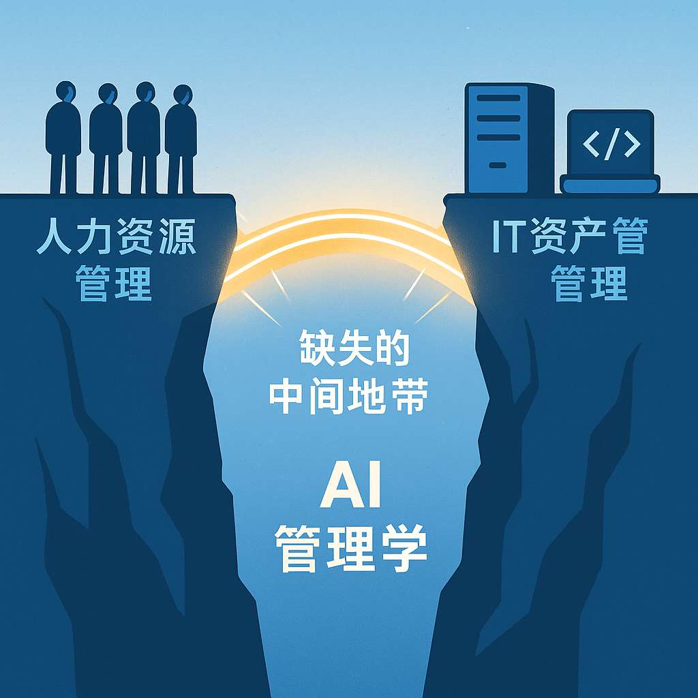
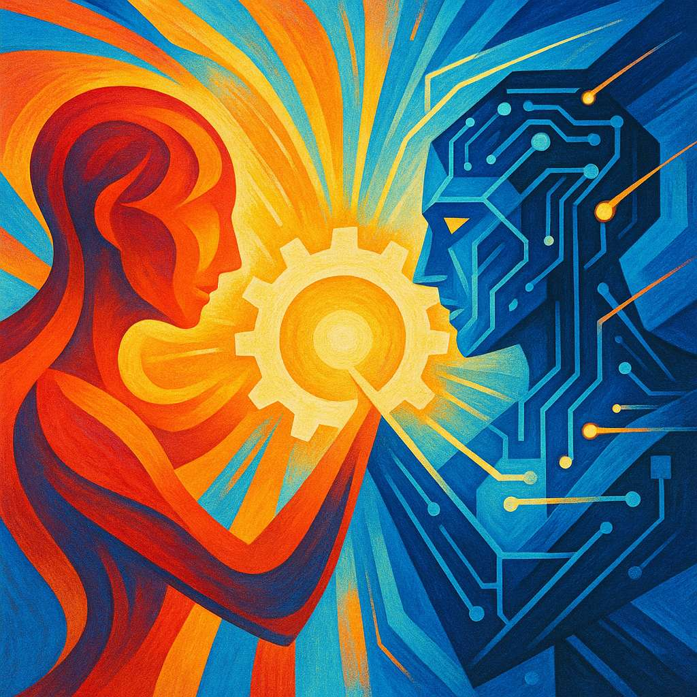
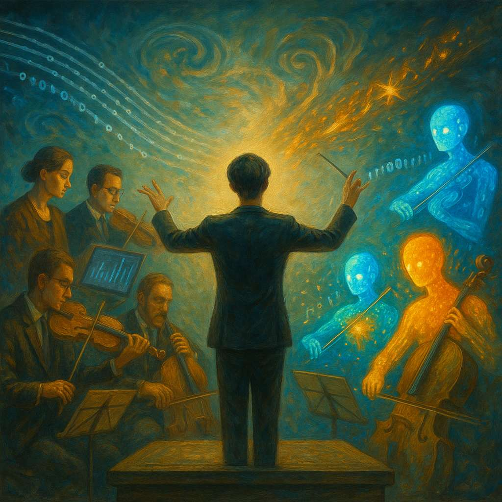
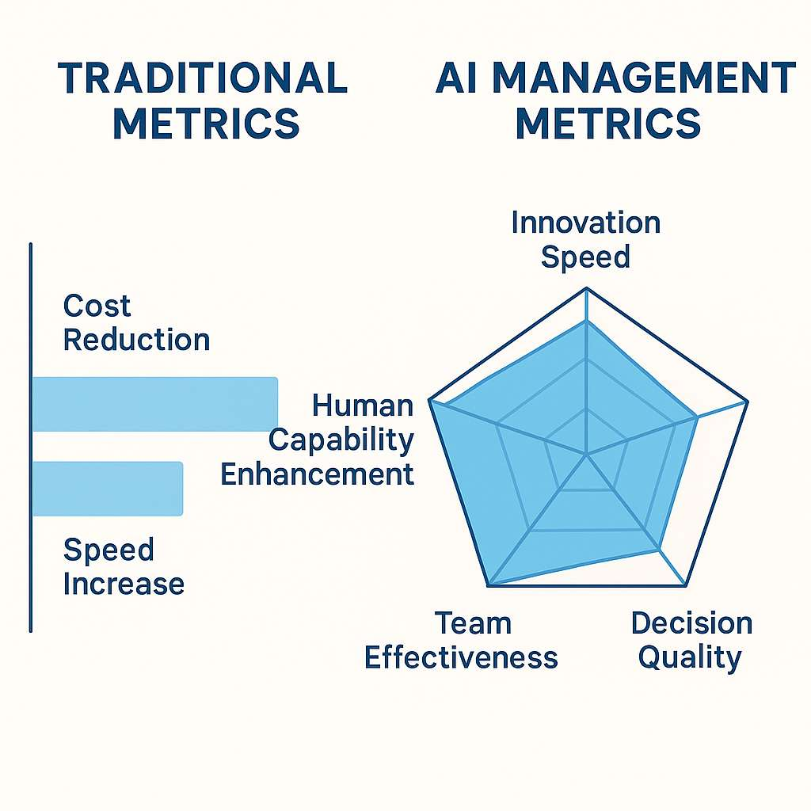

一场深刻而无声的革命正在重塑我们的工作场所。这场变革的核心，并非源于新的生产流程或全球市场转移，而是源于我们团队中新成员的出现——人工智能（AI）。长期以来，我们将AI视为一种强大的工具，一种可以自动执行重复性任务、提高效率的软件。

但今天，工作本身的性质正在经历一场根本性的演变。人工智能已不再仅仅是听从指令的被动执行者，它正在崛起成为一个能够主动协作、甚至自主行动的“数字同事”。

这一转变，尤其以“智能体AI”（Agentic AI）的兴起为标志，正以惊人的速度冲击着传统的管理模式。

**智能体AI是指那些能够理解高阶目标，并自主规划、采取行动以实现这些目标的系统。**它们不再仅仅是被动地“增强”人类的能力，而是作为积极的参与者“加入”人类的团队。它们可以独立分析市场数据、与客户互动、编写代码，甚至与其他AI协调完成复杂的多步骤任务。

当一个团队成员不再是人类，而是一个具备高度自主性的数字实体时，我们沿用了一个世纪的管理理论和实践便开始显得捉襟见肘。

这种前所未有的局面揭示了一个关键的管理真空。传统的**人力资源管理（HRM）**，其理论根基深植于人类心理学、动机理论和社会动态，它擅长处理员工敬业度、职业发展和人际冲突，**但其理论框架无法直接应用于一个没有情感、不受薪酬激励的AI队友**。你无法通过一次推心置腹的谈话来“激励”一个算法，也无法用团队建设活动来解决它与人类同事的“冲突”。

与此同时，传统的**技术管理或IT治理**也同样无能为力。IT部门习惯于将技术视为需要维护、保护和优化其性能的资产。他们关注的是系统的正常运行时间、数据安全和投资回报率。然而，**这种视角完全忽略了AI作为团队成员时所引发的社会性与协作性挑战。**当一个AI的决策影响了团队的士气，或者其行为的不可预测性破坏了团队内部的信任时，这便不再是一个单纯的技术问题。

于是，我们在人力资源管理的“人本”视角与IT管理的“物本”视角之间，发现了一个巨大的**“缺失的中间地带”（missing middle）** 。在这个地带中，一个全新的组织单元——人机混合团队——正在蓬勃发展，却缺乏一套专门为之设计的管理原则与实践。

Paul R. Daugherty和H. James Wilson在其著作《人机协作》（Human + Machine）中深刻地探讨了这一概念，指出真正的价值创造发生在人类与机器协同工作的空间里。

为了填补这一关键空白，我们迫切需要一门全新的管理学科。本文正式提出**“AI管理学”（AI Management）**这一概念，并将其定义为：**一套战略性原则与实践框架，旨在对由人类与AI智能体组成的混合团队进行统筹、发展与治理，以实现协同增效的绩效。**

AI管理学并非对现有管理理论的简单延伸，而是一次范式的重构。**它承认AI不再仅仅是提高生产力的工具，而是需要被理解、被整合、被引导的团队核心成员。它要求管理者超越传统的监督者角色，成为一个能够协调人类智慧与机器智能的统筹者（Orchestrator）**。

为了更清晰地界定这门新兴学科的独特性和必要性，下表将其与相邻的管理概念进行了系统性对比。这张表格不仅是对概念的区分，更是对未来管理模式的一次全面展望，为我们深入探讨AI管理学的核心内涵提供了一个坚实的概念锚点。

| 特征 | 传统人力资源管理 | AI技术资产管理 | AI管理学 (作为一门学科) |
| :--- | :--- | :--- | :--- |
| **核心焦点** | 员工激励、职业发展、人际动态、任务监督 | 系统性能、数据治理、投资回报率、技术风险缓解 | **团队协同绩效、混合工作流优化、协作智能** |
| **管理对象** | 人类员工 | 软件、算法、数据管道、基础设施 | **作为单一、相互依存生产单元的人机团队** |
| **关键活动** | 教练辅导、绩效评估、任务委派、冲突解决 | 模型训练、系统部署、性能监控、安全维护 | **战略性任务编排、信任校准、AI辅导、伦理监督、工作流重塑** |
| **领导风格** | 监督者、导师、教练 | 治理者、资产管理者 | **统筹者、系统思想家、伦理学家** |
| **成功指标** | 员工满意度、留任率、个人生产力 | 系统正常运行时间、准确率、处理速度、成本削减 | **团队效能、创新速度、决策质量、人类能力增强** |

#### **焦点的转移：从个体到协同**

传统人力资源管理的核心是对人的管理，其成功与否往往通过员工满意度、留任率等个体化指标来衡量。而IT管理则聚焦于技术资产的效率，追求更快的处理速度和更低的运营成本。 

AI管理学则将焦点从孤立的个体（无论是人还是机器）转移到了**协同过程**本身。它的核心目标是实现“协作智能”，即人与AI结合各自的优势，创造出任何一方都无法单独实现的价值。 **因此，其成功的衡量标准也演变为团队的整体效能、决策质量的提升以及创新的速度。**

#### **管理对象的重塑：从分离到融合**

过去，管理者清晰地知道他们的管理对象要么是“人”，要么是“物”。但在AI管理学中，管理对象变成了一个全新的、不可分割的实体：**人机混合团队**。在这个团队中，人与AI是相互依存的生产单元。AI的表现会直接影响人类同事的信任度和工作效率；反之，人类的反馈和引导又是AI学习和进化的关键。 管理者必须超越二元对立的思维，将整个混合团队视为一个需要整体优化的动态系统。

#### **核心活动的演进：从监督到设计**

随着管理对象和焦点的变化，管理者的核心活动也发生了根本性的转变。传统的任务委派和绩效评估变得不再适用。取而代之的是一系列全新的管理职能。**战略性任务编排**要求管理者深刻理解人与AI的互补优势，设计出能最大化协同效应的工作流程。 **信任校准**成为一项持续性的关键任务，管理者需要在防止人类对AI的“过度信任”（导致技能退化和疏忽）与“信任不足”（导致技术采用失败）之间找到精妙的平衡。 此外，“**AI辅导**”——通过结构化的反馈来提升AI队友的能力——和对AI行为的**伦理监督**，都成为了管理者的核心职责。

#### **领导风格的升华：从管理者到系统思想家**

这场变革对领导力提出了前所未有的新要求。仅仅作为监督者、导师或资产管理者是远远不够的。未来的管理者必须进化为具备多重角色的领导者。作为**统筹者**，他们需要像乐队指挥一样，协调团队中不同“乐器”（人类的创造力与AI的计算力）的和谐共鸣。 作为**系统思想家**，他们必须理解人机协作这一复杂系统中的各种动态反馈循环和潜在的非线性影响。 更重要的是，他们必须成为团队的**伦理学家**，为AI的应用设定明确的道德边界，并对最终结果承担责任，确保技术始终服务于人类的共同利益。

#### **成功指标的再定义：从效率到增益**

最后，衡量成功的标尺也必须重新校准。AI管理学的最终目标不是简单地用机器替代人力以削减成本，尽管这可能是短期效益之一。其更宏大、更具战略意义的目标在于**增强人类的能力**。 因此，成功的指标不再仅仅是系统的运行时间和处理速度，而是团队整体的创新能力是否得到提升，决策质量是否因为AI的洞察而更加卓越，以及最关键的——人类员工的潜力是否因为与AI的协作而得到前所未有的释放。 评估人机混合团队的生产力需要全新的框架，它必须能够量化这种协同作用带来的价值。

总之，我们正站在一个新管理时代的黎明。数字同事的崛起不仅是一次技术浪潮，更是一场深刻的管理范式革命。忽视这一转变，继续沿用旧地图，将无法在未来的商业世界中找到正确的航向。创立并发展“AI管理学”，为管理者提供驾驭这场变革的新理论、新工具和新思维，是我们这个时代赋予所有组织和领导者的紧迫任务。**未来的成功，将不属于单纯拥抱AI技术的公司，而属于那些率先掌握了如何与AI“共事”的艺术与科学的组织。**

