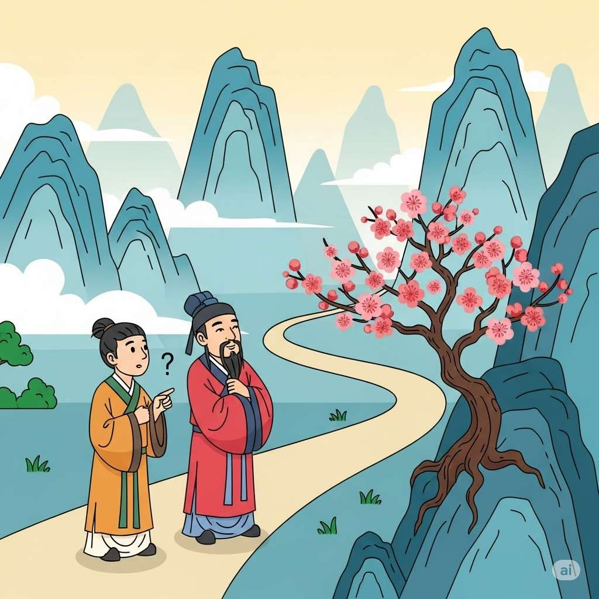
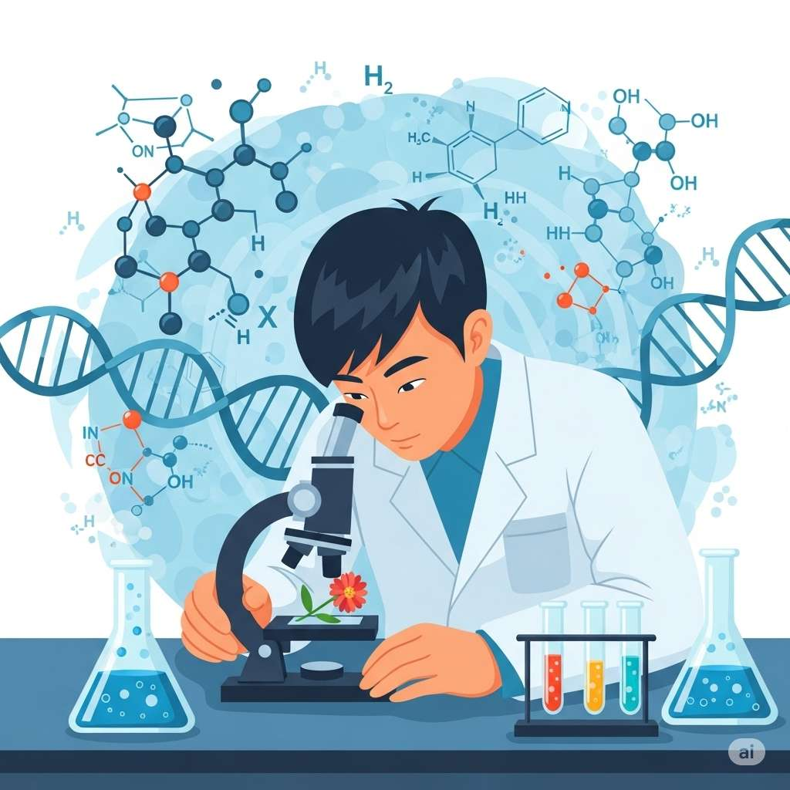
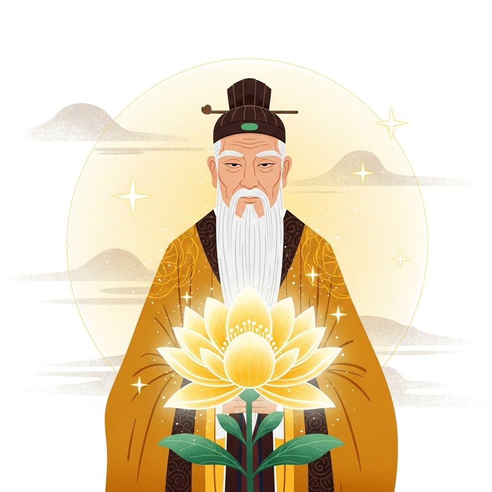

在中国思想史上，有一个极其迷人的哲学场景。

明代大儒王阳明，学说核心是“心外无物”。一天，他和一位朋友同游南镇。朋友指着岩石间的一棵花树，抛出了一个千古之问，一个直击灵魂的质问：

**“天下无心外之物，如此花树，在深山中自开自落，于我心有何相干？”**

这个问题问得实在太好了。它像一把尖刀，精准地刺向了唯心论的软肋，也构成了我们每个人对世界最朴素、最坚定的认知。这个场景，正是我们理解哲学三大阵营的最佳起点。

## **第一阵营：朋友的立场——坚实可靠的“唯物主义”**

我们先完全站在王阳明这位朋友的立场上。他的观点，其实就是**“唯物主义”**的朴素宣言。

在他看来，这棵花树的存在是绝对客观的。无论有没有人来看它，无论王阳明的心在想什么，它都遵循着自然的法则：春天发芽，夏天开花，秋天凋零。它的生长依赖的是阳光、水分和土壤，是生物化学反应，是一系列不以任何人的意志为转移的物质规律。

这套逻辑，是现代科学的基石，也是我们安全感的来源。我们相信，脚下的大地是坚实的，迎面开来的汽车是物质的，我们必须躲避。我们生病了，会去找医生治疗我们这个物质的身体，而不是靠凭空想象让自己痊愈。唯物主义者会说，世界的基础就是这些客观的物质，而我们的意识、精神、思想，不过是大脑这个高度复杂的物质器官活动的产物。意识是物质的“镜像”，是物质世界在我们头脑中的反映。

**这种思想的优点是：**
* **坚实可靠**：它给了我们一个稳定、可预测的世界。
* **符合直觉**：它和我们的日常经验高度一致。
* **催生科学**：正因为相信世界是客观的、有规律可循的，人类才发展出了物理、化学、生物等一系列探索客观世界的科学。

**但它的局限性也在此处：**
它似乎把世界看得太“冷冰冰”了。在这套话语里，那棵花只是“一堆有机物分子的集合”，它的美丽、它所引发的诗意、它在一个文化中的象征意义，都显得不那么重要了，仅仅被视为次要的“主观感受”。人，也更像一个被动的观察者，一台精密的录像机，只能记录，却无法赋予世界更深的意义。

## **第二阵营：王阳明的回答——意义由心而生的“唯心主义”**

面对朋友尖锐的提问，王阳明是如何回答的呢？他的回答充满了禅意和哲理：

**“你未看此花时，此花与汝心同归于寂。你来看此花时，则此花颜色一时明白起来。便知此花不在汝心之外。”**

初读此言，很多人会觉得这是“诡辩”。难道我不看花，花就消失了吗？这岂不是太荒谬了？如果我们将此理解为最极端的唯心主义，即世界完全由我的意识所创造，那确实站不住脚。

但我们必须深入理解王阳明的“心学”语境。他说的“寂”，并非指物理上的“消失”，而是指“寂静、沉默、未被照亮、无意义”。他说的“明白起来”，也非指花突然有了颜色，而是指它的颜色、形态、美感，乃至它作为一朵“花”的身份，**被你的心“照亮”和“赋予”了意义**。

在王阳明看来：
* 当你没看到它时，那山中的一切对你而言，是一片混沌的、未分化的、沉默的存在。你心中没有“花”的概念，那棵植物也无法在你意识里成为一朵“花”。它与你的心，都处于一种未被激发的“寂”然状态。
* 而当你把目光投向它，“看”这个行为发生时，你的心——你的意识、你的全部感官和过往经验——立刻开始工作。你辨认出它的颜色，欣赏它的形态，将它从周围的岩石和杂草中独立出来，命名它为“花”。在这一瞬间，花的“意义”诞生了，它的美“明白”起来了。

所以，王阳明并非否认花树的物理存在，而是强调，**一个事物之所以能成为我们意识中那个有特定意义、形态和价值的“物”，离不开心灵的参与和构建**。是“心”的梳理，让混沌的“存在”变成了有序的“世界”。

这种思想的深刻之处在于，它把人的主体性、精神价值和意义创造放在了核心位置。但其风险在于，如果把握不好，就容易滑向否定客观世界的虚无主义。

## **第三条路：马克思的登场——实践，让花朵真正“盛开”**

现在，让我们想象一下，如果马克思也来到了这片山坡上，他会怎么说？

他会先对王阳明的朋友点点头：“是的，这棵花树的物理存在是前提，没有这个物质基础，一切都无从谈起。”
然后，他会转向王阳明，同样表示赞同：“是的，如果沒有人的意识参与，这棵花的美和意义也无从谈起。”

但他会接着说：“但是，你们二位都忽略了最根本的一环，那就是**人与这棵花的具体、感性的互动——也就是‘实践’**。”

马克思的**“实践的唯物主义”**，提供了一条超越上述二元对立的道路。他认为，我们与世界的关系，既不是纯粹的物质反映，也不是纯粹的心灵构建，而是在**劳动和实践**中形成的。

让我们回到这棵花上，看看在“实践”的视角下会发生什么：

1.  **对于一位采药的郎中**：他来到山里，目的不是观赏，而是寻找药材。当他看到这棵花时，他的“实践”活动开始了。他会根据自己的医药知识去辨认：“哦，这是金银花，可以清热解毒。” 于是，他动手采摘、晾晒、炮制。在这个过程中，这棵花对他而言，其最真实的身份不是“审美对象”，而是**“药材”**，是一种具有特定使用价值的**“生产资料”**。它的客观存在，通过郎中的实践，转化成了社会性的、有价值的现实。

2.  **对于一位热恋中的青年**：他为了给心上人一个惊喜，专程来到山里寻找最美的花。当他看到这棵花时，他的“实践”是“赋予情感和象征意义”。他小心翼翼地将它摘下，并想象着爱人收到它时的喜悦。在这个过程中，这棵花成了**“爱情的象征”**。它的物理属性（颜色、香味）通过人的情感实践，被注入了全新的文化内涵。

3.  **对于一位植物学家**：他带着精密的仪器来到这里，是为了完成一篇关于高山植物生态的论文。他看到花后，会测量其尺寸、记录其伴生植物、采集土壤样本。在这个科学实践中，这棵花成为了**“研究标本”**，是一个被纳入知识体系的**“数据点”**。

看到了吗？马克思认为，山中的花“自开自落”，这只是它的自然史。但只有当人带着不同的目的，通过不同的实践活动（劳动、科研、艺术创作、情感表达等）去和它互动时，这棵花才真正地为人类“盛开”，展现出它丰富多样的社会现实意义。

它既是客观的物质（唯物主义的基础），又是被人的意识和活动所定义和塑造的（吸收了唯心主义对人的能动性的强调）。**“实践”，就是连接物质世界和人类意识的桥梁。**

## **结论：从“心外无物”到“实践成物”**

* **朋友的观点（唯物主义）**：世界是客观的物质，我们是被动的观察者。
* **王阳明的观点（唯心主义）**：世界由我心赋予意义，我们是意义的创造者。
* **马克思的观点（实践唯物主义）**：我们通过劳动和实践与客观物质世界互动，在改造世界的过程中，共同创造了我们身处的这个丰富多彩的现实世界。我们既是观察者，更是建设者。

因此，深山里的花，从物理上说，它不为谁而开；但从人类的现实意义上说，**它为每一个与之实践的人而开**。你以何种方式与世界互动，世界就以何种方式为你呈现。这或许就是马克思那句“哲学家们只是用不同的方式解释世界，而问题在于改变世界”的真正底气所在——因为在他看来，解释世界的最好方式，就是亲身去改变它、塑造它。

