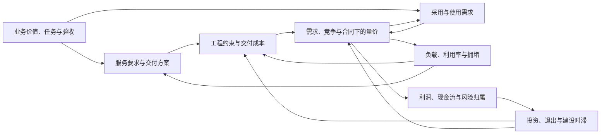
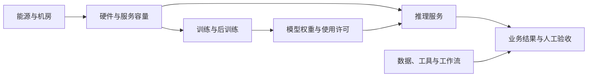

# 从瓦特、卡时到词元：LLM 算力与 Token 经济学的统一分析框架

> **定位**：研究异质、交付容量不可跨期储存、技术快速迭代的 AI 服务，如何形成需求、价格、分工与投资，以及合同和制度怎样分配收益与风险。这是一套可检验的条件分析框架，不是行业终局预测。

## 阅读定位：一个共同问题，三条研究分支

共同问题是：**在业务价值、质量和履约约束下，什么服务值得生产和购买，如何组织交易，谁承担风险，又如何影响下一期供给？**

| 研究分支 | 主问题 | 主要篇目 | 与其他分支的接口 |
|---|---|---|---|
| 生产与产业组织 | 怎样交付，量价与利润如何形成，何时进入或退出？ | 01 工程与产业通识；03 产业组织与投资 | 任务需求、服务规格、合同及收益可占有性 |
| 交易与服务治理 | 怎样比较、验收、采购、授权和支付？ | 02 专著；05 有效成本与计量合同 | 质量调整后的成本、履约责任和客户增量收益 |
| 基准与风险分配 | 什么风险需要什么工具，基准如何验证？ | 04 市场与治理；03 期限结构；05 基准方法 | 实际敞口、替代合同、样本代表性和使用效果 |

采购、支付、积分、指数和衍生品是按需选择的制度工具，不是上述分支共同奔向的终点。对具体方案，先问：不用新凭证、新指数或交易平台，仅靠现有法币结算和商业合同能否解决问题？

全文围绕四条正面命题展开：

1. **知识资产的低复制成本与服务交付的资源约束并存**，研发与交付因此需要分账分析。
2. **相同硬件不等于相同经济产品**，可比性和竞争边界取决于任务、质量、地点、期限与合同。
3. **需求组织影响交付成本**；技术降本通过竞争与合同进入价格、质量和利润，不存在统一传导比例。
4. **建设、技术替代、需求采用与融资期限可能错配**；合同可以转移或分担风险，但不会自动消灭风险。

图中是待分析的作用关系，不是已估计的因果效应。“不可跨期储存”针对已经流逝的交付容量，不等于硬件、权重、数据及服务结果都不能储存。

## 1. 先区分五种对象，而不是把它们当成同一种商品

AI 服务同时涉及资本、能源、知识产权和服务质量。传统软件经济学也并非一概假设交付零成本，服务商品也并非都能入库存储；没有必要先否定既有理论，才能研究这些对象的组合。

| 层级 | 对象与单位 | 主要约束 | 核算时最容易混淆的概念 |
|---|---|---|---|
| 能源与机房 | 功率 kW/MW；电量 kWh；PUE | 接电、配电、散热、地点 | 功率不是电量；发电/储能并网队列不是数据中心负荷队列 |
| 硬件与服务容量 | 指定配置的 GPU-hour、节点月 | 显存、互联、软件、可用性 | 裸卡不等于服务器；计费利用率不等于物理负载率 |
| 模型与知识资产 | 权重、代码、数据及许可证 | 训练、研发、维护、使用权限 | 权重可下载不等于无条件开源；复制成本低不等于研发或服务免费 |
| 推理服务 | 输入、输出、缓存、计费推理 Token | 任务长度、批处理、质量、延迟 | Token 是模型相关计量单位，不自动成为可转让资产或货币 |
| 业务结果 | 经约定标准验收的任务 | 正确率、人工复核、风险、工作流 | 名义 Token 价不等于一次合格任务的成本或经济价值 |

图示是投入关系，不表示“能量→信息→价值”的固定换算。热力学熵、信息熵和语义/商业价值不是同一个量，不能用熵增或熵减推导 Token 的经济价值。

### 1.1 电、卡时与 Token 为什么可能长期并存

它们分别描述能源投入、资源占用和模型服务用量，适合不同合同。三者能够在指定技术与负载下估算换算关系，但没有跨模型、跨地区恒定的换算率，也并非制度功能“严格正交”。

- 电费只是成本的一部分，其占比随设备价格、寿命、利用率和电价变化，不能固定写成 15%–25%。
- 资源租赁适合需要控制硬件和软件环境的客户；按 Token 计费适合购买模型服务。两者都可以包含预付、包量或 SLA。
- 同一任务在不同切词器、输出策略与工具流程下耗量不同；不能用统一“中文压缩率”换算所有模型。

## 2. 微观生产：物理上界、实测吞吐与服务成本分开

给定架构、负载和服务目标，有效产出可记为：

$$Q_{\mathrm{tok}}=f(K_{\mathrm{FLOPs}},B_{\mathrm{HBM}},M_{\mathrm{HBM}},B_{\mathrm{net}};\mathcal A,\mathcal S,\mathrm{SLA}).$$

这些变量必须使用相同系统边界。Roofline 对单个计算内核给出的是上界：

$$P_{\mathrm{achieved}}\le\min(K_{\mathrm{peak}},B_{\mathrm{HBM}}I).$$

峰值精度、稠密/稀疏口径、有效带宽、通信和调度损耗会影响实际结果。Prefill 在足够大批次时较容易受计算限制，低并发 Decode 较容易受访存限制；不能据此断言所有输入计算和输出计算永远分别受这两种限制。

### 2.1 从生产条件到交付选择

1. **成本非对称具有工程基础，但牌价倍率不是物理定理。** 输出/输入价比还受需求、竞争、补贴、配额和质量影响。用若干可调参数凑出 1:4，不构成对厂商定价的因果验证。
2. **缓存节省重算，但不是零成本。** 它占用内存、SSD、网络和管理资源。最优保留期取决于重访规律、失效条件和迁移成本，不能只由单 Token 字节数推导。
3. **PD 分离是候选架构，不保证普遍增益。** 收益必须扣除 KV 传输、池间失衡、额外节点及调度开销；小负载可能更适合混部。
4. **部署可行性不等于最小有效规模（MES）。** 装得下权重、达到指定吞吐、平均成本接近长期最低值，是三个不同检验。

厂商架构、吞吐和报价是带版本的观测，不是普遍生产参数。应记录配置、流量、计费结构和数据性质，再判断能否迁移到自己的任务。机制详见[推理微观生产函数](大模型推理的微观生产函数与架构经济学.md)；日期化技术资料与价格案例分别查[数据附录](算力与_token_经济：数据附录（2026-11-15—16_快照）.md)和[ch16](LLM-Token经济学专著/19-ch16._跨模型任务成本：完整账单、验收与迁移条件.md)，不在总纲重复维护快变数字。

### 2.2 成本通过什么机制进入价格

工程计算给出可行产出与成本，市场价格还需要需求、替代性和合同。先识别竞争情景，再讨论传导：

| 情景 | 降本可能怎样影响市场结果 | 验证时观察什么 |
|---|---|---|
| 容量宽松、同质量服务易替代 | 报价和成交价面临下降压力，也可能以配额、质量或服务改善形式让利 | 同规格实际成交价、折扣、进入退出与客户迁移 |
| 容量紧张、短期难扩张 | 稀缺性与买方支付意愿可能主导价格，降本未必立即传给买方 | 配额、排队、交付等待、可用容量与合同期限 |
| 服务差异化、切换成本较高 | 节约可能部分成为利润，或用于研发、可靠性和客户服务 | 任务质量、留存、完整切换成本与分项收益 |

上述是候选机制，不是已知传导系数。固定价长约可能延后重新议价；按量 API 的调价、额度和服务条款须具体读取；浮动合同按约定基准和重置周期传导。供应商成本下降、API 牌价下降与客户总任务成本下降，是三个需要分别测量的结果。

## 3. 企业采购：以可验收任务为共同分母

对观察期内提交的任务集合，定义：

$$C_{\mathrm{eff}}=\frac{\sum_{j=1}^{J}(C_{\mathrm{API},j}+C_{\mathrm{infra},j}+C_{\mathrm{human},j}+C_{\mathrm{tools},j}+C_{\mathrm{other},j})}{\sum_{j=1}^{J}\mathbf 1\{j\text{ 最终验收达标}\}}.$$

分子包含失败、重试和复核成本；基础设施费用与 API 费用避免重复记账。分母为零时该指标不定义。若把风险损失货币化，须披露估计方法和不确定性；不可量化的合规与安全红线单列，不能用廉价账单抵销。

当单价按“元/百万 Token”给出时，单次账单为各计费类别的 $N_kP_k/10^6$ 之和。推理 Token 已计入输出时不能再加一次。简单的 $c/q$ 只对应独立同分布、无限重试、每次成本恒定且成功可正确识别的近似，不适用于一般 Agent 工作流。

跨模型“汇率”宜称**同任务相对有效成本**：$R_{A/B}=C_{\mathrm{eff},A}/C_{\mathrm{eff},B}$。它不是可兑换汇率，也不提供无风险套利。若在质量相当、任务构成与单位运行成本稳定的前提下，预计交付 $N$ 个可比合格任务，应比较 $N(C_A-C_B)$ 与一次性迁移费及新增风险成本；这些费用若已摊入单位成本，就不再加一次。

参考：[采购指南](企业_AI_有效成本核算与算力_Token_采购指南.md)；[跨模型成本比较](LLM-Token经济学专著/19-ch16._跨模型任务成本：完整账单、验收与迁移条件.md)。

### 3.1 从成本比较到任务采用与使用强度

有效成本回答既定任务“交给谁更划算”，采用决策还要与不采用、人工处理或现有软件流程相比。先定义增量业务收益及观察期，再计入服务、集成、复核、迁移和风险成本；合规或安全红线作为准入条件，不用较低账单抵销。

- **采用边际**：新增收益或可实现的成本节约是否覆盖增量总成本？释放工时不自动等于节省同额现金，也可能转为增加产出或闲置时间。
- **使用边际**：已采用后，增加任务量、更长上下文或更多推理预算，是否带来足够的新增合格结果？平均收益为正不保证每一次增量调用都值得。
- **成本反馈**：更多可池化任务可能提高利用率、批处理与缓存复用；峰值集中或质量约束可能需要冗余，拥堵还会降低验收率。需求结构与数量共同影响成本。

检验采用应观察真实使用、验收、业务结果与付费留存，并记录价格和质量变化。仅有调用增长，不能区分新增价值、试用补贴、重复重试和无效流量。

## 4. 产业组织与投资：从收益可占有性到进入退出

### 4.1 研发投入、质量优势与收益可占有性

Sutton 内生沉没成本理论提供研究视角：市场扩大可能诱发质量投资升级，使集中度不随规模无限下降。但具体结论还要求质量优势能转为可占有收益、需求和竞争机制满足相应条件。训练损失扩展规律不能单独证明市场份额正下界，更不能证明“自然寡头”或某家闭源厂商必定退出。

### 4.2 开放许可、托管替代性与竞争边界

低部署门槛有利于进入；可靠性、许可、客户获取、缓存状态、融资、品牌和集成服务又可能形成差异化。需要比较同质量任务的长期平均成本、客户留存和进入退出数据，而不是用 8、128 或 144 张卡作为市场结构的充分证据。

开放与许可安排会改变研发收益的可占有性；运营能力、缓存状态和客户关系会改变托管服务的可替代性。两者共同进入投入与进入决策，而不是分别预定“研发寡头”和“托管完全竞争”。具体许可证的主体、用途、收入条件与版本需单独核对，日期化资料见[数据附录](算力与_token_经济：数据附录（2026-11-15—16_快照）.md)。

### 4.3 效率、采用与资源消耗的反馈

在单位资源价不变、效率提升完全传导为任务降价、质量不变且需求弹性为常数 $\varepsilon$ 的简化模型中，若效率为 $e$，则需求 $Q\propto e^{\varepsilon}$，资源消耗 $Q/e\propto e^{\varepsilon-1}$。只有 $\varepsilon>1$ 才产生该模型下的完全反弹以上增长。

现实中需求外移、质量提升、新应用与降价同时发生。观察到“价格跌、总量涨”不足以识别弹性或证明效率提升导致总能耗增加；碳排放还取决于电源结构。

### 4.4 约束、财务风险与投资反馈

芯片、并网、机房、网络和客户需求的建设周期不同，可能造成周期错配。原“五阶段”标签在本体系中用作可并存的约束与风险面板，不用于判定所有市场在同一时间轴的位置。毛利率、经营利润、自由现金流与经济租金分别衡量不同对象；单一毛利变化或违约事件不足以确认全行业约束转移。

解释动态变化至少需要连接：**预期回报→投资及订单→延迟上线→可用容量与利用率→价格和现金流→继续投资、推迟或退出**。容量递推说明存量如何变化，行为分析则要另列融资、不可撤销订单、合同保障、残值与退出成本。亏损可能触发退出，也可能因已沉没投资或合同义务而继续经营；较高当期利润也不等于扩容立即有利。

验证这一反馈，应将订单、建设进度、实际交付、利用率和现金流按相同主体及时间范围连接，再比较竞争解释。压力情景用于检查何种条件会使决策改变，不用来指定统一的崩盘年份。

参考：[产业组织专题](大模型层的内生沉没成本、开源溢出与定价机制.md)、[工厂隐喻](token_工厂：资源约束、需求组织与竞争条件.md)、[周期情景](token_工厂的约束与风险面板：供给、需求与投资反馈.md)。

### 4.5 理论分工：换模型时说明接口

| 分析工具 | 主体与目标 | 给定条件与主要解释量 | 时间与使用边界 |
|---|---|---|---|
| 生产与成本模型 | 交付者在质量约束下组织生产 | 架构、负载、资源价格；解释可行产出和成本 | 指定配置与观察期，不直接给出市场价格 |
| 产业组织 | 研发者、运营商与买方的投入和选择 | 可占有收益、许可、替代性和进入条件；解释竞争与利润 | 区分短期容量与长期投入均衡 |
| 政治经济学 | 所有者、劳动者、平台等的控制与分配关系 | 产权、合同、融资和风险承担；分析收益归属 | 解释视角仍需事实和竞争性机制检验 |
| Ramsey 等规范模型 | 给定约束下的福利配置 | 福利目标、需求与收支约束；分析规范性价格 | 不自动代表现实厂商的利润最大化行为 |
| 微观结构与金融模型 | 交易者、基准机构、风险承担者 | 信息、实际敞口、合约与治理；分析定价和风险分配 | 不从模型可行性推出客户需求或制度适用性 |

采购者节约、供应商利润、平台收入与社会福利分别报告。不同理论解释了同一现象，不等于获得了相互独立的证据；具体命题遵循“观察事实→候选机制→竞争解释→区分证据→条件性建议”。

## 5. 财务模型：平均成本、增量成本与现金流分开

在零残值、年末等额回收等假设下，可用资本回收系数把初始投资转为年金：

$$\mathrm{CRF}(r,N)=\frac{r(1+r)^N}{(1+r)^N-1},\qquad\mathrm{CRF}(0,N)=1/N.$$

由此计算的每售出卡时保本价，是**给定情景的平准化平均全成本**，不是长期边际成本 LRMC，也不是市场价格下限。模型回收期不是会计折旧年限。延长折旧可改变营业利润和账面价值，但不会直接提高剔除折旧的 EBITDA，更不会凭空增加现金。

- 短期增量成本包括实际新增电费、耗材等；停机是否省下闲置功率与固定合同费需要具体判断。
- 若已按 WACC 资本年金核算经济成本，不应再机械叠加同一资本的全部利息费用；债务现金流另表计算。
- DSCR 使用合同定义的 CFADS/到期本息。某年 DSCR 小于 1 不自动意味着违约，先前储备、股东补充与贷款条款都影响结果。
- 客户预付款对应未来履约义务；RPO、订单积压、营收、现金流和利润不等价。

所有示例电价、设备造价、利用率和利率应明示为假设，或附可追溯报价。见[财务模型与敏感性测算](智算中心全生命周期财务模型与敏感性测算手册.md)。

## 6. 风险与制度选择：先比较工具，再讨论金融化

### 6.1 从实际风险敞口选择方案

先区分买方担心的是价格上涨、容量拿不到、质量不足，还是供应商违约；卖方也可能面对销量不足、租价下跌和融资到期。风险不同，适配工具不同：

| 主要问题 | 候选安排 | 比较重点 |
|---|---|---|
| 价格波动 | 固定价或浮动长约、价格上限、适配的衍生品、不套保 | 价格、基差、费用、资金占用和合同弹性 |
| 容量、质量与履约 | 预留、验收、SLA、备用供应商、可获得的信用保障 | 实际可用性、责任边界、救济与保障成本 |
| 用量或技术不确定 | 短租、取消权、分批投入、可迁移架构、现金缓冲 | 灵活性的价格、锁定风险及可执行性 |

没有一种工具普遍优先。指数和衍生品须相对既有商业合同证明增量价值；完整选择矩阵见[市场全景](国际算力定价与衍生品市场全景.md)，实施方法见[价格基准指南](算力与_Token_价格基准构建与撮合演进指南：PRA_方法论与市场设计实践.md)。

### 6.2 不可储存服务的定价与套保

过去未使用的服务时间无法保存，因此常见库存型 cash-and-carry 复制不能直接套用；**无套利原则本身没有失效**。可约定未来特定时段提供容量，也可用指数现金结算。后者对冲价格，不保证获得所需硬件。

用真实概率写 $F_{t,T}=\mathbb E_t^{\mathbb P}[S_T]+RP_{t,T}$ 时，风险溢价 $RP$ 可以为正或负；这只是需要进一步建模的分解，不能直接当作可估计的三因子定律。技术进步不保证远期曲线向下，稀缺容量也不自动使所有现金结算期货升水。

跨代、地区和 SLA 不匹配会产生基差风险。简单线性最小方差套保比例为 $h^*=\operatorname{Cov}(X,Y)/\operatorname{Var}(Y)$，前提是明确实际风险敞口与合约损益单位；它不证明完全对冲。未来采购方通常用多头对冲涨价风险，未来供给方通常用空头对冲跌价风险。

### 6.3 基准验证与采用门槛

计量、价格评估、撮合和金融风险管理可以并行，亦可只采用其中一项。实际成交可以帮助形成基准，标准化也可能与交易共同演进；是否继续建设取决于客户用途和净收益，而不是“更高层级”的吸引力。

验证须分别回答：输入是否真实且具有代表性，指标能否改善客户决策，合同是否实际采用，以及收费能否覆盖持续治理成本。对指数未来值下注仅提供关于该序列的预测信息，不是对样本代表性的独立验证。影子套保、同任务账单对照和争议处理成本评估应在推广前完成，并允许结果不支持新方案。

基准需要区分可执行报价、已发生交易、持续租赁样本与模型估值，不能用刷新次数代替独立成交数量。来源封顶必须约束最终归一化权重；20% 封顶至少需要五个独立来源，仍不能防止三方串谋形成多数。缩尾、哈希存证和遥测均有边界，不能分别保证免操纵、数据真实或交易独立。

IOSCO 2013 年《金融基准原则》和 2012 年《石油价格报告机构原则》是不同文件。原则、本文的治理建议与当地强制法规应分开陈述。合约公告、参考数据、模拟结算、监管程序和实际挂牌成交也应分别记录，不能用一份旧公告证明当前交易状态。

参考：[期限结构](不可储存算力的期限结构与远期定价理论.md)、[抗操纵设计](算力基准抗操纵微观结构与_IOSCO_治理设计.md)、[市场核查报告](算力指数、衍生品与预测市场实证核查报告：Ornn、Silicon_Data_与_Polymarket.md)。

## 7. 全库证据规则、内容分工与阅读路径

### 7.1 证据分层

1. **定义与恒等式**：明示单位、观察期、分母及系统边界，可直接复算。
2. **模型结论**：列假设和适用范围；数值算例不是经验估计。
3. **一手披露**：记录发布主体、日期、版本和 URL；厂商披露不自动等于独立验证。
4. **二手研究与历史快照**：保留来源和原观察日期，不把旧截图写成今天的市场状态。
5. **预测与待核实项**：不作为已实现收入、已生效监管或采购必然收益的依据。

技术与产业事实集中查[03 数据附录](算力与_token_经济：数据附录（2026-11-15—16_快照）.md)，指数、合约和机构关系查[04 实证台账](算力指数、衍生品与预测市场实证核查报告：Ornn、Silicon_Data_与_Polymarket.md)，版本化账单案例查[ch16](LLM-Token经济学专著/19-ch16._跨模型任务成本：完整账单、验收与迁移条件.md)。原始网页与 `main` 分支会变化，正式采用时应保存日期化快照。理论篇短引事实并回链主记录，实践篇完整展开操作，审校史留在记录文件；引用同一来源不算多次独立验证。

### 7.2 推荐路径

- **研究与产业分析**：本总纲 → 01 生产与价格传导 → 03 产业组织 → 03 约束与投资反馈；日期化事实按需查询，明确每个模型的接口。
- **企业采购与架构**：05 有效成本指南 → 02 第 16 章 → 01 推理微观生产函数 → 05 计量与合同草案。
- **基础设施投资**：05 财务模型 → 03 周期情景与期限结构 → 04 市场证据；分别检查经济回报、现金流与信用风险。
- **产品与交易制度**：02 概念与核心成本方法 → 客户场景及可组合方案 → 评价标准与试验 → 有条件推荐；完整顺序见[专著摘要](LLM-Token经济学专著/04-ch01._核心摘要.md)。
- **指数与交易设计**：04 风险及工具比较 → 04 实证台账 → 05 计量与试点验证 → 按需阅读抗操纵设计并进行属地法律审核；不预设一定需要自建指数或金融产品。
