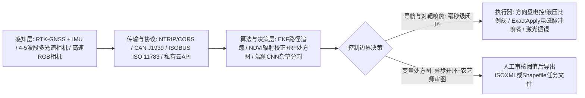
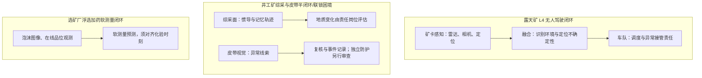

# 第一产业与资源工程 AI 应用深度调研：技术栈、开闭环边界与深水区踩坑尸检

> 同一架无人机，看得清一片叶子，不见得能单独给这片叶子施药。下面沿着“看见—决定—执行”读五类现场。产品规格、部署规模和田间案例取自截至 2026 年 11 月 13 日所列资料；客户节省的药费、厂商收到的货款和最后赚到的利润，是三本账。

---

## 全局洞察：非结构化自然战场与“冷热分化”的落地现实

第一产业与资源工程（矿山、建筑）是人工智能物理落地**环境最恶劣、数据最脏、容错与 ROI 约束最撕裂**的战场。与恒温恒湿的离散制造无尘车间截然不同，田间、猪舍、深海、矿坑与建筑毛坯房直面风霜雨雪、高氨气强腐蚀、浑浊水体、极寒扬尘以及高频动态改变的非结构化几何地形。

对照这些项目，感知和执行之间总隔着一道工序。有些工序靠人补，有些能交给设备：

| 产业板块 | 典型高成熟度跑通工位 | 仍卡在试点炼狱/低ROI的工位 | 主流控制边界 | 商业模式收敛趋势 |
| :--- | :--- | :--- | :--- | :--- |
| **大田种植与农机** | 北斗 RTK 直线/曲线自动辅助驾驶、大田行作物对靶除草（See & Spray） | 多光谱处方图全自动闭环变量施药、碎片化散户地块无人作业 | 导航与对靶喷施为**局部闭环**；处方图生成与农艺决策为**异步开环** | 硬件买断转向**按英亩软件订阅+节药担保**，大疆/极飞走封闭飞防生态 |
| **设施农业与采摘分选** | 温室环控、架式蘑菇采摘、产后近红外分选 | 枝叶遮挡下的整棚采摘 | 环控有反馈，采摘会跳过，分选须跟上输送带 | 第三方售机、服务收费和农场自用的成本归属不同 |
| **规模化畜牧与渔林** | 通道式 3D 视觉估重、猪舍咳嗽声纹预警、溶氧联动水产投饵、林区无人机松材线虫普查 | 老旧散养猪舍全自动“一畜一策”精准饲喂改造、高浊度淡水池塘水下视觉精准计数 | 疫病预警为**纯开环报警**；精喂站与溶氧断料为**局部闭环** | 牧原全自研降本、扬翔/影子生态输出、水产算“料比（FCR）省料账” |
| **智能矿山** | 露天矿规模化无安全员无人矿卡编队、井下辅助巡检与皮带异常识别报警 | 井工综采工作面复杂断层煤岩全自动识别、主运皮带AI直接联锁急停、高波动原矿全自动浮选加药 | 露天矿卡为**车-铲-云L4闭环+远程兜底**；井下综采与浮选主靠**记忆/软测量+人工微调半闭环** | 从卖软硬件改装转向 **TaaS（按吨公里承运）** 与 **ATaaS** 规模化摊薄重资产 |
| **建筑施工与预制** | 洁净楼板放线、室内抹灰 | 杂乱楼层巡检、高空防护图像辨识 | 安全线索由人核验；放线依赖清场 | 海外部署不是分部盈利 |

---

## 一、 大田精准种植与农机作业（含林木病虫害与表型延伸）

### 1.1 具体业务工位与真实技术栈拆解

1. **工位 A：北斗 RTK + 视觉融合农机自动驾驶**
   - **传感器与执行硬件**：双天线 RTK-GNSS（北斗/GPS/GLONASS，动态定位精度 $\pm 2.5\text{ cm}$）、9 轴工业级 IMU 惯性测量单元、转向角传感器（电位计/霍尔编码器）、电动方向盘（后装改装主流）或电控液压比例阀（前装大马力拖拉机主流）；辅助避障增加单/双目相机或毫米波雷达。
   - **协议与通信**：差分信号通过 NTRIP 协议经 4G/5G CORS 基站网络或 UHF 便携电台传输（RTCM 3.x 报文）；车辆底层执行通过 **CAN 总线（SAE J1939）** 与农具通用标准 **ISOBUS（ISO 11783）** 通信，实现拖拉机与播种机/施肥机的任务控制器（TC）联动。
   - **核心算法**：GNSS+IMU 紧耦合扩展卡尔曼滤波（EKF）解决姿态与航向估计；路径规划采用 AB 直线、曲线及地头 Dubins/Reeds-Shepp 掉头算法，结合 Pure Pursuit（纯追踪）或 MPC 控制方向盘转角，边缘计算单元控制周期通常在 20ms–50ms（20–50Hz）。
2. **工位 B：无人机多光谱遥感处方图与变量施药/施肥（VRA）**
   - **传感器与数据源**：低空巡田无人机搭载 RGB + 绿/红/红边/近红外（G/R/RedEdge/NIR）4~5 通道多光谱相机，顶部集成太阳光辐射传感器（Sunlight Sensor）用于实时记录环境光辐照度变化。
   - **软件流与协议**：航测影像导入地面/云端拼图引擎生成反射率正射影像，计算 NDVI（归一化植被指数）、NDRE（红边归一化指数，抗高密冠层饱和），结合土壤采样 EC/氮磷钾网格，利用随机森林（RF）、XGBoost 或线性分级规则生成网格化变量处方图，导出为 **Shapefile（.shp）** 或 **ISOXML（`TASKDATA.XML`）** 格式。
   - **执行层控制**：无人机飞控（如大疆农业平台/极飞 SuperX 5）或拖拉机 ISOBUS 终端读取坐标网格，实时调节播撒绞龙转速/仓口开度（如大疆 T50/T60 的“绞龙供料+离心甩盘”）或螺旋变量送料器电机转速（如极飞 P150 的“睿播”系统）。
3. **工位 C：行间实时机器视觉精准对靶除草与激光灭草**
   - **传感器与算力**：喷药机/除草机横梁（Boom）密集挂载全局快门高清 RGB/近红外工业相机（每隔 0.5–1 米一台）及高功率 LED 主动补光灯（压制日光阴影），车载部署多颗工业级嵌入式 GPU 算力盒（如多路 NVIDIA Jetson/Orin 阵列，IP67/IP69K 防尘防水与抗震封装）。
   - **算法与执行闭环**：在 `24 km/h`（15 mph）作业时速下，系统每秒扫描超过 `2,100` 平方英尺（约 `195 m²/s`）的农田，边缘侧轻量化语义分割/目标检测模型在 **10–30ms** 内完成 **Green-on-Green（绿中辨绿：行作物幼苗 vs 杂草）** 或 **Green-on-Brown（裸地/休耕地除草）** 分类，直接通过高带宽车载以太网/CAN 触发单个 **ExactApply 电磁脉冲喷嘴** 局部点喷，或驱动振镜控制高功率二极管激光器（LaserWeeder）毫秒级热击毁杂草分生组织。
4. **延伸工位 D：林业病虫害监测、森林防火与商业化育种高通量表型**
   - **智慧林业（松材线虫与防火）**：针对《全国松材线虫病疫情防控五年攻坚行动计划（2021–2025）》重点场景，采用“卫星大尺度初筛 + 无人机多光谱/高分辨率 RGB 局部详查 + 地面 App 核查”的“天空地”一体化架构，利用 YOLO/U-Net/DenseNet 模型对松树早期变色木与针叶光谱纹理异常进行精准分割（特定小班示范准确率宣称达 98%+）；同时叠加机载 **LiDAR 点云** 测算树高、胸径、郁闭度及林下可燃物载量，配合热红外相机 24 小时巡检烟火隐患。
   - **商业化辅助育种表型**：利用无人机多光谱/热红外与地面轨道式高通量表型平台，批量提取育种小区内作物的株高、冠层温度、抗旱指数与持绿期（Stay-green），结合基因组选择（GS）模型加快抗逆品种筛选周期。

### 1.2 国内外具名企业真实落地水位与指标对比

| 企业与系统 | 核心技术路线 | 2024–2026 年产品资料或案例所报指标 | 报价或收费模式 | 工程适用边界 |
| :--- | :--- | :--- | :--- | :--- |
| **John Deere See & Spray Ultimate / Premium** | 横梁多相机阵列 + 边缘 GPU 实时视觉 + ExactApply 独立脉冲喷嘴 | **2024 年**：覆盖超 100 万英亩，省药 800 万加仑，平均省除草剂 **59%**； **2025 年**：扩至超 **500 万英亩**，非残留除草剂平均省药近 **50%**（约 3,100 万加仑），田间净节省约 **$12.63–$35+/英亩**；最高作业时速 **15 mph（约 24 km/h）** | **Premium 后装套件**（适配 2018 年后机型）约 **$2.5 万–$10 万+**；软件按亩订阅（约 **$5/英亩** 或年度包干），附带“节药担保” | 主要仅支持玉米、大豆、棉花及休耕地；杂草呈“地毯式”高密度连片发生时退化为全喷，节省归零 |
| **Carbon Robotics LaserWeeder** | 视觉识别配套激光机具 | 蔬菜田案例比较的是每英亩人工除草费 | 整机与拖拉机机时 | 单次不施药不能推成全年所有作物不用药。 |
| **Ecorobotix ARA** | 遮光横梁下逐株点喷 | 产品资料报的是特定作物的施药量变化 | 悬挂机具及维护 | 要用本地杂草密度、实际覆盖面积和全幅喷施基准比较。 |
| **大疆农业 Mavic 3M + 大疆智图 + T50/T60** | 多光谱航测（4光谱+太阳传感器）→ 云端 NDVI 处方图 → 无人机变量播撒/喷洒 | T60 喷洒载重 50kg / 播撒载重 **60kg**，配前后相控阵雷达与双目避障，绞龙供料+离心甩盘自动调仓口开度 | 消费级/商用级低门槛硬件买断，依托大疆智慧农业平台免费/低价生成基础处方图 | **生态高度封闭**：底层飞控与播撒总线加密，禁止第三方传感器直连硬件控制，第三方 ISOBUS/ISOXML 处方图导入兼容性差 |
| **极飞科技 P150 / P150 Pro** | SuperX 5 Ultra 飞控 + 4D 成像雷达 + 螺旋变量送料器（睿播） | 最大工业载重达 **80kg**，支持螺旋送料器电机无级变速控制下料量，兼容地面水肥传感器云端联动 | 硬件买断为主，绑定 XAG 农服 App 生态 | 同等存在核心总线与硬件加密校验，严禁私自改装大流量泵或外挂非认证传感器实时控制飞行 |
| **华测导航（NX系列）/ 联适 / 中联重科 / 北大荒** | 北斗地基/星基 RTK（$\pm 2.5\text{ cm}$）+ 方向盘/液压电控 + 北大荒“一张图” | 主粮插秧、播种、收割作业直行交接误差控制在厘米级，在黑龙江北大荒等大型国营农场实现大规模连片无人化示范 | 后装自动驾驶套件已降至万元人民币级别；前装智能农机整机集成 | 国内拖拉机厂与农机具 **ISOBUS（ISO 11783）协议普及与兼容残缺**，换农具常导致接口与控制协议打架 |

### 1.3 开环与闭环边界：为什么“全自动处方图闭环”在大田依然罕见？

- **对靶喷施**的反馈对象是一株草或一段作物行；下一帧能纠正后续定位，不能收回已经落下的药液。
- **变量处方图**却要回答另一个问题：这块田究竟缺什么？低 NDVI 可能是积水，也可能是裸土或缺肥。今天航测、农艺师核对、明天上机，不是传数据慢，而是相似的颜色可能要求不同的处置。

### 1.4 深水区踩坑复盘

1. **物理与环境坑**：
   - **RTK 丢星与树荫盲区**：林带边、山地丘陵及高秆玉米后期遮挡卫星信号，一旦 RTK 固定解退化为浮点解或丢星，农机发生急刹停机或突然大幅偏航压苗。
   - **扬尘糊镜与光照突变**：收割/喷药机后方浓密尘土数小时即可糊住横梁相机镜头（John Deere 不得不在 MY27 机型专门前移并升级前置防尘镜头）；清晨/黄昏低光照、强烈逆光及云影过境会击穿多光谱与视觉分类阈值；高密度冠层下枝叶遮挡导致底层杂草漏喷，以及植被封垄后 NDVI 产生光学饱和失真。
   - **空间分辨率错配**：Mavic 3M 航测地面采样距离（GSD）高达 2–5cm，但无人机离心播撒幅宽 7–10 米且存在风场飘移与开关阀延迟，超精细像素级处方图在物理执行层完全无法兑现，纯属算力浪费。
2. **脏数据与协议割裂坑**：
   - 国内农机行业 **ISOBUS（ISO 11783）协议落地极其割裂**，雷沃、东方红、中联重科主机与华测、联适后装终端、第三方变量施肥机线束与通讯协议互不兼容；而大疆、极飞则出于飞行安全与商业壁垒采取全封闭加密总线，农场自购的土壤墒情站数据往往只能通过“人工下载 Excel $\rightarrow$ 肉眼定区间 $\rightarrow$ 手动导入处方图”的方式流转，形成严重的 IT/OT 孤岛。
3. **模型失效与农艺断层坑**：
   - 农艺模型极度依赖地域品种与气候（东北黑土大豆与中原冬小麦的 NDVI 需肥曲线截然不同），没有经过本地标定板（Reflectance Panel）辐射校正的“相对 NDVI”无法跨周、跨季复用；绝大多数中小合作社与家庭农场缺乏既懂 GIS 又懂植物营养学的复合人才，买来的软件沦为只看RGB航拍照片的摆设。
4. **ROI 算不过账的死结**：
   - **地块碎片化**：按生产面积算省药，却按包含掉头、转场在内的全部机时付钱。高价对靶机进连片菜田与进零散主粮田，是两笔不同的账。
5. **机手拿什么工钱**：按亩领薪，转场和校准却占班时；比较新旧方案时，这些时间都应算进来。

---

## 二、 设施农业、果蔬采摘机器人与产后无损分选

### 2.1 具体业务工位与真实技术栈拆解

1. **工位 A：智能玻璃温室多变量环控（MPC + 植物生理模型）**
   - **传感器与执行网络**：温室内外温湿度、PAR 光合有效辐射传感器、非色散红外 $\text{CO}_2$ 探头（如 Vaisala）、基质含水量/EC（电导率）/pH 传感器；底层现场仪表多通过 **Modbus RTU/TCP** 接入过程计算机/PLC，上层与云端分析平台及 SCADA 通过 **OPC UA** 互联；执行器覆盖天窗开合电机、内外遮阳保温幕布、湿帘风机、燃气锅炉供暖混水阀、高压迷雾与水肥一体机。
   - **控制算法**：以“植物赋能（Plant Empowerment）”与 24 小时水分/能量平衡模型为机理底座，叠加气象预报前馈的 **模型预测控制（MPC）**，在多输入多输出（MIMO）约束下提前 2–6 小时协同调节天窗、幕布与加热阀，兼顾作物蒸腾最佳 VPD（饱和水汽压差）与燃气/电耗极小化。
2. **工位 B：温室/果园采摘机器人**
   - **感知与定位**：RGB-D 深度相机（主动双目结构光/ToF，配合局部补光）或轻量级 LiDAR 构建局部三维点云，利用实例分割网络（如 Mask R-CNN / YOLOv8-Seg）识别成熟果实与果梗，通过点云配准估算果实 **6DoF 位姿** 与碰撞障碍物（主蔓/铁丝/邻果）八叉树地图。
   - **执行机构与规划**：多自由度机械臂（SCARA 或 6 轴协作臂）配合异步双臂运动规划（MoveIt/定制逆解），末端采用硅胶柔性气动夹爪、负压吸盘或热切/旋转剪断机构，避免压伤浆果表皮。
3. **工位 C：产后高速无损糖度与内部霉变分选线**
   - **多模态检测通道**：水果在“自由果托/滚轮杯”上高速旋转通过检测暗箱，同步经过：**① 多视角高分辨率 RGB 相机**（识别果径、着色率、表皮机械伤/果锈）；**② Vis-NIR / 短波红外 SWIR（400–1000nm / 900–1700nm）透射与漫反射光谱仪或线扫高光谱相机**（利用 $\text{O-H}$、$\text{C-H}$ 化学键在特定波段的吸收特征，无损反演可溶性固形物 Brix 糖度、酸度以及内部水心病、褐变、苹果霉心病）。
   - **硬实时同步与剔除**：输送链驱动轴安装高精度增量旋转编码器（Encoder），PLC 根据编码器脉冲精确追踪每只果杯的微秒级位置，边缘工控机（PLS 偏最小二乘 / 1D-CNN 光谱分类模型 + 2D-CNN 视觉模型）必须在 **几十毫秒内** 完成判定，硬触发对应分选出口的气动吹气阀或机械翻盘摆臂完成分级落果。

### 2.2 把可达果、整棚产量与卖机器的账拆开

| 场景 | 公开案例 | 这个案例能回答什么 |
| :--- | :--- | :--- |
| 温室环控 | Priva Plantonomy、Hoogendoorn IIVO 与寿光型温室 | 可以比较通风、供暖及控制接口；节能要按相同面积、作物与生产期比。 |
| 草莓与番茄 | Octinion Rubion、MetoMotion GRoW | 每颗采摘时间的分母是尝试或成功采下的果；藏在叶子后面没进候选的果，不能从整棚人工账里消失。 |
| 农场内部整合 | Tortuga 与 Oishii；苹果采摘还有 Abundant Robotics 的个案 | 部署或并购表明有人投入，不回答机器单卖是否赚钱，也不能用一家企业的退出判整个品类死刑。 |
| 架式蘑菇 | 4AG Robotics | 标准菇架约束了光照与可达范围，跟在枝叶间找果梗不是一道题。2025 年的融资消息说明筹资进展；没有采摘业务的分部损益，排不出“唯一盈利赛道”。 |
| **产后无损分选** | **TOMRA（Spectrim + LUCAi）** **江西绿萌（Reemoon / Infruscan）** | TOMRA 以高稳定光学/SWIR 传感器与 LUCAi 深度学习领跑全球高端产线；国产龙头**绿萌 Reemoon** 联合中科院微电子所等推出近红外全透射内部检测（Infruscan），综合外观分选精确度宣称约 **98%**、称重误差 $\pm 1.0\text{ g}$，已实现柑橘、苹果糖度及霉心病商业化下沉 |

### 2.3 开环与闭环边界剖析

- **温室环控**：属于**“有约束条件的前馈闭环”**——在传感器正常且气象波动温和时，MPC 算法直接闭环驱动天窗、遮阳网与供暖阀门；但在遭遇极端寒潮/台风或发现电导率/湿度曲线异常跳变时，资深温室经理必须强行切回手动规则兜底，防止低温冻害或高温灼苗。
- **采摘机器人**：属于**“保守型局部闭环（遇不确定性即放弃）”**——一旦枝叶遮挡导致末端执行器碰撞置信度升高，系统必须放弃该果实留待人工补采（二遍工），绝不允许盲目强行抓扯折断主蔓。
- **产后无损分选**：属于**“严苛硬实时闭环”**——编码器追踪到执行器吹气剔除必须在毫秒级自动完成，但背后的**“光学预测阈值与标定曲线”必须由质检员开环校准维护**。

### 2.4 深水区踩坑复盘

1. **物理与环境坑**：
   - **文洛式玻璃温室的“中国能耗黑洞”**：纯正荷兰玻璃温室照搬到中国华北/东北，冬季维持 18–20℃ 的天然气加温费足以吞噬全部番茄卖菜利润；夏季强太阳辐射下湿帘降温失效，温室被迫空置 2–3 个月“歇夏”。
   - **传感器高湿腐蚀与漂移**：温室长期 80%–95% 高湿凝露与叶面喷药，导致相对湿度探头、pH 玻璃电极与 EC 电极极易结垢或电解质中毒漂移；若不定期用标准缓冲液和参考仪标定，“Garbage in, garbage out”的 MPC 会把温室推向持续错误温湿区间。
   - **果体曲率与表面水珠**：分选线果体呈椭球形，果柄、花萼与清洗后残留水珠会引发近红外漫反射光程剧变（水峰在 970nm、1450nm 吸收极强），直接淹没糖度微弱吸收信号；输送皮带轻微打滑或轴承磨损造成的**速度校准误差（Speed Calibration Error）**，会导致气阀提前或滞后开闭，瞬间演变为大批“错踢好果或漏放烂果”。
2. **模型失效与标定灾难坑**：
   - **近红外模型的“跨季跨产地失效”**：同一品种的苹果，换了产区、土壤、采摘成熟度或冷库贮藏温度，其光谱响应就会发生系统性漂移。新果季上市时，分选厂不得不切碎成百上千颗好果做破坏性折光仪测糖实验，重新拟合 PLS/CNN 定标模型；至于**真正的高光谱成像（HSI）**，因图谱合一数据量极其庞大，在每秒分选十余颗果子的高速线上难以做到低成本实时边缘推理，绝大多数商业线仍妥协采用“多光谱/点阵近红外”。
   - **枝叶遮挡**：机器按可达果算命中率，工头却按整棚成熟果安排二遍工；加高架、疏叶也要花工钱。
3. **ROI 死结**：草莓采收有季节，蘑菇架可以连续生产。空置月份不省折旧；反过来，全年有活也还得扣维修和现场人员成本。
4. **组织与农艺断层坑**：
   - 引入一套 Priva 或 Hoogendoorn 系统需要极高水平的温室植物生理职业经理人看懂生长曲线并与算法协同；国内大量园区“硬件花了几千万建顶级温室，却按传统菜农习惯开天窗”，最后干脆把昂贵的环控计算机锁定在固定手动档位当普通开关使。

---

## 三、 规模化畜牧与智慧水产养殖

### 3.1 具体业务工位与真实技术栈拆解

1. **工位 A：生猪/奶牛/家禽非接触式 3D 视觉估重与体况评分（BCS）**
   - **传感器与防护**：猪牛俯拍通道上方或挤奶机器人/分群门上方安装工业级 ToF 深度相机或双目结构光相机，外加耐酸碱防腐密封罩、防起雾加热视窗或定时气吹除尘嘴；家禽（肉鸡/蛋鸡）平养与笼养禽舍顶部安装广角深度相机/高清 IPC 或滑轨式巡检视觉云盒；边缘侧采用带 NPU 的工业计算盒做本地点云过滤与推理。
   - **算法栈**：猪牛端通过深度图去噪与前景分割（剥离栏杆、料槽及粘连猪体）$\rightarrow$ 姿态矫正（去除抬头/弓背/行进扭曲畸变）$\rightarrow$ 提取体长/体高/胸围/臀部背膘曲率体积 $\rightarrow$ PointNet++ 或深度图回归模型输出体重估算或 1–5 分制 BCS 评分。家禽端则结合轮廓分割与三维体态重建计算群体平均体重与均匀度（指导最佳出栏日龄），并通过地面/笼内全时段姿态与运动轨迹扫描实现**死鸡/瘫痪弱鸡分钟级死淘网格定位**，防相互啄癖扩散疫情。
2. **工位 B：听咳嗽，筛出值得巡查的栏舍**
   - 麦克风记录群体声音，模型试着把咳嗽和风机、刮粪设备的噪声分开。单位栏舍、单位时间的异常声多了，是请兽医去看一眼的线索，不是识别出某头猪感染了某种病。
3. **工位 C：“一畜一策” RFID + AI 动态营养精准饲喂闭环**
   - **感知与身份绑定**：耳标采用 **134.2kHz 低频（LF）RFID**（穿透动物体液与潮湿环境抗衰减优于高频，配合防碰撞算法）或 UHF 超高频耳标；电子母猪饲喂站（ESF）与智能精喂仪集成称重/余料传感器与超声波液位检测。
   - **算法与执行**：云端/边缘平台融合猪只胎次、妊娠日龄、背膘/3D估重与历史采食量，基于 NRC 营养需求曲线与机器学习采食预测生成单头日粮配方（水料比、精料克数），通过 **RS-485 / Modbus RTU / CAN** 驱动步进电机、螺旋下料绞龙与定量给水电磁阀。
4. **工位 D：智慧水产声呐/水下视觉智能投饵**
   - **感知与环境联动**：深远海网箱与高密度对虾高位池/工厂化车间部署**主动水声声呐（Echosounder，回声测深探测鱼群上浮抢食聚散与残饵下沉回波）**或**水下双目立体视觉相机**（配备特定波长激光/窄带补光与图像去散射增强），并串联在线荧光法溶解氧（DO）、水温、pH 与盐度传感器（RS-485/LoRa）。
   - **控制边界**：摄食模型给出投喂建议，溶氧监测另负安全职责。设备如何联动应由养殖场按物种、密度和经确认的保护设计验收。

### 3.2 国内外具名企业真实落地水位对比

| 领域与企业 | 技术模式与代表产品 | 2024–2026 年企业或试点披露（非对照试验） | 架构定位与局限边界 |
| :--- | :--- | :--- | :--- |
| **牧原股份** | 自有猪舍环控、轨道巡检与饲喂 | 披露标杆猪场 PSY（每头母猪每年提供的断奶仔猪数），不是所有猪场的 AI 增益 | 场地与管理条件影响比较 |
| **扬翔股份与影子科技** | FPF 平台、AIFeeder 与通道估重 | 比较估重，应在同场以实际称重为参照，另报未成功成像的猪只 | 新建标准通道与老栏舍的改造账不同 |
| **温氏股份 / 圣农发展** | 猪舍或禽舍的轨道巡检、环控与饲喂 | 死淘上报延迟可以按发现至上报的时间衡量，不能等同于死亡率下降 | 公司自有场与合作农户设备条件不同 |
| **德康集团 / 农信互联（猪小智）** | **精细育种与平台改造派**：德康聚焦种猪性能测定与精细营养转换；农信互联以“猪小智”软硬一体方案赋能大中型猪场防非、繁育与精准饲喂 | 服务大规模商品猪场与育种场，通过数据测定与精准给料压缩料肉比波动以穿越猪价薄利周期 | 在建筑规格参差不齐的非标存量场推进全套硬件改造时，强弱电施工与传感器运维依然构成主要落地阻力 |
| **SoundTalks** | 栏舍声纹与群体呼吸健康指数 | 产品资料以比巡视更早发现异常为卖点，提前量取决于巡视频率与异常定义 | 不能定位病畜或判断病因；机械噪声可能影响曲线 |
| **DeLaval BCS 相机 / Cainthus（Cargill 合作）** | DeLaval 为分群门上方 3D 深度背膘评分；Cainthus 为牛舍多目 CCTV 面部与采食视觉 | DeLaval BCS 与资深专家评分相关性达 **$r \approx 0.78 - 0.85$**，在正常体况（BCS 3.00–3.75）最准 | DeLaval 在极瘦（<3.00）或过肥（>3.75）极端值出现明显压缩失真；Cainthus 因全牛舍高密 CCTV 布线 CAPEX 过高，2024–2025 年独立商业扩张明显退潮 |
| **CageEye / Aquabyte / 粤海、通威、海大** | 水声或水下视觉、投饵和溶氧监测 | 客户应比同一物种、生长期的实际耗料与增重；不能从一池料比推出普遍回本期 | 浑浊、附着与清洗停机都占成本 |

### 3.3 开环与闭环边界剖析

- **声纹只作筛查**。报警对象是栏舍；看现场、判断是否需要检查以及后续处置，是饲养人员和兽医各自的工作。不能把群体声音当处方。
- **水产**：异常溶氧与摄食活跃度不是一个信号；前者涉及保护，后者是“这池鱼还吃不吃”。要把现场安全安排与模型省下的饲料分开评估。
- **母猪精准饲喂（条件闭环）**：在装备了电子饲喂站（ESF）与防串读通道的新建现代化母猪舍，RFID 识别 $\rightarrow$ 按怀孕阶段下发水料比已实现**单头闭环**；但在大栏混养育肥猪舍，个体抢食与耳标脱落使得“一畜一策”无法成立，仍是以“群体平均视觉估重 $\rightarrow$ 料线分栏总量调控”为主。

### 3.4 深水区踩坑复盘

1. **物理与极端腐蚀坑（硬件“慢性谋杀”）**：
   - **猪舍高氨气/硫化氢与糊镜**：高密度猪舍充满强腐蚀性氨气、硫化氢、水雾与饲料粉尘，普通工业相机外壳与未镀膜电路板数月即锈蚀短路；3D 镜头和拾音孔往往 **3–7 天就被飞虫粪污和饲料灰糊死**，若无高压气吹或密封隔离设计，模型直接瘫痪。
   - **水产水下生物附着（Biofouling）与高浑浊“致盲”**：中国绝大部分淡水池塘及高位池对虾养殖水体富含有机质与微藻，能见度常常 **不足 20 厘米**，昂贵的水下立体视觉相机下水即“失明”（被迫退化为水面波纹视觉或声呐探测）；而在海区大黄鱼网箱，仅浸泡 **2–3 周**，水下镜头与声呐换能器表面即长满藤壶、藻类和生物膜，声波发射衰减严重、画面全黑，雇佣潜水员定期刮洗的运维费甚至高过节省的饲料钱。
2. **脏数据与采集姿势坑**：
   - **群体拥挤与打架粘连**：无论是通道猪只扎堆抢跑，还是奶牛在 DeLaval 通道门处扭曲转身、毛发厚重冬毛或沾染粪块，都会导致 3D 点云空洞或畸变，大量采集帧被系统丢弃为“Failed Images”；对虾底栖且半透明、大黄鱼高速群游互相遮挡（Occlusion），令水下视觉计数误差飙升。
   - **RFID 漏读与串读**：低频耳标在金属栏杆电磁屏蔽或猪只啃咬损坏脱落时失效；湿拌料管路堵塞或料塔“结拱”，导致后端系统记录“已完成下料”，实则料槽空无一物，脏数据直接污染后续生长模型。
3. **ROI 算不过账与老旧场改造死结**：
   - 存量老旧猪舍普遍缺少弱电强电桥架与稳定网络，猪栏高度与宽窄各异导致俯拍相机视场角（FOV）不够，全面布线与换装智能料线的单栏改造成本动辄数千至上万元；在 2024–2025 年生猪养殖进入“薄利精耕与周期波动”时期，中小猪场对重资产 CAPEX 极度敏感，“装一套顶一万斤猪肉利润，不如多雇一个饲养员靠桶喂”。
4. **养殖户组织人性博弈**：
   - 资深水产养殖户和猪场场长普遍存在**“宁可多喂浪费，绝不敢让鱼/猪饿着掉膘”**的保守心理。一旦 AI 建议某天减料 15%，若遇到换季生长稍微放缓，一线饲养员立刻把锅甩给“算法饿坏了鱼猪”，直接切回人工定时大水大料投喂。

---

## 四、 智能矿山（露天矿、井工矿综采与选矿加工）

### 4.1 具体业务工位与真实技术栈拆解

露天矿卡看的是车、人、道路和装卸区的关系；采面看的是会变化的煤岩边界。前者有地图和车队调度，后者即便记得上一刀的位置，也不能保证下一段地质相同。皮带相机和选矿泡沫相机同样都“看图”，前者提示异常，后者估计工况；图像质量再好，也不构成安全保护有效的证据。

### 4.2 国内外具名企业真实落地水位对比

| 领域与厂商 | 核心技术与商业模式 | 2024–2026 年披露的车队或项目（范围各异） | 财务或工程约束 |
| :--- | :--- | :--- | :--- |
| **易控智驾** | 按吨公里承运及运营服务 | 所引披露称 2025 年底活跃车队 2,580 台，2026 年中超过 3,100 台 | 活跃车辆不是可结算吨公里，不能代替分部损益 |
| **踏歌智行 / 慧拓** | 矿区调度和云边协同 | 材料列示部署矿区与装车辆数 | 安全员配置、道路和班次不同，不能把部署数当无人工时 |
| **Caterpillar / Komatsu** | MineStar Command、FrontRunner AHS | 厂商材料列有大型矿区车队案例 | 要逐矿审查接管与防护；累计投运不等于同时在岗 |
| **华为矿山军团 + 天地玛珂 + 郑煤机** | **矿鸿 MinerOS** + 盘古矿山大模型 + SAC/PM31 电液控系统 + 惯导找直 | 在国家能源集团神东、陕煤黄陵等示范矿推进采煤机惯导找直与记忆截割常态化少人巡视 | **煤岩识别准确率依然受限于复合顶底板与井下喷雾水雾**；快速推进时液压支架易出现“跟机滞后”与冲击地压“压架” |
| **Metso（FrothSense+）** **紫金矿业** | 防爆泡沫视觉软测量 + Courier XRF 在线品位 + MPC/ACT 自动液位充气加药 | 替代传统操作工每小时进高温高湿浮选车间肉眼看泡调阀，实现秒级泡沫流速反馈与药剂单耗收敛 | 浮选槽是大时滞强耦合化学过程，XRF 采样滞后往往长达 **15–30 分钟**，加药动作极易矫枉过正振荡 |

### 4.3 开环与闭环边界剖析

- **露天矿卡**：可用时间长不等于单车每小时更快。等挖机对位、道路变更和远程协助都占班次。
- **井工矿**：记忆截割遇到断层就遇到旧轨迹没回答的问题。皮带视觉与既有安全保护分别验收，人工确认不是所有保护动作的前提。
- **浮选**：品位化验回来时，槽里的料可能已换过一批。

### 4.4 深水区踩坑复盘

1. **物理与极端工况坑**：
   - **极寒与重度扬尘**：呼伦贝尔、新疆准东冬季 **$-30^\circ\text{C} \sim -40^\circ\text{C}$** 低温造成液压油粘滞、三电续航腰斩、激光雷达视窗结霜；干冷大风与卡车排土扬尘导致激光雷达点云产生满屏密集“鬼点”，迫使企业高价加装 4D 毫米波雷达并做严苛的点云滤尘算法。
   - **湿滑打滑破定位与深坑丢星**：暴雨融雪后长坡泥泞路面导致百吨矿卡打滑，轮速里程计瞬间失效并引发 GNSS/INS 融合定位跳变急刹；深凹采坑边缘卫星仰角遮挡造成的意外停车，在单车道会造成整条采-运-排链条“多米诺骨牌式堵死”。
   - **井下全黑高雾遮挡**：采煤机滚筒高速割煤配套高压喷雾降尘，整个工作面被水雾与煤粉笼罩，摄像机哪怕配有水气自清洁雨刷，能见度也经常只有一两米，“煤岩识别”在视觉维度几乎退化为瞎子。
2. **脏数据与大时滞坑**：
   - 选矿厂入选原矿的品位、氧化率、泥化程度（矿泥罩盖气泡）每班剧烈波动，导致**“表面泡沫看起来一模一样，但槽底实际精矿品位已经彻底漂移”**；加上载流 XRF 取样管路十多分钟的传输延迟，纯靠表观视觉和滞后数据的 AI 模型会输出反相调药指令，导致回收率断崖下跌。
3. **ROI 账本与重资产盈利陷阱**：
   - 按吨公里买运力，把购车和维护成本转到运营方，并没有消除这些成本。没有有效出勤、驻场成本与合同年限，算不出单矿盈亏。
4. **误报由谁接，保护由谁审**：湿煤反光、矿灯和滴水都可能让皮带画面像出了故障。矿方应同时登记误报停产工时与漏报后果，明确异常由谁接管、谁审查独立保护的有效性。不能以少停机为由削弱防护。

---

## 五、 建筑工程施工与预制构件（PC）生产

### 5.1 具体业务工位与真实技术栈拆解

1. **工位 A：BIM / CAD 图纸 AI 智能算量与审图**
   - **技术栈**：底层利用自研或第三方几何内核直接解析 `.dwg` / `.dxf` 矢量图元及 IFC 模型；针对设计院交付的非矢量扫描 PDF 变更单/大样图，采用多模态版面分析（OCR + 表格识别 + 符号图例提取）+ 规则引擎（严格对齐国标清单计价规范 GB 50500）+ 行业大模型辅助识别构件拓扑关系，自动生成工程量清单（BOQ）。
2. **工位 B：预制构件（PC）厂智能排样与 APS 排产**
   - **技术栈**：上游 BIM 拆分深化 $\rightarrow$ 模台（固定模台或环形流水线）**二维异形装箱排样（2D Nesting，遗传/启发式算法最大化模台空间利用率）** + 多约束 APS 排产求解（考虑模具套数、蒸汽养护窑温湿度曲线闭环、塔吊吊装顺序与堆场容量约束）；出厂质检通过双目视觉/激光扫描比对预埋套筒与线盒孔洞位置。
3. **工位 C：施工现场智能建造机器人（放线、抹灰、实测实量）**
   - **放线机器人（如 Dusty Robotics FieldPrinter）**：从 Revit/BIM 直接导出施工坐标（File-to-Field），地面由全站仪激光跟踪 Prism 实时回传毫米级定位（$1/16\text{ 英寸} \approx 1.6\text{ mm}$ 精度），控制工业喷墨头直接在现浇混凝土楼板上喷绘出墙线、机电管线（MEP）预留位与二维码。
   - **抹灰/涂装机器人（如蔚建科技、领鹊科技）**：基于 2D/3D 激光雷达建图与室内无 GPS 定位，通过泵送恒压控制与多轴机械臂实现“泵、抹、压、收”一体化或边走边喷，控制墙面恒定压抹力。
   - **实测实量机器人与自主巡检狗（如博智林、Boston Dynamics Spot）**：搭载三维激光扫描仪（LiDAR）+ 全景相机基于 SLAM 自主行走，获取房间海量三维点云，与虚拟靠尺算法或 BIM 模型配准比对墙面垂直度、平整度、阴阳角方正度与施工进度偏差。
4. **工位 D：塔吊安全与现场 EHS 视觉监控**
   - **技术栈**：塔吊大臂前端加装高变倍光电云台+毫米波防碰撞雷达，无线网桥/4G 传回驾驶室实现**吊钩可视化**；工地大门、基坑临边与高支模区域部署常规 IPC 摄像头推流至边缘 AI 视频盒子，识别未戴安全帽、反光衣、高空未系安全带、区域闯入及违规动火。

### 5.2 国内外具名企业真实落地水位与兴衰复盘

| 业务环节 | 企业与产品 | 2024–2026 年案例或产品所述场景 | 比较的条件 |
| :--- | :--- | :--- | :--- |
| **AI 算量** | **广联达** （AecGPT + GTJ 算量平台） | 依托亿级建筑 Token 知识库辅助读图与构件识别，可将超大型复杂项目算量初稿周期从传统 **3 个月压缩至约 2 周** | 遇异形节点、变截面构件及不规范图纸仍会漏算误判，造价师必须逐项人工复核兜底 |
| **PC 构件厂** | **远大住工（PC-CPS）** **三一筑工（SPCS）** | 打通虚拟预制造数字流，管理叠合板、剪力墙、楼梯等模具排样与蒸养节拍，减少错漏碰缺 | 国内户型标准化率低导致异形模台频换、周转率惨淡；工地临时催货/停吊频频击穿厂内 APS 计划 |
| **施工放线** | **Dusty Robotics FieldPrinter** | 资料所列精度 1/16 英寸，约 1.6 毫米，是定位规格，不是整班人工节省比例 | 租赁按天，清场与转层仍须占班时 |
| **抹灰/涂装** | **蔚建、领鹊、博智林** | 抹灰与移动喷涂已有项目披露；以验收墙面面积计，不只数机器开动时的日均平方米 | 海外部署或业务收缩不直接说明某条产品线盈利与否 |
| **实景采集与安全视觉** | **Boston Dynamics Spot** **广联达智慧工地** | Spot 具备 **IP54 防护**与约 **300mm 越障能力**，可背负激光雷达自主爬楼梯扫点云回传 Autodesk/Revizto 平台比对 | 极其怕重度磨蚀性硅尘与凌乱挂线；若项目部把扫回来的海量点云扔在云端文件夹里没人看，ROI 直接归零 |

### 5.3 开环与闭环边界剖析

- **BIM/CAD 算量**：同一处变更漏算，会进入后续结算。模型先出底稿，造价人员须对图纸版本、工程量与合同依据负责复核；签字不是对法律责任的预判。
- **施工机器人执行（强前置结构化约束闭环）**：放线、抹灰、喷涂本身动作一旦启动即在机载传感器引导下闭环执行；但前提是**环境必须被人为强制“半工厂化”**（先清场扫地、架设反射棱镜、移开脚手架与交叉施工班组）。一旦遇到未建模的现场障碍，机器人直接停车报警等待人工搬运或跳过。
- **现场安全视觉**：安全帽和安全带抓拍是巡查线索。是否看得清、谁在何时接报，需要单独验收；影像不能取代现场安全职责。

### 5.4 深水区踩坑复盘

1. **物理现场“非标混乱”对机器人的暴力劝退**：
   - **建筑垃圾与“预清扫税”**：工地毛坯楼层满地混凝土残渣、截断钢筋头、积水、拖拽的电线与各工种堆料。轮式放线机器人和实测实量机器人遇到一小块凝固砂浆或线管即卡死偏航或底盘打滑，迫使总包方必须**先专门派两名小工拿扫把吸尘器彻底清场**——算下来雇小工清场和搬运机器人上下无电梯楼层的耗时，常常比工人拿着激光测距仪和传统靠尺直接干还慢！
   - **粉尘与高空物理极限**：Spot 的 IP54 防护阻挡不住极细水泥与石膏粉尘侵入关节密封圈，镜头每天必须多次擦拭；塔吊大臂距离地面动辄 **50–100 米以上**，高空俯拍地面工人肩膀的安全带在普通 200 万/400 万像素画面中仅占几个像素点，物理上根本无法分辨“真系了安全带还是衣服褶皱”，强行上高变倍球机又导致覆盖死角极大、现场无线网桥带宽瞬间挤爆卡顿。
2. **脏图纸与多专业“两张皮”坑**：
   - 算量与放线最大的坑不在算法，而在**设计院交付图纸极度不规范**：CAD 图层乱放、块参照多层嵌套、设计师懒得改图面直接用文字备注“此处柱截面加宽 100mm”、设计说明与大样图自相矛盾、施工期高频下发口头/微信零星签证变更。AI 解析出来的 BIM 模型如果不经现场总工核对直接推给 Dusty 放线或 PC 厂开模，只会**以 10 倍的速度在现场批量制造错误构件和返工拆墙**。
3. **误报耗掉的是安全员的注意力**：
   - 日照斜影、密目网晃动、电焊弧光和扬尘都会制造假阳性。验收时看一个班次要复核多少条、待处置队列最长多久，以及真正的警情是否得到负责岗位响应。
4. **ROI 算不过账与“迎检花架子”组织病**：
   - 分包按平方米计价，机器人却按天收租。比较同面积的合格交付时，折旧、操作手、楼层转运和清场缺一不可；不能从设备摆在工地就推断买方动机。

---

## 六、 跨行业横向总结：第一产业与资源工程 AI 落地成熟度与破局法则

把五个现场并排看，能比较的是哪一步已经做成、哪一步仍靠人，不是给行业排利润榜。

### 6.1 五大行业“闭环边界与技术成熟度”横向对照

| 评价维度 | 大田农机与除草 | 设施温室与采摘/分选 | 畜牧 3D 视觉/声纹/水产 | 露天矿卡 vs 井工综采/选矿 | 建筑算量/机器人/现场安全 |
| :--- | :--- | :--- | :--- | :--- | :--- |
| **主导有效技术栈** | RTK-GNSS+IMU / 端侧实时视觉分割+电磁脉冲阀 | MPC+作物生理模型 / Vis-NIR&SWIR 光谱+编码器硬同步 | ToF 点云回归 / Mel 频谱 CNN / 主动水声声呐 | **露天**：LiDAR+**4D毫米波雷达**+V2X **井下**：惯导+线激光+矿鸿 | CAD图元+规则库+LLM / 全站仪追踪喷印 / SLAM点云 |
| **当前真实控制边界** | 对靶除草为**毫秒闭环**；处方图 VRA 为**异步开环** | 环控为**前馈闭环**；采摘遇遮挡跳过；分选**硬同步闭环** | 声纹**严格开环报警**；低溶氧断料**闭环** | **露天**：无安全员 **L4 闭环** **井下/选矿**：**半闭环/人工兜底** | 算量/安全视觉为**人工核验开环**；放线抹灰为**强前置约束闭环** |
| **头号技术卡脖子点** | 光照云影/重度扬尘、农具 ISOBUS 协议割裂 | 枝叶遮挡与 4~8s 节拍死结、近红外跨季标定漂移 | 氨气腐蚀、水体浑浊致盲、2周内水下生物污损 | 泥泞打滑、挖机对位慢、水雾下煤岩难辨、XRF大时滞 | 脏图纸变更、毛坯地面垃圾“预清扫税”、高空像素不足 |
| **可观察的商业信号** | 作业面积与收费方式 | 分选线部署、菇架订单、浆果企业并购 | 客户有节料需求 | 车队数可查，单矿盈亏另算 | 海外项目不是净利 |

### 6.2 回本从哪个分母算起？

| 工位 | 先算哪些投入 | 收益按什么计 |
| :--- | :--- | :--- |
| Deere 对靶喷施 | 后装套件、订阅、镜头维护 | 同作物同季每英亩的净药费差乘实际面积，累计覆盖英亩不是年收入。 |
| 激光除草与点喷 | 整机、拖拉机机时、换地与人工 | 蔬菜田每英亩少付的工钱，不是主粮田的统一收益。 |
| 水产智能投饵 | 声呐、溶氧探头及清洗 | 料比是每单位增重耗料；比较同一养殖周期，再乘饲料单价。 |
| 矿卡承运 | 车、地图、通信、维修、远程人员 | 按合同结算的有效吨公里，不是车队数乘标称运力。 |
| BIM 放线 | 租金、全站仪配合与清扫 | 比相同验收面积的总人工；分段停工的租金也算。 |

### 6.3 给一线甲方技术负责人与工业 AI 架构师的 4 条破局铁律

1. 先问谁来洗镜头。猪舍的灰、水下的附着物、矿区的冰霜都不看算法评分。
2. 再问谁来整理现场。给蘑菇用标准架、给浆果疏叶、给放线机器人清楼板，都是机器的生产条件，也是人的工时。
3. 识别、建议、安全保护分别验收；农业诊疗、矿山接管、施工防护不能由一张准确率验收单包办。
4. 最后看回款。融资、订阅面积、部署台数各有用处，却没有一项能代替分部收入减去部署、驻场和维护成本。

---

## 参考来源与权威信源索引（References & Sources）

> 厂商资料说明机型和披露口径，农场与矿区案例说明作业条件；两者都不是对行业利润的审计。

1. **John Deere 官方技术公报与田间实测数据（See & Spray 除草剂平均节省 59% 及 500 万英亩应用规模）**：
   - [John Deere News: See & Spray 59% Herbicide Savings](https://www.deere.com/en-us/john-deere-news/see-spray-59-percent-herbicide-savings)
   - [Cultivation Corridor: John Deere Customers Use See & Spray Across Five Million Acres (2025)](https://www.cultivationcorridor.org/news-events/industry-news/john-deere-customers-use-see--spray-technology-across-five-million-acres-in-2025)
   - [Michigan Farm News: See & Spray Field ROI Analysis](https://www.michiganfarmnews.com/john-deere-see-spray-technology-that-pays-for-itself-in-the-field)
2. **大疆农业 / 北大荒集团 / 中国农业大学：无人农场、多光谱处方图与北斗 RTK 变量作业案例**：
   - [北大荒集团智慧农业与无人农场应用报道](https://www.chinabdh.com/h-nd-6505.html)
   - [大疆农业（DJI Agriculture）全球应用案例库](https://ag.dji.com/cn/case-studies)
   - [中国农业大学新闻网：智慧植保与变量作业实践](https://news.cau.edu.cn/mtndnew/d26d46e9fcf946ad9174171b9bad178a.htm)
   - [华测导航（CHCNAV）农机自动驾驶北斗 RTK 产品技术规格](https://www.huace.cn/pdDetailNew/119)
3. **设施农业环控、采摘机器人商业化困境与果蔬高光谱无损分选**：
   - [荷兰 Priva 园艺生产自动化与环控开放平台](https://www.priva.com/zh/%E5%9B%AD%E8%89%BA%E7%94%9F%E4%BA%A7%E8%87%AA%E5%8A%A8%E5%8C%96/get-connected/%E5%9B%AD%E8%89%BA%E8%87%AA%E5%8A%A8%E5%8C%96%E5%BC%80%E6%94%BE%E5%B9%B3%E5%8F%B0)
   - [Agtecher / Agricultural Robotics：Tortuga 农业采摘机器人型号与商业化分析](https://agtecher.com/en/robotics/tortuga/) ｜ [Tortuga F & G Models](https://www.agricultural-robotics.com/robot/tortuga-f-and-g-models-for-strawberry-or-table-grape)
   - [陶朗（TOMRA Food）光学与近红外分级分选技术底座](https://www.tomra.cn/food/food-technology/)
   - [Specim 高光谱成像用于水果成熟度与内部缺陷无损检测](https://www.specim.com/cn/library/ripeness-and-aging-of-fruits/)
4. **现代畜牧（生猪/奶牛/水产）AI 视觉估重、声纹预警与智能饲喂**：
   - [新华网：现代农业与智慧畜牧 AI 落地实践报道（2026）](https://www.news.cn/20260713/fa64f78cbafd4e4d99332adae217e6ab/c.html)
   - [AgriPost：中国畜牧养殖进入 AI Agent 时代深度观察（2026）](https://www.agripost.cn/2026/09/14/chinas-ai-livestock-farming-enters-the-agent-era-as-agribusinesses-adoption/)
   - [日本 Desamis（U-motion）奶牛穿戴式行为监测官方通报](https://www.desamis.co.jp/information/0831)
5. **智能矿山（露天矿卡无人编队常态化去安全员）与建筑工程（BIM 智能算量与建筑机器人复盘）**：
   - [中国产业信息网：露天矿无人驾驶（易控智驾/踏歌智行等）商业化规模与极寒扬尘挑战分析](https://www.chyxx.com/industry/1229906.html)
   - [中国日报 / 36氪：广联达 AecGPT 建筑行业大模型、BIM 智能算量及预制构件落地剖析](https://cn.chinadaily.com.cn/a/202405/29/WS6656eadea3109f7860ddffd2.html) ｜ [36kr.com/p/1928591062469256](https://m.36kr.com/p/1928591062469256)
   - [前瞻经济学人：博智林等建筑机器人业务收缩原因与工地非结构化落地痛点复盘](https://t.qianzhan.com/caijing/detail/240904-6175ffa8.html)
6. **核心行业规范与法规依据**：
   - 国家矿山安全监察局《煤矿智能化建设指南》《智能矿山建设规范》；国际农机总线标准 `ISO 11783 (ISOBUS)`。
