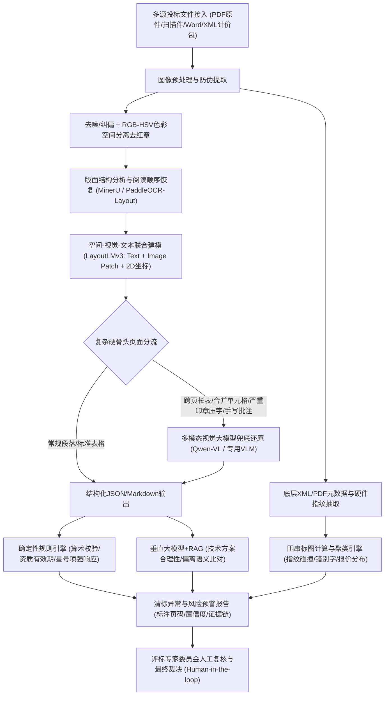
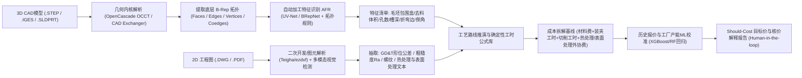

# 企业采购寻源与招投标全链路 AI 应用深度调研

> **核心判断**：截至 2026 年，企业招投标与工业采购寻源已成为第二产业中 AI 落地密度最高、但“技术幻觉风险与组织利益阻力”也最尖锐的战场。在政策端（发改法规〔2026〕195 号文落地倒计时）与降本审计压力下，行业已彻底摒弃“纯大模型端到端替人评标/自动下单”的幻想，收敛为 **“多模态版面/几何解析（MinerU/LayoutLMv3/VLM 与 OCCT B-Rep）+ 确定性规则/公式/图计算底座 + 垂直大模型 Agent + 强人工确认（Human-in-the-loop）”** 的四层混合架构。技术本身已能将千页标书清标、非标初审算价与百万级 MRO 编码清洗效率提升数倍至十余倍；真正卡住全链路落地的，是 **大模型的“数值/符号幻觉导致的废标索赔风险”**、**3D CAD 缺失 PMI 引发的 20%–40% 核价方差**，以及 **评标专家终身负责制、采购回扣与技术部指定品牌构成的组织灰色利益博弈**。

---

## 一、 甲方/招标与监管侧：发标排雷、AI智能清标、辅助评标与围串标穿透

在电网、能源、油气、钢铁、基建工程等实体行业，甲方（建设单位/工业集团/公共资源交易中心）每年面临海量标书与严厉的合规审计。2024–2026 年间，甲方侧 AI 已从早期的“关键词查重脚本”进化为贯穿发标、清标、辅助评标与围串标穿透的刚性风控网。

### 1.1 2026 政策坐标与发标源头合规排雷

#### （1）顶层政策拐点：发改法规〔2026〕195 号文
2026 年初，国家发展改革委、工信部、住建部、交通部、水利部、农业农村部、商务部、国务院国资委等 8 部门联合印发**《关于加快招标投标领域人工智能推广应用的实施意见》（发改法规〔2026〕195 号）**，划定了清晰的刚性时间表与业务边界：
- **两步走推进节点**：**2026 年底**，招标文件检测、智能辅助评标、围串标识别等重点场景在部分省市实现全覆盖应用；**2027 年底**，更多重点场景在全国范围内推广应用。
- **6 大环节 20 个重点场景全景**：覆盖“招标（策划、文件编制、文件检测）→ 投标（投标策划、合规自查）→ 开评标（开标、专家抽取、智能辅助评标）→ 定标（报告核验、辅助定标决策、合同签订）→ 交易中心现场管理（场所调度、见证管理、档案管理、智慧问答）→ 监管（专家管理、围串标识别、信用管理、协同监管、投诉处理）”。文件同时严格界定了“智评为主、人评为主体责任”的辅助原则，AI 结论不得直接替代专家和招标人的法定裁量权。

#### （2）招标文件编制与“排他性/倾向性暗桩”排雷
传统的招标文件合规审查依赖法务与代理机构肉眼翻看，极易放过业务部门或技术部门夹带的“萝卜坑”条款（如表面不点品牌，但把某家设备独有的尺寸公差、特定检测方法、冷门地域业绩或超规格资质门槛写进实质性条款）。

- **技术栈拆解**：
  1. **输入层**：招标文件草案（Word/PDF）、技术规范书（含参数表）、工程量清单、预算控制价。
  2. **合规知识底座**：国家及地方招投标法律法规库（《招标投标法实施条例》、财政部 87 号令等）、行业公平竞争审查负面清单、历史异议与投诉案例库、同品类历史中标单价穿透数据库。
  3. **核心算法流派**：**垂类微调 LLM + 检索增强生成（RAG）+ 法规条文/品牌特征词知识图谱**。系统不仅查显性违禁词（如出现特定商标），更做两层深度语义比对：
     - **语义级排他识别**：识别“近三年具有 XX 市同类业绩”（地域歧视）、“非特大型工程却要求双甲级资质”（门槛过高）、将非必要企业认证设为高权重加分项等隐蔽倾向。
     - **参数聚簇与品牌逆向映射**：将技术规范书中的几十项指标向量化，与外部设备参数库比对，若多条关键参数组合后仅指向 1–2 个特定厂商型号，系统直接亮黄/红灯预警“参数疑似量身定制”。
     - **历史中标价穿透比对**：针对控制价与预算清单，自动检索过去 12–24 个月同地区、同规格设备/工程的历史中标单价并联动大宗原材料指数（如铜、钢材期货均价），拦截虚高预算。
- **典型真实实践**：合肥市公共资源交易中心与科大讯飞联合落地的**“青天大模型”**将审查关口前移至招标文件发布前，叠加“三清单”共享核查与雷达监测，前 5 个月累计检查万余个项目，精准锁定并纠偏多起违规规避招标与排他倾向问题。
- **开环/闭环边界**：**全开环风险标注 + 人工修订确认（Human-in-the-loop）**。系统精准定位违规页码、条款原文、触犯的法规条目并给出改写建议，但最终是否修改、删减技术参数仍须招标人经办人员签字确认，否则工业非标设备确因现场工况接口限制需要兼容性匹配时容易被通用规则误杀。

---

### 1.2 千页标书毫秒/分钟级智能清标与辅助评标技术栈

工业设备与大型工程项目的投标文件动辄 500–2000 页，包含大量扫描版资质证明、带红章覆盖的参数表、跨页施工组织设计及加密工程量清单。过去依赖通用 OCR（光学字符识别）直接抽文本喂给大模型，在实战中几乎全军覆没。

#### （1）工业级标书多模态解析与清标标准流水线

- **为什么必须走“MinerU + LayoutLMv3 + VLM + 规则引擎”四级串联？**
  1. **阅读顺序与栏位错乱**：工程标书常出现双栏排版、页眉页脚嵌入项目编号、侧边批注。**MinerU** 或 **PaddleOCR-Layout** 通过版面目标检测先切分标题、正文、表格、图表区域并恢复真实阅读顺序，防止页眉文字插进正文指标中。
  2. **表头断裂与行列错位**：标书参数响应表经常跨 5–10 页。**LayoutLMv3** 同时输入文本词元、图像 Patch 视觉特征与文本框二维坐标 `(x0, y0, x1, y1)`，依靠空间几何对齐将“技术指标要求—投标响应值—偏离情况”锁死在同一逻辑行。
  3. **红章遮挡与跨页延续**：公章压盖关键日期或数字时，先利用 **RGB/HSV 颜色空间分离**去除红色印章通道，再对极度模糊或跨页无重复表头的表格交由 **Qwen-VL** 等视觉大模型基于全局视觉上下文进行还原与内容推断。
  4. **确定性逻辑绝不交给大模型**：所有算术乘法汇总、日期有效期比较（如营业执照/安许证是否过期）、“★”号条款是否全部命中，必须由**后端确定性规则引擎/代码脚本**执行，杜绝 LLM 的概率算术错误与遗漏。
- **算力形态与推理时延要求**：为避免开标评标现场阻塞且满足保密要求，大型央国企与省级交易中心普遍采用**机房本地 GPU 集群（如多卡 A100/H20/昇腾 910B 服务器）部署异步解析队列**。通常百页级清晰电子 PDF 解析与结构化抽取需 **1–3 秒**（商业解析引擎如 TextIn 等实测水位），含大量扫描红章页的千页标书结合 VLM 兜底与跨标比对可在 **5–15 分钟** 内输出全量清标异常报告，匹配现场开评标节奏。

#### （2）头部央企与公共资源交易平台真实落地水位对比

| 机构 / 平台 | 核心 AI 系统 / 底座 | 覆盖业务场景 | 公开实测工程指标与真实边界 |
| :--- | :--- | :--- | :--- |
| **国家电网** | **光明物资评标大模型**（基于电力行业高质量数据集私有部署） | 输变电设备、配网物资千页标书解析、技术参数比对、客观项秒级初评、围串标全网预警 | 公开实践显示单个千页级标书解析与评审从 **30 分钟压缩至 15 分钟**，全流程综合评审效率提升超 **4 倍**；国网山东、湖北分部智能清标应用使人工复核工作量减少 **60%**。客观项自动初评，主观分仍为“AI 第一阅评建议 + 专家最终确认”。 |
| **南方电网** | 新一代智能体（Agent）平台 + 供应链电子招采系统 | 多批次框架招标 AI 辅助评标、清单清标、硬件与联系人穿透 | 除内容清标外，强项在于底层硬件特征码（硬盘序列号、MAC 地址、上传 IP）与获取标书联系人电话的多维交叉核查。 |
| **国家能源集团** | **智能无人评审系统**（国能 e 购/e 招）+ **“擎源”电力行业大模型** + DeepSeek 私有化基座 | 非招标全类别采购（物资/工程/服务）、数十种资质业绩智能评审、2026 年 7 月上线国能 e 招智能评标板块 | 在非招标采购场景下，“智能无人评审系统”官方公布综合准确率保持在 **97% 以上**；涉及公开招标的重大项目仍保留专家委员会复核兜底。 |
| **中国宝武（欧冶工业品）** | 宝武欧贝平台（OBEI）+ 属地化 **DeepSeek-R1**（2025 年初完成私有部署）+ 工业品品类专家智能体 | 物料与单品智能审核、资材备件合同自动审单、寻源评估、库存平衡与吨钢成本优化 | 公开披露数据显示，借助数智化集采与 AI 审单体系，实现**高达 90% 的资材备件合同自动审核**、**吨钢资材备件采购成本同比下降 15%**、全口径资材备件库存较专业化整合前**下降 40%**；非标复杂采购与重大异常处理仍须品类专家复核。 |
| **中国石油** | **昆仑大模型（物资采购 L2 专业模型）** + 覆盖“编、审、评、答”的**招标智能体矩阵** | 招标文件合规校验、防爆设备/特种管材资质核验、股权穿透查询与“一键清标” | 将十余家以上投标单位的资质核验、股权穿透与基础清标由传统耗时**大半天压缩至几分钟**；融合石油行业标准与内部制度后，高频业务问答与合规审核准确率稳定在 **90% 以上**；适用于规则明确的合规与基础核验，深度技术方案评价仍由专家主导。 |
| **合肥公共资源交易中心** | **青天大模型**（联合科大讯飞研发） | 招标文件质检、电梯类等项目“模型先评、专家复核”、暗标语义雷达监测 | 电梯类等试点项目单次评审从平均 **3.5 小时降至 15 分钟**（效率跃升 **14 倍**）；辅助专家评审总体准确率 **90.63%**（局部试点出现人工评委全票采纳 AI 打分）。严格实行辅助定位，不替代专家法定判断。 |
| **深圳交易集团** | 深圳公共资源交易智慧平台 | AI 资格审查 + AI 辅助评标 + AI 围串标识别 | 在全国率先完成首个小型建设工程 **AI“无人化”评审试点**，但大型复杂工程仍受法规与责任限制维持人机协同。 |
| **广联达 / 新点软件 / 北京筑龙** | 广联达云清标（GBQ/XML 接口）、新点公共资源电子交易清标引擎、筑龙智慧招采 | 工程量清单算术清标、不平衡报价离散分析、计价加密锁号与文档指纹查重 | 行业基础设施级工具；算术与特征码核对接近 100% 确定性，但非标准 PDF 扫描件报价单仍需先转结构化并由造价师复核。 |

---

### 1.3 工程量清单（BOQ）算术核对与不平衡报价数学模型

在土木建筑、能源基建与工厂 EPC 总包招标中，乙方常在总报价不变的前提下故意制造“不平衡报价”（如把前期桩基/土方单价报高早回款、把后期装修报低，或针对图纸明显漏算工程量的分项报天价以待后期变更索赔）。广联达、新点等清标系统主要通过以下**确定性数学模型与统计规则**（而非大语言模型自由推理）实现秒级清标：

1. **硬性算术与逻辑校验（Zero-Tolerance Checks）**：
   - 重新计算所有清单子目 $\text{合价}_i = \text{工程量}_i \times \text{综合单价}_i$，核验分部分项工程费、措施费、规费、税金层级累加及总价一致性，揪出“单价乘积不等于合价”的隐藏计算错漏；
   - 自动筛查单价为 `0`、负数或明显遗漏取费的项目。
2. **多标横向离散度与基准偏差算法**：
   - 汇聚同一清标标段所有有效投标人在第 $i$ 项上的综合单价 $P_{i,k}$，计算统计基准价 $\bar{P}_i$（算术均值、剔除极值后的中位数，或结合招标控制价的加权基准）。
   - 计算偏差率：
     $$\text{偏差率}_{i,k} = \frac{P_{i,k} - \bar{P}_i}{\bar{P}_i} \times 100\%$$
   - 行业常用阈值：当某条关键清单单价偏差率超过 **$\pm 15\% \sim \pm 30\%$** 时自动标红为“显著不平衡报价嫌疑”。
3. **时间序列斜率与量-价弹性关联分析**：
   - **“前重后轻”检测**：按照施工工序（基础 $\to$ 主体 $\to$ 安装/装饰）映射清单序列，用回归斜率检验投标单价相对于控制价的比例是否随工序推进呈明显单调下降趋势。
   - **量-价反向博弈检测**：计算单价偏差率与清单工程量变动潜力的相关性——若投标人在招标工程量极小的清单项上报出极高单价、在工程量大且不易变更项上报出极低单价，系统提示“量差索赔博弈”。
4. **人-材-机底层成本底线反算（防恶意低价抢标）**：
   - 解构综合单价底层的人工费、主材费、机械台班消耗量，与地方造价信息价及近期市场要素价格比对；当主材报价跌破同期合理市场要素下限（如低于 **70%–80%** 区间）时，触发“疑似低于成本恶性竞标”预警。

---

### 1.4 围串标/陪标穿透式识别与“道魔博弈”

围串标识别是目前发改法规〔2026〕195 号与央国企反腐监控的重中之重。现行系统采用**“物理特征取证 + 文本语义碰撞 + 报价聚类 + 企业关联图谱”**四维围剿：

1. **电子文档与硬件元数据同源穿透**：
   - 解析电子标书封装包及上传日志中的网卡 **MAC 地址**、**CPU/硬盘序列号**、**上传 IP 地址**、**计价软件加密锁号（USB Key ID）**；
   - 解析 Word/PDF 底层元数据（Metadata）中的“作者（Author）”、“最后一次修改者”、“公司模板内部标识符”、修订时间戳序列。
2. **隐蔽文本与错别字指纹碰撞**：
   - 利用 NLP 语义指纹与局部敏感哈希（MinHash/SimHash）进行段落结构、技术路线编排和句法同源检测；
   - 抓取冷门错别字、特定标点误用、特殊自造词或完全一致的排版瑕疵（“错别字克隆”往往是同一标书代写人复制粘贴留下的铁证）。
3. **报价矩阵聚类与博弈特征分析**：
   - 对所有投标人的数千项分部分项单价做向量化聚类（如层次聚类/余弦相似度）与比例关系检测，识破“基准表乘以固定下浮系数（如 `1.015`、`1.028`）”的陪标报价矩阵。
4. **外部工商股权与社保穿透图谱**：
   - 基于图数据库构建“企业—法人—实控人—多层嵌套有限合伙—历史投标共现—社保代缴/共用联系人手机号”关联网络，识别表象毫无股权交叉、实则背后共用同一批核心人员或同一造价咨询团队的隐性挂靠与围标团伙。

> [!WARNING]
> **深水区踩坑与“道高一尺魔高一丈”的真实对抗**
> 1. **反侦察规避手段已实现“AI 对抗 AI”**：专业围标团伙目前已普遍采用**虚拟机多开隔离 + 动态 IP 代理池**抹除硬件与网络指纹；使用物理上完全独立的不同电脑与加密锁分别生成最终文件；甚至引入**商用大模型对核心技术标做同义改写“洗稿”**，并刻意在各家标书中人为注入**差异化的低级错别字与排版微调**，同时采用异地分散外包撰写，让纯文本与元数据检测失灵。
> 2. **评标专家终身责任制下的“AI 红灯恐惧症”与误判困局**：我国推行评标专家终身负责制，但 AI 算法本身不具备独立承担法律责任的主体资格。实务中一旦 AI 清标系统弹出“疑似围串标/雷同（如相似度 72%）”的红黄灯预警，专家为了规避事后纪检审计“未发现明显串标”的终身追责，往往出现**心理防御性“一刀切直接废标”**。
> 3. **高误报（False Positive）冤杀痛点**：在特种设备、电网标准物资或强制国标工程中，技术规范本就高度统一；或几家独立投标人恰好合法委托了同一家第三方造价软件服务商/标准图集库；或微利行业各家成本核算高度趋同，极易触发 AI 语义雷同或报价聚类误警。由于神经网络推理逻辑存在黑箱特性，若缺乏明确的可解释证据链与投标人现场申诉质询机制，AI 辅助极易异化为“算法盲目裁决”。

---

## 二、 乙方/工业设备厂与EPC投标侧：废标红线拦截、技术规格偏离表与防泄密私有化

站在工业装备厂（如变压器、高压开关柜、化工泵阀、自动化产线集成商）和 EPC 工程总包商视角，投标侧的核心诉求与甲方完全相反：**“不废标远大于写得快”**，其次才是如何在几十页的技术规格偏离表里做到精准对齐、不挖技术违约坑，同时死守商业底价不外泄。

### 2.1 “60% 死于细节”：废标红线拦截与交标前终审体检

#### （1）废标重灾区真实分布
根据招投标实务大数据统计，在竞争激烈、条款严苛的工业与政企项目中，**因形式审查与符合性审查不合格（非技术实力与报价竞争力原因）导致的废标，最高可占全部无效标原因的 60% 左右**。绝大多数投标团队败在“深夜赶标”时的低级疏漏：
1. **隐匿在数百页附件里的“★/☆”号实质性条款漏响或负偏离**：招标人常将关键交货期、质保年限、防爆等级或某项试验报告要求埋在技术规范书附件小字或跨页表格底部，标注“★”或加粗下划线，漏填即一票否决。
2. **资质与人员证书瑕疵**：营业执照/安全生产许可证过期；项目经理建造师证书专业不符；要求的近 6 个月社保证明与投标单位公章主体不一致（如子公司人员借用母公司资质未附关系证明）；联合体成员又单独参与同一标段投标。
3. **签章漏页与电子标封装失误**：法人章/授权代表签字遗漏、骑缝章漏盖、CA 数字证书过期、Word 转 PDF 错页/缺页或目录页码与正文对不上。
4. **暗标“露名”违例**：技术标暗标评审严禁出现任何可识别投标人身份的信息。高频翻车点包括：**CAD 工程图图框右下角保留了公司名称或设计人签名、设备照片里的铭牌未打码、正文页眉水印残留、Word 文档属性保留作者公司名、字体/字号/行距未严格执行暗标规定（如要求全篇黑体五号无彩色图表却混入蓝色超链接或特殊底纹）**。

#### （2）交标前终审体检 Agent 工作机制
市场上代表性的国内投标 AI 工具（如**火眼标书/火眼审阅（法狗狗旗下，支持 Word/PDF/OFD 及工程图片查重与私有化部署）、智标领航（AI 写标书与废标项自查）、合合信息 TextIn 文档解析、北京筑龙**以及头部工业企业自研 Agent）正在充当“交标前防雷质检员”：
- **核心架构**：**版面解析引擎（MinerU/TextIn）+ 交叉核验规则引擎 + RAG 语义校验**。
- **核心检查项**：
  1. **实质性条款双向倒查**：把招标文件所有含“★/☆/必须/不得/废标/无效”的句子抽成刚性 Checklist，反向检索投标文件响应页码与偏离表原文，任何一项无对应答复立即阻塞提示。
  2. **跨文档一致性勾稽**：自动校验《投标函》总价、开标一览表、分项报价表合价、技术标工期/质保期/项目经理姓名是否全篇一致；扫描资质原件 OCR 有效期截止日是否晚于开标日。
  3. **暗标物理级脱敏扫描**：对标书正文、图片（含嵌入截图的 OCR）、CAD 导出矢量图及 PDF 元数据做全局实体识别（NER），暴力检索企业全称、简称、商标、高管姓名、过往项目所在地、非法字体格式及非黑白像素。
- **边界定性**：**强规则拦截 + 人工逐项消警（Human-in-the-loop）**，目前没有任何一家成熟工业装备企业敢跳过人类标书经理签字直接由 Agent 自动上传加密标书。

---

### 2.2 硬骨头攻坚：非标工业设备技术规格偏离表自动对齐

对于变压器、特种泵阀、工业机器人产线、空分压缩机等非标工业装备，招标书里的《技术规格偏离表（Technical Deviation Table）》往往长达几十页、涵盖 **200–800 项** 细粒度参数（如绝缘耐热等级、温升限值、防护等级 IP65、法兰标准 GB/T 9119 vs ASME B16.5、振动烈度、噪音 dB(A)、PLC 接口协议及环境工况 `-30℃~+50℃`）。

#### （1）双向语义对齐工程流水线
1. **基准表精准拆解**：使用 **TextIn / MinerU + LayoutLMv3** 解决跨页合并表头、嵌套子表（如主表套子设备参数表）的行列关联，输出带表头上下文的 JSON 基准项。
2. **企业内部 PDM/PLM 与型录知识库混合检索**：将每项招标参数同时做**精确关键词/型号匹配（BM25）+ 向量语义检索**，对照企业内部 PDM 参数库、标准产品型录（Catalog）与历史中标偏离表。
3. **规则判定与偏离说明草拟**：
   - 将数值型指标通过正则/结构化抽取拆解为 `{物理量, 比较符(≥/≤/±), 数值, 单位, 工况前置条件}`；
   - **单位归一化与确定性数值比对**：通过工程单位换算脚本统一换算（如 `MPa` ↔ `bar` ↔ `kPa`、`m³/h` ↔ `L/min`）后，由代码判定“正偏离 / 无偏离 / 负偏离”，再由 LLM 生成合规的偏离表商务/技术说明。

#### （2）通用大模型翻车的四大幻觉“死穴”

| 翻车类型 | 真实出错机理 | 工业投标灾难性后果 |
| :--- | :--- | :--- |
| **1. 长上下文“中间丢失”（Lost in the Middle）** | 把 300 页招标文件直接扔给长上下文通用 LLM，模型注意力集中在首尾页，漏掉藏在第 180 页补充说明里的“★号带载测试要求”或“特定油漆厚度”。 | 漏响应实质性条款，开标现场直接**废标**。 |
| **2. “合理脑补”瞎编参数承诺** | 企业 PDM 库里缺失某项冷门指标（如“抗震设防烈度 9 度下的共振频率”），通用大模型基于“积极配合用户完成任务”的对齐倾向，直接在偏离表里幻觉填入“满足/无偏离”。 | 若被评标专家识破（与型式试验报告矛盾），按**弄虚作假**废标、没收投标保证金并纳入供应商黑名单；若侥幸中标，交付验收不达标触发**巨额违约索赔与退货**。 |
| **3. 跨页表格行列错位与单位/不等号反转** | 跨页表缺少表头时，切片 RAG 把第 3 行产品参数对应到了第 4 行需求上；或将“噪声 $\le 65\text{ dB}$”与自身实测“$68\text{ dB}$”误判为“正偏离（因为 $68>65$）”，忽略了噪声/能耗/误差类指标“越小越优”的工程极性。 | 技术偏离表大面积指鹿为马，被直接判定实质性负偏离废标。 |
| **4. 忽略限定边界条件** | 只匹配到主数值“额定流量 $100\text{ m}^3/\text{h}$ 满足”，却漏掉后面的括号限定“（在介质粘度 $300\text{ cSt}$、出口背压 $1.6\text{ MPa}$ 工况下）”。 | 设备选型严重偏小，现场投产无法达标，引发工程项目索赔纠纷。 |

#### （3）国内外标书/RFP AI 工具真实定位对比
- **海外阵营（Responsive 原 RFPIO、Loopio）**：在欧美标准品与 B2B 软件/通用工业 RFP 中广泛应用，核心机制是**“库限制型 RAG（Library-restricted RAG）”**——强制 AI 只能从经法务与技术专家事先审定批准的 Q&A 知识库里拼接答案，结合强制 SME（领域专家）审批门控与出处溯源来压低幻觉。但其**致命短板**在于：绝大多数架构为**多租户公有云 SaaS**（虽通过 SOC 2 Type II、ISO 27001 认证及零训练数据保留承诺），**不支持开箱即用的本地物理隔离或气隙（Air-gapped）私有化部署**，难以满足国内军工、能源装备、大型制造集团的保密红线，且对中文复杂嵌套跨页工程表的版面还原能力较弱。
- **国内阵营（火眼标书/火眼审阅、智标领航、合合信息 TextIn、北京筑龙、广联达云清标及企业自研方案）**：在复杂中文 PDF 版面解析（特别是跨页表格与印章分离）、工程图片/文档指纹查重、暗标查错和国央企评标规则贴合度上明显领先，并普遍提供**单机版 / 私有化一体机 / 本地服务器容器部署选项**。

---

### 2.3 工程量清单（BOQ）/历史 BOM 估价联动与长篇技术标防幻觉审查

在 EPC 工程总包、成套工业装备（如整套空分站、涂装线、污水处理站）投标中，长期存在**“技术标与商务标两张皮”**的致命脱节——技术工程师在施工组织设计/方案中写了采用高规格防爆配置或重型机械施工，预算员在商务组价时却沿用常规清单定额漏算措施费；或者技术标编纂时大模型“自由发挥”编造了不存在的国标条款、虚构过往业绩合同号。

#### （1）BOQ / 历史 BOM 成本库联动算价架构
真正落地的估价联动系统必须切断“大模型直接算钱”的危险链路，构建 **“语义拆项映射 + 企业实绩定额库 + 确定性算价引擎”** 的三层结构：
1. **技术方案参数提取与 BOQ 自动挂接**：LLM/文档解析引擎读取技术标与施工组织设计（如工法选择、桩基/基坑支护形式、吊装机械吨位、核心配套设备选型），将其映射至招标工程量清单（BOQ）子目或标准成套设备 BOM 结构树，自动识别技术方案变更引发的**清单增补项与措施项目费联动**（例如施工方案由人工开挖调整为旋挖钻机后，联动替换对应的机械台班与临水临电定额项）。
2. **企业定额与历史实绩成本库检索**：不同于国标/地方统一定额的僵化滞后，智能组价系统通过混合检索（规则编码+向量相似度）调取企业内部保密的**“企业定额”**及**“已完工项目历史实绩成本库”**（真实分包成交价、焊材/钢材实耗损耗率、特定地质或工况下的人工工日实绩），并引入近期主材行情（铜、铝、型钢、特种树脂期货波动率）做敏感性区间测算。
3. **漏项/暂估价校验与确定性计算**：所有工程量乘积、分部分项汇总、规费税金、利润率测算全部交由**确定性计价引擎（如广联达计价底层或自研规则脚本）**执行；同时系统硬性扫描清单中的**暂估价、甲供材、零单价及超最高限价红线**，并反向核对“技术标出现的特种设备/工艺”是否在商务分项报价表中存在对应计价行，防止出现“中了标却漏算百万元主材/安装费”的亏本死局。

#### （2）长篇技术标/施工组织设计编纂防幻觉审查链路
面对动辄 300–1000 页的技术方案与施工组织设计，严禁直接用通用大模型从零“创作”，工程实践中普遍采用以下三重防幻觉刚性护栏：
1. **结构化模板锁死与“库限制型”RAG**：系统首先按招标文件评分细则与废标条款生成刚性大纲骨架，每个章节仅允许从企业经法务/总工审核入库的**“合规工法库、型式试验报告库、真实合同业绩台账”**中检索组装段落，禁止模型调用开放域预训练记忆自由编造标准编号（如杜绝 LLM 将作废旧国标或虚构规范写入标书）。
2. **强制颗粒度证据溯源（Claim-to-Source Traceability）**：技术标中生成的每一句性能指标承诺、工期节点、质量标准或过往业绩金额，必须在后台界面强制绑定来源锚点（一键穿透跳转至：**① 招标文件第 X 页条款、② 对应版本施工图/PDM 型号规格书、③ 企业真实业绩合同扫描件及发票编号**），凡无锚点支撑的生成语句一律标黄禁止定稿。
3. **跨文档逻辑一致性交叉校验（Cross-Document Verification）**：由独立校验 Agent 扫描全套标书，执行刚性规则核对——检查技术标正文的设备功率、交货周期、质保期、项目经理姓名、安全投入比例是否与商务标报价明细、偏离表、开标一览表**100% 字符一致**，并在终审界面要求**总工与商务经理双签放行（Human-in-the-loop）**。

---

### 2.4 工业级私有化部署防泄密刚需、算力选型与全生命周期 TCO/ROI 账本

工业装备厂的投标文档集中了企业最核心的资产：**成本 BOM 底价、企业定额、毛利红线、未公开的设备性能曲线、历史客户合同台账与特种工艺诀窍**。一旦上传外部公有云 API，不仅违背国央企/军工保密条款，还面临商业机密泄露风险。因此，大中型制造企业普遍强刚需**本地私有化部署（数据不出局域网）**。

#### （1）常见本地推理底座与显卡算力配置对比
以典型 `MinerU + LayoutLMv3 + Qwen-32B/72B 或 DeepSeek-R1-Distill-32B/70B` 私有化一体机为例：
- **显存与推理精度基线**：**32B 级模型**原生 BF16 约需 **64–70GB** 显存，经 INT4/AWQ/FP8 量化后约需 **20–25GB**（适合轻量级标书摘要与初筛）；**70B/72B 级模型**原生 BF16 约需 **140–160GB** 显存，量化后（INT4/FP8）约需 **40–50GB**，在复杂逻辑推理、技术偏离极性判断与跨页表格长文对齐上显著优于 32B，是中型以上投标部门的主力选型。

| 部署方案 | 典型硬件配置 | 硬件与基础集成参考预算 | 核心优势与适用边界 | 真实踩坑与限制 |
| :--- | :--- | :--- | :--- | :--- |
| **企业级合规方案（英伟达路线）** | 1 台 4U 机架服务器配置 **2–4 张 A100 (80GB)** 或 **4–8 张 H20 (96GB HBM3)** + vLLM/TensorRT-LLM | **40万 – 110万元**（硬件约 30–80 万，RAG 平台/软件授权与实施约 10–30 万） | 满足 50–200 人并发、首字延迟可控、ECC 显存校验与 7×24 小时企业级 SLA 质保；通过等保与国央企采购审计。 | A100 受供应链限制采购周期长且溢价高；H20 FP16 纯算力受限，需靠 96GB 大显存与多卡总线带宽支撑高并发吞吐。 |
| **信创国产算力一体机** | 搭载 **华为昇腾 Ascend 910B** / 海光 / 昆仑芯的预集成 AI 一体机 | 与同级企业级方案相近（按卡数与软件授权浮动） | 彻底满足信创国产化替代与涉密政企/央国企招投标准入要求，开箱即用免去底层集群运维。 | 算子生态与部分前沿开源多模态文档解析库（如特定视觉算子）适配周期略慢于 CUDA 生态，部署前需实测 MinerU/VLM 吞吐 TPS。 |
| **私企轻量 PoC 方案** | **2–4 张消费级 RTX 4090 (24GB)** 组装工作站（跑量化版 32B/70B） | **4万 – 8万元**（纯硬件组装） | 单卡性价比极高，适合中小型民营零部件厂/机加工厂内部测试与 10 人以下投标团队轻量化使用。 | **无 ECC 显存校验、无企业级 SLA 质保、机架散热差**，PCIe 带宽限制多卡通信，**无法通过正规大中型政企或央国企的硬件合规标书验收**。 |

#### （2）采购与投标 AI 项目完整 TCO（总拥有成本）与 ROI 回本周期测算模型
企业决不能只算“买几张显卡的钱”，真正决定项目算得过账与否的是**包含主数据清洗与系统对接在内的全口径 TCO**。以下基于行业公开实施基准，给出一套典型中型制造企业（**年采购额 10 亿元尺度 / 500 家核心供应商 / 5–10 人投标与采购协同团队**）的成本收益测算框架：

| 财务维度 | 细分构成项 | 参考投入/收益水位（中型制造企业参考基准） | 关键说明与财务死穴警示 |
| :--- | :--- | :--- | :--- |
| **一次性建设与首年 TCO** | ① **AI 软件许可与私有部署 / 算力底座** | 私有化一体机（见上表 **40万–110万**）或轻量 SaaS/混合方案（标准 SRM 许可 20–80 万 + AI 高阶模块 10–30 万/年） | 仅购置纯投标体检 SaaS/工作站门槛低；若需全集团私有化并发与 CAD/ERP 打通，软硬底座成本迅速放大。 |
| **一次性建设与首年 TCO** | ② **历史主数据与标书库清洗成本** | **10万 – 30万元**（10 万条以内物料与供应商数据清洗，含第三方工具+内部抽调业务专家人工校验工时） | **行业铁律：必须划拨总预算的 15%–20% 做主数据清洗**。跳过清洗直接上 AI 模型，会因“垃圾进、垃圾出”导致比价和偏离匹配全部失真。 |
| **一次性建设与首年 TCO** | ③ **ERP / PLM / SRM 系统集成定制费** | **30万 – 80万元**（对接 SAP/用友/金蝶、PDM 参数库与企业微信/OA 审批流，实施费常与软件授权相当） | 非标接口与老旧 ERP 脏字段映射往往吃掉最多工期，极易出现超预算烂尾。 |
| **年度持续运维成本** | ④ **模型微调、规则库维护与算力电费维保** | **10万 – 25万元 / 年**（含法规库更新、新品类参数迭代、AI 模块年度订阅或硬件维保） | 上线后若无人持续把新废标案例、新工艺价格反馈回 RAG/规则库，半年后准确率将明显退化。 |
| **总计首年 TCO 基准** | **全链路采购 + 投标 AI 综合落地** | **轻量单点落地：15万 – 40万元**；**全链路 ERP/SRM 深度集成：80万 – 200万元** | 必须按企业年采购体量与投标中标额规模分层投入，切忌小厂硬上百万级重型平台。 |
| **年度可量化 ROI 收益** | ① **投标止损与报价漏项拦截** | 成功拦截 **1–2 次千万级项目废标或重大漏项亏本中标**，单次止损即覆盖整套轻量系统投入 | 仅按避免没收投标保证金（通常占项目估算价 1%–2%）与减少标书编制 50%+ 加班人力即可快速打平。 |
| **年度可量化 ROI 收益** | ② **采购阳光比价与 MRO 主数据降本** | 行业实证通过全网寻源、反向竞价与 MRO 归一平均可实现 **2.5%–8% 直接采购降本**；以年采购额 10 亿元保守按 2.5% 计即为 **2,500万元/年**，同时财务月度三单对账周期可从平均 **7 天压至 1 天** | **真实回本周期（Payback Period）**：主数据清洗 + 异构询比价/投标自检等刚需模块通常 **3–6 个月** 回本；覆盖全链路深度风控与 3D 核价的综合项目一般为 **6–12 个月** 回本。但前提是**管理层能顶住采购与技术部门的利益抵抗（见第四章）**。 |

---

## 三、 制造业直接采购（Direct）、非标定制件与MRO寻源全链路攻坚

离开招投标大厅进入工厂内部，生产物料采购划分为三大品类：**直接生产物料（Direct BOM）**、**非标定制件（机加工/钣金/注塑模具）** 与 **非生产性MRO工业品**。这里没有“写标书”的文字游戏，而是直接面对 3D 几何拓扑、工艺工时、百万级乱码主数据与五花八门的微信报价单。

### 3.1 非标机械件/钣金件/注塑模具的 CAD 图纸解析与 Should-Cost 自动核价

#### （1）为什么普通 OCR 只能读标题栏，完全看不懂工程图纸？
很多外行尝试用“通用 OCR + 视觉大模型”直接读取 2D DWG 或工程图 PDF 来自动报价，实战结果几乎全部报错甚至报价偏差数倍。核心技术盲区在于：
1. **DWG 图元的“炸开”与孤立几何灾难**：工程师导出的 DWG/DXF 文件中，大量表格和标注并非完整文本对象，而是嵌套的**块参照（Block Reference）**或被彻底“炸开（Explode）”的**多段线（Polyline）与零散直线段**；且尺寸标注随视图呈 **30°、45° 旋转**，传统 OCR 连字符方向与所属边界都切不对。
2. **语义完全依赖视图与符号的“空间绑定”**：工程图纸里的孔径、深孔比、位置度（`⌖`）、同轴度（`◎`）、垂直度（`⊥`）、圆跳动等 **GD&T 形位公差框** 以及表面粗糙度符号（如 `Ra 0.8` vs `Ra 3.2`），必须精准绑定到主视图/俯视图/局部剖视图中的**某一条特定边界或某一个内孔**上。同样一个 $\Phi 20\text{ mm}$ 通孔，普通钻孔 $Ra 6.3$ 只要几块钱，若标了同轴度 $0.01\text{ mm}$ 加内圆磨床精磨 $Ra 0.4$，加工工时与成本直接飙升 **5–10 倍**。
3. **隐蔽的“未注要求文本块”决定生死**：决定热处理外协费（如“调质处理 HRC 28–32”、“表面阳极氧化/硬铬/发黑”）、未注尺寸公差（如“未注公差按 GB/T 1804-m 级”）以及探伤要求的关键约束，往往全写在图纸右下角标题栏上方的一段纯文本《技术要求》里，与 3D 模型完全脱离。

#### （2）现代工业级 CAD/STEP 解析与 Should-Cost 自动核价技术栈

当前真正能够投入实战的方案，必须走**“3D B-Rep 拓扑几何引擎 + 2D 图纸信息融合 + 工艺工时公式库 + 历史报价 ML 校准”**的混合路径：

- **底层几何内核**：商业 SDK 如 **CAD Exchanger**、国产底座如**华天软件**（CrownCAD / SView 几何造型内核），以及开源引擎 **OpenCascade（OCCT / `pythonOCC`）**，负责无损读取 STEP/IGES 文件底层的 **B-Rep（Boundary Representation，边界表示）** 数学结构——因为相比点云（Point Cloud）和三角网格（Mesh），只有 B-Rep 能无损精确表达圆柱面、倒角半径和精确拓扑共边关系。
- **特征识别算法（AFR）**：早期完全靠硬编码拓扑规则搜寻凹凸边；前沿深度学习则引入了 Autodesk AI Lab 等提出的 **UV-Net**（将 B-Rep 曲面的 U-V 参数网格卷积 CNN 与面邻接拓扑图 GNN 融合）以及 **BRepNet**（直接在 B-Rep 的定向共边 Coedges 上定义卷积核传递消息），直接识别盲孔、沉头孔、深腔、薄壁、凸台与钣金折弯特征。
- **确定性公式核算 + ML 校准**：AI 不直接“猜总价”，而是先确定毛坯尺寸包围盒（Bounding Box）计算下料重量与材料费，再按特征体积去除率（MRR）、机床主轴功率、装夹翻面次数、标准换刀时间和表面处理面积算出**确定性工艺工时与物理成本**；最后用机器学习模型基于历史实际采购价、地区机台费率与当前产能负荷进行误差校正。

#### （3）国内外主流非标核价平台真实水位与误差真相

| 代表厂商/系统 | 技术定位与核心方法 | 适用工艺覆盖 | 公开真实指标与工程局限性 |
| :--- | :--- | :--- | :--- |
| **aPriori**（美国） | 面向主机厂采购与设计的 **Should-Cost 数字孪生仿真平台** | CNC 机加工、钣金冲压、注塑、铸造（含“虚拟数字工厂”区域费率配置） | 公开实践明确表明：系统算出的 Should-Cost 理论合理价与供应商实际市场报价之间普遍存在 **20%–40% 的结构性方差（Variance）**（受供应商产能利用率、战略低价抢单、排料套料实时算法、注塑模具滑块/斜顶及铸件缩松良率波动影响）。**只能作为采购谈判基线与 Design-to-Cost 工具，绝不能直接按其报价下单。** |
| **Paperless Parts**（美国） | 面向中小定制机加工厂（Job Shop）的自动化报价与工艺路由 SaaS | CNC 车铣、钣金加工 | 解析 B-Rep 几何特征并自动匹配工厂自有设备费率规则，**自动高亮标记 2D 图纸上的关键 GD&T 公差与文本警告供人类报价师复核**，不盲目全自动发价。 |
| **Xometry / 米思米 meviy** | 数字化制造交易平台 Instant Quoting Engine / 在线机加工即时报价 | 机加工、钣金、3D 打印、注塑 | 基于海量历史成交订单用 ML 直接秒级出市场价；但 Xometry 明确设置免责机制——**伴随上传的 2D PDF 工程图对 GD&T 公差和表面处理具有最终控制权**，严苛公差会触发后台工艺审核并动态调价。 |
| **蚂蚁工场（“蚂蚁格物”）** | 联合北航推出的**零件制造大模型** + 工业零件计价系统（Enterprise 一体机 V2.0） | 自动化装备标准/非标机加工件、精密零件 | 依托千万级历史图纸与工艺工时库，主打“秒报、分接、小时造”；公开披露在常规标准机加工件上可将传统 **1 人天** 的手工拆图算价闭环工作压缩至 **15 分钟左右**，并附带计价风险预警。 |
| **海智在线** | 《基于 AI 的非标零部件工厂智能报价系统》 | 多品类非标外协零部件 | 针对不同代工厂设备新旧、管理费率迥异的痛点，构建**可配置的“工厂模型”**而非单一全网均值模型，输出可拆解、可追溯的工艺工时构成，避免用平均值抹平工艺差异。 |

#### （4）非标核价一线的“脏数据”尸检清单
1. **3D 模型无 PMI（产品制造信息）且与 2D 图纸版本打架**：设计工程师修改公差或改了螺纹规格，只改了 2D DWG/PDF（甚至用手写红笔批注拍照片发给采购）而未同步更新 3D STEP（Rev A 与 Rev C 混用），导致 B-Rep 解析全盘失真。
2. **工艺特征“黑箱”无法仅凭几何推断**：例如铸件的浇冒口设计、缩松探伤报废率（可能高达 10%–20%）、薄壁件精铣热变形必须增加的时效退火次数、复杂异形曲面所需的特殊定制夹具（Soft Jaws）成本，静态几何模型几乎无法自动算准。
3. **国内中小机加工厂缺少真实工时台账**：多数年产值几千万的配套厂没有标准化的工时与设备折旧记录，历史报价单只留一个总价且夹杂着当时加急插单的溢价水分，ML 吃进去的是混乱报价，吐出来的只能是随机拟合噪声。

---

### 3.2 EBOM → MBOM → PBOM 转换与百万级 MRO“一物多码”治理

#### （1）EBOM → MBOM → PBOM 转换：确定性 PLM 为主、AI 仅作语义辅佐
制造业直接物料（Direct Materials）的采购源头是研发设计发布的 **EBOM（工程物料清单）**，必须经过工艺部门重构转化为 **PBOM（工艺物料清单）** 与 **MBOM（制造物料清单）** 后，才能下发给 ERP/SRM 触发采购。这绝非简单的“清单格式翻译”，而是包含严密制造工程约束的重构过程：
- **核心工程转换动作**：① **虚零件（Phantom Item）消减与合件/拆分**（研发按功能模块画的总成，在车间装配时需打散并入不同工位子件）；② **毛坯定额与工艺损耗补录**（EBOM 只有成品净重，PBOM/MBOM 必须按折弯下料排样或棒料锯切余量加计工艺定额与辅料焊丝/切削液消耗）；③ **工艺路线与工装夹具绑定**。
- **AI 在其中的真实水位**：**绝不能让 LLM 直接“生成或改写” MBOM/PBOM 去驱动车间领料与采购下单！** 物料父子装配结构、用量系数和生效断点属于**零容错的确定性工程约束**，核心引擎依然是 **PLM 规则引擎与工程变更控制流程（ECN/ECO）**。
- **AI 真正起效的三个切口**：
  1. **历史相似件工艺与 BOM 结构推荐**：面对新设计的非标组件，基于图神经网络与文本嵌入检索历史相似 EBOM 对应的成熟 PBOM 模板，帮工艺员省去从零搭建的时间；
  2. **替代料语义寻优与合规查重**：识别元器件/标准件在不同品牌间的等效替换关系；
  3. **工程变更（ECN）影响穿透分析**：研发修改图纸后，自动提示该物料关联的在途采购订单（PO）、仓库呆滞库存和在制产线，辅助工艺与采购做切换断点决策。

#### （2）百万级 MRO 物料“一物多码 / 有品无码”治理实战
在大型制造集团与能源央企，MRO（维护、维修、运行）辅料与备品备件动辄高达数十万至数百万 SKU。由于各子公司、不同时代车间采购员各自建码（例如同一颗标准轴承或法兰被录入为 `深沟球轴承6205`、`SKF 6205-2Z`、`6205密封轴承`、`电机前轴承`），导致**重复建码率极高、同物不同价、集团集采规模优势完全无法发挥，同时催生大量呆滞僵尸库存**。

- **技术架构**：**行业百万级标准参数字典 + 知识图谱（品类属性树/UNSPSC/国标分类）+ 垂直大模型语义抽取与实体对齐 + 人工复核门控**。
- **典型具名厂商与真实水位**：
  1. **震坤行（ZKH）——“AI 物料管家”**：基于自研**“行家玲珑”工业大模型**并接入 **DeepSeek V3（MoE 架构）**，依托平台积累的 **2,700 万+ SKU**、**10 亿级工业参数字典**及 30 年行业知识图谱，对企业脏乱差历史采购清单执行属性抽取、同义词归一化与类目映射。在**中信控股**等大型集团客户的公开落地案例中，将物料类目标准化率提升至 **95% 以上**（紧固件等高度标准化品类在强特征约束下可达极高准确度）。
  2. **京东工业——“太璞”数智供应链方案与“墨卡托（Mercator）”标准商品库**：从源头建制统一的工业品编码参数库，企业在 SRM 提报非标准采购需求时，AI 实时将其语义映射匹配至“墨卡托”标准品库，在建码源头堵死“一物多码”新增漏洞。
  3. **国内 SRM 与海外巨头实践（甄云科技、企企通、SAP Ariba、Coupa）**：**甄云科技**（深度嵌入汽车、家电、化工制造业）与 **企企通**（新能源/新材料供应链协同）均已推出采购智能体，并与震坤行/京东工业底层商品库打通，实现 ERP/OA 与外部工业品电商平台的物料主数据映射清洗；海外 **SAP Ariba** 与 **Coupa** 则侧重结合 S/4HANA ERP 的全球 Spend Analysis（支出分类洞察）和自动化寻源协同，但在国内本地化繁杂非标中文口语描述清洗上依赖本地生态插件。
- **开环/闭环边界**：**批量机器初洗 + 置信度分层人工复核**。高置信度（如明确品牌+标准型号的紧固件/轴承/气动元件）可直接建议归并；低置信度（涉及非标定制备件、参数缺失、老旧进口设备停产件）必须打回设备工程师人工确认，否则一旦强行并码买错备件导致关键产线停机，损失远超清理冗余码的收益。

---

### 3.3 多源异构询比价单自动清洗与口径归一化

在实际工厂采购（特别是腰部和长尾制造企业）中，供应商极少老老实实填标准 Excel 模板——大量中小五金厂、热处理厂、运输商依然习惯通过**微信聊天截图、手机拍手写单、非标准格式 PDF 或邮件正文文字**直接发来报价，且口径极度混乱。

#### （1）异构报价单“四维口径拉齐”技术架构
1. **多渠道接入**：企业微信 RPA/API 监听采购对接群与私聊、采购专用邮箱自动解析下载附件。
2. **多模态抽取（OCR + VLM）**：提取供应商报价单里的离散实体：`{物料描述, 型号, 数量, 含/未税单价, 税率, 运费条款, 表面处理/热处理工艺, 交期, 付款条件, 起订量MOQ}`。
3. **LLM 语义口径对齐 + 确定性计算引擎（严禁 LLM 算术！）**：
   - **语义映射**：VLM/LLM 负责把“口语黑话”映射为标准物料规范——例如 A 厂写 `2寸镀锌管`，B 厂写 `DN50 热镀锌无缝管`，C 厂写 `Φ60 焊管`，模型结合标准字典统一归口，但同时标注“无缝 vs 焊管”的材质差异警示。
   - **确定性函数调用（Function Calling）算落地总成本（Landed Cost）**：**严禁让大模型直接做税率换算与金额加总**，必须将抽取出的结构化 JSON 送入后端确定性计算函数：

| 口径差异维度 | 供应商原始杂乱表述 | AI 抽取与后端确定性归一化处理逻辑 |
| :--- | :--- | :--- |
| **税率与票据口径** | 甲报“100元（13%专票）”；乙报“90元（不开票/3%普票）” | 若采购方为一般纳税人可抵扣进项税，调用财务规则函数统一折算为**不含税可比基准价**（乙若无 13% 专票抵扣，则其真实税后净成本反高于甲）。 |
| **运费与交付边界** | 甲报“含运费送到厂”；乙报“厂区自提，物流另算” | 叠加第三方物流里程估算 API 或历史同线路吨公里运费表，统一折算为**到厂落地价（DDP 厂区）**。 |
| **表面处理与二次外协** | 甲报价包含“喷砂+本色阳极氧化”；乙报价仅含“机加工光坯，氧化实报实销” | 自动识别工艺缺失项，触发警报提示“乙报价漏项：表面氧化未计价”，并依据基准单价库补齐预估外协费后参与比价。 |
| **计量单位与 MOQ** | 甲按“公斤”报价，乙按“支（6米/支）”报价 | 依托标准密度与单重字典完成物理单位换算，并按阶梯报价与最小起订量（MOQ）计算真实采购总金额。 |

- **开环/闭环边界与实战踩坑**：目前在制造业生产采购中，多源询比价 Agent 停留在 **“自动抓取清洗 + 生成结构化比价草稿 + 人工核对原文切片并点确认生成 PO”** 的开环辅助阶段。核心踩坑在于：**微信手写涂改拍照件数字粘连易误识（如 `3` 与 `8`）、供应商聊天窗口补充的口头附加条件（如“前提是月底前付清预付款”）、以及无书面签章报价的法律效力缺失**。因此系统必须把原图切片与抽取字段并排高亮展示给采购员复核，而绝非跳过人工审批直接向外部供应商下发具有法律约束力的 PO 订单。

---

### 3.4 供应商交期（OTD）与断供风险穿透式预警

在经历全球供应链震荡与国产化替代后，制造企业采购已从单纯“压低单价”转向**“交付韧性（Resilience）与防停线断供”**。传统 ERP 只能机械记录供应商口头承诺交期（Promise Date），往往要到约定交货当天物料未进厂才被动拉响停线警报；AI 风险预警的目标是在交期违约发生前 **15–60 天** 实现早期穿透拦截。

#### （1）多源异构输入与算法协同架构
1. **内部交易与品质时序信号**：ERP/SRM 中的供应商历史按时交付率（OTD）跳票分布、在途 PO 催交响应时延变化、IQC 来料检验不良率（PPM）漂移与紧急补货频次。
2. **外部穿透与实时事件流**：企业工商股权质押/实控人变更/司法失信被执行人与欠税公告；化工园区环保限产、极端气象、港口拥堵与海空运清关延误信号；上游核心金属/晶圆大宗供需舆情。
3. **三层混合算法分工**：
   - **底层图计算穿透（揪出“假多源”死穴）**：基于图数据库构建 $N$-tier 多级供应商关联网络（Site-level 工厂与产线映射），利用**介数中心性（Betweenness Centrality）**与股权/产能溯源识别隐蔽单点风险——例如某主机厂以为同时向 A、B 两家竞争注塑厂/线束厂采购实现了“双源备份”，图谱穿透却发现两者的上游阻燃粒子原料或核心车规级接插件在 Tier-2/Tier-3 来自同一家垄断代工厂或同一工业园区。
   - **时序违约预测模型（GBDT / 时序生存分析）**：综合历史交付延迟均值、当前订单排产负荷与外生港口/天气特征，计算在途订单的**动态违约延迟概率与预测实际到货窗口**（不依赖 LLM 猜测）。
   - **供应链风控 Agent 备源预案**：当监测到特定事件触发阈值时，Agent 将风险新闻精准挂载到受影响的 BOM 物料号（Part Number）与工厂站点，自动检索合格供应商库（AVL）中具备认证资质的备选厂商、核算转产与模具切换周期，生成《备源切换建议单》。

#### （2）国内外标杆对标与开闭环边界
- **国际标杆阵营**：全球供应链风险管理（SCRM）代表平台 **Resilinc** 侧重 $N$-tier 多级供应商自主站点映射与 `EventWatchAI` 全球事件秒级监控（适合单一来源依赖度高的汽车/半导体/精密装备厂）；**Everstream Analytics** 侧重结合气象、航运港口拥堵与地缘情报的**预测性 OTD 延误模型与替代物流路线推演**。国内甄云、企企通及大型央企平台则多以“工商司法图谱 + 内部交期考核”切入。
- **开环/闭环边界**：**“Sense（感知）→ Recommend（推荐备源与调整排程）→ 人工审批触发 PO/APS 重排”**，绝不允许 AI 在没有采购总监和生产计划审批的情况下自动向替补供应商签发大额转包订单。

#### （3）一线真实踩坑复盘
1. **“狼来了”高频误报导致采购直接屏蔽警报**：未绑定工厂具体 BOM 物料号与在途 PO 交期的泛舆情监测系统，每天给采购员推送大量“某省某区暴雨/某上游企业发生一般劳动仲裁”邮件，却说不清究竟影响哪条产线哪颗料，几个月后采购员直接把预警邮件设为自动归档垃圾箱，真断供来临时反而无人响应。
2. **盲目响应预警引发巨额呆滞死料（Dead Stock）**：部分企业为了对冲 AI 提示的断供风险，一刀切拉高安全库存备库系数；结果断供危机解除或工程发生 ECN 改版后，备库物料变成无法退换的巨额呆滞库存，吞噬全部现金流与采购降本成果。
3. **“看得见却换不掉”的单一来源死结**：对于进口精密伺服电机、特种密封件、指定认证汽车电子芯片或带独家工装模具的配套件，即便 AI 提前 45 天精确预警该供应商产能告急或面临环保关停，由于新供应商验证（PPAP/小批试产/安规认证）往往需要 3–6 个月，采购部仍处于**“提前知道会断供，但当下根本无替补可换”**的被动境地。

---

## 四、 深水区非技术暗礁：组织博弈、灰色利益链与 AI 落地破局之道

在调研大量制造企业采购数字化项目时，一个反常识的现象反复出现：**技术和算法往往只决定了项目 30% 的成败；剩下 70% 决定 AI 核价和阳光询比价系统最终是变成“印钞机”还是“僵尸摆设”，完全取决于组织权力、人性欲望与灰色利益博弈。**

### 4.1 为什么 AI 自动核价和阳光询比价在很多工厂推不动？

在很多传统制造业（尤其是家族民企的中层采购、或管控链条较长的大型集团下属工厂），引入 AI 自动核价与全透明询比价，相当于直接用探照灯照进最隐蔽的利益黑箱，必然触发四重强烈软抵抗：

#### （1）采购员灰色寻租空间被彻底堵死与“主动数据投毒”
- **潜规则机制**：在非标件、MRO 辅料、包材与设备维修采购中，“回扣/茶水费/干股代持”在不少中小及传统大厂依然普遍存在。只要价格不透明、每次询价都能由采购员决定“找哪三家围标陪跑”，灰色利润空间就有 `5%–15%` 甚至更高。
- **真实阻力动作**：
  1. **规避系统留痕**：采购员借口“老供应商老板年纪大不会用 SRM 系统”、“现场生产急着用等不及走流程”，故意继续通过个人微信沟通报价，只把“挑选妥当”的截图和最终单价手工补录入系统，架空 AI 多源抓取。
  2. **主动“投毒”污染基线**：利用非标件图纸缺乏规范的漏洞，故意把录入系统的物料名称写得模糊（不填具体公差与表面处理），或引导合作供应商在早期故意报高价沉淀进历史数据库，让机器学习模型学出虚高的基准价，再以“比 AI 建议价还低 3%”作为自己“谈价有功”的政绩。

#### （2）技术部门“排他性指定品牌”锁死单一来源
- **潜规则机制**：采购权表面在采购部，实质定价权往往藏在**设备部、工艺部或研发技术部**。技术工程师与特定品牌代理商深度绑定后，在提报请购单（PR）与技术规格书时，通过以下两种隐蔽手法直接废掉 AI 比价：
  1. **参数排他性“点菜”**：把某家供应商独有的安装孔距、专利控制协议或特定耐温曲线写死为不可偏离项，让市场其他 99% 的高性价比替代品牌根本过不了资格初审。
  2. **合规伪装绕过平台**：针对刚性招标红线，采用**“拆单规避招标”**（把 200 万的设备改造拆成 5 笔 40 万以下的零星维修单分批下单）；或滥用**“单一来源采购”**（以“必须与原产线无缝配套、涉及知识产权唯一性、紧急抢修停线一天损失百万”为由，强行要求绕开 AI 询比价直采指定高价代理商）。

#### （3）供应商的“围猎”与“低价抢标 + 变更索赔”博弈
- **低价抢标反杀逻辑**：当企业强推 AI 核价与极度透明的电子逆向竞价后，一部分老练的工业供应商不再正面抗拒，而是先顺从算法压出的低价抢下中标资格，随后在交付期利用**“设计变更（ECN/工程签证）”**或**“隐性降标”**补回利润——例如非标件偷偷降低热处理硬度、用普通冷轧板冒充特定牌号合金钢、或者借口甲方图纸微调发起天价增补费用，而一旦产线已采用该模具/工装，甲方换供代价极高，只能被迫妥协买单。

#### （4）“零容错”下的背锅与责权错配
- 若采购员听信供应商“高价高质量”按老关系下单，即便买贵了只要不出生产事故往往无人深究；反之，如果采购员听信 AI 推荐换了一家低 15% 的新供应商，万一出现批次质量波动导致装配线停线 4 小时，车间与质量部的问责大棒会全部砸在采购员头上。**“买贵了没人骂，买错停线了背全责”的不对称激励**，迫使一线采购本能抵触 AI 寻优。

---

### 4.2 务实破局路线图：工具边界划定与管理机制重构

结合 2025–2026 年在电网、能源、头部汽配与先进机加工企业的成功转型经验，招投标与采购 AI 破局不能靠“纯买一套大模型软件”，必须同步配套刚性制度重构：

| 落地阶段 | 业务侧核心打法 | 技术侧系统边界 | 组织与权责破局抓手 |
| :--- | :--- | :--- | :--- |
| **第一阶段：外围止血与主数据治理（1–3 个月）** | **不碰直接定价权，先做客观体检**：上线乙方标书“★号废标体检”与甲方“招标准入排他扫描/MRO 一物多码清洗”。 | `MinerU/LayoutLMv3 + 规则引擎 + 震坤行/墨卡托级参数字典`。高置信度自动通过，低置信度标注高亮。 | 明确“AI 查废标/查重不问责个人历史，只防未来出事”，大幅降低投标员与采购员加班负担，换取基层配合度。 |
| **第二阶段：透明寻源与核价基线建立（3–6 个月）** | 上线**多源异构询比价清洗 Agent**（微信/邮件/PDF 自动归一算净价）与非标 **Should-Cost 辅助参考线**。 | `OCR/VLM + Function Calling 确定性税费计算 + 3D B-Rep 特征解析`。**强制闭环留痕：所有供应商报价必须进系统才有效。** | 推行**“技术-采购权责分离”**：技术部只准提性能边界与接口国标，**严禁直接指定单一品牌**（确需单一来源须经跨部门技术委员会+审计联签）；严查同一收货地址/同设备密集小额拆单。 |
| **第三阶段：风控穿透与激励重构（6–12 个月）** | 开启甲方**跨周期围串标图谱雷达**、不平衡报价分析，以及采购**供应商异常偏离与回扣关联审计**。 | 融合工商社保图谱 + 报价聚类 + 历史成交价趋势对比。 | **重构采购 KPI 与容错池**：打破“省钱没奖、停线背锅”僵局，将降本额与供应商引入审计合规挂钩，为 AI 推荐的新进供应商建立**小批量试样试错容错机制**（质量部联合验证放行）。 |

---

### 总结：全链路技术成熟度与投入产出建议

| 细分业务工位 | 当前真实技术成熟度 | 核心架构真相 | 务实落地建议 |
| :--- | :--- | :--- | :--- |
| **甲方：招标文件合规审查 & 客观清标** | **高（已规模化落地）** | `版面解析 + 垂类LLM + 法规知识库 + 确定性规则引擎` | 央国企与交易中心按发改法规〔2026〕195 号加速部署；务必保留“AI 预警 + 专家质询申诉复核”双轨，避免过度依赖机器红灯误杀。 |
| **甲方：围串标穿透识别** | **中高（强攻防博弈期）** | `硬件/文件元数据抽取 + 语义相似度 + 报价聚类 + 工商社保图谱` | 仅靠文本雷同已易被大模型“洗稿”绕过，必须将图谱穿透与报价矩阵数学聚类结合。 |
| **乙方：标书废标红线体检 & 暗标脱敏** | **高（刚需极强、ROI 明确）** | `跨页版面解析 + 实体识别 + 硬规则清单核验` | 投前性价比最高的切入点；核心参数、商业底价与历史库必须坚持本地**私有化部署**。 |
| **乙方：非标工业设备技术规格偏离表** | **中（极易因幻觉翻车）** | `LayoutLMv3/VLM + PDM/型录混合RAG + 单位换算规则校验` | **严禁无人工逐条核验直接盖章！** 重点防范长上下文漏看★号、单位混淆与幻觉脑补参数。 |
| **乙方：BOQ/BOM 估价联动与技术标防幻觉** | **中高（需锁定溯源与定额）** | `方案拆项映射 + 企业定额/实绩库 + 确定性算价引擎 + Claim溯源` | 严禁 LLM 直接算金额；必须强制“每条技术/业绩承诺一键溯源”，并由软件硬校验技术标与商务标一致性。 |
| **非标定制件：CAD/STEP 解析与 Should-Cost 核价** | **中（受限于 3D 缺失 PMI 与工艺黑箱）** | `OCCT/CAD Exchanger B-Rep + UV-Net/BRepNet + 2D图元解析 + 工艺公式 + ML校准` | **定位为“谈判参考基准与拆图提效工具”（容忍 20%–40% 市场方差）**，先从规则几何体机加工件/标准钣金件切入，慎用于复杂铸件与异形模。 |
| **MRO 物料治理 & 异构询比价清洗** | **高（降本见效极快）** | `百万级工业参数字典 + MoE/VLM + 确定性计算引擎` | 中大型企业可直接对接成熟工业品标准参数底座（预留总预算 15%–20% 洗脏数据），中小厂先做微信/邮件报价单统一落地成本核算，并同步封堵技术指定品牌与线下私单漏洞。 |
| **供应商交期（OTD）与断供风险预警** | **中高（常困于无替补可换）** | `OTD时序预测 + N-tier工商图谱介数中心性 + Agent备源推荐` | 必须绑定自身具体 BOM 物料与在途 PO 精准降噪，防范“狼来了”失效与盲目超高备库引发呆滞库存；单一来源必须前置长周期备源认证。 |

---

## 参考来源与权威信源索引（References & Sources）

> **说明**：以下信源涵盖本分册调研过程中检索核验的国家部委政策原文、公共资源交易中心与央企采购平台披露、工业零部件核价与 MRO 厂商案例（均已还原为直达 URL）：

1. **国家招投标 AI 顶层政策与监管边界**：
   - [国家发展和改革委员会官网：《关于推动招标投标领域人工智能推广应用的实施意见》（发改法规〔2026〕195号，明确“辅助不替代专家独立评审”红线与20个推广场景）](https://www.ndrc.gov.cn/xxgk/jd/jd/202602/t20260210_1403683.html)
   - [央视网财经频道：解读招标投标领域人工智能推广应用政策与围串标治理（2026年2月）](https://business.cctv.com/2026/02/12/ARTIIvZqR0DllPP9pUT9q1e5260212.shtml)
   - [安全内参：发改委等八部门招投标 AI 意见全文与合规拆解](https://www.secrss.com/articles/87841)
2. **甲方智能清标、辅助评标与围串标稽核标杆案例（合肥交易中心、国家电网、国家能源集团、中国宝武）**：
   - [新华网安徽频道 / 科大讯飞政企官网：合肥公共资源交易中心“青天大模型”辅助评标实效披露（评审时长从 3.5 小时缩至 15 分钟、客观项准确率 90.63%）](http://www.ah.xinhuanet.com/20250529/42fce125f2b34fa188fcdf5e80152728/c.html) ｜ [科大讯飞数字政府案例](https://www.iflydigital.com/2025/07/16/%E7%A7%91%E5%A4%A7%E8%AE%AF%E9%A3%9E%EF%BC%9Aai%E8%B5%8B%E8%83%BD%E5%85%AC%E5%85%B1%E8%B5%84%E6%BA%90%E4%BA%A4%E6%98%93%EF%BC%8C%E6%89%93%E9%80%A0%E5%90%88%E8%82%A5%E6%A8%A1%E5%BC%8F/)
   - [国家能源局官网：国家能源集团“擎源”智能评审系统非招标采购应用披露（2025年7月）](https://www.nea.gov.cn/20250704/e246d82887404c18a30c385931fd68c6/c.html)
   - [人民日报主管《中国能源报》：国家电网“光明”电力大模型智能评标应用报道](https://paper.people.com.cn/zgnyb/pc/content/202412/23/content_30048825.html)
   - [东方财富网 / 欧贝平台：宝武工业品供应链欧贝平台接入大模型智能寻源与清标报道](https://finance.eastmoney.com/a/202607293825379862.html) ｜ [欧贝官网 obei.com.cn](https://www.obei.com.cn/)
   - [新点软件（国泰新点）智慧招投标与电子交易清标产品底座](https://epoint.com.cn/)
3. **乙方工业投标防废标、偏离表生成与采购寻源/MRO 主数据治理/非标图纸 Should-Cost 核价**：
   - [百炼智能官网：工业与工程招投标标书解析、废标排雷与智能寻源实践](https://www.bailian-ai.com/news/2160.html)
   - [人民网上海频道（2025年11月）：震坤行“行家玲珑”大模型与 AI 物料管家（覆盖 2700 万+ MRO SKU 清洗与比价）报道](http://sh.people.com.cn/n2/2025/1110/c134768-41406675.html)
   - [36氪深度报道：蚂蚁工场（mymooo）“蚂蚁格物”零件制造大模型与 3D 图纸自动核价实践](https://m.36kr.com/p/2867523994521986) ｜ [蚂蚁工场官网](https://mymooo-group.com/)
   - [开源企业 AI 案例汇编：非标制造企业 CAD/STEP 图纸解析与 AI 自动报价工程拆解](https://github.com/scottzx/ai-in-organization/blob/main/%E4%B8%8B%E5%86%8C-%E6%A1%88%E4%BE%8B%E6%B1%87%E7%BC%96/C-%E5%88%B6%E9%80%A0%E4%B8%9A/C02-%E9%9D%9E%E6%A0%87%E5%88%B6%E9%80%A0%E4%BC%81%E4%B8%9AAI%E6%8A%A5%E4%BB%B7.md)
4. **法律法规依据**：
   - 《中华人民共和国招标投标法》《中华人民共和国政府采购法》及评标专家终身责任追究相关条例。