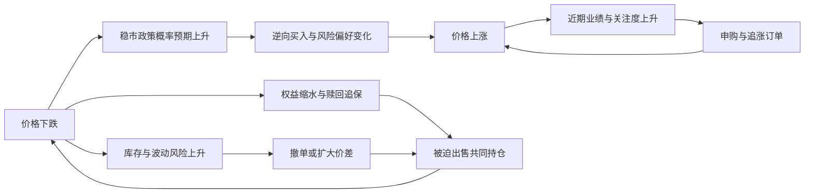

# A 股市场的主体、动机与行为

> 调研基准日：2026-10-28。用途：交易市场入门，以及 GPU 租赁、GPU 整机／卡买卖、大模型 token 交易的多主体建模参考。

## 摘要

【推断】理解交易市场，应从“谁在什么约束下下单”开始。A 股同时存在生产融资、长期配置、短线投机、套利、对冲与稳市任务；同一笔成交，对不同主体可以有完全不同的意义。持仓占比不能替代订单流占比，“散户”“机构”“量化”也不是互斥分类。历史研究显示小额与大额个人账户存在显著差异；杠杆、赎回、共同持仓和制度边界能把个体理性转化为集体踩踏。对算力市场，最值得迁移的是异质主体、订单簿、库存与融资反馈、信息差和内生监管；股票的永久权益、可替代性以及成熟交割机制则不能照搬。

## 阅读说明与证据口径

- **【事实】**：有公开制度、统计或论文支持；“研究估算”“历史样本”会明确注明，不等于全市场现时普查。
- **【推断】**：机制分析、目标函数、典型行为与建模建议；是可检验假设，不能理解成每个主体的自述。
- **【待核实】**：缺乏统一口径、未取得完整原表，或存在因果识别不足。不会用媒体流行说法补齐数字。
- 数字后的脚注提供来源、链接、发布日期及数据时点。网页没有可靠发布日期时明确说明；所有链接检索于 2026-10-28。

【推断】全文先读第一节建立术语，再读第三节认识主体，第五、六节理解反馈，最后一节可直接转为模型设计。单位换算：1 万亿元＝10,000 亿元。**总资产、基金净值、股票持仓、流通市值、自由流通市值、成交额属于不同变量。**

## 一、交易市场入门：一张股票如何被发行、交易和交付

### 1.1 一级市场、二级市场与企业价值

【事实】一级市场是证券发行融资的环节：企业 IPO 首次向公众发行股份，或上市后增发、配股等。二级市场是投资者转让已经发行的证券，通常买方的钱交给卖方；企业不会因为股票每换一次手就再获得一次融资。注册制覆盖发行审核注册安排，上市公司再融资也有相应制度。[^reg][^issue]

【推断·示例】一家企业新发股票募集 1 亿元购买设备，发生了企业融资；投资者甲随后以 12 元把原先持有的股票卖给乙，发生了股权转让。二级市场的价格、退出便利和估值会影响企业以后融资的成本，因此两个市场相互连接。

【推断】股票是企业剩余收益与相应股东权利的载体，其价值可理解为未来可分配现金流的折现。企业利润增长、分红和资产经营能创造总回报；股票短线交易则主要重新分配风险和收益。不能把所有股价上涨都解释成新资金流入，也不能把股票融资和 GPU 租赁收入当成同一种现金流。

### 1.2 交易所、券商与订单簿

【事实】投资者通过券商提交委托，券商将符合要求的申报送入交易所。沪市竞价行情通常揭示最优五档买卖价量；这只是可见深度的一部分。交易所规则规定申报、撤单、撮合及异常交易处置，券商承担客户管理和相应交易、交收责任。[^sserule]

【推断】**订单簿**像一个不断更新的排队表：买方按愿付价格从高到低排队，卖方按愿收价格从低到高排队。同价再比较申报时间。交易所提供市场设施和规则，通常不亲自买下每一张卖单。

【推断·教学订单簿，非真实行情】

| 方向 | 限价 | 数量 | 含义 |
|---|---:|---:|---|
| 卖二 | 10.02 元 | 1,000 股 | 愿意按此价或更高出售 |
| 卖一 | 10.01 元 | 300 股 | 当前最低卖价 |
| 买一 | 10.00 元 | 500 股 | 当前最高买价 |
| 买二 | 9.99 元 | 800 股 | 更低价等待成交 |

【推断】若有人提交买入 500 股、最高接受 10.02 元的限价单，可以先在卖一成交 300 股，再在卖二成交 200 股，均价为 10.014 元。原先看到的卖一价不保证全部数量都能按这个价格成交。买卖价差为 0.01 元；买卖中间价为 10.005 元，均不等于“所有股票真正值多少钱”。

【事实】**限价单**控制最差接受价格，但不保证成交；**市价申报**优先追求成交，但须符合交易所允许的申报类型及适用条件。A 股存在最优五档即时成交剩余撤销等具体类型，并非一个可以无条件扫完整个订单簿的通用按钮。连续竞价以价格优先、时间优先等规则组织撮合。[^szrule]

【推断】“限价”不等于“提供流动性”：高于卖一的买入限价单也会立即吃掉卖单。应按订单到达时是否立即与已有订单成交，区分**流动性提供者 maker**与**流动性消耗者 taker**，不能按职业或机构名称永久分类。

### 1.3 连续竞价和集合竞价

【事实】沪市通常在 9:15—9:25 开盘集合竞价，9:30—11:30、13:00—14:57 连续竞价，14:57—15:00 收盘集合竞价。集合竞价先累积订单，再依据规则选定统一成交价，核心原则包括最大成交量；连续竞价则在订单到达时逐笔匹配。[^sseschool]

【推断】集合竞价适于集中处理隔夜消息和收盘交易需求；连续竞价适于交易需求持续到达。收盘价作为基金估值、指数计算和考核的参考，可能使机构订单集中在收盘附近。建模时，两个时段应采用不同的撮合函数，而非全天统一“每分钟调价”。

### 1.4 价格发现、流动性与做市

【推断】**价格发现**是不同信息、判断和资金约束通过报价、成交逐步形成价格的过程。它不保证每一刻都等于基本价值。**流动性**至少包含价差、订单深度、成交冲击、成交速度和冲击后恢复速度；放量下跌也可能伴随流动性恶化。

【事实】做市商持续或按规定提供双边报价，承担库存和逆向选择风险。科创板股票做市交易于 2022-10-31 正式启动，是在既有竞价基础上引入做市商；不能由此把整个 A 股称为以做市商报价为中心的市场。ETF 另有申购赎回与二级交易之间的套利联系。[^mm][^etf]

【推断】做市商的收入来源可能是价差、服务安排和套利，其成本包括价格风险、资本占用、对冲和被更快的信息交易者“挑中旧报价”。波动或库存过大时，做市商可能扩大价差、降低深度；因此模型不应假设其无条件无限接盘。

### 1.5 清算交割、T+1 和涨跌停

【事实】**清算**计算各方应收应付，**交收**落实证券和资金划转。中国结算承担登记结算基础设施职能；货银对付 DVP 的目标是控制交券与付款不匹配的本金风险。2022-12-26 落地的改革建立了 T+1 DVP 制度。[^dvp]

【事实】股票通常实行买入后下一交易日才可卖出的交易限制，俗称股票交易 T+1。卖出已有可卖股票所得资金通常当日可用于再交易，转出银行一般需下一交易日；客户可用资金、可取资金与结算参与人的最终交收时点是不同概念。持有昨日底仓并在日内先卖后买，也不能解释为新买入股票获得了无限 T+0 权限。[^szrule][^settle]

【事实】截至本次检索，普通主板股票一般为前收盘价上下 10%，创业板、科创板一般为 20%，北交所一般为 30%；沪深 IPO 上市后前五个交易日、北交所公开发行上市首日存在不设涨跌幅限制的安排。还需区分申报价格范围、临时停牌、退市整理等特别规则。**主板 ST／*ST 一律“5%涨跌停”已不是本基准日可沿用的说法：2026-07-06 起主板风险警示股票限制调整为 10%。**[^szrule][^sserule][^bserule][^st2026]

【推断】跌停意味着当日更低价格不能用普通有效申报完成交易，不意味着愿卖的人已经卖掉。卖单可能在跌停价排长队；无法卖出的账户会转卖其他可交易资产。价格限制因此可能延缓价格发现，并把压力传播到相关资产。

### 1.6 融资融券：资金约束如何变成强制订单

【事实】融资是向券商借资金买证券，融券是借入证券卖出后再买回归还，均涉及保证金、担保品、期限和券商风控。融资保证金最低比例在 2023 年由 100% 降至 80%，而自 **2026-01-19 起恢复为 100%**；此次提高适用于新开融资合约，存续及展期有衔接安排。保证金比例不能与整个账户的维持担保比例混为一谈。[^marginlaw][^margin2026]

【推断·示例】自有资金 100、借款 100 买入市值 200 的资产，初始总资产／权益杠杆为 2。价格下跌 10%，资产变成 180、权益变成 80，权益损失 20%。如果触发合同追保线且不能补钱，卖出可能成为履约要求，与是否长期看好无关。100% 的融资保证金要求也不等于“完全没有杠杆”；实际账户上限还受担保品折算等条件影响。

【事实】2024-07-11 起暂停转融券业务，7 月 22 日起普通融券保证金最低比例提高至 100%、私募证券基金提高至 120%。这是有日期的历史措施，不是“全部融券被取消”。本次未取得足以确认截至 2026-10-28 所有后续调整状态的完整公告链，持续状态列为【待核实】。[^short]

### 1.7 股指期货、期权如何作用于现货

【事实】股指期货交易指数风险，到期通常现金交割；中金所实行保证金和当日无负债结算等安排。买入看跌期权取得在约定条件下受益于标的下跌的权利，看涨期权则对应上涨方向；买方支付权利金，卖方面临相应义务。股指期权与交易所 ETF 期权的交割安排需要分别处理，不能一律假定交付股票。[^future][^option]

【推断】衍生品对现货至少有四条通道：①持股机构卖期指，可降低市场暴跌敞口，减少必须卖股票的需要；②期现价差过大时，套利者在两边交易，使价格相互约束；③期权交易商根据 delta，即价格对标的变动的敏感度，动态对冲；④保证金追缴、基差走坏或对冲交易拥挤，会把衍生品风险传回现货。

【推断·基差示例】持有小盘股票、做空中证股指期货，不等于无风险。股票组合和指数不完全一致，承担风格／基差风险；期指上涨造成空头追保时，即使股票同时上涨，也可能来不及变现补钱。理论公平价约为现货加融资成本、减预期股息，现实还受融券约束、交易成本和资金分割影响。

## 二、A 股市场结构、量级与注册制

### 2.1 不同板块是不同的制度环境

【事实】A 股通常指境内发行、以人民币认购和交易的普通股票；不是所有境内上市证券，也不是全部中国企业在全球上市股份。下表数字为可核实的量级截面，时间一致尽量取 2026 年 9 月；“公司数”与“A 股证券只数”并非严格相同。

| 板块 | 定位与市场量级 | 交易及准入特征 | 证据 |
|---|---|---|---|
| 沪市主板 | 较成熟企业、金融与工业等；2026-09-30 市值约 51.8 万亿元、上市公司 1,705 家；该规模表为主板股票口径，含 B 股影响 | 通常 10%；普通个人不设科创板式统一资产门槛 | 上交所发布原始统计的转载，2026-09-30[^shsnap] |
| 深市主板 | 2026-09 末主板 A 股 1,495 只、市值 24.56 万亿元 | 通常 10%；原中小板已并入主板 | 深交所 2026-09 月报[^szcap] |
| 创业板 | 创新、成长企业；同月 A 股 1,409 只、市值 17.83 万亿元 | 通常 20%；新开个人权限一般须前 20 个交易日日均资产 10 万元及 24 个月交易经验 | 深交所月报、适当性解释[^szcap][^gem] |
| 科创板 | 科技创新与硬科技；2026-09-30 市值约 16.4 万亿元、618 家 | 通常 20%；个人一般为前 20 个交易日日均资产 50 万元、24 个月经验 | 上交所统计及投教[^shsnap][^star] |
| 北交所 | 创新型中小企业；2026-09 末 348 家、市值约 0.84 万亿元，月成交约 3,537 亿元 | 通常 30%；个人一般为日均资产 50 万元及 24 个月经验，并有适当性规则中的例外 | 国信证券月报、北交所规则[^bsemonth][^bseaccess] |

【推断】以上板块市值粗加约 **111 万亿元**，仅用于认识“百万亿元上下”的规模，不能作为精确官方 A 股总市值：沪市含 B 股、证券与公司口径有别，且总市值不等于可交易筹码。北交所单独是交易所，创业板和科创板分别属于深交所、上交所。

【事实】沪市 2026 年 9 月股票成交约 17.98 万亿元；深市同月主板 A 股 10.68 万亿元、创业板 A 股 9.49 万亿元。深市全部证券成交 29.81 万亿元包含基金、债券等，不能当作股票成交额。[^shmonth][^szturn]

【推断】将上述沪深股票成交加总约 38.15 万亿元，再以当月 21 个交易日粗除，约为日均 1.82 万亿元；加北交所后仍为“日均一两万亿元”的认识量级。这里沪市有微小 B 股影响，故不包装成精确 A 股指标。成交额为撮合成交金额，不把买卖双方再各加一遍。

### 2.2 注册制改变了什么

【事实】科创板先行试点、创业板于 2020-08-24 实施改革并试点注册制；2023-02-17 全面注册制相关规则发布实施，覆盖全市场相关公开发行行为。注册制以信息披露为核心，交易所审核、证监会注册，不表示监管保证公司质量、投资盈利或股价不跌。[^reg][^szsystem]

【推断】建模影响包括：新股供给取决于企业申请、中介筛选、审核与市场承接，而非外生固定股票数；发行定价、上市初期交易规则和退市预期改变“壳价值”。但不能把注册制简化成“企业随时零成本上市”；审核执行、板块定位和融资政策仍影响供给速度。

## 三、市场主体：身份、规模、动机、约束与互动

### 3.0 先分清身份、产品和交易技术

【推断】最稳妥的分类是三个维度：**最终资金所有者**（居民、保险、社保、政府、企业、境外资金）；**代理及载体**（公募、私募、券商、ETF）；**交易策略／技术**（价值、趋势、套利、量化、高频）。保险购买 ETF，同时属于保险的间接配置、公募的管理资产和 ETF 的规模；不能加三次。北向是通道，量化是方法，营业部是通道服务节点，都不能与资金所有者机械并列求和。

【推断】下文每类的“目标、典型行为、理性判断”均为建模抽象；规模和制度事实另标来源。提供流动性是逐单角色，承担风险则应追到最终资金或合同责任人。

### 3.1 个人投资者：必须把小额账户、大户和专业个人拆开

【事实】中国证券报据中国结算 2025 年统计年报报道：2025 年末投资者 25,067.29 万，自然人 25,006.41 万，其中已开 A 股账户的自然人 24,950.22 万；全年新增投资者 1,386.95 万。统计是有效一码通投资者维度，不是各券商账户简单求和，也不等于这些人每天交易。原年报链接本次未取得，精确值以具名媒体转述为证据。[^accounts]

【事实·历史样本】An、Lou、Shi 的沪市账户研究在 2014-07 至 2015-12 样本中，家庭持仓市值平均占 25.1%，成交占 86.6%；企业持仓平均占 63.6%，成交仅 1.7%。这直接展示“持股少、交易多”，但不是 2026 年全 A 股比例。[^wealth]

【事实·研究估算】申万宏源研究团队 2025-06-23 发表的 2024 年结构分析估计：一般个人投资者持有 A 股市值约 32.3%，个人大股东约 6.4%；文中称一般个人贡献约 70% 交易量。账户研究和报告估算的分母、分类、时期不同，不能当成同一条连续序列。**2025—2026 全市场同口径散户持仓／成交精确占比【待核实】。**[^structure]

【推断·行为分层；金额边界借鉴研究，不是自然人的能力评级】

| 资金层级 | 进场目的与目标 | 信息、约束及时间尺度 | 理性／偏差与对手方 |
|---|---|---|---|
| 小额，如账户资产低于 50 万元 | 财富增值、短期获利，有时包含娱乐效用；追求主观胜率与可见收益 | 信息处理时间少，单手门槛与本金限制分散化；日到月 | 分散配置可理性；追热点、过度自信、处置效应可能增加成本；追价时向原有卖单购买流动性 |
| 中等，如 50 万—300 万元 | 增值与家庭现金流，部分采用技术交易、基金组合 | 可能有经验，但面临生活支出、回撤容忍及盯盘成本；日到年 | 有纪律调仓与损失厌恶并存；既可能承接下跌，也可能跟风 |
| 大额／专业个人，如 300 万以上 | 选股、跨产品套利、组合收益；极大账户可能接近专业机构 | 可购买研究与系统服务，仍受集中持仓和冲击成本约束；日内到年 | 不能预设为噪声；也可能过度集中、自信或使用高杠杆；常与机构竞争信息、提供逆向流动性 |

【事实】Jones 等账户研究发现，小额个人更表现为日频趋势交易，较大账户更偏逆向，二者对后续收益的预测能力不同；小额账户的选股损失和交易成本共同侵蚀表现，大额账户的选股优势也可能被成本抵消。这里的收益预测不等于任何时段都保证净盈利。[^jones]

【推断】个人还有一个容易遗漏的角色：通过公募、养老金间接持有股票。因此“机构赚了、散户亏了”的账户层面结论，不自动等于居民部门全部金融财富的变化。

### 3.2 主动公募基金：收益目标与职业激励共同决定下单

【事实】2025 年末公募总净值 37.71 万亿元，其中股票基金约 6.05 万亿元、混合基金约 3.68 万亿元；总净值包含货币、债券和其他产品，股票基金中也包含被动基金，混合基金也并非全仓 A 股。2026 年 8 月公募总净值约 39.63 万亿元，由经济参考报转述协会数据。[^public][^publiclatest]

| 建模维度 | 【推断】主动公募的典型规则 |
|---|---|
| 动机／目标 | 投资者追求净回报；管理人还关心相对基准表现、资金净流入、管理规模、职业稳定与声誉 |
| 约束 | 基金合同、仓位与集中度要求、开放式赎回、投资范围、流动性风险、考核周期；大额交易受市场容量限制 |
| 信息／时间 | 有研究团队与公司跟踪能力；持有可达月到年，申赎和考核压力可把行动压缩至日或季度 |
| 理性与偏差 | 共同看好优质资产可能有基本面依据；基准和排名使不偏离同行具有职业理性；从众、叙事和近期业绩外推会扩大拥挤 |
| 互动／风险 | 从个人、保险等吸收委托资金；与其他持有人交易；持续赎回会迫使卖出股票，最终市场损失主要由持有人承担 |

【推断】一种简化机制是：好业绩带来申购，申购增加同类资产买入，价格上涨又改善近期排名。经理即使觉得估值偏高，也可能担忧提前退出导致排名落后和赎回。**“抱团”可能同时含信息共识、委托代理激励与行为偏差，不能仅凭持仓相似判定非理性。**

【事实】制度正在改变激励：2025-05-07 行动方案要求由重规模向重投资者回报转变，推动长周期考核、浮动费率和利益绑定；2026-01-23 发布的业绩比较基准指引自 3 月 1 日施行，强化基准与投资风格的约束。建模应允许制度前后参数变化，而不是假定短期排名激励永远不变。[^publicreform][^benchmark]

### 3.3 被动基金与 ETF：指数权重、申赎和套利共同驱动

【事实】协会《数说基金 2025》称，2025 年权益类公募约 11 万亿元，股票 ETF 在权益类基金中占比提高到约 35%。这与上一节“股票基金＋混合基金”分类不同，不能直接相减推算主动基金规模。[^fund2025]

【推断】被动基金的目标是扣费后尽量跟踪指数，约束是跟踪误差、成分与权重、现金拖累、申赎和交易成本；其信息优势在执行与组合管理，通常不以判断某成分股便宜为下单必要条件。指数调整可导致可预测的收盘附近交易，时间尺度从日内执行到长期持有。

【事实】ETF 份额在二级市场买卖；授权参与者等符合条件者可用证券篮子、现金或约定对价申赎。ETF 溢价时，买篮子申购、卖出 ETF 的套利方向有助于缩小溢价；折价时则相反，但受申赎规则、成本和流动性制约。[^etf]

【推断】被动买入高权重股票属于合同约束下的理性；追涨偏差也可能发生在购买 ETF 的终端投资者，而非基金组合算法。国家队或保险买 ETF 若只是从原持有人接货，未必立即形成等额股票净买入；需要观察是否引起净申购及篮子交易。承担指数风险的是持有人，做市与申赎中介承担短期库存、价差与操作风险。

### 3.4 主观私募基金：绝对收益也受止损和客户行为约束

【事实】2025 年末存续私募总规模约 22.15 万亿元，其中私募证券投资基金约 7.08 万亿元；股权、创投等不能算成二级市场股票资金。私募证券规模也包含债券、衍生品等，且无统一公开的“主观／量化全市场持仓分拆”。[^private]

【推断】主观私募主要服务合格投资者，可追求绝对收益、超额收益或特定策略收益；管理人还关心高水位以上业绩报酬、续募和生存。基金合同中的预警、止损、封闭或赎回安排差别很大，不能设成所有产品统一清盘线。

【推断】信息可能来自集中行业研究、调研和经验；时间通常从日到年。相较某些公募产品，私募可以更灵活降低仓位，但净值下跌、客户赎回和风控线会强迫其减仓。风险预算管理是理性的；过度自信、集中押注和盈亏后改变风险偏好可能非理性。其对手方是其他投资者，若使用收益互换还与券商形成信用、融资和对冲联系。

### 3.5 量化私募、程序化与高频：不能合并成一种资金

【事实】2024-04-12 证监会发布会披露：当时程序化投资者持股约占 A 股流通市值 5%、交易金额约占 29%。这是程序化执行口径，既不是高频独占份额，也不是“量化私募成交占比”；不能与散户占比相加。[^quantshare]

| 策略／技术 | 【推断】目标与决策 | 【推断】约束、信息与时间 | 【推断】风险与互动 |
|---|---|---|---|
| 多因子／指数增强 | 在行业、风格、跟踪误差约束下最大化预测收益减成本 | 统计数据、计算与研究优势；日到月调仓；受容量与拥挤限制 | 与主动及个人争夺 alpha；模型同质化可能集中交易 |
| 市场中性／DMA | 股票多头获取选股收益，期指空头控制市场风险 | 融资、保证金、基差和对冲额度；日内到月 | 暴露于小盘风格、基差和资金风险；券商是融资及衍生品对手方 |
| 高频策略 | 获取极短期价差、订单流或套利收益 | 延迟、行情、撤单、费用、库存及合规；毫秒到分钟 | 可以挂单提供深度，也可快速吃单；波动时撤单可使流动性骤降 |
| 算法执行 | 将给定母单按成交量、时间等拆分，降低冲击 | 服从最终投资指令和时限；秒到日 | 它解释“如何下单”，不能单独解释资金“为何买入” |

【推断】算法不是没有偏差的理性机器：训练期选择、过拟合、共同风险模型和低估极端流动性都会导致错误。若所有算法都按风险升高同步减仓，单体遵守风控，整体仍会产生负反馈。现货 T+1 下，高频回转还受底仓、可卖余额和产品规则约束，不能凭速度凭空生成可卖股票。

【事实】程序化管理规定于 2024-05-15 发布、10 月 8 日施行；上交所细则于 2025-04-03 发布、7 月 7 日施行。高频认定包括单账户每秒申报撤单最高达到 300 笔以上，或单日达到 20,000 笔以上等标准；条文允许差异化收费，但“可以收费”不等于任何时点已按同一费率征收。[^quantrule][^hft]

### 3.6 保险资金：资产负债匹配塑造“长钱”行为

【事实】2025 年末保险资金运用余额约 38.48 万亿元；国信证券对监管表的分析显示，股票余额约 3.73 万亿元，股票与证券基金合计约 5.7 万亿元。基金含非股票产品，股票也不能直接当成全部 A 股；余额增长同时包含买卖和估值变动。[^insurance]

| 建模维度 | 【推断】保险的典型规则 |
|---|---|
| 动机／目标 | 匹配保单负债，覆盖资金成本，兼顾长期收益、分红现金流与偿付能力 |
| 约束 | 负债久期、赔付和退保、偿付能力资本、权益配置比例、会计处理及内部风险预算 |
| 信息／时间 | 有资产配置与研究团队；通常季到多年，但退保和资本压力可能要求短期变现 |
| 理性／偏差 | 偏好稳定股息可能是负债匹配的理性选择；也会受共同估值框架、监管激励与市场叙事影响 |
| 互动／风险 | 可直接持股、买基金、委托资管；与卖出者交换长期风险，保单持有人和股东承担的结果取决于产品及会计安排 |

【推断】“长钱”不等于每次下跌都买入：若下跌侵蚀资本、触发风险限额，保险也可能卖出。长久期资金需要低波动的账面考核和稳定负债配合，才更可能发挥逆向作用。

### 3.7 全国社保、基本养老、年金和个人养老金

【事实】全国社保基金是战略储备基金，与地方基本养老基金受托投资不是同一账户池。2025 年末全国社保基金资产约 3.81 万亿元、权益约 3.35 万亿元；同年末受托基本养老基金资产约 3.52 万亿元、权益约 2.98 万亿元。这些均不是股票持仓市值。两者之外还存在企业年金、职业年金和个人养老金等不同制度。[^social][^pension]

【推断】其核心动机是长期保值增值、未来支付保障和受托责任；全国社保、基本养老、年金的委托合同和投资边界各异。信息依赖战略配置、管理人筛选与受托机构；时间为季到多年，约束包括安全性、支付需要、资产类别限额、受托考核和政治责任。机构的谨慎不是天然“保守偏差”，可能来自损失承受能力与受托要求。

【事实】2025 年中长期资金入市政策提出长周期考核等安排，并提出未来三年公募持有 A 股流通市值每年至少增长 10%、力争大型国有保险公司从 2025 年起每年新增保费的 30% 用于 A 股投资。这是政策目标，不能写成所有保险每年总资产的 30% 已买股票，或未来净买入的确定值。[^longmoney]

【推断】养老金可以经由公募、券商和其他管理人进入市场；它们是这些机构的资金来源，不应与受托管理规模重复计入。长期资金的收益、短期流动性和政策角色可能部分重合，但不能把所有养老资金都归为国家队托底资金。各体系最新可比的 A 股穿透持仓、交易份额【待核实】。

### 3.8 券商自营：方向性投资、套利和做市并存

【事实】国金证券 2025 年报摘要引用证券业协会数据：2025 年末 150 家证券公司总资产约 14.83 万亿元、净资产约 3.34 万亿元。总资产包括大量非股票资产及客户业务相关项目，不能据此推算券商自营 A 股规模。[^broker]

【推断】自营部门用自有资金投资，追求风险调整后利润和资本回报；不同团队可能做债券、权益方向、多空套利、ETF 做市或期权对冲。约束有净资本、风险资本、库存、集中度、融资和公司风控。研究、执行、行情与多产品交易能力是优势，资产负债表容量和信用敞口是约束；时间从毫秒到多年。

【推断】券商在多个市场连接订单与风险：给私募融资、给客户提供衍生品报价、在现货或期指对冲。券商卖出的期权若触发风险管理需求，产生的现货订单不一定代表其主观看空。其目标也可能受奖金激励和模型偏误影响；自营损益由券商股东承担，客户保证金与自有资金在模型中必须分账。全行业可比的自营 A 股方向净敞口【待核实】。

### 3.9 QFII、北向资金与全球配置者

【事实】QFII／RQFII 是合格境外投资者制度，陆股通是经香港市场连接沪深市场的北向通道；两者不能当成两类完全互不重叠的最终所有者。证监会 2025-05-07 发布会称，外资经 QFII、沪深股通等持有 A 股流通市值稳定在约 3 万亿元。不是所有北向交易都来自同一种长期外资策略。[^foreign]

【推断】动机包括全球资产配置、指数跟踪、主动选股、对冲和套利。目标是投资者本币或基准货币下的组合净收益；约束有国家／行业限额、汇率、全球客户申赎、交易日历、通道规则和对冲成本。本土公司信息可能有劣势，全球行业比较、风险因子和跨境资产配置则可能有优势；时间从日内到多年。

【事实】2024 年北向披露安排调整，剩余项目自 8 月 19 日实施，持股查询等改按季度公布上一季末数据。不能把旧的每日净流入序列无缝延伸到新披露期，第三方“北向净买入估算”也不能自动当成交易所公布的真实流量。[^north]

【推断】外资卖出可能源于全球赎回、美元升值或降低国家风险，并非获得了某家公司的利空信息。把北向称为“聪明钱”会诱使本土主体盲从，其本身也是一种锚定和权威偏差。通道交易的最终受益人结构、2026 年统一穿透持仓【待核实】。

### 3.10 “国家队”：汇金、证金与稳市资金

【事实】“国家队”是市场俗称，不是一个有统一公开资产负债表的法律主体。可核实的行为是：2024-02-06 证监会回应汇金持续加大 ETF 增持，表示支持并便利其入市；中证金融还承担融资融券相关基础制度职能。不能把其所有历史持股、国有银行战略股权与当期稳市可用资金混为一谈。[^huijin][^marginlaw]

【推断】建模可把主动稳市账户目标设为减少市场失序、流动性断裂和信心崩塌，同时兼顾预算、持仓风险、执行效果与退出。信息优势可能来自政策协调与资金调度，具体交易触发线不公开；行动可快至日内，持有可跨年。逆周期买入即使短期浮亏，也可能符合其政策目标，不能按短线利润函数评为不理性。

【推断】它可能直接接走抛盘，也可能买入 ETF、通过申赎链影响股票。政策信号还能引来其他买盘；反过来，市场相信必被托底，会提高风险偏好并削弱私人风控。模型应设置有限预算、不确定触发和退出成本，而非“指数跌到某点就无限买入”。**稳市账户总规模、逐日净买入、统一托底点位【待核实】。**

### 3.11 产业资本与大股东：控制权和变现具有不同价格

【事实·研究估算】前述 2024 年投资者结构报告将产业资本持股估为约 34.4%、政府持股约 7.6%、个人大股东约 6.4%；这是研究分类，大股东不等于只套现的卖方。2024-05-24 减持办法强化了控股股东、实际控制人、分红及破发破净相关限制，并防范绕道减持。[^structure][^reduce]

【推断】其动机可能是控制权、战略协同、融资、家庭或企业现金流、财富分散、股权激励，也可能包含套现。目标函数应含持股价值、私人控制收益与变现需求，约束包括锁定、减持预披露、交易方式、内幕信息窗口和质押。公司经营信息可能更充分，但不能据此假设合法地随时交易；时间通常月到多年，质押追保可骤然缩短。

【推断】增持可以传递信心，也可能保住质押安全边际；减持可以是合理分散或经营资金需求，也可能反映过高估值。损失厌恶、控制权偏好、过度自信和代理问题均可能出现。它与二级买方、大宗受让方、质押融资人互动；质押下跌时，贷款方、股东和其他持有人通过担保链共同暴露。

### 3.12 上市公司本身：发行、投资、分红与回购

【事实】上市公司可通过 IPO、再融资取得权益资金，也可向股东分红、回购股份。证监会公开的 2025 年两会相关材料称，2024 年上市公司实施分红约 2.4 万亿元、回购约 1,476 亿元；应理解为该材料口径下的实施统计，不能与按利润所属年度统计的分红直接拼接。[^corporate]

【推断】公司目标应区分股东价值与管理层目标：经营投资的净现值、融资成本、现金安全、控制权、每股指标和激励计划。信息优势在经营内部数据；约束是公司法、证券规则、资金用途、盈利和偿债能力，时间从季度到多年。

【推断】回购若注销会改变股数，若用于员工计划则有不同后续供给；不能把宣布回购额度当成当日已买入金额。分红将公司现金转给股东，除息会调整价格参考，不能把分红和未调整价格涨幅重复算收益。高估时融资、低估时回购可有经济理性；维持短期每股指标却牺牲高回报项目，可能是代理问题。公司连接一级供给、二级需求和企业价值创造，是金融市场正和来源的重要节点。

### 3.13 游资与营业部：注意力交易与席位观察的边界

【事实】交易所公开信息会披露特定条件下的营业部或交易单元买卖信息；这识别的是交易通道，不是最终资金所有人。营业部名称出现在龙虎榜，不等于营业部用自有资金做了全部交易，更不证明多个客户为同一“游资”。[^disclosure]

【推断】可将部分短线游资抽象为题材和注意力交易者：追求短期价差、资金效率与高胜率形态，关注新闻、涨停、成交量、盘口和市场情绪，时间多为日到周。受 T+1、涨跌停排队、持仓集中度和监管约束；看盘经验和执行可能是优势，对长期基本面未必更强。

【推断】“打板”即接近涨停买入，可能基于预计后续需求的策略，也可能包含彩票偏好和羊群。先买者并不必然赚钱；一旦次日需求消失，涨停买入者可能受隔夜跳空和跌停无法退出影响。游资既可发起价格冲击，也可能挂单承接；操纵交易须有监管证据，不能把所有题材交易定性为违法。全市场游资资金规模、成交占比和席位到受益人的映射【待核实】。

### 3.14 监管者与交易所：会改变游戏规则的特殊主体

【事实】证监会承担行政监管，交易所还承担市场运营、自律监管等职能。可直接观察到的行动包括减持规则、程序化报告和高频管理、异常交易限制，以及融资保证金调整；例如深交所 2024-02-20 对灵均限制交易并启动公开谴责程序。[^reduce][^quantrule][^margin2026][^lingjun]

【推断】监管目标可抽象为公平、融资功能、投资者保护、市场稳定和违法成本管理，约束包括法律授权、政策协调、信息不完备、执行时滞及监管本身的市场影响。交易所还需兼顾系统安全、流动性与价格形成，其目标不是某一个投资组合的收益最大化。

【推断】窗口指导可改变机构合规预期、可用杠杆和下单节奏，时间可从日内到制度周期；但具体电话内容和非公开要求不能随意写成事实。未有公告或可信具名证据的“全部机构禁止卖出”“某点位必须托底”均属【待核实】。监管者既不全知，也非无限资源主体；市场会猜测其反应，监管又会观察市场反馈，这是政策反身性的来源。

## 四、把动机写成可用的目标函数

### 4.1 共同状态，不同权重

【推断·模型抽象】令主体状态为：

$$
x_{i,t}=(C_i,Q_i,D_i,E_i,L_i,I_i,H_i,Z_i,R_i),\qquad E_i=C_i+P_tQ_i-D_i
$$

【推断】其中依次为现金、持仓、债务、权益、杠杆或保证金状态、信息、考核／投资期限、合同义务和监管约束。衍生品需增加头寸、逐日结算、delta、基差和保证金；基金需增加待执行申赎；普通股票需单列可卖持仓与当日新买持仓。

【推断·术语】beta 表示对市场或某风险因子的敏感度；alpha 指扣除相应风险因子解释后剩余的超额表现，依赖所选模型，不等于无风险收益；gamma 表示期权 delta 随标的价格变化的速度。“中性”通常只针对指定风险因子，不表示全部风险为零。

【推断】用一个“所有人最大化次日涨幅”的函数无法解释市场。可采用以下不同效用，权重须校准：

| 主体 | 【推断】示意目标函数 | 关键约束 |
|---|---|---|
| 普通个人 | 预期净收益－风险惩罚＋娱乐效用＋小概率暴利吸引 | 财富、可卖余额、注意力、生活现金流 |
| 主动公募 | 长期净收益＋相对基准表现＋规模与职业收益 | 合同、赎回、跟踪误差、考核 |
| 被动 ETF | 最小化跟踪误差平方＋成本＋现金拖累 | 指数权重、申赎篮子、操作规则 |
| 主观私募 | 风险调整收益＋业绩报酬－穿越止损线的损失 | 合同止损、客户赎回、高水位 |
| 量化中性 | 选股 alpha－冲击成本－残余因子与基差风险 | 融资、保证金、策略容量 |
| 做市商 | 价差收入－库存风险－逆向选择－对冲成本 | 资本、报价义务、库存上限 |
| 保险／养老 | 资产负债匹配后的长期回报－短缺及资本风险 | 偿付、支付、委托和配置限制 |
| 全球配置者 | 基准货币组合收益－全球风险预算占用 | 汇率、国家权重、全球赎回 |
| 稳市账户 | 最小化失序、流动性缺口和信心风险＋长期资产收益 | 资金预算、执行影响、退出责任 |
| 公司／大股东 | 经营净现值＋控制价值＋流动性价值－融资成本 | 发行、回购、减持、质押与现金 |
| 监管者 | 最小化系统风险、违法损失和功能受损 | 授权、信息、时滞与政策副作用 |

### 4.2 看似不理性，可能是局部最优

【推断】保险买低波动股票、ETF 买贵成分、公募跟随基准、私募在低点止损、国家队逆势持仓，分别可能满足不同约束。因此应把三件事分开：**信息处理错误、偏好不同、约束强迫**。同样的卖单可能来自看空、赎回、补保证金或监管限制，价格路径本身不能识别动机。

【推断】异质性还应存在于每类内部：相同资金量的人可有不同经验，相同基金类型可有不同负债稳定性。主体能学习和换策略；亏损者退出、新投资者进入，改变类型权重。ABM 应允许异质参数分布和进入退出，不能只设置五个永不变化的代表性人。

## 五、理性与非理性：研究证据和历史压力测试

### 5.1 如何读行为金融证据

【推断】价格偏离、投机偏好和过度交易不是同义词：追涨可能获得新信息，亏损卖出可能是追保；只有结合交易后的表现、替代策略、信息条件和约束，才能较有说服力地判断偏差。单次大赚不证明理性，长期高换手也不自动证明有优势。

| 现象 | 【事实】可用研究或制度证据 | 【推断】可建模机制及边界 |
|---|---|---|
| 小额散户追涨、过度交易 | Jones 等中国账户研究发现日频趋势模式、过度自信和交易成本问题[^jones] | 近期收益权重偏大、主观信号精度高估；应同时计算选股贡献、择时、成本和市场 beta |
| 处置效应 | Liu、Wang 的中国个人账户研究发现与“获利后更愿调减、亏损后不对称反应”一致的资金流模式，危机期更强[^disposition] | 买入成本作心理参考点；盈利卖出概率高于亏损；若有税费、信息或追保因素须控制 |
| 彩票型股票偏好 | 中国股票账户研究发现个人组合对彩票型股票超配；相关后续文献也检验极端收益特征与未来收益关系[^lottery] | 高估小概率暴利；可用低名义价、偏度、历史极端日收益构造吸引力，但不能视为同一变量 |
| 大户与小户不同 | An、Lou、Shi 研究 2014—2015 年泡沫崩溃期财富再分配；Jones 等发现个人内部信息能力异质[^wealth][^jones] | 财富、技能、时间和进入时点共同作用；不是“所有机构长期战胜所有散户” |
| 题材和羊群 | 综述归纳中国交易行为中的信息、行为与监管渠道，强调主体异质[^review] | 共同新闻形成合理同步；把别人下单误当私人信息可形成信息瀑布；社交模仿增加相关性 |

【事实·适用范围】经常被引用的 Barber 等“个人过度交易损失”研究使用**台湾市场**全交易记录，年度表现惩罚约 3.8 个百分点。它可作比较证据，不能标成大陆 A 股散户每年必损 3.8%。中国账户研究也不支持把“七亏二平一赚”作为不分年份的官方统计定律。[^taiwan]

【推断】题材炒作可从“基本面可能性”开始，经注意力上升、早期赚钱、媒体放大、跟风订单形成自我强化。成熟后，价格取决于有没有新增接盘需求；亏损厌恶又可能使退出迟缓。模型应同时保留真实产业信息和社会传播，不宜把一切主题买盘都设置为纯随机噪声。

### 5.2 2015 年：杠杆、约束和跨股票连锁抛售

【事实】Bian、He、Shue、Zhou 使用券商融资及影子配资账户数据，发现账户杠杆接近上限时显著增加卖出；被接近杠杆上限账户集中持有的股票承受更强卖压和随后反转。影子配资规模较小，却因更靠近约束而对压力传播有较大影响。[^fire]

【推断】典型链条是：价格跌→权益缩小→杠杆被动升高→追保／预防性卖出→价格再跌。若某股票跌停卖不出，融资人可能卖掉其他尚可成交股票，导致共同持仓的传染；这使账户网络比单只股票的基本面更重要。论文支持杠杆强平机制，不足以证明股灾全部由某一政策或单类投资者造成。

【推断】ABM 至少需有债务、可补现金、合同线、处置时延、跌停队列、跨资产持仓和交易冲击。仅给“非理性概率”加大噪声，无法复现“所有人都不愿卖，却不得不卖”的市场。

### 5.3 2024 年初：微盘股、雪球与量化不能画成一条无争议因果链

【事实】2024-02-28 证监会解释 DMA：私募选择股票多头，同时以股指期货套保，获取对冲后选股收益；春节后 DMA 规模稳步下降，日均成交约占全市场 3%。这不是全部量化份额，也不是整个年初期间的恒定比例。[^dma]

【事实】2024-02-19 开盘后，灵均相关账户在 9:30:00—9:30:42 集中卖出深市股票 13.72 亿元，交易所确认影响正常秩序并采取限制；沪市公告还记录对应一分钟卖出约 11.95 亿元。它是具体异常交易案例，不能据此把 1—2 月全部行情归因于这一机构。[^lingjun][^lingjunsh]

【事实】雪球是一类附敲入、敲出条件的结构化衍生品安排；敲入通常改变潜在损益状态，**不等于立即清盘，也不等于必然当场实现全部亏损**。最终损益须看是否敲出、到期标的表现和合同。招商期货 2024-01-26 报告讨论了 1 月 22 日前后集中敲入与市场变化，但其规模估算并非全市场逐单审计。[^snow][^snow2024]

【推断】需分开检验三条机制：①小微盘流动性薄、共同风格暴露集中，净赎回或降杠杆可能导致股票被同时出售；②持小盘多头、空指数的中性策略，在风格分化和基差剧变时可能两端风险扩大；③雪球交易商跨障碍前后的 delta、gamma 和跳变，可能改变期指对冲需求。

【推断】第三条尤其不能套用“跌就必卖、敲入后继续卖”的固定方向：雪球结构、交易商净头寸、已有对冲和障碍两侧风险敏感度共同决定交易方向。宽基 ETF 获得支持而微盘承压，也可能扩大风格分化，但需要持仓与逐时流量识别才能确认。

【待核实】雪球存量名义本金、真实敲入比例、DMA 杠杆分布，以及三者对微盘跌幅的独立贡献，本次均未取得足够统一数据。新闻称“踩踏”说明存在一种解释，不等于因果分解已完成。模型中宜分别启用三条通道做消融，而不是预先写死唯一故事。

### 5.4 2024 年 9 月：政策如何迅速改变预期和订单

【事实】2024-09-24 宣布创设证券基金保险公司互换便利和股票回购增持再贷款，首期规模分别为 5,000 亿元与 3,000 亿元；前者增强机构取得流动性的能力，后者通过商业银行支持符合条件的回购增持。9 月 26 日政策进一步释放稳市场信号。宣布额度不等于当天已投入的现金，也不是央行直接无条件购买同额股票。[^policy]

【事实】基金公开季度报告记录：9 月 24 日政策发布前市场缩量，发布后风险偏好及价量迅速转强；武汉市地方金融管理部门转载报道记录，9 月 30 日沪深成交约 2.59 万亿元。这里是公告、行情共时变化的事实，并非对全部涨幅的单因素因果证明。[^rally][^rallyturn]

【推断】可能的反馈是政策信号提高预期回报、降低尾部风险感知→空仓者追赶、趋势者加入、期权及期指参与者调整对冲→价格上涨→新开户和申购→进一步买入。基本面折现率改善与错失恐惧可以同时发生；上涨并不自动等于非理性，追价也不自动意味着未来有正收益。

【推断】与年初比较，同一群人、同一家公司，因融资约束、政策预期和共同风险暴露不同，可以产生相反订单。这正是应以“状态＋规则”而非永久“多头／空头标签”建模的原因。

## 六、主体互动：谁赚谁的钱，谁提供流动性，谁承担尾部风险

### 6.1 三种收益层次必须分开

【推断】第一层是**交易相对收益**：在同一标的、同一评价期、合适的买入持有基准下，交易改变谁持有未来收益；扣除税费、冲击等成本，主动交易整体相对被动持有通常是负和。衍生品双方的合同现金损益在费用前相互抵销，但对冲能提升双方效用，因此现金零和不等于社会价值为零。

【推断】第二层是**企业总回报**：企业经营、分红和资本回报可使全体股东共同获益；反之，经营亏损可让许多股东一起受损。第三层是**估值变化**：少量边际成交可以重估全部存量股份；市值增加 1 万亿元，不需要恰好有 1 万亿元现金流入。不能把全市场市值损失逐元解释为被某一类资金拿走的现金。

【事实·历史研究】An、Lou、Shi 估计，2014—2015 年样本中，最小的约 85% 家庭账户与最大的约 0.5% 家庭账户之间，发生约 2,500 亿元的财富再分配。这里指论文基于资金流、持仓与收益构造的再分配，不是“所有小户成交现金都直接交给大户”，也不是居民全部财富分配。[^wealth]

【推断】账户损益应至少拆为：市场敞口收益、股票选择、交易时机、费用和融资成本，再扣除外部申赎影响。基金经理账户的收益与客户实际收益也不同：客户若在净值高位申购、低位赎回，即使基金时间加权收益不错，客户资金加权收益仍可能差。

### 6.2 对手方与流动性矩阵

| 情景 | 【推断】消耗／提供流动性 | 【推断】风险最终落点 |
|---|---|---|
| 散户追热点、老持有人挂卖单 | 散户吃单，原持有人提供；后者可以也是散户 | 新买方承担后续价格风险，原持有人放弃后续上涨 |
| 主动基金因赎回急卖，大户逆向挂买 | 基金消耗，承接者提供 | 赎回者退出；余下持有人可能承担冲击与现金拖累 |
| 做市商两边成交并对冲 | 股票端可提供、期指端可消耗 | 做市商承担库存、基差、对冲与逆向选择 |
| 汇金买 ETF，授权参与者申购补给 | ETF 卖方供给；篮子买盘可能消耗股票深度 | 稳市资金持有市场风险，中介有执行与短暂库存风险 |
| 公司回购、大股东减持 | 是否吃单由执行方式决定；方向相反不代表自动互相抵销 | 公司现金减少、大股东风险下降、其余股东比例或权益变化 |
| 境外基金全球赎回、国内养老金接盘 | 强制卖出端消耗，养老金可提供 | 股票风险转移，汇率和全球负债风险留在各自体系 |

### 6.3 四条反馈回路

【推断·机制图，不是对任何单次事件的已识别因果图】



【推断】政策既改变资金条件，也改变主体对未来干预的预期；市场修复后监管可能再提高杠杆门槛。模型应将监管设为带时滞、预算与误判可能的反应函数，而不是独立于价格的随机新闻源。政策的短期稳价效果和长期道德风险应分别测量。

## 七、证据边界与待核实项目

| 【待核实】项目 | 当前可用证据与缺口 | 对模型的处理 |
|---|---|---|
| 2025—2026 散户持仓、成交同口径比例 | 有历史完整账户样本及 2024 年研究估算，无最新统一公开逐户全市场表 | 使用多组情景；不把“70%”当常数 |
| 主观／量化／高频、游资独立份额 | 身份和技术重叠，量化不等于高频，营业部不等于资金所有人 | 资金身份与策略标签分开抽样 |
| 国家队总规模、买卖触发线 | 有汇金增持公告，无统一完整托底账户池 | 有限预算，触发参数扫描 |
| 保险、养老、券商的 A 股穿透净敞口 | 总资产或基金持有不等于直接股票持有；衍生品可能改变净敞口 | 建立所有权链和风险敞口账本 |
| 2024 年初各机制的独立跌幅贡献 | 有 DMA 说明、个案处罚和雪球报告，缺逐时全市场对冲及融资数据 | 做消融实验，报告多个解释 |
| 2026 年最新统计完整原表及部分规则状态 | 协会目录已出现当日发布的 9 月公募数据及 10 月 27 日私募月报，但本次未可靠取得全部原表；转融券后续完整公告链未取得 | 明确采用已取得的较早截面；不声称所有数字均为 10 月最新[^latestindex] |
| 个别网页准确发布日期 | 交易所动态月报未单列日，部分 PDF 路径日期不是正文发布日期 | 保留数据时点与检索日，日期未知明示 |

【推断】这些缺口限制的是精确校准和因果归因，不妨碍建立结构模型。优先补齐交易与持仓的联合数据，而不是收集更多未经穿透的“资金规模排行”。

## 八、对算力交易市场建模的启示

### 8.1 三种标的，分别建立状态和交付规则

【推断】这里 token 指大模型推理输入／输出的计费或服务单位，不是加密资产。下表是建模起点，具体可转售条件、SLA 和硬件质量需以平台合同验证，尚不是对某个平台实际制度的调查结论。

| A 股可迁移机制 | GPU 租赁 | GPU 整机／卡买卖 | 大模型 token 买卖 |
|---|---|---|---|
| 分层标的与合格参与者 | 按 GPU 型号、拓扑、显存、地点、租期、网络及可中断性分层 | 按型号、成色、保修、来源与验收分层 | 按模型版本、上下文、输入／输出、缓存、延迟和质量分层 |
| 订单簿与成交冲击 | 标准短期容量可订单簿，定制集群适合询价或组合拍卖 | 标准卡可挂单；整机和异质二手设备需要议价、检验 | 标准服务额度可连续报价；异质模型需路由和质量约束 |
| 库存／持仓约束 | 库存是某地点、某时间窗可履约的 GPU 时段 | 实物库存、在途和售后义务 | 可履约吞吐与有效期，不能把已消耗 token 再卖 |
| 资金与强平链 | 设备贷款、预付、长约采购与租金错配 | 跌价导致担保品缩水、补保证金及甩卖 | 批发承诺、应收账款与退款导致现金缺口 |
| 价格发现与套利 | 跨平台价差须扣网络、迁移、数据和中断成本 | 扣物流、验货、税费、质保和时延 | 扣模型质量、限流、路由、上下文及合同限制 |
| 结算与信用 | 托管付款、用量计量、SLA 赔付 | 钱与货、验收、产权和退货的联动 | 请求计量、成功率、预付余额、退款与信用 |

【推断】不能照搬的关键点：股票是持续权益，GPU 会折旧，闲置的一小时不能保存到明天；不同型号不完全替代；token 价值依赖任务效果，原始个数不是统一产出。股票可以通过成熟中央结算设施统一登记，而算力还需证明物理可用性和服务履约。模型应把“买到了”和“成功交付了”分成两个事件。

### 8.2 主体列表与最小可行模型

【推断】第一版可从六类开始：**有截止期的终端需求者、弹性需求者、容量供给商、聚合转售商、融资者、平台／规则制定者**。进一步再加入设备厂商与二手商、长期采购大客户、库存型做市商、跨平台套利者，以及有明确补贴或保供任务的政策主体。政策主体应有实际任务依据，不能因为 A 股有国家队就凭空设置算力价格托底。

【推断】终端需求者最大化任务价值减价格、延迟和失败损失；供给商最大化收入减电力、设备折旧、运维和违约损失；转售商最大化批零价差减库存、信用和履约成本；融资者最大化利息收益减预期违约损失；平台在成交、服务质量、收入与信用风险间权衡。

【推断】至少为每个主体记录：现金、债务、授信、库存／容量、在途交付、长约义务、信用、预测误差、风险预算及期限。产品状态记录型号／模型、质量、地点、可用时间窗、到期、可转售权、SLA、交付成功率、订单深度和价差。硬件、租赁、token 三层通过技术转换相连，但不要固定假定“一张卡必然每秒产出相同 token”。

### 8.3 可参数化行为规则

【推断·示意】购买价格上限可写为任务边际价值减去延迟、失败与迁移成本；卖方最低报价可写为边际服务成本加容量机会成本和信用风险溢价。行为偏差另加一层，避免用偏差掩盖生产约束。

```text
每个事件时点 t：
    更新任务需求、设备状态、可用容量、合同到期和公开信息
    各主体更新现金、债务、可履约容量、欠交与风险预算
    对每个主体 i：
        估值 = 基本信息信号 + 趋势权重 * 近期价格变化
               + 模仿权重 * 可观察同行行动 + 私人信号误差
        若现金缺口或抵押约束触发：
            生成有期限的出售/降价/回收应收款计划
        否则若终端任务有截止期：
            在质量、预算和最晚开工时间内选择执行方案
        否则若有可售容量或库存：
            按机会成本、利用率和库存风险报价
        否则若套利价差覆盖全部成本且允许转售：
            在可融资、可交付额度内双边交易
    在同规格及交付时间窗内撮合，冻结资金和容量
    到交付事件验证数量、质量与 SLA，结算或赔付
    更新信用、授信与平台风控；记录停供、拒单和退出
```

【推断】若是期货式合约，还需到期交割、逐日结算和违约瀑布；若只是现货服务采购，不应自动加入裸卖空、保证金融资或期权。长期需求者的最低保供目标类似保险的负债约束；聚合商的客户提款和供应商预付错配类似基金流动性错配，比简单模仿散户追涨更有解释力。

### 8.4 参数：经验锚点和仿真范围分开

| 参数 | 可用经验或建议范围 | 性质、单位与用途 |
|---|---|---|
| A 股个人成交权重 | 历史账户样本 86.6%；2024 报告约 70% | 【事实·不同样本】只用于 A 股结构压力情景，不能直接校准算力需求占比[^wealth][^structure] |
| 程序化持仓／成交 | 2024-04 披露约 5%／29% | 【事实】流通市值／成交金额分母不同；不当成高频独立比例[^quantshare] |
| 股票价格限制 | 普通板块 10%／20%／30% | 【事实】用于复现相应 A 股规则；算力基线建议先不设硬性涨跌停[^szrule][^bserule] |
| 算力融资总资产／权益杠杆 | 1、1.5、2、3 倍 | 【推断·仿真扫描】1 倍无借款；非行业经验值；同步改变利率、折扣与追保线 |
| 趋势／模仿权重 | 各在 0—1 扫描；与基本信号权重归一化 | 【推断·仿真扫描】先标准化信号，避免把量纲差当行为偏差 |
| 信号与流动性冲击 | 取实际报价预测残差、盘口深度的分位数；无数据时做 0.5、1、2 倍基准压力 | 【推断·识别设计】倍数是实验设置，基准本身【待核实】 |
| 负债／订单期限 | 由合同日期、账期、任务截止期形成分布 | 【待核实】优先采样合同，不填一个所谓普遍行业值 |
| 需求价格弹性 | 根据同类任务价格与采购量联合估计，先分必须完成和可推迟任务 | 【待核实】不可用股票换手率代替服务需求弹性 |
| 库存融资与履约风险 | 抵押折扣、回收率、取消率和 SLA 违约率由真实记录估计 | 【待核实】各取多情景，并与硬件跌价、故障共同变化 |

【推断】主体数量占比、资金占比和成交占比应由财富、决策频率、订单大小及成交率共同生成。若直接设“30% 做市商、70% 散户”，很容易在账户、资金、订单三个层面同时矛盾。

### 8.5 校准、验证与制度实验

【推断】需要收集至少四组联合记录：报价与撤单／成交；容量、库存与利用率；融资、应收应付和合同；实际交付、失败与赔付。对每条记录保留主体标签、规格、时间窗和数据可见性，避免把标价当成交价、API token 价当同等任务成本。

【推断】验证不能只拟合价格曲线。至少比较成交率、价差、深度、冲击恢复、利用率、等待时间、质量调整后的价格、逾期和违约、主体利润分布与退出率。保持训练与验证时间分离，并检查现金、库存、容量、服务消耗和赔付账目守恒。

【推断】建议依次实验：无杠杆与有杠杆；独立策略与共同风控；连续撮合与周期集合竞价；限制撤单与不限撤单；预付、托管、保证金和信用结算；透明与不透明质量；单平台与跨平台供给。每次仅改变指定机制，再组合极端情景，区分价格稳定与成交枯竭。

【推断】最终应检验：什么条件下异质需求创造稳定互补，什么条件下共同融资、共同信号和不可交付承诺制造同步退出。算力市场的主要价值来自计算服务和生产效率；交易成本、资金链和履约制度决定这些价值能否真正实现。

### 8.6 参考来源清单

以下脚注同时作为文末来源目录。“发布日期未列”不表示没有发布日期，而是本次未可靠读取；不会用抓取日期冒充发布日。官方原始资料优先；具名媒体转述、券商估算与学术历史样本在条目中另注。

[^reg]: 中国证监会：[全面实行股票发行注册制制度规则发布实施](https://www.csrc.gov.cn/csrc/c100028/c7123213/content.shtml)，发布于 **2023-02-17**。发行注册改革的官方说明。

[^issue]: 中国证监会：[《上市公司证券发行注册管理办法》第206号令](https://www.csrc.gov.cn/csrc/c101953/c7121921/content.shtml)，公布于 **2023-02-17**。用于区分上市公司发行融资与二级转让。

[^sserule]: 上海证券交易所：[交易规则（2026年修订）](https://www.sse.com.cn/lawandrules/sselawsrules2025/stocks/exchange/c/c_20260424_10816482.shtml)，修订发布于 **2026-04-24**。规则正文；具体业务新增条款须结合施行通知，本文不将所有预留机制视为已上线。

[^szrule]: 深圳证券交易所：[交易规则（2026年修订）PDF](https://docs.static.szse.cn/www/lawrules/rule/trade/current/W020260424690713155663.pdf)，修订发布于 **2026-04-24**，相关新版规则于 **2026-07-06** 施行。包含申报、撮合、回转及价格限制等条款。

[^sseschool]: 上交所一网通办：[股票投资](https://one.sse.com.cn/onething/gptz/)，**页面未列固定发布日期**，检索于 2026-10-28。交易时段、交易规则和投资者适当性说明。

[^mm]: 上海证券交易所：[科创板股票做市交易业务将正式启动](https://big5.sse.com.cn/site/cht/www.sse.com.cn/aboutus/mediacenter/hotandd/c/c_20221028_5710843.shtml)，发布于 **2022-10-28**，业务启动日 **2022-10-31**。

[^etf]: 上海证券交易所基金网站：[ETF的交易机制](https://etf.sse.com.cn/fund/learning/knowledge/c/5704300.shtml)，发布于 **2022-06-23**；另见[ETF常见问题](https://etf.sse.com.cn/fund/quertion/)，后者发布日期未列。机制细节以具体基金合同、申赎清单为准。

[^dvp]: 中国结算：[大事记](https://m.chinaclear.cn/zdjs/dsj/about_dsj.shtml)，**汇总页未列统一发布日期**；2022 年条目记载 **2022-12-26** T+1 DVP 改革落地。属于事件日期，不冒充网页发布日期。

[^settle]: 中国结算上海分公司：[结算账户管理及资金结算业务指南](https://www.chinaclear.cn/zdjs/qsh/202503/4eca829ef75347e497cd104359030e6e/files/中国证券登记结算有限责任公司上海分公司结算账户管理及资金结算业务指南.pdf)，**2025-03 路径版本，准确发布日未核实**。可售交收锁定、参与人资金核验和 T+1 净额担保交收安排，勿与客户交易可用余额混淆。

[^bserule]: 北京证券交易所：[关于发布《北京证券交易所交易规则》的公告](https://www.bse.cn/jygl_list/200028217.html)，发布于 **2026-04-24**，除公告特别说明条款外自 **2026-07-06** 施行。价格限制、竞价和临时停牌见正文。

[^st2026]: 深圳证券交易所：[风险警示板交易事项（2026年修订）通知](https://www.szse.cn/lawrules/service/member/t20260630_621404.html)，发布于 **2026-06-30**，自 **2026-07-06** 施行；中国证券业协会转载：[A股交易新规今起施行](https://www.sac.net.cn/hydt/202607/t20260707_81900.html)，刊载于 **2026-07-07**，明确主板风险警示股票由 5% 调至 10%。

[^marginlaw]: 中国证监会：[证券公司融资融券业务管理办法](https://www.csrc.gov.cn/csrc/c106256/c1654005/content.shtml)，法规公布及施行日 **2015-07-01**。此处用于业务和担保框架，不据其旧条款推断现时全部参数。

[^margin2026]: 上海证券交易所：[关于调整融资保证金比例的通知](https://www.sse.com.cn/lawandrules/sselawsrules2025/trade/specific/margin/c/c_20260114_10805174.shtml)，发布于 **2026-01-14**、生效于 **2026-01-19**；[沪深北交易所提高融资保证金比例](https://www.sse.com.cn/aboutus/mediacenter/hotandd/c/c_20260114_10805178.shtml)，发布于 **2026-01-14**，解释新老合约衔接。

[^short]: 中国证监会：[依法批准暂停转融券业务，进一步强化融券逆周期调节](https://www.csrc.gov.cn/csrc/c100028/c7493852/content.shtml)，发布于 **2024-07-10**。用于说明当时的措施；其后完整状态见待核实表。

[^future]: 中国金融期货交易所：[交易规则](https://www.cffex.com.cn/u/cms/www/202003/27155731wtng.pdf)，**2020-03 路径版本，准确发布日未单独核实**；[结算细则](https://www.cffex.com.cn/u/cms/www/202501/071747590uho.pdf)，**2025-01 路径版本，准确发布日未单独核实**。用于现金交割概念和每日结算框架，不引用旧版本具体保证金数值。

[^option]: 中国金融期货交易所：[期权综述](https://www.cffex.com.cn/u/cms/www/oldsys/P020140509579189443508.pdf)，**2014-05 路径版本，准确发布日未核实**。投教资料，说明期权权利义务及股指期权现金交割；不能据此推断全部 ETF 期权交割方式。

[^shsnap]: 上交所发布：[沪市市场运行情况例行发布（2026年9月21日至2026年9月30日）](https://finance.eastmoney.com/a/202609303887905120.html)，**2026-09-30** 发布，东方财富原文转载，来源栏为上交所发布。用于主板、科创板市值与公司数；其中成交数据覆盖所列区间，未冒充整月成交。

[^szcap]: 深圳证券交易所：[上市证券 LISTED SECURITIES—2026.09](https://docs.static.szse.cn/www/market/periodical/month/W020261014351244013109.html)，数据截至 **2026-09-30**；**网页未单列发布日，文件标识日期为 2026-10-14**。人民币元换算为万亿元；公司与证券只数有别。

[^gem]: 深圳证券交易所：[创业板适当性管理问答](https://investor.szse.cn/index/update/t20211027_589101.html)，发布于 **2021-10-27**，引用 2020 年修订实施办法；门槛为新开权限适用口径，存量权限及其他例外须查规则。

[^star]: 上海证券交易所：[第三期：聚焦科创板投资者适当性管理](https://edu.sse.com.cn/tib/qa/c/4752417.shtml)，发布于 **2019-03-29**；[进一步深化科创板改革配套规则答记者问](https://big5.sse.com.cn/site/cht/www.sse.com.cn/aboutus/mediacenter/hotandd/c/c_20250711_10784583.shtml)，发布于 **2025-07-11**，说明科创成长层仍维持 50 万元及两年经验门槛。

[^bsemonth]: 国信证券李聪、曹翰民、石昆仑：[北交所2026年09月月报：指数持续震荡、机制逐步完善](https://stock.finance.sina.com.cn/stock/go.php/vReport_Show/kind/strategy/rptid/845072766216/index.phtml)，报告日期 **2026-10-11**，新浪研报摘要。证券公司研究统计，数据截至 2026-09-30；不是本次直接提取的北交所月报原表。

[^bseaccess]: 北京证券交易所：[投资者适当性管理办法](https://www.bse.cn/jygl_list/200018386.html)，**2023 年修订版本，准确网页发布日期未可靠读取**；[发布投资者适当性管理办法、启动预约开户](https://www.bse.cn/important_news/200010787.html)，发布于 **2021-09-17**。前者含存量权限等例外。

[^shmonth]: 上海证券交易所：[上证统计月报·市场概况](https://star.sse.com.cn/aboutus/publication/monthly/overview/)，数据期 **2026-09**；**动态页面未列该期准确发布日期**，检索于 2026-10-28。股票市价总值约 682,277.99 亿元、月成交 179,793.57 亿元；网页动态内容有时不能直接渲染，本次同时核对索引摘要与区间发布。

[^szturn]: 深圳证券交易所：[成交概况 TRANSACTION DATA—2026.09](https://docs.static.szse.cn/www/market/periodical/month/W020261013601720600093.html)，数据期 **2026-09**；**网页未单列发布日，文件标识日期为 2026-10-13**。股票成交 20.1771 万亿元，主板 A 股与创业板 A 股分项见表，月交易日 21 日。

[^szsystem]: 深圳证券交易所：[多层次市场体系](https://www.szse.cn/www/marketServices/listing/select/marketSystem/index.html)，**页面未列固定发布日期**；载创业板改革落地日 **2020-08-24**，检索于 2026-10-28。

[^accounts]: 中国证券报·中证金牛座：[A股投资者突破2.5亿，2025年月均新开户数超百万](https://finance.eastmoney.com/a/202606133770607084.html)，发布于 **2026-06-13**，东方财富转载。文章称中国结算于 2026-06-12 发布 2025 年统计年报。本次未取得该年报原件，本文保留二手转述层级。一码通统计定义另可参见[中国结算2024年统计年报](https://m.chinaclear.cn/zdjs/tjnb/202506/542ecc4ea6e14595ac34be6843c7ebb5/files/2024年统计年报.pdf)，**2025-06 版本，准确发布日未核实**。

[^wealth]: Li An、Dong Lou、Donghui Shi：[Wealth Redistribution in Bubbles and Crashes](https://www.pbcsf.tsinghua.edu.cn/__local/6/6E/3A/A8D55C27831E494FE9E954615F9_0E853BCB_2A1DE1.pdf)，*Journal of Monetary Economics* 126，134–153，**2022-01-15 在线发表**。Table 1 给持仓／成交和财富组，主样本 2014-07—2015-12；250 billion RMB 为 2,500 亿元。

[^structure]: 申万宏源研究团队：[从投资者结构变化看资本市场投资端改革——2024年投资者结构全景分析](https://finance.sina.cn/2025-06-23/detail-infcanva9299037.d.html)，发布于 **2025-06-23**，新浪刊载。持股及约 70% 交易量为研究报告的估算／表述，分类口径不同于交易所历史账户论文。

[^jones]: Charles M. Jones、Donghui Shi、Xiaoyan Zhang、Xinran Zhang：[Retail Trading and Return Predictability in China](https://eng.pbcsf.tsinghua.edu.cn/dfiles/yifabiao4.pdf)，*Journal of Financial and Quantitative Analysis* 60(1)，68–104，**2025-02 期刊版**，DOI **10.1017/S0022109024000085**；[工作论文页面](https://papers.ssrn.com/sol3/papers.cfm?abstract_id=3628809)，页面列 2021-10-07 上传、2023-09-22 修订。引用结论以期刊版为准，账户主样本为 2016-01—2019-06。

[^public]: 中国证券投资基金业协会：[公募基金市场数据（2025年12月）](https://www.amac.org.cn/sjtj/tjbg/gmjj/202601/P020260130653247595798.pdf)，协会目录标注发布于 **2026-01-28**，PDF 文件路径为 2026-01，不把路径内 01-30 当成正式发布日。资产净值、股票基金、混合基金分项见表。

[^publiclatest]: 经济参考报：[8月底公募基金规模合计39.63万亿元](https://finance.eastmoney.com/a/202609283884552793.html)，发布于 **2026-09-28**，转述中基协 2026 年 8 月数据；协会目录列该期发布于 **2026-09-18**。本文未将媒体转述当成已取得完整原表。

[^publicreform]: 中国证监会：[关于印发《推动公募基金高质量发展行动方案》的通知](https://www.csrc.gov.cn/csrc/c100028/c7555824/content.shtml)，发布于 **2025-05-07**；[官方内容说明](https://www.csrc.gov.cn/csrc/c100028/c7555822/content.shtml)，同日。改革目标不等于全部机构已彻底完成激励转型。

[^benchmark]: 中国证监会：[发布《公开募集证券投资基金业绩比较基准指引》](https://www.csrc.gov.cn/csrc/c100028/c7610827/content.shtml)，发布于 **2026-01-23**，**2026-03-01** 施行。

[^fund2025]: 中国证券投资基金业协会：[数说基金2025](https://www.amac.org.cn/xwfb/tzgg/202602/t20260202_27327.html)，发布于 **2026-02-02**。权益类基金、股票 ETF 占比与公募统计分类不可机械对加。

[^private]: 中国证券投资基金业协会：[私募基金管理人登记及产品备案月报（2025年第12期）](https://www.amac.org.cn/sjtj/tjbg/smjj/202601/P020260126611919011850.pdf)，发布于 **2026-01-26**；原 PDF 本次直接打开超时，规模另由中宏网[2025年12月新备案私募基金数量2087只](https://finance.sina.com.cn/roll/2026-02-16/doc-inhmzfsf9970506.shtml)，**2026-02-16**，转述协会分项交叉核对。最新月份未完整提取，见待核实表。

[^quantshare]: 中国证监会：[2024年4月12日新闻发布会](https://www.csrc.gov.cn/csrc/c100029/c7473708/content.shtml)，发布于 **2024-04-12**。程序化账户持股约 5%、成交约 29% 为当时披露口径，不是 2026 年值。

[^quantrule]: 中国证监会：[发布《证券市场程序化交易管理规定（试行）》](https://www.csrc.gov.cn/csrc/c100028/c7480577/content.shtml)，发布于 **2024-05-15**、施行于 **2024-10-08**。

[^hft]: 上海证券交易所：[程序化交易管理实施细则](https://www.sse.com.cn/lawandrules/sselawsrules2025/trade/universal/c/c_20250612_10781696.shtml)，正文标注发布于 **2025-04-03**，施行于 **2025-07-07**。网页路径含 2025-06-12，本文采用正文发布日；高频阈值与差异化收费授权见附件。

[^insurance]: 国家金融监督管理总局：[2025年四季度保险公司资金运用情况表](https://big5.nfra.gov.cn/cn/view/pages/ItemDetail.html?docId=1249433&generaltype=0&itemId=954)，**2026-02-12** 发布，原站部分访问受限；国信证券孔祥、王京灵[相关点评](https://stock.finance.sina.com.cn/stock/go.php/vReport_Show/kind/lastest/rptid/825268218895/index.phtml)，报告日期 **2026-02-24**，转述资金余额与配置分项。2026 年二季度表已有发布，但本文未可靠取得其全部分项，不称此为最新股票配置。

[^social]: 全国社会保障基金理事会：[全国社会保障基金2025年度报告](https://www.ssf.gov.cn/portal/xxgk/fdzdgknr/cwbg/sbjjndbg/webinfo/2026/08/1789929114448986.htm)，**2026-09-01 公开发布，网页路径为 2026-08**；发布时间由中国银行保险报[同日报道](https://finance.sina.com.cn/money/bank/2026-09-01/doc-iniqiaty1596802.shtml)交叉核对。资产 38,083.73 亿元、权益 33,466.25 亿元，数据截至 2025 年末。

[^pension]: 全国社会保障基金理事会：[基本养老保险基金受托运营年度报告（2025年度）](https://www.ssf.gov.cn/portal/xxgk/fdzdgknr/cwbg/yljjndbg/webinfo/2026/07/1787246784247037.htm)，官网[年度报告目录](https://www.ssf.gov.cn/portal/xxgk/fdzdgknr/cwbg/yljjndbg/A0010030802index_1.htm)标注发布于 **2026-08-01**。资产 35,206.99 亿元、权益 29,818.61 亿元；不使用网页路径中的 7 月代替发布时间。

[^longmoney]: 中国证监会山西监管局：[今年起每年新增保费的30%用于投资A股，吴清最新发声](https://www.csrc.gov.cn/shanxi/c106408/c7535653/content.shtml)，转载发布于 **2025-01-24**，所述国新办发布会日期 **2025-01-23**。文中同时载公募未来三年持仓增长目标；此为政策计划，并非已实现净买入统计。

[^broker]: 国金证券：[2025年年度报告摘要](https://paper.cnstock.com/html/2026-04/24/content_2204832.htm)，披露于 **2026-04-24**，上海证券报刊载的公司公告，引用中国证券业协会行业数据。不能以行业总资产代替自营股票敞口。

[^foreign]: 中国证监会：[国新办“一揽子金融政策支持稳市场稳预期”发布会](https://www.csrc.gov.cn/csrc/c106311/c7555758/content.shtml)，发布于 **2025-05-07**。外资持股约 3 万亿元为当时发言口径，非本次逐户穿透统计。

[^north]: 香港结算：[北向及南向交易信息披露机制调整通告](https://www.hkex.com.hk/-/media/HKEX-Market/Services/Circulars-and-Notices/Participant-and-Members-Circulars/HKSCC/2024/cc_HKSCC_NOM_217_2024.pdf)，发布于 **2024-07-26**，有关剩余安排 **2024-08-19** 实施；明确季度持股查询公布安排。

[^huijin]: 中国证监会：[新闻发言人就中央汇金公司增持公告答记者问](https://www.csrc.gov.cn/csrc/c100028/c7462111/content.shtml)，发布于 **2024-02-06**。确认支持汇金扩大 ETF 增持，未公布统一全部稳市账户池。

[^reduce]: 中国证监会：[发布股东减持管理办法与持股变动规则](https://www.csrc.gov.cn/csrc/c100028/c7483136/content.shtml)，发布于 **2024-05-24**。用于解释政策与行为约束；模拟基准日完整法律文本仍应逐条核对后续修订，不假定所有条款此后从未改变。

[^corporate]: 中国证监会山西监管局：[2025年全国两会十大财经热点前瞻](https://www.csrc.gov.cn/shanxi/c106408/c7542959/content.shtml)，**2025 年两会前转载资料，准确网页刊载日未单独核实**；载 2024 年分红 2.4 万亿元、回购 1,476 亿元。另见[吴清在经济主题记者会答记者问](https://www.csrc.gov.cn/shanxi/c106408/c7542846/content.shtml)，转载发布于 **2025-03-07**，发言日期 **2025-03-06**。实施年度与利润归属年度口径须分开。

[^disclosure]: 上海证券交易所：[交易公开信息查询](https://www.sse.com.cn/disclosure/diclosure/public/inquirydata/index.shtml?secCode=603667)、[科创板交易公开信息](https://star.sse.com.cn/star/disclosure/diclosure/)，**动态数据页未列统一发布日期**，检索于 2026-10-28；公布营业部／交易单元信息，非最终资金所有者名册。

[^lingjun]: 深圳证券交易所：[对宁波灵均限制交易并启动公开谴责程序](https://www.szse.cn/aboutus/trends/news/t20240220_606074.html)，发布于 **2024-02-20**；所述交易发生于 **2024-02-19**，42 秒卖出 13.72 亿元。

[^lingjunsh]: 上海证券交易所：[对宁波灵均实施暂停交易措施并启动公开谴责程序](https://big5.sse.com.cn/site/cht/www.sse.com.cn/regulation/trading/dynamic/c/c_20240220_5735603.shtml)，发布于 **2024-02-20**；所述交易发生于 **2024-02-19**，一分钟卖出 11.95 亿元。

[^disposition]: Crocker H. Liu、Na Wang：[Individual Investors and the Financial Crisis](https://ecommons.cornell.edu/entities/publication/442f7d3f-6be7-4ace-a40c-67cfe9d844b3)，康奈尔工作论文库，库内日期 **2014-01-01**。工作论文；描述中国个人投资者危机前后的资金流与处置效应，不视为全部年份结论。

[^lottery]: Yu Liang、Weiqiang Zhang：[Do Investors Buy Lotteries in China’s Stock Market?](https://eng.pbcsf.tsinghua.edu.cn/__local/9/0C/45/2E96D12F4E8CE75F547F41CF4CA_60AF674C_ACDCC.pdf?e=.pdf)，*Journal of Applied Finance & Banking* 6(5)，89–106，**2016-09-01 在线发表**。研究以高 MAX、高换手和低价格识别彩票型特征，特征会随时间变化。

[^review]: Lin Tan、Xiaoyan Zhang、Xinran Zhang：[Retail and Institutional Investor Trading Behaviors: Evidence from China](https://www.annualreviews.org/content/journals/10.1146/annurev-financial-082123-110132)，*Annual Review of Financial Economics* 16，459–483，**2024-07-10 在线先行发表，2024-11 卷期出版**。研究综述，不能代替原论文的具体因果设计。

[^taiwan]: Brad M. Barber、Yi-Tsung Lee、Yu-Jane Liu、Terrance Odean：[Just How Much Do Individual Investors Lose by Trading?](https://citeseerx.ist.psu.edu/document?doi=3ce0fe932cdbe3b73c584cfc1de984daea345880&repid=rep1&type=pdf)，*Review of Financial Studies* 22(2)，609–632，**2009 年期刊版**。数据为台湾市场，3.8 个百分点的年表现惩罚不可写成大陆 A 股统计。

[^fire]: Jiangze Bian、Zhiguo He、Kelly Shue、Hao Zhou：[Leverage-Induced Fire Sales and Stock Market Crashes](https://www.nber.org/papers/w25040)，NBER Working Paper 25040，**2018-09**；[作者所在研究机构项目介绍](https://www.chicagobooth.edu/research/fama-miller/finance-research/funding/2017-18/an-anatomy-of-the-chinese-stock-market-intervention)，**页面未列准确发布日期，项目期 2017—2018**。账户层面证据涉及 2015 年融资约束、抛售与价格限制下的传染。

[^dma]: 中国证监会：[新闻发言人就私募基金DMA业务有关情况答记者问](https://www.csrc.gov.cn/csrc/c100028/c7465086/content.shtml)，发布于 **2024-02-28**。3% 指春节后当时 DMA 的日均成交占比，不能外推为全部量化或全年比例。

[^snow]: 中国证监会青海监管局托管：[雪球产品情况介绍](https://www.csrc.gov.cn/qinghai/c104495/c1494114/1494114/files/雪球产品情况介绍%20.pdf)，**PDF 未可靠取得准确发布日期，属于历史投教资料**。用于区分敲入、敲出、到期损益，不用于证明 2024 年敲入总量。

[^snow2024]: 招商期货于中国期货业协会研究栏目发布：[雪球产品敲入前后市场对比分析](https://www.cfachina.org/servicesupport/analygarden/jrl/fxszh6/202401/P020240129522282261187.pdf)，报告日期 **2024-01-26**；附件路径标识 01-29 不替代报告日。属机构研究与测算，模型存在误差。

[^policy]: 中国人民银行：[2024年第三季度中国货币政策执行报告](https://www.pbc.gov.cn/zhengcehuobisi/125207/125227/125957/5347949/afbfa5df25ee45889d916a2819b60a43/2024110815410752868.pdf)，发布于 **2024-11-08**，回顾互换便利、回购增持再贷款等；新华社[宣布创设两项新工具报道](https://www.xinhuanet.com/20240924/ce1b8195363f4db196a4268e9b13686a/c.html)，发布于 **2024-09-24**。首期额度、实际操作与新增基础货币不能等同。

[^rally]: 南方瑞合三年定期开放混合基金：[2024年第3季度报告](https://www.sse.com.cn/disclosure/fund/announcement/c/new/2024-10-25/501062_20241025_CZ6I.pdf)，披露于 **2024-10-25**。为管理人当期市场观察的一手披露，描述政策前后量价与风格变化，不是独立因果估计。

[^rallyturn]: 武汉市地方金融管理部门转载：[实质性政策措施接续落地，券商板块“涨升”相迎](https://jrj.wuhan.gov.cn/ztzl_57/xyrd/dcczbsc/202410/t20241008_2464311.shtml)，发布于 **2024-10-08**，记录 **2024-09-30** 沪深成交约 2.59 万亿元。口径为沪深两市，未将北交所补入后继续称同一数值。

[^latestindex]: 中国证券投资基金业协会：[统计报告目录](https://www.amac.org.cn/index/sytjbg/)，检索于 **2026-10-28**；目录列 **2026-10-28** 公募基金市场数据（2026年9月）及 **2026-10-27** 私募基金管理人登记及产品备案月报（2026年第9期）。本次未完整提取原表，故未以部分新闻摘要替换所有统计截面。
