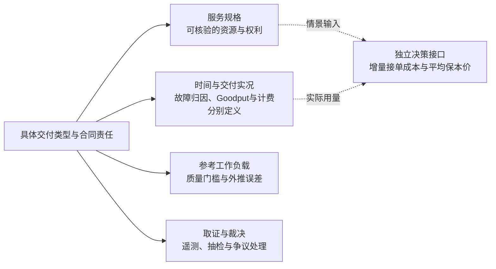

# 算力交易计量标准与四层基准体系：从性能基准到商业交割

> **导读**：规模化算力交易需要买卖双方可核验的计量、规格和争议处理安排。本文区分性能评测、交付计量、商品规格与价格评估，讨论五种不同的利用率口径，并提出合同设计建议。文中提到的具体评测体系须核对名称、版本与正式规则，不能仅凭名称推定权威性或适用性。

---

> **适用边界**：本文是标准设计建议，不是已颁布的国家/行业计量标准；附录是待技术、商务与法律审核的合同草案。资源租赁、托管训练和推理 API 的计费责任应分别协商。先用[采购指南](企业_AI_有效成本核算与算力_Token_采购指南.md)确认任务与获取方式，再从本篇选择需要的规格、验收和证据条款；是否另建市场指数须按[基准方法指南](算力与_Token_价格基准构建与撮合演进指南：PRA_方法论与市场设计实践.md)验证。

## 一、导论：算力计量为何影响市场交易

资源接入规模、被调度任务数与独立市场成交量是不同指标。本篇的主问题是：哪些可核验的服务规格与证据，能降低具体交易的比选、验收和争议成本？应先明确合同双方及交付责任，再决定需要怎样的计量。

交易稀疏可能涉及规格不清，也可能来自供需错配、信用、价格或客户获取。对拟建平台，可采用以下工作顺序，但不能将其视为已证明的历史铁律：

> **先明确可比服务和证据规则，再逐步改善报价、成交与价格评估；三者可以相互促进。** 真实交易本身也是价格发现和指数采样的来源。

大宗商品交割与价格评估通常需要明确品级、地点、验收和争议规则，可为服务规格设计提供参照。生产者内部成本核算回答另一个问题；成本可能通过授权审计、监管报送或开放账本核验，但不能代替实际履约数量与质量的记录。

混淆性能评测、企业成本、交付计量与价格形成可能降低标准的可用性。这是应检查的一类设计风险，不是已经识别的全行业唯一根因。

---

## 二、算力交易的四层问题架构与主流性能基准辨析

### 2.1 按交易用途选择的四类问题

性能评测、交付记录、商品规格和市场评估分别回答不同问题，存在信息依赖，但不是每笔交易必须依次经过的四个阶段。买卖双方可以直接按约定规格和报价签约，不以存在公共价格指数为前提；性能测试的范围也取决于交付责任。

| 功能 | 核心追问 | 标的与制度属性 | 证据与适用边界 |
|---|---|---|---|
| **① 性能评测层** | 特定软硬件在规定负载和质量约束下表现如何？ | 可复现基准实测，不等于理论上限 | MLPerf 等已有公开规则；其他体系须逐项核实 |
| **② 实际交付实况层** | 实际交付了多少约定资源或合格任务，故障与回滚由谁承担？ | 运行计量、工程Goodput及合同责任证据，三者不能混同 | 查具体供应商账单、SLA与日志；不能概括为行业不存在计量 |
| **③ 标准商品规格层** | 报价对应何种卡型、互联、地点、期限、独占性与SLA？ | 服务规格网格（Contract Specification） | 已有产品和合同规格，但跨平台可比性须逐项检验 |
| **④ 市场价格评估层** | 在规定样本与时点，该规格的报价或成交价是多少？ | 现货/远期参考价与任务成本指标 | 已有多种指数；适用性取决于样本与方法，不自动代表公允价值 |

### 2.2 工程类比：“发电机组型式试验报告” vs “电表与抄表裁决规则”

理解第 ① 层（性能基准测试）与第 ②③ 层（商业计量与规格标准）之间本质差异的最准确类比来自电力工业：

- **性能基准可类比型式试验**：它记录特定配置在约定测试中的表现，支持选型；测试可能包含实际服务器和时延约束，并非都只是“理想峰值”。
- **服务计量可类比抄表与账单核对**：通过约定的数量、质量、故障与抵扣规则确定应付账单。这只是功能类比，不表示 GPU 遥测已具有法定计量器具资格。

这项类比的限度是：测试成绩描述规定条件下的表现，账单需要合同计费规则和履约记录。性能成绩可成为验收条件，但不直接证明整个租期交付了多少服务；实际差距及纠纷频率应由日志和案例验证。

### 2.3 性能评测体系的规则核验与适用边界

比较性能基准时，须先核实其对象与规则，再判断成绩能否迁移到客户任务：

#### 1. MLPerf（须区分 Training 与 Inference）
- **核心设计哲学：钉死参考工作负载，换取跨硬件严格可比。**
- **三项制度特点**：
  1. **训练与推理的指标不同**：Training 衡量达到指定质量目标所需时间；Inference 在规定精度、场景和时延约束下测吞吐或响应性能，不能统称为“收敛时间”。
  2. **Closed与Open分流**：Closed约束模型与可比规则，但并不等于所有超参数和实现细节完全锁死；须查阅对应版本的允许变更和提交规则。
  3. **同行交叉评审（Peer Review）与全栈配置披露**：公信力源于严密的程序正义而非单一测试脚本。
- **局限与代价**：合规成绩针对特定软硬件与测试场景，不自动代表客户工作负载；它是可复现实测成绩而非数学上的性能上界。合同属性、可用性和交付环境仍需另行核验。

#### 2. AIPerf（须消除同名工具与版本歧义）
- 名称本身不足以确认发起机构、工作负载与适用版本，不能仅据此作为已核实比较对象。
- 如采用此类评测，应附论文或仓库、版本、任务、精度约束、伸缩方式及指标定义。不能把同名推理压测工具、系统榜单与早期研究基准混为一体。

#### 3. AISHPerf（名称与归属待一手核实）
- 现有材料不足以确认名称、主管机构、版本与测试规则；在取得正式发布页及方法文档前，不纳入主流基准比较或采购依据。
- **一般性原则仍成立**：全栈适配评测与运行期间的贸易计量用途不同，但不能据此替未核实的具体体系描述功能。

#### 主流性能基准与商业交易计量需求全景对照表

| 对比维度 | MLPerf | 商业交付计量 |
|---|---|---|
| 对象 | 规定任务、质量目标和场景下的性能 | 合同实际交付的资源或服务 |
| 指标 | Training 的达标时间；Inference 的场景化性能 | 可用卡时、达标请求、故障时间等约定指标 |
| 证据 | 提交版本、配置、规则检查与测试记录 | 运行日志、双方账单、验收记录及抽检 |
| 边界 | 不自动证明商业可用性或客户 SLA | 不代替模型质量评估或理论峰值测试 |
| 用途 | 选型与可复现技术比较 | 履约、结算、争议处理与可比样本筛选 |

### 2.4 对价格评估的方法论警示：为何性能基准分不能直接充当“有效成本指数”分母

`租赁价格÷基准吞吐` 可以作为限定负载下的性价比指标，但不能未经验证推广为客户任务成本。需防范以下偏差：

1. **任务迁移误差**：适配、通信和可用性会改变客户产出；这些因素可能相互作用，不能把三个任意“折扣”相乘当作已识别的生产函数。基准成绩也不是其他任务的数学上界。
2. **价格与配置错配**：报价须与测试配置、地区、租期、软件和服务范围一致。不能把裸卡租价与含支持、存储及网络的打包价直接比较，更不能把全部价差归因于品牌。
3. **样本选择偏差**：提交成绩不等于随机市场样本。应披露覆盖范围，抽检可交付配置与运行表现；独立核验可以降低偏差，不能保证完全消除偏差。

---

## 三、设计检查：区分计量、成本、价格与责任

检查草案时，逐项确认其回答的是交付数量、成本分析、报价机制还是合同责任。以下是候选设计风险，不是对行业普遍发生率或某机构现行规范的事实认定；成本核算本身有用途，问题在于用它替代交付证据或强制所有交易接受同一价格。

### 误区一：混淆“计量（Metering）”与“计价（Pricing）”，将成本加成公式写入标准

- **典型表现**：在计量标准中直接采用 $P_{\text{service}}=C_{\text{unit}}(1+\gamma)$ 作为统一参考价格。其中 $\gamma$ 是成本加成率，不等于收入毛利率或投资回报率；若把它作为合同定价选项，须与计量规则分开。
- **三项风险**：
  1. **交付计量与私有成本用途不同**：计量应明确可核验的物理与服务量。供应商内部成本可能通过自愿开放账本或审计核查，但不应成为所有交易必须披露的前提，也不能代替实际交付记录。
  2. **成本不唯一决定成交价**：供需、质量、期限、信用和市场势力可能使价格高于或低于平均全成本。会计折旧不是即时现金支出，设备仍可能具有转售或其他用途的机会成本；短期增量成本也不只有电费。成本加成可以是特定合同的计价选择，但不是市场价格的普遍恒等式。
  3. **竞争合规需按活动核查**：行业组织协调统一利润率或实际报价可能引发竞争法问题；中性的成本测算、自愿合同定价与横向协同行为不能混为一谈。应按具体文本、参与者和法域审核，而不是宣称任何成本公式均违法。

### 误区二：混淆会计使用寿命、经济寿命与回收期

- **典型表现**：将“计算设备使用寿命（生命周期小时数）”设为成本核算公式的静态必填标量。
- **底层问题**：回收年限会影响平均成本，但不是唯一变量。设备投入、利用率、电费、资本成本、运维和残值均须做敏感性分析。尤其不能把下面三种时间口径放在一张“折旧年限”表里横比：

| 时间口径 | 含义 | 证据与限制 |
|---|---|---|
| 会计使用寿命 | 将可折旧金额分配到会计期间的估计 | 查具体财年、资产类别和附注；服务器整体寿命不等于每张GPU寿命 |
| 经济使用寿命 | 继续持有/使用相对于替换的经济合理期间 | 取决于收入、运维、残值、替换成本及约束 |
| 投资回收期 | 累计现金流覆盖初始支出所需时间 | 毛租金回本未扣运营费，不能代替净现金流回收或NPV |

技术更新、贸易限制和替代用途都可能影响经济寿命，但本篇没有可复核的二手交易序列，不能断言固定跌幅或涨幅。直线折旧不旨在逐日跟踪市场价值，会计上还可能涉及估计变更和减值；不能据此认定所有企业均系统性低估贬值。账面净值也不是现货报价的硬约束。

### 误区三：把“买方模型架构机密”写进卖方服务规格，引发商务瘫痪与维度灾难

- **典型表现**：要求在算力服务计量与报价前，采集包含基础架构（Dense/MoE）、网络层数、注意力头数、特征隐藏维度、MoE 专家数、激活函数、优化器类型及超参数、分布式并行策略（DP/TP/PP）等十余项“计算任务复杂度参数”，甚至要求服务商在该参数空间内提供“完备配置组合”的基准测试。
- **三项设计约束**：
  1. **服务范围与保密边界**：纯资源租赁不应默认要求披露全部模型细节；联合优化或托管服务则可能需要部分任务信息，须约定最小必要范围和保密。MoE激活参数有助于估计计算量，但专家并集、路由、注意力和通信仍需单独分析，不能用一个参数概括所有瓶颈。
  2. **全因子组合增长**：若11个独立因素各取3个水平，全因子组合有 $3^{11}=177{,}147$ 种。逐一运行可能成本很高，但这不等于所有正交试验都需这么多点；可按目标采用部分因子设计、抽样和代理模型，并验证遗漏交互项及外推误差。
  3. **解析与实测结合**：训练工作量可用约定近似式估计，例如稠密Transformer部分运算的 $F\approx6N_{\text{params}}N_{\text{tokens}}$，再处理注意力与重计算等项。MFU、内存、通信、故障和质量都需要检查；少数参考任务不能保证准确外推到所有架构。

### 误区四：供给侧单边视角、异构均值谬误与缺失空间/长约维度

1. **未约定中断与回滚责任**：若仅按总墙钟时长收费，而不区分卖方故障、买方代码、排队及检查点恢复，可能把不同原因的损耗混入同一账单。解决办法是按合同交付类型约定归因和救济，不是一律把全部非有效训练时间由卖方承担。争议金额与发生频率须用实际记录评估。
2. **平均性能不能直接代替集群性能**：均匀分工、同步屏障下，慢节点可能限制步速；异构负载分配、流水线和通信拓扑又会改变结果。平均设备价格是成本统计，不是产出估计，端到端性能仍需测量。
3. **遗漏地点与合同权利**：相关市场随同步通信、离线任务、在线时延及数据边界而变化，不能统一限定为都市圈。按需、预留和长期合同分别记录期限、取消、转让、转租及履约保障；没有样本时不宣称某期限或折扣已成为全行业主流。

---

## 四、正本清源：算力行业五种“利用率”口径的严格界定

利用率差异既可能来自真实业务差异，也可能来自统计口径。没有明确样本、时期与定义的百分比，不能用来比较全国、单个平台和单个训练任务。

当产能以同一设备集合的日历卡时计、成本边界一致时，每售出卡时固定成本可按下式核算：
$$\text{单位有效算力固定成本摊销} = \frac{\text{周期固定总成本（折旧 + 固定运维 + 机柜）}}{\text{物理铭牌总产能} \times \text{商业负载因子（出租率）}}$$
例如固定成本与铭牌产能相同时，计费利用率从 90% 降到 30%，每售出卡时的固定成本变为三倍；这不是总成本必然三倍，也不是对大小运营商利用率的实证统计。MFU 不度量日历时段的商业闲置。

以下五类指标含义不同，但可以相关，并非数学上“正交”。披露时应给出分子、分母、观察期及是否加权：

| 口径层级 | 标准指标名称 | 严格数学定义（分子 ÷ 分母） | 采样观测点与周期 | 核心物理/经济用途 |
|---|---|---|---|---|
| **第一把尺：基建口径** | **上架率** （Installation Rate） | $\frac{\text{已完成机柜安装并具备通电条件的加速卡数}}{\text{数据中心规划设计的加速卡总容量}}$ | 机房资产管理系统（月度/季度） | 衡量智算中心物理投建进度、机电配套就绪度与空置机架规模 |
| **第二把尺：运维口径** | **开机率** （Power-on Rate） | $\frac{\text{处于通电在线运行状态的加速卡数}}{\text{已上架加速卡总数}}$ | PDU 机柜配电监控与 BMC 带外管理（日度/小时级） | 反映机房实际通电活跃度与冷备/停机止损规模 |
| **第三把尺：经营口径** | **对外计费利用率** | $\frac{\text{本期已提供且按约计费的卡时}}{\text{同一设备集合本期日历卡时}}$ | 计费账单（月度/年度） | 计算每售出卡时成本；内部占用另报，不与计费率相加重复计数 |
| **第四把尺：设备口径** | **GPU 设备繁忙率** | $\frac{\text{采样区间内至少一个kernel执行的时间}}{\text{该采样区间长度}}$ | `nvidia-smi` 等驱动遥测；型号、采样周期须注明 | 不等于SM占比、FLOPs效率或商业利用率 |
| **第五把尺：算法效率口径** | **模型算力利用率 MFU** | $\frac{\text{约定模型所需FLOPs/step}\times\text{steps/s}}{\text{同精度与稀疏口径下的集群峰值FLOPs/s}}$ | 框架层、逐步计时和理论工作量约定 | 衡量模型有效工作量效率；**HFU另计实际硬件运算，包括激活重计算等额外工作，不能与MFU混称** |

> **口径纪律**：kernel 持续执行时，GPU-Util 可以很高而 MFU 很低。高 MFU 也不意味着高出租率；是否亏损还取决于售价、成本和现金流，不能仅据两项利用率断定。

> **定义补正**：NVIDIA `GPU-Util` 指采样区间内至少一个kernel执行的时间比例，不是活跃SM数量或有效FLOPs占比。第三把尺应把对外计费率、内部占用率、物理负载率分开；分母若剔除维修时间，摊销公式也必须同步。不能把商业利用率称作所有成本模型的“唯一正确分母”，内部自用还可按合格任务等单位核算。仅给利用率和MFU也不足以断定项目亏损，还需售价与成本。

---

## 五、实施框架：四类交付条款与一项成本决策接口

以具体合同为中心，选择服务规格、时间口径、参考测试和取证裁决条款。成本模块用于买卖双方自身决策或另行约定的审计，不是所有交付计量必须披露的字段，也不构成进入价格指数或衍生品的强制步骤。

### 5.1 支柱一：按用途选择可交割服务规格网格（Service Specification Grid）

以下 10 项是资源租赁的候选规格字段，不是所有交易都必须采用的最小维数。优先选择供应商可披露、双方可核验且会影响交付责任的属性；推理 API 或托管训练按其服务边界调整。示例编码如 `[H100-80G-八卡整机-NVLink4/IB400G-西部枢纽-包月独占]`：

| 规格维度 | 标准枚举/取值形态 | 制度设计目的与消除的歧义 |
|---|---|---|
| **1. 加速器具体型号** | 精确至芯片型号与后缀（如 H20-96G、H800-SXM、昇腾 910B 等） | 不同代际与封装形态分别记录；跨规格聚合须另有用途、质量调整和权重依据 |
| **2. 单卡显存容量与类型** | 整数 GB 及 HBM 代次 | 明确大模型权重与 KV Cache 装载物理上限 |
| **3. 物理交付颗粒度** | **单卡实例 / 八卡整机 / 超节点整柜 / 专属集群** | 彻底消除行业中所谓“片时/片月”究竟指单卡还是整机的结算歧义 |
| **4. 节点内片间互联** | NVLink、HCCS、PCIe 等物理链路的代次、拓扑及单向/双向带宽；NCCL/HCCL 库版本另记 | 区分物理互联与集合通信软件，现场测有效吞吐 |
| **5. 节点间集群网络与本地 KV 缓存池** | InfiniBand（HDR/NDR）/ 无损 RoCEv2（披露是否支持 GPUDirect 单边 RDMA）+ 胖树收敛比 + 主机 DRAM/NVMe SSD 配比 | 不仅决定大规模训练扩展效率，在宽专家并行（Wide-EP，`DeepEP`）与 PD 分离分层缓存（`Mooncake` / `3FS` / `NIXL`）时代更直接决定超大 MoE 推理吞吐；异构集群须按**同构子集群**分别计量并披露最短板子池 |
| **6. 物理交割地（可用区）** | 国家算力枢纽大区及具体城域时延圈（如长三角-上海临港、西部-蒙西乌兰察布） | 承认跨区光速时延与专线带宽壁垒，锚定区域供需价差 |
| **7. 合约承诺期限与抢占属性** | 可抢占竞价（Spot，须披露抢占提前通知秒数与 KV 状态丢失风险）/ 按需（On-demand）/ 包月 / 1–5 年闭口长约（含是否允许转租/转让） | 规范期限升贴水结构；警示长上下文有状态推理（Stateful KV）严禁盲目混用无状态高频抢占实例 |
| **8. 资源隔离与独占性** | 物理独占 / 虚拟化共享（强制披露 CPU、多网卡 RDMA 通道、本地 NVMe 存储带宽最大超卖比 Oversubscription） | 防止隐蔽超卖主机内存与网卡通道导致分层 KV 缓存拉取阻塞及邻居噪声干扰（Noisy Neighbor） |
| **9. 可用性等级（SLA）** | 分级承诺可用率及配套 Goodput 下限承诺 | 将可靠性风险显性纳入合约分级 |
| **10. 原生支持数值精度** | FP32 / TF32 / BF16 / FP16 / FP8（含细粒度分块缩放）/ NVFP4（E2M1 微缩）/ INT8 / INT4 硬件原生支持列表 | 防止以低精度软件模拟或高开销反量化冒充硬件原生 Tensor Core 算力 |

> **商业秘密条款建议**：明确资源验收所需信息，不默认索取模型全部细节。若买方要求任务性能保证或联合优化，可协商披露必要信息、使用合成参考任务或第三方保密验证；按时长计费本身并不排除双方自愿的信息合作。

### 5.2 支柱二：确立“时间口径三分法”与有效训练时长（Goodput）扣减规则

为处理结算争议，分别定义墙钟、可用与有效进展时间。合同可以按预留日历时长计费再抵扣不可用，也可以按交付成果计费；本框架不规定统一默认结算方式：

1. **墙钟总时长（Wall-clock Time, $T_{\text{wall}}$）**：计量窗口的自然经过时间，须明确是合同预留窗口还是任务运行窗口。
2. **基础设施可用时长（Available Time, $T_{\text{avail}}$）**：
   $$T_{\text{avail}} = T_{\text{wall}} - T_{\text{seller\_fault}}$$
   这里的卖方责任停机按合同定义，包括经认定的硬件、网络、存储、供电散热故障及恢复区间。同一时段不能因既记为故障又记为维护而扣两遍；部分卡受影响时，结算要按卡分别积分，见附件第三条。
3. **有效训练时长（Goodput Time, $T_{\text{goodput}}$）与回滚损耗分担**：
   $$T_{\text{goodput}}=\max\!\left(0,T_{\text{wall}}-\left|\mathcal{I}_{\text{fault}}\cup\mathcal{I}_{\text{queue}}\cup\mathcal{I}_{\text{rollback}}\cup\mathcal{I}_{\text{other}}\right|\right)$$
   各集合为计量窗口内不形成有效训练进展的时间区间，取并集防止故障、恢复和排队重叠扣减。Goodput的定义须说明检查点保存、加载、编译和买方代码停顿是否计入；**工程有效进展与合同应付时长不是同一指标**，裸金属租赁也可按预留可用容量收费。
   在需要全作业回滚的同步训练中，单节点故障可能使检查点后的计算重跑；具有弹性恢复或局部容错的系统未必如此。合同应事先约定检查点策略、卖方责任、受影响设备与补偿比例，按实际日志确认损失，不自动把任一设备报错扩成全千卡损失。

### 5.3 支柱三：以“降维参考工作负载 + 解析外推 + 质量门槛”替代参数穷举

交付验收可先用代表性参考工作负载降低测试成本，再检查外推误差；任何有限测试集都不能保证覆盖全部业务：
- **钉死 3–5 个标准参考工作负载（Reference Workloads）**：分别选取代表典型稠密模型（Dense，如 7B/70B 规模）、混合专家模型（MoE）及长序列上下文的标准开源架构，固定序列长度、批次大小与通信拓扑，现场实测集群的 **MFU 与单卡每秒有效 Token 吞吐量**。
- **统计分布披露**：延迟的差尾部通常看P95/P99，吞吐的差尾部通常看P5/P1。P95吞吐是高分位，不能代表低吞吐保障。规定采样窗口、预热、样本量和异常处理，再报告均值与分位数。
- **解析外推与复测触发带**：对于其他尺寸任务，以标准解析算式结合实测基准 MFU 进行外推，设定合理允许偏差带（如 $\pm 15\%$），超出偏差带时触发软硬件环境复检。
- **产出计费强制绑定“质量门槛”**：凡采用按 Token 或按 FLOPs 产出计费的服务，账单有效计量必须绑定约定的数值精度（如严禁未经授权将 BF16 降级为 INT8/FP8 混合近似）或目标损失函数收敛判据，从源头封堵“刷吞吐降质量”的掺假激励。

### 5.4 决策接口：分开增量接单成本与平均保本价

成本核算服务于接单、持有和投资决策；若双方选择成本加成合同，应另行约定可审计成本和加成规则，不把该合同选项提升为统一市场定价。完整财务模型见[财务测算手册](智算中心全生命周期财务模型与敏感性测算手册.md)，本节只说明接口：

1. **短期增量接单成本（简化 SRMC）**：
   $$\text{SRMC} = \text{增量电费（明确区分 IT 设备电耗与乘 PUE 后的机房设施总电耗）} + \text{增量可变运维费}$$
   **经济含义**：在没有履约义务、启停费、未来容量机会成本等因素时，新增收入低于可避免的增量成本则不宜接该订单。拒绝新订单不等于立即关停整个集群。
2. **长期平均全成本/盈亏平衡价（$P_{\text{BE}}$，不等同于LRMC）**：
   $$P_{\text{BE}}=c_{\text{variable}}+\frac{\text{周期资本回收年金}+\text{固定运维及未重复计入的待机成本}}{\text{周期实际计费卡时}}$$
   折旧加资金成本与资本回收年金是不同核算方式，不能重复相加。此式服务于给定规模的回本分析，不是新增产能的长期边际成本，也不保证现货价格不跌破它。
3. **成本模型的口径与敏感性**：在实际开展成本比较或尽调时，注明会计折旧、经济寿命、回收年限和残值假设，检查利用率、能源、资本成本及替代设备情景。是否公开内部成本或提供保密审计由合同和适用义务确定；技术变化不自动触发统一金额的减值，毛租金回本也不能代替净现金流分析。

### 5.5 支柱五：建立防篡改运行时遥测证据链与争议裁决机制

计量约定需要与实际记录、取证权限和争议程序连接。遥测可支持合同核验，但不因采用签名或第三方工具就自动成为法定计量或司法认定：

- **遥测清单按可观测性约定**：功率、温度、时钟、内存、利用率和网络指标分别核对采集路径；Tensor活跃度不证明实际计算精度，必要时结合内核配置和可复现测试。
- **可检测篡改的存证**：统一时间戳、字段、签名与访问控制，并保存双方副本。保留六个月可作为协商示例，须服从适用的数据最小化与法定保留义务；不存在只靠哈希便绝对不可篡改、不可伪造的日志。
- **防掺假红线与变更告知义务**：严禁未披露的资源超卖共享、严禁后台静默替换低配/降频卡型、严禁未经许可降低计算通信精度；集群拓扑、驱动固件或虚拟化隔离策略变更须履行事前书面通知义务。
- **买方自核验权与第三方抽检仲裁**：明确买方在租期内有权运行轻量级验收探针验证硬件真伪与互联带宽；发生有效算力扣减争议时，依据留存遥测日志由具备独立资质的第三方机构按标准复核规程裁定举证责任。

---

## 六、验证与结论：计量是否改善了这笔交易

计量方案的价值在于让双方清楚交付什么、如何验收、怎样计费，以及发生偏差时如何处理。规格网格提高部分服务的可比性，不会消除全部异质性；合同转让、跨区交付和市场指数还各有额外条件。

试点时应与现有合同及人工核对流程比较：

1. **可执行性**：所需字段能否以可接受成本取得，参考测试是否覆盖约定责任，双方能否复核同一账单。
2. **客户净收益**：是否减少验收时间、争议和错付，收益能否覆盖遥测、测试、审计及数据治理成本。
3. **边界与停止条件**：若新增字段不能改善判断、外推误差不可控或数据责任难以履行，就缩小规格范围、保留双边安排或停止推广。

只有具体用途得到支持，才进一步讨论跨平台推广或价格评估。能够签成合同，不等于已有代表性指数；不建立新指数，也不妨碍本篇方法改善采购与交付。

---

## 附录：智算集群租赁交付验收与运行遥测结算合同附件草案

> **使用说明**：这是供双方谈判的商务技术附件草案，不是法定计量标准或可直接签署的通用合同。签约前应填明计费模式、通知渠道与期限、抵扣系数、损失范围与上限，并由双方依适用法律审查。DCGM 通常依赖主机驱动，不等于带外 BMC 遥测。

### 第一条 算力标的十维规格锁定与软硬件基线冻结

1. **物理与网络规格锁定**：卖方向买方交付单租户物理独占（Bare-Metal Exclusive，CPU/内存/计算网卡/存储带宽超卖比严格锁定 `1:1`）的智算集群，须逐项锁定以下十项交割要素并附机架/MAC/PCIe 设备序列号清单：
   - **① 加速卡精确型号与步进**（通过带外 BMC 与驱动 Device ID 双重核验，严禁混插降频卡或工程样卡）；
   - **② 单卡显存容量与实测带宽下限**（如 80GB HBM3 实测流带宽 $\ge 3.0\text{ TB/s}$，或 141GB HBM3e $\ge 4.3\text{ TB/s}$）；
   - **③ 交付颗粒度与整机形态**（如 128 台 8 卡 SXM 整机 = 1,024 卡）；
   - **④ 节点内互联**：明确物理互联、每GPU聚合/单链路、单向/双向、链路速率/有效载荷口径。H100的900GB/s宣传规格不能直接当任意两卡端到端吞吐保证；HCCL是集合通信库，不能与NVLink物理互联列作同类硬件；
   - **⑤ 节点间计算网络拓扑**（如两层 1:1 无收敛胖树 InfiniBand NDR 400G / Quantum-X800 或无损 RoCEv2）；
   - **⑥ 宿主机 CPU、DDR5 内存通道与本地 NVMe 缓存盘规格**；
   - **⑦ 共享并行全闪存储保底聚合吞吐（GB/s）与元数据 IOPS**；
   - **⑧ 物理机房等级、双路市电/液冷冗余架构及端到端时延圈**；
   - **⑨ 硬件原生计算精度指令集**（BF16 / FP8 / INT8 等原生 Tensor 指令支持）；
   - **⑩ 集群调度与容器隔离权限边界**。
2. **基线冻结与普通变更**：自验收合格起记录宿主机内核、驱动、网卡固件及网络配置基线。例行升级或割接应至少提前 **15 个工作日**书面通知，并在买方书面同意后实施；变更前后的版本、影响设备和维护窗口均留档。
3. **紧急维护的通知例外**：仅在等待同意会扩大紧迫安全或设施损害时，可在必要范围内先行处置，不必等待上述提前期；能事前通知的仍须通知，否则在通信恢复或具备条件后按约定时限告知指定联系人，补交事由、范围、起止时间、恢复记录及复核结果。例外免除的是事前等待，不自动免除对不可用时长的核算或其他责任。
4. **中断归哪里结算**：未经同意的非紧急变更若引发中断，或双方对紧急例外有争议，先保全记录，按第三条确认责任卡、时段及抵扣。违反通知义务不等于整单全额赔付。

### 第二条 48 小时免租基准验收（Reference Workloads）与一票退换权

集群通电组网交付后进入 **48 小时免计费基准验收窗口**，须连续通过三项标准压测：
1. **集合通信测试**：固定消息大小、节点数、通信算法、预热与重复次数，分别报告算法带宽和经拓扑校正的总线带宽。AllReduce/All-to-All的算法带宽不能直接除以端口线速验收；丢包、重传及PFC指标应约定分母和采样口径；
2. **24小时稳态训练测试（示例）**：固定任务和全局批次，可约定吞吐P50达到基准95%、**P5**达到基准88%；阈值须由预验收试测确认，不是行业统一标准。温度、功率限制和掉卡情况同时记录；
3. **存储检查点（Checkpoint）并发读写压测**：模拟全集群同步落盘与拉起，聚合写带宽不低于合同保底值。
- **不合格救济**：任一指标未达标，卖方限期 **24 小时**排障重测一次；复测仍不达标的，买方有权**单方无责解约**，卖方须在 **3 个工作日内**全额退还预付款与押金。

### 第三条 计费卡时扣减与分布式回滚损失（Rollback Loss）补偿公式

若双方选择按可用容量计费，可采用以下草案。预留容量租赁允许按日历时长计费并约定服务抵扣，不能宣称一律禁止。

$$H_{\text{bill}}=\max\left(0,N_{\text{GPU}}T_{\text{wall}}-H_{\text{fault}}-\alpha H_{\text{rollback}}\right)$$

- **$H_{\text{fault}}$**：经双方确认的卖方责任不可用卡时，按受影响卡数与时间积分，去重计算；恢复耗时按日志核定。不能从单个Xid或ECC计数直接判定责任，也不能无条件固定加0.5小时。
- **$H_{\text{rollback}}$**：按约定检查点与实际重跑日志计入、归于卖方的白做卡时。先按设备和时间剔除已算入 $H_{\text{fault}}$ 的部分，再乘协商系数 $0\leq\alpha\leq1$；不能把等待和重跑重叠计入，也不能对已经是卡时的量再乘卡数。
- **先结服务抵扣，再看另项损失**：本草案用上式减少当期应付卡时，按同一期约定单价折成抵扣额，最多抵至当期服务费为零。签约时须选择：只适用这一项救济，或另行约定可索赔的损失项目、证明责任、责任上限与适用法律限制。有后一项约定时，对同一事件、同一损失先冲减已给的服务抵扣，仅对可证明且未覆盖的余额在约定上限内另计；不把“少收服务费”再作为同额损害收付一次。
- **对账小例**：8 卡预留 2 小时是 16 卡时；若双方确认 2 卡时不可用，另有去重后的 4 卡时回滚，约定系数为一半，则本期计费 16−2−0.5×4＝12 卡时。工程上白做 4 卡时，不等于合同再赔 4 卡时，更不等于全作业免费。

### 第四条 主机遥测、带外交叉验证与未披露降级处理

1. **协商采样周期与字段**：可约定10秒采样，但需评估开销和瞬时故障遗漏。按实际硬件及DCGM版本采集功率、温度、`DCGM_FI_DEV_CLOCKS_EVENT_REASONS`、ECC、Xid与Tensor活跃度等字段；旧`CLOCK_THROTTLE_REASONS`为弃用别名。网络重传需相应网卡/交换机数据，不假定DCGM包含所有字段；设备不支持的指标须声明替代证据。
2. **摘要、签名与双方存证**：可按小时生成SHA-256摘要、可信时间戳及采集端签名，并向双方保存副本。**哈希只能帮助检测存证后的变化，不能证明原始采集真实、完整或无人伪造**。建议约定保留期及独立探针、工单、计费记录等交叉证据，不将单一日志写成仲裁唯一证据。
3. **未披露降级的救济**：先认定规格偏离、责任、受影响设备与时段；与第一、三条同一事件使用同一份对账记录。已计费扣减的同一损失不再计入阶梯补偿；解除及另项损害依合同选定的救济与适用法律处理。

### 一手定义与核查说明

- NVIDIA `nvidia-smi` 文档：<https://docs.nvidia.com/deploy/nvidia-smi/index.html>（2026-11-15读取，GPU利用率定义）。
- NVIDIA DCGM字段文档：<https://docs.nvidia.com/datacenter/dcgm/latest/dcgm-api/dcgm-api-field-ids.html>（同日读取；`CLOCK_THROTTLE_REASONS`已标为弃用别名，新增采集应按版本核对`CLOCKS_EVENT_REASONS`）。Tensor活跃度不等于实际数值精度，字段支持情况与硬件/驱动有关。
- NVIDIA H100规格：<https://www.nvidia.com/en-us/data-center/h100/>（同日读取，区分SXM/PCIe、聚合互联与显存带宽）。
- MLCommons规则入口：<https://github.com/mlcommons/training_policies> 与 <https://github.com/mlcommons/inference_policies>。采购验收须固定适用版本，不直接复制榜单结果作为合同保证。

---

## 延伸衔接阅读

- **智算重资产 TCO 与保本租金矩阵**：[智算中心全生命周期财务模型与敏感性测算手册](智算中心全生命周期财务模型与敏感性测算手册.md)
- **现货价格评估与撮合演进**：[算力与 Token 价格基准构建与撮合演进指南](算力与_Token_价格基准构建与撮合演进指南：PRA_方法论与市场设计实践.md)
- **基准抗操纵与 IOSCO 监管合规**：[算力基准抗操纵微观结构与 IOSCO 治理设计](算力基准抗操纵微观结构与_IOSCO_治理设计.md)
