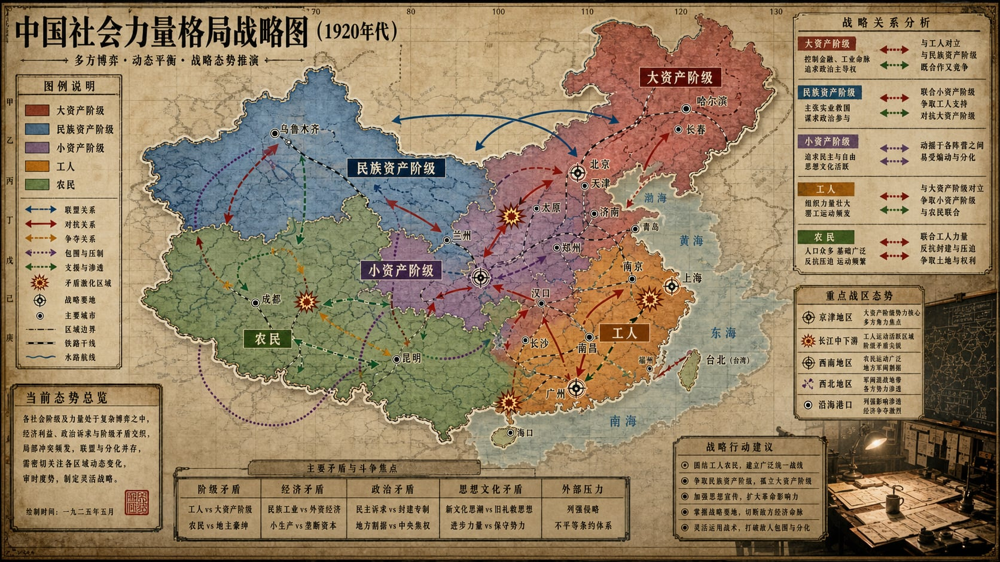
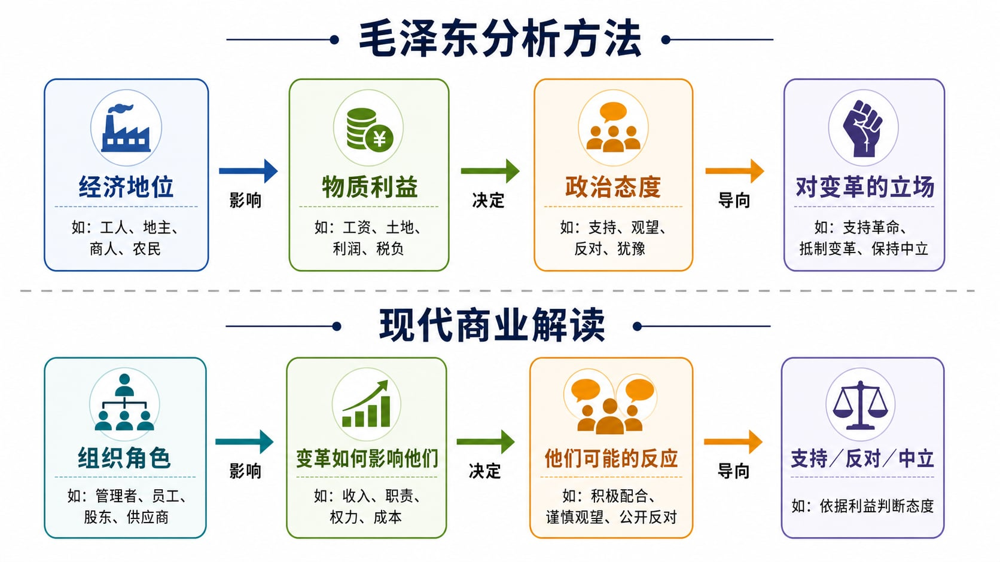
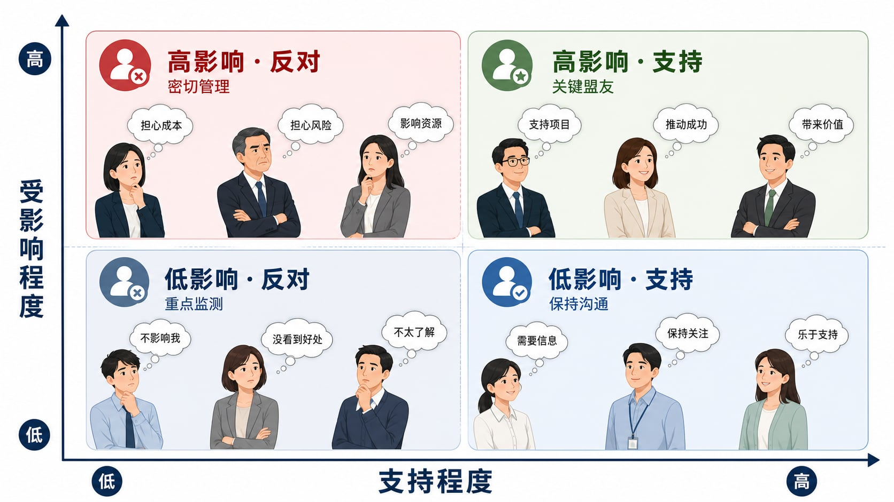
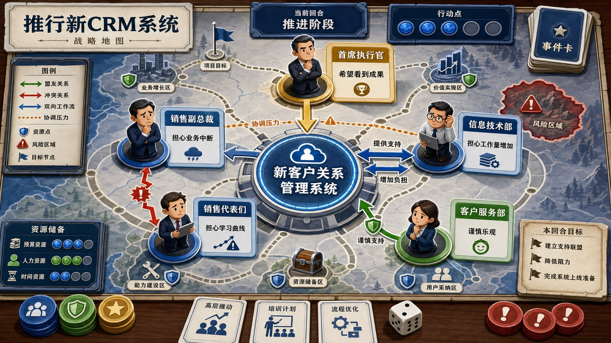
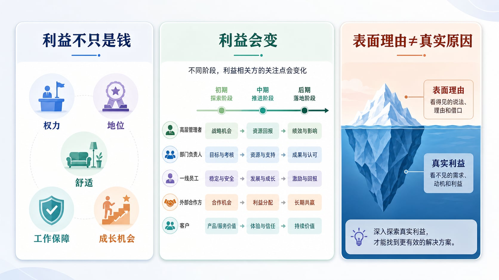
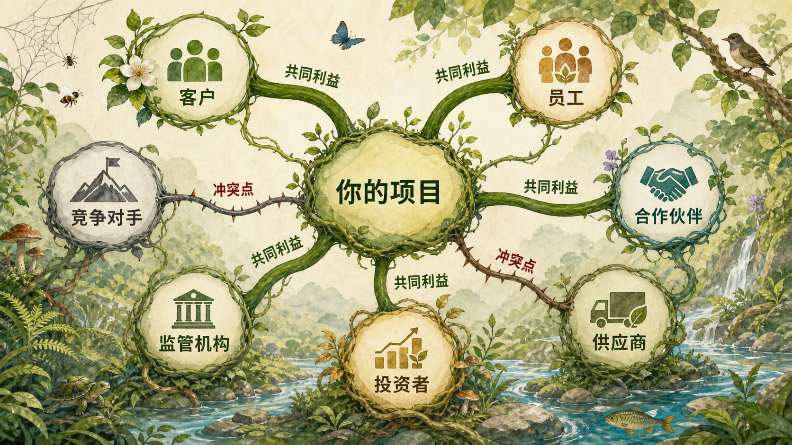

# AI时代的毛选阅读指南（六）

## 利益分析法：看懂职场博弈的底层逻辑

> **本篇解决的问题：** 为什么你的方案逻辑完美却推不动？为什么明明对大家都好的事情总是卡在某几个人那里？为什么职场中的"不合理"现象总是反复出现？

---


### 一、你推不动事情的真正原因

你有没有经历过这样的事——

你花了两周时间做了一份方案。逻辑严密，数据充分，连实施计划都做好了。你满怀信心地在会上汇报。

领导说："挺好的。"但没有下文。
部门A说："我们支持，但需要部门B先配合。"
部门B说："原则上没问题，但现在时机不太好。"
部门C直接没来开会。

你的方案就这样悄悄死掉了。

你很困惑：**方案本身没有问题啊，为什么就是推不动呢？**

答案很简单：**你只分析了"事"，没有分析"人"。**

更准确地说：你没有分析**每个人在这件事上的利益**。

部门B为什么说"时机不好"？可能是因为你的方案一旦推行，他们部门的重要性就降低了。
部门C为什么缺席？可能是因为他们已经提前知道这件事对他们没好处，用缺席来表达立场。
领导为什么说"挺好的"但不推？可能是因为他看到了你没看到的阻力，觉得硬推的成本太高。

**毛泽东在1925年就看透了这件事。他用一篇文章教了我们一个最根本的分析工具：从利益出发分析每个人的态度和行为。**

---

### 二、背景还原：1925年的生死判断




**时间：** 1925年12月

**背景：** 这是毛泽东发表的最早的重要文章之一。当时共产党刚成立4年，面临一个生死攸关的问题——

**"我们应该把力量投向谁？"**

党内有两种主要观点：
- 一派认为应该专注工人运动（照搬苏联经验）
- 一派认为应该跟国民党全面合作，不要太在意阶级问题

毛泽东的回答是：**先别争论应该怎么做，先搞清楚每个群体的利益是什么、他们的态度会怎样。**

于是他写了《中国社会各阶级的分析》。

文章开头第一句话就是千古名句：

> **"谁是我们的敌人？谁是我们的朋友？这个问题是革命的首要问题。"**

---

### 三、毛泽东的分析方法拆解




毛泽东的分析逻辑极其简洁有力：

```
经济地位 → 物质利益 → 政治态度 → 对变革的立场
```

他逐一分析了中国社会的各个阶层：

- **大地主大资产阶级**：利益完全依附于帝国主义和封建制度 → 坚决反对革命 → 是敌人
- **民族资产阶级**：有一定独立利益，但又依赖帝国主义 → 态度动摇，时左时右 → 可以争取但不可依赖
- **小资产阶级**（知识分子、小商人、手工业者）：生活日益困难 → 同情革命 → 可以团结
- **半无产阶级**（贫农等）：生活极度困苦 → 革命的重要力量
- **无产阶级**（工人）：受压迫最深，最有组织性 → 革命的领导力量

**注意他的推理方式：**

他不是根据"谁看起来像好人"来分类。他不做道德判断。他做的是**结构性分析**——

> **一个人的行为和态度，根本上是由他的利益处境决定的。这不是阴谋论，而是客观规律。**

你不需要猜测别人"想什么"，你只需要分析他"处于什么位置"、"变革对他是好是坏"，就能大致预判他的态度。

---

### 四、现代翻译：利益相关方分析




把毛泽东的方法翻译成现代职场语言，就是一个完整的**利益相关方分析框架**：

#### 第一步：列出所有相关方

任何一件你想推动的事情，先问自己："这件事会涉及到谁？"

不要只列"直接相关"的人。间接相关的、看起来无关但可能被影响的，都要列进来。

#### 第二步：分析每个人的"经济地位"

这里的"经济地位"是广义的——不只是钱，而是**利益**。问自己：

> 这件事如果成了，对这个人是好是坏？

具体来说：
- **权力会增还是减？** （他的影响力/管辖范围）
- **工作量会增还是减？** （他的负担）
- **功劳会归谁？** （他的利益）
- **资源会怎么重新分配？** （他的预算/人员）
- **他的重要性会怎么变？** （他的位置）

#### 第三步：推导他们的"政治态度"

根据利益分析，把每个人分为四类：

```
① 坚定支持者 —— 这件事对他有明确好处
   → 策略：巩固支持，让他们成为你的核心盟友
   
② 可争取的中间力量 —— 利弊参半，态度犹豫
   → 策略：找到他们的利益点，帮他们看到好处
   
③ 消极反对者 —— 这件事对他有坏处，但不至于拼命反对
   → 策略：降低他的损失感，或给予补偿
   
④ 坚决反对者 —— 这件事严重损害他的利益
   → 策略：孤立他的影响，避免他带动其他人反对
```

#### 第四步：制定差异化策略

**对不同的人，用不同的方式。**

这是毛泽东统一战线思维的精髓：不是对所有人一视同仁，而是根据每个人的利益处境采取最有效的策略。

---

### 五、一个完整的实战案例




**场景：你要在公司推行一个新的CRM系统**

你做了详细的技术选型和ROI分析，证明新系统能提升销售效率30%。然后你开始推——

**不做利益分析的结果：**
- 你在会上讲了30分钟技术优势
- 销售VP说"我们看看"
- 三个月过去了，没有任何进展

**做利益分析后的策略：**

```
利益相关方分析：

┌──────────────┬──────────────────┬────────────┬──────────────┐
│ 相关方        │ 利益影响          │ 预判态度    │ 策略          │
├──────────────┼──────────────────┼────────────┼──────────────┤
│ CEO          │ 关心业绩提升      │ 支持       │ 先搞定他做    │
│              │ 关心投入产出比    │            │ 背书，获得    │
│              │                  │            │ "尚方宝剑"   │
├──────────────┼──────────────────┼────────────┼──────────────┤
│ 销售VP       │ 担心过渡期影响    │ 谨慎       │ 承诺过渡期    │
│              │ 当季业绩          │            │ 不影响考核，  │
│              │ 担心"被监控"     │            │ 强调是"赋能"  │
│              │                  │            │ 而非"监控"   │
├──────────────┼──────────────────┼────────────┼──────────────┤
│ 一线销售      │ 学习成本高        │ 抵触       │ 先在小团队    │
│              │ 录入数据麻烦      │            │ 试点，用成功  │
│              │ 但长期省力        │            │ 案例带动      │
├──────────────┼──────────────────┼────────────┼──────────────┤
│ IT部门       │ 增加维护工作量    │ 消极       │ 给IT额外资源  │
│              │ 但体现部门价值    │            │ 或外包部分    │
│              │                  │            │ 实施工作      │
├──────────────┼──────────────────┼────────────┼──────────────┤
│ 财务部       │ 担心预算          │ 中性       │ 用ROI数据    │
│              │                  │            │ 说服，分期    │
│              │                  │            │ 投入          │
├──────────────┼──────────────────┼────────────┼──────────────┤
│ 客服部门      │ 新系统可能让      │ 潜在支持    │ 拉他们做盟友  │
│              │ 客户信息更完整    │            │ 强化"客户    │
│              │ 提升服务质量      │            │ 体验"价值    │
└──────────────┴──────────────────┴────────────┴──────────────┘

推进策略（按顺序）：
  ① 先找CEO单独沟通，拿到支持和授权
  ② 拉客服部门做盟友（他们有内在动力支持）
  ③ 跟销售VP一对一沟通，消除他的顾虑（重点是"不影响当季考核"）
  ④ 在一个小团队试点，用2个月出数据
  ⑤ 用试点成功案例说服一线销售
  ⑥ 给IT部门争取额外资源或外部支持
  ⑦ 用实际数据向财务部证明ROI
```

**这就是毛泽东"阶级分析法"在现代职场中的完整应用。**

---

### 六、利益分析的三个进阶认知




#### 进阶一：利益不只是"钱"

在职场中，影响一个人态度的"利益"远不止薪资——

```
权力利益：这件事会让我更有影响力，还是边缘化？
地位利益：这件事会提升我的位置，还是让别人凌驾于我之上？
舒适利益：这件事会让我的工作更轻松，还是更麻烦？
安全利益：这件事会增加我被替代的风险吗？
成长利益：这件事会给我带来新的能力和机会吗？
关系利益：这件事会影响我在组织中的人际关系吗？
```

大多数人嘴上说的理由（"时机不好""资源不够""方案有问题"）往往不是真正的原因。**真正的原因几乎总是利益层面的。**

#### 进阶二：利益格局是动态的

毛泽东在分析阶级时，非常注意动态变化——比如民族资产阶级的态度"时左时右"，会随着局势变化而变化。

在职场中也一样：

- 一个部门今天反对你，明天可能因为组织架构调整而变成你的天然盟友
- 一个领导今天支持你，明天可能因为公司战略转向而不再关注你的项目
- 一个同事今天是中间力量，明天可能因为你帮了他一个忙而变成坚定支持者

**利益分析不是做一次就完了，要定期更新。**

#### 进阶三：区分"表面反对"和"根本性反对"

有些反对是可以化解的（给对方找到利益点），有些反对是不可调和的（对方的根本利益跟你冲突）。

**区分方法：**

```
如果对方说"方案有问题" → 问自己：如果我改了方案，他会支持吗？
  - 如果会 → 表面反对，可以通过修改方案化解
  - 如果不会 → 根本性反对，需要绕过或孤立

如果对方说"时机不好" → 问自己：什么时候他会觉得"时机好"？
  - 如果能说出具体条件 → 真的是时机问题，可以等
  - 如果说不出来 → 根本不想做，"时机"只是借口
```

---

### 七、从"阶级分析"到"生态思维"




毛泽东的阶级分析法在更高层面上，其实是一种**生态思维**——

他不是孤立地看每一个群体，而是看**所有群体之间的关系网络**。谁依赖谁？谁制约谁？一个群体的变化会如何影响其他群体？

在现代职场中，这种思维的应用场景包括：

**内部推动变革时：**
- 不要只看"谁支持谁反对"
- 要看"支持者之间有没有互相增强的关系"
- 要看"反对者之间有没有联盟的可能"
- 要看"搞定A会不会自动带动B和C"

**外部商业竞争时：**
- 不要只看"我的竞争对手是谁"
- 要看"在这个生态里，谁跟谁有共同利益"
- 要看"有没有可能拉一个竞品的上游供应商成为我的合作伙伴"
- 要看"敌人的敌人能不能成为朋友"

**个人职业发展时：**
- 不要只看"我应该讨好谁"
- 要看"在组织中，谁是真正的权力节点"
- 要看"谁的成功跟我的成功是绑定的"
- 要看"跟谁结盟能让我获得最大的杠杆效应"

---

### 本篇练习

**练习：做一次利益相关方分析**

选一个你当前面临的真实决策场景（推行一个项目、争取一个资源、推动一个改变），做一个完整的利益相关方分析。

用这个表格：

```
┌──────────────┬──────────────────┬────────────┬──────────────┐
│ 相关方        │ 利益影响          │ 预判态度    │ 我的策略      │
│              │ （这件事对他      │ （支持/     │              │
│              │   的利益是好是坏） │  中间/反对）│              │
├──────────────┼──────────────────┼────────────┼──────────────┤
│              │                  │            │              │
├──────────────┼──────────────────┼────────────┼──────────────┤
│              │                  │            │              │
├──────────────┼──────────────────┼────────────┼──────────────┤
│              │                  │            │              │
├──────────────┼──────────────────┼────────────┼──────────────┤
│              │                  │            │              │
└──────────────┴──────────────────┴────────────┴──────────────┘

推进策略（按顺序）：
  ①
  ②
  ③
  ④
```

写完后问自己：**如果我之前不做这个分析就直接推，可能会在哪里碰壁？**

---

**本文要点回顾：**

1. 推不动事情的真正原因，往往不是"方案不好"，而是没有分析每个人的利益
2. 毛泽东的分析逻辑：经济地位 → 物质利益 → 政治态度 → 对变革的立场
3. 将利益相关方分为四类：坚定支持者、可争取的中间力量、消极反对者、坚决反对者
4. 对不同类别采取不同策略——这是统一战线思维的核心
5. 利益不只是钱（还有权力、地位、舒适、安全、成长、关系），利益格局是动态的
6. 区分"表面反对"和"根本性反对"，才能正确制定策略

---

*下一篇：《困境突围——"星星之火"的理性乐观主义》*

*本文是"AI时代的毛选阅读指南"系列第6篇，共12篇。*
